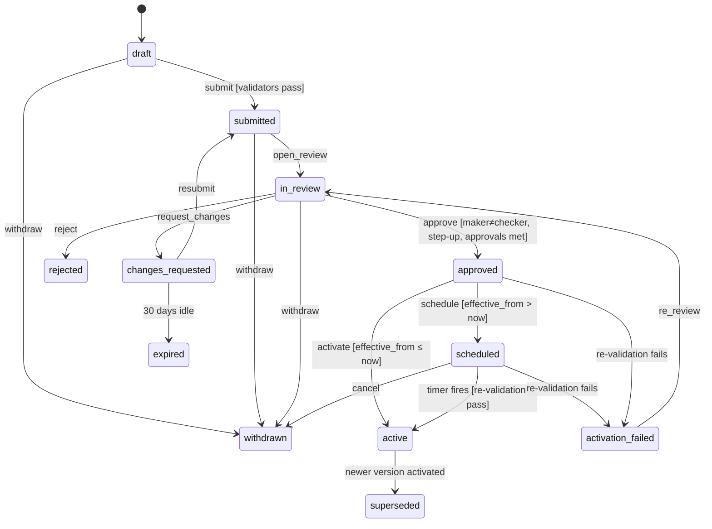

# P00 — Foundations & Platform Core
> Paste after 01_MASTER_PROMPT.md. Prerequisites: none. Estimated effort: 4 sprints (2-week) for a squad of 8 (1 tech lead, 3 backend, 2 web/mobile, 1 platform/DevOps, 1 SDET), with part-time security engineer, designer and DPO reviewer.

## 1. Objective and business outcome

Build the platform core on which every later phase depends, so that from P01 onwards each team ships vertical slices into a repository, pipeline and runtime that already enforce the constitution:

- tenant isolation is enforced by PostgreSQL Row-Level Security, not by developer discipline;
- every material action lands in a hash-chained, tamper-evident audit trail (NN-22);
- every evidence artefact is hashed into an evidence ledger and stored under S3 Object Lock (NN-10, NN-22);
- every configurable thing is versioned, maker–checker approved and pinnable (NN-21);
- every legal rule is data with a source and status (master §0, Appendix G);
- every vendor sits behind a port with routing and circuit breaking (master §4.4);
- every side effect goes through the transactional outbox, and every inbound webhook through an idempotent inbox;
- the design system, i18n framework, error model, observability and feature flags exist before the first screen is built.

Business outcome: P01–P14 cannot accidentally ship a cross-tenant leak, an untraceable action, an unversioned rule change or a hard-coded vendor. This is the evidence base for ISO 27001 / SOC 2 readiness and for the "Independence Evidence Pack" (D1) later.

## 2. Scope (in / out)

**In scope**
1. Monorepo scaffold per master §4.2 (pnpm + Turborepo, TypeScript strict), shared configs, commit conventions, CODEOWNERS.
2. Local developer stack (Docker Compose) and four cloud environments (dev, staging, uat, prod) plus DR region.
3. Terraform IaC for AWS ap-south-1 (primary) and ap-south-2 (DR); multi-account AWS Organization.
4. GitHub Actions CI/CD with security, contract, migration, accessibility and coverage gates; signed images; blue/green deploys.
5. Tenancy model, tenant resolution, PostgreSQL roles and RLS policies with a CI lint that fails on any unprotected table.
6. Sealed-store scaffolding (`posh_sealed`, `health_sealed`, `safety_sealed`) in a separate database with separate keys; no POSH business logic (P09).
7. Field-level encryption library (envelope encryption, per-tenant data keys, blind indexes, masking).
8. Audit hash chain (`audit.audit_events`), daily signed anchors, verification job, `audit.access_log`, `audit.break_glass_events` schema.
9. Document upload pipeline skeleton: quarantine → malware scan → SHA-256 → evidence bucket with Object Lock → `core.evidence_ledger`.
10. Transactional outbox + relay, CloudEvents envelope, idempotent consumers; webhook inbox; outbound webhook delivery scaffold (full product in P09).
11. Feature flags: OpenFeature SDKs (server, web, mobile) + self-hosted Unleash; DB-authoritative legal flags and kill switches.
12. Observability: OpenTelemetry traces/metrics/logs, PII redaction, Sentry (self-hosted), SLO dashboards, alert routing.
13. Error model (RFC 9457 problem+json) with stable codes; API conventions (pagination, filtering, idempotency, rate limits).
14. i18n framework (en-IN, hi-IN live; 10 further locales enabled by configuration), legal-term glossary, translation status workflow.
15. Design tokens package, web UI kit (`packages/ui`), native UI kit (`packages/ui-native`), Storybook, visual regression, axe gates.
16. Ruleset Studio skeleton: generic config objects, versioning, maker–checker, effective dating, tenant overlay, pinning API, preview runner, guardrail validators.
17. Legal Rules Register skeleton with seed from `docs/legal-register/`.
18. Platform admin console basics (tenants, domains, branding, flags, config queue, legal register, audit, outbox, inbox, provider routing, jobs).
19. Seed framework (`packages/seed`) with deterministic Indian synthetic data and profiles.
20. `core.provider_routing`, port interfaces (Appendix D), fake adapters for all ports in master §4.4 (the v2.1 list plus the ten ports added in v3.0 — master X-63), circuit breakers.
21. Keycloak deployment with a bootstrap realm for platform staff only (password + TOTP/WebAuthn). All persona login flows are P01.
22. ADR-0001 … ADR-0030 written and merged.

**Out of scope (later phases)**
Persona login/onboarding, KYC, consent ledger UI (P01) · cases, forms engine runtime, clocks service, notices (P02) · real vendor adapters except SES (email for staff invites), Unleash, Sentry · POSH/health/safety business logic (P09; schema scaffolding only here) · AI gateway (P11; only the `LLM_PORT` interface and kill-switch flags here) · public website (P13).

## 3. Personas and permissions touched

| Role code | P00 use |
|---|---|
| `platform_admin` | Creates tenants, domains, branding; manages release flags; views audit, outbox, inbox, jobs; maker for platform-scope config. Cannot approve own change requests. |
| `institution_admin` | Maker/checker for tenant-scope config in Ruleset Studio (screens usable from P00 for the Equator root tenant). |
| `legal_reviewer` | Holds `config.approve.legal` (master §1.5); checker for `legal` risk-class change requests and Legal Rules Register changes. |
| `registrar` | Checker for `standard`/`elevated` tenant-scope change requests; may additionally be granted `config.approve.legal` through the root tenant's role bundle where no `legal_reviewer` is appointed. |
| `dpo` | Read access to audit, break-glass log, retention schedules; approver for retention-schedule changes; receives break-glass notifications. |
| `auditor` | Scoped, time-bound, read-only access to audit explorer and chain verification reports. |
| `support_agent` | Read-only outbox/inbox monitor (no payload decryption). |
| `machine` | Service identities for worker, relay and scheduled jobs (no human login). |

Permissions introduced (Cerbos resource policies, ADR-0004): `tenant:create|update|suspend`, `tenant_domain:*`, `tenant_branding:*`, `feature_flag:read|propose|approve`, `config:read|propose|approve|approve_legal|activate|rollback` (`config:approve_legal` is the Cerbos form of master §1.5 `config.approve.legal`), `legal_rule:read|propose|approve`, `audit:read|verify|export`, `evidence:read_meta`, `outbox:read|replay`, `webhook_inbox:read|replay`, `provider_routing:read|propose|approve`, `ops:jobs_read`.

## 4. Functional requirements

### 4.1 Repository and tooling

**FR-P00-01 — Monorepo scaffold.** Create the layout in master §4.2 exactly. Toolchain: Node.js 24 LTS (Node 22 reaches end-of-life on 30 Apr 2027; pinned in `.nvmrc` and `engines`), pnpm 9 with `pnpm-workspace.yaml`, Turborepo pipelines `lint`, `typecheck`, `test`, `build`, `e2e`, `storybook`, `db:migrate`, `seed`. TypeScript `strict: true`, `noUncheckedIndexedAccess: true`, `exactOptionalPropertyTypes: true`. ESLint flat config with `@typescript-eslint/strict-type-checked`, `eslint-plugin-boundaries` enforcing master §4.3 module boundaries (a Nest module may import another module only via its `public-api.ts`; `packages/domain` and `packages/rules` may not import framework code). Prettier, commitlint (Conventional Commits), lint-staged, Husky. `CODEOWNERS`: `apps/api/src/**/migrations/**` and `db/rls/**` require the DB owner and security engineer; `packages/rules/**` requires tech lead + legal-config owner; `infra/**` requires platform owner. *(v3.0: this CODEOWNERS file is replaced by Appendix AE §AE.2.6 — FR-P00-V3-AE03; Terraform moves to `equator-infra` — X-66(e).)*

**FR-P00-02 — Module skeletons.** Generate empty NestJS modules for every bounded context in master §4.3 with `public-api.ts`, `module.ts`, `domain/`, `infra/`, `http/`, `events/`, `README.md` (purpose, owned tables, published events, consumed events). A CI script fails if a module accesses a table owned by another module (table ownership map in `db/ownership.yaml`).

**FR-P00-03 — Local stack.** `docker compose up` brings up PostgreSQL 16 with `pgvector`, `pgcrypto`, `pg_partman`; a second PostgreSQL database `equator_sealed`; Redis 7; Temporal dev server + UI; OpenSearch 2.x; MinIO with Object Lock enabled; Keycloak (version pinned per ADR-0003); Unleash; Mailpit; ClamAV; OpenTelemetry Collector → Grafana LGTM all-in-one. `pnpm dev` runs web, api, worker and mobile (Expo) against it. Make targets: `make reset-db`, `make seed PROFILE=demo`, `make verify-audit`.

### 4.2 Environments, infrastructure and delivery

**FR-P00-04 — AWS account topology.** AWS Organizations with accounts: `eq-management`, `eq-security` (GuardDuty, Security Hub, IAM Access Analyzer delegated admin), `eq-log-archive` (organisation CloudTrail, Config, VPC flow logs; S3 Object Lock), `eq-shared` (ECR, CI OIDC roles, Route 53 public zones), `eq-dev`, `eq-staging`, `eq-uat`, `eq-prod`. SCPs: deny any region outside `ap-south-1` and `ap-south-2` (allow-list global services: IAM, Route 53, CloudFront, WAF global, Organizations, Support); deny disabling CloudTrail/GuardDuty; deny `s3:PutBucketObjectLockConfiguration` changes on evidence buckets except via break-glass role; deny root user actions. Both regions are MeitY-empanelled (R3 §9) — required for government and court-annexed tenants. *(v3.0: accounts `eq-backup` (air-gapped backup vault) and `eq-bounty` are added — X-66(d), FR-P00-V3-AE06.)*

**FR-P00-05 — Environments.**

| Env | Purpose | Data | Deploy trigger | Approval |
|---|---|---|---|---|
| local | Developer machine | Seed `dev` profile | — | — |
| dev | Integration of merged main | Seed `demo` profile, reset weekly | Merge to `main` | None |
| staging | Release candidate, E2E + perf smoke | Seed `demo` + `load` subsets | Tag `rc-*` or auto after dev smoke | None |
| uat | Business/legal acceptance, client demos | Seed `demo`, curated | Promotion of staging artefact | Product owner |
| prod | Live | Real | Promotion of the same image digest | 2 approvers (tech lead + release manager) + change record |
| dr (ap-south-2) | Warm standby of prod | Aurora Global DB secondary, S3 CRR | Terraform only | — |

Production data never leaves prod (master §11). Non-prod messaging, eSign, payments and KYC adapters are forced to sandbox/fake via `provider_routing` guard (FR-P00-36).

**FR-P00-06 — Terraform.** Layout: `infra/terraform/modules/{org_scp, network, kms, aurora, aurora_sealed, redis, opensearch, s3_documents, s3_evidence, s3_quarantine, ecs_cluster, ecs_service, alb_waf, cloudfront, temporal, keycloak, unleash, sentry, observability, ses, secrets, backup, github_oidc, bastionless_access}` and `infra/terraform/envs/{dev,staging,uat,prod}/{ap-south-1,ap-south-2}`. Terraform ≥ 1.11 with S3 backend and `use_lockfile = true` (S3-native state locking is GA from 1.11); one state per env × region × stack (`network`, `data`, `compute`, `edge`, `observability`). Required resources per env:
- VPC across 3 AZs; private subnets for compute/data; no NAT egress except via an egress proxy allow-list (vendor API domains listed in `infra/egress-allowlist.yaml`); VPC endpoints for S3, KMS, Secrets Manager, ECR, CloudWatch, STS.
- Aurora PostgreSQL 16 (`core` cluster) Multi-AZ, Serverless v2 in non-prod, provisioned r7g in prod; Aurora Global Database to ap-south-2 in prod; PITR 35 days; IAM auth for humans (read-only, break-glass), Secrets Manager rotation for service roles.
- Separate Aurora cluster `sealed` (prod, uat) holding `equator_sealed`; separate subnet group, security group reachable only from the `sealed` task role.
- ElastiCache (Valkey/Redis 7) cluster mode; OpenSearch domain (3 AZ, fine-grained access control, KMS); S3 buckets per FR-P00-20; KMS CMKs per data class (`documents`, `evidence`, `pii-field`, `sealed-posh`, `sealed-health`, `sealed-safety`, `audit-anchor` [asymmetric ECC_NIST_P256], `backup`); per-tenant CMKs created on demand by `tenancy` module for tenants with `dedicated_key = true`.
- ECS Fargate cluster; services `web`, `api`, `worker`, `outbox-relay`, `temporal-frontend/history/matching/worker`, `keycloak`, `unleash`, `sentry`, `clamav`, `otel-collector`; ALB + AWS WAF (AWS managed core, SQLi, known-bad-inputs, bot control on public routes; rate rule 2,000 req/5 min/IP on `/v1/auth/*`); CloudFront for `web` with India origin.
- Route 53 zones; ACM certificates; SES (ap-south-1) with DKIM, SPF, DMARC `p=quarantine`, configuration set with event publishing to SNS.
- AWS Backup plans (daily, 35-day; monthly, 13-month) with vault lock; cross-region copy.
CI runs `terraform fmt -check`, `validate`, `tflint`, `checkov` (fail on HIGH), and posts `plan` to the PR. Nightly drift detection: `plan -detailed-exitcode` per stack; exit code 2 opens an incident ticket.

**FR-P00-07 — CI pipeline (`.github/workflows/ci.yml`).** On every PR: checkout (actions pinned by commit SHA; `zizmor` lint of workflows), pnpm install with cache, `turbo run lint typecheck test --filter=...[origin/main]`, coverage gates (domain packages ≥ 90%, overall ≥ 80%, `packages/rules` validators 100% branch), OpenAPI generation + `oasdiff breaking` against `main` (breaking change fails unless PR label `api-major` and ADR link), migration job (apply all migrations to a fresh Postgres 16 Testcontainer, run `db/tests/rls_lint.sql`, run `db/tests/*.pgtap`), Storybook build + axe (0 serious/critical), Playwright component tests, Semgrep (OWASP + custom rules: no `console.log`, no raw SQL outside `infra/sql`, no `fetch` to vendor domains outside adapters), CodeQL, gitleaks, Trivy filesystem scan, Syft SBOM (CycloneDX) upload, licence check (deny AGPL in shipped packages; Unleash and Sentry run as separate services). NN test suite (`NN-*`) runs as a required job; any failure blocks merge.

**FR-P00-08 — CD pipeline (`deploy.yml`).** Build OCI images once per commit (multi-stage, distroless Node 24 runtime, non-root UID 10001, read-only root FS), sign with cosign keyless (GitHub OIDC), attach SBOM and SLSA provenance, push to ECR in `eq-shared` (immutable tags = git SHA). Deploy via GitHub OIDC → environment-scoped IAM roles (no long-lived keys). Order: run DB migrations as a one-off ECS task (forward-only; expand/contract pattern) → deploy `api`, `worker`, `outbox-relay` with ECS blue/green (CodeDeploy) canary 10% for 10 minutes then linear 30%/10 min → `web`. Automatic rollback on CloudWatch alarms: 5xx rate > 1% for 3 min, p95 latency > 800 ms for 5 min, or SLO burn rate > 14.4 (1-hour window). Prod requires GitHub Environment approval by 2 reviewers and a change record ID in the workflow input. *GitHub plan note (v3.0, 23 Oct 2026; D3-09; master X-66(f)):* environment required reviewers and deployment protection on **private** repositories need **GitHub Enterprise Cloud** ([RD] F5.1; exact plan wording and INR price **[VERIFY — open: CTO]**). Until GHEC is licensed, the two-reviewer production gate is implemented by the Temporal `ReleaseApprovalWorkflow` with an AWS IAM condition and recorded as an Appendix Q §7.3 compensating control (Appendix AE §AE.2.1). Mobile: `mobile.yml` runs EAS Build on tags `mobile-v*`, EAS Update channels `dev`, `staging`, `production`; production OTA updates require approval and may not change native modules (FR-P00-46).

**FR-P00-09 — Branching and releases.** Trunk-based, squash merge, Changesets versioning, release notes from conventional commits.

### 4.3 Tenancy, RLS and data protection

**FR-P00-10 — Tenant model.** `core.tenants.kind` ∈ `institution | chambers | enterprise | grm_client | university | academy` (master §5). The Equator root tenant (`slug = 'equator'`, `kind = 'institution'`) is seeded and cannot be deleted or suspended. Tenant attributes: legal name, display name, slug, kind, status (`provisioning | active | suspended | offboarding | archived`), data region (`ap-south-1` only at launch; `intl_data_region` reserved for `INT` per NN-15/NN-19), default locale, enabled locales, enabled verticals, enabled mechanisms (validated against the master §5.2 matrix in code), `dedicated_key`, `byok_key_arn`, `isolation_tier` (`shared` | `dedicated_cluster`), case-number prefix (Private Chambers), parent tenant (for Chambers created under an institution partner), contract reference.

**FR-P00-11 — Tenant-of-record rule.** Every tenant-scoped row has exactly one `tenant_id` = the tenant that administers or owns the record. A case administered by Equator for an enterprise counterparty lives in the Equator tenant; the enterprise's users act on it inside the Equator tenant context under role `party_org_user` scoped by ABAC to their organisation's cases. Enterprise dashboards read per-organisation projections written by the `reporting` module into the enterprise tenant (P09). No query ever spans tenants at the database layer except through the platform role (FR-P00-13).

**FR-P00-12 — Tenant resolution.** Web: Next.js middleware resolves tenant by host (`core.tenant_domains`, cached 5 min) and sets the branding and locale context; API: the active tenant comes from the validated request context header `Equator-Context` (P01) checked against `core.memberships`; machine clients: from the API key / client-credentials grant. Unknown host → 404 page with Equator branding (no tenant enumeration). Custom domains: CNAME to CloudFront, ACM DNS validation, status shown in SCR-P00-04.

**FR-P00-13 — Database roles.** `eq_owner` (owns schemas; NOLOGIN), `eq_migrator` (runs migrations; member of `eq_owner`), `eq_app` (LOGIN, NOBYPASSRLS; DML only), `eq_platform` (LOGIN, NOBYPASSRLS; used only by the `admin` module for cross-tenant reads with logging), `eq_reporting_ro` (read replicas, RLS applies), `eq_sealed_app` (LOGIN on `equator_sealed` only). No application role has `BYPASSRLS` or table ownership. `FORCE ROW LEVEL SECURITY` on every tenant-scoped table so the owner is also bound.

**FR-P00-14 — Session context.** Every DB transaction opened by the API or worker sets context with `SELECT set_config('app.tenant_id', $1, true), set_config('app.user_id', $2, true), set_config('app.actor_type', $3, true), set_config('app.request_id', $4, true)` and, where applicable, `app.neutral_id`, `app.platform_scope`. Drizzle access goes only through `db.withContext(ctx, tx => …)`; a lint rule forbids importing the raw pool. Missing `app.tenant_id` makes `core.current_tenant()` return NULL and all tenant policies return zero rows (fail closed). RDS Proxy pins any PostgreSQL session that calls `SET`/`set_config` (AWS RDS Proxy documentation, "Avoiding pinning"), so tenant-context connections do not use RDS Proxy; the default is direct pooled connections via a pool sized per task (PgBouncer in transaction mode is an alternative, recorded in ADR-0006 if adopted).

**FR-P00-15 — RLS lint (enforces tenant isolation).** `db/tests/rls_lint.sql` enumerates every table in schemas `core, fin, com, fam, ins, wrk, intl, sec, grm, chambers, academy, campus, audit, eng, cfg, chm, mkp, rev, xpt, grp` of the core database (and, run separately against the business database, `growth, ops, mkt`; `hr`, `pay`, `ctl` are covered by the entity-scope check of FR-P00-V3-Z01) and fails if a table with a `tenant_id` column lacks `relrowsecurity AND relforcerowsecurity` or lacks a policy referencing `core.current_tenant()`, unless listed in `db/rls-exemptions.yaml` with justification (global reference tables: `core.verticals`, `core.dispute_types` platform rows, `core.consent_purposes` platform rows, `core.legal_rules` platform rows, `core.fx_rates`). Test `TEN-01_cross_tenant_read_denied` seeds two tenants and asserts zero leakage for every table via generated queries.

**FR-P00-16 — Sealed stores (NN-07).** Database `equator_sealed` (separate Aurora cluster in prod/uat; separate database locally) with schemas `posh_sealed`, `health_sealed`, `safety_sealed`, each encrypted with its own CMK and accessed only by `eq_sealed_app` from the `posh` module (and later `ins`/`fam` sealed sub-modules). Core references sealed rows only by an opaque token `sealed_ref` (format `sr_` + 26-char base32 random); the token→row map lives only in the sealed DB. No foreign key, no join, no OpenSearch index, no analytics export, no AI dataset reads it. CI check: `grep`-level and AST rules ban the sealed connection outside allow-listed modules; data-catalogue tag `classification = sealed`.

**FR-P00-17 — Field-level encryption.** `packages/crypto` (server-only) implements envelope encryption with the AWS Encryption SDK and a KMS keyring per tenant data class; data-key caching max 5 minutes / 1,000 messages. Column convention: `<field>_enc bytea` (ciphertext), `<field>_bidx bytea` (HMAC-SHA256 blind index with a per-tenant index key for equality lookups, e.g., PAN), `<field>_masked text` (display form, e.g., PAN `ABCDE****F`, phone `98****3210`, account `XXXXXX4321`). Decryption requires an explicit `@DecryptFor(purpose)` call that writes an `audit.access_log` row. Tier-High and Sealed fields are never decrypted into logs, search indexes or analytics.

### 4.4 Audit, evidence and immutability

**FR-P00-18 — Audit hash chain (NN-22).** All material actions call `AuditService.append()` which invokes `audit.append_event(jsonb)` inside the same transaction as the business change. One chain per tenant (`chain_id = tenant_id`) plus a platform chain (`chain_id = 00000000-0000-0000-0000-000000000000`). Hash = SHA-256 over the pipe-joined canonical fields (DDL §7.2). `details` must be PII-free (IDs, enums, digests); `before_digest`/`after_digest` are SHA-256 of the canonical JSON of the changed aggregate, so content changes are provable without storing PII in audit. "Material action" catalogue: every state transition, config change, permission change, login/logout/step-up, decrypt of Tier-High data, export, document upload/download of evidence, payment/payout instruction, break-glass, consent change, flag change. A Semgrep rule flags controller methods annotated `@Mutation()` that do not call `audit.append` (allow-list via `@AuditExempt(reason)`).

**FR-P00-19 — Verification and anchoring.** `AuditChainVerifyWorkflow` runs daily at 02:15 IST for every chain modified in the last 48 hours and weekly (Sunday 03:00 IST) for all chains: recomputes every hash in `seq` order and compares with stored values and the last anchor. `AuditAnchorWorkflow` runs at 00:10 IST: for each chain, computes a Merkle root over the previous UTC day's `row_hash` values in `seq` order, signs the anchor document `{chain_id, date, first_seq, last_seq, count, merkle_root, prev_anchor_hash}` with the `audit-anchor` KMS key (ECDSA_SHA_256), writes it to `s3://eq-{env}-evidence/anchors/{chain_id}/{yyyy-mm-dd}.json` under Object Lock and to `audit.anchors`. Any mismatch emits `equator.audit.chain.broken.v1`, opens a Critical incident (C1 §L.4), and freezes config activation platform-wide until the DPO and tech lead record a resolution.

**FR-P00-20 — Buckets.** `eq-{env}-quarantine` (uploads land here; lifecycle delete after 24 h; no public access), `eq-{env}-documents` (versioned working documents; SSE-KMS `documents` key), `eq-{env}-evidence` (Object Lock **compliance mode**, default retention 8 years from write per master §11 case-record retention, versioning, SSE-KMS `evidence` key, CRR to ap-south-2 with Object Lock replication), `eq-{env}-exports` (time-limited exports; lifecycle 7 days). Buckets block all public access; access only via VPC endpoint policies and presigned URLs ≤ 5 minutes. Legal hold is applied per object by the `documents` module on `challenged`/`in_execution` cases (P06).

**FR-P00-21 — Evidence ingest pipeline (NN-10).** `POST /v1/documents/upload-intents` returns a presigned PUT to quarantine with required `x-amz-checksum-sha256`; on `s3:ObjectCreated`, `EvidenceIngestWorkflow`: (1) validate MIME by magic bytes against the allow-list (PDF, PNG, JPEG, HEIC, MP4, M4A, DOCX, XLSX, CSV, EML; max 200 MB; video 2 GB in hearing context later); (2) ClamAV scan (signatures updated hourly); (3) stream-compute SHA-256 server-side and compare with the client checksum; (4) copy to `documents` or `evidence` bucket by artefact class; (5) for evidence class, set retention and write `core.evidence_ledger` row (hash-chained per case); (6) emit `equator.documents.evidence.recorded.v1`; (7) delete the quarantine object. Infected or mismatched files are rejected with `EQ-DOC-002`/`EQ-DOC-003` and logged. P02 builds the DMS on this.

**FR-P00-22 — Access log and break-glass schema.** `audit.access_log` (append-only; read of Tier-High/Sealed records, decrypts, exports, platform-scope reads) and `audit.break_glass_events` (actor, justification ≥ 30 characters, scope, approver if two-person, start/end, DPO notified at). The break-glass UI is P01/P09; the schema, service and DPO notification job are here.

### 4.5 Messaging backbone

**FR-P00-23 — Transactional outbox.** Any module emitting a domain event or requesting an external side effect inserts into `core.outbox` in the same transaction. Envelope = CloudEvents 1.0 (`specversion`, `id` UUIDv7, `source` `/equator/{module}`, `type` `equator.<context>.<entity>.<verb>.v1`, `subject` aggregate id, `time`, `datacontenttype`, `tenantid` and `caseid` extensions, `traceparent` extension, `data`). The `outbox-relay` service polls with `SELECT … FOR UPDATE SKIP LOCKED LIMIT 500` every 200 ms, publishes to Amazon SNS FIFO topic `eq-{env}-domain-events.fifo` (`MessageGroupId` = `partition_key` = `case_id` or aggregate id; `MessageDeduplicationId` = event id), marks `published_at`. Consumers are SQS FIFO queues per consuming module with DLQ after 8 receives; each consumer records `(consumer, event_id)` in `core.processed_events` (v3.0 name; v2 `ops.processed_events` — X-50, X-65) before side effects (idempotent). Metrics: `outbox_lag_seconds` (alert > 60 s for 5 min), `outbox_unpublished_total`.

**FR-P00-24 — Webhook inbox.** `POST /webhooks/:provider` captures the raw body (Nest raw-body), resolves the adapter's `verifySignature(headers, rawBody)` (HMAC, Leegality `mac`, Razorpay `X-Razorpay-Signature`, etc.), inserts into `core.webhook_inbox` with `ON CONFLICT (provider, external_event_id) DO NOTHING`, returns `200` within 300 ms, and enqueues processing (BullMQ `webhooks:{provider}`). Invalid signatures are stored with `signature_valid = false`, return `401`, and raise a security metric. `WebhookReconcileWorkflow` polls each provider nightly for events missed during downtime (adapter `listEventsSince`).

**FR-P00-25 — Outbound webhooks scaffold.** Tables `core.webhook_subscriptions` and `core.webhook_deliveries`; signing header `Equator-Signature: t=<unix>,v1=<hex HMAC-SHA256(secret, t + "." + body)>`; retries at 1 min, 5 min, 30 min, 2 h, 6 h, 12 h, 24 h, then `failed`; replay from admin console. Event allow-list per subscription; sealed and Tier-High events are never deliverable (master §4.4; C1 §A.5). Full self-serve in P09. A subscription whose deliveries end `failed` for 3 consecutive events or for 24 h moves to `suspended` (deliveries are queued, not dropped, for up to 7 days), the subscription owner and tenant admin are notified, and "Resume and redeliver" replays queued deliveries in original order with the original event ids so the receiver can deduplicate. *(v3.1)*

### 4.6 Feature flags

**FR-P00-26 — Two flag classes.** (a) **Release/ops/experiment flags** in self-hosted Unleash (ap-south-1), evaluated through OpenFeature providers in NestJS, Next.js (server-side evaluation; client receives resolved booleans) and Expo. (b) **Legal flags and kill switches** in `core.feature_flags`, authoritative in the database, changed only through Ruleset Studio maker–checker (FR-P00-39), each linked to one or more `core.legal_rules` rows; the OpenFeature server provider is a composite that checks `core.feature_flags` first for keys in the `legal.*`, `kill.*` namespaces. A legal flag cannot be set ON while any linked legal rule has status `UNVERIFIED`, `NOT_IN_FORCE`, `DRAFT`, `SUPERSEDED` or `REPEALED` (DB trigger + validator; enforces NN-05 and master §0).

**FR-P00-27 — Flag naming and context.** Key format `<class>.<domain>.<feature>[.<aspect>]` (e.g., `legal.mediation.statutory_mode`, `kill.ai.gateway`, `release.auth.digilocker_login`). Evaluation context: `tenantId`, `tenantKind`, `vertical`, `role`, `env`, `locale`, `appVersion`, `userKey` (HMAC of user id; never raw PII). Seeded flags (default in brackets): `legal.mediation.statutory_mode` [OFF], `legal.sec.smart_odr` [OFF], `legal.voice.ai_outbound` [OFF], `legal.recording.arbitration` [OFF], `legal.consent.consent_manager_integration` [OFF], `legal.payments.escrow` [OFF], `kill.ai.gateway` [ON = AI disabled], `kill.comms.outbound` [OFF], `legal.voice.equator_service_number.enabled` [OFF] (master NN-12/M-05 key `voice.equator_service_number.enabled`), `legal.com.s12a_equator_authorised` [OFF] (master M-06 key `com.s12a_equator_authorised`), `release.vertical.intl` [OFF], `release.auth.digilocker_login` [OFF], `release.auth.whatsapp_otp` [OFF], `ops.maintenance_mode` [OFF]. Stale-flag report: release flags older than 90 days appear in SCR-P00-06 with owner.

### 4.7 Observability and errors

**FR-P00-28 — OpenTelemetry.** OTel SDK auto-instrumentation in API (HTTP, Nest, pg, ioredis, BullMQ, AWS SDK), worker (Temporal interceptors propagate `traceparent` into workflow headers), web (server routes; browser RUM limited to Web Vitals with no PII), mobile (crash + performance via Sentry RN). Collector: ADOT on ECS → metrics to Amazon Managed Service for Prometheus, traces to Grafana Tempo, logs to Grafana Loki (both self-hosted on ECS with S3 storage in ap-south-1), dashboards in Grafana (self-hosted; Amazon Managed Grafana is not offered in ap-south-1 or ap-south-2 as of Oct 2026, so self-hosted Grafana is required for residency). Correlation: `X-Request-Id` accepted or generated at the edge, echoed in responses, logged, added to problem+json as `traceId`.

**FR-P00-29 — Logging and PII redaction.** Pino JSON logs; redaction paths generated from DTO metadata (`@Sensitive()` decorator) plus a global denylist (`authorization`, `cookie`, `otp`, `password`, `pan`, `aadhaar*`, `mobile`, `email`, `*_enc`, `account_number`, `dob`, `address*`). A CI job runs the E2E suite with a log sink and fails on regex hits for PAN (`[A-Z]{5}[0-9]{4}[A-Z]`), 12-digit Aadhaar-like numbers, Indian mobile numbers, email addresses (NN "no PII in logs", master §12). CERT-In Directions No. 20(3)/2022-CERT-In of 28 Apr 2022 (IT Act s.70B(6)): retain ICT system logs for a rolling 180 days within Indian jurisdiction and report Annexure I incidents within 6 hours (no amendment to the Directions issued through Oct 2026); DPDP Rules 2025 (G.S.R. 846(E)) r.6(1)(e) require logs and personal data needed to detect/investigate unauthorised access to be retained for one year, and r.8(3) requires personal data, traffic data and processing logs to be kept for a minimum of one year from processing (both in force 13 May 2027) — set Loki retention to 400 days for security/access logs and 30 days for debug logs.

**FR-P00-30 — Error model.** All API errors are RFC 9457 `application/problem+json`: `type` (`https://errors.equatorresolution.in/{code}`), `title`, `status`, `detail` (safe, localised by `Accept-Language`), `instance` (request path + id), `code` (stable, e.g., `EQ-TEN-001`), `traceId`, `retryable` (bool), `errors[]` for validation (`pointer` JSON Pointer, `code`, `messageKey`, `params`). Families: `EQ-GEN` (generic), `EQ-AUTH`, `EQ-PERM`, `EQ-TEN`, `EQ-VAL`, `EQ-IDEM`, `EQ-RATE`, `EQ-CFG`, `EQ-LEG` (legal-rule guard), `EQ-AUD`, `EQ-DOC`, `EQ-INT` (integration), `EQ-FLAG`, `EQ-SEAL`. P00 registers the codes in §7.3 note; the full catalogue lives in Appendix F and in `packages/domain/errors.ts` (single source). Unknown exceptions map to `EQ-GEN-500` with no internal detail.

**FR-P00-31 — API conventions.** Base `/v1`; OpenAPI 3.1 generated from Nest decorators + Zod (via `nestjs-zod`); cursor pagination (`?limit=50&cursor=…`, max 200; response `{data, nextCursor}`); filtering via allow-listed `filter[field]=value`; sorting `sort=-createdAt`; `Idempotency-Key` header mandatory on POSTs that create money, notices, cases, config change requests and tenants (stored in Redis 24 h + `core.idempotency_keys` 7 days with request hash — not `ops`, which from v3.0 is the Operations Platform schema in the business database (X-50); replays return the original response; same key with different body → `409 EQ-IDEM-002`); rate limits per tenant and per API key (token bucket in Redis; default 600 req/min per user, 6,000 per tenant, 60 per IP on auth routes; `429` with `Retry-After`). IDs UUIDv7 (RFC 9562) everywhere; `core.uuid_v7()` SQL function and `uuidv7()` in TS.

### 4.8 i18n, design system and UI kits

**FR-P00-32 — i18n framework (NN-23).** `packages/i18n`: ICU MessageFormat catalogues per namespace (`common`, `auth`, `admin`, `errors`, `studio`, …) per locale; locales `en-IN`, `hi-IN` (required, CI-blocking parity), `mr-IN`, `ta-IN`, `te-IN`, `kn-IN`, `bn-IN`, `gu-IN`, `pa-IN`, `ml-IN`, `or-IN`, `ur-IN` (RTL) enabled per tenant by configuration; pseudo-locale `en-XA` (accented, +40% length) for layout tests. Web uses `next-intl`; mobile uses `use-intl` with the same catalogues. Formatting via `Intl` with `en-IN` grouping (₹1,00,000), dates `DD MMM YYYY` default, time zone Asia/Kolkata default. Translation status per key: `source`, `machine`, `reviewed`, `legal_approved`; any key under `legal.*` or used by a document/notice template cannot reach production unless `legal_approved` (NN-23). Legal-term glossary `packages/i18n/glossary/{locale}.json` (e.g., arbitral tribunal → मध्यस्थ अधिकरण; mediation → मध्यस्थता; conciliation → सुलह) is the only source for legal terms; a lint flags free-text translations of glossary terms. **[VERIFY — open: legal-translator review; align with the authoritative Hindi texts of the A&C Act 1996 (title uses 'माध्यस्थम्' for arbitration) and the Mediation Act 2023 so that 'arbitral tribunal' and 'mediation' do not share a root]**

**FR-P00-33 — Design tokens.** `packages/design-tokens` authored in W3C Design Tokens format, built with Style Dictionary into CSS custom properties, a Tailwind preset and an RN theme object. Token set per Appendix C §E (colour incl. clock green `#2E7D5B`, amber `#B9822E`, red `#8A2E4F`; typography; spacing 4-pt; radius; elevation; motion; z-index; breakpoints). Tenant branding may override only `brand.*` tokens; semantic tokens (`clock.*`, `danger`, focus ring) are locked. A contrast checker validates every tenant palette (text ≥ 4.5:1, UI ≥ 3:1) before activation (WCAG 2.2 SC 1.4.3, 1.4.11).

**FR-P00-34 — Web UI kit.** `packages/ui`: Radix primitives + Tailwind + `class-variance-authority`; components in Appendix C §E.4 at minimum: Button, IconButton, Link, TextField, TextArea, Select, Combobox, Checkbox, Radio, Switch, DatePicker, FileUpload, MoneyInput (INR minor units, Indian grouping), PhoneInput (E.164, +91 default), OTPInput, ConsentCheckbox, Table, Card, StatCard, Badge, Timeline, KeyValue, Toast, InlineAlert, Banner, EmptyState, Skeleton, ProgressBar, ClockPill, TopBar, SideNav, Tabs, Breadcrumbs, Stepper, Modal, Drawer, ConfirmDialog, QuickExit, LanguageSwitcher, ErrorSummary. Each component: Storybook stories for every state (default, hover, focus-visible, active, disabled, loading, error, selected), axe test, keyboard test, RTL story, `en-XA` story. Playwright visual regression on Storybook (self-hosted, no third-party snapshot service).

**FR-P00-35 — Native UI kit.** `packages/ui-native` with the same component names and props where meaningful, built on React Native core + `react-native-reanimated`; minimum touch target 44×44 pt; Dynamic Type / font scaling to 200%; screen-reader labels; `QuickExit` triggers app background + clears clipboard. Expo app `apps/mobile` skeleton (Expo Router, tokens, i18n, OpenFeature provider, Sentry, a dev catalogue screen) — auth shell is P01.

### 4.9 Ruleset Studio skeleton, Legal Rules Register and admin

**FR-P00-36 — Provider routing and ports.** `packages/domain/ports/*` define all ports from master §4.4 (the v2.1 list plus the ten ports added in v3.0 — master X-63; including `POSTAL_PORT`, `CRM_PORT`, `ANALYTICS_PORT`) with the interfaces in Appendix D. `apps/api/src/integrations` implements `ProviderResolver.resolve(port, {tenantId, state?, language?, currency?})` reading `core.provider_routing` (tenant row overrides platform row; ordered by `priority`; `conditions` JSON match). Each adapter is wrapped by an opossum circuit breaker (defaults: timeout 10 s, error threshold 50% over a rolling 30 s with min 20 requests, reset 60 s). Automatic failover only for stateless operations (SMS/OTP, email, KYC lookups, FX, sanctions lookups); no automatic failover for stateful envelopes (eSign, eStamp, payments, escrow) — those return `EQ-INT-503` with the next provider suggested for human-initiated re-creation (R3 §10). Non-prod guard: a routing row pointing to a `live` credential in a non-prod env fails validation. P00 ships **fake adapters** for all ports (deterministic, scriptable failures) and live adapters only for SES (`EMAIL_PORT`).

**FR-P00-37 — Config object model (NN-21).** Generic config kinds registered in `packages/rules/registry.ts`: `dispute_taxonomy`, `mechanism_ladder`, `routing_pack`, `signposting_directory`, `clock_definition`, `procedure_rules`, `fee_schedule`, `form_schema`, `document_template`, `message_template`, `journey`, `allocation_policy`, `retention_schedule`, `assurance_policy` (P01), `role_bundle`, `sla_policy`, `dashboard_pack`, `legal_flag`. Each kind declares: JSON Schema for content, semantic validators, tenant-overlay allow-list (JSON Pointer paths a tenant may override), risk class, preview runner, and whether cases pin it. P00 makes `dispute_taxonomy`, `legal_flag`, `retention_schedule` and `role_bundle` fully editable; all others are registered with schema + generic structured JSON editor so later phases plug in rich editors.

**FR-P00-38 — Versioning and lifecycle.** Each config object (`core.rulesets`) has immutable versions (`core.ruleset_versions`) with semantic version, `content`, `content_hash` (SHA-256 of canonical JSON), `effective_from`, `effective_to`, status. Lifecycle: `draft → submitted → in_review → approved → scheduled → active → superseded`; side exits `rejected`, `withdrawn`. Only one `active` version per `(ruleset, tenant)` at any instant (exclusion constraint on `tstzrange(effective_from, effective_to)`). Activation is performed by `ConfigActivationWorkflow` at `effective_from` (min lead time: 0 for `standard`, 24 h for `legal`). Rollback = new change request whose content equals a prior version (history preserved).

**FR-P00-39 — Maker–checker.** Every change creates a `core.config_change_requests` row. Rules: maker ≠ checker (DB trigger); `standard` risk = 1 checker with `config:approve` in the same tenant; `elevated` (fees, allocation, retention, role bundles) = 2 checkers; `legal` (legal flags, clocks, procedure rules, routing/signposting packs, templates marked legal) = 1 checker holding `config.approve.legal` + 1 platform-level checker for platform-scope objects, plus mandatory `legal_rule_refs` and, for legal flags, a `notification_ref` (e.g., gazette S.O. number). Approval requires step-up authentication (`acr ≥ eq:aal2`, auth age ≤ 10 min; P01 supplies the step-up flow; P00 uses bootstrap TOTP). Self-approval, approval of a request with failing validators, or approval while the audit chain is in `broken` state → `EQ-CFG-004/005/009`. *(v3.0: this remains the engine for configuration objects; business transactions use `ctl.approval_requests`; both resolve approvers and limits through `ctl.resolve_authority()` — X-56. The checker roles above become authority-matrix rows from P18.)*

**Review SLA, delegation and queue ordering.** Each change request carries `review_due_at` = submission + `platform.cfg.review_sla_business_days` (T at tenant scope within the platform bounds; defaults `standard` 2, `elevated` 3, `legal` 5 business days, holiday calendar of the tenant's home state). At 75% of the SLA the checker pool is reminded; at 100% the request escalates to the next row returned by `ctl.resolve_authority()` (from P18; before P18, the tenant's `institution_admin` for `standard`/`elevated` and the platform `legal_reviewer` pool for `legal`). A checker marked away (leave or out-of-office from `hr`, or a manual away flag with dates) is skipped and their open reviews move to their recorded delegate, provided the delegate holds the same permission and is not the maker; delegation never widens a permission. The checker queue (SCR-P00-07 "My queue") is ordered by `effective_from` ascending, then `review_due_at`, then risk class (`legal` first), and shows an overdue badge. Idle drafts older than `platform.cfg.draft_idle_days` (T, default 30) are flagged to the maker; requests in `changes_requested` for 30 days move to `expired` with audit. *Acceptance:* `CFG-SLA-01` (escalation at 100% SLA reaches the next authority row); `CFG-SLA-02` (an away checker's review moves to the delegate; a delegate who is the maker is skipped). *(v3.1)*

**FR-P00-40 — Guardrail validation.** Before submission, all validators run: JSON Schema; kind-specific semantic rules; **platform guardrails in code** (not config) for NN rules — e.g., tenant cannot disable NN rules, reduce a statutory clock below `core.legal_rules.machine_params`, enable a mechanism × vertical combination prohibited by master §5.2, or remove a mandatory disclosure (master §6). The validation report (pass/warn/fail per rule with legal rule references) is stored on the change request and shown to checkers.

**FR-P00-41 — Pinning API.** `ConfigResolver.resolveActive(kind, key, tenantId, at)` returns the active version (tenant overlay applied over the platform baseline) and `PinSet` = list of `{kind, key, versionId, contentHash}`. `ConfigResolver.resolvePinned(pinSet)` returns exactly those versions regardless of later changes. P02 stores the PinSet on each case at filing (ruleset, form-schema, procedure-rules, fee-schedule versions per master §5). Test `NN-21_pinned_version_not_altered_by_new_activation`.

**FR-P00-42 — Preview.** `POST /v1/config/change-requests/{id}/preview` runs the kind's preview runner against golden fixtures in `packages/rules/fixtures/{kind}/*.json` and returns a diff of outputs between the active version and the proposed version (e.g., taxonomy tree diff; for later kinds: route/clock/fee outputs per fixture). Preview is deterministic and side-effect-free (runs in a worker sandbox with no outbox, no adapters).

**FR-P00-43 — Legal Rules Register skeleton.** `core.legal_rules` (platform rows `tenant_id IS NULL`; tenants may add tenant-specific contractual rules but cannot edit platform rows). Fields per §7.2. Status enum (aligned with Appendix G): `IN_FORCE`, `PARTIALLY_IN_FORCE`, `NOT_IN_FORCE`, `DRAFT`, `UNVERIFIED`, `SUPERSEDED`, `REPEALED`; a separate `verification` field records whether the reviewer has checked the primary source. Each rule has `next_review_at` (default 180 days; 30 days for rules marked `volatile`, e.g., Mediation Act commencement, DPDP phase dates, RBI conduct directions). `LegalRuleReviewReminderWorkflow` creates tasks 14 days before `next_review_at`. Seed loader reads `docs/legal-register/*.yaml` (Appendix G is the source; P00 seeds at least the rules referenced by NN-01…NN-40 (NN-33–NN-40 added in v3.0), each with source URL, citation, effective date, status and reviewer). Every config validator and legal flag references rules by `rule_code`.

**FR-P00-44 — Platform admin console basics.** Under `apps/web/(admin)` served on a separate origin `admin.{env}.equatorresolution.in` behind WAF IP allow-list (Equator office and VPN egress IPs) and staff-only Keycloak client: screens SCR-P00-01 … SCR-P00-21 (§6). Cross-tenant reads use `eq_platform` with `app.platform_scope = 'all'`, which requires a justification string on the first cross-tenant view per session, logged to `audit.access_log`.

**FR-P00-45 — Seed framework.** `packages/seed`: deterministic generator (`@faker-js/faker` with `en_IN` locale and a fixed seed per profile), scenario packs per phase (`seed/scenarios/P00/*.ts`, later phases add), idempotent upserts keyed by natural keys, profiles `dev` (small), `demo` (realistic: Equator root tenant, one each of chambers/enterprise/grm_client/university/academy tenant, users for every role in master §1.5, all six verticals in taxonomy), `test` (minimal fixtures for CI), `load` (volume generators for k6). Synthetic identifiers are format-valid but marked `is_synthetic = true`; synthetic phone numbers route only to the fake messaging sink. A hard guard refuses to run when `EQ_ENV = prod`. Indian names and cities across states (Delhi, Noida, Jaipur, Mumbai, Bengaluru, Chennai, Kolkata, Hyderabad, Lucknow, Guwahati); ₹ amounts in minor units.

**FR-P00-46 — Mobile release guardrails.** EAS project per environment; `app.config.ts` reads `EQ_ENV` and `TENANT` (white-label variants later in P10/P12); runtime version policy `appVersion` so OTA updates cannot cross native changes; forced-update check endpoint `GET /v1/meta/mobile-min-version` (returns min supported version per platform; security releases set it).

## 5. Workflows and state machines

### 5.1 Config change request

| State | Event | Guard | Next state | Side effects |
|---|---|---|---|---|
| draft | submit | validators: no `fail`; maker has `config:propose` | submitted | audit `config.change_request.submitted`; event `equator.rules.config_change.submitted.v1`; notify checkers |
| submitted | open_review | checker ≠ maker | in_review | audit |
| in_review | approve | step-up ok; checker ≠ maker; required approvals met; audit chain not broken; for `legal`: legal_rule_refs present, all linked rules `IN_FORCE`/`PARTIALLY_IN_FORCE` with verification = verified, notification_ref for legal flags | approved | audit; event `…config_change.approved.v1` |
| in_review | reject | reason ≥ 20 chars | rejected | audit; notify maker |
| draft/submitted/in_review | withdraw | actor = maker | withdrawn | audit |
| approved | schedule | effective_from > now | scheduled | start `ConfigActivationWorkflow` timer |
| approved/scheduled | activate | time reached; re-run validators pass | active (new version) / superseded (old) | audit; event `equator.rules.ruleset_version.activated.v1`; cache bust |
| scheduled | cancel | checker or maker with `config:approve` | withdrawn | audit |
| in_review | request_changes | checker ≠ maker; comment ≥ 20 chars; each comment anchored to a JSON Pointer in the diff | changes_requested | audit; notify maker; SLA clock paused (pause reason `awaiting_maker`) *(v3.1)* |
| changes_requested | resubmit | maker; validators pass; new `to_version_id` (the earlier draft version is retained) | submitted | audit; earlier approvals cleared; SLA restarts *(v3.1)* |
| changes_requested | expire | 30 days without resubmission | expired | audit; notify maker *(v3.1)* |
| scheduled / approved | activation_failed | re-run validators fail at `effective_from` (for example a linked legal rule moved to `SUPERSEDED`) or activation transaction aborts | activation_failed | no partial activation (single transaction; caches untouched); old version stays `active`; Critical alert to maker and checkers; event `equator.rules.config_change.activation_failed.v1` *(v3.1)* |
| activation_failed | re_review | checker ≠ maker | in_review | audit; validation report regenerated *(v3.1)* |
| active | rollback | new CR whose content equals a prior version; `rollback_of` set; same risk class and approvals; lead time 0 for every class (24 h legal lead time waived only for rollback to the immediately preceding version) | (new CR) approved → active | prior version re-activated as a new version number; audit links both CRs *(v3.1)* |

`core.config_change_requests.status` gains `changes_requested`, `expired` and `activation_failed`, and the table gains `review_due_at`, `rollback_of uuid` and `sla_paused_reason` (register in Appendix F with the X-43/X-46 columns). *(v3.1)*



### 5.2 Evidence ingest

```mermaid
sequenceDiagram
  participant C as Client (web/mobile)
  participant API as api/documents
  participant S3Q as S3 quarantine
  participant WF as EvidenceIngestWorkflow
  participant AV as ClamAV
  participant S3E as S3 evidence (Object Lock)
  participant DB as Postgres
  C->>API: POST /v1/documents/upload-intents (sha256, size, mime, class)
  API->>DB: insert upload_intent (pending) + audit
  API-->>C: presigned PUT (5 min, checksum required)
  C->>S3Q: PUT object (x-amz-checksum-sha256)
  S3Q-->>WF: ObjectCreated event (SQS)
  WF->>AV: scan
  WF->>WF: magic-byte MIME check; recompute SHA-256
  WF->>S3E: CopyObject + retention (compliance, 8y)
  WF->>DB: insert evidence_ledger (prev_hash,row_hash) + outbox event
  WF->>S3Q: delete
```

### 5.3 Tenant provisioning

| State | Event | Guard | Next | Side effects |
|---|---|---|---|---|
| — | create | `tenant:create`; slug unique; kind valid; verticals/mechanisms pass §5.2 matrix | provisioning | create KMS data-key context (and dedicated CMK if `dedicated_key`); seed platform config overlays; default role bundles; audit |
| provisioning | complete | branding passes contrast; at least one `institution_admin`/`chambers_admin`/`enterprise_admin` invited (P01 sends invites) | active | event `equator.tenancy.tenant.created.v1` |
| active | suspend | reason; not root tenant | suspended | revoke sessions (P01), block logins, keep data |
| suspended | reactivate | approval by second platform_admin | active | audit |
| active/suspended | offboard | contract end; legal hold check | offboarding | export pack; retention schedule applied |
| offboarding | archive | retention jobs complete | archived | keys scheduled for deletion only where no retention obligation |
| provisioning | step_failed | any provisioning step fails (KMS, seed overlays, domain, invites) | provisioning (retrying) | `TenantProvisioningWorkflow` retries each step idempotently (step key = tenant id + step) 5× with backoff; after the last retry it compensates in reverse order (cancel invites, remove seeded overlays, schedule deletion of any dedicated CMK created in this attempt) and raises a High alert; tenant stays `provisioning` and is never half-active *(v3.1)* |
| provisioning | abandon | no `complete` within 14 days, or platform_admin cancels | archived | compensation as above; slug released after 30 days *(v3.1)* |
| offboarding | cancel_offboarding | contract renewed before archive; second platform_admin approves | active | export pack retained; retention schedule restored; audit *(v3.1)* |

Before `offboard`, the console shows a pre-flight panel: open cases by status, running clocks with owners, unpaid invoices, escrow balances, active legal holds and pending exports; `offboard` is blocked while any running statutory clock or escrow balance exists, and the NN-37 exit export is generated free of charge before archive. *(v3.1)*

### 5.4 Audit chain incident

`chain.broken` detected → Critical incident (PagerDuty-equivalent on-call via Grafana OnCall) → automatic freeze of config activation and legal flag changes → DPO + tech lead notified → forensic compare against last good anchor (S3 Object Lock copy) → resolution note recorded in `audit.verification_runs.resolution` → unfreeze requires two platform_admins.

## 6. Screens and UX (web + mobile)

All P00 screens are web, admin origin, desktop-first (min width 1024 px) and keyboard-complete. Empty, loading (Skeleton), error (InlineAlert with problem `code` and `traceId`) and success (Toast) states are mandatory for every screen. Mobile: only the dev catalogue (SCR-P00-22) and error/forced-update screens (SCR-P00-23).

| ID | Route | Persona | Purpose | Key components / fields | Notes |
|---|---|---|---|---|---|
| SCR-P00-01 | `/admin` | platform_admin, support_agent | Platform health overview | StatCards: API availability (30 d), p95 latency, outbox lag, DLQ depth, webhook inbox backlog, last audit verification (pass/fail per chain), open incidents, active legal flags; links to Grafana | Auto-refresh 30 s; live region announces status changes |
| SCR-P00-02 | `/admin/tenants` | platform_admin | Tenant list | Table: name, slug, kind, status, verticals, locales, isolation tier, created; filters by kind/status; search | Cross-tenant view requires justification modal once per session |
| SCR-P00-03 | `/admin/tenants/new`, `/admin/tenants/{id}` | platform_admin | Create/edit tenant | Stepper: (1) Identity — legal name, display name, slug, kind, parent tenant, contract ref; (2) Scope — verticals (multi-select), mechanisms (matrix with disabled prohibited cells and tooltip citing master §5.2), locales; (3) Data — region (locked ap-south-1), dedicated key toggle, BYOK ARN, isolation tier; (4) Branding (embeds SCR-P00-05); (5) Admins to invite (email, role) | Idempotency-Key on create; suspend/reactivate with ConfirmDialog |
| SCR-P00-04 | `/admin/tenants/{id}/domains` | platform_admin | Custom domains | Domain, purpose (`portal`/`email_sender`), CNAME target, ACM status, DNS check button, SES identity status (DKIM) | Polls status every 60 s |
| SCR-P00-05 | `/admin/tenants/{id}/branding` | platform_admin, chambers_admin (P10) | Branding | Logo upload (SVG/PNG ≤ 200 KB), favicon, brand primary/secondary, font choice (approved list), email sender name, legal footer (entity, CIN, address, grievance officer); live preview of portal header, button, email; contrast checker per pair | Save blocked if any pair fails WCAG contrast |
| SCR-P00-06 | `/admin/flags` | platform_admin, legal_reviewer, registrar | Flags | Two tabs: Legal & kill switches (DB) — key, state, linked legal rules with status chips, notification ref, last change, "Propose change" → creates change request; Release flags (Unleash) — key, owner, strategy summary, age, stale badge | Legal flags never toggle inline |
| SCR-P00-07 | `/admin/studio` | institution_admin, platform_admin, registrar | Ruleset Studio home | Catalogue by kind; per object: key, scope (platform/tenant), active version, pending CRs, next scheduled activation; "My queue" (to review / mine) | Tenant admins see own tenant + platform baselines read-only |
| SCR-P00-08 | `/admin/studio/{kind}/{key}` | same | Object detail | Version timeline (status chips, effective dates, content hash), pinned-by count (P02 onward), compare any two versions (side-by-side diff), "New draft from version" | — |
| SCR-P00-09 | `/admin/studio/{kind}/{key}/drafts/{versionId}` | maker | Draft editor | Kind-specific editor or schema-driven structured JSON editor (with field help, enum pickers); validation panel (live); effective-from picker (IST, shows UTC); risk class (read-only, from kind); legal rule references picker; justification | Autosave every 10 s; leaving with unsaved changes prompts |
| SCR-P00-10 | `/admin/studio/change-requests/{id}` | checker | Review | Header (maker, risk class, required approvals, status); tabs: Diff, Validation report, Preview, Legal references (with status), Audit trail; Approve (step-up modal) / Reject (reason) | Approve disabled with reason text when guard fails |
| SCR-P00-11 | `/admin/studio/change-requests/{id}/preview` | maker, checker | Preview runner | Fixture list, run button, per-fixture output diff (active vs proposed), summary counts | Deterministic; shows fixture version |
| SCR-P00-12 | `/admin/legal-rules` | legal_reviewer, registrar, platform_admin, dpo, auditor | Register list | Table: rule code, title, instrument, section, jurisdiction, status chip, effective from/to, next review, reviewer, linked flags/config count; filters by status, vertical, volatile | Overdue reviews highlighted (danger) |
| SCR-P00-13 | `/admin/legal-rules/{code}` | legal_reviewer (approver), registrar (maker) | Rule detail/edit | Fields per §7.2; source snapshot upload (PDF → evidence ledger hash); machine parameters JSON editor with schema; change via maker–checker | Edits create CRs of kind `legal_rule` |
| SCR-P00-14 | `/admin/audit` | platform_admin, dpo, auditor | Audit explorer | Filters: tenant, chain, date range, actor, action prefix, case id, outcome; table with seq, time (IST), actor, action, resource, outcome; row drawer shows hashes and `details` | Export (CSV + hash manifest) is itself audited |
| SCR-P00-15 | `/admin/audit/verification` | platform_admin, dpo, auditor | Chain verification | Runs list (chain, range, result, duration), anchors list (date, merkle root, signature valid ✓/✗, S3 version id), "Verify now" for a chain | Broken result shows Critical banner and freeze status |
| SCR-P00-16 | `/admin/evidence` | platform_admin, auditor | Evidence ledger | Search by case id/hash; entries with artefact type, sha256, size, bucket key, version id, retain-until, legal hold | Metadata only; no download from admin |
| SCR-P00-17 | `/admin/events` | platform_admin, support_agent | Outbox & consumers | Outbox lag chart, unpublished count, per-consumer queue depth and DLQ depth, event search by id/type; DLQ replay (platform_admin) | Payloads shown redacted |
| SCR-P00-18 | `/admin/webhooks/inbox` | platform_admin, support_agent | Inbox | Provider, external id, received, signature valid, status, attempts, error; replay processing | Raw body never displayed |
| SCR-P00-19 | `/admin/integrations/routing` | platform_admin | Provider routing | Per port: ordered providers (platform + tenant overrides), conditions, credential mode (`fake`/`sandbox`/`live`), circuit state (closed/open/half-open), last error, cost counter (7 d) | Changes via change request (`elevated`) |
| SCR-P00-20 | `/admin/jobs` | platform_admin | Jobs & workflows | Temporal workflow list by type/status with deep link to Temporal UI (staff SSO), BullMQ queues, schedules (audit verify/anchor, reconcile, retention dry-run) | — |
| SCR-P00-21 | `/admin/env` | platform_admin (non-prod only) | Environment & seed | Env name, build SHA, migration version, seed profile, "Reset demo tenant" (dev/uat only, double confirm) | Hidden in prod |
| SCR-P00-22 | Storybook / `apps/mobile` dev catalogue | engineers, designers | Component catalogue | All web and native components with states, tokens table, RTL and `en-XA` toggles | Not deployed to prod |
| SCR-P00-23 | `/403`, `/404`, `/500`, `/maintenance`, mobile forced-update | all | System pages (extended by AG-SCR-18 with 410/429 pages, next-step guidance and access requests AG-SCR-17; FR-P00-V31-AG05) *(v3.1)* | Plain-language message (en/hi), `traceId` copy button, support contact, language switcher; forced update shows store link | ≤ 50 KB, no JS required for web |

## 7. Backend design

### 7.1 Modules touched
`tenancy`, `admin`, `audit`, `documents` (ingest only), `rules` (Ruleset Studio + Legal Rules Register), `integrations` (ports, routing, inbox, outbound webhooks), `identity` (bootstrap staff realm only), `notifications` (in-app scaffold), plus shared packages `domain`, `rules`, `crypto`, `i18n`, `design-tokens`, `ui`, `ui-native`, `seed`.

### 7.2 Tables (key columns and critical DDL)

**Roles, helpers and RLS template**
```sql
CREATE EXTENSION IF NOT EXISTS pgcrypto;
CREATE EXTENSION IF NOT EXISTS btree_gist;   -- for effective-window exclusion constraints
CREATE ROLE eq_owner NOLOGIN;
CREATE ROLE eq_app LOGIN NOBYPASSRLS;
CREATE ROLE eq_platform LOGIN NOBYPASSRLS;
CREATE SCHEMA core AUTHORIZATION eq_owner;
CREATE SCHEMA audit AUTHORIZATION eq_owner;
CREATE SCHEMA eng AUTHORIZATION eq_owner;    -- v3.0: replaces the v2 core-database `ops` schema (X-50, X-65); `ops` exists only in the business database

CREATE FUNCTION core.current_tenant() RETURNS uuid
  LANGUAGE sql STABLE AS $$ SELECT nullif(current_setting('app.tenant_id', true), '')::uuid $$;
CREATE FUNCTION core.platform_scope() RETURNS boolean
  LANGUAGE sql STABLE AS $$
    SELECT current_user = 'eq_platform' AND current_setting('app.platform_scope', true) = 'all' $$;

CREATE TABLE core.tenants (
  id              uuid PRIMARY KEY DEFAULT core.uuid_v7(),
  slug            text NOT NULL UNIQUE CHECK (slug ~ '^[a-z0-9-]{3,40}$'),
  kind            text NOT NULL CHECK (kind IN ('institution','chambers','enterprise','grm_client','university','academy')),
  legal_name      text NOT NULL,
  display_name    text NOT NULL,
  status          text NOT NULL DEFAULT 'provisioning'
                  CHECK (status IN ('provisioning','active','suspended','offboarding','archived')),
  parent_tenant_id uuid REFERENCES core.tenants(id),
  data_region     text NOT NULL DEFAULT 'ap-south-1' CHECK (data_region IN ('ap-south-1')),
  default_locale  text NOT NULL DEFAULT 'en-IN',
  enabled_locales text[] NOT NULL DEFAULT ARRAY['en-IN','hi-IN'],
  enabled_verticals text[] NOT NULL DEFAULT '{}',
  enabled_mechanisms text[] NOT NULL DEFAULT '{}',
  dedicated_key   boolean NOT NULL DEFAULT false,
  byok_key_arn    text,
  isolation_tier  text NOT NULL DEFAULT 'shared' CHECK (isolation_tier IN ('shared','dedicated_cluster')),
  case_no_prefix  text,
  is_root         boolean NOT NULL DEFAULT false,
  created_at      timestamptz NOT NULL DEFAULT now(),
  updated_at      timestamptz NOT NULL DEFAULT now(),
  CONSTRAINT one_root EXCLUDE (is_root WITH =) WHERE (is_root)
);
-- core.tenants is itself protected: tenant users see only their own row.
ALTER TABLE core.tenants ENABLE ROW LEVEL SECURITY;
ALTER TABLE core.tenants FORCE ROW LEVEL SECURITY;
CREATE POLICY tenants_self ON core.tenants FOR SELECT USING (id = core.current_tenant() OR core.platform_scope());
CREATE POLICY tenants_platform_write ON core.tenants FOR ALL USING (core.platform_scope()) WITH CHECK (core.platform_scope());

-- Template applied by migration helper rls.enable_tenant_rls('core','<table>') to every tenant-scoped table:
ALTER TABLE core.tenant_branding ENABLE ROW LEVEL SECURITY;
ALTER TABLE core.tenant_branding FORCE ROW LEVEL SECURITY;
CREATE POLICY tenant_isolation ON core.tenant_branding
  USING (tenant_id = core.current_tenant())
  WITH CHECK (tenant_id = core.current_tenant());
CREATE POLICY platform_read ON core.tenant_branding FOR SELECT USING (core.platform_scope());
GRANT SELECT, INSERT, UPDATE ON core.tenant_branding TO eq_app;   -- no DELETE: soft delete only
```
Other P00 tenancy tables: `core.tenant_domains (id, tenant_id, hostname UNIQUE, purpose, acm_status, verified_at)`, `core.tenant_branding (tenant_id PK, logo_document_id, tokens jsonb, email_sender, legal_footer jsonb, version)`. Global reference tables (`core.verticals`, platform rows of `core.dispute_types`) have no `tenant_id` or use `tenant_id IS NULL` with policy `USING (tenant_id IS NULL OR tenant_id = core.current_tenant())`.

**Audit chain**
```sql
CREATE TABLE audit.chain_heads (
  chain_id  uuid PRIMARY KEY,
  last_seq  bigint NOT NULL,
  last_hash char(64) NOT NULL,
  updated_at timestamptz NOT NULL DEFAULT now()
);
CREATE TABLE audit.audit_events (
  id            uuid NOT NULL,
  chain_id      uuid NOT NULL,
  seq           bigint NOT NULL,
  occurred_at   timestamptz NOT NULL,
  tenant_id     uuid,
  actor_type    text NOT NULL CHECK (actor_type IN ('user','machine','system','break_glass')),
  actor_id      uuid,
  actor_role    text,
  on_behalf_of  uuid,
  case_id       uuid,
  resource_type text NOT NULL,
  resource_id   text,
  action        text NOT NULL,
  outcome       text NOT NULL CHECK (outcome IN ('success','denied','failed')),
  before_digest char(64),
  after_digest  char(64),
  request_id    text,
  trace_id      text,
  ip_hmac       char(64),
  details       jsonb NOT NULL DEFAULT '{}'::jsonb,
  prev_hash     char(64) NOT NULL,
  row_hash      char(64) NOT NULL,
  PRIMARY KEY (occurred_at, id)
) PARTITION BY RANGE (occurred_at);           -- monthly partitions via pg_partman
CREATE INDEX ON audit.audit_events (chain_id, seq);
CREATE INDEX ON audit.audit_events (tenant_id, case_id, occurred_at);

CREATE FUNCTION audit.append_event(p jsonb) RETURNS uuid
LANGUAGE plpgsql SECURITY DEFINER SET search_path = audit, core, pg_temp AS $$
DECLARE
  v_chain uuid := coalesce((p->>'tenant_id')::uuid, '00000000-0000-0000-0000-000000000000');
  v_head  audit.chain_heads%ROWTYPE;
  v_id    uuid := core.uuid_v7();
  v_at    timestamptz := clock_timestamp();
  v_hash  char(64);
BEGIN
  INSERT INTO audit.chain_heads(chain_id, last_seq, last_hash)
       VALUES (v_chain, 0, repeat('0', 64)) ON CONFLICT DO NOTHING;
  SELECT * INTO v_head FROM audit.chain_heads WHERE chain_id = v_chain FOR UPDATE;
  v_hash := encode(digest(concat_ws('|',
              v_head.last_hash, v_head.last_seq + 1, v_id,
              to_char(v_at AT TIME ZONE 'UTC', 'YYYY-MM-DD"T"HH24:MI:SS.US"Z"'),
              v_chain, p->>'actor_type', coalesce(p->>'actor_id',''), coalesce(p->>'case_id',''),
              p->>'resource_type', coalesce(p->>'resource_id',''), p->>'action', p->>'outcome',
              coalesce(p->>'before_digest',''), coalesce(p->>'after_digest',''),
              coalesce(p->'details','{}'::jsonb)::text), 'sha256'), 'hex');
  INSERT INTO audit.audit_events (id, chain_id, seq, occurred_at, tenant_id, actor_type, actor_id, actor_role,
      on_behalf_of, case_id, resource_type, resource_id, action, outcome, before_digest, after_digest,
      request_id, trace_id, ip_hmac, details, prev_hash, row_hash)
  VALUES (v_id, v_chain, v_head.last_seq + 1, v_at, (p->>'tenant_id')::uuid, p->>'actor_type',
      (p->>'actor_id')::uuid, p->>'actor_role', (p->>'on_behalf_of')::uuid, (p->>'case_id')::uuid,
      p->>'resource_type', p->>'resource_id', p->>'action', p->>'outcome', p->>'before_digest',
      p->>'after_digest', current_setting('app.request_id', true), p->>'trace_id', p->>'ip_hmac',
      coalesce(p->'details','{}'::jsonb), v_head.last_hash, v_hash);
  UPDATE audit.chain_heads SET last_seq = v_head.last_seq + 1, last_hash = v_hash, updated_at = v_at
   WHERE chain_id = v_chain;
  RETURN v_id;
END $$;

CREATE FUNCTION audit.deny_mutation() RETURNS trigger LANGUAGE plpgsql AS
$$ BEGIN RAISE EXCEPTION 'audit.audit_events is append-only' USING ERRCODE = '42501'; END $$;
CREATE TRIGGER audit_no_update BEFORE UPDATE OR DELETE ON audit.audit_events
  FOR EACH ROW EXECUTE FUNCTION audit.deny_mutation();
REVOKE ALL ON audit.audit_events FROM PUBLIC, eq_app, eq_platform;
GRANT EXECUTE ON FUNCTION audit.append_event(jsonb) TO eq_app, eq_platform;
GRANT SELECT ON audit.audit_events TO eq_platform;   -- tenant-level read via RLS view audit.v_tenant_events
```
Canonical serialisation of `details` is PostgreSQL `jsonb` text output (keys ordered by length, then bytewise; whitespace normalised). The independent TypeScript verifier (`packages/audit-verify`) reproduces it exactly; ADR-0008 documents the algorithm so an external auditor can verify offline. Supporting tables: `audit.anchors (chain_id, anchor_date, first_seq, last_seq, merkle_root, signature, kms_key_id, s3_key, s3_version_id)`, `audit.verification_runs (id, chain_id, from_seq, to_seq, started_at, finished_at, result CHECK IN ('pass','fail'), first_bad_seq, resolution)`, `audit.access_log` (same chain pattern, separate chain namespace), `audit.break_glass_events`.

Verification query (per chain, inside the job):
```sql
SELECT seq, row_hash, prev_hash,
       lag(row_hash) OVER (ORDER BY seq) AS expected_prev
  FROM audit.audit_events WHERE chain_id = $1 AND seq BETWEEN $2 AND $3 ORDER BY seq;
-- job recomputes row_hash in TS for each row and asserts prev_hash = expected_prev (or the anchor's last hash for the first row).
```

**Evidence ledger**
```sql
CREATE TABLE core.evidence_ledger (
  id              uuid PRIMARY KEY DEFAULT core.uuid_v7(),
  tenant_id       uuid NOT NULL REFERENCES core.tenants(id),
  case_id         uuid,                         -- FK to core.cases added in P02
  artefact_type   text NOT NULL CHECK (artefact_type IN ('evidence','pleading','order','award','settlement',
                   'notice_proof','esign_audit_trail','estamp_certificate','consent_artefact','recording','anchor','other')),
  document_version_id uuid,                     -- FK added in P02
  s3_bucket       text NOT NULL,
  s3_key          text NOT NULL,
  s3_version_id   text NOT NULL,
  sha256          char(64) NOT NULL CHECK (sha256 ~ '^[0-9a-f]{64}$'),
  size_bytes      bigint NOT NULL CHECK (size_bytes > 0),
  mime_type       text NOT NULL,
  retention_mode  text NOT NULL DEFAULT 'COMPLIANCE' CHECK (retention_mode IN ('COMPLIANCE')),
  retain_until    timestamptz NOT NULL,
  legal_hold      boolean NOT NULL DEFAULT false,
  ledger_seq      bigint NOT NULL,              -- per (tenant_id, case_id) sequence
  prev_hash       char(64) NOT NULL,
  row_hash        char(64) NOT NULL,
  recorded_by     uuid,
  created_at      timestamptz NOT NULL DEFAULT now(),
  UNIQUE (s3_bucket, s3_key, s3_version_id)
);
-- RLS: tenant_isolation template; UPDATE allowed only on legal_hold via function documents.set_legal_hold(); DELETE revoked.
-- X-11: Appendix F §F.4.6 merged definition (ledger_scope, seq, item_ref, provenance, entry_hash) prevails; this draft shows the P00 storage/WORM fields only.
```

**Outbox and inbox**
```sql
CREATE TABLE core.outbox (
  id            uuid PRIMARY KEY,               -- = CloudEvents id (UUIDv7)
  tenant_id     uuid,
  aggregate_type text NOT NULL,
  aggregate_id  uuid NOT NULL,
  event_type    text NOT NULL CHECK (event_type ~ '^equator\.[a-z_]+\.[a-z_]+\.[a-z_]+\.v[0-9]+$'),
  partition_key text NOT NULL,
  payload       jsonb NOT NULL,                 -- CloudEvents envelope
  occurred_at   timestamptz NOT NULL DEFAULT now(),
  available_at  timestamptz NOT NULL DEFAULT now(),
  published_at  timestamptz,
  attempts      int NOT NULL DEFAULT 0,
  last_error    text
);
CREATE INDEX outbox_unpublished ON core.outbox (available_at) WHERE published_at IS NULL;

CREATE TABLE core.webhook_inbox (
  id                uuid PRIMARY KEY DEFAULT core.uuid_v7(),
  provider          text NOT NULL,
  external_event_id text NOT NULL,
  tenant_id         uuid,
  received_at       timestamptz NOT NULL DEFAULT now(),
  signature_valid   boolean NOT NULL,
  headers           jsonb NOT NULL,             -- allow-listed headers only
  raw_body_enc      bytea NOT NULL,             -- encrypted (pii-field key)
  body_sha256       char(64) NOT NULL,
  status            text NOT NULL DEFAULT 'received' CHECK (status IN ('received','processing','processed','failed','ignored')),
  attempts          int NOT NULL DEFAULT 0,
  processed_at      timestamptz,
  error_code        text,
  UNIQUE (provider, external_event_id)
);
```
`core.outbox` and `core.webhook_inbox` are written by the API under `eq_app` but are operational tables: RLS policy `USING (tenant_id IS NULL OR tenant_id = core.current_tenant() OR core.platform_scope())`; the relay runs as `eq_platform` with platform scope. Also `core.processed_events (consumer, event_id, processed_at, PRIMARY KEY (consumer, event_id))`, `core.idempotency_keys (key, tenant_id, actor_id, route, request_hash, response_status, response_body_enc, created_at, expires_at, PRIMARY KEY (tenant_id, actor_id, key))`, `core.webhook_subscriptions`, `core.webhook_deliveries`.

**Ruleset Studio**
```sql
CREATE TABLE core.rulesets (
  id         uuid PRIMARY KEY DEFAULT core.uuid_v7(),
  tenant_id  uuid REFERENCES core.tenants(id),  -- NULL = platform baseline
  kind       text NOT NULL,
  key        text NOT NULL CHECK (key ~ '^[a-z0-9_.-]{3,80}$'),
  name       text NOT NULL,
  pinnable   boolean NOT NULL,
  risk_class text NOT NULL CHECK (risk_class IN ('standard','elevated','legal')),
  UNIQUE NULLS NOT DISTINCT (tenant_id, kind, key)
);
CREATE TABLE core.ruleset_versions (
  id             uuid PRIMARY KEY DEFAULT core.uuid_v7(),
  ruleset_id     uuid NOT NULL REFERENCES core.rulesets(id),
  tenant_id      uuid,
  version        text NOT NULL CHECK (version ~ '^\d+\.\d+\.\d+$'),
  status         text NOT NULL CHECK (status IN ('draft','submitted','in_review','approved','scheduled','active','superseded','rejected','withdrawn')),
  content        jsonb NOT NULL,
  content_hash   char(64) NOT NULL,
  content_schema text NOT NULL,                 -- e.g. 'eqr.config.dispute_taxonomy.v1'
  effective_from timestamptz,
  effective_to   timestamptz,
  legal_rule_refs text[] NOT NULL DEFAULT '{}',
  created_by     uuid NOT NULL,
  created_at     timestamptz NOT NULL DEFAULT now(),
  UNIQUE (ruleset_id, version),
  CONSTRAINT one_active EXCLUDE USING gist (ruleset_id WITH =,
     tstzrange(effective_from, effective_to, '[)') WITH &&) WHERE (status IN ('active','scheduled'))
);
-- content of a version is immutable once status <> 'draft' (trigger rules.freeze_content).
CREATE TABLE core.config_change_requests (
  id               uuid PRIMARY KEY DEFAULT core.uuid_v7(),
  tenant_id        uuid,
  object_kind      text NOT NULL,               -- config kind or 'legal_rule' / 'provider_routing'
  object_id        uuid NOT NULL,
  from_version_id  uuid,
  to_version_id    uuid NOT NULL,
  risk_class       text NOT NULL,
  required_approvals int NOT NULL CHECK (required_approvals BETWEEN 1 AND 3),
  maker_id         uuid NOT NULL,
  justification    text NOT NULL CHECK (length(justification) >= 20),
  notification_ref text,
  validation_report jsonb,
  preview_report   jsonb,
  status           text NOT NULL CHECK (status IN ('draft','submitted','in_review','approved','scheduled','active','rejected','withdrawn')),
  created_at       timestamptz NOT NULL DEFAULT now(),
  decided_at       timestamptz
);
CREATE TABLE core.config_change_approvals (
  change_request_id uuid NOT NULL REFERENCES core.config_change_requests(id),
  approver_id      uuid NOT NULL,
  decision         text NOT NULL CHECK (decision IN ('approve','reject')),
  comment          text,
  acr              text NOT NULL,               -- authentication context at decision
  decided_at       timestamptz NOT NULL DEFAULT now(),
  PRIMARY KEY (change_request_id, approver_id)
);
-- trigger rules.enforce_maker_checker(): RAISE if approver_id = maker_id of the change request (NN-21).
```

**Legal Rules Register**
```sql
CREATE TABLE core.legal_rules (
  id             uuid PRIMARY KEY DEFAULT core.uuid_v7(),
  tenant_id      uuid,                           -- NULL = platform register
  rule_code      text NOT NULL,                  -- per Appendix G, e.g. 'LR-ACA-29A'
  version        int NOT NULL DEFAULT 1,
  title          text NOT NULL,
  instrument_type text NOT NULL CHECK (instrument_type IN ('act','rules','regulations','direction','circular','notification','judgment','policy','standard','contract')),
  instrument     text NOT NULL,                  -- 'Arbitration and Conciliation Act, 1996'
  provision      text,                           -- 's.29A(1)-(3)'
  citation       text NOT NULL,                  -- gazette no./circular no./neutral citation
  jurisdiction   text NOT NULL DEFAULT 'IN',     -- 'IN', 'IN-DL', 'IN-RJ', 'INTL'
  verticals      text[] NOT NULL DEFAULT '{}',
  status         text NOT NULL CHECK (status IN ('IN_FORCE','PARTIALLY_IN_FORCE','NOT_IN_FORCE','DRAFT','UNVERIFIED','SUPERSEDED','REPEALED')),
  verification   text NOT NULL DEFAULT 'pending' CHECK (verification IN ('pending','verified','monitor')),
  effective_from date,
  effective_to   date,
  source_url     text,
  source_document_sha256 char(64),               -- snapshot in evidence ledger
  summary        text NOT NULL,
  machine_params jsonb NOT NULL DEFAULT '{}',    -- e.g. {"period_months":12,"extension_months":6}
  volatile       boolean NOT NULL DEFAULT false,
  reviewer_id    uuid,
  reviewed_at    timestamptz,
  next_review_at date NOT NULL,
  superseded_by  uuid REFERENCES core.legal_rules(id),
  UNIQUE NULLS NOT DISTINCT (tenant_id, rule_code, version)
);
```

**Feature flags and provider routing**
```sql
CREATE TABLE core.feature_flags (
  id             uuid PRIMARY KEY DEFAULT core.uuid_v7(),
  key            text NOT NULL CHECK (key ~ '^(legal|kill)\.[a-z0-9_.]+$'),
  tenant_id      uuid,                           -- NULL = platform default
  enabled        boolean NOT NULL,
  legal_rule_codes text[] NOT NULL DEFAULT '{}',
  notification_ref text,
  change_request_id uuid REFERENCES core.config_change_requests(id),
  updated_at     timestamptz NOT NULL DEFAULT now(),
  UNIQUE NULLS NOT DISTINCT (key, tenant_id)
);
-- trigger flags.guard_legal(): enabled=true requires every linked rule status IN ('IN_FORCE','PARTIALLY_IN_FORCE') AND verification='verified' (NN-05).

CREATE TABLE core.provider_routing (
  id          uuid PRIMARY KEY DEFAULT core.uuid_v7(),
  tenant_id   uuid,                              -- NULL = platform default
  port        text NOT NULL CHECK (port IN ('VOICE_PORT','TELEPHONY_PORT','MESSAGING_PORT','EMAIL_PORT','PUSH_PORT',
               'ESIGN_PORT','ESTAMP_PORT','KYC_PORT','PAYMENTS_PORT','PAYOUT_PORT','ESCROW_PORT','TAX_INVOICE_PORT',
               'VIDEO_PORT','TRANSCRIPTION_PORT','TRANSLATION_PORT','LLM_PORT','DOC_AI_PORT','FX_PORT','SANCTIONS_PORT','AA_PORT',
               'POSTAL_PORT','CRM_PORT','ANALYTICS_PORT','CONNECTOR_PORT','CONSENT_MANAGER_PORT',
               -- v3.0 (master §4.4, X-63): ten ports; consolidated list = 25 v2.1 + 10 v3.0 = 35
               'WORKSPACE_PORT','PAYROLL_EXCHANGE_PORT','REGWATCH_PORT','STORAGE_PORT','ACCOUNTING_PORT',
               'MARKETING_PORT','SOCIAL_PORT','REGISTRY_PORT','ADS_PORT','PR_DISTRIBUTION_PORT')),
  provider    text NOT NULL,                     -- 'msg91','gupshup','leegality','surepass','fake', …
  priority    int NOT NULL CHECK (priority BETWEEN 1 AND 9),
  credential_mode text NOT NULL CHECK (credential_mode IN ('fake','sandbox','live')),
  secret_ref  text,                              -- Secrets Manager ARN; never the secret
  conditions  jsonb NOT NULL DEFAULT '{}',       -- {"state":["DL","RJ"],"language":["hi-IN"]}
  circuit     jsonb NOT NULL DEFAULT '{"timeoutMs":10000,"errorPct":50,"volume":20,"resetMs":60000}',
  enabled     boolean NOT NULL DEFAULT true,
  UNIQUE NULLS NOT DISTINCT (tenant_id, port, provider)
);
```
Also `core.provider_health (port, provider, state, opened_at, last_error_code, updated_at)` and `core.integration_costs (date, tenant_id, port, provider, units, cost_minor, currency)` (v2 drafts placed both in `ops`; moved to `core` under X-50 — record in the P00 ADR for X-65).

### 7.3 APIs

| Method & path | Purpose | Auth / role | Idempotency |
|---|---|---|---|
| GET /v1/health/live, /v1/health/ready | Liveness/readiness (DB, Redis, Temporal, KMS) | none / internal | — |
| GET /v1/meta/enums | Enumerations (verticals, mechanisms, tenant kinds) | any authenticated | — |
| GET /v1/meta/mobile-min-version | Forced-update threshold | public | — |
| GET/POST /v1/admin/tenants | List / create tenant | platform_admin | POST: required |
| GET/PATCH /v1/admin/tenants/{tenantId} | Read / update | platform_admin | PATCH: `If-Match` ETag |
| POST /v1/admin/tenants/{tenantId}/suspend, /reactivate | Lifecycle | platform_admin (reactivate: second admin) | required |
| GET/POST/DELETE /v1/admin/tenants/{tenantId}/domains | Custom domains | platform_admin | POST: required |
| GET/PUT /v1/admin/tenants/{tenantId}/branding | Branding | platform_admin; tenant admin for own (P10) | `If-Match` |
| GET /v1/admin/feature-flags | All flags with state and source | platform_admin, registrar | — |
| GET /v1/config/kinds | Registered config kinds + schemas | config:read | — |
| GET /v1/config/{kind}/{key} | Object + versions | config:read | — |
| POST /v1/config/{kind}/{key}/drafts | New draft (optionally from version) | config:propose | required |
| PATCH /v1/config/drafts/{versionId} | Edit draft content | maker only | `If-Match` |
| POST /v1/config/drafts/{versionId}/validate | Run validators | config:propose | — |
| POST /v1/config/change-requests | Submit draft as CR | config:propose | required |
| GET /v1/config/change-requests?status=&mine= | Queue | config:read | — |
| POST /v1/config/change-requests/{id}/preview | Run preview | config:read | — |
| POST /v1/config/change-requests/{id}/approve, /reject, /withdraw | Decisions | config:approve(_legal); step-up | required |
| GET /v1/config/resolve?kind=&key=&at= | Resolve active version for current tenant | internal service / config:read | — |
| GET/POST /v1/legal-rules, GET /v1/legal-rules/{code} | Register | legal_rule:read / propose | POST: required |
| GET /v1/admin/audit/events | Search audit | audit:read | — |
| POST /v1/admin/audit/chains/{chainId}/verify | On-demand verification | audit:verify | required |
| GET /v1/admin/audit/anchors | Anchors | audit:read | — |
| POST /v1/admin/audit/exports | Export with hash manifest | audit:export; step-up | required |
| POST /v1/documents/upload-intents | Presigned upload (scaffold used by P02) | authenticated + ABAC | required |
| GET /v1/admin/evidence?caseId=&sha256= | Ledger metadata | evidence:read_meta | — |
| GET /v1/admin/outbox/stats, POST /v1/admin/outbox/dlq/{queue}/replay | Monitor / replay | outbox:read / replay | replay: required |
| GET /v1/admin/webhooks/inbox, POST …/{id}/replay | Inbox | webhook_inbox:read / replay | required |
| POST /webhooks/{provider} | Inbound webhooks | signature | dedupe on (provider, external id) |
| GET /v1/admin/provider-routing, POST /v1/admin/provider-routing/change-requests | Routing | provider_routing:read / propose | required |

Error codes introduced (full text in Appendix F): `EQ-TEN-001` tenant context missing; `EQ-TEN-002` tenant suspended; `EQ-TEN-003` cross-tenant access denied; `EQ-CFG-001` schema validation failed; `EQ-CFG-002` guardrail violation (NN); `EQ-CFG-003` legal rule not verified; `EQ-CFG-004` maker cannot approve; `EQ-CFG-005` validators failing; `EQ-CFG-006` overlapping effective window; `EQ-CFG-007` version immutable; `EQ-CFG-009` activation frozen (audit incident); `EQ-FLAG-001` legal flag requires change request; `EQ-AUD-001` chain verification failed; `EQ-DOC-001` MIME not allowed; `EQ-DOC-002` malware detected; `EQ-DOC-003` checksum mismatch; `EQ-IDEM-001` key missing; `EQ-IDEM-002` key reused with different body; `EQ-RATE-001` rate limited; `EQ-INT-503` provider unavailable; `EQ-INT-401` webhook signature invalid; `EQ-SEAL-001` sealed resource access denied.

### 7.4 Domain events

`equator.tenancy.tenant.created.v1`, `equator.tenancy.tenant.updated.v1`, `equator.tenancy.tenant.suspended.v1`, `equator.tenancy.tenant.reactivated.v1`, `equator.tenancy.domain.verified.v1`, `equator.rules.config_change.submitted.v1`, `equator.rules.config_change.approved.v1`, `equator.rules.config_change.rejected.v1`, `equator.rules.config_change.changes_requested.v1` *(v3.1)*, `equator.rules.config_change.activation_failed.v1` *(v3.1)*, `equator.rules.config_change.escalated.v1` *(v3.1)*, `equator.rules.ruleset_version.activated.v1`, `equator.rules.legal_rule.status_changed.v1`, `equator.rules.legal_rule.review_due.v1`, `equator.platform.feature_flag.changed.v1`, `equator.audit.chain.verified.v1`, `equator.audit.chain.broken.v1`, `equator.audit.anchor.published.v1`, `equator.documents.evidence.recorded.v1`, `equator.documents.upload.rejected.v1`, `equator.integrations.provider.circuit_opened.v1`, `equator.integrations.provider.circuit_closed.v1`, `equator.integrations.webhook.received.v1`, `equator.notifications.inbox_item.created.v1`, `.updated.v1` and `.actioned.v1` (Work Inbox per data plane, Appendix AG §AG.4; F §F.9 #180) *(v3.1)*. Payloads carry IDs and enums only (no PII). Catalogue: Appendix F.

### 7.5 Temporal workflows / jobs

| Workflow / job | Trigger | Behaviour |
|---|---|---|
| `AuditAnchorWorkflow` | Schedule 00:10 IST daily | Merkle root per chain for previous UTC day; KMS sign; S3 Object Lock write; `audit.anchors` row |
| `AuditChainVerifyWorkflow` | 02:15 IST daily (48 h window); Sunday 03:00 IST full | Recompute hashes; compare anchors; on failure emit `chain.broken`, freeze activation |
| `ConfigActivationWorkflow` | On approval (timer to `effective_from`) | Re-validate; activate; supersede; bust caches; emit event; on failure → `activation_failed` with no partial state (§5.1) *(v3.1)* |
| `TenantProvisioningWorkflow` | Tenant `create` | Idempotent steps with retries and reverse-order compensation (§5.3) *(v3.1)* |
| `ConfigReviewSlaJob` | Every 15 min | Reminders at 75% of `review_due_at`, escalation at 100% via `ctl.resolve_authority()`, delegate re-routing for away checkers, expiry of `changes_requested` after 30 days (FR-P00-39) *(v3.1)* |
| `EvidenceIngestWorkflow` | S3 event via SQS | Scan, hash, lock, ledger, event (§5.2); retries 5× with backoff; poison → `upload.rejected` |
| `WebhookReconcileWorkflow` | 01:30 IST nightly per provider | Poll provider events since last checkpoint; insert missing into inbox |
| `LegalRuleReviewReminderWorkflow` | Daily 09:00 IST | Tasks for rules with `next_review_at` ≤ today + 14; escalate overdue to registrar |
| `RetentionSweepWorkflow` | Weekly (dry-run only in P00) | Reports records past retention per `retention_schedule`; no deletion until P14 sign-off |
| `PartitionMaintenanceJob` (BullMQ) | Daily | pg_partman maintenance; export detached audit partitions > 13 months to Parquet in evidence bucket |
| `outbox-relay` (service loop) | Continuous | §4.5 |

## 8. Integrations (ports and adapters used, with provider defaults and failure behaviour)

| Port | P00 adapter | Default in non-prod | Failure behaviour |
|---|---|---|---|
| `EMAIL_PORT` | AWS SES ap-south-1 (live); fake | Mailpit (local), SES sandbox (dev) | Retry 3× with jitter; fallback provider row `resend` exists but disabled: Resend has no India sending region (us-east-1, eu-west-1, sa-east-1, ap-northeast-1) and stores account data, incl. email metadata and logs, in the US; enable only after a DPDP cross-border assessment |
| All other 34 ports (35 in the consolidated v3.0 list, FR-P00-V3-V05) | Fake adapters with scriptable outcomes (`succeed`, `fail_transient`, `fail_permanent`, `timeout`, `webhook_delayed`) | Fake | Circuit breaker per FR-P00-36 |
| Secrets | AWS Secrets Manager | same | Fail closed at boot if a required secret is absent |
| Flags | Unleash (self-hosted) via OpenFeature | same | SDK caches last-known flags; if Unleash unreachable at boot, release flags default OFF; legal flags read from DB only |
| Errors | Sentry self-hosted (ap-south-1) | same | Drop events if unreachable; never block requests |

Every adapter must ship: contract test against the vendor sandbox (when live in later phases), an in-memory fake, cost telemetry (`integration_cost{provider,port,tenant}`), and a `verifySignature` for webhooks where applicable.

## 9. Configuration surface (Ruleset Studio, this phase)

| Config kind | Editable in P00 | Risk class | Defaults seeded |
|---|---|---|---|
| `dispute_taxonomy` | Yes (tree editor) | standard | Six verticals FIN, COM, FAM, INS, WRK, INT (+ `SEC` hidden behind `legal.sec.smart_odr`) with level-1 dispute types from master §1.2 |
| `legal_flag` | Yes | legal | Flags in FR-P00-27 |
| `retention_schedule` | Yes | elevated (DPO approval mandatory) | Case records 8 y after closure; caucus notes 12 m; AI logs 12 m; audit 10 y; POSH 7 y; call recordings ≥ 6 m (recovery); consent/notice records ≥ 7 y (C1 §L.3) |
| `role_bundle` | Yes (within platform guardrails) | elevated | Default bundles per role code in master §1.5 |
| `provider_routing` (as CR object) | Yes | elevated | All ports → `fake` in non-prod; SES live for email |
| All other kinds (FR-P00-37) | Registered; generic editor | per kind | Empty baselines; filled by later phases |

Guardrails (not configurable — tier L, NN-33): NN-01…NN-40; master §5.2 matrix; minimum statutory clock periods from `core.legal_rules.machine_params`; mandatory disclosures; sealed-data exclusions; India data region.

## 10. Security, privacy and audit

- **Isolation and encryption:** FORCE RLS + Cerbos ABAC + sealed DB (above); TLS 1.2+ (1.3 preferred at edge); SSE-KMS on all buckets; Aurora storage encryption; field-level encryption for Tier-High data; BYOK via tenant CMK (AWS KMS External Key Store; available in all KMS Regions except China, incl. ap-south-1/ap-south-2).
- **Secrets and supply chain:** Secrets Manager rotation (DB 30 days); gitleaks pre-commit and CI; SHA-pinned actions, cosign-signed images, SBOM, provenance; Renovate weekly grouped PRs.
- **Admin surface:** separate origin, WAF IP allow-list, staff-only Keycloak client (WebAuthn/TOTP), idle 15 min, absolute 8 h; cross-tenant reads need justification and are logged.
- **Audit:** hash chain + anchors + verification; audit exports carry a SHA-256 manifest (NN-10 pattern).
- **Privacy:** no PII in logs/metrics/traces; PII-free event payloads; data classification tags in `db/catalogue.yaml` (`public`, `operational`, `personal`, `sensitive`, `high`, `sealed`) used by CI to block indexing/exports of `high`/`sealed` columns. Records of processing (RoPA) skeleton in `docs/compliance/ropa.md`.
- **Compliance mapping:** ISO/IEC 27001:2022 Annex A and SOC 2 CC mapping started in `docs/compliance/controls.yaml` (controls → evidence → test); CERT-In 6-hour reporting runbook stub `docs/runbooks/cert-in-incident.md`; DPDP breach runbook stub (72-hour Board report per master NN-15).
- **Threat model:** STRIDE for tenancy, audit, ingest and admin console in `docs/security/threat-model-P00.md`.

## 11. AI touchpoints and guardrails

None in this phase. P00 defines `LLM_PORT`, `DOC_AI_PORT`, `TRANSLATION_PORT` interfaces with fake adapters, the `kill.ai.gateway` switch (default: AI disabled), and the `packages/ai` folder structure (prompt registry, policies, eval datasets — no case data). Any accidental model call path is blocked by the egress allow-list (no LLM domains allowed until P11).

## 12. Acceptance criteria (Gherkin)

```gherkin
Feature: Platform core foundations

  Scenario: TEN-01 Cross-tenant read is denied by RLS
    Given tenants "acme-nbfc" and "jaipur-chambers" each with a tenant_branding row
    And a DB session as eq_app with app.tenant_id set to "acme-nbfc"
    When the session selects all rows from core.tenant_branding
    Then exactly 1 row is returned and its tenant_id is "acme-nbfc"

  Scenario: TEN-02 Missing tenant context fails closed
    Given a DB session as eq_app with no app.tenant_id
    When it selects from any tenant-scoped table
    Then 0 rows are returned
    And an API request without a resolvable tenant returns 400 with code "EQ-TEN-001"

  Scenario: TEN-03 RLS lint blocks an unprotected table
    Given a migration that creates core.demo_table with a tenant_id column and no policy
    When the CI migration job runs
    Then the job fails with message containing "core.demo_table lacks FORCE RLS"

  Scenario: NN-22_audit_chain_tamper_detected
    Given 1,000 audit events appended for tenant "acme-nbfc"
    And a superuser directly alters the details of event seq 500 in a test database
    When AuditChainVerifyWorkflow runs for that chain
    Then the result is "fail" with first_bad_seq 500
    And event "equator.audit.chain.broken.v1" is emitted
    And config activation is frozen with code "EQ-CFG-009"

  Scenario: NN-22_audit_append_only
    Given the application role eq_app
    When it attempts UPDATE or DELETE on audit.audit_events
    Then the database raises an insufficient-privilege error
    And no row is changed

  Scenario: Daily anchor is signed and verifiable
    Given audit events exist for "equator" on 2026-11-02 UTC
    When AuditAnchorWorkflow runs on 2026-11-03 at 00:10 IST
    Then an anchor JSON exists under Object Lock in the evidence bucket
    And its ECDSA signature verifies with the audit-anchor public key
    And the independent verifier reproduces the Merkle root

  Scenario: NN-10 Evidence upload is hashed and locked
    Given a party uploads "loan_agreement.pdf" with client SHA-256 H
    When EvidenceIngestWorkflow completes
    Then core.evidence_ledger has a row with sha256 H and retention_mode "COMPLIANCE"
    And a delete of that S3 object version is refused by S3 Object Lock

  Scenario: Infected upload is rejected
    Given a file containing the EICAR test signature
    When EvidenceIngestWorkflow scans it
    Then the upload is rejected with code "EQ-DOC-002"
    And no evidence_ledger row is written
    And the quarantine object is deleted

  Scenario: NN-21_maker_cannot_approve_own_change
    Given registrar "Meera Iyer" created change request CR-1 for dispute_taxonomy
    When "Meera Iyer" attempts to approve CR-1
    Then the response is 403 with code "EQ-CFG-004"
    And CR-1 remains "in_review"

  Scenario: NN-21_pinned_version_not_altered_by_new_activation
    Given a PinSet created at 2026-11-01 referencing dispute_taxonomy version 1.0.0
    And version 1.1.0 is activated on 2026-11-10
    When resolvePinned(PinSet) is called on 2026-11-15
    Then version 1.0.0 content is returned with its original content_hash

  Scenario: NN-05 Statutory mediation flag cannot be enabled while rules are not in force
    Given flag "legal.mediation.statutory_mode" is linked to rule "LR-MED-18" with status "NOT_IN_FORCE"
    When an institution admin submits a change request to enable the flag with notification_ref "S.O. 0000(E)"
    Then validation fails with code "EQ-CFG-003"
    And the flag remains OFF

  Scenario: Guardrail blocks prohibited mechanism × vertical configuration
    Given a tenant config draft enabling "arbitration" for INS sub-type "retail_health_repudiation"
    When validators run
    Then the report shows "fail" for guardrail "NN-06/INS-retail-arbitration-bar"
    And submission is refused with code "EQ-CFG-002"

  Scenario: Outbox publishes exactly once per event with per-case ordering
    Given 3 events for case C1 and 2 for case C2 are committed to core.outbox
    When the relay publishes and a consumer receives a duplicate delivery of the second C1 event
    Then the consumer processes each event id once
    And C1 events are processed in commit order

  Scenario: Webhook inbox deduplicates and rejects bad signatures
    Given provider "fake_esign" sends event "evt_789" twice with a valid signature
    Then core.webhook_inbox contains one row for ("fake_esign","evt_789")
    When a third request arrives with an invalid signature
    Then the response is 401 with code "EQ-INT-401" and signature_valid is false

  Scenario: Circuit breaker fails over stateless SMS but not eSign
    Given MESSAGING_PORT routes to "fake_sms_a" (priority 1) and "fake_sms_b" (priority 2)
    And "fake_sms_a" fails 60% of 30 requests
    Then the circuit for "fake_sms_a" opens and subsequent OTP sends go to "fake_sms_b"
    Given ESIGN_PORT primary is unavailable
    When an envelope creation is attempted
    Then the API returns 503 "EQ-INT-503" and no envelope is created on the secondary

  Scenario: No PII in logs
    Given the E2E suite runs with a log capture sink
    When the PII scanner runs over captured logs
    Then there are 0 matches for PAN, Aadhaar-like, mobile number or email patterns

  Scenario: NN-23 Hindi catalogue parity blocks release
    Given key "admin.tenants.create.title" exists in en-IN but not in hi-IN
    When the CI i18n check runs
    Then the job fails listing the missing key

  Scenario: Seed refuses to run in production
    Given EQ_ENV is "prod"
    When "pnpm seed --profile demo" is executed
    Then the process exits with a non-zero code and writes nothing

  # v3.1 scenarios
  Scenario: CFG-CR-01 Failed re-validation at activation leaves the old version active
    Given change request CR-7 for clock_definition "fin_negotiation" is "scheduled" for 2026-12-01 00:00 IST
    And linked legal rule "LR-RBI-005" is moved to status "SUPERSEDED" on 2026-11-30
    When ConfigActivationWorkflow fires at 2026-12-01 00:00 IST
    Then CR-7 is "activation_failed"
    And the previously active version is still returned by resolveActive
    And event "equator.rules.config_change.activation_failed.v1" is emitted

  Scenario: CFG-CR-02 Request changes pauses the review SLA
    Given CR-8 is "in_review" with review_due_at 2026-11-20
    When the checker requests changes with a comment anchored to "/clocks/0/days"
    Then CR-8 is "changes_requested" with sla_paused_reason "awaiting_maker"
    And when the maker resubmits, all earlier approvals are cleared

  Scenario: TEN-04 Provisioning failure compensates and never activates
    Given tenant "noida-chambers" is "provisioning" with dedicated_key true
    And the seed-overlay step fails 5 times
    When TenantProvisioningWorkflow compensates
    Then no invite remains pending, the CMK created in this attempt is scheduled for deletion
    And the tenant status is "provisioning", never "active"
```

## 13. Deliverables and exit gate (checklist)

- [ ] Monorepo per master §4.2 with module skeletons, boundaries lint and ownership map.
- [ ] Local stack boots with one command; README quick start ≤ 15 minutes on a clean machine.
- [ ] Terraform for all stacks in dev/staging/uat/prod (ap-south-1) and prod DR (ap-south-2); `plan` clean; drift job green; Checkov no HIGH.
- [ ] CI and CD pipelines with all gates in FR-P00-07/08; a deliberate breaking API change and an unprotected table both fail CI (demonstrated).
- [ ] Blue/green deploy with automatic rollback demonstrated in staging.
- [ ] RLS on 100% of tenant-scoped tables; `TEN-01..03` green; sealed DB reachable only by `eq_sealed_app`.
- [ ] Audit chain, anchors, independent verifier, tamper test green; Object Lock confirmed (delete refused) in staging.
- [ ] Evidence ingest pipeline with ClamAV and checksum enforcement.
- [ ] Outbox relay, SNS/SQS FIFO, idempotent consumers, DLQ replay; webhook inbox with dedupe; outbound webhook scaffold.
- [ ] Unleash + OpenFeature in API/web/mobile; legal flags in DB with rule-status guard.
- [ ] OTel traces from browser request to DB visible in Grafana; SLO dashboards; alert routes; Sentry receiving errors without PII.
- [ ] Problem+json everywhere; error code registry generated into OpenAPI.
- [ ] i18n framework with en/hi parity gate, glossary, pseudo-locale, RTL story.
- [ ] Design tokens, web and native UI kits with Storybook, axe, visual regression.
- [ ] Ruleset Studio: versioning, maker–checker, step-up, preview, pinning API, guardrail validators; 4 kinds fully editable.
- [ ] Legal Rules Register seeded with NN-referenced rules, each with status and reviewer.
- [ ] Admin console SCR-P00-01…23.
- [ ] Seed framework with `dev`, `demo`, `test`, `load` profiles; demo tenants for all six kinds.
- [ ] Port interfaces + fake adapters for all master §4.4 ports (v2.1 list plus the ten v3.0 ports); SES live; provider routing with circuit breakers.
- [ ] ADR-0001…ADR-0030 merged (list below); `docs/phases/P00-plan.md`, `P00-demo.md`, `P00-open-items.md`.
- [ ] NN tests present: NN-05, NN-10, NN-21, NN-22, NN-23 (others stubbed as pending with owners and phase).

**ADR list to write (decisions are binding defaults; record alternatives considered)**

| ADR | Title | Decision |
|---|---|---|
| ADR-0001 | Record architecture decisions; monorepo | ADRs in `docs/adr/` (MADR format); pnpm 9 + Turborepo; TypeScript strict; Node 24 LTS |
| ADR-0002 | ORM and migrations | Drizzle ORM + drizzle-kit for schema, raw SQL migrations for RLS/functions/triggers; forward-only; expand/contract |
| ADR-0003 | Identity provider | Keycloak (pinned ≥ 26.4, the first release with officially supported DPoP — P01) self-hosted on ECS in ap-south-1, Aurora-backed, one realm `equator`, memberships/roles authoritative in app DB |
| ADR-0004 | Authorisation engine | Cerbos (policy-as-code, sidecar per API task) for RBAC+ABAC; policies in `policies/` with unit tests; OPA rejected for higher Rego authoring cost |
| ADR-0005 | Compute platform | ECS Fargate (not EKS) for all services; revisit at > 60 services or GPU need |
| ADR-0006 | Tenancy and RLS | Shared database, shared schema, `tenant_id` + FORCE RLS + `set_config` per transaction; dedicated cluster tier for large lenders; tenant-of-record rule |
| ADR-0007 | Identifiers | UUIDv7 (RFC 9562) internally; human case numbers `EQ/{VERT}/{CITY}/{YYYY}/{NNNNN}` (P02) |
| ADR-0008 | Audit hash chain | Per-tenant chains, `chain_heads` serialisation, pipe-joined canonical fields, jsonb text canonicalisation, daily Merkle anchors signed by KMS ECDSA, Object Lock storage |
| ADR-0009 | Evidence storage | S3 Object Lock compliance mode, 8-year default retention, legal hold per object, CRR to ap-south-2, evidence ledger hash chain per case |
| ADR-0010 | Eventing | Transactional outbox → SNS FIFO → SQS FIFO per consumer; CloudEvents 1.0; partition key = case id |
| ADR-0011 | Workflow engine hosting | Temporal self-hosted on ECS with a dedicated Aurora PostgreSQL cluster in ap-south-1 (Temporal Cloud is available in AWS ap-south-1 and ap-south-2 as of Oct 2026; self-hosting is retained as an ops/cost choice, not for residency) |
| ADR-0012 | Feature flags | OpenFeature + self-hosted Unleash for release/ops flags; DB-authoritative legal flags and kill switches with maker–checker |
| ADR-0013 | Observability | OTel → AMP / Tempo / Loki; Grafana; Sentry self-hosted; PII redaction at source |
| ADR-0014 | Error model | RFC 9457 problem+json with stable `EQ-*` codes and localised `detail` |
| ADR-0015 | API style | REST/JSON, OpenAPI 3.1 from code, `/v1`, cursor pagination, Idempotency-Key, `If-Match` ETags, oasdiff gate |
| ADR-0016 | Field-level encryption | AWS Encryption SDK envelope encryption, per-tenant data keys, blind indexes, masked display columns |
| ADR-0017 | Sealed stores | Separate Aurora cluster/database `equator_sealed`, separate CMKs and DB role, opaque `sealed_ref` tokens, no FK/joins/indexing |
| ADR-0018 | i18n | ICU catalogues in `packages/i18n`; next-intl (web) and use-intl (mobile); glossary-locked legal terms; `legal_approved` status gate |
| ADR-0019 | Design tokens and UI kits | W3C tokens + Style Dictionary; Radix + Tailwind (web); RN core + Reanimated (native); locked semantic tokens |
| ADR-0020 | Config versioning (Ruleset Studio) | Generic config kinds, immutable versions, effective dating with exclusion constraint, tenant overlay by allow-listed JSON Pointers, PinSet |
| ADR-0021 | Legal Rules Register | Rules as data with status enum and machine params; legal flags and validators reference `rule_code`; UNVERIFIED → feature OFF |
| ADR-0022 | Money | `amount_minor BIGINT` + ISO-4217 `currency`; no floats; FX snapshots (P05) |
| ADR-0023 | Time and calendars | UTC `timestamptz`; display Asia/Kolkata default; holiday calendars per state as config (P02 clocks) |
| ADR-0024 | Search | Amazon OpenSearch with per-tenant index aliases; sealed/high data never indexed |
| ADR-0025 | Region and DR | ap-south-1 primary, ap-south-2 DR; Aurora Global Database; S3 CRR; RPO ≤ 15 min, RTO ≤ 2 h |
| ADR-0026 | Web architecture | Next.js App Router; BFF with httpOnly session cookie for portals; SSR/SSG for public routes (build check) |
| ADR-0027 | Mobile | Expo (managed workflow + config plugins), Expo Router, EAS Build/Update with runtime-version policy |
| ADR-0028 | Ports and adapters | All master §4.4 ports (v2.1 list plus ten v3.0 ports, X-63), `provider_routing`, opossum circuit breakers, failover only for stateless operations |
| ADR-0029 | Secrets and keys | Secrets Manager with rotation; KMS CMKs per data class; BYOK via tenant CMK |
| ADR-0030 | CI/CD and supply chain | GitHub Actions with OIDC, SHA-pinned actions, cosign signing, SBOM, ECS blue/green with SLO-based rollback |

## 14. Open items and legal verification flags

1. RDS Proxy: AWS lists `set_config`/`SET` as PostgreSQL pinning triggers; prod uses direct pooled connections for tenant-context sessions (resolved).
2. Temporal Cloud is offered in ap-south-1 and ap-south-2 (docs.temporal.io/cloud/regions); ADR-0011 stays self-hosted unless revisited (resolved).
3. Amazon Managed Grafana: not available in ap-south-1/2, so self-host. AWS KMS XKS: available in ap-south-1/2 (resolved).
4. CERT-In Directions of 28 Apr 2022 — no 2025–26 amendment found (checked Oct 2026); DPDP Rules 2025 r.6(1)(e) (logs one year) and r.8(3) (minimum one year) confirmed against G.S.R. 846(E) (resolved).
5. Resend: no India region; account data stored in the US; keep disabled as `EMAIL_PORT` fallback (resolved).
6. **Object Lock vs erasure:** compliance-mode retention cannot be shortened; DPDP erasure requests for evidence-class objects must be refused with a recorded basis (legal claims, s.17(1)(a); legal obligation). DPO to confirm the evidence-class list and the 8-year default before prod buckets are created (retention cannot be reduced later).
7. **Legal rule codes:** rule codes used here (e.g., `LR-MED-18`, `LR-ACA-29A`) are provisional; Appendix G is authoritative and the seed loader maps by `rule_code`. Align before seeding uat.
8. **Role for legal approval:** resolved — master §1.5 defines `legal_reviewer`, which holds `config.approve.legal`; `registrar` receives it only through an explicit role-bundle grant (§3).
9. **Hindi legal glossary** entries require review by a qualified legal translator before any `legal_approved` status is set.

---

## v2 Addendum (21 October 2026)

> The requirements below are part of this phase's scope and exit gate (master §17). They come from the v2 appendices named in each heading; where they conflict with earlier sections of this phase, the addendum prevails (precedence: master §15, 02 decision log).

### From Appendix K — Dispute Explorer v2 & Dispute-Type Framework

| ID | Requirement | Acceptance criteria |
|---|---|---|
| FR-P00-V2-K01 | Ruleset Studio gains editors for taxonomy, explorer trees, form bindings and pack manifests with maker–checker (P00 config-change pattern). | Maker cannot approve own change (DB CHECK) |
| FR-P00-V2-K02 | Appendix G areas extended with `EXCL` and `XPN`; activation validator applies the G.1 fail-safe principle to `LR-EXCL-*` (protective) and `LR-XPN-*` (permissive). | Permissive `LR-XPN-*` row with VERIFY pending cannot be activated |

### From Appendix Q — Privacy, Security & Certification Readiness

**FR-P00-V2-Q1 — Compliance-as-code scaffolding.** `compliance/controls.yaml`, `@Control()` decorator in `packages/domain`, Semgrep rule for annotated modules, Terraform `eq:control` tags, OPA/Conftest policies for SC-05/SC-16/region guard/Object Lock. *Acceptance:* CI fails when an un-annotated change touches `consent`, `payments` or `audit`; Conftest blocks a public S3 bucket in a test plan.

**FR-P00-V2-Q2 — Assurance tables (`eng`).** *(v3.0 amendment kept: schema `eng` in the core database — X-50, X-65, FR-P00-V3-AE07; `ops` is reserved for the Operations Platform in the business database.)* Migrations for `eng.controls`, `eng.control_tests`, `eng.control_evidence`, `eng.risks`, `eng.policy_documents`, `eng.transfer_register`, `eng.processors`, `eng.processor_services`, `eng.subprocessor_changes`, `eng.ai_system_register`, `eng.processing_purposes`, `eng.regulator_requests` with RLS (ops roles only) and RLS-lint coverage. *Acceptance:* `TEN-01` cross-tenant test and RLS lint pass; no case-content columns in `eng`.

**FR-P00-V2-Q3 — PII tagging and test-data guard.** Column comments `pii:<tier>;purpose:<code>` required on personal-data tables; migration fails on untagged columns; detector blocks prod-like identifiers in non-prod seeds. *Acceptance:* PC-38 CI check green on all migrations.

**FR-P00-V2-Q4 — PAN detector and card-data guard.** Shared Luhn + IIN detector in `packages/domain/security/pan.ts` used by the API body filter, log redaction middleware (P00 FR-P00-29) and the quarantine step (inserted into FR-P00-21 as new step 2a, after the ClamAV scan and before hashing). *Acceptance:* Q-15 and Q-16 pass; logging test shows masked PAN.

**FR-P00-V2-Q5 — Security baseline SC-01…SC-22.** Workforce IdP federation, IAM Identity Center JIT elevation, SSM-only access, SIEM pipeline with the §3.2 SC-10 detections, KMS key classes and BYOK modes, secrets rotation. *Acceptance:* evidence collectors for SC-03, SC-04, SC-05, SC-08, SC-09 return `pass` in staging.

**FR-P00-V2-Q6 — Jurisdiction columns.** `privacy_jurisdictions text[]` on `core.persons`, `core.organisations`, `core.cases`; resolver package `packages/rules/privacy/` with golden vectors. *Acceptance:* Q-01 passes.

### From Appendix U — Institutional Rules, Codes & Policy Baselines (v2.1, 22 October 2026)

**FR-P00-V2-U01 — Policy registry.** `core.procedure_rules` gains kinds:
- `staff_code`
- `privacy_notice`
- `cookie_notice`
- `terms_of_service`
- `refund_policy`
- `disclaimer`
- `security_statement`
- `accessibility`
- `model_clauses`
- `grievance_policy`
- `publication_policy`

Each has the maker–checker workflow in §U.1, version pinning, a hash-stamped PDF on publish, and a 30-day change notice for U-4, U-6 and U-7. Acceptance: no policy page renders from a non-approved version.

## v3 Addendum (23 October 2026)

The requirements below come from the v3.0 appendices and are part of this phase's scope and exit gate.

### From Appendix V — Configuration Framework, Rule Engine and Settings Catalogue

**FR-P00-V3-V01 — Retired status and rule-pack kind.**
- Add `retired` to `core.ruleset_versions.status`.
- Register config kind `rule_pack` (pinnable, risk class per effect).
- Add columns to `core.config_change_requests`: `tier`, `scope_kind`, `scope_id`, `impact_report`, `fallback_kind`.

*Acceptance:* a retired version cannot be reactivated; a pinned case still resolves it.

**FR-P00-V3-V02 — Alias registry for flags.** Every `core.feature_flags` key and every legacy flag named in Appendices J and V gets a G definition and an alias row (X-44). The seed also loads the v3 cross-file aliases below (integration of 23 October 2026). The loader collapses chains, so every alias row points directly at the scoped canonical definition (an unscoped "written form" in the right-hand column is itself registered under its scoped canonical key per X-44).

| Alias (written in a v3 draft or legacy file) | Resolves to | Source |
|---|---|---|
| `tax.eco_tds` | `billing.eco_withholding` | RVA, RVD; AB-R12 |
| `tax.eco_gst_tcs` | `billing.eco_gst_tcs` | RVA, RVD; AB-R12 |
| `cms.display_ads` | `platform.rev.ads.enabled` | Appendix AB §AB.8 (RS-25) |
| `mkt.sponsored_placement`, `marketplace.sponsored_placement` | `marketplace.paid_placement` (platform G flag, OFF; NN-34) | Appendix AA §AA.15 |
| `brevo.crm.max_requests_per_hour`, `tenant.ops.connectors.brevo.max_requests_per_hour` | `tenant.mkt.brevo.max_requests_per_hour` (one budget for the Brevo account) | Appendix AC §AC.17; X §X.13 |
| `tenant.ops.connectors.brevo.enabled` | `mkt.brevo.enabled` (single Brevo connector flag) | Appendix AC §AC.17; X §X.13 |
| `growth.brevo.sms_whatsapp.enabled` | `mkt.brevo.sms_whatsapp.enabled` | Appendix AC §AC.17 |
| `ops.adobe_embed.enabled` | `mkt.adobe_embed.enabled` | Appendix AC §AC.11.1; Y §Y.12 |
| `ops.workspace.google.enabled` | `platform.ops.workspace.google.enabled` | Appendix AC §AC.17 |
| `group.mkt.cross_sell.enabled` | `group.ops.cross_sell.enabled` | Appendix X §X.13 |
| `mkt.automation.global_pause` | `tenant.mkt.automation.global_pause` | Appendix Y §Y.12 |
| `mkt.ma03.enabled`, `mkt.ma10.enabled` | `tenant.mkt.automation.<id>.enabled` | Appendix Y §Y.12 |
| `mkt.social.meta_graph.daily_post_cap` | `tenant.mkt.social.ig_daily_cap` | Appendix Y §Y.12 |
| `mkt.social.x_v2.monthly_credit_budget_usd` | `tenant.mkt.social.x_monthly_budget_usd` | Appendix Y §Y.12 |
| `workspace.sku_exception.max_days` | `platform.hr.workspace.sku_exception_max_days` | P21 §9 |
| `meetings.classes.permitted` | `platform.ops.meetings.permitted_classes` | P21 §9 |
| `grp.modules.never_shareable`, `platform.grp.never_shareable_modules` | `platform.grp.modules.never_shareable` | Appendix AD §AD.16 |
| `audit.applicability.*` | `group.audit.applicability.*` | Appendix AE §AE.15 |
| `xpt.path_budget_below_root`, `xpt.exclusions.*` | `platform.xpt.path_budget_below_root`, `platform.xpt.exclusions.*` | Appendix AC §AC.17 |
| `feature.ops.meeting_transcripts` | `tenant.ops.workspace.meeting_transcripts.enabled` | P16 §9 |

*Acceptance:* `CFG-REG-01` green; resolving `fam.s15_prelit` returns the canonical key's value.

**FR-P00-V3-V03 — Ruleset Studio becomes "Rules and legal".** SCR-P00-07 onwards are mounted inside the Configuration Studio shell (X-43), with tier badges and the approval inbox shared with P15.

**FR-P00-V3-V04 — Open-item linkage.** `core.open_items` gains `config_category`, `tier`, `cfg_key`, `rule_pack`, `changed_by` and `fallback_text`, loaded from §V.3 (X-46). The legal-rule review reminder also emits `equator.cfg.rule_pack.review_due.v1`.

**FR-P00-V3-V05 — `REGWATCH_PORT`.** Add `REGWATCH_PORT` to the master §4.4 port list (beyond the 25 v2.1 ports; the consolidated v3.0 list is 35 ports — the 25 of v2.1 plus the ten of X-63 — as now enumerated in the `core.provider_routing.port` CHECK in §7.2) and to `core.provider_routing.port`, with `http_fetch`, `email_in` and `fake` adapters (P15 §8). Its system of record is `cfg.reg_watch_items` (NN-40).

### From Appendix Z — Workforce HRMS, Payroll and Internal Controls

**FR-P00-V3-Z01 — Schemas and entity RLS.** Create schemas `hr`, `pay`, `ctl`; add `rls.enable_entity_rls()` and the `app.entity_ids` session setting; extend CI check `db:rls-catalogue` to require `entity_scope` on every `hr`/`pay`/`ctl` table with `legal_entity_id`. *Acceptance:* a user with entity grant A reads zero rows of entity B in all three schemas.

**FR-P00-V3-Z02 — Ports.** Register `WORKSPACE_PORT` (adapters `m365_graph`, `google_workspace` stub OFF, `manual_it_desk`) and `PAYROLL_EXCHANGE_PORT` (`generic_csv`) in `packages/domain/ports` with fake adapters; add both to the Appendix D §D.0.4 list. *Acceptance:* contract tests pass against fakes; Google adapter refuses calls while `platform.ops.workspace.google.enabled` (legacy alias `ops.workspace.google.enabled`, FR-P00-V3-V02) is OFF.

**FR-P00-V3-Z03 — Config kinds.** Register config kinds `payroll_rule_pack`, `leave_rule_pack`, `hours_rule_pack`, `authority_matrix`, `sod_rules`, `metric_definition` with JSON Schemas, validators (PT ₹2,500 cap; leave floor; outcome-metric ban) and NN-33 tiers. *Acceptance:* a PT slab summing above ₹2,500/year fails validation.

**FR-P00-V3-Z04 — Edit-log guard.** Extend the r.3(1) audit-trail guard (pgaudit + trigger-disable alert) to `pay` and `ctl`. *Acceptance:* `ALTER TABLE pay.run_lines DISABLE TRIGGER ALL` by any role raises a Critical alert and is blocked outside break-glass.

**FR-P00-V3-Z05 — Error and event registry.** Add §Z.17.2 events and §Z.17.3 codes to `packages/domain`. *Acceptance:* CI error-catalogue check passes.

### From Appendix AD — Group Companies and Cross-Functional Operations

**FR-P00-V3-AD01 — `grp` schema and grant-aware entity scope.** Create schema `grp` (AD.14), view `grp.companies`, helper `grp.active_grant_entities`, and the policy-engine step that computes `app.entity_ids` and the acting company from the home entity plus module-matching active grants (AD.4.2); widen the entity-scope CI catalogue to `cfg` entity tables, `xpt` and `dir` consumer tables. *Acceptance:* AD-T01; RLS lint passes.
**FR-P00-V3-AD02 — `GROUP_SHARE_SCOPE` CI test.** Static and runtime test that no query path from a `grp` sharing view, cross-company grant or group webhook subscription reaches `core` case tables, `neutrals`, allocation, proceedings, case documents or sealed schemas. *Acceptance:* AD-T03, AD-T15.

### From Appendix AE — Engineering Change, Release, Backup and Audit Management

**FR-P00-V3-AE01 — GitHub organisation, plan and rulesets.** Configure `equator-org` under GHEC with Secret Protection and Code Security once GHEC is licensed (D3-09 recommends it; licence and INR price **[VERIFY — open: CTO]**); until then, apply every ruleset the held plan supports, run production approval through `ReleaseApprovalWorkflow` (FR-P00-V3-AE09, `platform.eng.release.approval_mode = temporal_fallback`) and record each unavailable control as a compensating control (Appendix AE §AE.2.1). Apply rulesets `rs-main`, `rs-release`, `rs-tags` and `rs-push` (§AE.2.5) as code from `equator-infra/github/`, with a baseline export. Federate SSO and SCIM from the workforce IdP. *Acceptance:* `github_ruleset_export` shows no drift; a force-push and an unsigned commit to `main` are both rejected.

**FR-P00-V3-AE02 — Branch, commit and tag conventions.** Enforce §AE.2.3 naming through the `branch-name` check, commitlint trailers (`Refs:`, `Change-Record:`) and the tag ruleset. *Acceptance:* a branch named `Feature/X` fails; `rel-*` creation by a non-release-manager fails.

**FR-P00-V3-AE03 — CODEOWNERS v3.** Replace the FR-P00-01 CODEOWNERS with §AE.2.6, including the legal, payroll, tax, export, marketplace and directory lines. *Acceptance:* AE-04 passes.

**FR-P00-V3-AE04 — Required checks and merge queue.** Publish exactly the §AE.2.8 check names on `pull_request` and `merge_group`, add `copy/lint`, `ledger/audit-trail`, `export/spec`, `pr-template`, and enable the merge queue (§AE.2.9). *Acceptance:* AE-05 passes; a skipped path-filtered check reports success.

**FR-P00-V3-AE05 — PR template.** Add §AE.2.10 to `.github`. `pr-template` validation pre-fills risk inputs into the change record. *Acceptance:* a PR changing a migration without the Data migration section fails.

**FR-P00-V3-AE06 — Environments and OIDC.** Create GitHub environments per §AE.3.1 with required reviewers (on GHEC; otherwise the FR-P00-V3-AE09 fallback enforces the two approvals), prevent self-review, branch and tag restrictions, and the `equator-change-gate` protection rule. Restrict OIDC role trust to `environment:prod` for prod. Add accounts `eq-backup` and `eq-bounty` to FR-P00-04. *Acceptance:* AE-01 passes; a workflow on `main` cannot assume the prod role.

**FR-P00-V3-AE07 — `eng` schema and module.** Create schema `eng` and `EngModule` (§AE.11) and apply X-65 (move v2 `ops` compliance tables; compatibility views; `core.processed_events`). *Acceptance:* `rls_lint.sql` covers `eng`; v2 P14 queries work through the views.

**FR-P00-V3-AE08 — Change records from releases.** Implement `POST /v1/eng/change-records:from-release`, the deployment ledger and the deploy-eligibility API, and make FR-P00-08 call them. Every prod or DR deployment row requires a change record. *Acceptance:* AE-01 and AE-02 pass.

**FR-P00-V3-AE09 — Fallback approval path.** Implement `ReleaseApprovalWorkflow` and a prod deploy role trusting only that workflow, behind the setting `platform.eng.release.approval_mode ∈ {github_environment, temporal_fallback}` (G, CTO). *Acceptance:* in fallback mode, a prod deployment without two approvals fails.

**FR-P00-V3-AE10 — Migration rules in CI.** Add the `migration-risk` label check, the contract-age check against `eng.deployments`, the `compat-matrix` job and `eng.migrations_register`. *Acceptance:* AE-09 passes.

**FR-P00-V3-AE11 — Backup topology.** Extend the Terraform `backup` module per §AE.6.3–6.4: hourly snapshot copy, air-gapped vault in `eq-backup`, Vault Lock compliance mode, multi-Region KMS and secrets replicas, `rds.global_db_rpo = 600`, ap-south-2 opt-in, SCP denies, repository mirror job. Amend ADR-0025 with the two-mechanism model. *Acceptance:* AE-13 passes; the Conftest policy fails a vault without lock.

**FR-P00-V3-AE12 — Restore-test automation.** AWS Backup restore-testing plans and `RestoreTestValidator` writing `eng.restore_tests`. *v3.1:* `RestoreTestScheduler` (expected rows, missed-test detection, 24-hour retest) and `RestoreAssuranceReportJob` (§AE.6.5 reporting). *Acceptance:* AE-12, AE-22 and AE-23 pass in staging.

**FR-P00-V3-AE13 — Ledger audit-trail guard.** Add the event trigger, the pgaudit configuration on ledger schemas, the `*_history` pattern generator and the `LEDGER_TRAIL_NOT_DISABLEABLE` settings-registry test (§AE.8.5). *Acceptance:* AE-16 passes.

**FR-P00-V3-AE14 — JIT production access.** `eng.jit_grants`, IAM Identity Center permission sets, SSM session recording, and approval rules per §AE.14.2. *Acceptance:* AE-14 passes.

**FR-P00-V3-AE15 — Version endpoint and release tags.** `GET /v1/meta/version` returns the umbrella tag, digests, migration head and prompt manifest hash. *Acceptance:* the values match `eng.releases` for the deployed tag.

**FR-P00-V3-AE16 — Standard-change fast lane *(v3.1)*.** `std/match` check, standard train with one two-person approval per train, entry quotas and the nightly `StandardEntryHealthJob` with auto-suspension (§AE.4.2). *Acceptance:* AE-20 and AE-21 pass.

### From Appendix G — Legal Rules Register (v3.1 integration)

**FR-P00-V3-G01 — Seed the v3 legal rules and the rule-area lookup *(v3.1)*.** Create the seeded lookup `core.legal_rule_areas` (Appendix G §G.3: the 21 v1 areas plus CCPA, CERTIN, CORP, DISC, EUAI, EXCL, GDPR, GIG, IBC, ITA, PART, PROC, PROF, RERA, SGPDPA, UAEPDPL, WB, XPN) and check `core.legal_rules.area` against it, so that a new area is a data change through the §G.4 approval path, not a migration. Seed the 13 Appendix G §G.7 rows (LR-PROF-001…004, LR-DPDP-015, LR-DPDP-016, LR-CORP-004, LR-CORP-005, LR-CONS-011, LR-CONS-012, LR-TEL-012, LR-MED-022, LR-LAB-021) in the P00 v3 migration on the §G.6 terms: legal status as stated in G, every row through legal review (§G.4) before a dependent flag is switched ON, and the authoritative wording in the originating file; payroll and labour parameters stay `cfg` rule packs (Appendix Z §Z.2.4–§Z.2.5; master X-58), linked by LR-LAB-021. *Acceptance:* the `legal-rules-coverage` test finds a row for every LR ID cited in Appendices V–AF and phases P15–P21; inserting a rule with an unseeded area fails; a flag whose rule is not `active` cannot be switched ON.

## v3.1 Addendum (24 October 2026)

The requirements below come from the v3.1 appendices and are part of this phase's scope and exit gate.

### From Appendix AG — Information Architecture, Navigation, Menus and Workflow Patterns

**FR-P00-V31-AG01 — Shell framework.** Build `packages/shell` (web) with the AG.1.2 anatomy, skip links, context chip, header search entry, inbox tray, help entry, me menu, QuickExit slot and breadcrumbs generated from registered route parents; every app (`apps/web` shells, `apps/ops`, admin, assurance) uses it. *Acceptance:* axe shows no violations on each shell's home; route change moves focus to the H1 and announces the title.

**FR-P00-V31-AG02 — Navigation registry and resolver.** Create `cfg.nav_menus`, `cfg.nav_items`, `cfg.route_redirects`, the resolver of AG.1.4 (rules R-1–R-12) in each BFF, `GET /v1/me/navigation`, cache invalidation on the listed events, and seed rows for every tree in AG.2 (each owning phase adds its rows in the same PR as its screens). CI checks `NAV_ROUTE_GUARDED`, `NAV_HELP_MISSING` (warning), `NAV_NO_NEUTRAL_SELECTION_ENTERPRISE` and a registry-to-screen-table consistency check (route template equals the phase §6 route). *Acceptance:* the AG.10.6 resolver scenarios pass; menu payload ≤ 8 KB gzip.

**FR-P00-V31-AG03 — Work Inbox service.** `InboxPort`, `core.inbox_items`, `cfg.inbox_sources`, BFF federation across plane stores without cross-cluster joins, AG-SCR-01/-02, ordering (AG.4.4), snooze and bulk rules (AG.4.3, AG.4.5), digests and quiet hours (AG.4.6) using P07 channels; SCR-P07-17 becomes the Updates tab. *Acceptance:* the inbox scenarios of AG.10.6 pass; a P1 item reaches push within 60 s.

**FR-P00-V31-AG04 — Search and command palette.** Document-level ACL tokens on every index, Cerbos post-filter, `SEARCH_NO_SEALED`, case-number jump, type prefixes, AG-SCR-03/-04, AG-SCR-11 with remapping and the single-key switch (WCAG 2.1.4), recent items tables. *Acceptance:* search and palette scenarios pass; palette p95 ≤ 300 ms (customer shells).

**FR-P00-V31-AG05 — Pattern library.** Ship `packages/patterns` PAT-01 to PAT-16 with Storybook stories, accessibility tests and backend contract helpers (`BulkJobService`, `DraftService`, `UndoWindow`), plus AG-SCR-18, AG-SCR-19 and AG-SCR-27. *Acceptance:* each pattern has stories for every state and passes axe; bulk undo works within the window and fails after it with `CFG_BULK_UNDO_WINDOW_CLOSED`.

**FR-P00-V31-AG06 — Navigation analytics.** Emit the AG.9.3 events through `ANALYTICS_PORT` with the exhaustive property lists, pseudonymous daily session IDs, k ≥ 10 reporting and no events from sealed shells. *Acceptance:* a contract test rejects any event carrying an ID-shaped value or query text; POSH sub-shell emits zero events.
