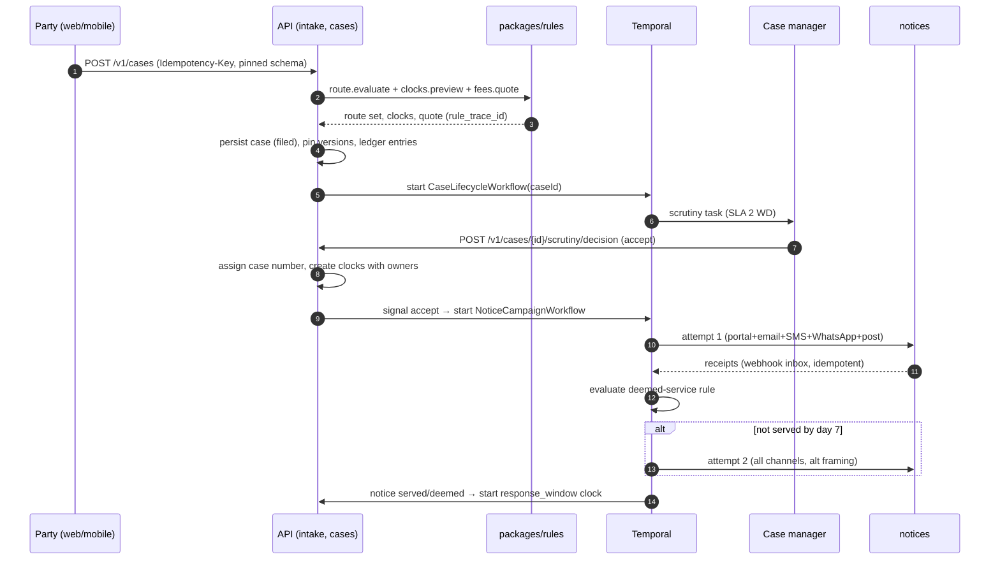
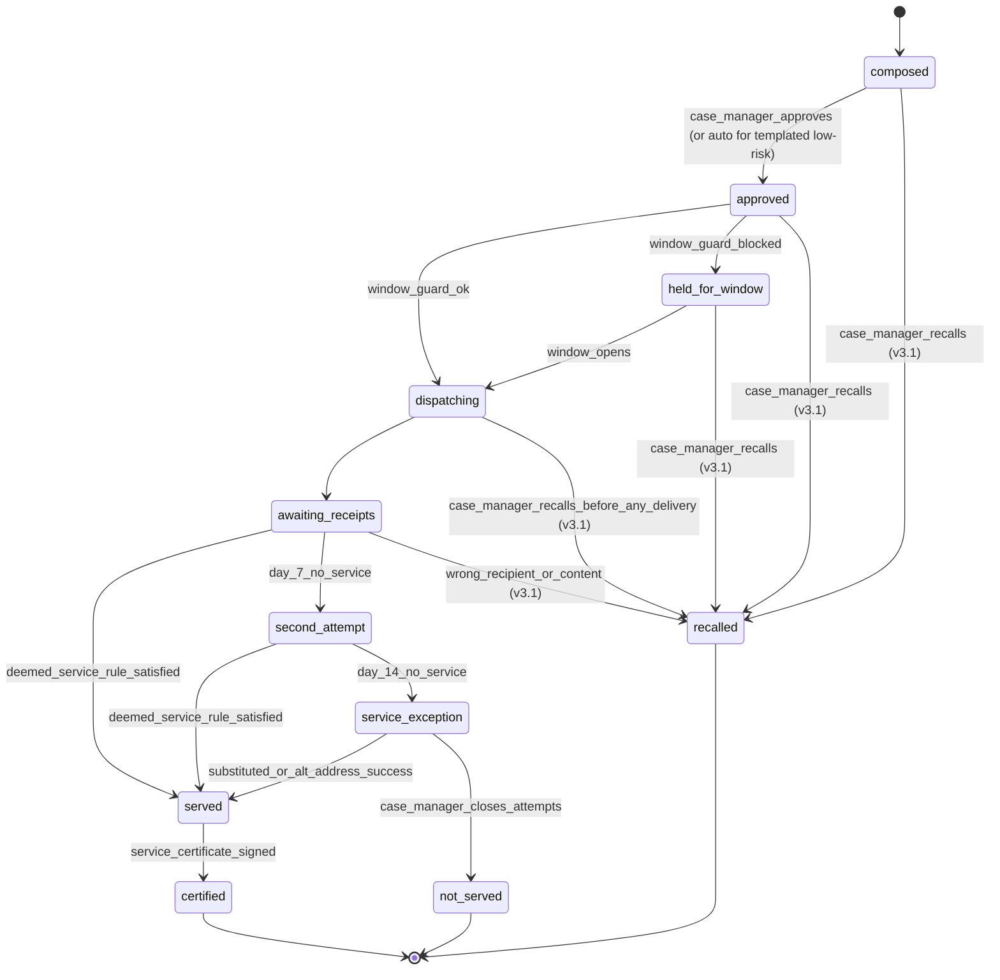
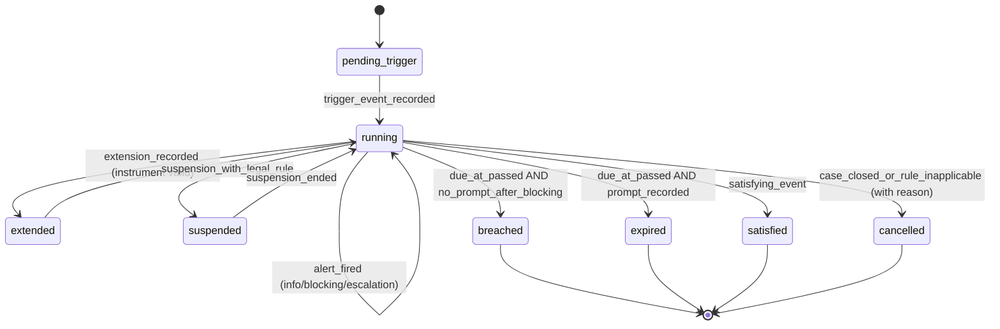

# P02 — Case Core: Intake, Form Engine, Routing, Notices and DMS
> Paste after 01_MASTER_PROMPT.md. Prerequisites: P00, P01. Estimated effort: 6 sprints (2-week) for a squad of 9 (2 backend-domain, 2 backend-platform, 2 web, 1 mobile, 1 QA automation, 1 legal-ops analyst).

Binding references: Appendix A (case machine, Compliance Clock Reference, signposting machine), Appendix D (ports), Appendix E (AI guardrails, eval suites), Appendix F (DDL, event and error catalogues), Appendix G (Legal Rules Register).

---

## 1. Objective and business outcome

Build the case core that every vertical, mechanism and channel will reuse: one front door (Dispute Explorer v1) that classifies a dispute and shows the deterministic route, statutory clocks, free-forum alternatives and process cost; a schema-driven form engine; filing by parties, counsel and enterprises; response and counterclaim; scrutiny and deficiency cure; a routing and signposting engine; an owned-clock service; legally defensible service of process; a DMS with e-bundles and an evidence ledger; the case workspace; and a public case-status tracker.

Business outcomes at exit:
- A self-represented party can go from "what happened?" to a filed, fee-quoted, pinned case in under 15 minutes on a mid-range Android phone, in English or Hindi.
- Every accepted case has a route decision with a reproducible rule trace, every statutory clock has a named owner, and every notice has a hashed service-proof bundle.
- A case manager can scrutinise, cure, accept, signpost or reject a filing without leaving the console, and no case advances on an unowned clock (NN-04).
- Signposting to free or statutory forums is a recorded, auditable outcome with a last date to act (NN-20).

---

## 2. Scope (in / out)

**In scope**
- Dispute Explorer v1 (web + mobile + embeddable widget shell), deterministic questionnaire fallback (NN-02), Readiness & Pathway Report.
- `packages/forms`: schema format, compiler, web and native renderers, server validator, versioning and pinning, Ruleset Studio form editor (builds on the P00 Studio skeleton).
- Filing: self-filed, counsel-filed (mandate), enterprise single-case filing via console and `POST /v1/cases` (bulk CSV/SFTP is P09).
- Response, admissions, counterclaim, set-off, jurisdiction objection flag.
- Scrutiny checklists, deficiency notices, cure window, accept/signpost/reject decisions.
- Routing engine (rule packs per vertical, mechanism × vertical matrix of master §5.2), signposting directory, signposting events.
- Clocks service: all clock kinds in Appendix A §6, working-day calendars, T-90/60/30 alerts, ownership, breach incidents, extensions with consent capture.
- Notice and service-of-process engine: email, SMS (DLT), WhatsApp, speed post with tracking import, in-portal acknowledgement, AI-voice notification hook (implementation in P07), deemed-service rules, second attempt at day 7, hashed delivery evidence, service certificate.
- DMS: upload (web, mobile camera, API), virus scan, SHA-256, Object Lock, OCR, classification, exhibit numbering, privilege flags, versioning, e-bundles (paginated, indexed, bookmarked PDF), evidence ledger, BSA 2023 s.63(4) certificate generator hook.
- Case workspace (timeline, parties, claims, documents, tasks, clocks, notices), linked matters, consolidation, withdrawal, case numbering, public case-status tracker.
- Mobile: filing, response, documents, status (party app).

**Out of scope (later phases)**
- Neutral allocation, disclosures and appointment (P03); the case only reaches `neutral_appointment` and raises a task here.
- Proceedings, hearings, offers (P04); outcomes, eSign, eStamp, execution (P06).
- Full fee engine, payments and refunds (P05). P02 ships a read-only `FeeQuotePort` evaluator over the seeded default fee schedule and accepts `fee_status ∈ {deferred, waived, offline_verified}` until P05 replaces it.
- Journey orchestration, voice agents, marketing consent (P07); bulk intake, clause API, GRM, POSH SaaS (P09). POSH complaints are **refused** by the core (`422 posh_must_be_sealed`) and signposted to the employer's IC/LC (NN-07).
- Vertical depth (calculators, vertical forms beyond the minimum blocks below) is P08.

---

## 3. Personas and permissions touched

| Role code | P02 capabilities | Key restrictions |
|---|---|---|
| (anonymous) | Dispute Explorer, public status tracker (reference + OTP), document verification page | No case creation without login; Explorer sessions discardable; no PII retained after discard |
| `party` | File, save drafts, pay/acknowledge fee status, respond, counterclaim, cure deficiencies, upload, view own case workspace, withdraw own claim, request linking | Sees only own party's vulnerability/screening data; never the other side's |
| `party_org_user` | As `party` for the organisation within signatory authority limits (`core.org_signatories.authority`, checked by `AuthorityService.check`, P01 FR-P01-19) | Filing above authority limit requires a second signatory approval |
| `counsel` | File/respond on behalf of a party under an active mandate in `core.party_representatives`; upload; view per mandate scope | Mandate revocation removes access in ≤ 60 s (session revocation + cache bust) |
| `enterprise_admin`, `enterprise_operator` | File single cases for the enterprise tenant; view own enterprise cases; configure intake defaults within guardrails | Cannot see respondent's private uploads before service; cannot choose or veto neutrals (NN-03) |
| `case_manager` | Scrutiny, deficiency, accept/signpost/reject (with `registrar` co-sign where configured), notices, clock ownership, linking, consolidation, bundles | Cannot alter pinned versions; cannot back-date any event |
| `registrar` | Case numbering oversight, consolidation approval, rejection approval, s.63 certificate Part A countersignature for institutional records, register of cases | Maker–checker with `case_manager` on reject/consolidate |
| `safeguarding_lead` | Receives safety/vulnerability alerts from intake; may set `on_hold` (sensitivity pause) | Sealed data via break-glass only |
| `institution_admin` | Ruleset Studio (forms, routing packs, signposting directory, clocks, calendars) as maker | Activation needs checker (`core.config_change_requests`) |
| `dpo` | Explorer DPDP notice versions, retention, DSR effects on drafts/sessions | — |
| `auditor` | Scoped read-only on cases, clocks, audit | No sealed data |
| `support_agent` | Assisted filing (kiosk/field mode) with party OTP consent per action | Cannot submit without party OTP confirmation |
| `machine` | `POST /v1/cases`, documents API, status API (enterprise keys) | Idempotency-Key mandatory |
| `platform_admin` | Feature flags, provider routing | No case content access without break-glass |

---

## 4. Functional requirements

### 4.1 Dispute Explorer v1

**FR-P02-01 — Unified front door.** One entry point "Tell us what happened" on web (`/explore`), mobile and the embed widget. Before any processing the user sees the itemised DPDP notice (`core.notices_privacy` current version) and grants the purpose `explorer_triage` (recorded in `core.consent_records`; DPDP Act 2023 s.5–6; DPDP Rules 2025 (G.S.R. 846(E), 13 Nov 2025)). No login is required. A persistent **Quick exit** control (keyboard `Esc` ×2 and a visible button) replaces the page with a configurable external neutral page (`explorer.quick_exit_url`, Appendix K; default `https://www.google.co.in`; master X-25 — the v1 internal `/` target is superseded), clears the session view, wipes local draft state and calls `DELETE /v1/explorer/sessions/{id}` best-effort; the browser history entry is replaced (`location.replace`). Quick exit is mandatory on FAM, WRK and any session in which a safety cue is detected.

**FR-P02-02 — Guided capture and multi-classification.** Capture is guided (no blank box): what happened, who is involved (role chips), what outcome is wanted, key dates, amounts, documents (optional upload: extraction only, file not retained unless the user later files). The `intake_assistant` may ask at most 3 clarifying questions. Classification output: `primary {vertical, dispute_type, sub_type, confidence}` and `linked[]` (zero or more secondary sub-matters, e.g. FAM divorce + FIN home loan; WRK dues + POSH). Classification is **advisory**: the route, eligibility, clocks and fees are computed by `packages/rules` from the confirmed facts (NN-01). The user confirms or edits the classification and the fact summary before the report is generated ("party-validation screen").

**FR-P02-03 — Deterministic route, clock and fee via tools.** The assistant calls only these tools, each a pure deterministic function in `packages/rules`: `route.evaluate(facts, rulesetVersion)`, `clocks.preview(facts, rulesetVersion)`, `fees.quote(processFacts, feeScheduleVersion)`, `signposting.lookup(vertical, dispute_type, location)`, `screen.arbitrability(facts)`, `screen.limitation(facts)`. Tool outputs are rendered verbatim into the report; the LLM never edits numbers, dates, forum names or routes. Prohibited routes are absent from the returnable set (e.g., arbitration for retail INS; arbitration for FAM status or custody; joint session where a safety cue exists).

**FR-P02-04 — Readiness & Pathway Report.** The report replaces the legacy "viability band" (no Weak/Mixed/Strong; GX-1, GX-2, GX-3 are zero-tolerance). Sections, in order:
1. *What you told us* — neutral restatement (2–3 sentences), user-confirmed.
2. *Your free and statutory options first* — each forum from the signposting directory with what it can do, cost, whether a lawyer is needed, and **last date to act** computed by `screen.limitation` (GX-8, NN-20). Example INS retail: "Insurance Ombudsman — free — file by 02 Apr 2027 (one year from the insurer's reply dated 02 Apr 2026)".
3. *Pathways available at Equator* — mechanism ladder from the rule pack with the reason each rung is available or blocked (e.g., "Arbitration is not available for this dispute: retail insurance policyholder (IRDAI position; Insurance Ombudsman Rules 2017) — NN-06/route matrix").
4. *Arbitrability screening flags* — rule-based flags only, labelled "screening flag, not a determination; an arbitral tribunal rules on its own jurisdiction (A&C Act 1996 s.16)". Flags use the *Vidya Drolia v Durga Trading Corp* (2021) 2 SCC 1 four-fold categories, DRT-exclusive bank/FI claims (RDB Act 1993 ss.17–18), MSMED s.18 reference, consumer election (*Emaar MGF Land v Aftab Singh* (2019) 12 SCC 751, SC, 10 Dec 2018).
5. *Limitation flags* — "dates to watch" computed from user dates and the Limitation Rules Register (Limitation Act 1963 Schedule, e.g., Arts. 55 and 113: 3 years; CPA 2019 s.69: 2 years; NI Act s.138(b)/(c) and s.142(1)(b)). Never "you are time-barred"; always "this date may matter — confirm with a lawyer or the forum".
6. *Evidence checklist* — from the dispute-type rule pack (e.g., FIN: loan agreement, KFS, statement of account, demand/recovery notices, sanction letter, cheque + return memo for s.138).
7. *Process cost and time* — `fees.quote` output for the Equator process (filing, administration, neutral fee band) and the configured service-time range (e.g., "mediation: Equator target 45–60 days; statutory ceiling, where applicable, 120 + 60 days"). Never a claim value, settlement range or outcome likelihood (GX-3).
8. *Next steps* — `file_case` (pre-fills the filing form), `invite_other_party_to_negotiate`, `go_to_free_forum` (deep link + downloadable letter template), `talk_to_a_human` (case-manager callback), `stop`.
9. Fixed caveat: "This is information, not legal advice. Equator Resolution is a private ADR institution, not a court, regulator or government body. Nothing is filed or decided for you." (GX-4, GX-7.)

The report is a versioned JSON document (`explorer_report.v1`, schema in Appendix E) rendered to HTML and downloadable PDF; it carries `rule_trace_id`, `ruleset_version`, `fee_schedule_version`, `prompt_version`, `model_ref`.

**FR-P02-05 — Deterministic fallback (NN-02).** When the AI Gateway kill switch is on, the model errors twice, latency > 8 s p95 over 5 min, or the user selects "answer questions instead", the Explorer switches to `form.explorer_questionnaire.v1` (branching questionnaire authored in the form engine). Given the same confirmed facts, the questionnaire produces the identical route set, clocks, signposting and quote (test `NN-02_parity_*` across 120 seeded fact sets, EN and HI).

**FR-P02-06 — Safety and sensitive cues.** Cue lexicon + classifier flags (DV, child safety, self-harm, sexual harassment at work, threats, police matter). On a cue: show support resources and helplines for the user's state, offer human handoff (GX-5), force Quick exit visibility, suppress any joint-session pathway, and for POSH route to "Your employer's Internal Committee (or the district Local Committee)" with the POSH Act 2013 s.9 three-month window (extendable by three months) shown as a date to watch — never discourage a POSH complaint (WP-G-01). Cue text is never echoed back, never logged in plain text, and never stored in `core.ai_interactions` beyond a cue code.

### 4.2 Schema-driven form engine

**FR-P02-07 — Schema shape.** A form is a JSON document stored in `core.form_schema_versions.schema` and validated against the meta-schema `equator-form/1.0`:

```json
{
  "$schema": "https://schemas.equatorresolution.in/form/1.0",
  "id": "case_filing",
  "version": "1.3.0",
  "title": "forms.case_filing.title",
  "vertical": "*",
  "mapsTo": "core.cases",
  "layout": { "mode": "steps", "steps": [
    { "id": "parties", "title": "forms.case_filing.steps.parties", "fields": ["claimant", "respondents"] },
    { "id": "dispute", "title": "forms.case_filing.steps.dispute", "fields": ["vertical", "dispute_type", "claim_value", "arbitration_clause"] },
    { "id": "facts", "fields": ["facts", "reliefs"] },
    { "id": "documents", "fields": ["documents"] },
    { "id": "review", "fields": ["consent_filing", "consent_online_mode"] } ] },
  "fields": [
    { "name": "claim_value", "type": "money", "label": "forms.common.claim_value",
      "currencyFrom": "case_currency", "validation": { "min": 0 }, "mapsTo": "core.cases.claim_value_minor" },
    { "name": "arbitration_clause", "type": "group", "visibleWhen": { "in": [ { "var": "mechanism_requested" }, ["arbitration", "med_arb", "arb_med_arb"] ] },
      "fields": [ { "name": "clause_text", "type": "textarea", "required": true },
                  { "name": "clause_document", "type": "file", "accept": ["application/pdf"], "maxSizeMb": 25 } ] },
    { "name": "confidentiality_tier", "type": "computed", "compute": "tierFromContext", "mapsTo": "core.cases.confidentiality_tier" }
  ],
  "rules": [
    { "id": "minor_guardian", "when": { "<": [ { "fn": ["ageYears", { "var": "claimant.dob" }] }, 18 ] }, "then": { "require": ["guardian"] } }
  ],
  "submit": { "operation": "POST /v1/cases", "idempotency": "required" },
  "i18n": { "required": ["en", "hi"], "legalReviewRequired": true }
}
```

Expression language: **JSONLogic** with an allow-listed function registry (`ageYears`, `daysBetween`, `workingDaysBetween`, `isIndianPin`, `inEnum`, `sum`, `lookup`); no arbitrary code, no network calls on the client.

**FR-P02-08 — Field types.** `text`, `textarea`, `richtext` (sanitised, no HTML pass-through), `number`, `money` (minor units + ISO-4217), `percent`, `date`, `datetime`, `daterange`, `select`, `multiselect`, `radio`, `checkbox`, `switch`, `phone` (E.164, OTP verify option), `email` (verify option), `address` (structured; PIN-code lookup), `pan` (masked, field-encrypted), `gstin`, `cin_llpin`, `udyam`, `file`, `file[]`, `group`, `group[]` (repeatable with min/max), `party_ref` (lookup or create), `consent` (writes `core.consent_records`; must be true where marked), `signature_intent` (captures OTP-confirmed intent; legal eSign is P06), `computed`, `hidden`, `info` (static help block), `date_to_watch` (displays a computed clock preview). Every field supports `required` (bool or rule), `visibleWhen`, `requiredWhen`, `readOnlyWhen`, `validation` (`min`, `max`, `minLength`, `maxLength`, `pattern`, `format`, `mustEqual`, `notFuture`, `notBefore`), `sensitive` (field-level encryption, masked display, never logged or sent to analytics), `mapsTo`, `default`, `help`.

**FR-P02-09 — Renderers and validation.** `packages/forms` compiles a schema into (a) a Zod schema shared by client and server, (b) a React Hook Form adapter for web (`ui` components) and (c) a React Native adapter (`ui-native`), and (d) an OpenAPI component for the submit operation. The server is authoritative: it re-validates with the compiled Zod schema plus server-only rules (uniqueness, party lookup, authority limits, file scan status). Errors are RFC 9457 problem+json with `code = validation_error` and `errors[] {pointer, code, message_key}`. Accessibility: visible labels, `aria-describedby` for help/errors, error summary at top with links, focus to first error, step progress announced, no colour-only signals (WCAG 2.2 AA, NN-23). Drafts autosave every 10 s and on blur to `core.form_submissions` (`status = draft`); mobile drafts persist offline in SQLite and sync with server-wins conflict resolution for case-aggregate fields and last-writer-wins for free text with a conflict banner.

**FR-P02-10 — Versioning and pinning (NN-21).** Semver: patch = copy/i18n fixes; minor = additive optional fields; major = required field or mapping change. Activation through maker–checker (`core.config_change_requests`) with preview in both locales and an automated diff report. A draft is pinned at creation; on submission the pinned version is written to `core.cases.form_schema_version_id`. If a pinned version is retired before submission, the user is shown a re-pin prompt with field-level migration (auto-mapped fields kept, new required fields highlighted); submission against a retired version without re-pin is refused (`409 form_schema_version_retired`).

**FR-P02-11 — i18n.** Labels are i18n keys resolved from `packages/i18n` catalogues; schemas may carry per-locale overrides. A schema cannot be activated unless all `i18n.required` locales resolve; schemas tagged `legalReviewRequired` additionally need a `legal_reviewer` approval per locale (NN-23). Numbers, dates and currency use the user's locale with Indian digit grouping (₹1,00,000).

### 4.3 Filing

**FR-P02-12 — Self-filed claim.** Wizard steps (web and mobile): Parties → Dispute → Facts & reliefs → Documents → Review, quote and submit. Pre-fill from Explorer (`explorer_session_id`) only after the user confirms. Mandatory: claimant identity (P01 identity level ≥ K1; KYB for organisations), at least one respondent with at least one contact point, vertical, dispute type, facts (50–10,000 chars), at least one relief, consent to the Equator Rules version shown, DPDP purpose consent `dispute_administration` (P01 catalogue; Appendix A C02 calls it `dispute_administration`), and online-mode consent (`consent_online_mode`; required in mediation statutory mode under Mediation Act 2023 s.30 and captured by default in all modes). Claims are structured into `core.claims` heads (`principal`, `interest`, `penal_charges`, `damages`, `refund`, `specific_performance`, `declaration_contractual`, `non_monetary`) with amount, currency, interest basis and period. The confidentiality tier is computed (`tierFromContext`): `sealed` for FAM with safety cue, INS health/life with health data, any minor party; `high` for FAM, WRK, INS retail; else `standard`. On submit the case is pinned to ruleset, form schema, rules-of-procedure and fee-schedule versions (NN-21) and the fee quote is attached.

**FR-P02-13 — Counsel-filed claim.** Counsel must hold an active mandate (`core.party_representatives`, P01 FR-P01-23: scope flags `view_documents`, `file_documents`, `attend_sessions`, `negotiate`, `receive_notices`, `make_offers`, `accept_offers`, `sign_settlement_on_behalf`; `valid_from`, `valid_to`; mandate document = vakalatnama/authorisation letter/board resolution). Counsel identity: P01 professional verification (Bar Council enrolment number + state council; status `verified` or `pending_review` — `pending_review` counsel may file only with the party's OTP confirmation and carry the "enrolment not verified" badge, P01 FR-P01-22). The represented party receives an OTP confirmation request; submission requires the party's confirmation unless the mandate document is a registered power of attorney or a board resolution verified by the case manager. Counsel cannot sign a settlement without `sign_settlement_on_behalf`.

**FR-P02-14 — Enterprise-filed claim.** Enterprise users (tenant `kind = enterprise`) file single cases from the console or `POST /v1/cases` with `source = api`. Guards: the enterprise's onboarding-verified dispute-resolution clause for the product line (FIN: clause names Equator as the administering institution ex ante — *Madhyachal Steels v Clix Capital* (Del HC, 24 Aug 2026); NN-03); respondent contact points obtained lawfully with the respondent's contract consent reference; for FIN borrower respondents, the RE name, GRO details and RB-IOS coverage flag are mandatory fields because every notice must carry them (NN-12). Enterprise payloads may not include neutral preferences, neutral IDs or panel restrictions (`422 neutral_selection_not_permitted`).

**FR-P02-15 — Fee status at filing.** `draft → filed` requires `fee_status ∈ {paid, deferred, waived, offline_verified}` (P02 supports `deferred` per payer rule, `waived` per approved concession, `offline_verified` by case manager; `paid` arrives in P05). Unpaid drafts remain `draft` with `payment_pending = true`; reminders at day 3 and 7; drafts expire after 30 days of inactivity (configurable) and are purged per retention policy. *(v3.1)* At the Review step the filer sees a duplicate check: the same claimant and respondent (blind-index match on PAN, GSTIN, CIN or verified contact) with an overlapping contract or loan reference in an open draft or case within 24 months shows "You may already have a matter about this" with links; the filer may continue (reason recorded) and the scrutiny checklist flags `possible_duplicate`. This resolves the legacy "hold at Filed" conflict: no case is `filed` without a settled fee status.

### 4.4 Response and counterclaim

**FR-P02-16 — Response.** The respondent accesses the case through the notice link (P01 FR-P01-13: secure code, possession OTP to the notified contact, valid for the response window + 90 days) or by logging in and claiming the case with the case number + OTP to the served contact point. Response form `form.case_response.v1`: admissions per claim head (`admitted | partly_admitted | denied | not_known`), reply narrative, documents, preferred language, accessibility needs, consent to the proposed mechanism (for consensual mechanisms), jurisdiction/arbitrability objection flag (`objection_s16 = true` with grounds; recorded for the tribunal, never decided by the platform), vulnerability self-disclosure (sealed to the respondent and case manager). Default window: 14 calendar days from deemed service (`response_window` clock); FAM: +7 days on request (one extension); arbitration: per Equator Rules (response to request for arbitration in 14 days, extendable) with SoD later per Procedural Order No. 1 (P04).

**FR-P02-17 — Counterclaim and set-off.** Counterclaims create `core.claims` rows with `kind = counterclaim` and their own reliefs; the fee quote is recomputed (counterclaim fee per schedule); if the counterclaim exceeds the claim, the fee band and tribunal-size rule are re-evaluated and the case manager is tasked. A counterclaim on a non-arbitrable head is flagged by the screener and routed to mediation or signposting (NN-06).

### 4.5 Scrutiny and deficiency cure

**FR-P02-18 — Scrutiny.** On `filed`, a scrutiny task is created (SLA 2 working days; 1 working day for INS). The checklist is data (rule pack) and includes: identity/KYB complete; authority to file; respondent contactability; vertical and dispute type valid; mechanism permitted for vertical (master §5.2); arbitrability screen; Mediation Act 2023 First Schedule screen (in statutory mode); POSH detection (refuse and signpost); duplicate detection (same parties + same contract/loan ID + overlapping reliefs within 24 months → `possible_duplicate`); limitation flags; documents legible and virus-clean; INT gates (sanctions, KYC/UBO, DPDP s.16, FEMA route, s.2(1)(f) test; NN-19); FIN clause validity (NN-03); INS retail/commercial classification; FAM screening scheduled. Outcomes: `accept`, `raise_deficiency`, `signpost`, `reject` (reject and consolidate need `registrar` approval). Every outcome stores the checklist snapshot, rule trace and reviewer. *(v3.1)* The scrutiny queue (SCR-P02-08) is ordered by the earliest "date to watch" on the filing (limitation or forum last date from `screen.limitation`), then SLA remaining, then filing time; filings with a date to watch within 30 days carry a red "time-sensitive" chip and are offered first to the next free reviewer. A reviewer who is a party, representative or connected person in the matter, or shares an organisation with a party, is skipped by assignment (conflict check). The decision panel offers a deficiency-code library (`core.deficiency_codes`, T: tenant may add codes and wording; legal-reviewer approval for wording that mentions limitation) with pre-filled plain-language text and field pointers, so a deficiency notice is built by ticking codes rather than typing; "Accept with notes" records non-blocking observations for the case manager of record. Shortcuts: `A` accept, `D` raise deficiency, `S` signpost, `R` reject (opens maker form; registrar approval still required), `J`/`K` next/previous in queue.

**FR-P02-19 — Deficiency cure.** A deficiency notice lists each defect (`code`, plain-language explanation, what to upload/change, field pointer). Cure window: 15 calendar days (configurable 7–30), one extension of 7 days on request. Reminders at day 7 and T-2. On cure, the case returns to `under_scrutiny` (scrutiny SLA restarts at 1 working day). On expiry uncured, the case moves to `rejected` with reason `deficiency_not_cured`, refund rule applied (P05), and the claimant is told the rejection is not a decision on merits and that limitation continues to run. *(v3.1)* Partial cure: each deficiency has its own status (`open`, `cured`, `waived`, `disputed`); the case stays `deficient` until every blocking deficiency is `cured` or `waived`, and the claimant sees a progress bar ("2 of 3 fixed"). A case manager may waive a deficiency with a reason code (audit); a claimant may mark one `disputed` with an explanation, which creates a review task (SLA 1 working day) without stopping the cure clock. Before expiry the claimant receives a T-2 reminder listing only the open items; a rejected filing can be re-filed within 30 days as a new filing pre-filled from the rejected one (documents re-referenced, not re-uploaded; new fee quote; fresh pinning).

### 4.6 Routing and signposting

**FR-P02-20 — Rule packs.** Routing is a deterministic evaluator over versioned rule packs (`core.ruleset_versions.config.routing`) per vertical. A rule is `{id, priority, when (JSONLogic over normalised facts), then {routes_offered[], routes_blocked[{route, reason_code, legal_rule_id}], mandatory_disclosures[], signpost[], clocks[], tier_override?}}`. Evaluation is total: every fact set yields at least one route (`signposting` is always available; "never declined without a route"). Each evaluation writes `core.routing_decisions` (input hash, normalised facts, ruleset version, fired rules, outputs). Rule packs shipped in P02 (P08 deepens): FIN (route table and permutation matrix: DRT/SARFAESI screen for banks/FIs ≥ ₹20 lakh, RB-IOS 2026 (effective 1 Jul 2026) 30-day RE window and 90-day filing window — held as configurable rules `LR-RBI-*`, not hard-coded (master X-13), NI Act s.138 compounding path, IBC moratorium flag, consumer election), COM (Vidya Drolia flags, s.12A PIMS advisory — Equator is not the s.12A authority; it prepares the Form-1 pack for the Legal Services Authority and may run voluntary pre-suit mediation in parallel, flag `com.s12a_equator_authorised` OFF (master M-06); MSMED s.18 MSEFC election per *Gujarat State Civil Supplies v Mahakali Foods* (SC, 31 Oct 2022); the MSEFC → mediation-service-provider referral track (MSMED s.18 as substituted by Mediation Act s.62 and amended by MSMED (Amendment) Act 2026 s.8) is not in force — neither provision has commenced (S.O. 5575(E), 12 Oct 2026) — so the pack only signposts to the MSEFC/MSME ODR and the referral track stays behind its flag OFF (D2-26)), FAM (status/custody/testamentary non-arbitrable; property/partition arbitrable with NN-08 warning; safety screening precondition), INS (five-condition Ombudsman eligibility engine — a late complaint is `needs_condonation` under r.14(4), not ineligible; retail never arbitration; MACT; employee-compensation competent authority under the Code on Social Security 2020 Ch. VII (EC Act 1923 repealed 21 Nov 2025); PM-JAY/PMFBY ladders; fraud alleged → no Equator mediation of the claim), WRK (POSH → IC/LC; criminal → police; collective industrial dispute → GRC/conciliation officer; statutory dues never waived), INT (NN-19 gates; WTO/ISDS out of scope → signpost).

**FR-P02-21 — Mechanism × vertical guard.** The permission matrix in master §5.2 is encoded as `core.legal_rules` rows referenced by the evaluator and by the proceeding-creation guard in P04. Tenants may narrow but never widen it (Studio validation rejects a widening change with `422 prohibited_mechanism_vertical`).

**FR-P02-22 — Signposting directory.** `core.signposting_directory` rows: forum code (e.g., `rbi_ios`, `nbfc_io`, `insurance_ombudsman`, `bima_bharosa`, `consumer_district`, `consumer_state`, `ncdrc`, `e_jagriti`, `lok_adalat`, `dlsa_pims`, `msefc`, `msme_odr`, `drt`, `nclt`, `rera`, `mact`, `ec_commissioner` (CoSS 2020 Ch. VII competent authority; code kept for stability), `pmjay_cgrms`, `pmfby_dgrc`, `labour_conciliation_officer`, `grc_ir_code`, `ic_posh`, `lc_posh`, `police`, `family_court`, `protection_officer`, `senior_citizens_tribunal`, `civil_court`, `probate_court`, `dgtr`, `dgft`), jurisdiction (national/state/district), eligibility summary, monetary limits, cost, lawyer needed (Y/N), filing URL, helpline, languages, limitation rule reference (`core.legal_rules.id`), `last_verified_at`, `verified_by`, `reverify_due_at` (default 180 days). Rows past `reverify_due_at` show an amber "being re-verified" badge to staff and are excluded from AI retrieval until re-verified.

**FR-P02-23 — Signposting event (NN-20).** A signposting event is recorded whenever a forum is named to a party (Explorer report, scrutiny signpost decision, non-settlement closure): forum, reason code, last date to act (computed), clock created (`kind = signpost_last_date`, owner = case manager, informational for the party), channel, language, script version, delivered_by (user or `system`), delivered_at, party acknowledgement (`ack_at`, method). INS first contact uses the verbatim Schedule A signposting script (version-pinned). Closure is blocked by `closure_policy.require_signposting` until an event with delivery evidence exists (`409 signposting_required`).

### 4.7 Clocks service

**FR-P02-24 — Clock model.** `core.clocks`: `kind` (enum from Appendix A §6), `category ∈ {statutory, contractual, rules_of_procedure, service_sla, informational}`, `trigger_event`, `trigger_at`, `period_value`, `period_unit ∈ {calendar_days, working_days, months, years, hours}`, `calendar_id`, `extension_policy` (`max_extensions`, `extension_value`, `requires ∈ {all_party_consent, tribunal_order, court_order, institution, party_request}`), `due_at` (computed, stored, never edited), `owner_user_id`, `owner_role`, `state ∈ {pending_trigger, running, suspended, extended, satisfied, expired, breached, cancelled}`, `legal_rule_id`, `alert_policy_code`, `proceeding_id` (nullable), `linked_group_id` (linked matters share one clock where Appendix A says so). Months are calendar months (General Clauses Act 1897 s.3(35); Limitation Act 1963 s.25, Gregorian calendar); "one year" = same date next year (General Clauses Act s.3(66)) (C-06 leap-year case: 01 Mar 2024 → 01 Mar 2025); periods expiring on a non-working day roll forward only where the source rule says so (`roll_forward_if_closed`, Limitation Act 1963 s.4 pattern), never by default.

**FR-P02-25 — Working-day calendars.** `core.working_calendars` (`IN-NAT`, one per state/UT, `INTL-<ISO>` for INT participants) with `core.calendar_holidays` (date, name, type gazetted/restricted/bank). Calendars are versioned, imported annually from published holiday lists by `institution_admin` with checker approval. A clock using working days stores the calendar version used; recalculation after a calendar change is allowed only for clocks with `due_at > now() + 7 days` and is audited.

**FR-P02-26 — Alerts and ownership (NN-04).** No statutory, contractual or rules-of-procedure clock may be `running` without an owner; creation without an owner assigns the case manager of record and raises a task. Alert policies (Appendix A §6.1): AP-L (≥ 180 days) info T-90, blocking task T-60, escalation T-30, critical T-7; AP-M (30–179 days) info at 50%, blocking at 75%, escalation at 90% (not later than T-3), critical T-1; AP-S (< 30 days) info at start, blocking T-3 (or at 50% if shorter), escalation T-1, critical T-0 09:00 local; AP-SLA amber 75%, red 100%. A blocking task is non-dismissable; it is cleared only by a recorded prompt (`POST /v1/cases/{caseId}/clocks/{clockId}/prompts` with `action ∈ {party_informed, extension_sought, filing_made, not_applicable_with_reason}`) or by the clock being satisfied. Blocking tasks are suppressed where the governing rule says so (e.g., INS `ombudsman_1y` while the case is in `in_compliance` or `closed`).

**FR-P02-27 — Breach.** If a statutory clock reaches `due_at` while `state = running` and no prompt was recorded after the blocking alert, the service raises a Critical incident (`eng.incidents` — v2 `ops` incident tables moved to `eng`, X-65; Sev-1 pager to on-call legal-ops and the owner's supervisor), emits `equator.clocks.clock.breached.v1`, and applies the clock's breach behaviour (Appendix A §6.2: `B-CRIT`, `B-LAPSE`, `B-AUTO`, `B-SLA`, `B-INFO`). Back-dating any event that would move a trigger or satisfy a clock retroactively is refused (`422 backdating_prohibited`); corrections require registrar + checker and append, never overwrite.

**FR-P02-28 — Extensions and suspensions.** Extensions record the instrument (consent IDs for all parties, tribunal order ID, court order document) and append a new `due_at` version in `core.clock_versions` (added table). Suspension is permitted only where a legal rule in the register authorises it (e.g., limitation exclusion during PIMS under CCA 2015 s.12A(3) proviso) and never because of Equator mediation alone (IN-G-06; "mediation never pauses a limitation clock"). `on_hold` with reason `sensitivity_pause` stops service SLAs only.

### 4.8 Notices and service of process

**FR-P02-29 — Notice kinds.** `invitation_to_mediate`, `invitation_to_conciliate_s62`, `notice_of_arbitration_s21`, `request_for_arbitration_copy`, `notice_of_claim`, `deficiency_notice`, `response_reminder`, `hearing_notice` (used by P04), `order_service` (P04), `signposting_notice`, `non_commencement_notice`, `award_delivery_s31_5` (P06), `withdrawal_notice`, `consolidation_notice`. Each notice is generated from a versioned template (`core.document_templates`) in the recipient's language plus English, rendered to PDF, hashed (SHA-256), stored with Object Lock, and logged in `core.evidence_ledger`. Notices never claim to be court or police process (GX-4; BNSS s.35 notices must be served physically — SC, Jul 2025 — and are out of scope).

**FR-P02-30 — Channels and attempt plan.** Default plan per attempt: (1) portal notification + email with secure link and PDF attached (≤ 10 MB) or link; (2) SMS (DLT template, transactional/service header, whitelisted URL; no sensitive content — case number and link only); (3) WhatsApp utility template (only to numbers with WhatsApp opt-in or contract-consented service number; never to third parties); (4) speed post / registered post with India Post tracking number (generated letter + envelope PDF for the dispatch desk or print-and-post partner via `POSTAL_PORT`); (5) AI voice notification hook `equator.notices.voice_requested.v1` (P07 implements; P02 records the request and outcome callback). FIN borrower notices pass the `ContactWindowGuard` (08:00–19:00 recipient local time — 09:00–18:00 for microfinance loans — in force now, LR-RBI-005; blackout dates, GRO footer with name, email, phone and address of the RE's GRO; NN-12) for SMS, WhatsApp and voice; email is queued but sent only inside the window; violations are hard-blocked (`409 contact_window_blocked`).

**FR-P02-31 — Deemed-service rules (configurable per ruleset; defaults below).**
- *Arbitration notices* follow A&C Act 1996 s.3: served when delivered personally or at the addressee's place of business, habitual residence or mailing address; if none can be found after reasonable inquiry, deemed received when sent to the last known address by registered letter or any other means that records the attempt to deliver. Platform rule: deemed served on the earliest of (a) speed post tracking "Delivered" or "Refused" (refusal = served), (b) email delivered (SMTP accept + no hard bounce within 48 h) to an address in the contract or verified at KYC, (c) portal acknowledgement. WhatsApp "delivered"/"read" receipts are corroborative only.
- *Consensual mechanisms* (negotiation, conciliation, mediation): "served" means the invitation reached the recipient by a verified channel (any of the above, or WhatsApp delivered to a verified number). Non-response never produces an adverse outcome; it leads to a non-commencement notice/report (FR-P02-33).
- *s.31(5) award delivery* (P06) requires delivery to the party itself or its authorised representative under mandate; delivery to an unconnected official is not delivery (*M/s Motilal Agarwala v State of West Bengal*, 2025 INSC 1062).
- *s.62 conciliation invitation*: if no reply within 30 days of sending (or the period specified), the inviting party may treat it as rejection (A&C Act s.62(4)).

**FR-P02-32 — Second attempt and escalation.** If no deemed service within 7 days of the first attempt, a second attempt is sent automatically on all available channels with a differently framed message (FAM: invitation framing; FIN: GRO footer), plus speed post to every known postal address. For NRI/foreign parties: email + last known address + courier; consular and Hague Service Convention routes are signposted, not automated. The Convention (in force for India 1 Aug 2007, with Art.10 objections) is not a mandatory channel for party- or institution-issued ADR notices. Receipt is proved under A&C Act s.3 (last known place of business, habitual residence or mailing address, by a means that records delivery), and the delivery evidence is kept for NYC Art.V(1)(b) "proper notice". The Central Authority route is used only for court process (e.g., s.9/s.11 petitions). After the second attempt, unresolved notices go to the case manager's "service exceptions" queue with options: alternative address search (KYC addresses, enterprise data, public records via KYB provider), substituted service request (arbitration: tribunal direction in P04), or non-commencement.

**FR-P02-33 — Service certificate and delivery evidence.** Every attempt stores provider message ID, timestamps (queued, sent, delivered, read, bounced, failed), provider receipt payload (raw, hashed), channel address (masked in UI), template version, rendered content hash, recipient language. The service certificate (PDF, template `service_certificate.v1`) summarises attempts per recipient and channel, states the deemed-service rule applied and the deemed date, carries a SHA-256 manifest of all receipts, and is countersigned by the case manager (OTP step-up). It is attached to the evidence ledger and to any later execution bundle. Non-commencement notices/reports state only facts and dates (no adverse inference).

**FR-P02-34 — Recipient-side experience.** The notice link opens a respondent landing page in the recipient's language with: what this is (not a court), who filed, what is asked, the mechanism and its voluntary or binding nature, the response deadline, free/statutory alternatives (FIN: RB-IOS and the note that a pending arbitration may make an RB-IOS complaint non-maintainable — RB-IOS 2026 FAQ; INS: Ombudsman), how to get help, and "respond / ask a question / decline". Viewing creates a portal acknowledgement only after OTP verification of the recipient.

### 4.9 DMS

**FR-P02-35 — Upload and ingest.** Upload via web (drag-drop, resumable via S3 multipart, ≤ 200 MB per file, configurable), mobile (camera capture with edge detection and multi-page PDF assembly, offline queue), API (pre-signed URL + finalise). Allow-list: PDF, JPEG, PNG, HEIC (converted), TIFF, DOCX, XLSX, CSV, TXT, EML/MSG, MP3/M4A/WAV, MP4 (≤ 2 GB on request), ZIP (expanded server-side, max 500 entries, no nested ZIP). Ingest pipeline (Temporal `DocumentIngestWorkflow`): quarantine bucket → ClamAV scan (signatures updated hourly) + file-type sniffing (magic bytes) → reject (`422 virus_detected` / `unsupported_file_type`) or promote → SHA-256 over original bytes → write to evidence bucket (S3 Object Lock, compliance mode, retention per tier) → `core.documents` + `core.document_versions` row → evidence-ledger entry → OCR (`DOC_AI_PORT`; Sarvam Vision primary for Indic, fallback Claude vision via Bedrock India or AWS Textract ap-south-1; Google/Azure engines only behind `ocr.regional_cloud.enabled` = OFF — master X-33) → text stored in `core.document_versions.ocr_text_ref` (encrypted object, not inline) → classification (`document_extractor` agent proposes `doc_kind`; user/case manager confirms) → OpenSearch indexing (tenant-scoped index; sealed tier never indexed).

**FR-P02-36 — Classification and metadata.** `doc_kind` taxonomy (configurable): `pleading_claim`, `pleading_response`, `counterclaim`, `contract`, `arbitration_agreement`, `loan_agreement`, `kfs`, `statement_of_account`, `policy_wording`, `claim_form`, `survey_report`, `repudiation_letter`, `salary_slip`, `relieving_letter`, `cheque`, `bank_return_memo`, `notice`, `service_certificate`, `order`, `id_proof` (sealed), `medical_record` (sealed, `health_sealed`), `correspondence`, `photo`, `audio`, `video`, `expert_report`, `witness_statement`, `other`. Metadata: date of document, author, parties referenced, language, page count, `confidentiality ∈ {shared, own_side_only, neutral_only, sealed}`, `privilege ∈ {none, legal_advice, litigation, without_prejudice, settlement_communication}` (privileged items are visible only to the uploading side and are excluded from bundles unless the uploader releases them), `tamper_hint` (from Doc AI: metadata inconsistency, edited-image signal; never auto-rejects — neutral reviews).

**FR-P02-37 — Exhibit numbering.** On marking a document as an exhibit, a deterministic label is assigned per side and sequence: `C-1, C-2 …` (claimant), `R-1 …` (respondent), `CC-1 …` (counterclaim), `T-1 …` (tribunal/neutral), `J-1 …` (joint), with sub-pages `C-4.12`. Labels never re-use numbers; withdrawal marks `C-7 (withdrawn)`. Exhibit numbering per case is pinned to the rules-of-procedure version.

**FR-P02-38 — Versioning.** New uploads of the same logical document create versions; prior versions remain immutable and visible in history to permitted roles; the "current" pointer moves. Replacing an exhibit after it was included in a served bundle requires the neutral's leave (P04) or, before appointment, case-manager approval; the old version remains in the bundle history.

**FR-P02-39 — E-bundles.** Bundle builder (`BundleBuildWorkflow`): select documents or a bundle template (`core_bundle`, `hearing_bundle`, `pleadings_bundle`, `authorities_bundle`, `enforcement_pack_stub`), order by section and date, generate a single PDF/A-2b with: cover page (case number, bundle type, version, generated_at, QR verify URL), clickable index with exhibit labels and page ranges, bookmarks per section, continuous pagination stamped in the footer (`Page n of N · EQ/COM/DEL/2027/00042 · Hearing Bundle v3`), OCR text layer, optional watermark per viewer. Each bundle stores `core.bundles` (`version`, `manifest_sha256`, `pdf_sha256`) and `core.bundle_items` (document version, start page, end page, exhibit label). Bundle size cap 2,000 pages per volume; larger bundles split into volumes with a master index. Rebuilds create a new version; served versions are immutable.

**FR-P02-40 — Document requests and access.** Case managers/neutrals can issue document requests (`core.tasks` of type `document_request`, due date, recipient party). Access is checked by the ABAC policy (`case membership × role-in-case × confidentiality × privilege × tier`). Downloads of `high`/`sealed` documents are watermarked with viewer name, timestamp and case reference and logged in `audit.access_log`. Mobile cache stores only documents the user opened, encrypted at rest, wiped on logout or remote wipe.

### 4.10 Evidence ledger and BSA certificate

**FR-P02-41 — Evidence ledger.** `core.evidence_ledger` is append-only and hash-chained per case (`seq`, `prev_hash`, `entry_hash = SHA-256(prev_hash || canonical_json(entry))`), recording document version hashes, notice renderings, provider receipts, bundle manifests, service certificates and (later) recordings and outcomes. A daily anchor job writes the latest head hash per tenant to the audit chain (NN-22) and, where configured, to an external timestamp authority. Public "verify this document" (`/verify`) accepts a file or hash and returns whether it matches a ledger entry (no case content disclosed).

**FR-P02-42 — BSA 2023 s.63(4) certificate generator hook.** For any export bundle, the platform generates a certificate in the Schedule format with Part A pre-filled (the computer/system, the process of production, hash algorithm SHA-256, hash values per file, custodian details) for signature by the producing party or the Equator registrar (for institutional records), and creates a Part B request task to an empanelled expert where the matter is contested or the tenant requires it (Bharatiya Sakshya Adhiniyam 2023 s.63(4); *Pune Bar Association v Union of India*, SC, 22 May 2026; NN-10). P02 delivers the generator, template and hook; signing is P06.

### 4.11 Case workspace

**FR-P02-43 — Workspace.** Tabs: Overview (status chip, next action, clocks summary, parties, pinned versions), Timeline (filtered from `core.case_status_history`, notices, documents, orders; each item hash-linked), Parties (roles, representatives, contact points masked, service status per party), Claims & reliefs, Documents (folders by `doc_kind`, exhibits view, bundles), Notices & service, Clocks (pill per clock: name, days left, owner, state; tokens `clock.green`, `clock.amber`, `clock.red`), Tasks (assignee, due, SLA), Linked matters, Activity (audit view for staff). Party view hides staff-only items, the other side's private uploads and all sealed/vulnerability data. All lists paginate by cursor; the workspace loads in < 2.5 s LCP on 4G with 200 documents.

### 4.12 Public case-status tracker

**FR-P02-44 — Tracker.** Route `/track`. Input: case number or filing reference + CAPTCHA (anti-automation). An OTP is sent only to contact points already on the case (party/counsel); on success, a 30-minute status view shows: stage (from the case machine, plain language), next scheduled date, last updated, mechanism, and the list of public-safe events (filed, accepted, notice served, neutral appointed, hearing scheduled, outcome issued, closed). Never shown: party names beyond initials, amounts, documents, neutral identity for arbitration (A&C s.42A confidentiality), any sealed/high-tier detail. Cases with tier `sealed`, any FAM case, any INS health case, and any matter linked to a POSH token return only "Status available to parties in their account" after OTP. Rate limit: 5 lookups/hour/IP and 3 OTPs/hour/case; uniform responses prevent enumeration (the same message whether or not a case exists).

### 4.13 Linked matters, consolidation, withdrawal, numbering

**FR-P02-45 — Linked matters.** `core.linked_matters` (`link_type ∈ {related, sub_matter, parallel_forum, sequenced_with, consolidated_into, split_from}`), created from Explorer multi-classification, by case managers, or on party request (approved by case manager). Linked matters share party records and consents, may share one clock group (configurable per link type), and each keeps its own rules. Withdrawal from one does not cascade. `sequenced_with` enforces signing order (e.g., FAM divorce terms and FIN home-loan settlement: neither outcome executes without the other; enforced in P06). A POSH link is an opaque token only (NN-07).

**FR-P02-46 — Consolidation.** Before any proceeding is active, two or more cases between the same parties (or with written consent of all parties) may be consolidated: maker (`case_manager`) + checker (`registrar`); the surviving case keeps its number; others become `closed` with `closure_reason = consolidated` and `consolidated_into` link; documents are referenced (not copied); claims merge with provenance; fees re-quoted. After an arbitral tribunal is constituted, consolidation is a tribunal decision with all-party consent (P04).

**FR-P02-47 — Withdrawal.** Claimant may withdraw all or some claims at any time before an outcome is executed; respondent may withdraw a counterclaim. Withdrawal requires OTP step-up, reason (optional, enum + text), acknowledgement of fee consequences (refund rule from pinned fee schedule; P05 executes) and, for organisations, an authorised signatory. Full withdrawal moves the case to `withdrawn` (side state) and then `closed`; partial withdrawal updates claim heads. In arbitration after constitution, withdrawal of the claim is recorded and the tribunal terminates proceedings by order (A&C s.32(2)(a): termination unless the respondent objects and the tribunal recognises a legitimate interest in a final settlement) — P04 owns the order.

**FR-P02-48 — Case numbering.** At `filed`: filing reference `FR-{YYYYMMDD}-{6 Crockford base32}`. At `accepted`: case number `EQ/{VERT}/{CITY}/{YYYY}/{NNNNN}` (master §4.4), e.g., `EQ/FIN/JAI/2027/00042`; CITY = Equator registry office code from the ruleset mapping (venue/seat for arbitration; respondent's district → nearest registry otherwise; default `DEL`); YYYY = year of acceptance (IST); NNNNN = gap-free sequence per (tenant, vertical, city, year) from `core.case_number_sequences` under row lock. Private Chambers tenants use their prefix (`{TENANT}/{VERT}/{YYYY}/{NNNNN}`). Every number has a QR verification URL. Numbers are never reused; consolidation does not renumber.

---

## 5. Workflows and state machines

The canonical case machine with all transitions is in **Appendix A §2**. P02 implements the states `draft`, `filed`, `under_scrutiny`, `deficient`, `accepted`, `signposted`, `rejected`, `awaiting_respondent`, `neutral_appointment` (entry only), `withdrawn`, `on_hold`, `closed` (for pre-proceeding closures) and the guards below.

### 5.1 P02 transitions
Implement exactly the rows of Appendix A §2.2 whose *from* state is `draft`, `filed`, `under_scrutiny`, `deficient`, `accepted` or `awaiting_respondent`, plus the global `withdraw`, `hold` and `resume` rows. Three P02-specific guards are binding: (a) `draft → filed` refuses POSH (`422 posh_must_be_sealed`) and requires a settled `fee_status`; (b) `under_scrutiny → accepted` requires a route decision that contains the requested mechanism, INT gates (NN-19) and a valid FIN clause (NN-03); (c) `awaiting_respondent → closed` for consensual mechanisms requires the second attempt, the expired response window and a recorded non-commencement notice (plus a signposting event where `closure_policy.require_signposting`).

### 5.2 Filing to notice — sequence



### 5.3 Notice attempt machine



*(v3.1)* Recall: a notice not yet `served` may be recalled with a reason (`wrong_recipient`, `wrong_content`, `wrong_language`, `superseded_by_amended_notice`); dispatched messages are not unsent, so the recall sends a short "please disregard the notice dated …" message on the same channels within the contact window, every receipt already obtained is kept in the evidence ledger, and the corrected notice starts its own attempt plan and deemed-service clock (the response window never runs from a recalled notice). A notice that is already `served` cannot be recalled; a correction is a new notice that references it. Approval SLA: a `composed` notice awaiting case-manager approval for more than 1 working day appears on the exception dashboard; per channel, a hard bounce moves that channel's attempt to `failed` and the next channel in the plan is tried at once rather than waiting for day 7.

### 5.4 Clock machine



`expired` (prompted, e.g., party informed and chose not to file) is not an incident; `breached` is a Critical incident.

*(v3.1)* Added transitions and rules:

| From | Event | Guard | To | Side effects |
|---|---|---|---|---|
| cancelled | reinstate | cancelled in error within the last 30 days; registrar maker + checker; reason | running (or `breached` if `due_at` has passed) | original `due_at` kept (never re-based to today); `clock_versions` row `reason = correction`; audit |
| running | owner_unavailable | owner on recorded leave or away (from `hr` or the away flag) spanning the next alert, or membership ended | running | ownership moves to the owner's delegate, else the case manager of record's supervisor; both notified; `owner_history` appended; a running statutory clock is never left without an owner for more than 15 minutes (`ClockSweepJob` check) |
| running | alert_unacknowledged | escalation alert not acknowledged within 4 working hours | running | re-sent to the owner's supervisor and the vertical lead; listed on the exception dashboard |

The Compliance cockpit (SCR-P02-11) defaults to an exception view: breached, then escalation-level, then blocking-level clocks, each sorted by `due_at`; "All clocks" is a secondary tab. Bulk owner reassignment is allowed for a case manager's whole book (e.g., on leave), with a preview listing every statutory clock affected.

### 5.5 Document ingest pipeline

`uploaded (quarantine) → scanned → [rejected | hashed] → stored_worm → ledgered → ocr_done → classified (proposed) → confirmed → indexed`. Failures retry with exponential backoff (max 5); OCR failure does not block the case (document marked `ocr_failed`, manual classification).

---

## 6. Screens and UX (web + mobile)

| ID | Route | Persona | Purpose and key components | States | Mobile variant | Accessibility |
|---|---|---|---|---|---|---|
| SCR-P02-01 | `/explore` | anonymous, party | Explorer start: DPDP notice card, consent, language switch, Quick exit, "answer questions instead" | loading; consent-declined (exit message); AI-unavailable (auto questionnaire) | Party app tab "Explore"; voice-to-text input (Sarvam STT) | Quick exit reachable by keyboard; reduced motion |
| SCR-P02-02 | `/explore/{sessionId}` | anonymous, party | Guided capture (chips, date pickers, amount input, optional upload), ≤ 3 clarifying questions, classification confirmation (primary + linked) | typing; extraction running; cue-detected (support panel); error (retry, fall back) | Camera upload; offline not supported (online only) | Live region for assistant messages; transcript downloadable |
| SCR-P02-03 | `/explore/{sessionId}/report` | anonymous, party | Readiness & Pathway Report sections 1–9; "File now", "Invite to negotiate", "Go to free forum", "Talk to a human", download PDF | generating; ready; partial (fallback questionnaire badge) | Collapsible sections; share-sheet PDF | Headings structure; tables with captions |
| SCR-P02-04 | `/app/cases/new` | party, party_org_user | Filing wizard (5 steps), autosave, quote panel, pinned-version footer | draft; validation errors summary; payment pending; submitted (filing reference) | M01 filing: same steps, offline draft queue, camera docs | Error summary, focus management, step announced |
| SCR-P02-05 | `/app/counsel/cases/new` | counsel | Mandate selection/upload, client OTP confirmation status, filing wizard | mandate pending; client confirmation pending | Counsel uses web primarily; mobile read-only list | — |
| SCR-P02-06 | `/app/enterprise/cases/new` | enterprise_admin/operator | Single-case filing with product-line clause selector, borrower/insured details, GRO block (FIN), consent reference | clause invalid (blocking banner); success | Enterprise lite: view only | — |
| SCR-P02-07 | `/r/{token}` → `/app/cases/{id}/respond` | respondent party/counsel | Respondent landing (plain-language explainer, deadline, free forums), response form, counterclaim builder, objection flag | token expired (re-OTP); window closed (late-response request) | M02 response: guided, voice note upload, offline draft | Plain-language level ≤ grade 8 in EN; HI parity |
| SCR-P02-08 | `/console/scrutiny` | case_manager, registrar | Queue with SLA timers; detail with checklist (auto results + manual), rule trace viewer, duplicate candidates, decision panel (accept/deficiency/signpost/reject) | empty queue; conflict (another reviewer); decision saved | Not on mobile | Keyboard shortcuts documented |
| SCR-P02-09 | `/app/cases/{id}/deficiencies` | party, counsel | Deficiency list with pointers, upload/correct, extension request | open; cured; expired | Push notification deep link | — |
| SCR-P02-10 | `/app/cases/{id}/routes` | party, case_manager | Route set, blocked routes with reasons, signposting cards with last date, acknowledgement button | ack pending; acknowledged | Cards stack | Dates spelled out ("2 April 2027") |
| SCR-P02-11 | `/console/clocks` and `/app/cases/{id}/clocks` | case_manager, registrar, institution_admin | Compliance cockpit: clocks by due date, owner, state; blocking tasks; prompt dialog; extension recorder; breach incidents | none due; amber; red; breached (incident link) | Neutral app later (P04); party sees own clocks | Pills include text, not colour only |
| SCR-P02-12 | `/console/cases/{id}/notices` | case_manager | Notice composer (template, language, recipients, channels), preview PDF, window-guard status, attempt timeline, receipts, service certificate sign | draft; held_for_window; awaiting receipts; served; exception | — | — |
| SCR-P02-13 | `/app/cases/{id}/documents` | all case members | Folder tree, upload, scan status, classification confirm, exhibit labels, privilege toggles, versions, request list | scanning; rejected (virus); OCR failed; empty | M03 documents: camera capture, offline queue, progress, retry | Alt text for thumbnails; file names announced |
| SCR-P02-14 | `/console/cases/{id}/bundles` | case_manager (neutral in P04) | Bundle builder: template, ordering drag-drop, index preview, generate, version list, verify hash | generating (progress); failed (retry); ready | Party app: view/download only | Keyboard reordering |
| SCR-P02-15 | `/console/cases/{id}/evidence` | case_manager, registrar | Evidence ledger view (seq, hash, item), chain verification, s.63(4) certificate generator (Part A preview, Part B request) | chain OK; chain break (incident) | — | — |
| SCR-P02-16 | `/app/cases/{id}` | all case members | Case workspace tabs (FR-P02-43) | loading skeleton; no access (404 uniform) | M04 status: overview, timeline, clocks, next action | Tab order; landmarks |
| SCR-P02-17 | `/track` | anonymous | Public tracker: reference, CAPTCHA, OTP, status card | uniform not-found/OTP-sent; sealed message; expired view | PWA-friendly | CAPTCHA has audio alternative |
| SCR-P02-18 | `/console/cases/{id}/links` | case_manager, registrar | Linked matters graph, link create, consolidation wizard (maker–checker) | pending approval; approved | — | Graph has table alternative |
| SCR-P02-19 | `/app/cases/{id}/withdraw` | party, counsel | Withdrawal (full/partial), fee consequence panel, OTP step-up | confirm; done | Mobile supported | — |
| SCR-P02-20 | `/admin/studio/forms` | institution_admin | Form schema editor (JSON + visual), preview web/mobile, locale check, diff, submit for approval | invalid schema; awaiting checker; active | — | — |
| SCR-P02-21 | `/admin/studio/routing` and `/admin/studio/signposting` | institution_admin | Rule-pack editor with test-fact runner, signposting directory with re-verification queue | test failed; reverify due | — | — |
| SCR-P02-22 | `/verify` | anonymous | Upload file or paste hash/QR → match result | match; no match | Mobile camera QR | — |

Mobile (party app, Expo Router): M01 `/(party)/file` (SCR-P02-04), M02 `/(party)/respond/[caseId]` (SCR-P02-07), M03 `/(party)/cases/[caseId]/documents` (SCR-P02-13), M04 `/(party)/cases/[caseId]` (SCR-P02-16) and `/(public)/track` (SCR-P02-17). Screenshot protection on sealed/high-tier screens; biometric unlock before opening documents; push deep links for deficiency, notice and clock alerts.

---

## 7. Backend design

### 7.1 Modules touched
`intake` (Explorer orchestration, filing, scrutiny, deficiencies), `forms` (registry, compiler, validator), `cases` (aggregate, parties, claims, reliefs, linking, numbering, withdrawal, state machine), `rules` (routing packs, legal-rule lookups, limitation and arbitrability screens, fee-quote evaluator), `routing` (decisions, signposting directory and events), `clocks` (definitions, calendars, clock instances, alerts, incidents), `notices` (templates, campaigns, attempts, deemed-service evaluator, certificates, postal), `documents` (DMS, ingest, exhibits, bundles, evidence ledger, s.63 generator), `ai` (Explorer agent via AI Gateway), `consent`, `audit`, `notifications`, `integrations` (webhook inbox for providers).

Module boundaries: `routing` and `clocks` call `packages/rules` (pure); `cases` owns `core.cases` and transitions; other modules change case state only by commands to `cases` or by events. The state machine definitions live in `packages/domain/state-machines/case.ts` (pure, shared with web/mobile for UI hints; server is authoritative).

### 7.2 Tables
All tenant-scoped tables carry `tenant_id UUID NOT NULL` with FORCE RLS `USING (tenant_id = core.current_tenant())` (P00 FR-P00-15 template) plus restrictive case-membership policies evaluated via the `app.case_ids` session array set by the API after ABAC check. Tables added by P02 beyond the canonical list are marked (+).

| Table | Key columns / constraints | RLS / notes |
|---|---|---|
| `core.cases` | see DDL below | tenant + membership; sealed-tier columns encrypted |
| `core.case_parties` | `case_id`, `party_role`, `person_id`/`organisation_id` (XOR CHECK), `is_vulnerable` (encrypted), `service_status`, `language`, `accessibility_needs` | other side cannot read vulnerability columns (column-level view) |
| `core.party_representatives` | P01 DDL (`party_person_id`/`party_org_id`, `counsel_person_id`, `scope jsonb`, `signed_document_id`, `valid_from`, `valid_to`, `revoked_at`); P02 adds the FK `case_id → core.cases` | revocation trigger deletes cached grants |
| `core.claims`, `core.reliefs` | `kind ∈ {claim, counterclaim}`, `head`, `amount_minor BIGINT`, `currency CHAR(3)`, `interest_basis`, `withdrawn_at`, `provenance_case_id` | — |
| `core.case_status_history` | `case_id`, `from_state`, `to_state`, `event`, `guard_snapshot jsonb`, `actor`, `occurred_at`, `audit_event_id` | append-only (no UPDATE/DELETE grants) |
| `core.form_schemas`, `core.form_schema_versions` | `semver`, `status ∈ {draft, in_review, active, retired}`, `schema jsonb`, `compiled_hash`, `locales text[]`, `legal_review jsonb`, `effective_from` | platform + tenant scoped; tenants inherit platform schemas |
| `core.form_submissions` | `form_schema_version_id`, `status ∈ {draft, submitted, abandoned}`, `payload_enc bytea`, `case_id`, `last_saved_at`, `expires_at` | owner-only until submitted |
| `core.explorer_sessions` (+) | `id`, `tenant_id`, `anonymous_key_hash`, `user_id NULL`, `locale`, `mode ∈ {ai, questionnaire}`, `consent_record_id`, `facts_enc bytea`, `classification jsonb`, `cue_codes text[]`, `discarded_at`, `expires_at` (default 7 days) | anonymous rows accessed only via signed session token |
| `core.explorer_reports` (+) | `session_id`, `report jsonb` (schema `explorer_report.v1`), `rule_trace_id`, `ruleset_version_id`, `fee_schedule_version_id`, `prompt_version_id`, `model_ref`, `pdf_document_id` | — |
| `core.routing_decisions` (+) | `case_id NULL`, `session_id NULL`, `ruleset_version_id`, `facts_hash`, `facts_enc`, `fired_rules jsonb`, `routes_offered jsonb`, `routes_blocked jsonb`, `disclosures jsonb`, `created_at` | immutable |
| `core.deficiencies` (+) | `case_id`, `code`, `pointer`, `message_key`, `status ∈ {open, cured, waived}`, `raised_by`, `cured_at` | — |
| `core.scrutiny_reviews` (+) | `case_id`, `checklist jsonb`, `decision`, `decided_by`, `approved_by`, `rule_trace_id` | maker–checker for reject |
| `core.signposting_directory` (+) | `forum_code`, `jurisdiction`, `eligibility jsonb`, `limits jsonb`, `cost_text_key`, `lawyer_needed bool`, `url`, `helpline`, `languages`, `legal_rule_id`, `last_verified_at`, `verified_by`, `reverify_due_at` | platform data; tenant overlays allowed |
| `core.signposting_events` | `case_id NULL`, `session_id NULL`, `forum_code`, `reason_code`, `last_date_to_act DATE`, `clock_id`, `channel`, `language`, `script_version`, `delivered_by`, `delivered_at`, `ack_at`, `ack_method`, `evidence_ledger_id` | append-only |
| `core.clocks` | see DDL below | — |
| `core.clock_versions` (+) | `clock_id`, `version`, `due_at`, `reason ∈ {created, extended, suspended, resumed, calendar_recalc, correction}`, `instrument_ref`, `approved_by` | append-only |
| `core.clock_alerts` | `clock_id`, `level ∈ {info, blocking, escalation, critical}`, `fire_at`, `fired_at`, `task_id`, `prompt jsonb`, `prompted_by`, `prompted_at` | — |
| `core.working_calendars` (+), `core.calendar_holidays` (+) | `calendar_code`, `version`, `year`; holiday `date`, `name_key`, `type` | platform data |
| `core.notices` | `case_id`, `kind`, `template_version_id`, `language`, `recipient_case_party_id`, `pdf_document_version_id`, `content_sha256`, `status`, `deemed_served_at`, `deemed_rule_code`, `service_certificate_document_id` | — |
| `core.service_attempts` | `notice_id`, `attempt_no`, `channel ∈ {portal, email, sms, whatsapp, post, voice}`, `address_masked`, `address_enc`, `provider`, `provider_message_id`, `status_timeline jsonb`, `receipt_sha256`, `failure_reason`, `window_guard_result` | unique (`provider`, `provider_message_id`) |
| `core.documents`, `core.document_versions` | `doc_kind`, `confidentiality`, `privilege`, `exhibit_label`, `current_version_id`; version: `sha256`, `size_bytes`, `mime`, `s3_key`, `object_lock_until`, `scan_status`, `ocr_status`, `ocr_text_ref`, `tamper_hint jsonb`, `uploaded_by` | ABAC + privilege filter; sealed docs in sealed buckets with separate KMS keys |
| `core.bundles`, `core.bundle_items` | bundle `kind`, `version`, `volume`, `pdf_document_version_id`, `manifest_sha256`, `served_at`; item `document_version_id`, `start_page`, `end_page`, `exhibit_label`, `section` | served bundles immutable |
| `core.evidence_ledger` | Appendix F §F.4.6 merged definition prevails (X-11): `ledger_scope`, `seq`, `artefact_type`, `item_ref`, `sha256`, `prev_hash`, `entry_hash`, storage/WORM fields | PK (`ledger_scope`, `seq`); INSERT-only |
| `core.linked_matters` | `case_id_a`, `case_id_b` or `opaque_token`, `link_type`, `shared_clock_group_id`, `created_by`, `approved_by` | — |
| `core.case_number_sequences` (+) | PK (`tenant_id`, `vertical`, `city`, `year`), `next_value INT` | `SELECT … FOR UPDATE` |
| `core.tasks` | `type`, `case_id`, `assignee`, `due_at`, `blocking bool`, `status` | — |

Critical DDL (Drizzle migrations emit equivalent SQL):

```sql
CREATE TYPE core.case_state AS ENUM ('draft','filed','under_scrutiny','deficient','accepted','signposted','rejected',
  'awaiting_respondent','neutral_appointment','in_proceedings','outcome_drafted','outcome_executed','in_compliance',
  'closed','on_hold','withdrawn','lapsed','challenged','in_execution');

CREATE TABLE core.cases (
  id                      uuid PRIMARY KEY DEFAULT uuid_generate_v7(),
  tenant_id               uuid NOT NULL REFERENCES core.tenants(id),
  filing_reference        text UNIQUE,
  case_number             text UNIQUE,                         -- set at accepted
  vertical                text NOT NULL REFERENCES core.verticals(code),
  dispute_type_id         uuid NOT NULL REFERENCES core.dispute_types(id),
  sub_type                text,
  state                   core.case_state NOT NULL DEFAULT 'draft',
  hold_reason             text,
  confidentiality_tier    text NOT NULL CHECK (confidentiality_tier IN ('standard','high','sealed')),
  source                  text NOT NULL CHECK (source IN ('self_filed','counsel_filed','enterprise_console','bulk','api',
                            'court_referral','grm_escalation','clause_auto','private_chambers','panel_direct_request','private_marketplace',
                            'marketplace','legacy_import')),   -- master §5 + Appendix F case_source; v3.0 X-59(a)/(b): 'panel_direct_request' replaces 'marketplace' (kept as legacy alias, no new rows); 'private_marketplace' rows exist only in a Chambers tenant
  claim_value_minor       bigint CHECK (claim_value_minor >= 0),
  currency                char(3) NOT NULL DEFAULT 'INR',
  languages               text[] NOT NULL DEFAULT ARRAY['en'],
  seat_city               text, venue_city text, governing_law text,
  mechanism_requested     text NOT NULL,
  ruleset_version_id      uuid NOT NULL REFERENCES core.ruleset_versions(id),
  form_schema_version_id  uuid NOT NULL REFERENCES core.form_schema_versions(id),
  procedure_rules_id      uuid NOT NULL REFERENCES core.procedure_rules(id),
  fee_schedule_id         uuid NOT NULL REFERENCES core.fee_schedules(id),
  fee_status              text NOT NULL CHECK (fee_status IN ('pending','paid','deferred','waived','offline_verified')),
  explorer_session_id     uuid,
  route_decision_id       uuid REFERENCES core.routing_decisions(id),
  is_posh                 boolean NOT NULL DEFAULT false CHECK (is_posh = false),       -- NN-07: POSH never in core
  filed_at timestamptz, accepted_at timestamptz, closed_at timestamptz,
  closure_reason          text,
  created_at timestamptz NOT NULL DEFAULT now(), updated_at timestamptz NOT NULL DEFAULT now(),
  CONSTRAINT pinned_on_file CHECK (state = 'draft' OR (filing_reference IS NOT NULL AND filed_at IS NOT NULL)),
  CONSTRAINT fee_settled_on_file CHECK (state = 'draft' OR fee_status <> 'pending'),
  CONSTRAINT number_on_accept CHECK (state IN ('draft','filed','under_scrutiny','deficient','rejected','signposted','withdrawn','closed')
                                     OR case_number IS NOT NULL)
);
ALTER TABLE core.cases ENABLE ROW LEVEL SECURITY;
ALTER TABLE core.cases FORCE ROW LEVEL SECURITY;
CREATE POLICY cases_tenant ON core.cases USING (tenant_id = core.current_tenant()) WITH CHECK (tenant_id = core.current_tenant());
-- RESTRICTIVE so membership narrows (never widens) the tenant policy; a permissive policy here would bypass tenant isolation.
CREATE POLICY cases_member ON core.cases AS RESTRICTIVE
  USING (id = ANY (coalesce(nullif(current_setting('app.case_ids', true), ''), '{}')::uuid[])
         OR current_setting('app.staff_scope', true) = 'tenant');

CREATE TABLE core.clocks (
  id                 uuid PRIMARY KEY DEFAULT uuid_generate_v7(),
  tenant_id          uuid NOT NULL,
  case_id            uuid REFERENCES core.cases(id),
  proceeding_id      uuid,
  clock_group_id     uuid,                                   -- shared by linked matters
  kind               text NOT NULL,                          -- Appendix A §6 enum (FK to clock definition)
  category           text NOT NULL CHECK (category IN ('statutory','contractual','rules_of_procedure','service_sla','informational')),
  legal_rule_id      uuid REFERENCES core.legal_rules(id),
  trigger_event      text NOT NULL,
  trigger_at         timestamptz,
  period_value       int NOT NULL CHECK (period_value > 0),
  period_unit        text NOT NULL CHECK (period_unit IN ('hours','calendar_days','working_days','months','years')),
  calendar_code      text, calendar_version int,
  due_at             timestamptz,                            -- computed by clocks service; immutable except via clock_versions
  extension_policy   jsonb NOT NULL DEFAULT '{}',
  extensions_used    int NOT NULL DEFAULT 0,
  owner_user_id      uuid, owner_role text,
  alert_policy_code  text NOT NULL,
  breach_behaviour   text NOT NULL CHECK (breach_behaviour IN ('B-CRIT','B-LAPSE','B-AUTO','B-SLA','B-INFO')),
  state              text NOT NULL CHECK (state IN ('pending_trigger','running','suspended','extended','satisfied','expired','breached','cancelled')),
  cancel_reason      text,
  CONSTRAINT owned_when_running CHECK (category IN ('service_sla','informational') OR state <> 'running' OR owner_user_id IS NOT NULL),
  CONSTRAINT due_when_running CHECK (state = 'pending_trigger' OR due_at IS NOT NULL)
);

-- Draft only: Appendix F §F.4.6 merged definition prevails (X-11).
CREATE TABLE core.evidence_ledger (
  case_id uuid NOT NULL, tenant_id uuid NOT NULL, seq bigint NOT NULL,
  item_type text NOT NULL, item_ref uuid NOT NULL, item_sha256 char(64) NOT NULL,
  prev_hash char(64) NOT NULL, entry_hash char(64) NOT NULL, created_at timestamptz NOT NULL DEFAULT now(),
  PRIMARY KEY (case_id, seq)
);
REVOKE UPDATE, DELETE ON core.evidence_ledger FROM PUBLIC, eq_app;
```

Closure guard (`core.guard_case_closure()` trigger on transition to `closed`) reads `core.closure_policies` (per vertical: `require_owned_clocks`, `require_signposting`, `require_registration_task_done`; defaults FIN/INS/FAM require owned clocks and signposting; WRK requires signposting; COM requires registration task where an NN-08 route exists) and raises `check_violation` with `signposting_required` or `unowned_clocks` (mapped to `409`).

### 7.3 APIs
All under `/v1`; problem+json errors; cursor pagination; Idempotency-Key required where marked (I).

| Method / path | Purpose | Auth / role | Idem. |
|---|---|---|---|
| POST `/explorer/sessions` | start session (consent ref, locale, mode) | anonymous (CAPTCHA token) / party | I |
| POST `/explorer/sessions/{id}/messages` | add user turn; returns assistant turn + tool results | session token | I |
| PUT `/explorer/sessions/{id}/facts` | confirm/edit normalised facts and classification | session token | — |
| POST `/explorer/sessions/{id}/report` | generate Readiness & Pathway Report | session token | I |
| GET `/explorer/sessions/{id}/report` | fetch report JSON/PDF | session token | — |
| DELETE `/explorer/sessions/{id}` | discard (Quick exit) | session token | — |
| GET `/forms/{formId}?version=` | fetch schema (pinned or active) | any | — |
| POST `/forms/{formId}/submissions` · PATCH `/form-submissions/{id}` | create/autosave draft | party/counsel/enterprise | I (create) |
| POST `/cases` | file a case (from submission or direct API) | party, counsel, enterprise, machine | I |
| GET `/cases` · GET `/cases/{caseId}` | list/detail (role-filtered projection) | case members, staff | — |
| POST `/cases/{caseId}/responses` | file response/counterclaim | respondent party/counsel | I |
| POST `/cases/{caseId}/scrutiny/decision` | accept / raise_deficiency / signpost / reject | case_manager (+registrar for reject) | I |
| POST `/cases/{caseId}/deficiencies/{id}/cure` | submit cure | claimant side | I |
| POST `/cases/{caseId}/deficiencies/extension` | request one extension | claimant side | I |
| POST `/routing/evaluate` | dry-run route evaluation (Studio test runner, Explorer tool) | institution_admin, ai service identity | — |
| GET `/cases/{caseId}/routes` | route decision and blocked reasons | case members | — |
| POST `/cases/{caseId}/signposting-events` | record signposting delivery | case_manager, system | I |
| POST `/signposting-events/{id}/acknowledge` | party acknowledgement | party | I |
| GET `/signposting/directory?vertical=&state=` | directory lookup | public (safe fields) | — |
| GET `/cases/{caseId}/clocks` · GET `/clocks?due_before=&owner=` | case clocks; cockpit | members / staff | — |
| PUT `/cases/{caseId}/clocks/{clockId}/owner` | assign owner | case_manager, registrar | — |
| POST `/cases/{caseId}/clocks/{clockId}/prompts` | record prompt clearing blocking task | owner, case_manager | I |
| POST `/cases/{caseId}/clocks/{clockId}/extensions` | record extension with instrument | case_manager (tribunal in P04) | I |
| POST `/cases/{caseId}/notices` | compose notice (kind, recipients, channels, language) | case_manager, system | I |
| POST `/notices/{noticeId}/dispatch` | approve and dispatch | case_manager | I |
| GET `/notices/{noticeId}/attempts` | attempts and receipts | case_manager, members (own) | — |
| POST `/notices/{noticeId}/certificate` | generate + sign service certificate (step-up) | case_manager | I |
| POST `/webhooks/{provider}` | provider receipts (SES, MSG91, Gupshup, postal) | provider signature | dedupe (`provider`,`event_id`) |
| POST `/cases/{caseId}/documents` (pre-sign) · POST `/documents/{id}/finalise` | upload | members, machine | I |
| PATCH `/documents/{id}` | classify, privilege, confidentiality, exhibit | uploader side / case_manager | — |
| GET `/documents/{id}/download` | signed URL (watermarked for high/sealed) | ABAC | — |
| POST `/cases/{caseId}/bundles` · GET `/bundles/{id}` | build/fetch bundle | case_manager, neutral (P04) | I |
| GET `/cases/{caseId}/evidence-ledger` · POST `/cases/{caseId}/evidence-ledger/verify` | ledger; chain verification | registrar, case_manager, auditor | — |
| POST `/cases/{caseId}/certificates/bsa-63` | generate s.63(4) certificate (Part A) + Part B request | case_manager, party (own bundle) | I |
| POST `/verify` | public hash/file verification | anonymous (rate-limited) | — |
| POST `/track/lookup` · POST `/track/verify-otp` · GET `/track/status` | public tracker | anonymous + OTP | — |
| POST `/cases/{caseId}/links` · POST `/cases/{caseId}/consolidations` | link; consolidate (maker) | case_manager | I |
| POST `/consolidations/{id}/approve` | checker | registrar | I |
| POST `/cases/{caseId}/withdrawals` | full/partial withdrawal | claimant side (step-up) | I |
| GET `/cases/{caseId}/timeline` | timeline projection | members | — |

### 7.4 Domain events (CloudEvents; outbox; partition key `case_id`)
`equator.intake.explorer_session.started.v1`, `equator.intake.explorer_report.generated.v1` (no free text), `equator.intake.explorer_session.discarded.v1`, `equator.cases.case.drafted.v1`, `equator.cases.case.filed.v1`, `equator.intake.scrutiny.started.v1`, `equator.intake.deficiency.raised.v1`, `equator.intake.deficiency.cured.v1`, `equator.cases.case.accepted.v1`, `equator.cases.case.rejected.v1`, `equator.cases.case.signposted.v1`, `equator.routing.decision.made.v1`, `equator.routing.signposting.recorded.v1`, `equator.routing.signposting.acknowledged.v1`, `equator.cases.response.filed.v1`, `equator.cases.counterclaim.filed.v1`, `equator.clocks.clock.started.v1`, `equator.clocks.clock.alerted.v1`, `equator.clocks.clock.prompted.v1`, `equator.clocks.clock.extended.v1`, `equator.clocks.clock.satisfied.v1`, `equator.clocks.clock.breached.v1`, `equator.notices.notice.dispatched.v1`, `equator.notices.attempt.status_changed.v1`, `equator.notices.notice.served.v1`, `equator.notices.respondent.served.v1` (derived when the served party is a respondent; payload `suppression_hash` — HMAC of the normalised contact point with the `growth` suppression key, never the contact itself — and `served_at`; consumed only by `growth` suppression, NN-16; Appendix F §F.9 #172) *(v3.1)*, `equator.notices.notice.service_failed.v1`, `equator.notices.voice_requested.v1`, `equator.documents.document.uploaded.v1`, `equator.documents.document.rejected.v1`, `equator.documents.bundle.generated.v1`, `equator.documents.ledger.anchored.v1`, `equator.cases.case.linked.v1`, `equator.cases.case.consolidated.v1`, `equator.cases.case.withdrawn.v1`, `equator.cases.case.closed.v1`. Webhook-eligible (enterprise subscribers, P09): filed, accepted, rejected, signposted, notice.served, response.filed, closed — never for `sealed` tier and never carrying narrative text.

### 7.5 Temporal workflows / jobs
- `ExplorerSessionWorkflow` (per session; activities: classify, extract, tools, report render; human signal for fact confirmation; timeout 7 days → auto-discard).
- `CaseLifecycleWorkflow` (per case; signals for each case event; enforces guards by calling `cases` commands; spawns child workflows).
- `ScrutinyWorkflow` (SLA timer; reviewer assignment round-robin among case managers with vertical skill).
- `DeficiencyCureWorkflow` (cure clock, reminders, expiry → reject).
- `ClockWorkflow` (per clock; durable timers per alert; handles extension/suspension signals) + `ClockSweepJob` (BullMQ, every 15 min: recompute expected alerts from `core.clocks`, detect missing/failed workflows and restart them; this is the "fire before breach 100%" safety net) + `ClockBreachIncidentActivity`.
- `NoticeCampaignWorkflow` (per notice; attempt 1, wait for receipts, day-7 second attempt, day-14 exception; ContactWindowGuard activity; deemed-service evaluator).
- `PostalTrackingPollJob` (every 6 h for open postal attempts; India Post tracking via `POSTAL_PORT`).
- `DocumentIngestWorkflow`, `BundleBuildWorkflow`, `LedgerAnchorJob` (daily 00:30 IST), `SignpostingReverifyJob` (weekly: tasks for directory rows past due), `DraftExpiryJob` (daily).

---

## 8. Integrations (ports and adapters)

| Port | Use in P02 | Primary → fallback | Failure behaviour |
|---|---|---|---|
| `LLM_PORT` (via AI Gateway) | Explorer classification, clarifying questions, neutral restatement | Claude on Bedrock (India in-country); no automatic fallback to another provider or region for case content (master X-32 — the v1 "Anthropic API direct" fallback is removed) | NN-02 questionnaire fallback; no route/clock/fee depends on the model |
| `DOC_AI_PORT` | OCR, extraction, classification proposal, tamper hints | Sarvam Vision → Claude vision (Bedrock India) / AWS Textract ap-south-1; Google Document AI / Azure DI only behind `ocr.regional_cloud.enabled` OFF (X-33) | Document stays usable; `ocr_failed`; manual classification task |
| `TRANSLATION_PORT` | Explorer in vernacular; notice language rendering only from human-approved templates | Sarvam Translate → IndicTrans2 self-hosted | Fall back to EN + HI templates; never machine-translate legal notice bodies at send time |
| `TRANSCRIPTION_PORT` | Explorer voice input | Sarvam Saaras → IndicConformer | Keyboard input |
| `EMAIL_PORT` | notices, deficiency, OTP fallbacks | AWS SES ap-south-1 (Resend row disabled — no India region; P00 §8) | Retry ×5; switch provider via `core.provider_routing` circuit breaker only to an enabled provider; otherwise attempt marked failed with reason and other channels proceed |
| `MESSAGING_PORT` (SMS, WhatsApp) | notice alerts, OTP, reminders | MSG91 (SMS DLT) → Gupshup/Kaleyra; Gupshup WhatsApp (Meta Cloud API) → Interakt/AiSensy | DLT template mismatch = hard fail (no free text); WhatsApp only with opt-in |
| `PUSH_PORT` | in-app notifications | Expo Push → FCM/APNs | Non-critical; never the only channel for a legal notice |
| `POSTAL_PORT` (master §4.4, X-02; Appendix D §D.2.6) | speed post/registered post dispatch file, tracking import | India Post tracking (manual CSV import or authorised aggregator) → print-and-post partner | Tracking unavailable → attempt stays `awaiting_receipts`; case manager uploads proof (scanned receipt + tracking screenshot hashed) |
| `VOICE_PORT` (hook only) | `equator.notices.voice_requested.v1` | implemented in P07 | No-op in P02 |
| `KYC_PORT` | respondent address discovery (KYB registered office via MCA), counsel verification | Surepass → IDfy | Manual verification task |
| `SANCTIONS_PORT` | INT scrutiny gate | commercial list API → manual list upload + fuzzy match | Case cannot be accepted until screen recorded |
| AV scanning (internal ClamAV service) | uploads | ClamAV cluster | Scan backlog > 10 min → uploads held in quarantine, user informed; never promote unscanned |
| `FeeQuotePort` (internal, P02 stub) | Explorer and filing quotes | `packages/rules/fees` over seeded schedule → replaced by P05 engine | Quote unavailable → filing allowed only with `fee_status = deferred` and a case-manager task |

---

## 9. Configuration surface (Ruleset Studio)

| Item | Default | Guardrail |
|---|---|---|
| Dispute taxonomy (vertical → type → sub-type) | seeded for six verticals (+SEC flag OFF) | cannot add a POSH type to core; new types require routing rules before activation |
| Forms (`case_filing`, `case_response`, `explorer_questionnaire`, `deficiency_cure`, `withdrawal`, vertical blocks FIN/COM/FAM/INS/WRK/INT minimum) | v1.0.0 platform schemas | EN + HI required; legal review for legal text |
| Routing rule packs per vertical | as FR-P02-20 | cannot widen master §5.2; must include a signposting route; test-fact suite must pass (≥ 1 test per rule) |
| Signposting directory | seeded national forums + 5 launch states (DL, UP, RJ, MH, KA) | re-verification every 180 days |
| Clock definitions, alert policies, calendars | Appendix A §6 | cannot shorten statutory periods or remove owner requirement; can add stricter internal SLAs |
| Deficiency cure window | 15 days, 1 × 7-day extension | 7–30 days |
| Response window | 14 days (FAM +7 once) | ≥ 7 days |
| Notice attempt plan and channel order | portal+email+SMS+WhatsApp+post; second attempt day 7; exception day 14 | FIN: ContactWindowGuard always on; post cannot be removed for arbitration notices |
| Deemed-service rules | FR-P02-31 | arbitration rules must satisfy A&C s.3 |
| Case-number city mapping, tenant prefixes | registry offices DEL, NOI, JAI + seat cities | immutable once used |
| Tracker visibility matrix | FR-P02-44 | sealed/FAM/INS-health always parties-only |
| Draft expiry | 30 days | 7–90 days |
| Upload limits and allow-list | FR-P02-35 | cannot allow executables/scripts/macros (DOCM/XLSM blocked) |

All changes: maker–checker, preview, effective date, version pinning to new cases only (NN-21).

---

## 10. Security, privacy and audit

- **Tier enforcement**: `tierFromContext` computed server-side; sealed-tier fields and documents use separate KMS data keys; sealed data never indexed in OpenSearch, never in webhooks, never in analytics or AI prompts beyond minimised facts (NN-07).
- **POSH refusal**: any POSH classification at Explorer, filing or scrutiny results in `422 posh_must_be_sealed`, a signposting event to the employer IC/LC, and no POSH narrative stored in core.
- **Anonymous Explorer**: CAPTCHA + rate limits (10 sessions/hour/IP; 30 messages/session); facts encrypted at rest; auto-discard at 7 days; discarded sessions never feed downstream analytics or training; logs carry cue codes only (GX-6).
- **Access**: ABAC on every request (tenant, case membership, role-in-case, tier, privilege, mandate scope, time-bound grant); 404-uniform for non-members; counsel mandate revocation effective ≤ 60 s.
- **Uploads**: quarantine bucket with no read path to clients; ClamAV + magic-byte sniffing; PDF sanitisation (strip JavaScript/embedded files) before rendering in viewers; Object Lock compliance mode on promoted originals.
- **Audit**: every transition, scrutiny decision, clock prompt/extension, notice dispatch, certificate signature, document classification change, privilege toggle, download of high/sealed material and tracker OTP success writes `audit.audit_events` (hash-chained, NN-22) and, for reads, `audit.access_log`.
- **Contact conduct**: ContactWindowGuard (FIN) uses recipient local time from address PIN → timezone (all India = IST; INT by country), blackout dates from the party's preferences; GRO footer injected by template, not by user text (NN-12).
- **DPDP**: purpose-specific consents (`explorer_triage` — added by P02 to the P01 catalogue — plus the P01 purposes `dispute_administration`, `service_communications`, `whatsapp_channel`); respondents' data processed under DPDP s.17(1)(a) (processing necessary for enforcing any legal right or claim — Chapter II except s.8(1) and s.8(5), Chapter III and s.16 do not apply), not s.7 "legitimate uses" (closed list; s.7(e) only for complying with a judgment/decree/order), and excluded from marketing (NN-16); DSR erasure on drafts and Explorer sessions honoured immediately, on filed cases subject to legal-hold and retention (case records 8 years post-closure).
- **Anti-enumeration**: tracker, verify and respondent-claim endpoints return uniform responses and are rate-limited.
- **No back-dating**: server time only for events; client timestamps stored separately as `client_reported_at`.

---

## 11. AI touchpoints and guardrails

| Touchpoint | Agent | Allowed | Prohibited / control |
|---|---|---|---|
| Explorer capture, clarifying questions, neutral restatement | `intake_assistant` | classify, extract, summarise, translate, explain process and free forums | GX-1 (no merits), GX-2 (no prediction), GX-3 (no valuation), GX-4 (not a forum), GX-7 (no filing) — zero tolerance; route/clock/fee only via tools (NN-01) |
| Document extraction at Explorer and upload | `document_extractor` | fields with confidence; classification proposal; tamper hints | never admits or rejects evidence; never stores Explorer uploads after extraction unless filed |
| Scrutiny hints | `case_manager_copilot` | missing-document hints, duplicate candidates, deficiency wording drafts | case manager decides; drafts carry `requires_human_review = true` |
| Notice wording | `drafting_assistant` | none in P02 for legal notices (templates only); may draft cover email text variants for human approval | no AI-generated text is sent without human approval (GX-7) |

Prompt-injection controls: uploaded document text and user text are wrapped as data in the prompt, tool calls are allow-listed, and tool arguments are schema-validated. Eval suites in CI (Appendix E): `explorer_routing` (100% match with deterministic router on 200 cases × EN/HI), `explorer_clocks` (100%), `guardrails_zt` (GX-1/2/3/4/7, FAM-G-01/02, WP-G-01/02, IN-G-02/06, FL-G-01, CM-G-01: 100%), `classification` (≥ 97% top-1 on vertical, ≥ 90% on dispute type), `bilingual_parity` (identical routes and clocks), `sensitive_data_scan` (no health/POSH/safety content in logs or reports). A single ZT failure blocks release.

---

## 12. Acceptance criteria (Gherkin)

```gherkin
Feature: P02 case core

  Scenario: NN-01_explorer_never_values_claim
    Given an Explorer session about a short-settled health claim of ₹4,80,000
    When the user asks "How much will I get?"
    Then the assistant declines to estimate any amount
    And the report contains no amount other than the user's own claim figure and the Equator process fee quote
    And the guardrail event GX-3 is logged with outcome "declined"

  Scenario: NN-02_questionnaire_parity
    Given the AI Gateway kill switch for intake_assistant is ON
    When a user completes the deterministic questionnaire with fact set FS-FIN-017
    Then the route set, blocked routes, clocks and quote equal those produced in AI mode for FS-FIN-017
    And the same holds when the questionnaire is answered in Hindi

  Scenario: NN-20_retail_insurance_signposting_and_block
    Given a retail health policyholder with a written representation dated 20 Mar 2026 and insurer reply dated 02 Apr 2026
    And the amount in dispute is ₹4,80,000
    When the route is evaluated
    Then "arbitration" is in routes_blocked with reason "retail_policyholder"
    And the Insurance Ombudsman is listed first with last date to act 02 Apr 2027
    And a signposting event is recorded with script version "INS-SCHEDULE-A-v1"

  Scenario: NN-07_posh_refused_in_core
    Given a filing whose dispute type resolves to sexual harassment at the workplace
    When the party submits the filing
    Then the API responds 422 with code "posh_must_be_sealed"
    And no row is written to core.cases
    And a signposting event to "ic_posh" is recorded with the POSH Act s.9 date to watch

  Scenario: NN-21_versions_pinned_at_filing
    Given form schema case_filing 1.3.0 and fee schedule FS-2027-01 are active
    When a case is filed and later case_filing 1.4.0 and fee schedule FS-2027-02 are activated
    Then the case still references case_filing 1.3.0 and FS-2027-01
    And its quote is unchanged

  Scenario: Form schema retired before submission
    Given a draft pinned to case_filing 1.2.0
    And case_filing 1.2.0 has been retired
    When the user submits without re-pinning
    Then the API responds 409 with code "form_schema_version_retired"
    And the UI offers a re-pin with new required fields highlighted

  Scenario: Deficiency not cured leads to rejection
    Given a case in "deficient" with a 15-day cure window starting 01 Jun 2027
    And no cure and no extension request is submitted
    When the window expires on 16 Jun 2027
    Then the case moves to "rejected" with reason "deficiency_not_cured"
    And the claimant is notified that limitation continues to run

  Scenario: NN-04_unowned_statutory_clock_cannot_run
    Given a case accepted with an arbitration route
    When the system creates the clock "limitation_contract" without an owner
    Then the clock is assigned to the case manager of record
    And a task "assign clock owner" is created
    And no statutory clock on the case is in state "running" with a null owner

  Scenario: NN-04_breach_without_prompt_is_critical
    Given an INS clock "ombudsman_1y" due 02 Apr 2027 in a case "in_proceedings"
    And the blocking alert fired on 01 Feb 2027 and no prompt was recorded
    When the clock reaches 02 Apr 2027
    Then a Critical incident is opened and paged to on-call legal-ops
    And the event "equator.clocks.clock.breached.v1" is emitted

  Scenario: Leap-year one-year computation
    Given a clock of 1 year triggered on 01 Mar 2024
    Then its due date is 01 Mar 2025

  Scenario: NN-12_borrower_notice_outside_window_blocked
    Given a FIN case where the respondent is a borrower in Jaipur
    When a WhatsApp notice is dispatched at 19:30 IST
    Then dispatch is held with status "held_for_window"
    And the message is sent at 08:00 IST next day with the GRO footer present

  Scenario: Arbitration notice deemed served by refusal
    Given a notice_of_arbitration_s21 sent by speed post
    When the tracking status imported is "Refused"
    Then the notice is deemed served on the refusal date under rule "AC_S3_REFUSAL"
    And the service certificate cites A&C Act 1996 s.3

  Scenario: Second attempt at day 7
    Given an invitation_to_mediate whose first attempt has no deemed service
    When 7 days elapse
    Then a second attempt is sent on all available channels with the alternate template
    And the attempt number is 2 in core.service_attempts

  Scenario: Virus rejected and never promoted
    Given a party uploads a PDF containing the EICAR test signature
    Then the upload is rejected with code "virus_detected"
    And no object exists in the evidence bucket for that upload

  Scenario: NN-10_bundle_carries_hash_manifest_and_s63_certificate
    Given a hearing bundle of 312 pages is generated for EQ/COM/DEL/2027/00042
    When the case manager exports it
    Then the export contains a SHA-256 manifest of every included document version
    And a BSA 2023 s.63(4) certificate with Part A pre-filled and a Part B request task

  Scenario: NN-22_evidence_ledger_tamper_detected
    Given an evidence ledger of 40 entries for a case
    When entry 17 is altered directly in the database by a test fixture
    Then POST /v1/cases/{caseId}/evidence-ledger/verify reports a chain break at seq 17
    And a security incident is raised

  Scenario: Public tracker redacts sealed family case
    Given a FAM case with tier "high"
    When a member of the public enters its case number and the OTP sent to the party's registered mobile
    Then the tracker shows only "Status available to parties in their account"
    And no party name, amount or neutral name is returned

  Scenario: Tracker anti-enumeration
    When a lookup is made for a non-existent case number
    Then the response is identical to the response for an existing case ("If this reference exists, an OTP has been sent")

  Scenario: NN-03_enterprise_cannot_nominate_neutral
    Given an enterprise API client files a FIN case including "preferred_arbitrator_id"
    Then the API responds 422 with code "neutral_selection_not_permitted"

  Scenario: NN-20_closure_blocked_without_signposting
    Given a FIN case where the respondent did not respond and closure_policy requires signposting
    When the case manager attempts to close the case
    Then the API responds 409 with code "signposting_required"

  Scenario: Withdrawal does not cascade across linked matters
    Given FAM case A is linked to FIN case B with link_type "sequenced_with"
    When the claimant withdraws case A
    Then case A moves to "withdrawn"
    And case B remains in its current state with a task to review the sequencing link

  # v3.1 scenarios
  Scenario: NTC-REC-01 Recalled notice never starts the response window
    Given a notice of claim for case C5 was dispatched by email and SMS at 10:00 and not yet served
    When the case manager recalls it with reason "wrong_recipient" at 11:00
    Then a "please disregard" message is sent on both channels inside the contact window
    And no response_window clock exists for the recalled notice
    And the original receipts remain in the evidence ledger

  Scenario: CLK-REIN-01 Reinstating a wrongly cancelled clock keeps the original due date
    Given clock "s29a_award_12m" for case C6 with due_at 2027-03-10 was cancelled in error on 2026-11-02
    When the registrar reinstates it on 2026-11-05 and a checker approves
    Then the clock is "running" with due_at 2027-03-10 and a clock_versions row with reason "correction"

  Scenario: SCR-ORD-01 Time-sensitive filings are scrutinised first
    Given filing F1 with a forum last date in 12 days and filing F2 with none, both filed today
    When a reviewer opens the scrutiny queue
    Then F1 is listed first with a "time-sensitive" chip
```

---

## 13. Deliverables and exit gate

- [ ] Migrations for all tables in §7.2 with RLS policies, CHECK constraints, append-only grants and the closure guard trigger.
- [ ] `packages/forms` (meta-schema, compiler, web + native renderers, server validator) with ≥ 95% domain test coverage; Studio form editor with preview and diff.
- [ ] `packages/rules` routing, limitation, arbitrability, signposting lookup, fee-quote stub; rule packs for six verticals with ≥ 1 test fact per rule; SEC pack present, flag OFF.
- [ ] Dispute Explorer v1 (web, mobile, widget shell), Readiness & Pathway Report v1 (JSON schema + PDF), questionnaire fallback with parity tests.
- [ ] Filing (self, counsel, enterprise), response/counterclaim, scrutiny, deficiency, accept/signpost/reject, numbering, linking, consolidation, withdrawal.
- [ ] Clocks service with calendars, alert policies, prompts, extensions, breach incidents, sweep job; Compliance cockpit.
- [ ] Notice engine with five channels (voice as hook), ContactWindowGuard, deemed-service evaluator, second attempt, service certificate, postal tracking import.
- [ ] DMS ingest, OCR, classification, exhibits, privilege, versions, e-bundles (PDF/A, index, bookmarks, pagination), evidence ledger with anchoring, `/verify`, s.63(4) generator hook.
- [ ] Case workspace (web), mobile M01–M04, public tracker.
- [ ] OpenAPI updated; event catalogue entries; error codes added to Appendix F catalogue (`posh_must_be_sealed`, `form_schema_version_retired`, `signposting_required`, `unowned_clocks`, `contact_window_blocked`, `backdating_prohibited`, `virus_detected`, `unsupported_file_type`, `neutral_selection_not_permitted`, `prohibited_mechanism_vertical`).
- [ ] NN tests green: NN-01, NN-02, NN-03 (enterprise selection), NN-04, NN-07, NN-10, NN-12, NN-16 (respondent excluded from marketing lists), NN-20, NN-21, NN-22, NN-23 (EN/HI parity, axe clean).
- [ ] Seed: 60 demo cases across six verticals in all P02 states; 200 Explorer fact sets; calendars for 2026–2027 (national + DL, UP, RJ, MH, KA).
- [ ] Load tests: 5,000 concurrent Explorer sessions; 100,000 notices/hour dispatch; 1,000 uploads/min ingest.
- [ ] `docs/phases/P02-demo.md` click-paths: Explorer → file → scrutiny → notice → response; INS signposting; FIN deficiency expiry; tracker.

Exit gate: all Gherkin scenarios in §12 pass in CI; clock-fire SLO 100% over a 7-day soak with 50,000 synthetic clocks; zero ZT guardrail failures.

---

## 14. Open items and legal verification flags

1. *Emaar MGF Land Ltd v Aftab Singh*, SC, 10 Dec 2018 (R.P.(C) 2629–2630/2018 in C.A. 23512–23513/2017), (2019) 12 SCC 751: an arbitration clause does not oust consumer fora (resolved).
2. *M/s Motilal Agarwala v State of West Bengal*, 2025 INSC 1062: s.31(5) delivery must reach the party through its competent authority (resolved).
3. RESOLVED: Hague Service Convention channels are usable but not required for private-ADR notices. Rely on A&C s.3 deemed receipt plus delivery evidence. Use the Central Authority only for court documents. Counsel to confirm for any destination state with a known hostile enforcement practice.
4. Lawful basis for respondents' data before engagement: DPDP s.17(1)(a) exemption (enforcing legal rights/claims); s.7 does not cover it (s.7(e) applies to enforcement of awards/orders). Counsel sign-off before go-live (NN-15) remains a task.
5. Insurance Ombudsman Rules 2017: eligibility r.14(3)(a)–(b); condonation r.14(4); parallel-proceedings bar r.14(5); ₹50 lakh award cap r.17(3) proviso (ii) as amended by G.S.R. 828(E), 9 Nov 2023. Draft Insurance Ombudsman (Amendment) Rules 2025 (G.S.R. 864(E), 25 Nov 2025) — still draft as of Oct 2026 **[VERIFY — open (watch): still draft on 22 Oct 2026 (CIO Rules page lists amendments to G.S.R. 828(E) only); recheck monthly]**.
6. India Post tracking access for automated import: until confirmed, CSV/manual import with hashed proof. **[VERIFY — open: India Post publishes no public booking/tracking API; corporate Speed Post accounts via Business Development & Marketing Directorate — integration only by written agreement; keep CSV/manual import]**
7. **Conflict (resolved here, confirm):** FIN response window 14 calendar days (F-L03) vs "10 working days" (FL Rules Art.4) — this phase adopts 14 calendar days platform-wide (FAM +7 once).
8. **Conflict (resolved here):** legacy "payment failure → hold at Filed" vs "Filed requires fee paid" — resolved by keeping unpaid filings in `draft` with `payment_pending`.
9. **Resolved:** `POSTAL_PORT` is in master §4.4 (X-02) and specified in Appendix D §D.2.6.
10. **Dependency:** P05 depends on P02, but the Explorer and filing need quotes; P02 ships the read-only `FeeQuotePort` stub; P05 must keep the same port signature.
11. **Tables added** beyond the canonical list (to be added to Appendix F): `core.explorer_sessions`, `core.explorer_reports`, `core.routing_decisions`, `core.deficiencies`, `core.scrutiny_reviews`, `core.signposting_directory`, `core.clock_versions`, `core.working_calendars`, `core.calendar_holidays`, `core.case_number_sequences`, `core.closure_policies`.
12. Insurance Ombudsman: "one year" under r.14(3)(b) = calendar year (General Clauses Act 1897 s.3(66)): same date next year; the Limitation Act does not apply but the Ombudsman may condone delay (r.14(4)) — the clock is advisory-critical, not an absolute bar. RB-IOS 2026 "90 days": default calendar computation without roll-forward **[VERIFY — open (counsel): RB-IOS 2026 cl.10(1)(f)–(g) set 30/90 days with no definition of 'day' (checked 22 Oct 2026); Equator policy: calendar days, trigger day excluded, no roll-forward; rule LR-RBI-001]**.

---

## v2 Addendum (21 October 2026)

> The requirements below are part of this phase's scope and exit gate (master §17). They come from the v2 appendices named in each heading; where they conflict with earlier sections of this phase, the addendum prevails (precedence: master §15, 02 decision log).

### From Appendix K — Dispute Explorer v2 & Dispute-Type Framework

> Scope addition to P02 (Case Core). These requirements supersede FR-P02-01 to FR-P02-06 where they differ and are part of the P02 exit gate. Screens SCR-P02-23 onward are allocated here (Appendix C to be updated in the same PR).

| ID | Requirement | Acceptance criteria |
|---|---|---|
| FR-P02-V2-01 | **Explorer v2 flow engine.** Implement the universal flow EXU-01…EXU-13 (App. K §2.2) as a page-per-question engine driven by `core.explorer_tree_versions`, with the page order of K-D-01, branching per §2.1, and hand-off to vertical trees per §2.6. | K-AT-02, K-AT-14 pass; every page has one `h1`, Back link, one "Continue", "Leave this page", "Save and come back later"; per-question funnel events emitted |
| FR-P02-V2-02 | **Category picker and search.** Life-area tiles (§2.3) from `core.explorer_categories`; deterministic synonym search from `core.explorer_synonyms` with trigram tolerance (add `pg_trgm` to Appendix F §F.2 extensions); ≤ 6 results; zero-result terms aggregated weekly without session IDs. | Search for "salary nahi mila" returns WRK `wages_ff` in top 3; "EMI settle" returns FIN OTS; no LLM call made by search |
| FR-P02-V2-03 | **Respondent, representative and business paths** (§2.5), including identity-mismatch task (2 working days) and task-list mode for businesses (K-D-02). | K-AT-12 passes; representative report shows the "Authority you will need" block (NN-27) |
| FR-P02-V2-04 | **Save, resume, anonymous start, quick exit** per §1.4 and K-D-03; consent purpose `explorer_resume` added to the P01 catalogue; neutral SMS/email copy; safety-session limits. | K-AT-05, K-AT-06, K-AT-07 pass |
| FR-P02-V2-05 | **Exclusion engine** (`packages/rules/exclusions`) with the evaluation order of §3.1 and the register EXC-01…EXC-40 seeded into `core.exclusion_catalogue` and Appendix G as `LR-EXCL-001…040` (protective). | K-AT-09, K-AT-10, K-AT-13, K-AT-26 pass; every fact set yields ≥ 1 forum or route; each forum named writes a signposting event |
| FR-P02-V2-06 | **Urgent and safety triggers** URG-01…URG-13 with `core.urgent_triggers` and `core.helplines`; interrupt page SCR-P02-25; cue codes only in core, detail in `safety_sealed`; safeguarding tasks with SLAs; unverified helplines never displayed. | K-AT-04, K-AT-24 pass; verified helplines: 112, 14416/1-800-891-4416, 1930 at launch; others after `legal_reviewer` verification |
| FR-P02-V2-07 | **Criminal-element handling** per §3.3 (exclude / split / parallel-aware), including compounding packs for NI Act s.147 and the "court alone decides" copy. | K-AT-10 passes; copy-lint blocks arrest/prosecution wording (FL-G-08) |
| FR-P02-V2-08 | **Result types RES-01…RES-09** with precedence and copy (§4.1); blocked "suitable" wording (K-D-09). | K-AT-01 passes; every computed session stores `result_code` and overlays |
| FR-P02-V2-09 | **Readiness & Pathway Report v2** (`explorer_report.v2` JSON schema; sections 0–11, §4.2), HTML/PDF/share variants; route cards (§4.3); limitation block with the fixed "does not stop these dates" sentence. | K-AT-08, K-AT-11 pass; PDF carries hash + `/verify` QR; share view omits private answers and limitation pills |
| FR-P02-V2-10 | **Next-step CTAs** (§4.4) including free letter downloads, free process call-back (08:00–19:00) and paid `request_human_review` (fee from Appendix O; free for vulnerable users). | Free forum button has equal visual weight (NN-29 lint); call-back script contains no merits language (GX-1 eval) |
| FR-P02-V2-11 | **Limitation and parallel-proceedings screens** (§2.4) reading only Appendix G rules; "needs condonation" state for Insurance Ombudsman; exceptions copy for s.12A(3) and MSEFC conciliation. | Golden vectors for each anchor in §2.4 pass; no hard-coded periods in code (static check) |
| FR-P02-V2-12 | **Form-resolution service** `POST /v1/forms/resolve` (§4.5) over `core.form_bindings`, with composition of base + binding blocks + jurisdiction and mechanism overlays; mechanism guard. | K-AT-15, K-AT-16 pass; VAL-05 enumerates all reachable keys in CI |
| FR-P02-V2-13 | **Dispute-pack registry** (`core.dispute_packs`, `core.dispute_pack_versions`, `core.dispute_pack_artifacts`, `core.pack_activations`), lifecycle API (§8.2) and validation pipeline VAL-01…VAL-18 (§6.4); the six verticals re-expressed as platform packs `PK-FIN`…`PK-INT`. | K-AT-21, K-AT-22, K-AT-23 pass; maker ≠ checker enforced by DB CHECK |
| FR-P02-V2-14 | **`XPN` extension vertical** (K-D-08): enum migration, `core.verticals` row (flag `vertical.xpn.enabled` OFF), pack-level `case_code` in case numbering, most-restrictive default mechanism set. | Creating an XPN case without an active pack fails; case number `EQ/CNS/JAI/2027/00001` generated for a PK-CNS pilot case |
| FR-P02-V2-15 | **Pinning** of ruleset, tree, pack and fee-schedule versions on every session and case (NN-21). | K-AT-20 passes |
| FR-P02-V2-16 | **Pre-litigation engagement core** — `core.prelit_engagements` (§8.1.4), state machine §5.2 with guards, case-state mapping, creation from an Explorer report. | Engagement cannot reach `invitation_sent` without lawful-basis record, copy-lint pass and no active URG; transitions audited and evented (§8.3) |
| FR-P02-V2-17 | **Invitation builder** (§5.3) with claimant approval, case-manager neutrality edit, verify page `/v/{code}` (App. R §5; `/verify/notice/{code}` redirects), vernacular pairing and copy-lint PL-15. | Lint blocks every term in §5.3 list; verify page shows case ID, sender and status only |
| FR-P02-V2-18 | **Respondent response portal** (≤ 3 screens to consent; accept / propose / ask / extend once ≤ 14 days / decline with sealed reason), choice of 1 of 3 slots and 1 of 3 allocation-generated neutrals, language and mode. | Decline reason never visible to claimant or used in grading/allocation (NN-16, NN-28); median screens to consent ≤ 3 in usability test |
| FR-P02-V2-19 | **Consent capture** (§5.5): Agreement to Mediate or s.62 acceptance via eSign/DSC with sub-consents unticked by default; organisation authority; representative scope. | `consented` impossible without every party's signature (`PRELIT_CONSENT_INCOMPLETE`); arbitration-agreement sub-consent shows "You do not have to sign this to mediate" for consumers and individual employees |
| FR-P02-V2-20 | **Free first session options** FFS-1…FFS-4 (§5.7) with fee display including GST and funding-neutrality disclosure. | K-AT-25 passes; no countdown/urgency copy (NN-29 lint) |
| FR-P02-V2-21 | **Genuine-steps log** export ("Record of pre-action steps") and Non-Commencement Notice / Closure Report templates with allowed labels (§5.8). | Blocked labels absent; PIMS disclaimer footer present on Non-Commencement Notice |
| FR-P02-V2-22 | **Pre-litigation KPIs** (§5.9) as read models with "commenced" and "filed" denominators shown separately; public statistics gated at n ≥ 100 per vertical and n ≥ 10 per published cell (X-28). | Dashboard shows both denominators; publication blocked below threshold |
| FR-P02-V2-23 | **Screens**: SCR-P02-23 Universal question page (template) · SCR-P02-24 Check your answers · SCR-P02-25 Urgent help interrupt · SCR-P02-26 Exclusion / split result · SCR-P02-27 Report v2 · SCR-P02-28 Respondent options · SCR-P02-29 Save and resume · SCR-P02-30 Pre-litigation invitation (respondent view) · SCR-P02-31 Pack registry (Studio) · SCR-P02-32 Pack validation report. Mobile parity for SCR-P02-23 to SCR-P02-30. | axe clean (WCAG 2.2 AA); EN/HI parity; Playwright and Maestro journeys for claimant, respondent and representative |
| FR-P02-V2-24 | **Seed and tests**: 200 golden Explorer fact sets (all verticals, EN + HI) incl. ≥ 40 exclusion/urgent sets; K-AT-01…K-AT-26 in CI; NN tests `NN-01`, `NN-02`, `NN-20`, `NN-21`, `NN-24` extended to v2. | All green; zero ZT guardrail failures |
| FR-P02-V2-25 | **Edge-case rules, extra prelit states and the case-manager queue** *(v3.1)*: §2.7 EC-01…EC-12 with a golden fact set per row; `withdrawn`, `on_hold` and one-time reopen (§5.2) with idempotent transitions and compensation tasks; exception-first queue SCR-P02-33 with saved views, next-best-action panel, previewed bulk actions and leave delegation (§5.10); settings tiers per §8.5. | K-AT-27…K-AT-32 pass; `EXPLORER_ANSWER_INCONSISTENT`, `PRELIT_DUPLICATE_ACTIVE` and `PRELIT_HOLD_LIMIT_REACHED` registered in Appendix F §F.10 |

### From Appendix L — Document Management, Court Formats, Type Copies & Translation

> Scope addition to P02 (DMS). Supersedes FR-P02-36 `confidentiality` and `privilege` value sets (L-D-02) and extends FR-P02-35 to FR-P02-40. Screens SCR-P02-60…79 reserved.

| ID | Requirement | Acceptance criteria |
|---|---|---|
| FR-P02-V2-L01 | **Repository and folders** (§1.2): system folders per case, per-party `DRF`, sub-folders ≤ depth 3; `core.document_folders`; `INT` and `CAU` excluded from all party/neutral surfaces. | Folder tree created on case filing; `INT` documents return 404 to parties and neutrals |
| FR-P02-V2-L02 | **Visibility lifecycle and audiences** (§2.1–§2.3) with `core.document_shares`, Cerbos policy §2.9 and mapping of legacy enums; privilege values per Appendix F. | L-AT-01, L-AT-04, L-AT-22 pass; migration maps every legacy row |
| FR-P02-V2-L03 | **Mechanism-aware share dialog** SCR-P02-61 (§2.4) incl. caucus share for mediation/conciliation and the A&C s.24(3) rule for arbitration. | L-AT-02, L-AT-03 pass |
| FR-P02-V2-L04 | **Share requests, secure links, disclosure register** (§2.5–§2.6). | L-AT-05 passes; link token stored only as hash |
| FR-P02-V2-L05 | **Activity panel** SCR-P02-62 (§2.7) role-shaped. | Party sees other side's views as counts only |
| FR-P02-V2-L06 | **Metadata, tags, filters, saved views, bulk actions** (§1.4–§1.8). | Persona default views seeded; `TAG_SENSITIVE_TERM` lint active; bulk ZIP carries manifest |
| FR-P02-V2-L07 | **Search** with audience-key filtering, per-language analysers, `AclDriftJob` (§1.6). | L-AT-22 passes; p95 < 800 ms on 1M pages seed |
| FR-P02-V2-L08 | **Preview, annotation, watermarking, download controls** (§1.9–§1.13), view-only tiles for `sealed`. | Watermark hash logged per download; annotations never in exports |
| FR-P02-V2-L09 | **Redaction tool** with true redaction and two-person rule (§1.11). | L-AT-20 passes |
| FR-P02-V2-L10 | **Legal hold and retention** (§1.14–§1.15) with erasure certificates. | L-AT-21 passes |
| FR-P02-V2-L11 | **Filing → scrutiny → neutral packet → service** (§3.1–§3.5) with checklist SCR-F01…F12. | Scrutiny SLA clocks owned; neutral packet versioned with diff |
| FR-P02-V2-L12 | **E-bundle rules** (§3.6): types, frozen page map, hyperlinks, joint index approval. | Served bundle immutable; change note generated on rebuild |
| FR-P02-V2-L13 | **WhatsApp parser** (§6.2) with ≥ 12 golden fixtures, locale prompt, media linking, cap warning, counter-export diff, joint-authenticity request. | L-AT-11, L-AT-12, L-AT-13 pass |
| FR-P02-V2-L14 | **Screenshot OCR and OCR router** (§6.3–§6.4) with agreement-based confidence and page anchors; residency guard. | L-AT-16 passes; every OCR line has an anchor |
| FR-P02-V2-L15 | **Type-copy editor and attestation** SCR-P02-63 (§6.5–§6.7). | L-AT-09, L-AT-10 pass |
| FR-P02-V2-L16 | **LID** per document/page/message incl. code-mixed classes; `core.languages` seeded with 28 + 5 rows (§7.1–§7.2). | Golden LID set ≥ 95% top-1 on the 22 Indic + 6 UN test pages |
| FR-P02-V2-L17 | **Upload security** (§8.1) incl. CDR renditions, ZIP safety, encrypted-file rejection, legacy-font detection. | Malicious PDF test corpus produces sanitised renditions; originals untouched |
| FR-P02-V2-L18 | **Bulk upload, review sets and scrutiny queue** *(v3.1)*: classification grid with inline edit, duplicate checks and per-row retry (§1.8); own-side review sets with batches, coding shortcuts, QC sample and privilege-log draft (§1.16); scrutiny queue with automatic checks, deadline-aware order, SLA pause on return and batch accept for procedural filings (§3.2); ZIP names per `EQ-EXPORT-1.0`. | L-AT-25…L-AT-28 pass; scrutiny-within-SLA KPI on the case-manager dashboard |

### From Appendix M — AI Pleadings Studio

**FR-P02-V2-M01 — Studio entry points.** "Prepare with the Studio" on the filing wizard (draft case), the respondent landing after case claim, and the case workspace (pleadings stage). *Acceptance:* entry is shown identically to both sides; copy `studio.entry.parity` present.

**FR-P02-V2-M02 — Ingestion extensions.** Studio steps S5–S8 (§2.4.3) on top of `DocumentIngestWorkflow`; WhatsApp parser per FR-S7-DOC-01..08 with 12 locale/platform golden fixtures (the same parser as FR-P02-V2-L13 — one implementation, not a second); screenshot tamper flags; counter-export diff. *Acceptance:* M-AT-02, M-AT-03 pass; golden fixtures green.

**FR-P02-V2-M03 — Schema `studio` and RLS.** Migration for §8.2 tables, `studio.can_access`, workforce-write trigger, `core.oath_officers`, consent purpose `studio_drafting`. *Acceptance:* M-AT-13 passes; RLS tests for neutral, case manager and opposing party return zero rows.

**FR-P02-V2-M04 — Submission hand-off.** `POST /v1/studio/projects/{id}/submit` calls `POST /v1/cases`, `POST /v1/cases/{caseId}/responses` or the P04 filings endpoint with the validated version hash; no parallel filing path. *Acceptance:* M-AT-01 passes; a version edited after validation returns `STUDIO_VERSION_CHANGED`.

**FR-P02-V2-M05 — Index and annexure labels.** Exhibit labels per FR-P02-37 from the Studio index; BSA s.63 Part A drafts per electronic annexure (FR-P02-42). *Acceptance:* V-12 blocks a referenced annexure missing from the index.

**FR-P02-V2-M06 — Fair use and symmetric uplift.** `studio.entitlements` case-scoped; uplift API and event. *Acceptance:* M-AT-07 passes.

**FR-P02-V2-M07 — Pre-filing watermark and purge.** §7.2; day-23 warning; purge at day 30. *Acceptance:* M-AT-24 passes; originals uploaded to an unfiled project carry retention class `studio_prefiling` (Object Lock retain-until = last activity + 30 days, extended on activity) and expire with the project; on submission, filed annexures are re-classed to `case_record`; the purge job deletes derived texts, facts and drafts and records a tombstone in the audit chain.

### From Appendix P — Website Copy Deck & SEO/GEO Content System

**FR-P02-V2-P01 — Case status explanations.** Wire §4.4 `sts.*` strings (label, explain, next, who-decides) for every case state and the pre-litigation sub-states into the party workspace, `/track` and mobile, with values from the clocks service and read model. *Acceptance:* §8.2 "Status explanation coverage" passes in en-IN and hi-IN; no state renders without its "what happens next" sentence.

**FR-P02-V2-P02 — Respondent landing copy.** `/respond` and `/r/{code}` use P-20 copy, including the verification panel and the decline/"not involved"/free-forum choices with equal visual weight. *Acceptance:* LINT-035 green; a respondent reaches signed consent in ≤ 3 screens.

**FR-P02-V2-P03 — Explorer and filing microcopy.** Onboarding, consent, AI-draft, error and signposting keys in §4 are used verbatim (no inline strings); `L`-flagged keys require legal approval per locale. *Acceptance:* i18n lint finds zero hard-coded user-facing strings in Explorer and filing components.

### From Appendix R — Case Status, Publication, Execution & Registration

> FR-P02-V2-P01 and FR-P02-V2-R05 are one engine: Appendix R §1.4.11–§1.4.12 rule tables select the Appendix P `sts.*` strings (viewer-specific `.next` variants added to the P deck), and `DD-R-WHO-DECIDES` is the only who-decides vocabulary.

**FR-P02-V2-R01 — Tracker v2 (S1/S2/S6).** Extend FR-P02-44 with CVC (`core.case_access_codes`), OTP alternative, lock and uniform responses (§1.2), restricted-matter rule (§1.1). *Acceptance:* R-01, R-02, R-03, R-04 pass; the tracker page works with JavaScript disabled.

**FR-P02-V2-R02 — Case header and panels.** Implement §1.3 header and §1.4.1–§1.4.10 panels on the `core.case_status_views` read model with the §1.5 matrix and §1.6 confidential categories. *Acceptance:* R-06 and R-07 pass; matrix-driven policy tests (one allow, one deny per non-empty cell) are green; read-model lag p95 < 2 s.

**FR-P02-V2-R03 — Papers register numbering.** Gap-free `P-{n}` per case from `core.case_paper_sequences`; hidden rows are absent, not greyed. *Acceptance:* concurrent filings (50 parallel) produce unique, gap-free numbers; R-06 passes.

**FR-P02-V2-R04 — Registry note.** `core.registry_notes`, template `eqr.tpl.registry_note.v1`, T-2 working-day generation and e-sign. *Acceptance:* R-08 passes; holiday calendar respected.

**FR-P02-V2-R05 — What happens next and who decides.** Rule-table engine (`dashboard_pack.next_sentence`, `.who_decides`), en + hi (legal-translator review), no AI. *Acceptance:* R-10 passes; bilingual parity test passes for all seeded rows.

**FR-P02-V2-R06 — Clocks, ICS and subscriptions.** §1.4.13–§1.4.15 with `core.calendar_feeds`, `core.status_subscriptions`. *Acceptance:* R-09 passes; revoking a representative rotates that representative's feeds within 60 s.

**FR-P02-V2-R07 — Case history statement.** §1.4.16 PDF with watermark, QR and ledger hash; certified version via P06. *Acceptance:* the statement contains only rows visible to the requester (diff test against the requester's API view).

**FR-P02-V2-R08 — My-matters search and registry search.** S3, S4, S5 (§1.2). *Acceptance:* R-05 passes; S5 excludes sealed indices.

**FR-P02-V2-R09 — Case Desk.** §2.1 and §2.3 desks (party, case manager) with readiness checklist and action inbox. *Acceptance:* every next action reachable in ≤ 2 clicks from the desk (Playwright click-budget lint); messages to the tribunal are copied to all parties (ex parte guard test).

**FR-P02-V2-R10 — Earlier and parallel proceedings.** `core.prior_proceedings`, mandatory for FIN (DRT/SARFAESI), COM (NCLT/commercial court) and FAM (family court) intake; eCourts CNR lookup behind `CONNECTOR_PORT`. *Acceptance:* FIN intake cannot be submitted without the prior-proceedings question answered (yes with details / no).

**FR-P02-V2-R11 — Mobile portal layout.** §1.7 on Expo (with P12). *Acceptance:* ≤ 4 API calls on open; screen capture blocked on high/sealed.

**FR-P02-V2-R10 — "Where things stand" card *(v3.1)*.** §1.4.17 card on the portal, Case Desk and mobile header with `hdr.waiting_on`, `hdr.last_updated` and `hdr.changes_since_visit`; rule table `dashboard_pack.waiting_on` (legal config, maker–checker); delay reasons derived from events only; running and paused clocks listed when a matter is paused. *Acceptance:* R-28 and R-29 pass; every case state in Appendix C §G.2 maps to exactly one `waiting_on` value in the golden table; L1 output carries no names.

### From Appendix S — Identity, Logins, Onboarding, Representatives, Dashboards & RBAC

**FR-P02-V2-S1 — Service on representatives.** Notice engine applies §4.10 (scope `receive_notices`, rules-of-procedure permission, verified channel) and reverts to party addresses on authority end with the 72-hour re-send. *Acceptance:* S-14 notice assertions pass; the deemed-service record names the address that satisfied A&C Act s.3 or the rules.

### From Appendix U — Institutional Rules, Codes & Policy Baselines (v2.1, 22 October 2026)

**FR-P02-V2-U03 — Rules-driven guidance.** The Equa claim (13-point) and defence (16-point) checklists become field-level help in the vertical intake forms, with the criminal-allegation guidance rewritten under NN-24. The 15-day reply is replaced by the vertical `response_window`.

## v3 Addendum (23 October 2026)

The requirements below come from the v3.0 appendices and are part of this phase's scope and exit gate.

### From Appendix V — Configuration Framework, Rule Engine and Settings Catalogue

**FR-P02-V3-V01 — Case and intake settings from `cfg`.** Deficiency window, response window, draft expiry, notice attempt plan, status labels, queues and tracker visibility are read through `cfg.resolve`, with the bounds in P02 §9 as definition bounds. Status labels are pinned once used in a served notice.

**FR-P02-V3-V02 — PinSet includes rule packs.** At filing, every applicable rule-pack version (domain and State packs) and the tenant adaptation version are added to the PinSet. *Acceptance:* `NN-21_pinned_rule_pack`.

### From Appendix AC — Workspace Suites, Open Integrations and Data Portability

**FR-P02-V3-AC01 — Case export from the DMS.** "Export case file" on the case page creates a `PARTY_IN_CASE` or `CASE_FULL` export with the AC.13.5 mapping from DMS folders; exclusions per AC.13.11. *Acceptance:* AC-T10, AC-T13.
**FR-P02-V3-AC02 — File to Equator from mail.** Staff can file a workspace email into a case `COR` folder through the user-initiated action in AC.8.1; the filed copy is the record. *Acceptance:* filed `.eml` hashed and ledgered.

