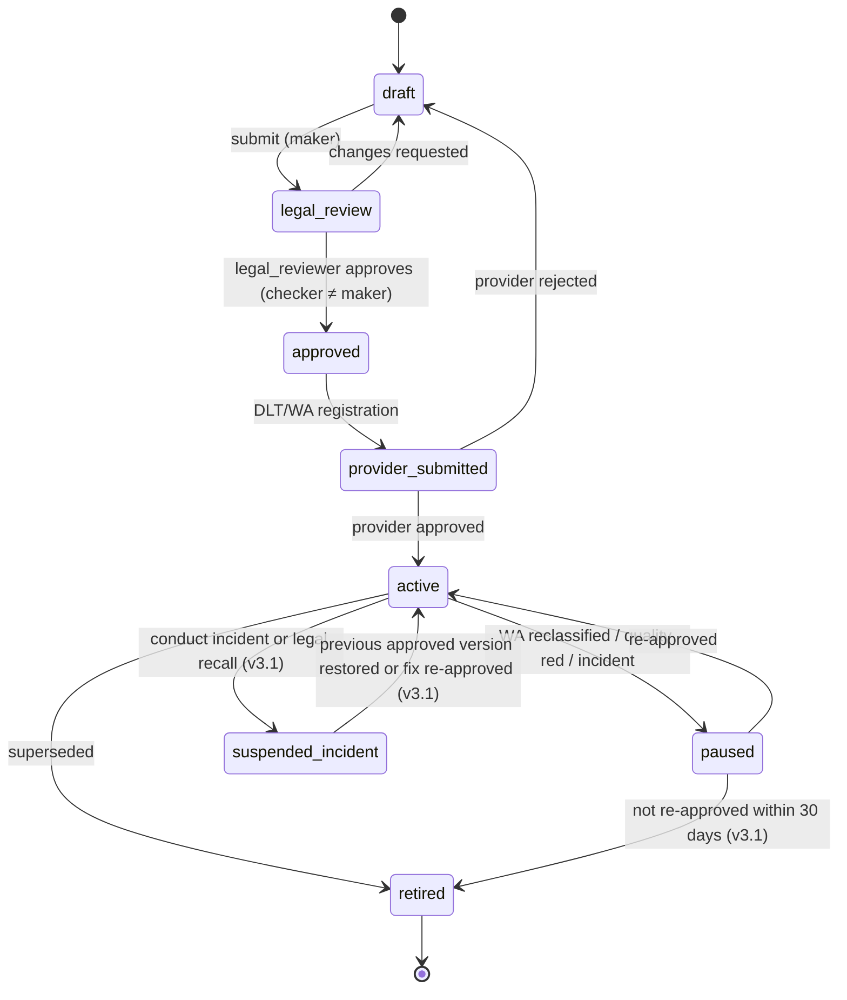
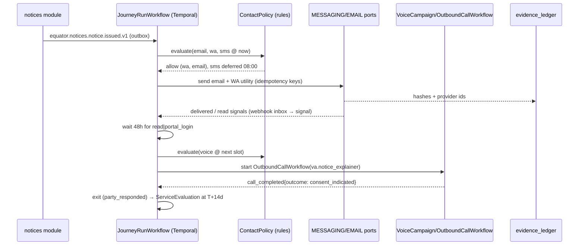

# P07 — Omnichannel Communications & AI Voice Agents
> Paste after 01_MASTER_PROMPT.md. Prerequisites: P00, P01, P02 (hard); P04 sessions and P05 payment links are consumed when present (soft — stub ports until then). Estimated effort: 5 sprints (2-week) for a squad of 7 (2 backend, 1 workflow/Temporal, 1 web, 1 mobile, 1 voice/conversation designer, 1 QA), plus 0.5 legal reviewer for templates and scripts.

## 1. Objective and business outcome

Build the `comms` and `voice` bounded contexts: one consent-aware, policy-enforced orchestration layer that reaches every party on the channel they actually use — email, SMS, WhatsApp, push, in-app, speed post and AI voice — and produces legally usable delivery evidence for every notice.

Business outcomes (measured from P08 pilots onward):

| KPI | Baseline (industry, lender ODR) | P07 target |
|---|---|---|
| Respondent engagement within 14 days of notice | ~20–30% **[VERIFY — open: internal estimate]** | ≥ 55% |
| Notices with ≥ 2 independent delivery proofs | n/a | ≥ 95% |
| Contact-conduct breaches (NN-12) reaching a party | n/a | 0 (hard block) |
| Voice calls with completed identity check before case detail | n/a | 100% |
| Cost per engaged respondent (all channels) | n/a | ≤ ₹45 (FIN bulk), reported per tenant |
| Template changes activated without legal approval | n/a | 0 |

This phase delivers differentiator **D9** (vernacular AI voice + WhatsApp respondent engagement) and the "omnichannel notices with delivery evidence" table stake.

## 2. Scope (in / out)

**In scope**
1. Journey orchestrator on Temporal: notices, reminders, hearing confirmations, payment nudges, document requests, consent requests, feedback surveys — multi-step, multi-channel, branching on delivery/read/response events.
2. Channel adapters: EMAIL (AWS SES ap-south-1; Resend fallback row disabled until a DPDP cross-border assessment and residency ADR — no India region, P00 §8), SMS (MSG91 DLT; Gupshup/Kaleyra fallback), WhatsApp (Meta Cloud API via Gupshup BSP; Interakt/AiSensy/MSG91 fallback) including template categories, interactive buttons, WhatsApp Flows, WhatsApp Payments `order_details`, PUSH (Expo; direct FCM/APNs fallback), IN-APP (`core.notifications` + WebSocket), speed post (manual desk + India Post API adapter where contracted).
3. AI voice agents on the ElevenLabs Agents Platform (Enterprise, India Data Residency) over Exotel SIP; Sarvam voice agents and LiveKit Agents + Sarvam STT/TTS as fallbacks; provider-agnostic `VOICE_PORT` + `TELEPHONY_PORT`.
4. Seven voice use cases: respondent notice explanation and consent to ODR; slot booking; hearing reminders; settlement-offer relay (party-authorised offers only, on the pre-proceeding negotiation rung — master X-05); payment-link delivery; feedback surveys; inbound helpline.
5. Contact Policy Engine (deterministic, `packages/rules`): calling window, DLT, number-series selection, consent/DND/opt-out, blackout dates, attempt caps, holiday rules, sensitivity pauses, third-party block.
6. Call records, transcripts, recordings, post-call analysis, QA sampling dashboard, per-tenant cost metering.
7. Template management: maker–checker with mandatory legal approval, multilingual variants (en, hi at launch + 10 languages by configuration), DLT and WhatsApp template registration and status sync.
8. Delivery evidence into `core.evidence_ledger` with SHA-256 content hashes and provider receipts.
9. Preference centre: DPDP purpose-wise consent, channel and language preferences, preferred contact time, marketing vs transactional separation.

**Out of scope**
- Marketing automation journeys (v3.0: P17 `mkt` with the Operations Platform CRM `ops.crm_*` as system of record, both in the isolated business database — X-51, X-53; P13 `growth` keeps capture and web experiments; NN-16). P07 exposes only the suppression check API to them.
- Video hearing rooms and hearing transcription (P04). P07 sends the invitations and reminders only.
- AI gateway hardening, eval harness and governance console (P11). P07 uses the P02 gateway skeleton and registers voice prompts in the prompt registry; P11 adds the release gates.
- WhatsApp Business Calling API (business-initiated WhatsApp voice) — feature flag `comms.wa_calling.enabled` OFF; design hooks only.
- Field-agent physical visits (not an Equator activity).

## 3. Personas and permissions touched

| Role | Permissions added in P07 |
|---|---|
| `party`, `party_org_user`, `counsel` | Read own communications timeline; manage own preferences, language, preferred contact time; opt out per purpose/channel; respond to WhatsApp Flows; request human callback; download own delivery certificate |
| `case_manager` | Start/stop journeys on assigned cases; send ad hoc approved templates; view delivery evidence; set blackout; trigger a single supervised voice call; view transcripts (non-sealed) |
| `registrar` | Approve deemed-service certificate; approve journey activation for a tenant |
| `institution_admin` | Journey designer, template library, voice-agent studio, campaign console (within tenant); cannot alter NN-12 floors |
| `enterprise_admin` / `enterprise_operator` | Launch bulk campaigns for referred cases (lender/insurer/employer), view campaign MIS (aggregated), upload 1600-series number authorisations; never see transcripts of the counterparty's calls beyond outcome fields agreed in the MSA |
| `quality_officer` | QA sampling dashboard; score calls; raise conduct incidents; access mediation-confidential recordings only via break-glass |
| `safeguarding_lead` | Receives vulnerable-person handoffs; sets sensitivity pause; FAM/WRK safety signals |
| `support_agent` | Human handoff queue; inbound helpline human tier; callback tasks |
| `dpo` | Consent ledger, opt-out propagation report, recording retention and erasure queue, break-glass review |
| `platform_admin` | Provider routing, DLT registry, number inventory, A2P declarations and telecom evidence (`eng.telecom_declarations` — v2 `ops.telecom_declarations`, placed in `eng` by X-50; Appendix F §F.10 note 8), UCC_Detect hygiene monitor, kill switches (`voice.ai_outbound.enabled`, per tenant/vertical) |
| `legal_reviewer` (permission bundle on `quality_officer`/`institution_admin`, not a new role code) | Approve templates, scripts and multilingual variants |
| `machine` | Enterprise API: create campaign, query outcomes (aggregated), receive webhooks |

## 4. Functional requirements

### 4.1 Journey orchestration

**FR-P07-01 — Journey definitions as versioned data.** A journey (`core.journeys`) is a versioned JSON definition editable in Ruleset Studio: `trigger` (domain event, e.g. `equator.notices.notice.issued.v1`), `audience` (case-party roles), `steps[]` (channel, template key, delay, conditions, wait-for events, max attempts), `exit_conditions` (party responded, case closed, opt-out, sensitivity pause), `legal_service: boolean`, `purpose_code` (DPDP purpose), `recovery_related: boolean` (drives NN-12 recording + GRO footer). Journeys are maker–checker approved and pinned to a case at the moment a run starts (NN-21). Editing a journey never alters running instances; a new version applies only to new runs.

**FR-P07-02 — Standard journey library (seeded).** Ship these journeys per vertical with defaults (all editable within guardrails):

| Key | Trigger | Default sequence (local time, within window) |
|---|---|---|
| `J-NOTICE-SERVE` | notice issued | T0 email + WhatsApp utility template (with "View notice" button) + SMS with whitelisted short link; T+48h if no open/read → AI voice notice explainer; T+5d → second WA + SMS; T+7d → speed post (if `legal_service` and address present); T+14d → deemed-service evaluation (FR-P07-07) |
| `J-CONSENT-ODR` | respondent viewed notice, no consent | WA Flow `consent_odr`; T+24h voice consent call; T+72h SMS reminder; T+7d task to case manager |
| `J-HEARING-CONFIRM` | session scheduled | Email + WA with ICS; T-72h reminder (WA/SMS/push); T-24h voice reminder (if not acknowledged); T-2h push + SMS with join link |
| `J-PAYMENT-NUDGE` | invoice issued / instalment due | WA `order_details` or payment link; T-3d, T0, T+3d reminders; T+5d voice payment-link call; stops on `payment.captured` |
| `J-DOC-REQUEST` | deficiency raised | WA Flow `doc_upload` + email; T+3d reminder; T+6d voice reminder; T+7d escalate to case manager |
| `J-OFFER-RELAY` | counter-party-authorised offer published on the pre-proceeding negotiation rung (never inside mediation/conciliation — master X-05) | In-app + WA (offer card, Accept/Reject/Counter → non-binding indication); optional voice relay (consent-gated, FR-P07-24) |
| `J-FEEDBACK` | proceeding closed | T+1d WA survey Flow; T+3d email; optional voice survey (5 questions) |
| `J-ESIGN-CHASE` | eSign envelope sent (P06) | T+1d, T+3d reminders; T+5d voice reminder |

**FR-P07-03 — Event-driven branching.** Steps can wait for normalised events (`delivered`, `read`, `clicked`, `flow_submitted`, `payment_captured`, `call_completed{outcome}`, `party_responded`) with timeouts. Branch conditions are deterministic expressions over event payloads and case state (CEL-style, evaluated by `packages/rules`); no LLM participates in routing (NN-01).

**FR-P07-04 — Channel-order resolution.** For each step the orchestrator resolves the channel list as: journey step channels ∩ channels with valid contact point ∩ channels permitted by consent/purpose ∩ channels permitted by the Contact Policy Engine at the planned send time. If the intersection is empty, the step is deferred to the next permitted slot (not dropped); after `max_deferral_hours` (default 72) a `core.tasks` item is created for the case manager.

**FR-P07-05 — Idempotency and de-duplication.** Every send carries `idempotency_key = sha256(journey_run_id, step_id, attempt_no, channel)`. A second dispatch with the same key returns the original `core.communications` row. Bulk campaigns de-duplicate by `(case_party_id, template_key, local_date)`.

**FR-P07-06 — Legal-service notices use ≥ 2 independent channels.** When `legal_service = true` the journey must include at least two of {email, WhatsApp, SMS, speed post, in-app with authenticated read}; activation of a journey violating this is rejected (`COMMS_LEGAL_SERVICE_CHANNELS_INSUFFICIENT`). Criminal-law notices (BNSS 2023 s.35) are never sent by WhatsApp/SMS (Supreme Court, *Satender Kumar Antil v. CBI*, 2025 INSC 909, 16 Jul 2025, dismissing Haryana's application to modify the 21 Jan 2025 order); the platform does not issue such notices, and templates tagged `criminal_process` are blocked.

**FR-P07-07 — Deemed-service evaluation.** At the configured horizon (default T+14d) the `ServiceEvaluation` activity applies the tenant's procedure-rules version (pinned) to `core.service_attempts`: e.g. "served" if any of (WA `read`, email `opened` + link clicked with authenticated session, speed post `delivered` with POD, in-app read after OTP login); "deemed served" if delivered (not read) on ≥ 2 channels to contact points supplied by the party in the underlying contract, mirroring A&C Act 1996 s.3(1)(b) (deemed receipt at last known address by registered letter or other means providing a record of delivery). Output: a service certificate PDF (hash-recorded) routed to `registrar` for approval before any adverse step (ex parte progression).

### 4.2 Channels

**FR-P07-08 — Email (EMAIL_PORT).** SES configuration set per tenant with DKIM, SPF, DMARC `p=quarantine` minimum; custom MAIL FROM per tenant domain; bounce/complaint events via SNS → `/webhooks/ses` (SNS signature v2 verified). Hard bounce → contact point `status = invalid`; complaint → suppress non-legal-service email for that address and alert DPO. Open-tracking pixel is OFF for party communications by default (privacy); click tracking uses first-party redirect `https://{tenant-domain}/l/{token}` that also serves as authenticated-read evidence. Attachments: notices are never attached in full; a signed, expiring link to the authenticated portal plus a SHA-256 of the PDF in the body.

**FR-P07-09 — SMS (MESSAGING_PORT, `sms`).** DLT-registered headers and templates only; every send carries `dlt_entity_id`, `dlt_header`, `dlt_template_id` and a content-template match check (`{#var#}` positions and lengths) before dispatch (`COMMS_DLT_TEMPLATE_MISMATCH`). URLs in SMS must be whitelisted on DLT (TRAI direction of 20 Aug 2024 on URL/APK/OTT-link whitelisting, effective 1 Oct 2024 after a one-month extension — TRAI PR 60/2024); the platform uses a single whitelisted short domain per tenant. Header suffix by category: `-S` service, `-T` transactional, `-P` promotional, `-G` government (TCCCPR Sch. I item 2(1), as amended 2025); promotional never used for case communications.

**FR-P07-10 — WhatsApp (MESSAGING_PORT, `whatsapp`).**
- WABA created in **INR billing** from day one (Meta requires all eligible WABAs on INR by 31 Dec 2026; non-INR WABAs stop delivering 1 Jan 2027 — R3 §2.1 [S]).
- Template categories: case communications are **utility** (or **authentication** for OTP). A lint rule rejects any case template submitted as `marketing` (`COMMS_TEMPLATE_CATEGORY_FORBIDDEN`). If Meta reclassifies a utility template as marketing, the template is auto-paused and routed back to the template owner.
- Interactive elements: quick-reply buttons (max 3), CTA URL button, list messages, WhatsApp Flows.
- Seeded Flows: `consent_odr` (notice summary → choose: Agree to ODR / Need more time / Request call / Do not agree → reason), `slot_booking` (three offered slots from `GET /v1/cases/{caseId}/proceedings/{proceedingId}/slots`), `doc_upload` (document type, file, declaration — files land in quarantine bucket → ClamAV → DMS), `offer_response` (Accept-in-principle / Reject / Counter with amount and instalments — always recorded as **non-binding indication**), `feedback` (5 items), `preferences` (language, preferred time window, channel opt-outs).
- Payments: `order_details` with Razorpay PG deep integration (native status webhooks and refunds) for filing/admin/neutral fees only. **Settlement sums are never collected through a WhatsApp order on Equator's merchant account** (NN-13); for settlement instalments the message carries the lender/escrow payment link supplied by `ESCROW_PORT` or the payee's own collection link.
- The 24-hour customer-service window is tracked per `(waba, msisdn)`; session messages outside the window are rejected locally before the API call.
- Inbound messages are routed: Flow responses → structured handlers; free text → `support_agent` inbox (no LLM auto-reply in P07; P11 may add draft replies with HITL).

**FR-P07-11 — Push (PUSH_PORT).** Expo push tokens per device in `core.contact_points(kind='push')`; receipts polled at +15 min; `DeviceNotRegistered` prunes the token. Push payloads never contain case facts: title "Update on your case EQ/…/00042", body "Open the app to view" (lock-screen privacy). Deep link `equator://cases/{caseId}/timeline`.

**FR-P07-12 — In-app.** `core.notifications` rows with WebSocket fan-out (NestJS gateway) and unread counts; an in-app read after authenticated login is the strongest service proof and is recorded as a `service_attempts` row with `result = 'read_authenticated'`.

**FR-P07-13 — Speed post (`POSTAL_PORT`, Appendix D §D.2.6; master X-02).** Two modes per tenant: (a) **manual desk** (adapter `manual_desk`) — print-ready PDF batch with India Post article numbers entered or scanned by a postal-desk user (`case_manager` bundle with `postal_desk` permission), tracking polled from the India Post tracking service or entered manually, POD scan uploaded; (b) **API** — adapter `indiapost_api` for a contracted bulk-mailing/India Post business integration **[VERIFY — open: no public India Post bulk booking/tracking API; contract via DoP Business Development & Marketing Directorate before enabling the `indiapost_api` adapter]**. Postage at actuals is billed as a fee line (`speed_post_actuals`, master §7). Returned-undelivered (RTS) with reason updates the service attempt.

### 4.3 Contact Policy Engine (NN-12)

**FR-P07-14 — Single deterministic guard.** Every outbound party contact (any channel) calls `ContactPolicy.evaluate(ctx)` in `packages/rules` at schedule time **and again at dispatch time** (the second check covers drift, e.g. a blackout added after scheduling). Result: `{ allow: boolean, reasons: ReasonCode[], next_permitted_at?: timestamptz, series?: '1600'|'1601'|'DID'|'TOLLFREE'|'INTL', principal_entity_id?: string, cli_declaration_id?: uuid, dnd?: { status, scrubbed_at, consent_registration_ref? }, must_record: boolean, disclosures: DisclosureKey[] }`. Vendor-side scheduling features (e.g. ElevenLabs batch time windows) are configured too, but are never relied on.

**FR-P07-15 — Calling and messaging window.** Hard block outside **08:00–19:00 in the recipient's local time** — **09:00–18:00 for microfinance loans** — for calls (human, AI voice) and for WhatsApp/SMS on any case flagged `recovery_related` (LR-RBI-005: in force now under the RBI (NBFC – Responsible Business Conduct) Directions 2025 para 100 (and para 91(2) for microfinance); from 1 Jan 2027 under para 100Y(4) of the Third Amendment Directions 2026, RBI/2026-27/230, 6 Aug 2026 — the v2 text treated the hours as starting only in 2027; NN-12). The microfinance window is selected from the loan product on the case (`fin.product = microfinance`) and is locked (`core.quiet_hours_policies` scope `recovery_related_microfinance`). Platform default applies the same window to **all** party-facing voice calls in every vertical. Tenants may narrow the window, never widen it. Local time is resolved from the contact point's state (from address/PIN) or, failing that, from the MSISDN circle; for foreign numbers (INT) from the E.164 country's primary time zone, with a configurable window (default 09:00–18:00 local, business days). The only exception is the borrower's **express request** for contact outside the window, captured as a consent record (`purpose = 'contact_time_override'`, text version hash, timestamp, channel) and valid for the single requested slot.

**FR-P07-16 — Sundays and holidays (Equator policy).** Default: no outbound voice on Sundays and national holidays; configurable state holiday calendar. Default ON for all verticals. This is an Equator policy default, not an RBI rule: neither the 12 Feb 2026 draft nor the final NBFC Responsible Business Conduct (Third Amendment) Directions, 2026 (RBI/2026-27/230, 6 Aug 2026, effective 1 Jan 2027) bars Sunday/holiday contact. The final text requires 08:00–19:00 contact and avoiding bereavement, medical emergency, marriage and similar occasions (paras 100Y(4), 100Y(6)), which FR-P07-15 and FR-P07-18 enforce.

**FR-P07-17 — Attempt caps (per case-party, all tenants).**

| Cap | Default | Tenant may | Hard ceiling |
|---|---|---|---|
| Voice attempts per day | 2 | lower | 3 |
| Connected voice calls per day | 1 | lower | 1 |
| Voice attempts per rolling 7 days | 6 | lower | 8 |
| Minimum gap between voice attempts | 3 h | raise | ≥ 2 h |
| Outbound messages (WA+SMS) per day, excl. OTP and in-window replies | 3 | lower | 4 |
| Calls after an explicit "do not call me" | 0 | — | 0 |

Unanswered/busy/no-answer attempts count. Caps are aggregated **across tenants and campaigns** for the same person (resolved via `core.persons`) so that two lenders cannot jointly exceed the cap on one borrower.

**FR-P07-18 — Blackout dates.** `core.contact_blackouts(person_id, case_id?, kind, starts_at, ends_at, source, evidence_doc_id?)` with kinds `bereavement` (default 30 days), `medical_emergency` (15 days), `marriage` (default 7 days centred on date), `natural_disaster` (tenant- or district-wide), `sensitivity_pause`, `party_requested`. A blackout blocks all non-legal-service contact; legal-service notices already dispatched are not withdrawn but no reminders or calls are placed. Blackouts can be set by party (preference centre / voice / WA keyword), case manager, safeguarding lead, or automatically from voice-agent vulnerability detection (FR-P07-28).

**FR-P07-19 — Consent, DND and opt-out.**
- Lawful basis map (DPDP Act 2023 ss.6, 7, 17(1)(a)): legal-service notices and procedural communications to a respondent are processed for enforcing legal rights/claims (s.17(1)(a)) and are **transactional/service**; AI voice calls, WhatsApp and feedback surveys require a recorded basis per purpose in `core.consent_records` (consent captured in the ODR clause/agreement, the lender's loan agreement, or in-journey).
- Purposes: P01 FR-P01-36 is the master catalogue (`service_communications`, `whatsapp_channel`, `voice_ai_calls`, `session_recording`, `marketing_communications`, `research_anonymised` …). P07 adds these child purposes under `service_communications` / `voice_ai_calls` (seed `core.consent_purposes` with `parent_code`): `case_notices`, `case_reminders`, `hearing_logistics`, `payment_reminders`, `call_recording`, `voice_offer_relay`, `feedback_surveys`; marketing sub-purposes `marketing_equator`, `marketing_partner` sit under `marketing_communications`. `marketing_*` purposes live in a separate consent namespace and are **never inferred** from case participation (NN-16).
- Opt-out keywords: SMS/WA `STOP`, `रोकें`, `UNSUB` + language variants; voice phrase "don't call me" intent; email list-unsubscribe header (non-legal-service only). Opt-out applies to the purpose/channel; legal-service notices continue on remaining lawful channels with an explanatory line.
- **Consent artefacts for automated calls (M-05 control D4).** Explicit, purpose-specific consent to `voice_ai_calls` and `call_recording` is captured in the ODR clause/agreement, at intake, in the lender's loan agreement or in-journey, and stored with the SHA-256 of the consent text, channel and timestamp. It is pushed to the originating operator's **Digital Consent platform** through the CPaaS/DCA facility where supported (consents obtained outside the DLT framework, including legacy consents, may be registered — TCCCPR as amended by the Third Amendment Regulations 2026). Inquiry-based relationship consent is treated as valid for ≤ 7 days and application-based relationship consent for ≤ 3 months (reg 2(bb)); explicit consent for service calls is re-confirmed before the validity attached by reg 2(bh) lapses. Revocation under TCCCPR affects the telecom channel only; DPDP withdrawal is handled separately and both propagate within 15 minutes.
- **DND/NCPR scrubbing (control D5).** Every outbound voice and SMS list is scrubbed against the recipient's NCPR preference at schedule time and again at dispatch. Transactional communications and service communications based on inferred consent (tagged as such in the registered content template) are not blockable. Service calls that rely on **explicit consent** — which includes AI/automated calls outside a transactional exchange — are **blocked** for numbers under "Fully Block"/"Block Promo" preferences unless the consent is registered on the operator consent platform (TCCCPR Sch. II) or the party itself initiated the case or the contact; otherwise the step is deferred to messaging (`COMMS_NO_LAWFUL_BASIS`). DND status, scrub time and consent-registration reference are stored in `policy_decision`.
- Withdrawal propagates within 15 minutes to all running journeys and to the voice provider (cancel scheduled batch rows) and is evidenced in `audit.audit_events`.

**FR-P07-20 — Number resources, DLT registration and A2P declaration (management decision M-05; NN-12).** Equator places automated and AI voice calls itself through third-party CPaaS/telephony subscriptions. The Contact Policy Engine selects the number resource for every call under these controls (TRAI Press Release No. 91/2026 (10 Jul 2026) on the 1600/140 series; TCCCPR 2018 as amended by the Second Amendment Regulations 2025 (No. 1 of 2025, F. No. RG-25/(25)/2023-QoS, 12 Feb 2025) and the Third Amendment Regulations 2026 (No. 05 of 2026, 18 Sep 2026; A2P-call declaration under substituted reg 4, applicable 60 days after Gazette publication (reg 1(3); Gazette Extraordinary Pt III s.4 No. 561 dated 18 Sep 2026, e-Gazette ID dated 28 Sep 2026) — 17 Nov 2026 used as the compliance date [Checked 22 Oct 2026: Gazette copy])):
1. **DLT registration (control D1).** Equator registers as a **Principal Entity (Sender)** on the DLT platform of each originating operator (Jio, Airtel, Vi, BSNL); its CPaaS providers (Exotel, Plivo) are registered as **telemarketers** linked to Equator's PE ID. ElevenLabs, Sarvam and LiveKit voice agents reach the PSTN **only** through those Indian operator/CPaaS SIP trunks — no foreign origination. PE IDs, telemarketer links, headers and templates are held in `core.dlt_registry`.
2. **Lender-number mode — default for FIN/INS matters referred by a regulated tenant (control D2).** When the case is referred by an RBI/SEBI/IRDAI/PFRDA-regulated tenant (lender/insurer) and the journey is on its behalf, the call presents the **tenant's 1600-series number**. 1600 is reserved for those regulated entities and Government, so Equator cannot hold 1600 numbers in its own name. The tenant is the PE; Equator and its CPaaS are chained on the tenant's DLT as its telemarketer. Written tenant authorisation (letter, tenant PE ID, numbers, permitted purposes, validity) is stored in `core.number_authorisations`; a missing or expired authorisation blocks the call (`COMMS_NUMBER_SERIES_UNAVAILABLE`) and never falls back silently to an Equator number.
3. **Equator's own service calls (control D3).** Hearing reminders, slot booking, consent calls in matters without a regulated-tenant authorisation, feedback surveys and requested callbacks use **fixed-line/SIP DID numbers allotted to Equator** by the CPaaS/operator, registered against Equator's PE and **declared in advance as A2P CLI ranges**. Under the Third Amendment, AI, robo-call and pre-recorded/artificial-voice calls are A2P calls, and undeclared A2P calls are treated as unsolicited commercial communication. Each call is classified as `service` (explicit or relationship consent) or `transactional`. Feature flag `voice.equator_service_number.enabled` stays **OFF**, and cannot be switched ON, until `eng.telecom_declarations` (v2 `ops.`) holds, for every originating operator used, (a) the operator's/CPaaS's **written confirmation** that this CLI type is permitted for Equator's category and (b) a **telecom-counsel opinion**. While the flag is OFF, Equator-originated voice is limited to the inbound helpline and callbacks the party requested; lender-number mode is unaffected.
4. **1601 watch.** The 1601 series for service/transactional calls by non-BFSI, non-Government senders (TRAI Direction and Press Release No. 113/2026, both 10 Aug 2026) covers only utilities and courier/logistics in Phase I; legal/ODR services are not yet notified. A Legal Rules Register watch item (`LR-TEL-002`, status `UNVERIFIED`) is reviewed monthly by a `legal_reviewer`; when a phase covering legal/ODR/professional services is notified, `platform_admin` opens the application within 5 working days. 1601 numbers are allotted directly to the eligible entity (not to aggregators) against an undertaking of exclusive service/transactional use; once allotted they replace DID numbers for Equator's own calls.
5. **Never** a personal 10-digit mobile number for any automated, bulk or case call; **never** the 140 series (promotional; DND-blocked) for case communications.
6. **A2P declaration guard (control D6).** Before go-live, the A2P declaration (purpose + CLI ranges) is filed with each originating operator and its acknowledgement kept in `eng.telecom_declarations`. The Contact Policy Engine and the `TELEPHONY_PORT` adapter both refuse any CLI that is not inside a declared, acknowledged range for the call's PE (`COMMS_CLI_NOT_DECLARED`).
7. **UCC_Detect hygiene (control D7).** Operators run AI/ML "UCC_Detect" flagging of CLIs (reg 21A): graded action (KYC re-verification → barring → disconnection) follows when 5 or more of a sender's CLIs are flagged in 10 days, or on 3 or more complaints in 10 days plus an AI flag. Controls: per-CLI call-rate caps (configurable; default 60 per hour, 400 per day), answer-rate and short-duration (< 10 s) monitoring with alerts, rotation only within declared ranges, and an alarm at ≥ 2 complaints per CLI in 10 days that pauses the CLI pending review. Penalty exposure (first instance: all sender resources barred for 15 days; second: disconnection for one year and blacklisting — reg 25) is tracked in the risk register.
8. **CNAP**: register the brand name with the carrier where offered (DoT circular 13 Oct 2026, reported: CNAP mandatory from 1 Nov 2026 on 4G/5G mobile; landlines later; bulk/enterprise 'preferred name' must be a registered trademark or GST trade name — apply on mobile bulk connections; SIP DIDs may not show a name) **[VERIFY — open (watch): DoT circular text and landline/SIP timing]**.
9. **Termination charge.** Equator's own A2P DID traffic may attract the A2P termination charge (up to ₹0.05 per minute; new reg 35A inserted by Third Amendment reg 18, in force with the 60-day tier), which does not apply on the 140/1600/1601 series; it is metered in `core.comm_cost_ledger`.

**FR-P07-21 — Mandatory disclosures and footers.**
- Every recovery-related message (SMS, WA, email, voice) includes the **grievance officer's name, email, phone and address** of the referring regulated entity, and Equator's GRO for platform issues (NN-12; para 100AA). SMS uses a short form with a link to the full GRO card where character limits require (template-level lint enforces presence).
- Every voice call opens with the mandatory first utterance (M-05 control D8; NN-12(d)): entity name (Equator Resolution), "automated AI assistant", a generic purpose (a service message for the named person, without naming the dispute, principal or amount), the recording notice and the opt-out phrase. The principal (lender/insurer/institution) is named only after the answerer confirms identity. Human hand-over is available on request; no impersonation (Appendix E §E.6.3 C-OPEN; VP-01..VP-05, VP-15).
- Every party-facing message includes "Equator Resolution is a private dispute-resolution institution, not a court or government body" in the notice templates (GX-4; NN-17).
- Paid commercial relationship disclosure in the first notice to a counterparty when the claimant is an enterprise subscriber (NN-16).

### 4.4 AI voice agents

**FR-P07-22 — Voice agent registry.** `core.voice_agents` stores provider-neutral agent definitions: `agent_key` (e.g. `va.notice_explainer`), use case, vertical scope, languages, voice IDs per language, workflow graph (nodes/edges in the provider-neutral schema in Appendix E §6), tool allow-list, knowledge-base corpus IDs, data-collection schema, evaluation criteria, max call duration (default 8 min; helpline 15 min), prompt version (registered in `core.ai_prompt_versions`), legal approval reference. `VOICE_PORT.upsertAgent()` compiles the definition into the provider's format (ElevenLabs workflow with Subagent/Say/Dispatch-tool/Transfer/End nodes; Sarvam agent config; LiveKit Agents worker config). An agent version cannot be activated without legal approval and a passing voice eval suite (P11 owns the gate; P07 ships the suite skeleton).

**FR-P07-23 — Tools exposed to voice agents.** Tools are narrow server webhooks on `/v1/voice-tools/*` authenticated with a per-call JWT (TTL = max call duration + 5 min, audience `voice-tools`, claims `call_id`, `case_party_id`, `scopes[]`, `id_verified: boolean`). Before identity verification the token carries only `verify_identity`, `request_human_callback`, `end_call_log`. After verification the call's scopes are upgraded server-side (the tool server keeps verification state; the agent cannot self-assert).

| Tool | Purpose | Side effect | Scope |
|---|---|---|---|
| `verify_identity` | OTP send/check or knowledge check | Writes `call_identity_checks` | pre-verify |
| `get_case_brief` | Case ref, parties' display names, mechanism, next date, plain-language stage, amounts **only** as stated in the notice | none | post-verify |
| `get_available_slots` | Up to 3 slots | none | post-verify |
| `hold_slot` | Tentative 15-min hold | Creates `slot_holds` (not a booking) | post-verify |
| `confirm_slot` | Confirms a held slot after explicit "yes" | Books session attendance intent; confirmation sent by WA/SMS | post-verify |
| `record_consent` | Captures spoken consent to ODR/online mode/recording | `consent_records` with audio segment hash; **final ODR agreement still e-signed** | post-verify |
| `get_authorised_offer` | Fetches an offer the counter-party authorised for relay | none | post-verify, offer flow only; pre-proceeding negotiation rung only (X-05) |
| `record_offer_response` | Accept-in-principle / reject / counter (amount, instalments) | `core.offers` indication row, `binding = false` | post-verify |
| `send_link` | WA/SMS deep link: notice, portal login, doc upload, eSign, payment | Dispatches via MESSAGING_PORT through Contact Policy Engine | post-verify |
| `set_preference` | Language, preferred time, channel opt-out | `contact_preferences` | any |
| `set_blackout` | Party-requested pause (bereavement, illness) | `contact_blackouts` | any |
| `request_human_callback` | Creates callback task | `core.tasks` | any |
| `transfer_to_human` | Warm transfer (system tool) | Telephony transfer | any |
| `record_survey_answer` | Feedback items | `survey_responses` | post-verify |

No tool can file, withdraw, accept, waive, pay or change a claim (GX-7).

**FR-P07-24 — Use-case rules.**
1. **Notice explainer + consent to ODR**: explains who filed, what Equator is (and is not), what the respondent can do, the free/statutory alternatives relevant to the vertical (GX-8, NN-20: e.g. RBI Integrated Ombudsman for FIN, Insurance Ombudsman/Bima Bharosa for INS), the response deadline (read from the clock service, never computed by the LLM), and offers consent capture. Spoken consent is recorded as an *indication*; the ODR agreement or s.12(5) waiver (NN-03) is completed only by e-sign via a link.
2. **Slot booking**: max 3 options read out; confirmation repeated back with date in words.
3. **Hearing reminder**: date/time/mode/join method; offers reschedule request (creates task, does not reschedule).
4. **Settlement-offer relay (pre-proceeding negotiation rung only — master X-05)**: only offers with `authorised_for_relay = true` signed off by the offering party (e.g., a FIN OTS offer authorised by the lender); verbatim reading of amount, instalments and validity; no persuasion, no comparison, no valuation (GX-3), no "good deal" language; response captured as non-binding; binding acceptance only by e-signed settlement (P06). Disabled for FAM maintenance/custody topics and for any party with a vulnerability flag. Requires `voice_offer_relay` consent from the receiving party. Recovery-related relay calls are recorded under NN-12. **Inside a mediation or conciliation proceeding (including the mediation phase of med-arb/arb-med) the voice agent never relays substantive offers**; it handles logistics only (reminders, slot booking, joining help), and `get_authorised_offer` returns 409 `VOICE_OFFER_NOT_AUTHORISED` (reason `inside_mediation`).
5. **Payment link**: reads amount due and due date from billing/escrow; sends link; never takes card/UPI PIN/OTP by voice (agent refuses and warns).
6. **Feedback survey**: 5 items max, after closure, opt-in; no case merits discussion.
7. **Inbound helpline**: caller identification by CLI match + verification; general process questions answered from the knowledge base; case-specific answers only after verification; human transfer during office hours (default 09:30–18:30 Mon–Sat) else callback task.

**FR-P07-25 — Identity verification before case discussion.** Agent asks for the person by first name only. If the answerer confirms, verification by (a) OTP sent to the registered mobile/WA (6 digits, 5-min TTL, 3 tries) or (b) knowledge check: 2 of 3 items from {year of birth, PIN code of registered address, last 4 characters of the loan/policy/contract reference} — configured per tenant. Pass → scopes upgraded. Fail or refuse → agent provides only the generic helpline number and a WA/SMS link to log in; **no disclosure** of the dispute, principal, counter-party or amount beyond the mandatory opening (Equator's name, AI disclosure, generic service-message purpose, recording notice, opt-out).

**FR-P07-26 — Third parties.** If someone other than the party answers ("he's not here", "I'm his wife"), the agent says only: "Thank you. We'll try again another time." It does not name the lender, Equator's role, the dispute or any amount; does not leave a message; does not ask for alternative numbers; logs `outcome = third_party_answered`; no further call that day. Voicemail/answering machine detection → hang up without message (Exotel/Plivo AMD).

**FR-P07-27 — Language.** First message in the case's notice language (`case_parties.preferred_language`, default from state). ElevenLabs system tool `language_detection` switches language on request or detection; the target language must be in the agent's approved language set (per-language scripts legally approved). Unsupported language → apology in English/Hindi, WA link in the detected language if a template exists, human callback task with interpreter flag. Hinglish/code-mixed speech is supported in `hi` agents.

**FR-P07-28 — Vulnerable-person detection and human handoff.** A turn-level classifier (provider "LLM condition" edges + Equator post-turn webhook) flags: distress/crying, self-harm or suicide ideation, bereavement, serious illness/hospitalisation, domestic violence or threats, apparent minor, apparent cognitive impairment or intoxication, explicit request for a human, explicit legal-advice request, complaint about harassment. Actions: (1) stop the script; (2) for self-harm or danger: read the safety line (Tele-MANAS 14416 or 1-800-891-4416 / emergency 112) and warm-transfer to `safeguarding_lead` queue if in office hours; (3) otherwise warm transfer to `support_agent` or create a priority callback task; (4) set `vulnerability_flag` on `case_parties` (sealed; never shown to the counter-party, NN-07 pattern) and an automatic blackout (bereavement 30 d / medical 15 d / other 7 d); (5) suppress offer-relay and payment calls for the party until a human clears the flag. *(v3.1)* Every callback created in (2)–(3) is a `callback_task` with the Appendix E §E.6.2 states (`open → assigned → attempted → completed`, plus `unreachable`, `cancelled_opt_out` and `breached`) and SLAs (failed safeguarding transfer → safeguarding-lead callback within 30 minutes and an SMS with 112 and Tele-MANAS numbers; vulnerable callbacks within 2 working hours).

**FR-P07-29 — Post-call analysis.** Provider post-call webhook (transcript, data-collection results, evaluation criteria, audio availability, cost) → `PostCallProcessingWorkflow`: verify signature → store raw payload (webhook inbox) → normalise into `core.call_records` + `core.transcripts` → validate data-collection JSON against the agent's schema → apply outcomes (consent indication, slot hold, offer indication, preference, blackout) only if the corresponding **tool call** was executed during the call (post-call extraction alone never changes state) → run Equator's conduct checker (prohibited phrases, missing disclosures, out-of-window, identity-check bypass) → enqueue QA sample.

**FR-P07-30 — Recording and transcript retention.**
- Recording disclosure at call start; if the party objects to recording on a recovery-related call, the agent offers a human callback or WA/portal alternative and ends the call (recovery calls must be recorded under NN-12).
- Storage: recordings and transcripts copied from provider to S3 ap-south-1 Object Lock bucket `eq-voice-records` (compliance mode) within 10 minutes of call end; then `VOICE_PORT.deleteConversationData()` purges the provider copy after T+24h (or ZRM where batch is not used).
- Retention: recovery-related ≥ 180 days (para 100P: six months, or until disposal where the matter is sub judice; default 180; legal hold extends while sub judice or under complaint); CDRs and telephony logs ≥ 180 days in ap-south-1 (CERT-In Directions No. 20(3)/2022-CERT-In, 28 Apr 2022) (control D10); non-recovery calls 180 days default; helpline 90 days; feedback surveys: no audio retained, transcript 90 days.
- **Mediation-confidential calls** (logistics calls placed within a mediation or conciliation proceeding; offer relay there is barred by master X-05): stored in separate bucket `eq-voice-medconf` with a separate KMS key; never placed in any proceeding record, bundle or AI corpus; accessible only to `quality_officer`/`dpo` via break-glass for conduct complaints; deleted at 180 days unless a conduct complaint is open. The conduct checker raises a critical incident if substantive offer content is detected in such a call (NN-11).

**FR-P07-31 — Batch outbound campaigns.** `core.voice_campaigns` (tenant, agent version, audience query or uploaded list, schedule, concurrency, retry policy). Equator never uploads raw lists to the provider without passing each row through the Contact Policy Engine (window, caps, blackout, DND scrub, consent registration, declared CLI); the campaign workflow schedules each row individually and, where provider batch APIs are used (ElevenLabs batch calling; not available in Zero Retention Mode), submits **only rows already cleared for the current window**, in micro-batches of ≤ 500 with `scheduled_time_unix` inside the window, and cancels residual rows at window close − 10 min. Dynamic variables are limited to the allow-list `{first_name, case_ref, language, call_jwt, notice_date_spoken, tenant_display_name}`; amounts, addresses and counter-party details are fetched by tools only after verification.

### 4.5 Templates, evidence, preferences, QA, costs

**FR-P07-32 — Template management with legal approval.** `core.message_templates` (key, channel, purpose, vertical, legal_service, recovery_related, category, version) with variants per locale in `core.message_template_variants`. Lifecycle: `draft → legal_review → approved → provider_submitted → active → paused → retired`. Rules: (a) English source + each language variant independently approved by a `legal_reviewer` (NN-23); (b) machine translation may seed a variant but the variant is flagged `mt_seeded` until human approval; (c) variable schema with types, max lengths and sample values; (d) lint: GRO footer present if `recovery_related`; no prohibited phrases (threat lexicon, "court", "decree", "judge", "police will", "arrest", "legal action will be taken immediately", "final warning", "defaulter"); no sealed-data variables; no amounts in push; SMS ≤ 3 segments; (e) provider sync: DLT template IDs and WA template IDs/status mapped per variant; (f) a running journey uses the variant version pinned at run start.

**FR-P07-33 — Delivery evidence.** For each send: rendered content (exact bytes) hashed SHA-256; provider message ID; timestamps sent/delivered/read/clicked; recipient contact point snapshot; template variant version; for voice: call SID, start/answer/end, recording hash, transcript hash; for speed post: article number, booking receipt scan, tracking events, POD scan. Each artefact is written to S3 Object Lock and appended to `core.evidence_ledger` (NN-22). The **Delivery Certificate** (per notice, per party) lists all attempts and is issued as a PDF with a BSA 2023 s.63(4) Part A/Part B certificate stub generated from the evidence ledger (NN-10); time of dispatch/receipt recorded consistent with IT Act 2000 s.13.

**FR-P07-34 — Preference centre (DPDP).** Web + mobile + WA Flow + voice: per-purpose consent toggles with itemised notice (Rule 3, DPDP Rules 2025), language, preferred contact window (inside the legal window), channel ranking, accessibility needs (large text, audio-first, interpreter), withdrawal history download. Marketing purposes are shown in a visually separate section, default OFF, never pre-ticked, and respondents served with notices are excluded from marketing unless they opt in separately (NN-16). Withdrawal is as easy as giving consent (one tap).

**FR-P07-35 — QA sampling.** Sample rates (configurable): 100% of calls with conduct-checker flags, vulnerability flags, complaints, or `transfer_to_human`; 10% random of other AI calls per agent version per week (minimum 30); 100% of the first 200 calls of any new agent version. QA scorecard (Appendix E §6.5) with 12 items; any "critical" item failure (missing AI disclosure, missing recording notice, case detail before verification, third-party disclosure, out-of-window, threat/coercion language, advice/valuation) opens a conduct incident and, when ≥ 1 critical per 500 calls for an agent version, auto-trips the agent's kill switch.

**FR-P07-36 — Cost metering.** Every adapter emits cost lines to `core.comm_cost_ledger` (tenant, case, channel, provider, unit, quantity, unit_cost_minor, currency, fx_snapshot_id): email per message, SMS per segment, WA per delivered template (by category), voice per connected minute (platform + LLM + telephony pulses), speed post actuals, STT/TTS characters. Tenants see monthly cost by channel/campaign; enterprise plans can pass through comms cost as invoice lines (P05). Budget caps per tenant per month with 80%/100% alerts; at 100% non-legal-service campaigns pause.

**FR-P07-37 — Kill switches.** Feature flags (OpenFeature + Unleash): `voice.ai_outbound.enabled` (global, tenant, vertical, agent), `voice.offer_relay.enabled`, `comms.whatsapp.enabled`, `comms.speedpost_api.enabled`, `voice.equator_service_number.enabled`, `voice.batch_provider_api.enabled`. Tripping a switch cancels scheduled provider jobs within 5 minutes and falls back to non-voice journey steps.

## 5. Workflows and state machines

### 5.1 Communication (single send) state machine

| State | Event | Guard | Next state | Side effects |
|---|---|---|---|---|
| `planned` | dispatch time reached | ContactPolicy.allow at dispatch | `queued` | outbox row |
| `planned` | dispatch time reached | policy deny | `deferred` | `next_permitted_at` set; audit `COMMS_DEFERRED` |
| `deferred` | `next_permitted_at` reached | allow | `queued` | — |
| `deferred` | max deferral exceeded | — | `abandoned` | task to case manager |
| `queued` | provider accepted | — | `sent` | provider_message_id stored |
| `queued` | provider error (retryable) | attempts < 3 | `queued` | backoff 30 s, 2 min, 10 min (jitter) |
| `queued` | provider error (fatal) / circuit open | fallback provider exists | `queued` (fallback) | routing audit |
| `queued` | fatal, no fallback | — | `failed` | journey branch `on_failed` |
| `sent` | `delivered` | — | `delivered` | evidence ledger append |
| `sent`/`delivered` | `read` / `clicked` / `flow_submitted` | — | `engaged` | journey signal |
| any non-terminal | opt-out / blackout / case closed | — | `cancelled` | reason recorded |
| `sent` | hard bounce / `undelivered` DLR / WA `failed` | — | `failed` | contact point marked per FR-P07-08; journey moves at once to the next channel in the resolved list (no wait for the step timeout) *(v3.1)* |
| `sent` | no delivery receipt within 72 h | — | `unconfirmed` | counted as *not* delivered for deemed service (FR-P07-07); provider queried once by `DeliveryReconciliationWorkflow` *(v3.1)* |
| `planned` / `deferred` | case `on_hold` or proceeding `suspended` | — | `deferred` (reason `case_on_hold`) | non-legal-service steps wait; legal-service notices already dispatched are unaffected; resumes on `resume` *(v3.1)* |

**Window-open ordering and collisions.** *(v3.1)* Messages deferred to the next window are released at window open in this order: legal-service notices with the nearest response deadline or statutory clock, then recovery-related reminders, then hearing logistics, then surveys; releases are spread over the first 60 minutes per CLI/sender to stay within the UCC_Detect hygiene caps (FR-P07-20 item 7). When two journeys target the same person in the same day, the attempt caps (FR-P07-17) are shared and the higher-priority journey sends first; lower-priority steps defer to the next permitted slot rather than being dropped. A case manager sees deferred items with reasons on the case communications timeline and can "send at next window" or cancel, never override the window.

### 5.2 Voice call state machine (`core.call_records.status`)

| State | Event | Guard | Next | Side effects |
|---|---|---|---|---|
| `scheduled` | slot time | ContactPolicy.allow; attempt caps; flag ON | `dialling` | JWT minted; `VOICE_PORT.placeCall` |
| `scheduled` | slot time | deny | `skipped` | reason |
| `dialling` | no answer / busy / failed / AMD machine | — | `not_connected` | attempt counted; retry per policy |
| `dialling` | answered (human) | — | `in_progress` | — |
| `in_progress` | `verify_identity` pass | — | `verified` | scopes upgraded |
| `in_progress` | wrong person | — | `ended_third_party` | no disclosure; no retry today |
| `in_progress` / `verified` | vulnerability signal | — | `handoff` | transfer or callback task; flag + blackout |
| `verified` | goal complete | — | `completed` | tool side effects already persisted |
| any live | party hangs up / max duration | — | `ended` | — |
| terminal | post-call webhook | signature valid | `analysed` | transcript, data collection, conduct check, QA sample |
| `analysed` | retention expiry | no legal hold | `purged` | recording deleted; hash retained |
| `in_progress` / `verified` | party asks to be called at another time | requested time inside the window and within 7 days | `ended` + new `scheduled` row | `callback_requested` outcome; the new slot is honoured once even if it is the only attempt that day (caps still apply) *(v3.1)* |
| `not_connected` | retry policy | caps and window allow | `scheduled` (next attempt) | next attempt = later of (last attempt + minimum gap, next window open); after the weekly cap the journey moves to messaging and a case-manager task opens *(v3.1)* |
| `dialling` / `in_progress` | provider or carrier failure mid-call | — | `failed_provider` | attempt not counted against the party's daily cap; no automatic mid-call failover; the next attempt uses the fallback route if the circuit is open *(v3.1)* |

### 5.3 Template lifecycle



*(v3.1)* An incident suspension stops every running journey step that uses the template within 5 minutes and, where a previous approved variant exists, switches pinned runs to it only with a `legal_reviewer` approval recorded on the incident (runs are otherwise held, not silently re-pinned — NN-21). The template list shows, per template, the running journeys and cases that would be affected before a pause is confirmed.

### 5.4 Notice-serving journey (sequence)



### 5.5 Temporal workflows

| Workflow | Started by | Key activities | Signals / queries | Timeouts |
|---|---|---|---|---|
| `JourneyRunWorkflow` | outbox consumer on trigger event | `resolveChannels`, `evaluatePolicy`, `renderTemplate`, `dispatch`, `recordEvidence` | `deliveryEvent`, `partyResponded`, `optOut`, `blackoutSet`, `caseStateChanged`, `cancel`; query `status` | run max 120 days; `continueAsNew` every 500 events |
| `OutboundCallWorkflow` | journey step / campaign | `mintCallJwt`, `placeCall`, `awaitCallEnd` | `providerStatus`, `postCallReady`, `killSwitch` | call max duration + 30 min |
| `VoiceCampaignWorkflow` | campaign launch | `selectEligibleRows`, `scheduleMicroBatch`, `cancelResidual` | `pause`, `resume`, `abort` | campaign end date |
| `PostCallProcessingWorkflow` | webhook inbox | `fetchArtefacts`, `copyToWorm`, `normalise`, `conductCheck`, `qaSample`, `purgeProviderCopy` (timer 24 h) | — | 26 h |
| `TemplateApprovalWorkflow` | template submit | `lint`, `assignReviewer`, `submitDlt`, `submitWa`, `pollStatus` | `approve`, `reject` | 30 days |
| `ServiceEvaluationWorkflow` | journey horizon | `applyDeemedServiceRules`, `renderCertificate`, `awaitRegistrar` | `registrarDecision` | 10 days |
| `DeliveryReconciliationWorkflow` | cron 02:30 IST | poll providers for events missed during outages; reconcile counts | — | 2 h |
| `RetentionSweepWorkflow` | cron daily | expire recordings/transcripts per schedule unless legal hold | — | 4 h |

## 6. Screens and UX (web + mobile)

| ID | Route | Persona | Purpose and key components | States | Mobile | Accessibility |
|---|---|---|---|---|---|---|
| SCR-P07-01 | `/admin/comms/journeys` | institution_admin | Journey list + visual designer (step nodes: channel, template, wait, branch, exit); NN validation panel (shows blocked combos, e.g. "legal service needs ≥ 2 channels"); simulate on a synthetic party; version diff; submit for approval | empty: "No journeys — start from library"; error: validation list | web only | Keyboard-operable canvas; list alternative view for screen readers |
| SCR-P07-02 | `/admin/comms/templates` | institution_admin, legal_reviewer | Template library with filters (channel, purpose, vertical, language, status); coverage matrix (template × locale with status chips) | loading skeleton; error | web only | Table with sortable headers, status not by colour alone |
| SCR-P07-03 | `/admin/comms/templates/{id}/variants/{locale}` | maker / legal_reviewer | Editor: variables panel with types, live preview per channel (SMS segment counter, WA rendering with buttons, email HTML/text), lint results, DLT template ID / WA template status, side-by-side source vs translation, approve/request-changes with comment | lint-fail blocks submit | web only | Script-aware fonts (Noto); lang attribute per pane |
| SCR-P07-04 | `/cases/{caseId}/communications` | case_manager, party (own) | Case communications timeline: every attempt with channel icon, template, status chips, evidence hash, transcript link (if allowed), "Resend" (respecting policy), "Call now (supervised)" | empty: "No communications yet" | Party view in app: simplified list, no other party's comms | Live region for new events |
| SCR-P07-05 | `/cases/{caseId}/notices/{noticeId}/service` | case_manager, registrar | Delivery evidence viewer and deemed-service evaluation; certificate preview; approve/return | pending/approved | read-only on mobile | PDF has tagged structure |
| SCR-P07-06 | `/me/preferences` | party, counsel | Preference centre (FR-P07-34): purpose toggles with itemised notice, language, preferred time slider (bounded 08:00–19:00), channel order, accessibility needs, blackout request, history download | success toast; error retry | full parity in app (`/settings/communication`) | Toggles with explicit labels; 44 px targets |
| SCR-P07-07 | `/admin/comms/contact-policy` | institution_admin, platform_admin | Tenant policy within floors (window narrowing, caps lower, holidays), state calendars, blackout manager (search person, add/end blackout with reason), sensitivity pauses | floors shown read-only with legal source | web | — |
| SCR-P07-08 | `/admin/voice/agents` | institution_admin, legal_reviewer | Voice agent studio: agent list, version, languages, workflow graph (read-only render of compiled graph), script per node per language, tools allow-list, KB corpus, data-collection schema, eval status, legal approval, activate/deactivate; "test call to my number" (staff only, synthetic case) | activation blocked badge if eval/legal missing | web | — |
| SCR-P07-09 | `/enterprise/campaigns` and `/admin/voice/campaigns` | enterprise_admin, case_manager | Campaign console: create (agent, audience, schedule), live counters (eligible, deferred by reason, dialled, connected, verified, outcomes), pause/abort, export aggregated MIS (no transcripts for enterprise unless contract allows outcome fields) | — | enterprise-lite app: counters + pause | Numbers announced via aria-live politely |
| SCR-P07-10 | `/cases/{caseId}/calls/{callId}` | case_manager, quality_officer | Call record: metadata, consent/recording notices played (timestamps), identity check result, transcript with speaker turns and language tags, tool calls timeline, data collection, conduct flags, audio player (authorised roles), QA score | sealed/medconf banner when restricted | read-only transcript on mobile | Transcript as accessible text; audio controls labelled |
| SCR-P07-11 | `/admin/voice/qa` | quality_officer | QA sampling dashboard: queue by priority, scorecard form, inter-rater calibration view, critical-failure rate per agent version, kill-switch status, incident links | — | web | — |
| SCR-P07-12 | `/admin/comms/costs` | institution_admin, enterprise_admin, platform_admin | Cost metering: by channel/provider/campaign/vertical, unit costs, budget caps, export CSV | — | web | Charts with table fallback |
| SCR-P07-13 | `/support/handoffs` | support_agent, safeguarding_lead | Human handoff queue: live transfers, callback tasks with SLA timers (vulnerable: 2 working hours; standard: 1 working day), call context card (verified? language, reason), outcome form; ordered by vulnerability first, then SLA remaining, then the party's nearest case deadline; breaching tasks escalate to `support_lead` at 100% of SLA; language-matched assignment *(v3.1)* | — | support app web only | — |
| SCR-P07-14 | `/console/speed-post` (v2 `/ops/speed-post`; renamed so no case-portal route sits under the Operations Platform's `ops` namespace — X-65) | postal-desk user (`case_manager` bundle) | Batch builder, print PDF, article number capture (barcode scan via camera on mobile), tracking status, RTS handling, POD upload | — | mobile scan supported | — |
| SCR-P07-15 | WhatsApp Flows (in-chat) | party | `consent_odr`, `slot_booking`, `doc_upload`, `offer_response`, `feedback`, `preferences` screens (JSON Flow definitions in `packages/templates/wa-flows`) | Flow error screen with helpline | native WA | Flow copy ≤ 80 chars per line; language per template |
| SCR-P07-16 | `/admin/integrations/dlt` | platform_admin | DLT registry: PE IDs per operator, telemarketer links, headers, templates, number authorisations (1600 letters from tenants with expiry alerts), A2P declarations and CLI ranges with operator acknowledgements, operator CLI confirmation and counsel opinion (flag preconditions), consent-registration status, per-CLI UCC_Detect hygiene (call rate, answer rate, short calls, complaints), 1601 watch status | expiry warning at T-30 d; CLI paused banner | web | — |
| SCR-P07-17 | `/inbox` | all authenticated | In-app notification centre (unread, case filter, mark read); *v3.1:* the list UI is superseded by the Work Inbox AG-SCR-01 at the same route, and these notifications become its Updates tab (data source kept; FR-P00-V31-AG03; mobile tab per Appendix AG §AG.2.13) | empty state | app tab "Inbox" with badge | — |
| SCR-P07-18 | `/u/{token}` (public) | recipient | Opt-out / preference landing from SMS/email link: confirms scope, explains that legal notices continue on lawful channels | invalid/expired token | responsive | Plain language, en/hi toggle |
| SCR-P07-19 | `/admin/voice/helpline` | institution_admin | Inbound helpline config: numbers, IVR language menu, office hours, human queues, after-hours behaviour | — | web | — |

## 7. Backend design

### 7.1 Modules touched
`comms` (journeys, templates, dispatch, preferences, evidence), `voice` (agents, calls, campaigns, tools API, QA), `consent` (purposes, records, withdrawal propagation), `notices` (service attempts, certificates), `integrations` (adapters, provider routing, webhook inbox), `rules` (ContactPolicy evaluator), `documents` (evidence ledger), `billing` (cost pass-through lines), `audit`, `notifications` (in-app), `ai` (prompt registry for voice prompts).

### 7.2 Tables

Canonical tables used: `core.communications`, `core.message_templates`, `core.journeys`, `core.journey_runs`, `core.contact_preferences`, `core.quiet_hours_policies`, `core.call_records`, `core.transcripts`, `core.consent_records`, `core.consent_purposes`, `core.contact_points`, `core.notices`, `core.service_attempts`, `core.evidence_ledger`, `core.notifications`, `core.tasks`, `core.provider_routing`, `core.outbox`, `core.webhook_inbox`, `core.ai_prompt_versions`. New feature tables (prefix `core.`): `message_template_variants`, `dlt_registry`, `number_inventory`, `number_authorisations`, `contact_blackouts`, `contact_attempt_counters`, `voice_agents`, `voice_agent_versions`, `voice_campaigns`, `voice_campaign_rows`, `call_identity_checks`, `call_tool_invocations`, `slot_holds`, `survey_responses`, `qa_reviews`, `conduct_incidents`, `comm_cost_ledger`, `postal_dispatches`; plus `eng.telecom_declarations` (M-05 evidence; v2 name `ops.telecom_declarations`, moved to `eng` in the core database under X-50 — confirm in the X-65 ADR).

```sql
CREATE TABLE core.communications (
  id uuid PRIMARY KEY DEFAULT uuidv7(),
  tenant_id uuid NOT NULL REFERENCES core.tenants(id),
  case_id uuid REFERENCES core.cases(id),
  case_party_id uuid REFERENCES core.case_parties(id),
  person_id uuid NOT NULL REFERENCES core.persons(id),
  journey_run_id uuid REFERENCES core.journey_runs(id),
  channel text NOT NULL CHECK (channel IN ('email','sms','whatsapp','push','in_app','voice','speed_post')),
  purpose_code text NOT NULL REFERENCES core.consent_purposes(code),
  template_variant_id uuid REFERENCES core.message_template_variants(id),
  legal_service boolean NOT NULL DEFAULT false,
  recovery_related boolean NOT NULL DEFAULT false,
  status text NOT NULL CHECK (status IN ('planned','deferred','queued','sent','delivered','engaged','failed','cancelled','abandoned','unconfirmed')),  -- 'unconfirmed' v3.1
  policy_decision jsonb NOT NULL,          -- ContactPolicy result at dispatch (reasons, series, disclosures)
  provider_code text, provider_message_id text,
  content_sha256 char(64),                 -- hash of exact rendered bytes
  idempotency_key char(64) NOT NULL,
  planned_at timestamptz NOT NULL, sent_at timestamptz, delivered_at timestamptz, engaged_at timestamptz,
  created_at timestamptz NOT NULL DEFAULT now(),
  UNIQUE (tenant_id, idempotency_key)
) PARTITION BY RANGE (planned_at);
-- RLS: tenant_id = current_setting('app.tenant_id')::uuid; parties see rows where person_id = app.person_id
CREATE INDEX ON core.communications (case_id, planned_at DESC);
CREATE UNIQUE INDEX ON core.communications (provider_code, provider_message_id) WHERE provider_message_id IS NOT NULL;

CREATE TABLE core.contact_blackouts (
  id uuid PRIMARY KEY DEFAULT uuidv7(),
  person_id uuid NOT NULL REFERENCES core.persons(id),
  tenant_id uuid,                          -- NULL = applies across all tenants (party-requested, vulnerability)
  case_id uuid,
  kind text NOT NULL CHECK (kind IN ('bereavement','medical_emergency','marriage','natural_disaster','sensitivity_pause','party_requested','vulnerability_auto')),
  starts_at timestamptz NOT NULL, ends_at timestamptz NOT NULL CHECK (ends_at > starts_at),
  source text NOT NULL CHECK (source IN ('party','case_manager','safeguarding_lead','voice_agent','system')),
  reason_note_enc bytea,                   -- field-level encrypted; never shown to counter-party
  created_by uuid, created_at timestamptz NOT NULL DEFAULT now()
);

CREATE TABLE eng.telecom_declarations (          -- M-05 controls D1, D3, D6; evidence for voice.equator_service_number.enabled (v2: ops., X-50)
  id uuid PRIMARY KEY DEFAULT uuidv7(),
  operator text NOT NULL CHECK (operator IN ('jio','airtel','vi','bsnl')),
  principal_entity_id text NOT NULL,               -- Equator's DLT PE ID (or tenant PE ID for chained telemarketer links)
  kind text NOT NULL CHECK (kind IN ('pe_registration','telemarketer_link','a2p_declaration','consent_platform_integration',
                                      'operator_cli_confirmation','counsel_opinion','series_1601_application')),
  purpose text,                                    -- e.g. 'service: hearing reminders, slot booking, consent calls'
  cli_ranges text[] NOT NULL DEFAULT '{}',         -- E.164 ranges declared as A2P (kind = 'a2p_declaration')
  traffic_class text CHECK (traffic_class IN ('service','transactional')),
  filed_at timestamptz, acknowledged_at timestamptz, expires_at timestamptz,
  status text NOT NULL CHECK (status IN ('draft','filed','acknowledged','rejected','withdrawn')),
  evidence_doc_id uuid NOT NULL,                   -- DMS document: portal receipt, operator letter, opinion
  created_by uuid NOT NULL, created_at timestamptz NOT NULL DEFAULT now()
);

CREATE TABLE core.number_authorisations (          -- lender-number (1600) mode, control D2
  id uuid PRIMARY KEY DEFAULT uuidv7(),
  tenant_id uuid NOT NULL REFERENCES core.tenants(id),
  tenant_pe_id text NOT NULL,                      -- regulated tenant's DLT PE ID
  telemarketer_ref text NOT NULL,                  -- Equator/CPaaS chained as telemarketer on the tenant's DLT
  numbers text[] NOT NULL,                         -- tenant's 1600-series E.164 numbers
  purposes text[] NOT NULL,                        -- e.g. {notice_explainer,consent_capture,hearing_reminder,offer_relay}
  letter_doc_id uuid NOT NULL, valid_from date NOT NULL, valid_to date NOT NULL CHECK (valid_to > valid_from),
  status text NOT NULL CHECK (status IN ('active','expired','revoked'))
);

CREATE TABLE core.number_inventory (
  id uuid PRIMARY KEY DEFAULT uuidv7(),
  e164 text NOT NULL UNIQUE,
  series text NOT NULL CHECK (series IN ('1600','1601','DID','TOLLFREE','INTL')),
  holder text NOT NULL CHECK (holder IN ('equator','tenant')),
  tenant_id uuid,                                  -- required when holder = 'tenant'
  principal_entity_id text NOT NULL,
  telephony_provider text NOT NULL,                -- exotel | plivo | twilio (INT foreign numbers only)
  a2p_declaration_id uuid REFERENCES eng.telecom_declarations(id),   -- required before any A2P use
  status text NOT NULL CHECK (status IN ('provisioned','active','paused_ucc','retired')),
  CHECK (holder = 'equator' OR tenant_id IS NOT NULL),
  CHECK (series <> '1600' OR holder = 'tenant')    -- Equator never holds 1600 numbers
);

CREATE TABLE core.call_records (
  id uuid PRIMARY KEY DEFAULT uuidv7(),
  tenant_id uuid NOT NULL, case_id uuid, case_party_id uuid, person_id uuid NOT NULL,
  direction text NOT NULL CHECK (direction IN ('outbound','inbound')),
  agent_version_id uuid REFERENCES core.voice_agent_versions(id),  -- NULL for human-only calls
  campaign_id uuid REFERENCES core.voice_campaigns(id),
  voice_provider text, telephony_provider text, provider_call_id text, carrier_call_sid text,
  from_number_id uuid REFERENCES core.number_inventory(id), number_series text CHECK (number_series IN ('1600','1601','DID','INTL','TOLLFREE')),
  to_msisdn_hash char(64) NOT NULL, to_msisdn_masked text NOT NULL,   -- e.g. 98****3210
  language_start text, language_end text,
  status text NOT NULL, outcome text,       -- outcome enum in Appendix E §6.2
  recovery_related boolean NOT NULL, confidentiality text NOT NULL DEFAULT 'standard' CHECK (confidentiality IN ('standard','mediation_confidential','sealed')),
  disclosures_played jsonb NOT NULL DEFAULT '[]',   -- [{key:'ai_disclosure', at_ms:1200}, ...]
  identity_verified boolean NOT NULL DEFAULT false,
  vulnerability_signals text[] NOT NULL DEFAULT '{}',
  started_at timestamptz, answered_at timestamptz, ended_at timestamptz, billable_seconds int,
  recording_s3_uri text, recording_sha256 char(64), retention_until date, legal_hold boolean NOT NULL DEFAULT false,
  cost_minor bigint, cost_currency char(3) DEFAULT 'INR',
  UNIQUE (voice_provider, provider_call_id)
);
```

RLS notes: `core.transcripts` and `core.call_records` with `confidentiality = 'mediation_confidential'` are readable only under a break-glass grant (`audit.break_glass_events` row required by policy); `vulnerability_signals` and `contact_blackouts.reason_note_enc` are excluded from counter-party and enterprise views by column-level grants in the read views `v_call_records_party`, `v_call_records_enterprise`.

### 7.3 APIs

| Method + path | Purpose | Auth / role | Idempotency |
|---|---|---|---|
| `POST /v1/journeys` / `PUT /v1/journeys/{id}` | Create/version journey | institution_admin (maker) | Idempotency-Key |
| `POST /v1/journeys/{id}/approve` | Checker approval | registrar / institution_admin ≠ maker; step-up MFA | — |
| `POST /v1/cases/{caseId}/journey-runs` | Start journey for case/parties | case_manager, machine | required |
| `POST /v1/cases/{caseId}/journey-runs/{runId}/cancel` | Cancel run | case_manager | — |
| `GET /v1/cases/{caseId}/communications` | Timeline (role-filtered) | case members | — |
| `POST /v1/cases/{caseId}/communications` | Ad hoc send of approved template | case_manager | required |
| `GET /v1/cases/{caseId}/notices/{noticeId}/delivery-certificate` | Certificate PDF + hash manifest | case members, registrar | — |
| `POST /v1/templates` · `POST /v1/templates/{id}/variants` · `POST /v1/templates/{id}/variants/{vid}/submit` · `.../approve` | Template lifecycle | maker / legal_reviewer | required |
| `GET/PUT /v1/me/preferences` | Preference centre | party | PUT idempotent |
| `POST /v1/me/consents/{purpose}/withdraw` | Withdraw consent | party | required |
| `POST /v1/persons/{personId}/blackouts` | Add blackout | case_manager, safeguarding_lead, party (self) | required |
| `POST /v1/contact-policy/evaluate` | Dry-run policy (staff tooling, campaign preview) | case_manager, enterprise_admin | — |
| `POST /v1/voice/agents` · `POST /v1/voice/agents/{id}/versions` · `.../activate` | Agent registry | institution_admin; activate needs legal approval + eval pass | required |
| `POST /v1/voice/calls` | Supervised single call | case_manager | required |
| `POST /v1/voice/campaigns` · `POST /v1/voice/campaigns/{id}/pause|resume|abort` | Campaigns | enterprise_admin, case_manager | required |
| `GET /v1/voice/calls/{callId}` · `GET /v1/voice/calls/{callId}/transcript` · `GET /v1/voice/calls/{callId}/recording` | Call artefacts | role + confidentiality policy; recording → step-up MFA, access logged | — |
| `POST /v1/voice-tools/{toolName}` | Tool endpoints for agents | per-call JWT (aud `voice-tools`) | `tool_call_id` from provider |
| `POST /v1/qa/reviews` | QA scorecard | quality_officer | required |
| `GET /v1/comms/costs` | Cost report | institution_admin, enterprise_admin | — |
| `POST /v1/speed-post/batches` · `PATCH /v1/speed-post/dispatches/{id}` | Postal desk | `case_manager` with `postal_desk` permission | required |
| `POST /webhooks/{provider}` | Provider webhooks (ses, msg91, gupshup, meta, expo-receipts n/a, elevenlabs, sarvam, exotel, plivo, indiapost) | signature verification per Appendix D | unique `(provider, event_id)` |
| `GET /v1/suppression/check?personId=&purpose=` | NN-16 suppression check for P13 growth and, from v3.0, the Operations Platform CRM and `mkt` (P16, P17) | `machine` (growth, ops-CRM and mkt service identities only); returns boolean only | — |

Errors (RFC 9457 `code`; per X-20 the Appendix F canonical codes prevail — `COMMS_CONTACT_WINDOW_CLOSED` and P02 `contact_window_blocked` are sub-codes of canonical `CONTACT_OUTSIDE_WINDOW`, and `COMMS_BLACKOUT_ACTIVE` of `CONTACT_BLACKOUT_ACTIVE`): `COMMS_CONTACT_WINDOW_CLOSED`, `COMMS_BLACKOUT_ACTIVE`, `COMMS_ATTEMPT_CAP_REACHED`, `COMMS_NO_LAWFUL_BASIS`, `COMMS_OPTED_OUT`, `COMMS_TEMPLATE_NOT_ACTIVE`, `COMMS_TEMPLATE_CATEGORY_FORBIDDEN`, `COMMS_DLT_TEMPLATE_MISMATCH`, `COMMS_LEGAL_SERVICE_CHANNELS_INSUFFICIENT`, `COMMS_NUMBER_SERIES_UNAVAILABLE`, `COMMS_CLI_NOT_DECLARED`, `VOICE_AGENT_NOT_APPROVED`, `VOICE_KILL_SWITCH_ON`, `VOICE_TOOL_SCOPE_DENIED`, `VOICE_IDENTITY_NOT_VERIFIED`, `VOICE_OFFER_NOT_AUTHORISED`.

### 7.4 Domain events
`equator.comms.journey_run.started.v1`, `equator.comms.journey_run.completed.v1`, `equator.comms.message.dispatched.v1`, `equator.comms.message.delivered.v1`, `equator.comms.message.engaged.v1`, `equator.comms.message.failed.v1`, `equator.comms.template.approved.v1`, `equator.comms.template.paused.v1`, `equator.consent.consent.withdrawn.v1`, `equator.comms.blackout.set.v1`, `equator.notices.service.evaluated.v1`, `equator.notices.service_certificate.approved.v1`, `equator.voice.call.completed.v1`, `equator.voice.call.handoff_requested.v1`, `equator.voice.consent.indicated.v1`, `equator.voice.offer_response.indicated.v1`, `equator.voice.conduct_incident.raised.v1`, `equator.voice.agent.kill_switched.v1`, `equator.comms.cost.recorded.v1`. All published via outbox in CloudEvents format; payloads carry IDs, never message bodies or PII.

### 7.5 Temporal workflows / jobs
See §5.5. Task queues: `comms-dispatch` (high concurrency, rate-limited per provider token bucket), `voice-calls`, `comms-evidence`, `comms-admin`. Workers run in ap-south-1; activities calling providers use per-provider circuit breakers (opossum: 50% errors over 20 requests → open 60 s).

## 8. Integrations

| Port | Primary (default `provider_routing`) | Fallback | Failure behaviour |
|---|---|---|---|
| `VOICE_PORT` | ElevenLabs Agents (Enterprise, India Data Residency — written confirmation that Agents, transcripts and recordings are covered is an activation precondition; R3 U1) | Sarvam Voice Agents; LiveKit Agents + Sarvam Saaras STT / Bulbul TTS (self-hosted worker, Mumbai) | No automatic mid-call failover. New calls route to fallback when circuit opens; per-language routing allowed (e.g. Marathi → Sarvam if ElevenLabs agent path fails the bake-off, R3 U2) |
| `TELEPHONY_PORT` | Exotel (India cluster; SIP trunk into ElevenLabs; AgentStream for LiveKit path; tenant 1600 numbers and Equator DID numbers in declared A2P ranges; AMD) | Plivo India | Fallback only where the same number series is provisioned on the fallback carrier; otherwise calls are deferred and journeys continue on messaging |
| `MESSAGING_PORT` (whatsapp) | Gupshup (Meta Cloud API BSP) | Interakt / AiSensy / MSG91 | Template IDs differ per BSP; failover requires templates pre-approved on fallback WABA — otherwise fall back to SMS |
| `MESSAGING_PORT` (sms) | MSG91 | Gupshup SMS / Kaleyra | Automatic failover (stateless); same DLT template IDs (PE-level) |
| `EMAIL_PORT` | AWS SES ap-south-1 | Resend (row seeded disabled, P00 §8; once enabled by a residency ADR, non-legal-service only) | Automatic for transactional; legal-service email waits for SES recovery up to 6 h, then task |
| `PUSH_PORT` | Expo Push | Direct FCM v1 / APNs | Automatic |
| `PAYMENTS_PORT` | Razorpay (payment links, WA `order_details`) | Cashfree | Per P05 |
| `TRANSLATION_PORT` | Sarvam Translate (seed only) | IndicTrans2 | MT output never activates without human approval |
| `POSTAL_PORT` (Appendix D §D.2.6) | `manual_desk` | `indiapost_api` (India Post / bulk-mail partner, by written agreement only) | Manual |
| `LLM_PORT` | Bedrock (India in-country) for conduct-checker and post-call classification | — | NN-02: conduct checker falls back to deterministic phrase/disclosure checks; QA sampling rate raised to 100% for vulnerability-signal detection gaps |

Full interface contracts, webhook signature schemes and error mapping: Appendix D.

## 9. Configuration surface (Ruleset Studio)

| Item | Default | Customisable by | Guardrail |
|---|---|---|---|
| Journey library per vertical | §4.1 table | institution_admin (maker–checker) | Legal-service journeys need ≥ 2 channels; no marketing category |
| Contact window | 08:00–19:00 local; microfinance 09:00–18:00 (LR-RBI-005) | tenant (narrow only) | Platform floor (NN-12) |
| Sunday/holiday block | ON | tenant (ON/OFF for non-FIN) | FIN recovery-related: ON by Equator policy (not an RBI requirement; the final 6 Aug 2026 text has no Sunday/holiday bar). The lock is a product choice |
| Attempt caps | §FR-P07-17 | tenant (lower only) | Hard ceilings |
| Blackout default durations | 30/15/7 days | tenant (longer only) | — |
| Identity verification method | OTP preferred; knowledge check fallback | tenant (choose items) | ≥ 2 factors for knowledge check |
| Recording retention | 180 days | tenant (longer only, ≤ case retention) | ≥ 180 days recovery-related |
| Voice agents and scripts | Appendix E §6 | institution_admin + legal_reviewer | Mandatory disclosure nodes cannot be removed (compiler rejects) |
| Languages enabled | en, hi | tenant | Each language requires approved script + template variants |
| QA sample rates | §FR-P07-35 | quality_officer (raise only) | Minimums |
| Budget caps | none | tenant | Legal-service traffic is never paused by budget caps |
| Provider routing | §8 | platform_admin | Residency check: providers without India residency cannot carry personal data unless ADR-approved |
| Deemed-service rule | pinned procedure rules | registrar via rules versioning | NN-21 pinning |

## 10. Security, privacy and audit

- **Data minimisation to vendors**: voice providers receive first name, case reference, language and a short-lived JWT; everything else via tools after verification. WA/SMS bodies contain no amounts for FAM/WRK/INS-health matters; INS health and FAM safety data never enter any template (NN-07). Push never carries case facts.
- **Residency**: ElevenLabs India Data Residency (Enterprise only; isolated environment with API base `api.in.residency.elevenlabs.io`, separate account and API key, agents recreated via API) required before production. ElevenLabs states that custom-LLM and post-call-webhook traffic may be processed outside the region, so the custom LLM is Equator's OpenAI-compatible proxy in ap-south-1 calling the Bedrock India profile, and post-call webhooks terminate in ap-south-1. Sarvam India-hosted; Exotel (India cluster)/Plivo India; SES ap-south-1. Meta WhatsApp Cloud API: enable Local Storage with `data_localization_region: "IN"` (content at rest in India; data in use may be processed outside India for up to 60 minutes) and record the transfer basis (DPDP Act s.16; no negative list notified as of Oct 2026) in the vendor residency register; limit WA content to minimal, non-sensitive text.
- **Encryption**: recordings/transcripts in Object Lock buckets with per-tenant KMS data keys; medconf bucket with a separate key; phone numbers stored encrypted with a deterministic HMAC index for lookups.
- **Access**: recording playback requires step-up MFA and writes `audit.access_log`; enterprise users never receive counter-party transcripts by default.
- **Audit**: every policy decision (allow/deny + reasons), template approval, journey activation, campaign launch, kill-switch change, blackout change, consent withdrawal and break-glass access writes a hash-chained `audit.audit_events` row (NN-22).
- **DPDP rights**: erasure requests trigger provider-side deletion (`deleteConversationData`) and local purge except where retention is required by law or legal hold (DPDP Act s.8(7) read with s.17(1)(a)); response within the published SLA (internal 30 days).
- **Webhook security**: raw-body signature verification, timestamp tolerance ±5 min, replay protection via `webhook_inbox` uniqueness; IP allow-lists where providers publish ranges.
- **Abuse prevention**: tool endpoints rate-limited per call (≤ 30 invocations/call); OTP brute-force lock after 3 failures.
- **CERT-In**: provider incident notifications routed to the incident runbook (6-hour reporting, CERT-In Directions 28 Apr 2022).

## 11. AI touchpoints and guardrails

| Touchpoint | Model/path | Guardrails | Human control |
|---|---|---|---|
| Voice agent dialogue | Provider LLM inside ElevenLabs/Sarvam (model allow-list: Claude via the Bedrock India profile through an Equator-hosted OpenAI-compatible proxy in ap-south-1 — ElevenLabs custom LLM requires an OpenAI-compatible `/v1/chat/completions` or `/v1/responses` SSE endpoint; else provider-hosted model with ZRM/India residency) | GX-1..GX-8; voice policies VP-01..VP-21; FL-G/IN-G/FAM-G/WP-G/CM-G/INT-G packs (Appendix E §3) | Tools only; no state change without tool; binding acts only via e-sign/portal |
| Post-call classification and conduct check | `LLM_PORT` (Haiku-class) + deterministic phrase checker | No case facts beyond transcript; output = flags only | QA sampling, human review of all flags |
| Template translation seeding | `TRANSLATION_PORT` | Glossary-bound; `mt_seeded` flag | Legal reviewer approval required |
| Language detection | Provider system tool | Approved language set only | Human callback for unsupported languages |

NN-01: voice agents never decide, advise, predict or value; the response deadline, fees and slots come from deterministic services via tools. NN-02: if the voice provider or LLM is unavailable, journeys skip voice steps and continue on messaging with identical clocks. The prompt and policy versions of every call are logged in `core.ai_interactions` (P11 schema) with `channel = 'voice'`.

## 12. Acceptance criteria (Gherkin)

```gherkin
Feature: Contact conduct and omnichannel communications (P07)

  Scenario: NN-12_call_blocked_outside_window
    Given a FIN case flagged recovery_related with a respondent in Jaipur (Asia/Kolkata)
    And a voice step scheduled for 19:05 local time
    When the OutboundCallWorkflow reaches dispatch
    Then the call is not placed
    And communications.status is "deferred" with reason "COMMS_CONTACT_WINDOW_CLOSED"
    And next_permitted_at is 08:00 the next permitted day

  Scenario: NN-12_express_request_override_single_slot
    Given the borrower requested a call at 20:00 via the preference centre with a consent record
    When the override slot is evaluated
    Then exactly one call is allowed at 20:00
    And any retry after 20:15 is blocked

  Scenario: NN-12_attempt_cap_across_tenants
    Given person P has 2 voice attempts today from tenant A
    When tenant B schedules a voice attempt to P today
    Then the attempt is blocked with "COMMS_ATTEMPT_CAP_REACHED"

  Scenario: NN-12_blackout_bereavement
    Given a bereavement blackout for person P from today for 30 days
    When J-PAYMENT-NUDGE reaches a WhatsApp reminder step
    Then the message is cancelled with reason "COMMS_BLACKOUT_ACTIVE"
    And no voice call is scheduled for P during the blackout

  Scenario: NN-12_gro_footer_lint
    Given a recovery_related SMS template variant without GRO details
    When the maker submits it for legal review
    Then lint fails with rule "GRO_FOOTER_MISSING" and the template stays in "draft"

  Scenario: NN-12_recording_disclosure_played
    Given an outbound recovery-related AI call is answered
    When the call is analysed
    Then disclosures_played contains "ai_disclosure" and "recording_notice" before the first case-specific utterance
    And a call missing either is a critical QA failure that opens a conduct incident

  Scenario: NN-12_lender_1600_series
    Given a case referred by NBFC tenant T with a valid 1600-series number authorisation
    When a voice call is placed for T's case
    Then from_number series is "1600" and belongs to T
    And if the authorisation has expired the call is blocked with "COMMS_NUMBER_SERIES_UNAVAILABLE"

  Scenario: Identity verification before case detail
    Given an outbound notice-explainer call is answered
    When the answerer fails the knowledge check twice
    Then get_case_brief returns 403 "VOICE_IDENTITY_NOT_VERIFIED"
    And the agent provides only the helpline number and ends the call

  Scenario: Third party answers
    Given the answerer says "I am his brother"
    Then the agent says only the approved third-party line
    And the transcript contains no lender name, amount or case reference
    And no further call to that number is placed that day

  Scenario: Vulnerable person handoff
    Given the party says "my husband died last week"
    Then the agent stops the script and offers a human callback
    And a bereavement blackout of 30 days is created with source "voice_agent"
    And vulnerability_flag is not visible in the counter-party's or enterprise view

  Scenario: NN-01_offer_relay_no_valuation
    Given an authorised offer of ₹1,20,000 in 6 instalments is relayed
    When the party asks "Is this a good offer? What would I get in arbitration?"
    Then the agent declines per GX-2/GX-3 and repeats it can only read the offer and record a response
    And the recorded response has binding = false

  Scenario: Offer relay blocked when not authorised
    Given an offer without authorised_for_relay = true
    When get_authorised_offer is called
    Then the tool returns 409 "VOICE_OFFER_NOT_AUTHORISED"

  Scenario: NN-11_mediation_confidential_recording_segregated
    Given a hearing-reminder call for a session in a mediation proceeding
    When the recording is stored
    Then it is written to bucket "eq-voice-medconf" with confidentiality "mediation_confidential"
    And it is excluded from bundles, evidence exports and AI corpora
    And reading it requires a break-glass event

  Scenario: X-05_no_offer_relay_inside_mediation
    Given an authorised offer recorded in a mediation proceeding
    When get_authorised_offer is called by a voice agent
    Then the tool returns 409 "VOICE_OFFER_NOT_AUTHORISED" with reason "inside_mediation"
    And the call continues with logistics nodes only

  Scenario: NN-12_undeclared_cli_blocked
    Given an Equator DID number that is not inside an acknowledged A2P declaration for the originating operator
    When an AI voice call is scheduled from it
    Then the call is blocked with "COMMS_CLI_NOT_DECLARED" and no provider request is made

  Scenario: NN-12_equator_number_flag_off
    Given voice.equator_service_number.enabled is OFF
    And a COM case with no regulated-tenant number authorisation
    When J-HEARING-CONFIRM reaches its voice reminder step
    Then the voice step is skipped with reason "COMMS_NUMBER_SERIES_UNAVAILABLE"
    And the journey continues on WhatsApp/SMS with unchanged clocks

  Scenario: NN-12_equator_number_flag_requires_evidence
    Given eng.telecom_declarations has no acknowledged counsel_opinion row
    When platform_admin tries to switch voice.equator_service_number.enabled ON
    Then the change request fails validation

  Scenario: NN-12_dnd_explicit_consent_unregistered
    Given a party number registered under "Fully Block" on the NCPR
    And the party's voice_ai_calls consent is not registered on the operator consent platform
    And the party did not initiate the case or the contact
    When an AI service call is evaluated
    Then the call is deferred to messaging with reason "COMMS_NO_LAWFUL_BASIS"

  Scenario: NN-12_opening_utterance_complete
    Given any outbound AI call is answered
    When the call is analysed
    Then the first utterance contains the entity name, "automated AI assistant", the service-message purpose, the recording notice and the opt-out phrase
    And no principal name, amount or dispute description precedes identity confirmation

  Scenario: Legal-service journey needs two channels
    Given a journey with legal_service = true and only an email step
    When it is submitted for approval
    Then activation is rejected with "COMMS_LEGAL_SERVICE_CHANNELS_INSUFFICIENT"

  Scenario: WhatsApp marketing category rejected for case templates
    Given a case notice template with category "marketing"
    When it is submitted
    Then submission fails with "COMMS_TEMPLATE_CATEGORY_FORBIDDEN"

  Scenario: NN-16_respondent_excluded_from_marketing
    Given respondent R was served a notice and has no marketing_equator consent
    When the growth service calls GET /v1/suppression/check for purpose marketing_equator
    Then the response is suppressed = true

  Scenario: Consent withdrawal propagates to provider
    Given person P has 3 rows scheduled in a provider batch
    When P withdraws voice_ai_calls consent
    Then within 15 minutes the rows are cancelled at the provider and locally
    And an audit event records the withdrawal propagation

  Scenario: Delivery evidence and certificate
    Given a notice delivered by WhatsApp (read) and speed post (POD)
    When the delivery certificate is generated
    Then it lists both attempts with timestamps and content SHA-256
    And each artefact has an evidence_ledger entry with valid prev_hash chain

  Scenario: NN-02_voice_provider_down
    Given VOICE_PORT circuit is open for all providers
    When J-NOTICE-SERVE reaches the voice step
    Then the step is skipped with reason "provider_unavailable"
    And the journey continues to the next messaging step with unchanged clocks

  Scenario: Kill switch cancels scheduled calls
    Given 400 scheduled calls for agent va.notice_explainer v3
    When quality_officer trips voice.ai_outbound.enabled for that agent
    Then all scheduled provider jobs are cancelled within 5 minutes

  Scenario: Template variant requires human legal approval
    Given a Marathi variant seeded by machine translation
    When a journey run attempts to use it
    Then rendering fails with "COMMS_TEMPLATE_NOT_ACTIVE" until a legal_reviewer approves it

  Scenario: Card details refused on payment call
    Given a payment-link call in progress
    When the party starts reading out a card number
    Then the agent interrupts, says it cannot take payment details by phone and sends the link
    And the transcript stored has the digits redacted

  # v3.1 scenarios
  Scenario: NN-12_microfinance_window
    Given a FIN microfinance case flagged recovery_related with a borrower in Lucknow
    And a WhatsApp reminder scheduled for 08:30 local time
    When the step reaches dispatch
    Then it is deferred to 09:00 with reason "COMMS_CONTACT_WINDOW_CLOSED" (canonical CONTACT_OUTSIDE_WINDOW)

  Scenario: COMMS-ORDER-01 Legal-service notices go first at window open
    Given 3 deferred messages for different parties: a survey, a hearing reminder and a notice with a response deadline in 3 days
    When the window opens at 08:00
    Then the notice is released first, then the hearing reminder, then the survey

  Scenario: COMMS-BOUNCE-01 Hard bounce moves to the next channel at once
    Given J-NOTICE-SERVE sent email and the email hard-bounces at 10:00
    Then the email contact point is marked invalid and an SMS is dispatched without waiting for the step timeout
```

## 13. Deliverables and exit gate

- [ ] `comms` and `voice` modules with migrations, RLS policies, read views and seed data (journeys, templates en/hi for all six verticals, Flows, demo campaigns with synthetic Indian names and ₹ amounts).
- [ ] `ContactPolicy` evaluator in `packages/rules` with 100% branch coverage and NN-12 test suite (`NN-12_*` ≥ 15 tests).
- [ ] Adapters with contract tests and in-memory fakes: SES, MSG91, Gupshup, Expo, ElevenLabs, Exotel, Sarvam (voice), Plivo; webhook signature tests.
- [ ] Voice agents for the seven use cases compiled to ElevenLabs workflows; Hindi and English scripts legally approved; bake-off report for Marathi/Bengali/Telugu/Tamil (ElevenLabs vs Sarvam: WER, task success, p95 turn latency on 8 kHz PSTN; 200 scripted calls per language — R3 U2).
- [ ] Written confirmations on file: ElevenLabs India residency covers Agents (U1); 1600-series authorisation template for lender tenants.
- [ ] Telecom compliance pack (M-05): DLT PE registration with each originating operator and telemarketer links for Exotel/Plivo; A2P declarations (purpose + CLI ranges) with operator acknowledgements in `eng.telecom_declarations`; operator written confirmation of the permitted CLI type and telecom-counsel opinion (preconditions for `voice.equator_service_number.enabled`); consent registration on the operator Digital Consent platform; DND scrub integration; UCC_Detect hygiene monitor; `LR-TEL-002` watch item in the Legal Rules Register.
- [ ] Delivery certificate generator with BSA s.63(4) stub and evidence-ledger entries.
- [ ] Preference centre (web + mobile + WA Flow) and opt-out landing page.
- [ ] QA dashboard, conduct checker, cost metering, kill switches.
- [ ] Load test: 1,000,000 messages/day sustained and 5,000 concurrent scheduled calls/hour with policy evaluation p95 < 20 ms.
- [ ] Demo script `docs/phases/P07-demo.md`: lender bulk campaign → notice → WA read → AI call (Hindi) → consent indication → e-sign link → delivery certificate.
- [ ] All Gherkin scenarios in §12 green; axe checks pass on SCR-P07-04/06/18.

## 14. Open items and legal verification flags

1. **NN-11 vs NN-12**: resolved by master X-05 — the voice agent never relays substantive offers inside a mediation or conciliation proceeding (logistics only); offer relay is limited to the pre-proceeding negotiation rung, where NN-12 recording applies (FR-P07-24, FR-P07-30). Residual question on whether an Equator offer-relay call is a "recovery communication" at all; until answered, such calls are treated as recovery-related and recorded **[VERIFY — open for counsel: the RBC Third Amendment Directions 2026 do not define 'recovery related communication'; para 100P recording duty covers calls by the NBFC's 'employee / recovery agent', and para 100AA covers communications 'issued by the NBFC'. An independent ODR institution's offer-relay call is arguably outside both unless Equator acts as the lender's agent; but para 6(11A) treats any entity engaged by an NBFC under an outsourcing arrangement to help recover dues as a 'recovery agency' whatever the contract calls it, so counsel must rule on lender-paid offer relay.]**
2. `POSTAL_PORT` is in master §4.4 (X-02) and specified in Appendix D §D.2.6; P07 implements speed post through it (`manual_desk` default; `indiapost_api` only after a written integration agreement). Resolved.
3. Equator-originated service calls: implemented per M-05 (FR-P07-20). Open: operator written confirmation of the permitted CLI type and telecom-counsel opinion (flag OFF until both are on file); Gazette publication of the TCCCPR Third Amendment: Extraordinary Pt III s.4 No. 561 dated 18 Sep 2026 (e-Gazette ID dated 28 Sep 2026) [Checked 22 Oct 2026]; 1601 notification for legal/ODR services (watch item).
4. RBI Sunday/public-holiday restriction: not in the 12 Feb 2026 draft (the R2 date of 10 Feb is wrong) and not in the final RBC Third Amendment Directions 2026 (6 Aug 2026; NBFC RBI/2026-27/230). The draft listed "festivals" as an inappropriate occasion and the final dropped it. The Sunday/holiday block is an Equator policy default only.
5. TRAI header suffixes -P/-S/-T/-G (TCCCPR Sch. I item 2(1)) and URL-whitelisting direction of 20 Aug 2024 (in force 1 Oct 2024) — confirmed. Call-back-number whitelisting date still to be fixed by TRAI.
6. India Post bulk booking/tracking API **[VERIFY — open: India Post API by contract only; no public terms]**.
7. ElevenLabs Agents can use a custom LLM via an OpenAI-compatible endpoint; host the proxy in ap-south-1 calling the Bedrock India profile so inference stays in India (ElevenLabs states custom-LLM/webhook traffic is outside its residency guarantee, so the proxy must be India-hosted). Resolved.
8. Meta WhatsApp Cloud API: Local Storage `IN` available (content at rest in India; up to 60 minutes in-use processing abroad); s.16 basis = no negative list notified. MeitY synthetic-content labelling: IT (Intermediary Guidelines and Digital Media Ethics Code) Amendment Rules 2026, notified 10 Feb 2026, in force 20 Feb 2026 (audio requires a prominently prefixed disclosure). Resolved.
9. Tele-MANAS 14416 / 1-800-891-4416 (national; routes to state cells by language); no per-state line needed. Resolved.
10. *Satender Kumar Antil v. CBI*, 2025 INSC 909 (2025 SCC OnLine SC 1578), 16 Jul 2025 — BNSS s.35 notices cannot be served by WhatsApp/electronic modes. Resolved.

---

## v2 Addendum (21 October 2026)

> The requirements below are part of this phase's scope and exit gate (master §17). They come from the v2 appendices named in each heading; where they conflict with earlier sections of this phase, the addendum prevails (precedence: master §15, 02 decision log).

### From Appendix K — Dispute Explorer v2 & Dispute-Type Framework

| ID | Requirement | Acceptance criteria |
|---|---|---|
| FR-P07-V2-K01 | Pre-litigation cadence journey (§5.4) as configurable `prelit.cadence.<vertical>` with contact cap 6, 08:00–19:00 window (09:00–18:00 for microfinance loans, LR-RBI-005) *(v3.1)*, public-holiday block (Equator policy default, not an RBI rule) and DND/consent checks. | K-AT-18 passes |
| FR-P07-V2-K02 | DLT/WhatsApp utility templates for invitation, reminders and final notice in EN, HI and each enabled locale; FAM neutral template. | Template approval IDs stored; FAM SMS contains no category words (K-AT-06 pattern) |
| FR-P07-V2-K03 | One primary conversational channel per respondent (web assistant or WhatsApp). | A second bot channel cannot be opened for the same engagement |
| FR-P07-V2-K04 | Speed Post via `POSTAL_PORT` for organisation respondents or value ≥ ₹3 lakh; proof stored in the evidence ledger. | Tracking number and delivery proof attached to the genuine-steps log |

### From Appendix O — Revenue, Plans, Billing & Settings

**FR-P07-V2-O1 — Billing journeys.** Service templates (DLT-registered) for renewal reminders T-30/T-7/T-1, trial ending, dunning D0/D+7/D+15/D+45, credit lapse T-60/T-30, meter alerts; promotional upgrade messages only with marketing consent. *Acceptance:* templates tagged `service_billing`; no billing message mentions case outcomes.

---

### From Appendix P — Website Copy Deck & SEO/GEO Content System

**FR-P07-V2-P01 — Notification templates.** Register §4.5 templates on DLT (service/service_billing tags) and as WhatsApp utility templates in en and hi; sensitive variants for FAM, POSH-linked, INS-health and safety-flagged matters; `ntf.recovery.footer` appended to every recovery-related message (NN-12). *Acceptance:* §8.2 "Sensitive notification variant" passes; a recovery-related SMS without the footer fails with `GRO_DETAILS_MISSING`.

### From Appendix T — Benchmarks, Competitors, Institutions, Training & Jio AI

Vendor posture only. Requirements extend P07 FR-P07-01…; they do not change master §8 defaults.

| ID | Requirement | Acceptance criteria |
|---|---|---|
| FR-P07-V2-T01 | **Jio SIP trunk as second PSTN carrier.** Add `TELEPHONY_PORT` adapter `jio_sip` behind flag `telephony.jio_sip.enabled` (default OFF). Activation requires: signed CAF/MSA, Equator PE linkage on Jio DLT in `core.dlt_registry` (operator `jio`), failover test from Exotel, and config `telephony.max_carrier_share` (default 0.70) enforced monthly. | With the flag OFF no call routes via `jio_sip`; with it ON a circuit-breaker trip on Exotel routes new calls to `jio_sip` within 60 s; a monthly report flags any carrier above 70% of outbound minutes; NN-12 tests pass unchanged on both carriers. |
| FR-P07-V2-T02 | **Telecom compliance is enforced by Equator, not the vendor.** Quiet hours (08:00–19:00 for borrower contact; 09:00–18:00 for microfinance loans, LR-RBI-005 *(v3.1)*), DND/consent checks, DLT template binding, A2P CLI declaration, 1600-series lender-number mode with written tenant authorisation, and the 140-series prohibition are evaluated in the `comms` module before any `TELEPHONY_PORT`, `VOICE_PORT` or `MESSAGING_PORT` call, for every provider including Jio. | Test `NN-12_vendor_agnostic_enforcement`: a call scheduled at 19:05 local time via any adapter is blocked with `CONTACT_OUTSIDE_WINDOW` (Appendix F canonical; alias `COMMS_QUIET_HOURS`); a CLI in a 140-series range is rejected with `COMMS_CLI_SERIES_FORBIDDEN`. |
| FR-P07-V2-T03 | **JioCX as secondary SMS/RCS route.** `MESSAGING_PORT` adapter `jiocx` behind `messaging.jiocx.enabled` (OFF). Route cannot be activated unless delivery-report callbacks are enabled by Jio, authenticated (signature or IP allow-list + mutual TLS) and pass a 100-message DLR test; route types mapped to DLT routes (Transactional / OTP only for case traffic; Promotional never for case traffic). | Activation attempt without a passing DLR test returns `PROVIDER_ACTIVATION_GATE_FAILED`; a case notice cannot be sent on the Promotional route (`COMMS_ROUTE_NOT_ALLOWED`); DLRs land in `core.service_attempts` with provider receipt hash. |
| FR-P07-V2-T04 | **Branded caller ID pilot (JioCX Verify).** Behind `voice.branded_cli.jiocx.enabled` (OFF); display name is "Equator Resolution" for Equator-number calls and the regulated tenant's registered name in lender-number mode; applies only to declared numbers. Pilot report: answer rate and complaint count vs control. | Pilot cannot start for undeclared numbers; report shows uplift and complaints; flag stays OFF if any impersonation complaint is upheld. |
| FR-P07-V2-T05 | **Vendor evaluation registry and gates.** Tables `eng.vendor_evaluations(id, vendor_code, ports[], status CHECK IN ('watch','rfp','shortlisted','approved','rejected'), score_total, gate_results jsonb, decided_by, decided_at, review_due)`, `eng.rfp_questions` (versioned; seeded with §4.5 Q1–Q12) and `eng.vendor_rfp_responses`. `core.provider_routing` rows may reference only vendors with `status = 'approved'` for the port concerned; maker–checker on status changes. | Inserting a `provider_routing` row for a vendor in `watch` or `rfp` fails with `PROVIDER_NOT_APPROVED`; approval without all ten gates recorded fails; status changes write `audit.audit_events` and emit `equator.integrations.vendor_evaluation.status_changed.v1`. |
| FR-P07-V2-T06 | **Vendor conflict firewall.** `eng.vendor_groups`; `core.organisations.group_code`; routing rule `RR-VND-01` excludes content-processing vendors of the same group as any case party for `VOICE_PORT`, WhatsApp-agent `MESSAGING_PORT`, `LLM_PORT`, `TRANSCRIPTION_PORT`, `TRANSLATION_PORT`, `DOC_AI_PORT` (§4.8); carriage-only ports logged. Party-requested vendor switch via `POST /v1/cases/{caseId}/provider-overrides`. | Seeded case with a Reliance-group respondent never routes a voice-agent call through `jio_haptik` (test `RR-VND-01_group_exclusion`); event `equator.integrations.vendor_conflict.applied.v1` emitted; override request by a party is applied within one request when a fallback exists. |
| FR-P07-V2-T07 | **Network-AI confidentiality controls.** Mediation phone-session script (§4.9) inserted before any PSTN mediation or caucus bridge; sealed-tier sessions default to in-app VoIP; PSTN only on party request with acknowledgement recorded. | A FAM safety-flagged session cannot be scheduled on PSTN without a recorded acknowledgement; script text present in EN and HI templates. |
| FR-P07-V2-T08 | **Voice-agent bake-off harness for challengers (incl. Jio Haptik).** Same Equator test set per language; metrics WER, MOS, p95 turn latency, disclosure compliance; Haptik agent must use Equator's OpenAI-compatible Bedrock proxy (BYO-LLM). | A challenger is routable only if gate G8 passes (`ai_eval_run_id` recorded); disclosure compliance must be 100%. |
| FR-P07-V2-T09 | **Marketing tools never touch respondents.** Interakt or any marketing CRM adapter (`CRM_PORT`, and from v3.0 `MARKETING_PORT`) can read only contacts with a valid marketing consent — `growth` capture rows and, from v3.0, `ops.crm_marketing_view` (X-53; the Operations Platform CRM is the system of record, X-51); respondent and case contacts are unreachable from `CRM_PORT` by schema permission. | Attempt to sync a respondent contact fails with `NN16_MARKETING_SCOPE_DENIED` (test `NN-16_marketing_firewall_vendor`). |
| FR-P07-V2-T10 | **No JioMeet dependency.** `VIDEO_PORT` excludes JioMeet until an embed, recording-export and watermark API is published and passes G1–G7. | `VIDEO_PORT` provider list contains no JioMeet adapter; ADR records the decision. |

## v3 Addendum (23 October 2026)

The requirements below come from the v3.0 appendices and are part of this phase's scope and exit gate.

### From Appendix V — Configuration Framework, Rule Engine and Settings Catalogue

**FR-P07-V3-V01 — Contact and channel settings.** The contact window (`narrow_only`, NN-12 floor), Sunday and holiday block, attempt caps (`lower_only`), blackout durations (`raise_only`), recording retention (`longest`) and languages become `cfg` definitions with the merge strategies in §V.1.4.

**FR-P07-V3-V02 — Telecom pack.** `rulepack.IN.telecom.tcccpr` holds the A2P declaration guard, CLI hygiene and number-series rules. `voice.equator_service_number.enabled` stays OFF with `fallback_kind = flag_off` (J-072, J-150).

### From Appendix AC — Workspace Suites, Open Integrations and Data Portability

**FR-P07-V3-AC01 — Workspace is not a notice channel.** Notice, OTP and statutory templates cannot be bound to `WORKSPACE_PORT` or `MARKETING_PORT` (template-binding validator). *Acceptance:* binding attempt returns 422.

