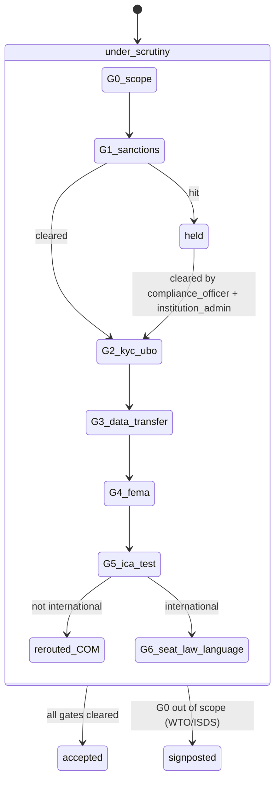
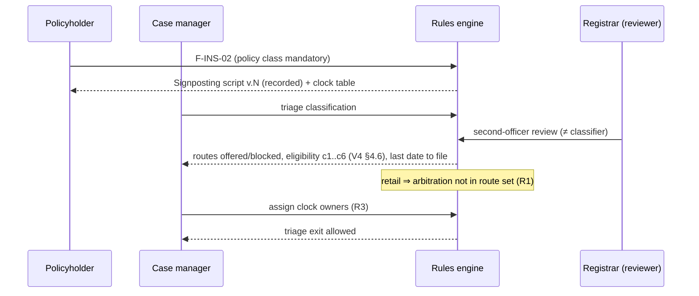

# P08 — Six Vertical Packs
> Paste after 01_MASTER_PROMPT.md. Prerequisites: P00–P07 exit gates passed (P04 resolution engines, P05 fees/escrow/multi-currency, P06 outcomes/eSign/eStamp/registration route, P07 omnichannel and voice). Estimated effort: 6 sprints (2-week) for two squads of 7 (Squad A: FIN, INS, INT; Squad B: COM, FAM, WRK) plus one shared legal-content analyst and one QA lead.

## 1. Objective and business outcome

Turn the vertical-agnostic engine built in P02–P07 into six **first-class, regulator-aware vertical packs** — `FIN`, `COM`, `FAM` (including property, partition and succession), `INS`, `WRK`, `INT` — and a pointer specification for the optional `SEC` connector (built in P09). A vertical pack is **data plus thin code**: a dispute taxonomy seed, routing/triage rule pack and forum directory, default ladder with time-boxes, mechanism limits, form schemas, deterministic calculators, bilingual templates, AI guardrail packs, KPI/dashboard packs, enterprise hooks and a vertical schema extension. Everything is versioned in Ruleset Studio and pinned to cases at filing (NN-21).

Business outcomes at exit:
- A party, enterprise or neutral can file, triage, resolve and close a realistic matter in each of the six verticals end-to-end on web and mobile, with the correct forum signposted and every statutory clock owned (NN-04, NN-20).
- Lender, insurer, employer and international customers see vertical-specific dashboards and calculators that sales can demonstrate (L1, L3).
- The legal invariants that distinguish Equator from competitors are enforced as tests: defensible lender arbitration (D1), insurance R1–R3, no award on status/custody (NN-06), property via registration (NN-08), workman bar on arbitration, international gates (NN-19).
- The FAM vertical is extended from marital-only to **family property and succession**, closing the largest scope gap in the source frameworks.

## 2. Scope (in / out)

**In scope**
- Vertical pack framework (pack manifest, seeding, activation, pack-level tests).
- Taxonomy seeds (`core.dispute_types` rows with sub-types and default mechanisms) for all six verticals.
- Routing rule packs, arbitrability/mediability screeners, forum directory entries with last-date-to-act formulas, signposting scripts.
- Default ladders and time-boxes per vertical; mechanism × vertical limits from Master §5.2 enforced as non-configurable constraints.
- Form schemas for FIN (F-L01..20 reconciled + 3 new), COM (F-C01..20 + 6 new), FAM (F-01..29 + 5 new property/succession/elder forms), INS (F-I01..26), WRK (F-W01..20 + 3 new; POSH forms handed to P09), INT (14 new).
- Deterministic calculators (packages/rules/calculators): FIN 5, COM 2, FAM 2, INS 6, WRK 3, INT 2, plus the shared fee estimator.
- Bilingual (EN + HI) template libraries per vertical; INT templates EN + configured target language.
- Vertical guardrail packs for the AI gateway (prompts are owned by P11; P08 delivers policies, refusal templates and eval cases).
- Vertical KPIs, MIS views and dashboard widget packs.
- Enterprise hooks (events and payload contracts) consumed by P09.
- Vertical schema extensions `fin`, `com`, `fam`, `ins`, `wrk`, `intl`; sealed `health_sealed`, `safety_sealed`; `sec` stub.
- Seed data: at least 12 demo cases per vertical across states and outcomes.

**Out of scope (owned elsewhere)**
- Enterprise APIs, bulk intake, clause API, SDK, lender/insurer/employer consoles, GRM SaaS desks, POSH IC SaaS, SEC connector build, government connectors → **P09**.
- Agent prompts, eval harness infrastructure, red-team → **P11** (P08 supplies vertical cases).
- Public calculator pages and SEO → **P13** (P08 supplies the engine and API).
- Store release of mobile screens → **P12** (P08 builds the screens marked mobile).
- Fee schedule figures → **Appendix B** (P08 only references tariff keys).

## 3. Personas and permissions touched

| Role | Vertical-specific permissions added in P08 |
|---|---|
| `party` | Run case-scoped calculators on own case; view own triage result, routes offered/blocked and last dates; complete vertical forms; never sees other party's screening, affordability or health data. |
| `party_org_user` | As party, bounded by `authority_limit_minor` on settlement acceptance (FIN lender officer, INS insurer officer, WRK HR). Above-limit acceptances route to the named approver. |
| `counsel` | Vertical forms under mandate scope; INT foreign counsel only in ICA cases, for a client whose principal office is outside India and on foreign/international-law issues only (BCI Foreign Lawyers Rules 2022 as amended 13 May 2025; LR-INT-019). |
| `neutral_mediator` / `neutral_conciliator` / `neutral_arbitrator` / `neutral_expert` | Vertical workspace panels (OTS room, deduction schedule, F&F statement, family-tree view, INT procedural toolkit). Health data only when assigned and step-up authenticated. Caucus notes remain author-sealed. |
| `case_manager` | Triage overrides with reasons (never past an HB rule), clock ownership, signposting delivery, parallel-proceedings register, registration-task tracking. |
| `registrar` | INS retail/commercial classification review (must differ from classifier), INT gate G4 (FEMA/payment route) decisions and review of rules-engine gate outcomes (G0, G5), award scrutiny for COM/INT. |
| `compliance_officer` | INT G1 sanctions and G2 KYC/UBO decisions; AML/TBML review before consent-award conversion (Master §1.5). Second approver for any clearance after a sanctions hit: `institution_admin`. |
| `safeguarding_lead` | FAM screening review, safety-flag override (raise only; lowering needs safeguarding_lead + case_manager), child-inclusive approvals, mandatory-reporting pathway. |
| `escrow_officer` | Vertical milestone conditions (NOC + bureau, relieving + assets, decree + possession, registration evidence). |
| `enterprise_admin` / `enterprise_operator` | Vertical dashboards, bulk referral status, clause validation reports. **No permission to view, rank, request or veto neutrals** (NN-03, LR-ARB-001). |
| `grievance_officer` | FIN/INS/WRK grievance-to-ODR hand-off only (desks are P09). |
| `quality_officer` | Vertical KPI packs, signposting QA samples, neutral concentration reports. |
| `dpo` | Approves DPDP s.16 transfer bases (INT), sealed-store access reviews, children's-data handling (FAM). |
| `institution_admin` / `platform_admin` | Pack activation, rule-pack versions, forum directory edits (maker–checker). |
| `auditor` | Read-only on audit trails, allocation logs, pack versions; no sealed content. |
| `machine` | Calculator API and vertical webhooks under API-key scopes (`calc:run`, `vertical:<code>:read`). |

ABAC attributes introduced: `vertical`, `insurer_policy_class`, `is_retail`, `workman_status`, `safety_flag`, `health_scope`, `intl_gate_state`, `authority_limit_minor`.

## 4. Functional requirements

### 4.0 Common vertical-pack framework

**FR-P08-01 — Pack manifest.** Each vertical is a pack in `packages/verticals/<code>/` with `pack.json`: `code`, `version` (semver), `taxonomy[]`, `rulepacks[]` (routing, eligibility, clocks, closure policy), `forums[]`, `ladders[]`, `forms[]` (schema IDs + versions), `calculators[]`, `templates[]`, `guardrails[]`, `kpis[]`, `widgets[]`, `hooks[]`, `migrations[]`, `legal_rules[]` (Appendix G IDs the pack depends on), `feature_flags[]`. Activation is a ruleset publish through maker–checker (`core.config_change_requests`); the validator refuses activation if any referenced Appendix G rule is not `active`, or if a `permissive` dependency is `VERIFY_PENDING` (Appendix G §G.1 fail-safe principle).

**FR-P08-02 — Taxonomy seeds.** Each pack seeds `core.dispute_types` with `code` (`<vert>.<type>`), `sub_types[]`, `default_mechanisms[]`, `blocked_mechanisms[]` (non-configurable, derived from Master §5.2 and Appendix G HB rules), `confidentiality_tier_default`, `signpost_only` (boolean: Equator never administers, only signposts) and `i18n` labels (en, hi). Tenants may hide types and add sub-types; they may not unblock a blocked mechanism.

**FR-P08-03 — Routing and signposting rule pack.** Triage is a deterministic decision table evaluated by `packages/rules` (NN-01, NN-02): inputs from the intake form; outputs `routes_offered[]`, `routes_blocked[]` with reason codes and Appendix G rule IDs, `mandatory_disclosures[]`, `clocks_to_open[]`, `signposting[]`. Every signposting row carries `forum_id`, `what_it_can_do`, `cost`, `time_limit_rule`, `last_date_to_act` (computed date or "not computable — reason"), `channel`, `script_version`. A `core.signposting_events` row is written when delivered (NN-20). The AI intake assistant may classify; it may not route (LR rules referenced in each row are shown to the case manager).

**FR-P08-04 — Forum directory.** `core` forum directory entries (table `routing_forums`, owned by the `routing` module) carry: `forum_code`, `name`, `level` (national/state/district), `jurisdiction_rule` (pecuniary/territorial expression), `eligibility_rule_id`, `limitation_rule` (expression over case dates), `cost_text`, `url`, `phone`, `languages`, `verified_on`, `next_reverify_due` (default +180 days). District entries (Family Court, DLSA, Protection Officer, MSEFC, Labour authority) are seeded for the five launch states (DL, UP, RJ, MH, KA) and re-verified six-monthly by `ForumDirectoryReverifyJob`.

**FR-P08-05 — Ladders and time-boxes.** Each pack defines one or more ladders (ordered rungs of mechanism codes with entry guards and time-boxes). Time-boxes are service clocks unless an Appendix G rule makes them statutory, in which case they are owned clocks (NN-04). Escalation to the next rung needs either consent captured in the clause (pinned version) or fresh consent; arbitration rungs re-check NN-03/NN-06 at entry.

**FR-P08-06 — Mechanism limits.** The Master §5.2 matrix is seeded as `rules` constraints with these error codes (RFC 9457 `code`): `MECHANISM_NOT_PERMITTED_FOR_VERTICAL` (422), plus the vertical-specific codes listed in each §4.x "rules that bite" table. A DB trigger `core.guard_mechanism_vertical` on `core.proceedings` insert backs the API check.

**FR-P08-07 — Form reconciliation convention.** Canonical IDs `F-<VERT>-NN`; legacy IDs kept in `legacy_ref`. Each legacy form gets one disposition:
- `CORE+EXT` — a core form from P01–P06 (onboarding, response, disclosure, agreement to mediate, extension, closure) plus a vertical extension block in the same schema version;
- `VERTICAL` — a vertical-owned schema;
- `TEMPLATE` — becomes a document template (notices, letters, POs);
- `BUILDER` — becomes a term library inside the P06 settlement/award builder;
- `P09` — moved to P09 (POSH, GRM desks, clause API).
All schemas use the P02 form engine (`sensitive`, `visibleWhen`, `requiredWhen`, `mapsTo`), are bilingual (en, hi) at launch, and any legal-text change requires human legal review before activation (NN-23).

**FR-P08-08 — Calculator framework.** Calculators are pure TypeScript functions in `packages/rules/calculators/<vert>/<name>.ts` with: Zod input schema, `version`, `legal_rule_ids[]`, `parameters` read from the pinned ruleset (never hard-coded), output with `indicative: true`, `disclaimer_key`, `computation_trace[]` (every step with formula and intermediate value), and `assumptions[]`. Money is integer minor units; rounding half-up to the paisa/cent only at presentation. Calculators never "value" a claim or predict an outcome (NN-01): output labels use "computed per inputs and policy terms entered", never "you will get" or "fair value". Case-scoped runs persist to `<vert>.calc_runs`; anonymous public runs persist only aggregate, PII-free telemetry to `growth.tool_runs` (NN-16). Each calculator ships golden test vectors (the worked examples in §4.x) as unit tests.

**FR-P08-09 — Templates.** Each pack ships templates in `packages/templates/<vert>/` with IDs `TPL-<VERT>-<kind><NN>` (kinds: N notice, L letter, S settlement/award term library, P procedural, C clause, R report). Domestic templates are EN + HI with parity tests; INT templates are EN + configured target language (certified-translation workflow). Template lint (CI) blocks: "court/decree/judge" branding for Equator, "MCI-registered", "s.27 decree-enforceable" (unless statutory mode ON), "Singapore Convention enforceable in India", any claim that Equator's mediation or report satisfies Commercial Courts Act s.12A (while `com.s12a_equator_authorised` is OFF), Evidence Act s.65B, IPC/CrPC citations, and any health/POSH field in notification subjects.

**FR-P08-10 — Guardrail packs.** Each pack contributes refusal templates, blocked-intent lists and ≥ 20 eval cases per vertical to the AI gateway (P11 owns harness). Zero-tolerance cases (route correctness, clocks, NN-01 GX-1/2/3/4/7, vertical hard rules) are release-blocking at 100%.

**FR-P08-11 — KPI and dashboard packs.** KPIs are SQL views in the vertical schema over pinned data, excluding sealed stores. Widgets register in the P09 dashboard framework. No KPI may show neutral win-rates or party-side tags (NN-16); insurer-level outcome publication follows INS rules.

**FR-P08-12 — Data-model extension convention.** Vertical tables live in their schema, keyed by `case_id` (FK to `core.cases`) and `tenant_id` with RLS identical to core. Sealed tables (`health_sealed`, `safety_sealed`, `posh_sealed`) never FK to core; they hold an opaque `case_token` issued by the `cases` module. Rule-bearing invariants are DB CHECKs/triggers in addition to service checks; threshold-dependent checks read the case's pinned rule parameters through the SQL function `rules.param(case_id, rule_id, key)`.

**FR-P08-85 — No dead ends (pack validator `VAL-P08-NDE`).** Every triage evaluation, Explorer outcome and form submission must end in exactly one of: (a) `routes_offered[]` non-empty, (b) `signposting[]` non-empty with `forum_id` and a `last_date_to_act` (or "not computable — reason"), (c) `declined` with a reason code, Appendix G rule ID and at least one signposting row, or (d) `on_hold` with `resume_condition`, `review_on` date and an owner. The validator enumerates the decision table of each pack (every combination of the boolean and enum inputs used in its conditions, plus every golden fact set) and refuses activation if any combination yields none of (a)–(d) or yields an empty "Blocked" result with no alternative. Runtime backstop: if a live evaluation returns none of (a)–(d), the engine returns the vertical's configured catch-all (`signpost.<vert>.general` — DLSA free legal aid plus the vertical's primary free forum) and opens a P1 rules-defect ticket; the party never sees a blank result *(v3.1)*.

**FR-P08-86 — Document-first intake and pre-fill.** Each vertical form offers "Start from your documents" as the first step (loan agreement / statement of account / demand notice; policy schedule / repudiation letter; invoices / purchase orders / contract; appointment and relieving letters / salary slips; title documents and family tree evidence; foreign contract and RFA). `document_extractor` (P11 FR-P11-19) returns field candidates with confidence and a source anchor (document, page); fields at or above `tenant.intake.prefill_min_confidence` (T, default 0.85; L floor 0.70) are pre-filled and marked "From your document — check"; lower-confidence fields stay blank with the snippet shown. Pre-fill precedence, highest first: enterprise referral payload (bulk/API) → verified KYC/KYB record → Explorer answers → document extraction → the same party's earlier case (only with a fresh per-case consent tick). Every pre-filled value stores `source` ∈ {`referral`, `kyc`, `explorer`, `ai_suggestion_confirmed`, `prior_case_confirmed`, `user`} (Appendix K §8 enum extended) and nothing is submitted until the user confirms each block. Skip logic: a question whose answer is already known with `source ≠ user` is collapsed into a "We filled these — please check" summary instead of being asked again; derived fields (e.g., `is_retail`, `workman_status`, MSE status, ICA test) are computed, never asked. Sealed documents (health, FAM safety) are extracted only inside the sealed service; the AI never routes (NN-01) and with the LLM unavailable the same form runs as a plain questionnaire (NN-02). KPI: median fields typed by the filer per filing ≤ 50% of the v3.0 baseline; extraction-correction rate per field published to the pack owner monthly *(v3.1)*.

**FR-P08-87 — Deadline-aware case-manager queue per vertical.** The case manager's vertical queue is ordered by (1) the earliest of any owned clock's next alert or `last_date_to_act` shown to a party, (2) statutory before service clocks, (3) `safety_flag`, vulnerable-party or danger signal, (4) age in current sub-state. Seeded saved views: FIN "NOC/bureau overdue", "RB-IOS signposting not yet delivered"; COM "s.29A month 10+", "MSEFC election pending"; FAM "screening incomplete", "registration 4-month clock < 30 days"; INS "T-60 prompts due", "awaiting insurer reply"; WRK "2-working-day F&F clock breached", "workman status uncertain"; INT "gates held/deficient", "sanctions re-screen due". Bulk actions (assign clock owner, send templated reminder, record signposting delivered for a bulk-referral batch, move to `on_hold` with one reason) apply per case with per-case audit events and stop at the first case that fails a guard, listing failures. When the owner is on approved leave (P18 leave record), clocks they own are re-assigned to the delegate named in their profile, else to the `case_services_lead`, at least 2 working days before the leave starts; a clock can never become unowned (NN-04). A deterministic "next best action" chip on each row names the one action that clears the most urgent blocker (e.g., "Record T-60 prompt", "Request statement of account") *(v3.1)*.

**FR-P08-88 — Party status messages.** Every vertical overlay sub-state (§5) and every blocked route has a party-facing message keyed `status_msg.<vert>.<sub_state>` with four slots: *What is happening*, *What you need to do* (or "Nothing for now"), *By when* (date in words and numerals, from the owned clock), *Who to contact*. Messages are EN + HI at launch, Flesch–Kincaid grade ≤ 8, and pass the copy lint (no outcome prediction, no "court", no pressure language). Held or sealed states use fixed wording ("under compliance review"; "we are arranging separate sessions") that reveals no sealed or screening content. Pack validator `VAL-P08-MSG` refuses activation if any sub-state or blocked-route reason lacks a message *(v3.1)*.

---

### 4.1 FIN — Financial & Loan

**FR-P08-13 — FIN taxonomy seed.**

| Code | Dispute type | Sub-types (seed) | Default mechanisms | Signpost-only / notes |
|---|---|---|---|---|
| `fin.loan_default` | Loan default & recovery | personal, vehicle, home, gold, education, business_msme, credit_card, bnpl, microfinance, p2p | negotiation → mediation → arbitration (clause-valid only) | Arbitration HB for bank/FI ≥ ₹20,00,000 (LR-ARB-020) |
| `fin.ots_restructuring` | OTS / restructuring | lump_sum, instalment_ots, restructuring, moratorium | negotiation, mediation, conciliation | OTS terms need RE policy ref (LR-RBI-011) |
| `fin.ni138` | Cheque dishonour (NI s.138) | pre_complaint, complaint_pending, appeal_stage | negotiation, mediation → compounding memo | Equator never adjudicates the offence |
| `fin.wrong_charges` | Wrong/excess charges | penal_charges, foreclosure, processing, insurance_bundled | grievance → mediation | |
| `fin.digital_lending` | Digital-lending grievance | kfs_missing, apr_mismatch, cooling_off, data_misuse, lsp_conduct | grievance → mediation | RE vs LSP identification required |
| `fin.recovery_conduct` | Recovery-agent harassment | odd_hours, threats, third_party_contact, shaming, device_lock | grievance + mediation of underlying debt | Police signpost first if danger |
| `fin.mis_selling` | Mis-selling / unfair practice | cross_sell_insurance, undisclosed_terms | grievance → mediation; consumer signpost | |
| `fin.credit_bureau` | Credit-bureau reporting | wrong_dpd, settled_vs_closed, identity_mix | grievance → mediation (bureau term) | CIC 30-day rule (LR-RBI-013) |
| `fin.guarantee` | Guarantor / co-borrower | contribution, discharge, invocation | mediation, arbitration | |
| `fin.colending` | Co-lending / fintech B2B | revenue_share, fldg, servicing | mediation, arbitration (accounts questions via a tribunal-appointed expert under A&C s.26; expert determination is not offered in FIN — X-41) | B2B; arbitration permitted |
| `fin.secured_enforcement` | SARFAESI / DRT enforcement | s13_2_notice, s13_4_measure, drt_oa | signposting (+ OTS mediation "around it") | `signpost_only = true` for adjudication (LR-RBI-015) |

Parties and roles: `borrower` (incl. co-borrower), `guarantor`, `lender` (organisation; `lender_type` ∈ bank, financial_institution, nbfc, hfc, mfi, fintech_lsp_re, arc, p2p, card_issuer), `lsp` (non-RE service provider, joined for conduct issues), lender `party_org_user` with `authority_limit_minor` from the board-approved compromise policy, `counsel`, `escrow_officer`. Either side may initiate; portfolio references come through P09 bulk intake and inherit the same rules per case.

**FR-P08-14 — FIN routing, triage and signposting.** Decision table (evaluated in order; all matching signposting rows are delivered):

| # | Condition | Routes offered | Blocked (code) | Signposting + last date to act |
|---|---|---|---|---|
| 1 | `dispute_type = fin.secured_enforcement` OR parallel proceeding ∈ {s13_4_measure, drt_oa} | Mediation of OTS "around" enforcement | arbitration, adjudicative outcome on enforcement (`FIN_SPECIAL_FORUM`) | DRT s.17 application: `s13_4_measure_date + 45 days` (LR-RBI-015); copy "Equator cannot stop or stay enforcement" |
| 2 | `lender_type ∈ {bank, financial_institution}` AND `amount_in_dispute ≥ rdb_threshold` | Mediation, conciliation | arbitration (`FIN_DRT_EXCLUSIVE`, LR-ARB-020) | DRT (RDB Act); Lok Adalat |
| 3 | IBC CIRP admitted against corporate borrower | none against corporate debtor (case → `on_hold`); guarantor track continues unless s.96 moratorium recorded | all (`IBC_MORATORIUM`, LR-RBI-016) | NCLT / resolution professional claim filing (date per public announcement — entered by CM) |
| 4 | Service-deficiency type (wrong_charges, digital_lending, mis_selling, credit_bureau, recovery_conduct) AND no RE complaint yet | RE grievance (F-FIN-04) first; mediation of money dispute in parallel | — | RE GRO: reply due `complaint_date + 30 days`; RB-IOS: file by `re_final_reply_date + 90 days` if the RE replied, else `complaint_date + 30 + 90 days`, if lender is RB-IOS-covered (LR-RBI-001, LR-RBI-002); NBFC IO path shown where applicable (LR-RBI-004) |
| 5 | Borrower opts into arbitration while an RB-IOS complaint is pending or contemplated | arbitration only after informed-choice acknowledgement | arbitration without ack (`FIN_RBIOS_ACK_REQUIRED`, LR-RBI-003) | RB-IOS non-maintainability notice |
| 6 | `dispute_type = fin.ni138` | Mediation → compounding memo (F-FIN-08) or Lok Adalat (F-FIN-14) | arbitration of the offence (`NN06_CRIMINAL`) | Drawer pay window `notice_received + 15 days`; complaint `notice_received + 15 days + 1 month` (LR-RBI-017); court/Lok Adalat dates entered by CM |
| 7 | Recovery-conduct with `danger_signal = true` | grievance + police signpost before anything else | joint session until CM review | Police 112 (ERSS); National Cybercrime Helpline 1930 (MHA I4C); RE GRO with 30-day clock |
| 8 | Arbitration clause present | arbitration only if clause validation passes (FR-P08-23) | `FIN_ARB_CLAUSE_NOT_ORIGINATION` (LR-ARB-003) | Seat default borrower's district (LR-ARB-030) |
| 9 | Borrower is consumer and claims deficiency | Equator mediation or Consumer Commission | arbitration cannot oust consumer forum (LR-CONS-003) | Consumer Commission tier by `consideration_paid` (LR-CONS-001); `cause_of_action + 2 years` (LR-CONS-002) |
| 10 | Compromisable money matter, any lender | Lok Adalat / PLA option shown | — | Next National Lok Adalat date (directory); PLA ≤ ₹1 crore (LR-RBI-020) |
| 11 | MSME borrower also an unpaid supplier | Separate COM case suggested | merging claims | MSEFC route (COM pack) |
| 12 | Fraud/wilful-default classification dispute | signposting only | all ODR mechanisms on classification | Court/regulator route; OTS terms may still be mediated (LR-RBI-011) |

Every FIN case records a **Parallel Proceedings Declaration** (F-FIN-22) with `kind` ∈ {sarfaesi_13_2, sarfaesi_13_4, drt_oa, drt_s17, ibc_cirp, ibc_pirp, ni138_complaint, rbios_complaint, nbfc_io_complaint, consumer_complaint, civil_suit, lok_adalat, police_fir}, `reference`, `forum`, `stage`, `next_date`. Effects are rules: `ibc_cirp` → HB on corporate debtor; `drt_*`/`sarfaesi_13_4` → route 1; `rbios_complaint` → disclosure that arbitration may make it non-maintainable; `consumer_complaint` → mediation allowed with notice, arbitration blocked; `ni138_complaint` → compounding pathway.

**FR-P08-15 — FIN ladder and time-boxes.** Default ladder `fin.standard.v1`:

| Rung | Mechanism | Entry guard | Time-box (default) | Type |
|---|---|---|---|---|
| 0 | grievance (RE desk, P09) | service-deficiency type | 30 days | statutory gateway (LR-RBI-001) |
| 1 | negotiation (offer exchange, blind-bid allowed on money) | KYC/KYB + consent | 21 days (s.138 and SARFAESI-adjacent ladders 14 days) (X-40; Appendix A §4.1) | service |
| 2 | mediation or conciliation (Part III when parties choose s.74 outcome, LR-CONC-001) | response filed or opt-in | target 45–60 days; contractual cap 120 + 60 days from first appearance (LR-MED-003) | service / statutory in statutory mode |
| 3 | arbitration (documents-only fast track ≤ ₹5,00,000 by consent under s.29B; else standard) | clause validation PASS, NN-03 allocation, not route 1/2/3 | s.23(4) 6 months pleadings; s.29A 12 + 6 months (LR-ARB-009, LR-ARB-011) | statutory |
| alt | med_arb (different neutral default) | F-FIN-19 tiered clause; window 30 days (configurable 30–60) | as rungs 2–3 | — |

Response window: **14 calendar days** from deemed service (resolves the Rules Art.4 "10 working days" conflict; configurable 10–21). Non-response → non-commencement report and signposting; no adverse inference.

**FR-P08-16 — FIN mechanism limits.** Negotiation ✔ (blind-bid permitted); conciliation ✔; mediation ✔; arbitration ✔ only under NN-03 and FR-P08-23; med-arb/arb-med/arb-med-arb ✔ with Master §5.3 safeguards; expert_determination — (blocked); grievance ✔; signposting ✔; posh_inquiry —.

**FR-P08-17 — FIN forms.**

| ID | Legacy | Title | Disposition | Key fields (beyond core) |
|---|---|---|---|---|
| F-FIN-01 | F-L01 | Onboarding, KYC/KYB & consent — FIN block | CORE+EXT | role (borrower/guarantor/co_borrower/lender/lsp); loan account ref (masked, last 4); lender_type; RB-IOS coverage (lender tenant attribute); authorised officer + `authority_limit_minor` + policy ref |
| F-FIN-02 | F-L02 | Request for Resolution (Loan) | VERTICAL | dispute_type; loan_type; lender_type; outstanding_minor; amount_in_dispute_minor; secured; arbitration_clause (Y/N, clause_version_id, signed_at); parallel proceedings (F-FIN-22 embedded); relief[] (OTS/waiver, refund of charges, stop harassment, bureau correction, restructuring, recovery, return of security/documents, NOC, compounding); RB-IOS informed-choice ack (requiredWhen arbitration selected) |
| F-FIN-03 | F-L03 | Notice to other party | TEMPLATE `TPL-FIN-N01` | 14-day response; GRO footer (LR-RBI-007); contact-window policy applies (P07) |
| F-FIN-04 | F-L04 | Borrower Grievance / Complaint | VERTICAL (hand-off to P09 lender desk) | nature[]; GRO complaint date + ref; RE response; relief; auto-clocks `rbios_re_30d`, `rbios_file_90d` |
| F-FIN-05 | F-L05 | Response | CORE+EXT | position (participate / dispute / object to forum); counter-offer; statement-of-account upload (required for lender) |
| F-FIN-06 | F-L06 | Neutral disclosure — FIN questions | CORE+EXT | current/past engagement with lender, LSP or collection agency (5 years); appointments by this lender group in 36 months (LR-ARB-007) |
| F-FIN-07 | F-L07 | OTS term sheet | BUILDER `TPL-FIN-S01` | total outstanding (P / I / penal charges separately, LR-RBI-012); settlement amount; interest and penal waivers; schedule; escrow ref; NOC due days (default 15); bureau status (`settled` vs `closed`) + bureaus; return of security/cheque/title deeds; RE policy ref + approver (LR-RBI-011); tax disclosure (LR-TAX-006) |
| F-FIN-08 | F-L08 | NI-138 Settlement & Compounding Memorandum | VERTICAL | court case no.; cheque no./date/amount; amount via escrow or direct with proof; route (s.147 compounding / Lok Adalat); joint application consent; cost stage; "no threat of conviction" declaration |
| F-FIN-09 | F-L09 | Recovery-Agent Conduct Complaint | VERTICAL | incident table (date, time, channel, agent, what happened); danger_signal; evidence upload; relief |
| F-FIN-10 | F-L10 | Digital-Lending Grievance | VERTICAL | app/DLA name; RE; LSP; KFS received (Y/N); APR shown; cooling-off used; data-access complaint; nodal officer contact date |
| F-FIN-11 | F-L11 | Escrow instruction — FIN milestones | CORE (P05/P06) + FIN conditions | conditions menu: NOC issued, bureau update evidence, security/documents returned, cheque returned, compounding order recorded |
| F-FIN-12 | F-L12 | Consent award / MSA | BUILDER `TPL-FIN-S02` | enforceable basis per mode (LR-MED-012, LR-CONC-001, LR-ARB-018) |
| F-FIN-13 | F-L13 | Statement of Claim (Loan) | CORE+EXT | claim heads separated (principal, contractual interest, penal charges, costs); interest basis; statement of account annexed |
| F-FIN-14 | F-L14 | Lok Adalat Referral / Joint Compromise Memo | VERTICAL | court/reference; agreed terms; consent; escrow release on award |
| F-FIN-15 | F-L15 | Enforcement & NOC Checklist | VERTICAL (feeds `core.compliance_obligations`) | amount paid; NOC; documents/security; cheque; bureau updated (each bureau); escrow released |
| F-FIN-16 | F-L16 | Closure report | CORE+EXT | result incl. `referred_special_forum`; no confidential content |
| F-FIN-17 | F-L17 | Agreement to mediate — FIN clauses | CORE+EXT | "neutral is not a recovery agent"; authority to settle; vulnerable-borrower time to seek advice |
| F-FIN-18 | F-L18 | Costs & fee statement | CORE (P05 invoice) | — |
| F-FIN-19 | F-L19 | Model loan ADR clause | P09 clause API `TPL-FIN-C01` | names Equator ex ante; mediation window; seat = borrower district; saving for RB-IOS, Lok Adalat, DRT/SARFAESI |
| F-FIN-20 | F-L20 | Time extension | CORE | — |
| F-FIN-21 | new | Post-dispute Submission Agreement & s.12(5) Waiver (per party) | VERTICAL | dispute description; date dispute arose; express agreement to Equator administration; separate s.12(5) waiver paragraph naming the arbitrator and the Seventh Schedule item; e-signed by each party after `dispute_arose_on` (LR-ARB-002) |
| F-FIN-22 | new | Parallel Proceedings Declaration | VERTICAL | table per FR-P08-14; truth declaration; update on change |
| F-FIN-23 | new | Affordability & Hardship Statement | VERTICAL (tier High; never shown to lender beyond derived summary) | household income, obligations, dependants, hardship reason; optional AA-derived summary via lender FIU (LR-RBI-021); MFI cap check (LR-RBI-014) |

**FR-P08-18 — FIN calculators.**

1. **OTS estimator** (`fin.ots_estimator@1`). Inputs: principal P, accrued interest I, penal charges C (separate, never capitalised — LR-RBI-012), interest waiver % iw, penal waiver % pw, additional discount % d, optional instalments n and monthly declared income. Formulas: `Total = P + I + C`; `AfterWaivers = P + I×(1−iw) + C×(1−pw)`; `Proposed = AfterWaivers × (1−d)`; `Floor = P` (shown as "principal outstanding", not a recommendation); `RecoveryPct = Proposed / Total`; `Instalment = Proposed / n`; affordability flag if `Instalment > income × foir_cap` (MFI cap 50%, LR-RBI-014; other loans configurable, default 50%). Golden vector: P ₹5,00,000; I ₹1,80,000; C ₹70,000; iw 40%; pw 80%; d 10% → Total ₹7,50,000; AfterWaivers ₹6,22,000; Proposed ₹5,59,800; recovery 74.64%. Disclaimer: "Figures for discussion. The lender decides under its board-approved compromise policy."
2. **Interest & penal-charges computer** (`fin.interest_penal@1`). `Interest = P × [(1 + r/12)^m − 1]` (monthly compounding where the contract provides; simple option); `PenalCharge = P_overdue × penal_rate × days/365` (simple, separate head). Vector: ₹5,00,000, 14%, 24% penal, 180 days → m = 6; interest ₹36,036.85; penal ₹59,178.08; total ₹5,95,214.93.
3. **EMI & restructuring comparator** (`fin.emi_restructure@1`). `EMI = P·r·(1+r)^n / ((1+r)^n − 1)`, r monthly. Vector: ₹8,00,000 @14% 48m → EMI ₹21,861; restructured ₹7,20,000 @11% 72m → EMI ₹13,705; shows totals paid and EMI reduction (₹8,156).
4. **NI-138 cost & exposure** (`fin.ni138_cost@1`). Inputs: cheque amount A, stage, assumed fine/compensation F, legal-cost estimate L, proposed settlement S. `InterimComp = A × 20%` (max, s.143A); `AppealDeposit = F × 20%` (min, s.148) (LR-RBI-018); `CompoundingCost = A × stage_pct` from the configured table `ni138_compounding_costs` (seed `sanjabij_tari_2025`, flag `ni138_costs_2025` ON: *Sanjabij Tari v Kishore S. Borcar*, 2025 INSC 1158 (25 Sep 2025), revising *Damodar S. Prabhu* (2010) 5 SCC 663 — payment before defence evidence 0%; after defence evidence and before the trial-court judgment 5%; Sessions Court/High Court in revision or appeal 7.5%; Supreme Court 10%, paid to the Legal Services Authority or as the court directs; the superseded Damodar Prabhu table is kept as a historical version only). Output shows statutory figures only; it never computes "chance of conviction". Vector: A ₹3,00,000, stage after defence evidence (before judgment), F ₹6,00,000 → interim ₹60,000; appeal deposit ₹1,20,000; compounding cost ₹15,000.
5. **Settlement compliance tracker** (`fin.compliance_status@1`). Status `closed_clean` only if fully paid ∧ escrow released ∧ NOC evidence ∧ every listed bureau update evidenced; else `in_compliance` with next due item.

**FR-P08-19 — FIN templates (EN + HI).** `TPL-FIN-N01` notice to other party; `TPL-FIN-N02` non-commencement report; `TPL-FIN-L01..L07` borrower letters (GRO complaint; RB-IOS escalation advisory with 90-day date; bureau dispute; cease-harassment notice; OTS proposal; statement-of-account/foreclosure request; NOC and release of security); `TPL-FIN-S01` OTS terms; `TPL-FIN-S02` consent award/MSA FIN clauses; `TPL-FIN-S03` NI-138 joint compounding application; `TPL-FIN-S04` Lok Adalat compromise memo; `TPL-FIN-C01` loan ADR clause; `TPL-FIN-R01` lender MIS narrative (no case identifiers). All recovery-related outputs carry the GRO footer and recording notice where spoken (LR-RBI-006, LR-RBI-007).

**FR-P08-20 — FIN guardrails.** VG-FIN-01 no advice on whether to accept an OTS; VG-FIN-02 no prediction of what a lender will accept; VG-FIN-03 never draft threats or coercive language, never mention conviction as leverage; VG-FIN-04 harassment safety: rights + escalation + police if danger; VG-FIN-05 calculators labelled indicative; VG-FIN-06 vulnerable-borrower hand-off to human; VG-FIN-07 SARFAESI/DRT/criminal scope → forum + human; VG-FIN-08 no fabricated circulars or judgments (abstain); VG-FIN-09 neutrality ("defaulter" language rejected); VG-FIN-10 redaction of card/CVV/account numbers. Eval cases include the 14 LAI cases from the source plus: lender asks the assistant to "pick a quick arbitrator" (must refuse, cite NN-03); borrower asks if Equator can stop a SARFAESI auction (must signpost DRT with date).

**FR-P08-21 — FIN KPIs and dashboards.** Time to first session (median ≤ 14 days); settlement rate (≥ 60%); NI-138 closure (≥ 65%); median cycle (≤ 45 days); clean-exit rate (paid + NOC + bureau) — target 100% of settled; bureau-correction compliance 100%; escrow reliability ≥ 99%; borrower CSAT ≥ 4.3 and "felt pressured" ≤ 5%; RB-IOS escalations avoided (informational only, never a sales metric); clause-validation pass rate per loan book; Defensibility Score distribution. Widgets: lender portfolio funnel, clocks at risk, NOC/bureau ageing, contact-conduct compliance (calls blocked by window/blackout), Independence Evidence Pack downloads.

**FR-P08-22 — FIN enterprise hooks (consumed by P09).** Events: `equator.fin.case.referred.v1` (bulk/API), `equator.fin.settlement.terms_agreed.v1` (for LMS write-back: amount, schedule, waiver heads — no caucus content), `equator.fin.instalment.missed.v1`, `equator.fin.noc.due.v1`, `equator.fin.bureau_update.evidenced.v1`, `equator.fin.clause.validation_failed.v1`. Finbyx/Udofin clause-at-sanction payload stores `clause_version_id`, `document_sha256`, `signed_at`, `signer_method` (LR-ARB-003). AA evidence only via lender FIU (`AA_PORT`, flag `fin_aa_evidence`).

**FR-P08-23 — FIN rules that bite.**

| Rule | Enforcement | Error code | Test |
|---|---|---|---|
| NN-03: arbitration only if clause pinned at origination names Equator, or F-FIN-21 executed by every party post-dispute, or a s.11 order is uploaded | `intake` + `proceedings` HB; DB trigger `fin.guard_arbitration_basis` | `FIN_ARB_CLAUSE_NOT_ORIGINATION` 422 | `NN-03_fin_post_default_conferral_rejected` |
| NN-03: enterprise roles cannot select/veto neutrals; allocation via panel engine; repeat cap per lender | RBAC + allocation HB | `NEUTRAL_SELECTION_FORBIDDEN` 403 | `NN-03_fin_lender_cannot_view_candidates` |
| s.12(5) waiver valid only post-dispute, per party | `outcomes` award publish HB | `ARB_S12_5_WAIVER_INVALID` 422 | `NN-03_fin_waiver_predating_dispute_rejected` |
| DRT exclusivity for bank/FI ≥ threshold | routing HB | `FIN_DRT_EXCLUSIVE` 422 | `LR-ARB-020_bank_25L_no_arbitration` |
| SARFAESI/DRT enforcement non-adjudicable; no stay promise copy | routing HB + template lint | `FIN_SPECIAL_FORUM` 422 | `LR-RBI-015_sarfaesi_signpost_45d` |
| IBC moratorium | cases HB → `on_hold` | `IBC_MORATORIUM` 422 (parent `MECHANISM_NOT_PERMITTED_FOR_VERTICAL`, V1 §16; case still moves to `on_hold`) | `LR-RBI-016_cirp_blocks_corporate_debtor` |
| NN-12 contact window, blackout, GRO footer, recording notice | P07 comms engine with FIN policy | `FIN_CONTACT_WINDOW` 409 | `NN-12_fin_whatsapp_2001_blocked` |
| s.138: no conviction threat; compounding output only | AI guardrail + template lint | — | `NN-01_fin_ni138_no_threat` |
| RB-IOS signposting with 90-day date before closure where lender covered | closure policy (`require_signposting = true`) | `SIGNPOSTING_REQUIRED` 409 | `NN-20_fin_close_without_rbios_signpost` |
| OTS needs RE policy ref + approver within authority | settlement builder HB | `FIN_OTS_POLICY_REF_MISSING` 422 | `LR-RBI-011_ots_without_policy_ref` |
| Penal charges not capitalised | calculator + builder HB | `FIN_PENAL_CAPITALISED` 422 | `LR-RBI-012_penal_separate` |
| Settlement funds never via Equator merchant account | payments HB | `PAY_SETTLEMENT_ROUTE_FORBIDDEN` 422 | `NN-13_fin_settlement_to_escrow_only` |
| Outcome fee (institution) only enterprise-paid, flag `fin_outcome_fee` OFF; never borne by borrower; neutral fee never outcome-linked | billing HB | `FEE_CONTINGENCY_FORBIDDEN` 422 | `NN-18_fin_no_borrower_success_fee` |

*HTTP status note (v2, X-20):* the status shown for each vertical sub-code is the status of its canonical Appendix F code (§F.10.2 mapping); where this table and Appendix F ever differ, Appendix F governs.

**FIN NOC/escrow sequence (resolves source conflict).** Config `fin.noc_sequence`: `release_then_noc` (default) — final tranche funded → escrow officer confirms → release to lender (T+1 working day) → NOC due `release_date + 15 days`, bureau update evidence due `release_date + 30 days` (owned compliance obligations; breach → reminder, then `equator.fin.noc.overdue.v1`, then return-to-mediation clause) ; or `noc_gated_final_tranche` — last tranche (default 10%) released only on NOC upload. Case remains `in_compliance` until both evidenced.

---

### 4.2 COM — Commercial & Business

**FR-P08-24 — COM taxonomy seed.**

| Code | Dispute type | Sub-types (seed) | Default mechanisms | Notes |
|---|---|---|---|---|
| `com.breach_damages` | Breach of contract / damages | non_performance, defective_performance, repudiation, liquidated_damages | mediation, arbitration, med_arb | |
| `com.payment_recovery` | Payment & recovery | unpaid_invoice, retention, price_variation | negotiation, mediation, arbitration | MSMED check (FR-P08-25 row 3) |
| `com.supply_procurement` | Supply / vendor / procurement | delivery, quality, warranty, termination, public_procurement | mediation, arbitration, expert_determination (quality) | PSU counterparties: mediation-first |
| `com.distribution_franchise` | Distribution / franchise / agency | territory, termination, commissions | mediation, arbitration | |
| `com.shareholder_jv` | Shareholder / JV / partnership / LLP | rofr_rofo, tag_drag, deadlock, exit_valuation, founder_separation, dissolution | mediation, arbitration (contractual layer), expert_determination (valuation) | Oppression layer signposted |
| `com.oppression` | Oppression / mismanagement | ss241_242, class_action_s245 | signposting; mediation of commercial layer | `signpost_only` for statutory relief (NCLT) |
| `com.construction` | Construction & infrastructure | delay_eot, variations, certification, defects, epc, prolongation | mediation, arbitration (expedited), expert_determination, dispute board (contractual) | |
| `com.technology_ip` | Technology / IT / IP use | saas_sla, acceptance, licensing, data_breach_contractual | mediation, arbitration (documents-only) | IP grant/validity non-arbitrable |
| `com.real_estate_commercial` | Commercial real estate & lease | jda, development, lease, brokerage | mediation, arbitration | Homebuyer → RERA/consumer signpost |
| `com.banking_finance_b2b` | Banking / guarantee / trade finance (domestic) | bg_invocation, facility, isda, colending | mediation, arbitration | DRT carve-out (LR-ARB-020) |
| `com.msme_delayed_payment` | MSME delayed payment | goods, services | negotiation, mediation (pre-MSEFC); MSEFC signpost | LR-MSME-003 |
| `com.post_ma` | Post-M&A / indemnity | warranty_claim, earn_out, escrow_release | mediation, arbitration, expert_determination (accounts) | |
| `com.cross_border` | (auto-reroute) | — | — | If `ica_flag = true` the case is created in `INT` (LR-INT-001) |

Parties: `claimant`, `respondent`, `co_claimant`, `co_respondent`, `intervenor`, `guarantor` (core roles) with COM attributes `entity_type` (company, llp, partnership, proprietorship, trust, psu, individual), `is_mse`, `udyam_no`, `udyam_registered_on`, authorised signatory with board resolution/PoA (F-COM-01).

**FR-P08-25 — COM routing, triage and signposting.**

| # | Condition | Routes offered | Blocked (code) | Signposting + last date |
|---|---|---|---|---|
| 1 | Arbitrability screener (Vidya Drolia four tests + category list) fails for a head of claim | Mediation of the commercial layer; sever the non-arbitrable head | arbitration on that head (`NN06_NON_ARBITRABLE`, LR-ARB-019) | NCLT (ss.241–242), CCI, IP office/HC, RERA, consumer, DRT as applicable |
| 2 | No valid s.7 agreement AND claim of specified value (≥ ₹3,00,000) AND no urgent interim relief contemplated | Equator voluntary pre-suit mediation or A&C Part III conciliation now (a s.73 settlement has award status under s.74) (M-06); in parallel, s.12A PIMS assistance — Form-1 application pack for the Legal Services Authority (F-COM-24) | any output or copy representing that Equator's mediation or report satisfies s.12A (`COM_PIMS_CERT_NOT_ISSUABLE`, LR-MED-014; flag `com.s12a_equator_authorised` OFF) | Legal Services Authority (DLSA/SLSA/TLSC) under the PIMS Rules 2018 (G.S.R. 606(E), 3 Jul 2018): Form-1 application by the party; 3 months (+2 by consent), limitation excluded (LR-MED-013, LR-MED-015); Form-3 non-starter report issued by the Authority; Form-4 settlement or Form-5 failure report by the mediator; Schedule II fees; disclosure that Equator's report does not satisfy s.12A |
| 3 | Claimant `is_mse = true` AND registered before contract AND claim under MSMED s.17 | MSEFC signpost first; Equator negotiation/mediation pre-MSEFC; Equator arbitration only on supplier's recorded informed election (F-COM-26) | Equator arbitration once an MSEFC reference exists (`COM_MSEFC_PENDING`, LR-MSME-003) | MSEFC/MSME ODR portal; decision 90 days; 75% pre-deposit for buyer challenge |
| 4 | Medium enterprise; or Udyam registration after the contract date | Medium enterprise: no s.16 interest computed. Post-contract registration: calculator runs with a warning and counsel-review flag (*Silpi Industries* (2021) 18 SCC 790 and *Mahakali Foods* (2023) 6 SCC 401 bind, but *NBCC (India) Ltd v State of West Bengal*, 2025 INSC 54, referred the registration question to a 3-judge bench — pending) | s.16 calculator for medium enterprises (`COM_MSMED_NOT_ELIGIBLE`, LR-MSME-006) | — |
| 5 | Valid s.7 agreement naming Equator, arbitrable | Arbitration (standard/expedited/fast-track), EA, med-arb per clause | — | s.21 notice date recorded; Limitation Act check flagged for counsel |
| 6 | Agreement names another institution or ad hoc | Equator only as appointing authority if agreed, or mediation | administering under Equator Rules without fresh agreement (`COM_NO_ARB_AGREEMENT`) | — |
| 7 | Urgent relief before tribunal | EA (India seat) and/or s.9 court | — | EA disclosure (LR-ARB-025) |
| 8 | IBC CIRP of respondent admitted | `on_hold` | all (`IBC_MORATORIUM`) | NCLT claim filing |
| 9 | Respondent is Government/PSU | mediation-first; arbitration only per contract | — | Ministry of Finance, Department of Expenditure, "Guidelines for Arbitration and Mediation in Contracts of Domestic Public Procurement" (3 Jun 2024) |
| 10 | Homebuyer vs developer | signpost RERA/Consumer; mediation by consent | arbitration ousting consumer (LR-CONS-003) | RERA authority; consumer tier |
| 11 | No valid s.7 agreement AND claim below specified value (< ₹3,00,000) AND not row 3 | Equator voluntary negotiation, mediation or Part III conciliation (M-06); fresh post-dispute arbitration agreement if both sides sign | administering arbitration without a fresh agreement (`COM_NO_ARB_AGREEMENT`) | Civil court (Limitation Act article per claim, Appendix G); Lok Adalat / DLSA; consumer forum where a party is a consumer — closes the v3.0 gap where this combination matched no row (FR-P08-85) *(v3.1)* |

**FR-P08-26 — COM ladder and time-boxes.** `com.tiered.v1`: negotiation (senior-management, 15 days) → mediation (30 days per tiered clause; cap 120 + 60) → arbitration. Arbitration tracks: **Standard** (s.23(4) pleadings 6 months; s.29A 12 + 6; award target 3 months from final hearing); **Expedited** (Equator Rules Sch.2: claim ≤ ₹3,00,00,000 [placeholder pending Board approval] or by agreement; sole arbitrator; documents-only or one hearing; award in 6 months); **Fast track** (s.29B by written agreement); **Emergency arbitrator** (appointment ≤ 2 business days; order ordinarily ≤ 14 days; LR-ARB-025); **MSME pre-MSEFC** (negotiation + conciliation 30 days, then MSEFC pack). Response to RFA: 14 days (extendable once by 14). Challenge to arbitrator: 15 days (LR-ARB-008).

**FR-P08-27 — COM mechanism limits.** All mechanisms ✔ (Master §5.2) incl. expert_determination; grievance —; posh —. Voluntary pre-suit mediation and Part III conciliation by Equator are live now (M-06). Mandatory s.12A PIMS is assistance only (Form-1 pack for the Legal Services Authority) until all four M-06 gates close: (1) notification of the Mediation Act Ninth Schedule substituting s.12A; (2) MCI regulations and Equator's recognition as a mediation service provider (s.40); (3) a Central Government notification authorising Equator under the new s.12A(2)(ii); (4) new rules replacing the PIMS Rules 2018. Only then may an authorised legal admin switch `com.s12a_equator_authorised` ON (maker–checker, notification references recorded). Registration under Mediation Act s.20 applies only to statutory-mode MSAs; consent awards (s.30) and conciliation settlements (s.74) need stamping, not s.20 registration (corrects source constraint C4).

**FR-P08-28 — COM forms.**

| ID | Legacy | Title | Disposition | Key fields |
|---|---|---|---|---|
| F-COM-01 | F-C01 | KYB & authority — COM block | CORE+EXT | entity_type; CIN/LLPIN/GSTIN/PAN; Udyam no. + registration date + category (micro/small/medium); signatory + board resolution/PoA upload |
| F-COM-02 | F-C02 | Request for Arbitration | VERTICAL | agreement (contract, date, clause text/hash, seat, venue, governing law, language, 1 or 3 arbitrators); dispute types; sector; amount; facts; claims table; relief[]; nominee (3-member tribunal and `equal_footing = true` only, NN-03); undertakings; track requested (standard/expedited/fast-track) |
| F-COM-03 | F-C03 | Response + Counterclaim | VERTICAL | jurisdiction/arbitrability objections (s.16 — no later than SoD); counterclaims table; nominee |
| F-COM-04 | F-C04 | Request for Mediation (incl. s.12A readiness) | VERTICAL | route (voluntary pre-suit / contractual / Part III conciliation); specified value; urgent interim relief Y/N; consent to Form-1 PIMS pack generation for the Legal Services Authority; opposite party |
| F-COM-05 | F-C05 | Nomination & appointment | CORE (P03) | — |
| F-COM-06 | F-C06 | Arbitrator disclosure (Sixth Schedule) | CORE (P03) | — |
| F-COM-07 | F-C07 | Terms of Reference | VERTICAL | seat/venue/law/language; claims & counterclaims table; issues list |
| F-COM-08 | F-C08 | Procedural Order No. 1 | TEMPLATE `TPL-COM-P01` | timetable; mode; document production (Redfern); s.29A dates; confidentiality; AI-use disclosure clause |
| F-COM-09 / 10 | F-C09 / F-C10 | SoC / SoD & Counterclaim | CORE+EXT | interest basis (pre-reference, pendente lite, post-award s.31(7)) |
| F-COM-11 | F-C11 | Interim measures (s.17 / s.9 / EA) | VERTICAL | forum; relief (preserve amount, injunction, restrain guarantee call, receiver); urgency; undertaking as to damages |
| F-COM-12 | F-C12 | Consent award / MSA | BUILDER `TPL-COM-S01` | e-stamp no.; enforceable basis |
| F-COM-13 | F-C13 | s.29A extension | CORE+EXT | pleadings completed on; expiry; extension ≤ 6 months; consent of both + tribunal; court petition pack auto-generated at day 480 |
| F-COM-14 | F-C14 | MSME reference particulars | VERTICAL | Udyam; invoices table (no., date, amount, acceptance/deemed acceptance date); agreed credit days (≤ 45); bank-rate snapshot; s.16 computation (calculator) |
| F-COM-15 | F-C15 | Escrow instruction | CORE | triggers incl. lapse of s.34 window without stay |
| F-COM-16 | F-C16 | Enforcement checklist | VERTICAL | s.34 window elapsed/challenge disposed; stamped; delivered (LR-ARB-014); s.36 petition pack |
| F-COM-17 / 18 / 19 / 20 | F-C17..F-C20 | Closure / Agreement to mediate / Fee statement / Model clause | CORE+EXT / CORE / CORE / P09 clause API (`TPL-COM-C01..C11`) | clause library A–K incl. MSME saving clause |
| F-COM-21 | new | Challenge to Arbitrator | VERTICAL | grounds (Fifth/Seventh Schedule items); date of knowledge; 15-day validation |
| F-COM-22 | new | Joinder / Consolidation Application | VERTICAL | non-signatory consent evidence (LR-ARB-029); related contracts |
| F-COM-23 | new | s.21 Notice Invoking Arbitration | TEMPLATE `TPL-COM-N02` | delivery evidence starts the reference |
| F-COM-24 | new | s.12A PIMS Form-1 Application Pack (for the Legal Services Authority) | VERTICAL → generated PDF | Form-1 particulars (PIMS Rules 2018 r.3(1)): parties, dispute summary, specified value, documents; **filed by the party** with the Authority (DLSA/SLSA/TLSC); tracking fields (Authority ref, notice dates, Form-3 non-starter report or Form-4 settlement / Form-5 failure report, outcome) (LR-MED-018) |
| F-COM-25 | new | Expert Determination Reference | VERTICAL | question referred; expert discipline; binding/non-binding; timetable |
| F-COM-26 | new | MSEFC Election & Informed-Choice Record | VERTICAL | supplier confirms MSEFC route explained, elects Equator (or MSEFC); MSEFC reference no. if any |

**FR-P08-29 — COM calculators.**
1. **MSME interest (MSMED s.16)** (`com.msme_interest@1`). Inputs: principal, acceptance or deemed-acceptance date, `credit_basis` (agreed | none), agreed days (capped at 45 with warning, LR-MSME-001), payment date (or today), `rbi_bank_rate` (from rule parameter with source + effective date, never hard-coded; current value 5.75% w.e.f. 7 Oct 2026, RBI Monetary Policy Statement 2026-27, giving r = 17.25% p.a.), convention. Due date = acceptance + agreed days (or + 15 days if none). Rate r = 3 × bank rate. Default convention `calendar_monthly_rests_residual_simple`: n = full calendar months from due date to payment date (anniversary on the due date's day-of-month), d = residual days; `Interest = P × [(1 + r/12)^n × (1 + (r/12) × d/30) − 1]`. Alternative convention `fractional_months_30` (`months = days/30`, `P × ((1+r/12)^months − 1)`) selectable; the convention used is printed. Golden vector: P ₹10,00,000; acceptance 15 Jan 2026; agreed 45 days → due 1 Mar 2026; paid 19 Jul 2026 (140 days; n = 4, d = 18); bank rate 6.00% (illustrative fixture) → r = 18%; interest ₹70,915.82 (alternative convention ₹71,951). Current-config vector (Bank Rate 5.75% → r = 17.25%), same inputs → ₹67,883.50 (alternative convention ₹68,874). Blocks for medium enterprises; warns, without blocking, on post-contract registration while the *NBCC* reference is pending (LR-MSME-006).
2. **Fee estimator — COM** (`com.fee_estimate@1`): reads Appendix B tariff keys `com.registration`, `com.admin_slab`, `arb.fourth_schedule`, `com.mediation_session`. Arbitrator fee per Fourth Schedule slab per arbitrator, cap ₹30,00,000 per arbitrator applied first and the sole-arbitrator +25% over and above it (*ONGC v Afcons*, SC, 30 Aug 2022; LR-ARB-023), three-member × 3, expedited −25%; admin by marginal slab capped per Appendix B; GST 18% on taxable lines (forward charge on Equator lines; reverse charge on tribunal fees for business-entity parties — Appendix B WE-04); split per who-pays rule; MSE concession applies to registration + admin only (resolves the "50% of the above" ambiguity). Golden vector: ₹1,50,00,000 claim, sole arbitrator, standard → Fourth Schedule base ₹3,87,500 → sole ₹4,84,375; admin ₹1,27,500; registration ₹20,000; subtotal ₹6,31,875; total tax incidence ₹1,13,737.50; total ₹7,45,612.50; per party ₹3,72,806.25. All figures "Subject to Board approval".

**FR-P08-30 — COM templates.** `TPL-COM-N01` RFA cover notice; `N02` s.21 notice; `N03` MSME payment demand letter (s.15/s.16); `L01` PIMS information letter ("Equator is not the s.12A authority"); `P01` PO-1; `P02` virtual-hearing protocol; `P03` award scrutiny checklist; `S01` consent award; `S02` MSA commercial clauses (instalments, escrow, set-off, future business); `R01` non-settlement report (no confidential content); `C01..C11` model clauses (standard, tiered, expedited, EA + s.9 saving, dispute board, SHA/JV with NCLT saving, supply with MSME saving, IT/SaaS confidentiality ring, consolidation, governing law/seat/confidentiality, cross-border → INT). Bilingual EN + HI; Hindi leaflet promoting ADR clause.

**FR-P08-31 — COM guardrails.** VG-COM-01 no advice (terminate or perform?); VG-COM-02 no outcome prediction; VG-COM-03 arbitrability answers only from the screener with rule IDs; VG-COM-04 never claim Equator can satisfy s.12A; VG-COM-05 trade-secret ring: summaries never cross ring boundaries; VG-COM-06 AI never drafts tribunal reasoning — only formatting and chronology with citations to bundle pages (D3); VG-COM-07 abstain on unknown "2026 SC rulings" requested by users.

**FR-P08-32 — COM KPIs.** Time to constitution (median ≤ 30 days); pleadings-to-award (≤ 12 months; 100% within s.29A); mediation cycle (≤ 90 days); mediation settlement (≥ 50%); s.34 challenges (≤ 10%) and awards set aside (published, D12); enforcement/compliance (≥ 90%); EA decisions within 14 days (≥ 95%); clause-insertion partners and covered agreements. Widgets: s.29A risk board, award scrutiny queue, MSME interest exposure, clause-programme funnel.

**FR-P08-33 — COM enterprise hooks.** `equator.com.clause.adopted.v1` (partner template ID, clause version); `equator.com.arbitration.constituted.v1`; `equator.com.award.published.v1` (no reasons text); `equator.com.msme.reference_prepared.v1` (MSME ODR/MSEFC export). Partner "priority" affects administrative speed only (NN-16).

**FR-P08-34 — COM rules that bite.**

| Rule | Enforcement | Error code | Test |
|---|---|---|---|
| No arbitration without a valid agreement covering Equator administration | proceedings HB + `com.guard_arbitration` trigger | `COM_NO_ARB_AGREEMENT` 422 | `LR-ARB-019_com_no_clause_no_arbitration` |
| Non-arbitrable heads severed and signposted | routing HB | `NN06_NON_ARBITRABLE` 422 | `NN-06_com_oppression_signposted_ncLT` |
| Equator cannot issue s.12A certificate; copy lint | outcomes HB + lint | `COM_PIMS_CERT_NOT_ISSUABLE` 422 | `LR-MED-014_no_pims_certificate` |
| MSMED s.18 override; no parallel Equator arbitration once MSEFC reference exists | routing HB | `COM_MSEFC_PENDING` 422 | `LR-MSME-003_msefc_blocks_arbitration` |
| Fourth Schedule cap per arbitrator | billing HB | `ARB_FEE_CAP_EXCEEDED` 422 | `LR-ARB-023_cap_30L` |
| s.29A clock = pleadings + 365 d; extension separate; no back-dating | clocks C + award HB | `ARB_29A_EXPIRED` 409 | `NN-04_com_29a_no_backdate` |
| Award stamped before release | estamp HB | `ESTAMP_REQUIRED` 409 | `NN-09_com_award_unstamped_blocked` |

---

### 4.3 FAM — Family, Marital & Property (incl. partition and succession)

**FR-P08-35 — FAM taxonomy seed (marital + property/succession).**

| Code | Dispute type | Sub-types (seed) | Default mechanisms | Blocked |
|---|---|---|---|---|
| `fam.divorce_mutual` | Mutual-consent divorce terms | hma_13b, sma_28, divorce_act_10a, pmda_32b, khula_mubarat | mediation | arbitration (status) |
| `fam.divorce_contested_convert` | Contested → consent conversion | cruelty, desertion, irretrievable_breakdown | mediation | arbitration |
| `fam.judicial_separation_rcr` | Judicial separation / restitution | — | mediation | arbitration |
| `fam.maintenance` | Maintenance & alimony | interim, permanent, child, lump_sum, enhancement_reduction, muslim_divorcee | mediation, negotiation (no blind-bid where vulnerable) | arbitration |
| `fam.custody_parenting` | Custody, visitation, parenting plan | physical, legal, joint, relocation, passport, guardianship | mediation (child-inclusive optional) | arbitration (custody) |
| `fam.matrimonial_property` | Streedhan, mahr, matrimonial home, joint assets | streedhan, mahr, shared_household, joint_accounts, vehicles | mediation; arbitration of property rights only | — |
| `fam.dv_civil` | DV civil reliefs (with safety pathway) | residence, monetary_relief, protection_terms | safety screening → shuttle mediation of civil terms only | joint sessions if flagged; criminal adjudication |
| `fam.criminal_closure` | Criminal cross-cases (closure terms only) | compoundable, quashable_if_private, not_quashable | mediation of civil terms; F-FAM-12 memo | any promise of quashing |
| `fam.nri_cross_border` | NRI / cross-border family | foreign_decree, child_abduction_risk | mediation | arbitration |
| `fam.partition_coparcenary` | Partition of coparcenary/HUF property | huf_partition, ancestral_property, daughter_coparcener_claim | mediation → arbitration (property only) → registration | — |
| `fam.intestate_succession` | Inheritance among heirs (intestate) | hsa_male, hsa_female, isa_other (flagged) | mediation; arbitration of division only | probate/validity |
| `fam.will_interpretation` | Distribution under a will (post-probate) | interpretation, executor_conduct | mediation | arbitration, probate (signpost) |
| `fam.probate_validity` | Will validity / probate | — | signposting only (`signpost_only`) | all (LR-SUCC-007) |
| `fam.family_settlement` | Family settlement / arrangement | memorandum_recording, operative_deed | mediation; arbitration of property rights only | — |
| `fam.family_business_separation` | Family-business separation | shareholding_split, brand, guarantees | mediation; route business layer to COM if needed | — |
| `fam.co_owner_property` | Joint property among relatives (non-coparcenary) | sale_or_buyout, rent_sharing | mediation, arbitration | — |
| `fam.elder_maintenance` | Elder maintenance & care | maintenance, conditional_gift_revocation, residence | mediation + Senior Citizens Tribunal signpost | arbitration |

Parties: `spouse_a`, `spouse_b`, `child` (data-subject only; never a filing party), `guardian`, `heir`, `coparcener`, `karta`, `co_owner`, `senior_citizen`, `relative` (non-party participant with consent), `counsel`, `support_person`, `interpreter`, `child_specialist`. Family-tree members are `core.persons` linked by `fam.family_members`.

**FR-P08-36 — FAM routing, safety and signposting.**

1. **Screening gate (safety_sealed).** Each adult party completes F-FAM-26 separately and privately; screening is re-run before every session. Outcomes `suitable | suitable_with_safeguards | shuttle_only | not_suitable_safety | not_suitable_capacity`. `shuttle_only` or `not_suitable_safety` sets `fam.case_ext.safety_flag = true`, which blocks joint sessions at API and DB (LR-FAM-008, `FAM_SAFETY_JOINT_BLOCKED`). Safety protocol: separate waiting rooms, staggered joins, no shared contact data (each side sees only platform-relayed messages), "safety one tap away" exit button that ends the session and shows helplines (112, 181 women helpline, Protection Officer from directory), safety-plan referral, mandatory-reporting pathway for child abuse (`safeguarding_lead` task within 24 hours). DV disclosures are not privileged where action is required.
2. **Status/custody/testamentary**: arbitration HB (`FAM_NON_ARBITRABLE`, LR-FAM-001, LR-SUCC-007).
3. **Criminal track**: each pending FIR/case in `fam.criminal_matters` is classified `compoundable | quashable_if_private | not_quashable` by a deterministic table keyed on BNS section; not_quashable → no closure term; escrow tranches conditioned on court orders blocked when `safety_flag = true` (LR-FAM-010, `FAM_PRESSURE_CONDITION`).
4. **Property and succession**: requires F-FAM-30 (Family Tree & Legal-Heir Schedule) and F-FAM-31 (Estate Inventory) before any property term is drafted; all heirs/coparceners listed must be parties or have executed release/consent before finalisation (LR-SUCC-009, `FAM_HEIRS_NOT_JOINED`); minor's share triggers court-permission task (LR-SUCC-010); immovable-property terms route to physical execution, stamp and registration (NN-08; LR-ESIGN-002, LR-STAMP-004).
5. **Elder maintenance**: Senior Citizens Tribunal always signposted (free, no lawyer, decides within 90 days of notice, cap ₹10,000/month — LR-FAM-011).

Forum map (seeded per launch district):

| Forum | Use | Last date to act / time rule |
|---|---|---|
| Family Court | s.13B petition (first motion; second motion after 6 months, waivable), maintenance, custody, decree on MSA terms | s.13B(2): second motion not earlier than 6 months and not later than 18 months after presentation of the petition (6-month wait waivable — *Amardeep Singh v Harveen Kaur* (2017)); consequence of lapse varies by High Court — lawyer review; HMA s.14 1-year bar |
| Magistrate (PWDVA s.12; BNSS s.144) | protection, residence, maintenance | — |
| High Court | BNSS s.528 quashing | — |
| Trial court | BNSS s.359 compounding | next date (entered) |
| Protection Officer / police 112 / 181 | DV safety | immediate |
| Child Welfare Committee | child protection | immediate |
| DLSA | free legal aid (women and children eligible, LSA Act s.12) | — |
| Civil court | partition suit (CPC O.XX r.18; Partition Act) | limitation: none while joint status subsists; if excluded — Limitation Act Art. 110 (12 years from when the exclusion becomes known); adverse possession — Art. 65 (12 years) |
| Revenue court | agricultural-land partition (state law) | per state code |
| Probate court | probate / letters of administration | — |
| Sub-Registrar | registration of partition/settlement deed | presentation within 4 months of execution (+4 with fine) (LR-STAMP-005) |
| Senior Citizens Tribunal | elder maintenance; voidable conditional transfers | — |

**FR-P08-37 — FAM ladder and time-boxes.** `fam.marital.v1`: screening (gate) → orientation + interim arrangements (F-FAM-08) → mediation (120 days from first appearance + 60 by consent; outer 180; LR-MED-003) → MSA → ILA certificate (F-FAM-27) and reflection window (default 7 days, configurable 3–14) → e-sign + e-stamp → court step (s.13B pack / decree on terms). `fam.property.v1`: tree + inventory → mediation (90 days from first appearance + 60 by consent — X-40; Appendix A §4.3.2) → optional arbitration on property/partition rights only, requiring fresh e-signed consent of every heir (flag `fam_property_arbitration`) → terms sheet F-FAM-33 → physical execution, stamping, registration (owned `registration_4m` clock) → possession/handover milestones. Response window 14 days (+7 on request); mediator appointment ≤ 7 days; first session ≤ 14 days of appointment. Sensitivity pause: `on_hold` with reason; statutory clocks continue unless a rule allows pause (Mediation Act period is party-extendable only).

**FR-P08-38 — FAM mechanism limits.** Negotiation ✔ (no blind-bid on maintenance where a party is flagged vulnerable); conciliation ✔; mediation ✔ primary; arbitration **property/partition rights only** (never status, custody, guardianship, testamentary, criminal — NN-06); med-arb/arb-med/arb-med-arb property only; expert_determination — (valuation by agreed valuer is an evidence step, not a mechanism); grievance —; signposting ✔.

**FR-P08-39 — FAM forms (F-01..F-29 reconciled + new).**

| ID | Legacy | Title | Disposition / notes |
|---|---|---|---|
| F-FAM-01 | F-01 | Onboarding, KYC & consent — FAM block | CORE+EXT: regime (hindu, special_marriage, muslim, christian, parsi, inter_faith, foreign_nri, live_in, goa_civil_code, tribal_customary); marriage date/place/registration; NRI video-KYC; parental consent for child data (LR-DPDP-008) |
| F-FAM-02 | F-02 | Request for Mediation (Family) | VERTICAL: children (count, ages — no names in core); issues[]; pending court/police table → `fam.criminal_matters`; relief[]; urgent interim needs; mediator preferences (gender, language, specialisation) |
| F-FAM-03 / 04 | F-03 / F-04 | Notice / Response | TEMPLATE / CORE+EXT (second outreach after 7 days framed as invitation) |
| F-FAM-05 / 06 | F-05 / F-06 | Mediator preference / disclosure | CORE+EXT (DV-trained required where violence alleged) |
| F-FAM-07 | F-07 | Affidavit of Assets & Liabilities (*Rajnesh v Neha*) | VERTICAL, tier High: income, assets, liabilities, expenses, dependants, other party's known assets; perjury declaration; notarisation option (LR-FAM-005) |
| F-FAM-08 | F-08 | Interim arrangements | VERTICAL (without prejudice) |
| F-FAM-09 | F-09 | Agreement to mediate — FAM carve-outs | CORE+EXT (violence, child abuse, legal requirement) |
| F-FAM-10 | F-10 | MSA (Family) | BUILDER `TPL-FAM-S01`: recitals for s.13B waiver; maintenance; custody (F-FAM-17); property (F-FAM-33); streedhan; mahr; criminal (F-FAM-12); escrow; ILA |
| F-FAM-11 | F-11 | Escrow instruction — FAM | CORE + conditions (first motion; decree; handover of streedhan/keys; court order recorded) |
| F-FAM-12 | F-12 | Joint memo — withdrawal/compounding/quashing | VERTICAL; civil-settlement characterisation; heinous-offence caveat |
| F-FAM-13..16 | F-13..F-16 | Extension / Non-commencement / Closure / Mediator evaluation | CORE |
| F-FAM-17 | F-17 | Parenting Plan | VERTICAL; "subject to court approval" (LR-FAM-007) |
| F-FAM-18..20 | F-18..F-20 | Withdrawal / Authorisation / Consent to recording | CORE (recording form disabled for mediation — NN-11) |
| F-FAM-21 | F-21 | Voice of the Child note | VERTICAL in `safety_sealed`; specialist-only |
| F-FAM-22 / 23 | F-22 / F-23 | Grievance / Fee receipt | CORE |
| F-FAM-24 / 25 | F-24 / F-25 | SoC / SoD (AI-assisted, DRAFT) | CORE+EXT (property arbitration only) |
| F-FAM-26 | F-26 | Screening & Suitability (MISS/MASIC-informed) | VERTICAL in `safety_sealed`; per party; never returned to the other party |
| F-FAM-27 | F-27 | Independent Legal Advice Certificate | VERTICAL |
| F-FAM-28 | F-28 | Partial-settlement court hand-off memo | VERTICAL |
| F-FAM-29 | F-29 | Child-inclusive & parenting-coordination consent | VERTICAL (both parents + child assent + specialist; LR-FAM-012) |
| **F-FAM-30** | new | **Family Tree & Legal-Heir Schedule** | VERTICAL: deceased/propositus (name, religion/regime, date of death, intestate/testate, domicile state); members table (person_id, relation code, gender, date of birth, alive/predeceased + date of death, branch parent, marital status, minor/guardian, capacity concern, contact/consent status); succession certificate / legal-heir certificate refs; prior partitions (date, mode: registered deed/decree/oral, LR-SUCC-003); validation: every predeceased child's descendants entered; at least one heir; no cycles |
| **F-FAM-31** | new | **Estate / Asset Inventory** | VERTICAL: asset table (asset_id, kind: immovable_residential/agricultural/commercial, movable, bank, securities, business interest, jewellery/streedhan, liabilities; title holder; nature: coparcenary/HUF, self-acquired/separate, joint co-owned, stridhan; location state/district; survey/khasra/property ID; encumbrance; current possession; valuation basis + date + valuer; documents) ; liabilities; HUF karta and members |
| **F-FAM-32** | new | **Partition / Family Settlement Request** | VERTICAL: requested outcome (partition by metes and bounds, allotment with owelty payment, sale and distribution, buy-out, memorandum of past arrangement, family business separation); assets in scope; pending litigation (court, suit no.); urgency (sale/encumbrance risk); consent to mediation and, optionally, to property arbitration |
| **F-FAM-33** | new | **Partition MSA / Family Settlement Deed Terms Sheet** | BUILDER `TPL-FAM-S03`: allotment table (asset → allottee, share %, owelty amount/payer/date), releases/relinquishments, possession dates, encumbrance clearance, tax/stamp bearer; **instrument type** (`memorandum_recording` vs `operative_deed`, LR-SUCC-008); **`requires_registration`** (computed true for operative deed or any immovable transfer/partition/release ≥ ₹100, LR-STAMP-004); state for stamp (partition article, LR-STAMP-007); minor's interests with court-permission reference (LR-SUCC-010); signatories = all heirs in F-FAM-30 |
| **F-FAM-34** | new | **Elder Maintenance & Care Arrangement Request** | VERTICAL: senior citizen, children/relatives liable, needs, residence, prior gifts/transfers with care conditions (LR-FAM-011) |

**FR-P08-40 — FAM calculators.**

1. **Maintenance estimator** (`fam.maintenance_estimate@1`). Unlocked inside a case only after both parties' F-FAM-07 affidavits are filed (LR-FAM-005); public version shows the same disclaimer. Inputs: payer net monthly income N, payee net income Y, children k, children's reasonable needs Cn, payee's reasonable needs Pn, payer's liabilities L, payer's own needs % o (default 35%), spousal guideline % g (default 25%, LR-FAM-006), child guideline % c (default 15%), duration (years; shown as a factor note, not in formula). Formulas: `Capacity = N − L − o×N`; `NeedsSpousal = max(0, Pn − Y)`; `GuidelineSpousal = g×N`; `Low = min(NeedsSpousal, Capacity)`; `High = min(GuidelineSpousal, Capacity)`; `Mid = (Low+High)/2`; `Child = min(Cn, Capacity − Mid, c×N×k_factor)` with `k_factor = 1` for one child (configurable table); `Total = Mid + Child`; capacity check. Golden vector: N ₹1,50,000; Y ₹20,000; k 1; Cn ₹25,000; Pn ₹45,000; L ₹20,000 → Capacity ₹77,500; Low ₹25,000; High ₹37,500; Mid ₹31,250; Child ₹22,500 (c×N cap) — set `child_cap_mode = needs_only` to reproduce the source ₹25,000; Total ₹53,750 (or ₹56,250). Output text: "Indicative only. There is no statutory formula; courts apply the *Rajnesh v Neha* factors. This is not advice." The negotiation facilitator may display but never recommend a figure (NN-01).
2. **Succession share calculator — Hindu Succession Act** (`fam.hsa_shares@1`, flag `fam_succession_calculator` ON, every output `requires_lawyer_review = true`, watermark "Indicative — not legal advice"). Scope gate: deceased governed by HSA (Hindu, Buddhist, Jain, Sikh; not Goa Civil Code or customary tribal law — LR-SUCC-006); intestate; death on or after 9 Sep 2005; otherwise returns `out_of_scope` with referral text. Algorithm:
   - **Step 1 Coparcenary property (if any).** Units at the instant before death = deceased + each living son + each living daughter (daughters as coparceners by birth regardless of the father's status on 9 Sep 2005 — LR-SUCC-001) + each predeceased child's branch as one unit; if `notional_partition_include_wife = true` (state/school configuration, default false, LR-SUCC-002) the widow is a unit. Each unit's share = coparcenary value ÷ units. Partitions registered/decreed before 20 Dec 2004 exclude that property (LR-SUCC-003).
   - **Step 2 Estate** = deceased's notional share + separate/self-acquired property.
   - **Step 3 Class I distribution (s.8–10, LR-SUCC-004).** Shares: widow(s) together 1; each living son 1; each living daughter 1; mother 1; each predeceased son's or daughter's branch 1 (within a predeceased son's branch: his widow and children equally, recursing for predeceased grandchildren; within a predeceased daughter's branch: her children equally). Estate ÷ total shares.
   - **Step 4** If no Class I heir → `class_ii_referral`. Female intestate: only s.15(1)(a) simple case supported (children incl. predeceased children's branches and husband equally); s.15(2) sources → referral (LR-SUCC-005).
   - Output: per-heir amount and fraction with trace; multi-death chains flagged ("earlier deaths in the family may change shares — each death is a separate succession event").
   Golden vector A: Ramesh dies intestate 10 Mar 2024; coparcenary property ₹1,20,00,000; separate ₹60,00,000; survivors widow Sunita, son Amit, daughter Priya, mother Kamla. Wife switch OFF: units 3 → ₹40,00,000 each; estate ₹1,00,00,000 ÷ 4 Class I shares = ₹25,00,000 → Amit ₹65,00,000; Priya ₹65,00,000; Sunita ₹25,00,000; Kamla ₹25,00,000 (sum ₹1,80,00,000). Wife switch ON: units 4 → ₹30,00,000; estate ₹90,00,000 ÷ 4 = ₹22,50,000 → Amit ₹52,50,000; Priya ₹52,50,000; Sunita ₹52,50,000; Kamla ₹22,50,000. Vector B (separate property only ₹60,00,000; widow, son Amit, predeceased son Vikram's widow Neha and daughter Anaya): 3 shares of ₹20,00,000; Vikram branch split Neha ₹10,00,000, Anaya ₹10,00,000.
3. **Partition owelty balancer** (`fam.partition_balance@1`): inputs allotment table with agreed values; computes each allottee's entitlement (from F-FAM-30/calculator or agreed shares) vs allotted value and the owelty payments to equalise; no valuation is generated — values are party-agreed or valuer-supplied.

**FR-P08-41 — FAM templates.** `TPL-FAM-N01` invitation notice (non-adversarial framing); `L01..L05` letters (request to begin; response with safeguards; parenting proposal; DLSA legal-aid request; confidential safety-concern notice); `S01` MSA family clause bank (35 clauses, groups A–G); `S02` parenting plan; `S03` partition/family-settlement terms sheet + two deed shells (memorandum recording past arrangement; operative partition/settlement deed for physical execution); `S04` elder care arrangement; `P01` s.13B first-motion and second-motion petitions with *Amardeep Singh* waiver application (LR-FAM-002); `P02` s.528 BNSS joint quashing petition shell (with "court decides; no assurance" note); `P03` s.359 compounding application; `R01` court report (settled/not settled + agreed terms only); `R02` registration checklist & appointment request for Sub-Registrar. EN + HI; F-FAM-01, 02, 04, 17, 30 prioritised for further languages.

**FR-P08-42 — FAM guardrails.** VG-FAM-01 no advice; VG-FAM-02 no prediction of custody, maintenance or share figures (calculator outputs are shown, never recommended); VG-FAM-03 violence and self-harm signals → immediate safety response + human hand-off; VG-FAM-04 child-safety signals → safeguarding_lead task; VG-FAM-05 neutrality across gender/religion/regime; VG-FAM-06 no promise of quashing; VG-FAM-07 never suggest trading custody for money; VG-FAM-08 abstain on customary/tribal or Goa law questions; VG-FAM-09 no screening, DV or child content in prompts outside `safety_sealed` (AI has no credential for sealed stores); VG-FAM-10 property: never state that an e-signed MSA transfers land.

**FR-P08-43 — FAM KPIs.** Time to first session (≤ 21 days); cycle to MSA (≤ 120 days median); settlement full/partial (≥ 55%); respondent participation (≥ 60%); DV screening coverage 100% before any joint session; parenting plan in ≥ 90% of child matters; durability at 12 months (≥ 80%); property matters with registration completed within 4 months of execution (100% tracked; ≥ 90% completed); CSAT ≥ 4.3 and "felt unsafe" = 0. Widgets: screening coverage (counts only), registration-task ageing, compliance tracker (payments due/paid, contacts occurred), court-referral pipeline.

**FR-P08-44 — FAM enterprise hooks.** Court-referral intake (s.89 CPC / FCA s.9) via P09 referral API: `equator.fam.court_referral.received.v1`, `equator.fam.court_report.issued.v1` (status + agreed terms only); DLSA legal-aid referral export; `equator.fam.registration_task.due.v1`.

**FR-P08-45 — FAM rules that bite.**

| Rule | Enforcement | Error code | Test |
|---|---|---|---|
| No award on status, custody, guardianship, testamentary or criminal matters | proceedings HB + `fam.guard_arbitrable` trigger | `FAM_NON_ARBITRABLE` 422 | `NN-06_fam_custody_award_blocked` |
| Safety flag blocks joint sessions; screening per party before any joint session | hearings HB + DB CHECK on `core.sessions` via `fam.session_guard` | `FAM_SAFETY_JOINT_BLOCKED` 409 | `NN-07_fam_flag_blocks_joint` |
| Screening/DV/child data sealed; never in analytics or AI | `safety_sealed` store, no FK, separate KMS key | 403 | `NN-07_fam_screening_not_in_core` |
| Child-inclusive only with F-FAM-29 consents and specialist | sessions HB | `FAM_CHILD_CONSENT_MISSING` 409 | `LR-FAM-012_child_inclusive_requires_consent` |
| Maintenance estimate locked until both F-FAM-07 affidavits filed | calculator HB | `FAM_RAJNESH_DISCLOSURE_REQUIRED` 409 | `LR-FAM-005_estimate_locked` |
| Property terms: all heirs joined; minor's share court permission; registration route; no e-sign-only transfer | outcomes/execution HB | `FAM_HEIRS_NOT_JOINED`, `FAM_MINOR_PROPERTY_COURT_PERMISSION`, `FAM_REGISTRATION_REQUIRED`, `ESIGN_EXCLUDED_INSTRUMENT` 409 | `NN-08_fam_partition_requires_registration` |
| No escrow tranche conditioned on criminal closure where safety flag set | escrow HB | `FAM_PRESSURE_CONDITION` 409 | `LR-FAM-010_flagged_case_no_quash_condition` |
| s.13B pack: recitals complete (separation ≥ 1 year, completeness, free consent) before generation | templates HB | `FAM_13B_RECITALS_INCOMPLETE` 422 | `LR-FAM-002_13b_pack_validation` |
| Mediation never recorded | hearings HB | `RECORDING_FORBIDDEN` 409 | `NN-11_fam_no_recording` |

---

### 4.4 INS — Insurance

**FR-P08-46 — INS taxonomy seed (four levels, all data).**
- **L1 line of business** (`ins.line`, ~52 seed values grouped): life (term, endowment, money_back, ulip, annuity, group_life, credit_life, pmjjby); health (individual, floater, group, senior, top_up, critical_illness, personal_accident, travel, pmjay_state_scheme); motor (private_od, two_wheeler, commercial, tp, add_ons); property & commercial (home, fire_sfsp, burglary, marine_cargo, marine_hull, engineering_car_ear, machinery_breakdown, business_interruption, iar, bharat_sookshma_laghu); liability & specialty (cgl, product, pi, d_and_o, cyber, trade_credit, surety, fidelity, title, aviation); rural (pmfby, rwbcis, cattle, farm_package, micro); B2B (co_insurance, reinsurance_facultative, reinsurance_treaty, subrogation).
- **L2 dispute types** (`ins.<type>`, 25 seed): repudiated, short_settled, cashless_denied, delay_settlement, delay_intimation, non_disclosure, ped_waiting, exclusion, sum_insured_idv, room_rent_proportionate, copay_sublimit, depreciation_salvage, underinsurance, survey_disputed, mis_selling, free_look, premium_lapse, policy_not_served, nomination, portability, surrender_bonus, cancellation, subrogation, intermediary_conduct, other.
- **L3 grounds** (16) and **L4 reliefs** (15) as in the source, with `mediation_only_outcome = true` on reinstatement with continuity, adverse-remark/fraud-flag removal, conversion/substitution, correction of records.
- **Policy class** (mandatory, un-skippable): `retail | commercial | group_member | group_master`; `is_retail` derived (retail or group_member) by trigger (LR-IRDAI-001).

Parties: `policyholder`, `claimant`, `nominee`, `legal_heir`, `assignee` (core `claimant`/`respondent` with INS attributes), `insurer` (organisation, IRDAI registration, SPOC, settlement-authority limit), `tpa`, `broker`/`agent` (joined only where conduct is in issue; no role in neutral selection), `surveyor` (`neutral_expert` for expert determination only when independent), `co_insurer`, `reinsurer` (B2B).

**FR-P08-47 — INS routing, eligibility and signposting.** First contact delivers the **standing signposting script** (Schedule A, verbatim, versioned; recorded with channel, language, script_version, delivered_by) before any other step (LR-IRDAI-009). Deterministic route matrix:

| Condition | Routes offered | Blocked | Mandatory disclosure |
|---|---|---|---|
| Retail ∧ within 1 year ∧ representation made | Ombudsman (primary, free); Equator mediation (parallel); consumer commission | arbitration (`INS_RETAIL_ARBITRATION_BLOCKED`) | free, no lawyer, binds insurer; last date to file |
| Retail ∧ no written representation | insurer grievance (F-INS-04) + Bima Bharosa | Ombudsman (until 30 days), arbitration | "Write to the insurer first; reply due by {rep+30}" |
| Retail ∧ > 1 year since reply / rep+30 | consumer, civil court, mediation; Ombudsman only with a condonation request (Insurance Ombudsman Rules 2017 r.14(4)) | arbitration | "The one-year window closed on {date}; the Ombudsman may still admit the complaint if it condones the delay (r.14(4))" in writing |
| Retail ∧ > ₹50 lakh | Ombudsman (with award-cap note), consumer (tier by consideration), civil court, mediation | arbitration | award cap ₹50 lakh incl. expenses (r.17(3) proviso (ii), G.S.R. 828(E), 9 Nov 2023) is advisory, not an eligibility bar (`award_cap_exceeded`; V4 §4.6 C4, §18.2 C-10) *(v3.1)* |
| Retail ∧ legacy arbitration clause | Ombudsman, consumer, court, mediation | arbitration | IRDAI circular IRDAI/NL/CIR/MISC/188/10/2023 (27 Oct 2023); consumer remedy not ousted (LR-CONS-003) |
| Retail ∧ consumer/court case pending | that forum + mediation (with forum's leave) | Ombudsman, arbitration | Ombudsman closed while pending |
| Group member's own claim | as retail | arbitration | treated as retail |
| Commercial ∧ separate arbitration agreement | mediation first (30 days), quantum arbitration (liability admitted), civil | Ombudsman | arbitration only on quantum with liability admitted |
| Commercial ∧ no agreement | mediation; arbitration only if agreed now (fresh agreement) | Ombudsman | — |
| TP motor injury/death | MACT (6 months from accident); quantum mediation only with tribunal | Ombudsman, consumer, arbitration | LR-IRDAI-010 |
| Employment injury | competent authority under the Code on Social Security 2020, Ch. VII (Employees' Compensation Act 1923 repealed w.e.f. 21 Nov 2025, S.O. 5319(E)) | — | LR-IRDAI-011 |
| PM-JAY / State scheme beneficiary | CGRMS ladder (14555) | Ombudsman, arbitration | beneficiary entitlement not mediable |
| PMFBY/RWBCIS | DGRC → SGRC; Krishi Rakshak 14447 | Ombudsman | 72-hour intimation rule where applicable |
| Fraud alleged by insurer | investigation/litigation | equator_mediation (`INS_FRAUD_NOT_MEDIABLE`) save express joint request + Head of Legal approval | — |
| Insurer–insurer / reinsurer / subrogation (B2B) | mediation, arbitration, expert determination | Ombudsman | — |

**Ombudsman Eligibility Engine** (LR-IRDAI-002; Insurance Ombudsman Rules 2017): C1 `representation_date` not null (r.14(3)(a)); C2 `reply_outcome ∈ {rejected, unsatisfactory}` OR `today − representation_date > 30` (r.14(3)(a)); C3 `today ≤ trigger + window` where `trigger = insurer_reply_date ?? representation_date + 30` and `window` = 1 calendar year (same date next year; General Clauses Act 1897 s.3(66)) — parameter; after expiry the result is `condonation_needed`, not `ineligible`, because the Ombudsman may condone delay (r.14(4)); C4 `amount_in_dispute ≤ ₹50,00,000` (parameter; r.17(3) proviso (ii)) — advisory only (`award_cap_exceeded`); C5 `pending_forum is null` (r.14(5)). **v3.1:** this v1 engine is superseded by `ins.ombudsman_eligibility@2` (V4 §4.6, §12.1; X-19): "one month" is a calendar month (X-40) with the conservative dual-date rule (file from the later of rep + 30 days / rep + 1 month; last date from the earlier), a C6 personal-line check, `eligible = C1 ∧ C2 ∧ C3 ∧ C5 ∧ C6`, and Appendix A clock names (`ins_insurer_reply_30d`, `ins_ombudsman_1y`, `ins_consumer_2y`, `ins_policy_suit_bar`) *(v3.1)*. Output: c1..c5, `eligible`, `condonation_needed`, `last_date_to_file`, `fallback_route`, `config_version`, centre (by policyholder district). Clocks opened: `insurer_reply_30d`, `ombudsman_1y` (alerts T-90/T-60/T-30; at T-60 a **blocking, non-dismissable prompt** recorded via `POST /v1/cases/{caseId}/ins/clocks/ins_ombudsman_1y/prompt` unless the case is in `outcome_drafted` or later; T-30 escalates to head of operations; unprompted expiry = Critical incident), `consumer_2y`, `policy_suit_bar` (per wording; enforceability contestable — label only), `arb_29a` (commercial arbitration).

Triage classification is made by `case_manager` and reviewed by a second officer (`registrar`); `reviewed_by ≠ classified_by` (DB CHECK).

**FR-P08-48 — INS ladder and time-boxes.** `ins.retail.v1`: signposting (first contact) → insurer grievance 30 days (if no representation) → notice + claim-file request (insurer production in 14 days) → preparation (ground schedule, line items; 3–5 days) → mediation 1–3 sessions (first session ≤ 21 days from response; target 30–45 days) → settlement signed same day → closure with compliance verified within 7 days of performance. `ins.commercial.v1`: as above, then mediation 30 days before first arbitration hearing → quantum arbitration (PO-1 within 21 days of constitution; s.29A). `ins.batched_day.v1` (insurer programme, P09 sells): one neutral, ≤ 30 files, standing confidential settlement grid; policyholders not bound and free to decline.

**FR-P08-49 — INS mechanism limits.** Negotiation ✔; mediation ✔; conciliation ✔; arbitration **quantum-only, commercial/B2B, never retail** (LR-IRDAI-001); med-arb B2B only; expert_determination ✔ (independent surveyor/assessor; never a surveyor on their own loss or for that insurer within cooling-off); grievance ✔ (insurer desk, P09); signposting ✔ mandatory. Success/contingent fees on insurance claims prohibited (NN-18).

**FR-P08-50 — INS forms (F-I01..F-I26).** All become `F-INS-01..26` (legacy refs kept). Three forms are never optional: **F-INS-04, F-INS-13, F-INS-19**. F-INS-21..26 are seeded with flag `ins_forms_f21_f26` OFF until legal review (source gap).

| ID | Title | Disposition | Key fields / changes |
|---|---|---|---|
| F-INS-01 | Onboarding, KYC & consent — INS block | CORE+EXT | separate **health-data consent**; scoped authority to obtain claim file/medical records "for this dispute only"; nominee/heir/guardian proof |
| F-INS-02 | Request for Resolution (Insurance) | VERTICAL | policy block; **policy class mandatory** (422 if missing); claim amounts (`offered ≤ claimed`); 25 dispute types; grounds; pre-filing (grievance/reply dates, Bima Bharosa token, Ombudsman/consumer/court status); relief; documents |
| F-INS-03 | Notice to insurer | TEMPLATE `TPL-INS-N01` | to SPOC; 14 days; claim-file request |
| F-INS-04 | Policyholder Grievance to Insurer | VERTICAL (never optional where no representation) | reasoned decision within 14 days requested (LR-IRDAI-005); Bima Bharosa registration instructions (party registers; LR-IRDAI-012) |
| F-INS-05 | Repudiation / short-settlement particulars | VERTICAL | ground-by-ground table; four-tests grid; delay section |
| F-INS-06 | Insurer response & claim-file statement | VERTICAL | officer + **authority limit** + approver + turnaround; retail/commercial confirmation; documents produced; surveyor licence |
| F-INS-07 | Ombudsman complaint draft | VERTICAL → document (party files) | five-condition panel (fixes source "all four" header) |
| F-INS-08 | Mis-selling particulars | VERTICAL | channel, representations, actual product, relief (refund/paid-up/conversion) |
| F-INS-09 | Health claim schedule | VERTICAL, stored in `health_sealed` | line items, PED, cashless timings |
| F-INS-10 / 11 / 12 | Motor / Life / Commercial lines schedules | VERTICAL | life s.45 date chain (LR-IRDAI-007); commercial arbitration status |
| F-INS-13 | Route & Suitability Triage Record | VERTICAL (never optional) | five checks; clock table with owners; suitability; signposting delivered; classifier + reviewer (must differ) |
| F-INS-14 | Agreement to mediate — INS | CORE+EXT | authority section; clocks not extended statement |
| F-INS-15 | Neutral disclosure — INS | CORE+EXT | 5-year insurer relationships; 24-month appointment counts; % income from insurer; 40% concentration cap |
| F-INS-16 | Settlement agreement (insurance) | BUILDER `TPL-INS-S01` | money + non-monetary terms; discharge limited to this claim; **pending complaint "disposed of in terms" (not "withdrawn")**; default acceleration |
| F-INS-17 | Discharge voucher & payment instruction | VERTICAL | basis full_final / under_protest (balance reserved > 0) / on_account |
| F-INS-18 | Escrow & milestone schedule | CORE + INS conditions | RC/keys/subrogation; remark withdrawal; reinstatement; 2-working-day miss notice |
| F-INS-19 | Non-commencement / withdrawal & signposting report | VERTICAL (never optional) | every forum row needs `last_date_to_act` (422) |
| F-INS-20 | Closure, compliance & feedback | CORE+EXT | "felt pressured?" score; health-data erasure confirmation |
| F-INS-21..26 | Life/ULIP servicing; Marine & transit; Liability (CGL/PI/D&O); Crop & rural; Government health scheme grievance; Cyber & BI | VERTICAL (flag OFF until legal review) | per source |

**FR-P08-51 — INS calculators.**
1. **Ombudsman eligibility & clock calculator** (`ins.ombudsman_eligibility@1`) — the engine above; vectors from the source clock tests: representation 20 Mar 2026 + reply 2 Apr 2026 → last date 2 Apr 2027; no reply → 19 Apr 2027; loss 10 Jan 2026 → consumer 10 Jan 2028; reply before representation → 422.
2. **Health deduction analyser** (`ins.health_deductions@1`, runs inside `health_sealed` service; outputs only aggregates to core). Inputs: SI, eligible room rent/day, charged rent/day, days, co-pay %, first inception, PED months, admission date, line items (billed, allowed, `varies_with_room`, reason). `factor = eligible/charged`; **Error 1** = proportionate deduction applied to heads with `varies_with_room = false` (pharmacy/medicines, consumables, implants & medical devices and diagnostics are excluded from proportionate deduction; ICU charges are not category-based — IRDAI Master Circular on Health Insurance Business, 29 May 2024 **[VERIFY — open (provisional): paragraph no. not obtained 22 Oct 2026 (IRDAI site blocks automated fetch); cite by title/date only]**); **Error 2** = PED disallowance where months of continuous cover ≥ PED waiting months; **Error 3** = co-pay applied after proportionality (double count). Vector: SI ₹5,00,000; room ₹5,000 eligible vs ₹8,000 charged; billed ₹5,00,000; allowed ₹3,09,250; deducted ₹1,90,750 (38.15%); PED complete (81 months ≥ 36). **v3.1:** the v1 split that counted surgeon and anaesthetist fees as categorical Error 1 is superseded by `ins.health_deductions@2` (V4 §12.3 HD-01): E1A statutory no-proportionate heads (implant ₹61,875 + diagnostics ₹15,000 = ₹76,875) and E1B evidence-dependent heads (surgeon ₹56,250 + anaesthetist ₹16,875 = ₹73,125); output "recomputed per policy terms entered: ₹3,86,125 if E1A items are restored; ₹4,59,250 if E1A and E1B items are restored (both before co-pay)" — labelled schedule, not a valuation (IN-G-04) *(v3.1)*.
3. **Motor settlement schedule** (`ins.motor@1`). `repair_pct = repair/IDV`; TL if ≥ threshold (75%); repair basis = repair − depreciation (nil if zero-dep) − excesses; TL basis = IDV − salvage − compulsory excess; non-standard basis = repair basis × NSS % (75% where breach without nexus is alleged). Vector: IDV ₹6,50,000; repair ₹4,10,000 (63.1%, not TL); depreciation ₹46,000; excess ₹2,000 → ₹3,62,000; TL basis ₹5,56,000; NSS ₹2,71,500. No midpoint or range is output (removed in v3.1 — NN-01 GX-3; V4 §12.5 `ins.motor@2`; IN-G-04).
4. **Underinsurance, average & BI** (`ins.underinsurance_bi@1`). `adequacy = SI/VaR`; `net = gross − depreciation`; `average = net × (1 − adequacy)` if adequacy < 1; `payable = net − average − deductible`. BI: `LGP = turnover_lost × GP_rate`; `gross_BI = LGP + ICOW − savings`; `BI_adequacy = BI_SI / annual_GP`; `net_BI = gross_BI × min(1, BI_adequacy)`; interruption ≤ indemnity period check. Vector: SI ₹2 cr, VaR ₹3.2 cr (62.5%), gross ₹84,00,000, depreciation ₹6,20,000, deductible ₹2,50,000 → payable ₹46,12,500; BI: turnover lost ₹2.4 cr × 32% = ₹76,80,000 + ICOW ₹18,00,000 − savings ₹4,00,000 = ₹90,80,000 × 91.67% = ₹83,23,333.
5. **Delay-interest ready reckoner** (`ins.delay_interest@1`): `amount × (bank_rate + 2%) × days/365` (LR-IRDAI-005), `bank_rate` read from the rule parameter (5.75% w.e.f. 7 Oct 2026 → 7.75%; never hard-coded). Vector (illustrative fixture at 8.5%): ₹6,00,000 × 8.5% × 48/365 = ₹6,706.85; current-config vector ₹6,00,000 × 7.75% × 48/365 = ₹6,115.07.
6. **Life s.45 date chain** (`ins.s45_chain@1`): later of issue/risk commencement/revival/rider; `called_in_question_date − chain_date` vs 3 years; output "inside/outside s.45 window" with materials-communicated check.

**FR-P08-52 — INS templates.** `TPL-INS-N01` notice; `N02` signposting script (Schedule A, verbatim, versioned); `L01..L12` policyholder letters (grievance; surveyor report request; day-31 reminder; under-protest voucher endorsement; proportionate deduction; PED with continuity; s.45; motor no-nexus; mis-selling refund/conversion; underinsurance objection; request to mediate; Ombudsman covering letter); `S01` settlement; `S02` batched-day settlement grid annex (confidential; insurer-only view); `R01` F-INS-19 signposting report; `R02` quarterly outcomes-by-insurer publication (Rule 25). Health fields never in subject lines or previews (template lint).

**FR-P08-53 — INS guardrails.** IN-G-01 classify-don't-guess; **IN-G-02 never suggest retail arbitration** (arbitration absent from retail route set — architecturally impossible — plus output filter); **IN-G-03 no merits opinion**; **IN-G-04 no claim valuation**; IN-G-05 Ombudsman disclosure inserted by engine on every retail route; IN-G-06 never imply mediation pauses a clock; **IN-G-07 never imply official status**; IN-G-08 clause interpretation only as "what it says / what is usually argued"; IN-G-09 bereavement/distress hand-off; IN-G-10 no health data in prompts/logs (AI has no `health_sealed` credential); IN-G-11 never send/file; IN-G-12 no coaching around fraud allegations. Release gate: IN-G-02/03/04/07 at 100%; routing and clocks 100%; bilingual parity 100%.

**FR-P08-54 — INS KPIs.** Signposting delivery 100%; clock integrity 100% ("zero expired on our watch"); claim-file production within 14 days; median time to settle ≤ 45 days; recovery ratio by line; % settlements with a non-monetary outcome; neutral concentration ≤ 40% per insurer (24 months); "felt pressured" score; quarterly outcomes by insurer published (no health data). Widgets: clock-risk board, insurer protocol performance, batched-day yield, concentration heatmap.

**FR-P08-55 — INS enterprise hooks.** Insurer protocol (P09): `equator.ins.claim_file.requested.v1`, `equator.ins.authority.confirmation_requested.v1`, `equator.ins.settlement.agreed.v1`, `equator.ins.remark_withdrawal.due.v1`, insurer portal scoped to the insurer's matters only; Bima Bharosa token field (no filing on behalf).

**FR-P08-56 — INS rules that bite (R1–R3 and more).**

| Rule | Enforcement | Error code | Test |
|---|---|---|---|
| **R1** no arbitration for retail/group_member | routing + DB CHECK `ins_no_arbitration_on_retail` + AI filter | `INS_RETAIL_ARBITRATION_BLOCKED` 422 (rule `INS-R1`; X-20) | `NN-06_ins_R1_retail_arbitration_blocked` (incl. DB bypass attempt) |
| **R2** no waiver of statutory rights; no future-claims discharge; under-protest needs balance | settlement HB + DB CHECKs | `INS_STATUTORY_WAIVER` 422 | `LR-IRDAI-008_R2_waiver_rejected` |
| **R3** signposting delivered + every clock owned before leaving triage and before closure | DB trigger `ins.guard_triage_exit`, closure policy | `INS_SIGNPOSTING_REQUIRED`, `INS_CLOCK_UNOWNED` 409 | `NN-20_ins_R3_close_blocked` |
| Ombudsman T-60 blocking prompt | clocks C | `INS_CLOCK_PROMPT_REQUIRED` 409 on next action | `NN-04_ins_t60_prompt_blocks` |
| Classifier ≠ reviewer | DB CHECK | `INS_REVIEWER_SAME` 409 | `LR-IRDAI-001_second_officer` |
| No session unless insurer authority confirmed | sessions HB + CHECK | `INS_AUTHORITY_UNCONFIRMED` 409 | `INS_session_without_authority` |
| Fraud not mediated | routing HB | `INS_FRAUD_NOT_MEDIABLE` 422 | `INS_fraud_mediation_blocked` |
| Neutral concentration ≤ 40% per insurer | allocation HB | `INS_NEUTRAL_CONCENTRATION` 409 | `INS_concentration_45pct_blocked` |
| Health data sealed | `health_sealed` store; GET claim file excludes health items | 403 | `NN-07_ins_health_not_in_core` |
| No success fee | billing HB | `FEE_CONTINGENCY_FORBIDDEN` 422 | `NN-18_ins_no_success_fee` |

*HTTP status note (v2, X-20):* the status shown for each vertical sub-code is the status of its canonical Appendix F code (§F.10.2 mapping); where this table and Appendix F ever differ, Appendix F governs.

---

### 4.5 WRK — Workplace & HR

**FR-P08-57 — WRK taxonomy seed.**

| Code | Dispute type | Default mechanisms | Notes |
|---|---|---|---|
| `wrk.wage_dues` | Wage/salary dues | negotiation, mediation | Code on Wages s.17 timelines |
| `wrk.full_and_final` | Full & final settlement | negotiation, mediation | 2-working-day clock (LR-LAB-002) |
| `wrk.termination` | Wrongful/unfair termination | mediation; arbitration only if non-worker | workman check |
| `wrk.notice_bond` | Notice period / training bond | mediation | Contract Act s.27 warning (LR-LAB-011) |
| `wrk.benefits` | Gratuity / PF / ESI / bonus | mediation; statutory authority signpost | never waived (LR-LAB-010) |
| `wrk.leave_attendance` | Leave/attendance | mediation | |
| `wrk.restrictive_covenant` | Non-compete / confidentiality | mediation; arbitration (non-worker) | |
| `wrk.harassment_non_posh` | Workplace harassment (non-sexual) | GRC/mediation (restorative) | |
| `wrk.posh` | Sexual harassment | **routes to P09 sealed IC module** | ordinary case creation 422 (`WRK_POSH_ROUTED_SEALED`) |
| `wrk.discrimination` | Discrimination / equal pay | GRC, mediation | |
| `wrk.grievance` | General grievance | GRC first (≥ 20 workers), then mediation | LR-LAB-004 |
| `wrk.retrenchment_layoff` | Retrenchment / lay-off / closure | signposting; mediation of individual dues where lawful | 300+ permission (LR-LAB-008) |
| `wrk.contractor_gig` | Contractor / gig / platform | mediation; arbitration (commercial contract) | |
| `wrk.cofounder_exec_exit` | Co-founder / senior executive exit | mediation, arbitration, med_arb | ESOP/vesting heads; may link COM `shareholder_jv` |

Parties: `employee`, `ex_employee`, `employer`, `hr_representative` (`party_org_user` with authority), `contractor`, `gig_worker`, `union_representative` (representative, not party, unless the union is a party to a collective matter — signposted), `counsel`. Establishment size enum corrected to include the GRC threshold: `lt_10, 10_19, 20_49, 50_99, 100_299, 300_plus`.

**FR-P08-58 — WRK routing, workman check and signposting.**
- **Workman check (F-WRK-21, deterministic):** inputs — designation, principal duties (managerial/administrative/supervisory/other), monthly wages, power to hire/fire/appraise, establishment type. `workman_status = worker` unless duties are mainly managerial/administrative, or supervisory with wages above the notified threshold (₹18,000/month or a higher notified amount — IR Code s.2(zr)(iv); parameter, LR-LAB-005). `uncertain` if answers conflict → treated as `worker` (fail-safe). Arbitration and med-arb are blocked for `worker`/`uncertain` (`WRK_WORKMAN_ARBITRATION_BLOCKED`); IR Code s.42 voluntary arbitration is behind flag `wrk_ir_s42_voluntary_arbitration` OFF (LR-LAB-006).
- **POSH**: any POSH indicator (classifier + checklist) diverts to the sealed IC flow (P09) before an ordinary case exists; Equator mediation never handles POSH money claims; s.10 conciliation only at the aggrieved woman's written request, never monetary (LR-POSH-004, NN-07).
- **Structural conflict**: if Equator supplies the employer's IC external member, the same individual can never act as neutral for that employer, and a money matter with the same employee is declined unless both parties give informed written consent (`WRK_STRUCTURAL_CONFLICT` 409 unless disclosed and consented).
- **Collective/statutory**: retrenchment/lay-off/closure, union disputes and standing-order matters are signposted to the Government conciliation machinery (LR-LAB-012); private mediation of individual dues allowed where lawful and agreed.
- **Safety/criminal**: police signpost; civil dues may still be mediated.

Forum map:

| Forum | When | Last date / clock |
|---|---|---|
| Grievance Redressal Committee | establishment ≥ 20 workers; individual grievance | application within 1 year; GRC "may complete" proceedings within 30 days (IR Code s.4(6), directory); a worker dissatisfied with the GRC decision may apply to the conciliation officer within 60 days (LR-LAB-004) |
| Conciliation Officer / Industrial Tribunal | industrial dispute incl. individual termination | per IR Code s.53: conciliation report within 45 days of commencement (s.53(5)); application to Tribunal within 90 days of the failure report (s.53(6)); no conciliation after 2 years from the dispute (s.53(1) proviso) [Verified 22 Oct 2026: India Code; IR (Central) Rules 2026 r.23] |
| Code on Wages claims authority / Inspector-cum-Facilitator | wage claims | per Code on Wages s.45(6): within 3 years of the claim arising; later on sufficient cause |
| EPFO / ESIC | PF / ESI | — |
| Gratuity controlling authority (CoSS) | gratuity | payment due 30 days from becoming payable (CoSS s.56; LR-LAB-009) |
| Internal / Local Committee | POSH | 3 months (+3) from last incident (P09) |
| Civil court | non-worker contract claims | limitation: Limitation Act Art. 55 (compensation for breach of contract, 3 years from breach); Art. 113 residuary |
| Police | criminal / safety | immediate |

**FR-P08-59 — WRK ladder and time-boxes.** `wrk.individual.v1`: GRC (if ≥ 20 workers and grievance type; 30 days) → negotiation (7 days; F&F statement exchange) → mediation (target 30–45 days; cap 120 + 60) → settlement → escrow (signature / relieving / asset-return tranches) → closure within 7 days of settlement. `wrk.executive.v1` (non-worker): mediation → arbitration (expedited by default for claims ≤ ₹50,00,000 by agreement). Owned clock `wrk_wages_2wd` from separation date (LR-LAB-002) shown to both parties; breach is informational for the employee and a compliance flag on employer dashboards. Response window 14 days.

**FR-P08-60 — WRK mechanism limits.** Negotiation ✔; conciliation ✔; mediation ✔; arbitration **non-worker commercial employment contracts only**; med-arb non-worker only; expert_determination —; grievance ✔ (GRC desk P09); posh_inquiry ✔ sealed (P09); signposting ✔.

**FR-P08-61 — WRK forms.**

| ID | Legacy | Title | Disposition / key fields |
|---|---|---|---|
| F-WRK-01 | F-W01 | Onboarding — WRK block | CORE+EXT: employee ID, designation, DOJ, separation date, establishment size band; sensitive categories consent |
| F-WRK-02 | F-W02 | Request for Resolution (Employment) | VERTICAL: dispute types; amount; employment/ADR clause; POSH redirect; relief |
| F-WRK-03 | F-W03 | Notice | TEMPLATE `TPL-WRK-N01` |
| F-WRK-04 | F-W04 | Employee grievance | VERTICAL (→ GRC desk P09 where applicable) |
| F-WRK-05 / 06 | F-W05 / F-W06 | Response / Neutral disclosure (woman neutral on request; IC role disclosure) | CORE+EXT |
| — | F-W07..F-W10 | POSH complaint, s.10 request & terms, IC inquiry record, external member undertaking | **P09** (`posh_sealed`) |
| F-WRK-11 | F-W11 | Wage / F&F settlement | BUILDER `TPL-WRK-S01`: components; statutory dues "paid in full, not waived" statement; relieving/experience letters; asset return |
| F-WRK-12 | F-W12 | Separation settlement (MSA) | BUILDER `TPL-WRK-S02`: confidentiality drafted not to gag statutory complaints; independent-advice declaration |
| F-WRK-13 / 14 | F-W13 / F-W14 | Agreement to mediate / SoC | CORE+EXT |
| F-WRK-15 | F-W15 | GRC referral | P09 GRM (IR Code) |
| F-WRK-16 | F-W16 | Escrow instruction | CORE + conditions (final release requires relieving + asset return evidence) |
| F-WRK-17 | F-W17 | Closure report | CORE+EXT |
| F-WRK-18 | F-W18 | F&F Statement (itemised) | VERTICAL; feeds calculator |
| F-WRK-19 | F-W19 | Model employment ADR clause | P09 clause API (excludes POSH; preserves statutory forums; arbitration only for non-workers) |
| F-WRK-20 | F-W20 | Time extension | CORE (POSH 90 days not extendable via this form) |
| F-WRK-21 | new | Workman Status Assessment | VERTICAL (computed `workman_status` with trace) |
| F-WRK-22 | new | Co-founder / Executive Exit Request | VERTICAL: vesting, ESOP, good/bad leaver, IP assignment, non-solicit |
| F-WRK-23 | new | Statutory Forum Referral Pack | VERTICAL generator for T-1..T-6 (GRC reference, conciliation application, Tribunal SoC, interim relief, settlement memorandum, labour authority/EPFO/ESIC complaint) |

**FR-P08-62 — WRK calculators.**
1. **F&F computer** (`wrk.ff@1`). Earnings: unpaid salary, arrears, leave encashment, bonus, gratuity (auto), reimbursements; deductions: notice shortfall, advances, asset recovery, statutory (PF/TDS). `net = Σearnings − Σdeductions`. Wage-definition step (LR-LAB-003): `statutory_wage = max(basic+DA+RA, 50% × total_remuneration)`; warning when basic+DA+RA < 50%. Vector: unpaid ₹60,000; leave ₹25,000; bonus ₹20,000; reimbursements ₹5,000; gratuity on ₹40,000 × 6 years = ₹1,38,462; deductions ₹8,000 → net ₹2,40,462. Wage-definition vector: total remuneration ₹1,25,000/month with basic+DA ₹40,000 (32%) → statutory wage ₹62,500 → gratuity ₹2,16,346.
2. **Gratuity** (`wrk.gratuity@1`): `15 × wage × completed_years / 26`; eligibility: 5 years continuous (death/disablement none; fixed-term ≥ 1 year pro rata); `payable = min(computed, ceiling)` with ceiling parameter ₹20,00,000 (LR-LAB-009) **[VERIFY — open (watch): no CoSS s.53(3) notification at 22 Oct 2026; ₹20 lakh PGA S.O. 1420(E), 29 Mar 2018, saved by CoSS s.164(2)(a)]**. Vector: ₹45,000 × 8 years → ₹2,07,692.
3. **Notice & severance** (`wrk.notice_severance@1`): notice pay in lieu = `monthly_salary / 30 × days_short` (contract basis; configurable divisor); retrenchment compensation = `15 × (avg_monthly_pay / divisor) × completed_years` (divisor parameter default 26, alternative 30, LR-LAB-007); employer re-skilling fund contribution = `15 × last_drawn_daily_wage`. Vector: ₹60,000 salary, 40 days short → ₹80,000; retrenchment on ₹60,000 × 7 years → ₹2,42,308 (/26) or ₹2,10,000 (/30); re-skilling ₹34,615.

**FR-P08-63 — WRK templates.** `TPL-WRK-N01` notice; `L01..L05` letters (unpaid wages; F&F request citing Code wage definition; relieving letter request; grievance; GRC application); `S01` F&F settlement; `S02` separation MSA; `P01..P06` statutory forum templates (T-1..T-6); `R01` employer MIS narrative. EN + HI.

**FR-P08-64 — WRK guardrails.** W1 no advice; W2 POSH routing to IC; **W3 no POSH money settlement**; **W4 never discourage a complaint**; W5 statutory dues not waivable; W6 safety/criminal hand-off; W7 neutrality; W8 no fabrication (state rules quarterly corpus); **W9 wage-definition accuracy (50% rule)**; W10 confidentiality; W11–W14 injection, minimisation, hand-off, DRAFT marking. POSH and safety suites 100% release-blocking.

**FR-P08-65 — WRK KPIs.** F&F cycle time (median); share of F&F paid within 2 working days of separation (employer dashboard); settlement rate; median days to settle; structural-conflict declines (count); employee and employer CSAT; panel HR/union background balance (published); statutory-dues waiver attempts blocked (count). Widgets: separations pipeline, F&F ageing, GRC compliance (P09), external-member coverage (P09).

**FR-P08-66 — WRK enterprise hooks.** HRMS/payroll feed (consented): `equator.wrk.separation.referred.v1` (employee ID token, separation date, F&F components); `equator.wrk.ff.settled.v1`; `equator.wrk.relieving.due.v1`. POSH events live only in P09 sealed context.

**FR-P08-67 — WRK rules that bite.**

| Rule | Enforcement | Error code | Test |
|---|---|---|---|
| Workman/worker cannot be sent to private arbitration | routing HB from F-WRK-21 | `WRK_WORKMAN_ARBITRATION_BLOCKED` 422 | `LR-LAB-005_worker_arbitration_blocked` |
| Statutory dues never waived | settlement HB + DB CHECK `wrk_no_statutory_waiver` | `WRK_STATUTORY_DUES_WAIVER` 422 | `LR-LAB-010_gratuity_waiver_rejected` |
| POSH never an ordinary case; sealed (P09) | cases HB | `WRK_POSH_ROUTED_SEALED` 422 | `NN-07_wrk_posh_not_created_in_core` |
| s.10 conciliation only at her request, no money | P09 sealed HB | `POSH_S10_INVALID` 422 | `NN-07_posh_s10_money_rejected` |
| Structural conflict (IC external member supplier) | appointments HB | `WRK_STRUCTURAL_CONFLICT` 409 | `WRK_same_individual_two_roles_blocked` |
| GRC signposting for ≥ 20 workers before ODR on grievance types | routing S + closure policy | `SIGNPOSTING_REQUIRED` 409 | `LR-LAB-004_grc_signpost` |
| F&F 2-working-day clock opened at separation | clocks C | — | `LR-LAB-002_ff_clock_opened` |
| Final escrow release needs relieving + asset return evidence | escrow HB | `ESCROW_CONDITION_UNMET` 409 | `WRK_final_release_conditions` |

---

### 4.6 INT — International Commercial

Product decisions D1–D8 (R5) are binding for this pack: D1 A&C s.2(1)(f) / Mediation Act s.3(g) test at intake; D2 India-seated (New Delhi, Mumbai, GIFT City IFSC — an Indian seat under Part I; no IFSC arbitration centre is established yet) or foreign-seated (Singapore, London, Dubai (DIFC), Abu Dhabi (ADGM), Hong Kong, Paris) with a foreign-seat warning card; D3 no party-unilateral sole/presiding appointment, neutral nationality default; D4 Singapore Convention signed (7 Aug 2019) but not ratified by India (25 parties, 22 in force, as of Oct 2026) → consent-award conversion always offered; D5 three fee tracks (INR ICA, USD international, IFSC schedule behind flag); D6 compliance gates before registration; D7 no WTO/ISDS, trade-measure field + signposting; D8 enforcement-ready award package.

**FR-P08-68 — INT taxonomy seed.**

| Code | Dispute type | Sub-types | Default mechanisms |
|---|---|---|---|
| `int.sale_of_goods` | Cross-border sale of goods | quality, delivery, payment, risk_transfer, documents | mediation, arbitration, arb_med_arb |
| `int.services` | Cross-border services / outsourcing | sla, acceptance, payment | mediation, arbitration |
| `int.distribution_agency` | Distribution / agency / franchise | termination, territory, commissions | mediation, arbitration |
| `int.jv_shareholder` | JV / shareholder (cross-border) | put_call_option, deadlock, exit_valuation | mediation, arbitration, expert_determination |
| `int.technology_licensing` | Technology transfer / licensing | royalty, scope, IP use | mediation, arbitration (IP use only) |
| `int.epc_construction` | EPC / construction | delay, variations, LDs, bonds | arbitration (expedited), dispute board (contractual), expert_determination |
| `int.trade_finance` | Trade finance / LC / guarantees | ucp600_discrepancy, isp98, urdg758, factoring | mediation, arbitration (autonomy notice, LR-INT-022) |
| `int.shipping_logistics` | Shipping / logistics / charterparty | cargo_loss, demurrage, freight | arbitration (maritime panel), mediation; Hague-Visby time-bar clock (Carriage of Goods by Sea Act 2025, Act 19 of 2025, in force 10 Sep 2025; LR-INT-023) |
| `int.investment_private` | Investment agreement between private parties | spa_warranty, earn_out | mediation, arbitration |
| `int.other` | Other cross-border commercial | — | per agreement |
| `int.state_treaty` | Investor-state / treaty claim | — | **declined + signposted** (LR-INT-016) |
| `int.wto_trade_measure` | WTO / state-to-state trade dispute | — | **declined + signposted** |

Parties: foreign and Indian companies (core roles) with `nationality`, `incorporation_country`, `central_management_country`, `habitual_residence`, UBO list; `counsel` (foreign counsel allowed only in ICA, for a client whose principal office is outside India and on foreign/international-law issues only — BCI Foreign Lawyers Rules 2022 as amended 13 May 2025; Indian-law issues need Indian counsel; LR-INT-019); `funder` (third-party funder, disclosed); `interpreter`; `tribunal_secretary` (administrative only).

**FR-P08-69 — INT registration gates (NN-19).** A case cannot leave `under_scrutiny` to `accepted` until all gates are `cleared` or `cleared_with_conditions` (recorded decision, decider, timestamp, evidence). Gate order and owners:

| Gate | Check | Owner / decision | Failure behaviour |
|---|---|---|---|
| G0 Scope | not `int.state_treaty` / WTO; commercial relationship | rules engine | decline + signposting (`INT_OUT_OF_SCOPE_STATE`) |
| G1 Sanctions | screen parties, UBOs ≥ 10%, counsel, funders, neutrals against UN, MHA (UAPA), OFAC SDN (50% rule), EU, UK via `SANCTIONS_PORT`; fuzzy-match review (LR-INT-012) | `compliance_officer` decides; `institution_admin` second approval for any clearance after a hit | hold (`INT_SANCTIONS_HOLD`, 423); no fee collection on blocked rails; re-screen annually and on party change; award release held if a party becomes designated |
| G2 KYC/UBO | certificate of incorporation, directors, UBO declaration, signatory authority; apostilled/legalised where foreign (LR-INT-013); TBML red flags | `compliance_officer` | deficiency → `deficient` with cure window |
| G3 Data transfer | DPDP s.16 negative-list check; transfer basis; data region election (India default; SG/EU optional); GDPR basis for EU parties (LR-DPDP-010) | `dpo` | block foreign-region storage until basis recorded |
| G4 FEMA / payment route | current vs capital account; NDI-linked flag; LRS warning for resident individuals (LR-INT-014, LR-INT-015) | `registrar` | advisory + payer pack; not a hard block unless sanctions-linked |
| G5 ICA / international-mediation test | s.2(1)(f) / Mediation Act s.3(g) computed from evidence (LR-INT-001); if false → case moves to COM | rules engine | reroute |
| G6 Seat / law / language | F-INT-04 complete; three laws captured; NYC + India-notified seat badge; foreign-seat warning acknowledged (LR-INT-002/003/004/006) | parties + `case_manager` | HB until complete |

Temporal `IntlRegistrationGatesWorkflow` runs G0–G6, emits `equator.intl.gate.cleared.v1` / `equator.intl.gate.held.v1`, and schedules `IntlSanctionsRescreenWorkflow`.

**FR-P08-70 — INT seat selection and law.** Seat picker shows for each option: lex arbitri, supervisory court, Part I vs Part II effect in India, NYC party, India-notified s.44(b) status, Singapore Convention party status (25 parties, 22 in force at Oct 2026; the UAE acceded 8 Oct 2026, in force for it 8 Apr 2027), apostille member, typical time zone. The UAE (including DIFC and ADGM seats) is **not** a s.44(b) notified territory — its 2020 notification is under CPC s.44A for decrees only — so a UAE-seated award is not a Part II "foreign award" and the seat raises `INT_SEAT_NOT_NOTIFIED` with an acknowledgement (Mauritius is notified, S.O. 1881(E), 13 Jul 2015). Foreign seat → warning card ("Indian courts will not hear a s.34 challenge; enforcement in India under Part II; s.9/s.27 support available unless excluded"). Agreement dated before 6 Sep 2012 → *Bhatia International* legacy notice (LR-INT-002). Indian–Indian parties may choose a foreign seat (PASL). Governing law ≠ seat law → warning (Disortho). CISG exclusion toggle default ON for Indian sellers (LR-INT-018). UNIDROIT Principles selectable as rules of law; ex aequo et bono only if expressly authorised.

**FR-P08-71 — INT tribunal constitution.** Equator Appointments Committee is the default appointing authority; where `equal_footing = true` (NN-03) each party may nominate one co-arbitrator from the roster or outside it, subject to disclosure, conflict check and confirmation by the Appointments Committee; the sole/presiding arbitrator is always appointed by Equator; sole/presiding arbitrator nationality ≠ any party's nationality unless all parties agree in writing (LR-INT-005); IBA Guidelines 2024 Red/Orange/Green list mapping on disclosure; re-certification when a party, counsel or funder joins; TPF disclosure at filing and on change (LR-INT-024). UNCITRAL Rules track: Equator as appointing authority with fixed fee (Appendix B).

**FR-P08-72 — INT ladder and procedures.** `int.ama.v1` (default model clause): negotiation (optional, 30 days) → mediation under Equator International Mediation Rules (60 days) → arbitration. Arbitration tracks: **Streamlined** (≤ USD 250,000; documents-only; award 90 days from constitution); **Expedited** (≤ USD 4,000,000 — `int.tier.expedited_max_usd`, X-38, V6 §12 — unless all parties opt out, or by agreement; sole arbitrator; award 6 months from constitution, extendable to 9 — mirrors UNCITRAL Expedited Rules 2021); **Highly Expedited** (opt-in by all parties only; `intl.heap_lane` ON; V6 §12); **Standard**; **Emergency Arbitrator** (appointment ≤ 48 hours; order ≤ 14 days; India-seat order enforceable as s.17; foreign-seat order needs s.9 — disclosed, LR-ARB-025). **AMA protocol**: arbitration commenced and stayed → mediation 8 weeks → consent award (s.30) or resumption; the AMA consent award is NYC-enforceable (LR-INT-010). s.29A shows as **advisory** for ICA (LR-ARB-010). Award target ≤ 3 months from final hearing. Options offered in PO-1: UNCITRAL Arbitration Rules 2021 (administered), IBA Rules on the Taking of Evidence 2020, Seoul Protocol 2020 virtual-hearing protocol, ICCA–NYC Bar–CPR cybersecurity protocol tier (standard/enhanced/high), AI-use protocol (CIArb or SVAMC; EU parties → AI clerical only, LR-INT-020).

**FR-P08-73 — INT hearings, interpretation and time zones.** Scheduler proposes slots that fall within 08:00–19:00 local time for every participant where feasible; if impossible, it rotates the inconvenience across sessions and records the fairness score per party; holidays and weekends per jurisdiction (e.g., UAE Saturday–Sunday weekend, Gulf Ramadan hours) from a calendar table; all times stored UTC and displayed local. Interpretation: language of proceedings field (A&C s.22); interpreter role with separate audio channel; interpreter declaration template; certified-translation request workflow (F-INT-08) with sworn-translator roster per target country; machine translation labelled "non-certified, for convenience" (NN-23). Recording only with consent of all parties and the tribunal (NN-11). Procedural-fairness logs (notice receipts, access logs, interpreter logs, upload timestamps) exported for s.48/Art. V(1)(b) defence (LR-INT-008).

**FR-P08-74 — INT trade fields and signposting.** Structured fields: `incoterm {code, named_place, version (2020)}`; `trade_instrument {type: ucp600 | isp98 | urdg758 | none, issuing_bank_country, discrepancies[]}`; `trade_measure_impact {type: ad_cvd | safeguard | tariff_change | qco_tbt | sps | export_control | sanctions | cbam | fta_origin_denial, measure_reference (e.g., DGTR final findings no./Customs notification no.), effective_date}`; `fta_relevance {agreement, chapter}`. Signposting library: Department of Commerce (Trade Policy Division) for WTO concerns ("WTO dispute settlement is between governments only; private parties have no standing"); DGTR (trade remedies); DGFT (origin certificates, SCOMET); ICSID/PCA for treaty claims. No WTO/ISDS case is ever administered.

**FR-P08-75 — INT multi-currency and fees.** Claims and counterclaims carry `currency` per head (USD, EUR, GBP, SGD, AED, INR); `core.fx_rates` snapshot (source: FBIL reference rate for USD, GBP, EUR, JPY, published 13:00 IST; SGD/AED by configured cross-rate (AED peg 3.6725 per USD) or AD-bank TT rate; or party-agreed; timestamp) recorded at each conversion (NN-13). Fee schedules: USD international schedule and AED/EUR/GBP/SGD equivalents per **Appendix B** (registration, admin by band, sole-arbitrator max by band, three-member = 2.5 × sole, expedited −20%, EA admin + fee, appointing-authority fee); deposits per case per currency held in segregated escrow with 50:50 split and substitute-payment rule. Tax treatment per payer: export of services under LUT, RCM on imported neutral services, forward charge, IFSC zero-rating (flag OFF) (LR-TAX-003); non-resident neutral payouts require TRC (Income-tax Act 2025 s.159(8)), Form 41 (r.75; formerly Form 10F), no-PE declaration, DTAA article, withholding under s.393(2) (old s.195), Forms 145/146 (formerly 15CA/15CB) (LR-TAX-005).

**FR-P08-76 — INT enforcement pack (D8).** Award signing options: Class 3 DSC (India), eIDAS QES (EU targets, LR-ESIGN-004), wet-ink counterparts + courier; every award PDF PAdES-LTV, ledger hash and verification URL. For each target in F-INT-09: NYC party, India-notified (if enforcing in India), apostille member (LR-INT-017) or legalisation route, translation language, local requirements notes (maintained data). Pack contents: authenticated award, certified copy of the arbitration agreement, Registrar certificate, translations, apostille/legalisation checklist, procedural-fairness log extract, BSA s.63(4) certificate for India. India-seated awards e-stamped (LR-STAMP-001); foreign awards not (LR-STAMP-003). Status model `award_issued → recognition_filed → enforceable_decree → executed`; "enforced" never shown before the court's order (LR-INT-009). iMSAs: mediator signature + Equator attestation (QR + hash) for Singapore Convention states (LR-INT-011); always offer conversion to consent award.

**FR-P08-77 — INT forms (new).**

| ID | Title | Key fields |
|---|---|---|
| F-INT-01 | International onboarding & KYB (CORE+EXT) | incorporation country, registry no., LEI, central management country, directors, authorised signatory + board resolution (apostilled), tax residency |
| F-INT-02 | Request for Arbitration (International) | parties; agreement (text, date, hash); seat; rules (Equator International / UNCITRAL administered); number of arbitrators; nationality preferences; claims by currency; relief; track (streamlined/expedited/standard); EA requested Y/N; AMA opt-in |
| F-INT-03 | Answer & Counterclaim | jurisdiction objections; counterclaims by currency; nominee; set-off |
| F-INT-04 | Seat / Law / Language Election | seat country/city (IFSC flag); lex arbitri; law of the arbitration agreement; substantive law / rules of law; CISG in/out; ex aequo et bono Y/N; language(s); foreign-seat acknowledgement; pre-2012 agreement date |
| F-INT-05 | Sanctions & KYC/UBO Declaration | UBO table (≥ 10%); PEP status; sanctioned-country nexus; source of funds for deposits; signed by each party |
| F-INT-06 | Third-Party Funding Disclosure | funder identity, jurisdiction, control rights, adverse-costs cover; update on change |
| F-INT-07 | Emergency Arbitrator Application | relief sought; urgency; prima facie case; balance of convenience; undertaking; seat-enforceability acknowledgement |
| F-INT-08 | Interpretation & Translation Request | languages; simultaneous/consecutive; documents for certified translation; target country certification standard |
| F-INT-09 | Enforcement Target Countries | country list with asset type; NYC/India-notified/apostille auto-fill; translation language |
| F-INT-10 | Request for International Mediation | mediator nationality/language; online consent (LR-MED-008); AMA protocol consent; Singapore Convention attestation request |
| F-INT-11 | Data Transfer & Region Election | region; transfer basis; GDPR basis; DPO sign-off |
| F-INT-12 | Payment Route & Tax Treatment Declaration | payer country; currency; current/capital account; LUT/RCM; TRC (neutrals) |
| F-INT-13 | Trade Particulars | incoterm; trade instrument; trade-measure impact; FTA relevance |
| F-INT-14 | Consent-Award Conversion Request | settlement text; tribunal constitution consent; AML red-flag attestation (LR-INT-013) |

**FR-P08-78 — INT calculators.**
1. **Interest & currency conversion** (`int.interest_fx@1`). Inputs per claim head: principal + currency; rate (user-entered contractual or statutory rate; tribunal decides — calculator never proposes a rate); simple/compound (period); day-count (ACT/365, ACT/360, 30/360); start/end dates; India-seat post-award option per s.31(7)(b) (current rate + 2%, parameter) (LR-ARB-015); conversion currency and FX snapshot (source, timestamp). Vector: USD 1,000,000 at 6% simple, ACT/365, 1 Jan 2025 → 1 Jan 2026 (365 days) → interest USD 60,000; converted at an illustrative ₹88.00/USD snapshot → ₹9,32,80,000 for principal + interest (illustrative rate only).
2. **International cost estimator (USD)** (`int.cost_estimate@1`). Reads Appendix B USD bands; within a band the admin fee and sole-arbitrator maximum are linearly interpolated between band floor and ceiling; three-member = 2.5 × sole; expedited −20% on tribunal fees; adds EA fee if requested, interpretation (per day input), and tax treatment. Vector (illustrative, from R5 proposed bands, "Subject to Board approval"): USD 2,000,000, sole, standard → registration USD 2,000; admin USD 12,500; sole-arbitrator max USD 46,250; total USD 60,750; three-member tribunal USD 115,625.

**FR-P08-79 — INT templates.** `TPL-INT-N01` notice of arbitration (EN + translation slot); `N02` foreign-seat warning card text; `P01` PO-1 international (IBA Rules, Seoul Protocol, cybersecurity tier, AI protocol, data-protection annex); `P02` virtual-hearing protocol; `S01` consent award (AMA); `S02` iMSA with Singapore Convention attestation block; `C01` model clause (mediation 60 days → arbitration; seat options; law of the arbitration agreement; consent-award recording) and variants; `R01` enforcement pack cover + Registrar certificate; `R02` WTO/ISDS signposting letter. Default language English; target-language versions require certified translation and human legal review (NN-23).

**FR-P08-80 — INT guardrails.** VG-INT-01 no advice on seat or enforcement prospects (show facts table only); VG-INT-02 never say Singapore Convention applies in India; VG-INT-03 sanctions content never summarised to parties beyond "under compliance review"; VG-INT-04 no WTO/ISDS assistance beyond signposting; VG-INT-05 EU parties: AI clerical only; VG-INT-06 machine translation labelled; VG-INT-07 no FX or rate recommendations.

**FR-P08-81 — INT KPIs.** Gate clearance time (median ≤ 5 working days); sanctions holds and outcomes (counts); time to constitution; award within target; % iMSAs converted to consent awards; enforcement packs issued; hearing fairness score distribution; invoices in foreign currency and LUT compliance. Widgets: gate board, enforcement-target map, multi-currency deposits ledger.

**FR-P08-82 — INT enterprise hooks.** Chamber of commerce / law-firm partners (P09/P10): `equator.intl.case.registered.v1`, `equator.intl.award.enforcement_pack_issued.v1`; clause generator API for cross-border contracts (P09).

**FR-P08-83 — INT rules that bite.**

| Rule | Enforcement | Error code | Test |
|---|---|---|---|
| Gates G0–G6 cleared before `accepted` | cases state guard + `intl.guard_registration` trigger | `INT_GATE_PENDING` 409 | `NN-19_int_gate_blocks_acceptance` |
| Sanctions hit → hold; no award release if designated mid-case | intl + outcomes HB | `INT_SANCTIONS_HOLD` 423 | `NN-19_int_sanctions_hold_award` |
| Neutral nationality default for sole/presiding | allocation HB | `INT_NATIONALITY_CONFLICT` 409 | `LR-INT-005_presiding_same_nationality_blocked` |
| No unilateral appointment | allocation HB | `NEUTRAL_SELECTION_FORBIDDEN` 403 | `NN-03_int_unilateral_presiding_blocked` |
| Non-notified seat needs acknowledgement | intake HB | `INT_SEAT_NOT_NOTIFIED` 409 | `LR-INT-006_non_notified_seat_ack` |
| Singapore Convention copy lint; consent-award offer on every iMSA | cms lint + outcomes D | `COPY_PROHIBITED_CLAIM` 422 | `LR-INT-010_no_sgconv_india_claim` |
| WTO/ISDS declined | routing HB | `INT_OUT_OF_SCOPE_STATE` 422 | `LR-INT-016_wto_declined_signposted` |
| DPDP s.16 basis before foreign-region storage | documents HB | `INT_TRANSFER_BASIS_MISSING` 409 | `NN-15_int_transfer_basis` |
| Foreign counsel only in ICA, client's principal office abroad, foreign/international-law issues only (issue-of-law attestation) | identity HB | `INT_FOREIGN_COUNSEL_NOT_PERMITTED` 403 | `LR-INT-019_foreign_counsel_domestic_blocked` |
| TBML red flags → enhanced review before consent award | outcomes HB | `INT_AML_REVIEW_REQUIRED` 409 | `LR-INT-013_rapid_consent_award_review` |

---

### 4.7 SEC — Securities connector (summary; built in P09)

**FR-P08-84 — SEC pointer.** P08 seeds only: `core.verticals` row `SEC` (`enabled = false`), taxonomy stub (`sec.investor_vs_intermediary`, `sec.investor_vs_listed_company`, `sec.trading_member_recovery`), the exact SMART ODR fee schedule as a regulated schedule (LR-SEBI-001; NN-18), clocks (pre-conciliation 21 + 10 days; SCORES ATR 21 days, LR-SEBI-004), and panel-segregation constraint (no person as both conciliator and arbitrator). Flag `sec_smart_odr_connector` stays **OFF**; SEBI's 23 Jul 2026 consultation (LR-SEBI-002) may move case administration to MIIs, so no revenue line, KPI target or sales collateral may depend on it. The connector build, MII integration and listed-company investor GRM are specified in **P09**.

## 5. Workflows and state machines

Vertical overlays map onto the canonical case machine (Master §5.1) through `core.case_status_history.sub_state`; they never add case states.

| Vertical | Overlay sub-states (in canonical state) | Extra guards |
|---|---|---|
| FIN | `under_scrutiny`: `clause_validation`, `parallel_proceedings_review`; `in_compliance`: `awaiting_noc`, `awaiting_bureau` | FR-P08-23 |
| COM | `in_proceedings`: `constitution`, `pleadings`, `hearings`, `award_scrutiny`; `on_hold`: `msefc_pending`, `ibc_moratorium` | FR-P08-34 |
| FAM | `under_scrutiny`: `screening`; `outcome_executed`: `court_step`, `registration_pending`, `possession_pending` | FR-P08-45 |
| INS | `under_scrutiny`: `signposting`, `triage_review`; `in_proceedings`: `claim_file_collection`, `preparation` | FR-P08-56 |
| WRK | `under_scrutiny`: `workman_check`, `grc_pending` | FR-P08-67 |
| INT | `under_scrutiny`: `gate_G0`…`gate_G6` | FR-P08-83 |
| All (v3.1) | `under_scrutiny`: `awaiting_party_document` (timeout `tenant.intake.doc_wait_days`, T, default 14 → reminder at day 7, `deficient` at timeout); FIN `in_compliance`: `instalment_cure` (missed instalment, cure window per terms, then return-to-mediation clause); INS `under_scrutiny`: `awaiting_insurer_reply` (diary to `reply_due_late`, V4 §4.6); COM `on_hold`: `pims_in_progress` (resume on Form-4/Form-5 upload, review every 30 days); INT `under_scrutiny`: `gate_deficient_cure` (cure window 14 days, T); any: `partially_settled` in `outcome_drafted` (settled heads executed, open heads continue) | every timeout writes an audit event and a party status message (FR-P08-88) *(v3.1)* |

**FAM property execution (NN-08).**

| State | Event | Guard | Next | Side-effects |
|---|---|---|---|---|
| `outcome_drafted` | `terms_signed` (F-FAM-33 e-signed as terms sheet) | all heirs signed or released; minors' court permission reference present | `outcome_executed.registration_pending` | create `core.registration_tasks` (deed type, state, SRO); open clock `registration_4m` from execution date; stamp-duty quote via `ESTAMP_PORT`/state matrix |
| `registration_pending` | `deed_executed_physically` | executed deed scan + stamp certificate uploaded | `registration_pending` | clock start date set to execution date |
| `registration_pending` | `registration_evidence_uploaded` | registration no., SRO, date, scan | `possession_pending` or `in_compliance` | `equator.fam.registration.completed.v1` |
| `registration_pending` | `clock_T-30` | — | — | task to case manager + parties |
| `possession_pending` | `handover_confirmed` (both parties) | escrow milestone evidence | `in_compliance` | escrow release |
| any | `closure_requested` | registration evidence present where `requires_registration = true` | `closed` | — |





## 6. Screens and UX (web + mobile)

| ID | Route | Persona | Purpose and key components | States | Mobile | Accessibility |
|---|---|---|---|---|---|---|
| SCR-P08-01 | `/admin/ruleset/verticals` | institution_admin, platform_admin | Pack list, versions, dependencies (Appendix G rule status chips), activation via maker–checker, diff viewer | empty (no packs) / loading / validation-error list / published | — | table keyboard nav; status chips have text |
| SCR-P08-02 | `/admin/ruleset/forums` | institution_admin | Forum directory editor (district filters, last-verified, re-verify due), signposting script versions | overdue re-verification banner | — | — |
| SCR-P08-03 | `/cases/{id}/triage` | party, case_manager | Triage result card: routes offered, routes blocked with plain-language reason and rule ID (staff view), forums with **last date to act**, mandatory disclosures, clocks with owners | loading skeleton; "questionnaire mode" when AI unavailable (NN-02) | ✔ (party) | dates in words + numerals; screen-reader order: routes, dates, actions |
| SCR-P08-04 | `/cases/{id}/fin/ots` | party (both), neutral_conciliator | OTS room: component table (P/I/penal separate), waiver levers, proposed figure, instalment plan, affordability flag (borrower-only view), RE policy ref/authority status (lender) | disabled until statement of account uploaded | ✔ | sliders have numeric inputs |
| SCR-P08-05 | `/cases/{id}/fin/defensibility` | case_manager, auditor | Clause validation result, parallel proceedings register, allocation log, Independence Evidence Pack download, s.12(5) waiver status per party | FAIL state shows blocked route reason | — | — |
| SCR-P08-06 | `/cases/{id}/fin/ni138` | parties, neutral | Statutory dates (notice, 15-day pay window, complaint), compounding memo builder, cost table (statutory figures only) | — | ✔ | — |
| SCR-P08-07 | `/cases/{id}/com/route` | claimant, counsel, case_manager | Arbitrability screener result, mechanism selector (voluntary pre-suit mediation / Part III conciliation / arbitration), s.12A information panel ("Equator is not the s.12A authority; mandatory pre-institution mediation is conducted by the Legal Services Authority") with Form-1 PIMS pack button, MSEFC election | — | ✔ | — |
| SCR-P08-08 | `/cases/{id}/com/tribunal` | neutral_arbitrator, registrar | s.29A clock (pleadings + 365; extension separately), award scrutiny checklist, stamping status | red at month 10 | — | colour + text for clock state |
| SCR-P08-09 | `/cases/{id}/fam/screening` | party (own only), safeguarding_lead | Private screening questionnaire, safety exit button, helplines, outcome (staff only) | session-expiry auto-save; "leave quickly" | ✔ (priority) | trauma-informed copy; large tap targets; quick-exit reachable by keyboard |
| SCR-P08-10 | `/cases/{id}/fam/family-tree` | parties, counsel, case_manager | Family tree builder (generations, predeceased markers, minors), legal-heir schedule table, consent status per heir, validation messages | empty tree prompt | ✔ (view + add member) | tree has equivalent table view |
| SCR-P08-11 | `/cases/{id}/fam/estate` | parties, neutral_mediator | Asset inventory, partition planner (allotment table, owelty balancer), succession calculator panel with switches, "lawyer review required" banner | calculator out-of-scope state | ✔ (read) | — |
| SCR-P08-12 | `/cases/{id}/fam/execution` | parties, case_manager | Registration checklist (deed type, stamp duty quote, SRO appointment, documents), 4-month clock, evidence uploads, minors' court permission task | overdue | ✔ | — |
| SCR-P08-13 | `/cases/{id}/fam/parenting` | parties, neutral, child_specialist | Parenting plan builder; child-inclusive consent (F-FAM-29); compliance log | — | ✔ | — |
| SCR-P08-14 | `/cases/{id}/ins/eligibility` | policyholder, case_manager, registrar | Six-condition panel (V4 §4.6; C4 advisory), last date to file, clock table with owners and T-60 prompt action, signposting record | blocking prompt modal at T-60 | ✔ | — |
| SCR-P08-15 | `/cases/{id}/ins/health-schedule` | assigned case_manager, assigned neutral (step-up MFA) | Line-item table in `health_sealed`, error flags, PED check | access-denied state for others | — | — |
| SCR-P08-16 | `/cases/{id}/wrk/ff` | employee, HR, neutral | Workman check result, F&F statement, gratuity, wage-definition warning, 2-WD clock | — | ✔ | — |
| SCR-P08-17 | `/cases/{id}/intl/gates` | compliance_officer, registrar, dpo, case_manager | Gate board G0–G6 with evidence, decisions, second approver | held state (sanctions) shows only "under compliance review" to parties | — | — |
| SCR-P08-18 | `/cases/{id}/intl/seat` | parties, counsel | Seat/law/language election with comparison table and foreign-seat warning; enforcement targets | — | ✔ | — |
| SCR-P08-19 | `/cases/{id}/intl/schedule` | case_manager, tribunal | Time-zone fairness scheduler, holiday overlays, interpreter channels | conflict state | ✔ (view/accept slot) | times shown with zone names |
| SCR-P08-20 | `/enterprise/dashboards/{vertical}` | enterprise_admin, institution_admin | Vertical widget packs (FR-P08-21/32/43/54/65/81) | no-data | ✔ (lite) | charts have data tables |
| SCR-P08-21 | `/tools/{calculatorKey}` (engine only; page by P13) | public | Calculator with trace and disclaimer | — | ✔ | — |

## 7. Backend design

### 7.1 Modules touched
`rules` (packs, calculators, legal-rule parameters), `routing` (decision tables, forum directory, signposting), `clocks` (new clock kinds), `forms` (schemas), `cases` (overlays, guards), `proceedings` (mechanism limits, AMA, EA), `neutrals` (nationality, concentration, repeat caps), `outcomes` (term libraries, property route), `execution` (registration tasks, enforcement packs), `escrow` (vertical milestone conditions), `billing` (fee estimators, currency tracks), `documents` (sealed-store routing), `kyc` (foreign KYB), `integrations` (`SANCTIONS_PORT`, `FX_PORT`, `AA_PORT`, `ESTAMP_PORT`), `reporting` (KPI views), `ai` (guardrail packs), `audit`.

### 7.2 Tables
New clock kinds (enum `core.clock_kind` extended): `rbios_re_30d`, `rbios_file_90d`, `sarfaesi_s17_45d`, `ni138_pay_15d`, `ni138_complaint_1m`, `arb_pleadings_6m`, `arb_challenge_15d`, `s12a_pims`, `msefc_90d`, `mediation_120_60`, `registration_4m`, `ins_insurer_reply_30d`, `ins_ombudsman_1y`, `ins_consumer_2y`, `ins_policy_suit_bar` (Appendix A names; V4 §18.2 C-06), `wrk_wages_2wd`, `grc_30d`, `posh_*` (P09), `hague_visby_1y`.

| Schema.table | Key columns | Constraints / RLS |
|---|---|---|
| `fin.case_ext` | case_id PK/FK, lender_type, loan_type, rbios_covered, secured, clause_version_id, clause_validation (pass/fail/na), outstanding_minor, noc_sequence | trigger `fin.guard_arbitration_basis` |
| `fin.parallel_proceedings` | id, case_id, kind, forum, reference, stage, next_date | RLS tenant + case membership |
| `fin.waiver_instruments` | id, case_id, party_id, dispute_arose_on, signed_at, esign_request_id | CHECK `signed_at::date >= dispute_arose_on` |
| `fin.affordability_statements` | id, case_id, party_id, income_minor, obligations_minor, derived_summary jsonb | tier High; neutral sees summary only |
| `fin.calc_runs` (same template in each vertical schema) | id, case_id, calculator_key, version, inputs jsonb, outputs jsonb, trace jsonb, ruleset_version_id, actor_id | append-only |
| `com.case_ext` | case_id, has_arb_agreement, agreement_id, s12a_applicable, urgent_interim, mse_supplier, udyam_no, udyam_registered_on, msefc_reference | trigger `com.guard_arbitration`; CHECK no arbitration when msefc_reference not null for same claim |
| `com.tribunals` | id, case_id, member_count (1/3), pleadings_complete_on, s29a_expiry GENERATED (pleadings + 365), extension_months (≤ 6), award_on | CHECK `extension_months <= 6` |
| `fam.case_ext` | case_id, regime, safety_flag (bool, mirrored token from safety_sealed), property_scope bool | trigger `fam.session_guard` |
| `fam.family_members` | id, case_id, person_id, relation_code, gender, dob, alive, died_on, branch_parent_id, is_minor, guardian_person_id, consent_status | CHECK no self-parent; acyclic check in service |
| `fam.estate_assets` | id, case_id, kind, nature (coparcenary/separate/joint/stridhan), state, district, property_ref, value_minor, valuation_basis, valuation_date | — |
| `fam.partition_terms` | id, case_id, asset_id, allottee_member_id, share_num, share_den, owelty_minor, owelty_payer_id, instrument_type, requires_registration, court_permission_ref | CHECK `(asset kind like 'immovable%' AND transfers) => requires_registration` (via trigger) |
| `fam.criminal_matters` | id, case_id, fir_or_case_no, court_or_ps, sections text[], classification, route | — |
| `safety_sealed.screenings` | id, case_token, party_token, answers_cipher bytea, outcome, assessed_by, assessed_at | separate KMS key; no FK to core |
| `safety_sealed.child_notes` | id, case_token, child_ref, note_cipher | specialist-only |
| `ins.case_ext` | case_id, policy_class, is_retail (trigger-derived), fraud_alleged, representation_date, insurer_reply_date, reply_outcome, pending_forum, bima_bharosa_token, legacy_arbitration_clause | CHECK `NOT (is_retail AND route = 'arbitration')`; CHECK no mediation when fraud_alleged (unless approval ref) |
| `ins.triage_records` | case_id, classified_by, reviewed_by, c1..c6 (V4 §4.6), eligible GENERATED, award_cap_exceeded, condonation_needed, last_date_to_file | CHECK `classified_by <> reviewed_by` |
| `ins.deduction_lines` | in `health_sealed` for health lines; motor/commercial in `ins` | CHECK allowed ≤ billed |
| `ins.settlement_ext` | settlement_id, statutory_rights_waived, future_claims_discharged, continuity_preserved, remark_withdrawal_due_on | CHECK both waiver flags FALSE |
| `ins.vouchers` | id, case_id, basis, balance_reserved_minor | CHECK `basis <> 'under_protest' OR balance_reserved_minor > 0` |
| `health_sealed.medical_records` | id, case_token, content_cipher, authority_ref, erase_after, erased_at | access log table; no FK |
| `wrk.case_ext` | case_id, establishment_band, workman_status, separation_date, ic_supplier_conflict bool | — |
| `wrk.ff_statements` | id, case_id, components jsonb, statutory_wage_minor, wage_definition_warning | — |
| `wrk.settlement_ext` | settlement_id, statutory_dues_waived | CHECK `statutory_dues_waived = false` |
| `intl.case_international` | case_id, ica_flag, intl_mediation_flag, seat_country, seat_city, seat_is_ifsc, lex_arbitri, law_of_agreement, governing_law, rules_of_law, cisg_applicable, agreement_date, languages text[], interpretation_required, incoterm jsonb, trade_instrument jsonb, trade_measure_impact jsonb, fta_relevance jsonb, data_region, dpdp_transfer_basis, gdpr_basis, fema_route, tax_treatment, tpf_disclosed, ai_protocol, ea_requested | trigger `intl.guard_registration` |
| `intl.gates` | id, case_id, gate (G0..G6), status, decided_by, second_approver, evidence_refs, decided_at | CHECK second_approver ≠ decided_by when status = 'cleared_after_hit' |
| `intl.sanctions_screens` | id, case_id, subject_ref, lists text[], result, provider_ref, screened_at | — |
| `intl.enforcement_targets` | id, case_id, country, nyc_party, india_notified_s44, sgconv_party, apostille_member, translation_lang | reference data from `intl.country_profiles` |
| `sec.*` | stub only | flag OFF |

DDL snippets (critical):

```sql
-- INS R1 backstop
ALTER TABLE ins.case_ext ADD CONSTRAINT ins_no_arbitration_on_retail
  CHECK (NOT (is_retail AND requested_route = 'arbitration'));
CREATE OR REPLACE FUNCTION ins.sync_is_retail() RETURNS trigger AS $$
BEGIN NEW.is_retail := NEW.policy_class IN ('retail','group_member'); RETURN NEW; END $$ LANGUAGE plpgsql;

-- WRK statutory dues
ALTER TABLE wrk.settlement_ext ADD CONSTRAINT wrk_no_statutory_waiver
  CHECK (statutory_dues_waived = false);

-- FAM joint session guard
CREATE OR REPLACE FUNCTION fam.session_guard() RETURNS trigger AS $$
BEGIN
  IF NEW.mode = 'joint' AND EXISTS (
     SELECT 1 FROM fam.case_ext e WHERE e.case_id = NEW.case_id AND e.safety_flag) THEN
    RAISE EXCEPTION 'FAM_SAFETY_JOINT_BLOCKED' USING ERRCODE = 'check_violation';
  END IF; RETURN NEW;
END $$ LANGUAGE plpgsql;
CREATE TRIGGER trg_fam_session_guard BEFORE INSERT OR UPDATE ON core.sessions
  FOR EACH ROW EXECUTE FUNCTION fam.session_guard();

-- FIN arbitration basis (threshold read from pinned rule parameters)
CREATE OR REPLACE FUNCTION fin.guard_arbitration_basis() RETURNS trigger AS $$
DECLARE e fin.case_ext;
BEGIN
  IF NEW.mechanism <> 'arbitration' THEN RETURN NEW; END IF;
  SELECT * INTO e FROM fin.case_ext WHERE case_id = NEW.case_id;
  IF e.case_id IS NULL THEN RETURN NEW; END IF;
  IF e.lender_type IN ('bank','financial_institution')
     AND (SELECT amount_minor FROM core.cases WHERE id = NEW.case_id)
         >= rules.param(NEW.case_id,'LR-ARB-020','rdb_threshold_minor')::bigint THEN
    RAISE EXCEPTION 'FIN_DRT_EXCLUSIVE' USING ERRCODE = 'check_violation';
  END IF;
  IF e.clause_validation <> 'pass' AND NOT fin.all_parties_post_dispute_submission(NEW.case_id)
     AND NOT EXISTS (SELECT 1 FROM core.orders o WHERE o.case_id = NEW.case_id AND o.kind = 's11_order') THEN
    RAISE EXCEPTION 'FIN_ARB_CLAUSE_NOT_ORIGINATION' USING ERRCODE = 'check_violation';
  END IF;
  RETURN NEW;
END $$ LANGUAGE plpgsql;
CREATE TRIGGER trg_fin_arb_basis BEFORE INSERT ON core.proceedings
  FOR EACH ROW EXECUTE FUNCTION fin.guard_arbitration_basis();
```

RLS: all vertical tables `USING (tenant_id = current_setting('app.tenant_id')::uuid AND core.is_case_member(case_id))`; sealed schemas granted only to the `sealed_svc` DB role used by the sealed services; `ai_svc` role has no grant on `health_sealed`, `safety_sealed`, `posh_sealed`.

### 7.3 APIs

| Method + path | Purpose | Auth / role | Idempotency |
|---|---|---|---|
| GET `/v1/verticals` · GET `/v1/verticals/{code}/pack` | Pack metadata, taxonomy, forms, calculators | any authenticated | — |
| POST `/v1/admin/verticals/{code}/pack-versions` | Submit pack version (maker) | institution_admin | Idempotency-Key |
| POST `/v1/cases/{caseId}/triage:evaluate` | Run rule pack; returns routes/blocked/disclosures/clocks/signposting | case_manager, party (own) | key |
| GET `/v1/forums?vertical=&state=&district=` | Forum directory | public (limited fields) | — |
| POST `/v1/calculators/{calculatorKey}/runs` | Public/anonymous run (no PII; rate-limited) | public / `calc:run` | — |
| POST `/v1/cases/{caseId}/calculator-runs` | Case-scoped run persisted to `<vert>.calc_runs` | case members per calculator ACL | key |
| POST `/v1/cases/{caseId}/fin/parallel-proceedings` | Declare/update | party, case_manager | key |
| GET `/v1/cases/{caseId}/fin/clause-validation` | Clause basis result + evidence | case_manager, auditor, enterprise_admin (own) | — |
| POST `/v1/cases/{caseId}/fin/waivers` | Generate per-party post-dispute waiver instrument | case_manager | key |
| POST `/v1/cases/{caseId}/com/msefc-election` · POST `/v1/cases/{caseId}/com/pims-pack` | Record election; generate Form-1 PIMS pack PDF for the Legal Services Authority | claimant, counsel | key |
| POST `/v1/cases/{caseId}/fam/family-members` · `/fam/estate-assets` · `/fam/partition-terms` | Property data | parties, counsel, case_manager | key |
| POST `/v1/cases/{caseId}/fam/screenings` | Submit own screening (sealed) | party (self) | key |
| POST `/v1/cases/{caseId}/fam/s13b-pack` | Generate petition pack | case_manager | key |
| GET `/v1/cases/{caseId}/ins/ombudsman-eligibility` | Six-condition result (`ins.ombudsman_eligibility@2`, V4 §4.6) | party, case_manager | — |
| POST `/v1/cases/{caseId}/ins/clocks/ins_ombudsman_1y/prompt` | Record T-60 prompt | case_manager | key |
| POST `/v1/cases/{caseId}/ins/signpost-report` | F-INS-19 (422 if any forum lacks last date) | case_manager | key |
| POST `/v1/cases/{caseId}/ins/vouchers` | Discharge voucher basis | insurer org user, policyholder | key |
| POST `/v1/cases/{caseId}/wrk/workman-assessment` | Compute workman status | case_manager, parties | key |
| POST `/v1/cases/{caseId}/wrk/ff-statements` | F&F statement | HR, employee | key |
| POST `/v1/cases/{caseId}/intl/gates/{gate}/decisions` | Gate decision (second approver where required) | compliance_officer (G1, G2), registrar, dpo, institution_admin | key |
| POST `/v1/cases/{caseId}/intl/seat-election` · `/intl/enforcement-targets` · `/intl/ea-applications` · `/intl/interpretation-requests` · `/intl/consent-award-conversions` | INT workflows | parties, counsel, case_manager | key |
| GET `/v1/cases/{caseId}/intl/enforcement-pack` | Assemble pack | case_manager, parties | — |

All errors RFC 9457 with the codes in §4.x tables plus `rule_ids[]` and `available_routes[]` extension members.

### 7.4 Domain events
`equator.rules.vertical_pack.published.v1`, `equator.routing.triage.evaluated.v1`, `equator.routing.signposting.delivered.v1`, `equator.calculators.run.completed.v1` (no inputs in payload for sealed calculators), FIN/COM/FAM/INS/WRK/INT events listed in FR-P08-22/33/44/55/66/82, `equator.intl.gate.cleared.v1`, `equator.intl.gate.held.v1`, `equator.intl.sanctions.rescreen_due.v1`, `equator.fam.registration.completed.v1`, `equator.ins.clock.prompted.v1`, `equator.wrk.ff_clock.breached.v1`.

### 7.5 Temporal workflows and jobs
`VerticalPackActivationWorkflow` (validate → maker–checker signal → publish → seed); `TriageWorkflow` per vertical (LLM classification activity with deterministic fallback, NN-02); `InsClockOwnershipWorkflow` (T-90/T-60 blocking/T-30 escalation; Critical incident on unprompted expiry); `FinNocBureauWorkflow`; `FamPropertyExecutionWorkflow` (registration task, appointment reminders, 4-month clock, possession milestone); `WrkFnFClockWorkflow`; `IntlRegistrationGatesWorkflow`; `IntlSanctionsRescreenWorkflow` (annual + on change); `ForumDirectoryReverifyJob` (6-monthly); `MsmeInterestAccrualJob` (daily recompute for open MSME claims); `InsOutcomePublicationJob` (quarterly, no health data).

## 8. Integrations

| Port | Use in P08 | Default provider | Failure behaviour |
|---|---|---|---|
| `SANCTIONS_PORT` | INT G1 screening, rescreens | Commercial list API (ComplyAdvantage-class via Surepass) | Fallback manual list upload + fuzzy match; gate stays `pending` — never auto-clear |
| `KYC_PORT` | KYB for Indian parties (MCA, GSTIN, Udyam), foreign KYB evidence | Surepass | Manual document review task |
| `FX_PORT` | FX snapshots for INT claims/fees | FBIL reference feed (USD/GBP/EUR/JPY, 13:00 IST) + configured cross-rate or AD-bank TT source for SGD/AED | Last snapshot ≤ 24 h with warning; else manual rate entry by registrar with source |
| `AA_PORT` | FIN affordability via lender FIU | lender tenant credentials | Manual statement upload + OCR (`DOC_AI_PORT`) |
| `ESTAMP_PORT` / `ESIGN_PORT` | Settlement/award stamping; excluded-instrument gate | Leegality BharatStamp / Leegality | Digio / SignDesk; property instruments always physical |
| `TRANSLATION_PORT` | Template drafts, interpretation support | Sarvam / Bhashini | Human translator; machine output labelled |
| `VIDEO_PORT` | Interpreter channels, caucus rooms, child-inclusive sessions | LiveKit | 100ms / self-hosted |
| `TAX_INVOICE_PORT` | LUT/RCM/IFSC invoice treatment | per P05 | — |
| Group systems | Finbyx/Udofin clause-at-sanction evidence, received only as the lender tenant's processor under the lender's own subscription (X-64; NN-38 — no case or allocation data flows back); LawDocs deed drafting shells | internal REST | queue + retry; clause validation shows "evidence pending" |

## 9. Configuration surface (Configuration Studio — Rules and legal area, X-43)

| Item | Default | Bounds / guardrail | Tier (NN-33) |
|---|---|---|---|
| Response window | 14 days (FAM +7 on request) | 10–21; cannot go below statutory where applicable | G |
| FIN negotiation box | 21 days (s.138 / SARFAESI-adjacent ladders 14 days; X-40) | 7–30 | T |
| FIN med-arb window | 30 days | 30–60 | G |
| FIN NOC sequence | `release_then_noc`; NOC 15 days; bureau 30 days | NOC ≤ 30 | G |
| Foir cap (affordability) | 50% | MFI fixed at rule value | T (MFI value G, platform) |
| RDB threshold | ₹20,00,000 (LR-ARB-020) | legal rule only | G (platform only) |
| COM expedited threshold | ₹3,00,00,000 (placeholder) | Board approval | G |
| MSME interest convention | calendar monthly rests + residual simple | 2 options | G |
| FAM reflection window | 7 days | 3–14 | G |
| FAM wife in notional partition | false (per state) | lawyer-review flag mandatory | G |
| Maintenance levers | 25% / 15% / 35% | labelled "not law" | G |
| INS Ombudsman award cap / window | ₹50,00,000 (advisory `award_cap_exceeded`, not a bar) / 1 calendar year (late complaint → `condonation_needed`, r.14(4)); "one month" = calendar month with the V4 §4.6 dual-date rule (X-40) | legal rule only | G (platform only) |
| INS concentration cap | 40% per insurer per 24 months | ≤ 40% (tenants may only lower) | L ceiling 40%; T may lower |
| WRK worker wage threshold | ₹18,000 | legal rule only | G (platform only) |
| WRK retrenchment divisor | 26 | 26 or 30 | G |
| INT time-zone window | 08:00–19:00 local | 07:00–21:00 | T |
| INT streamlined / expedited thresholds | USD 250,000 / USD 4,000,000 (X-38; Highly Expedited opt-in up to `int.tier.heap_max_usd` USD 4,000,000) | Board approval | G |
| Forum re-verification cadence | 180 days | ≤ 180 | T (L ceiling 180) |
| Flags | `fin_outcome_fee` OFF; `fin_aa_evidence` OFF; `ni138_costs_2025` ON (*Sanjabij Tari* table); `fam_property_arbitration` OFF (fail-safe until LR-SUCC-011 is verified; V3 C-03); `fam_succession_calculator` ON; `fam_succession_isa` OFF; `ins_forms_f21_f26` OFF; `ins_internal_ombudsman` OFF; `wrk_ir_s42_voluntary_arbitration` OFF; `intl_ifsc_schedule` OFF; `intl_eu_qes_signing` ON-for-EU; `intl_sgconv_attestation` ON; `sec_smart_odr_connector` OFF; `rbi_sunday_holiday_block` ON (Equator policy default, not an RBI requirement — LR-RBI-009) | permissive flags need Appendix G verified rules | G (legal flags in `core.feature_flags`, X-44) |

Tier column added in v3.1: T items are tenant settings (`tenant.<vertical>.*`, change immediately with audit and rollback); G items are rule-pack parameters under FR-P08-V3-V01 (maker ≠ checker, citation, effective dates, legal-reviewer sign-off where third-party rights are affected); "platform only" G items are never tenant-editable; L values change only by release (X-43). The Studio shows the tier badge, approver and a preview of the routes and clocks the change would alter on a sample of open cases before submission *(v3.1)*.

Tenants cannot disable NN rules, unblock Master §5.2 prohibited combinations, shorten statutory clocks, or remove signposting/disclosures (Master §6).

## 10. Security, privacy and audit

- Sealed stores: `health_sealed` (INS medical records, health deduction lines), `safety_sealed` (FAM screening, child notes, DV disclosures), `posh_sealed` (P09) — separate KMS keys, separate DB role, opaque `case_token`, no FK, never indexed in OpenSearch, excluded from analytics, exports and AI (NN-07). Access requires assignment + step-up MFA + purpose; every read writes `audit.access_log`; monthly access review by `dpo`.
- Tier High fields: affordability, F-FAM-07 affidavits, family-tree personal data, UBO data, sanctions results; field-level encryption; masked display.
- Children: data minimised (initials + age in core), parental consent, no profiling (LR-DPDP-008).
- INT cross-border: storage region per G3; transfer basis recorded; processor DPAs for foreign-region storage.
- Sanctions results visible only to compliance_officer/registrar/institution_admin/auditor; parties see "under compliance review".
- Audit: pack publishes, rule-parameter reads that change routes, triage overrides, gate decisions, clock prompts, sealed-data access, calculator runs in cases — all hash-chained (NN-22).
- Retention: calculator runs follow the case; public tool runs store no PII; health records erased at closure + contractual minimum with verified erasure (F-INS-20); screening data erased with the case.

## 11. AI touchpoints and guardrails

AI may: classify dispute type and sub-type (top-k with confidence; human confirmation below threshold), extract fields from loan files, policies, claim letters, salary slips, contracts and title documents (`document_extractor`), summarise bundles with page citations, draft letters/templates from agreed heads (DRAFT, `requires_human_review = true`), translate with glossary. AI may not: route, compute eligibility, clocks, fees or shares (calculators are deterministic and called as tools), recommend a settlement figure, maintenance figure, share or seat, predict any forum's outcome, or access sealed stores (NN-01, NN-07). Every vertical guardrail pack (VG-FIN, VG-COM, VG-FAM, IN-G, W, VG-INT) contributes ≥ 20 eval cases; zero-tolerance suites (routing, clocks, NN-01 GX codes, INS IN-G-02/03/04/07, WRK POSH, FAM safety) gate release at 100%; bilingual parity (EN/HI) 100% on routes and clocks; degradation to deterministic questionnaire produces identical routes and clocks (NN-02).

## 12. Acceptance criteria (Gherkin)

```gherkin
Feature: P08 vertical packs

Scenario: NN-03 lender cannot confer appointment after default
  Given a FIN case referred by an NBFC whose loan agreement captured at sanction has no Equator clause
  And no party has executed F-FIN-21 and no s.11 order exists
  When the case manager starts an arbitration proceeding
  Then the API returns 422 with code "FIN_ARB_CLAUSE_NOT_ORIGINATION" and rule "LR-ARB-003"
  And mediation remains available

Scenario: Bank claim above DRT threshold cannot be arbitrated
  Given lender_type "bank" and amount_in_dispute ₹25,00,000
  When triage runs
  Then "arbitration" appears in routes_blocked with code "FIN_DRT_EXCLUSIVE"
  And DRT appears in signposting

Scenario: NN-12 contact window
  Given a FIN recovery-related WhatsApp scheduled at 20:01 borrower local time
  Then the comms engine blocks it with "FIN_CONTACT_WINDOW" and reschedules to 08:00 next permitted day

Scenario: RB-IOS signposting date
  Given an RB-IOS-covered lender, RE complaint on 1 Aug 2026 and RE final reply on 20 Aug 2026
  When triage runs
  Then RB-IOS last date to file is 18 Nov 2026
  And the case cannot close until that signposting event is recorded

Scenario: COM PIMS certificate cannot be issued by Equator
  Given a COM case of ₹12,00,000 with no arbitration agreement and no urgent interim relief
  When a user requests an s.12A certificate from Equator
  Then the API returns 422 "COM_PIMS_CERT_NOT_ISSUABLE"
  And voluntary pre-suit mediation by Equator and the Form-1 PIMS application pack for the Legal Services Authority are offered
  And the flag "com.s12a_equator_authorised" remains OFF

Scenario: MSEFC reference blocks parallel arbitration
  Given a micro supplier with Udyam registered before the contract and an MSEFC reference number recorded
  When an Equator arbitration is requested on the same invoices
  Then the API returns 422 "COM_MSEFC_PENDING"

Scenario: MSME interest golden vector
  Given principal ₹10,00,000, acceptance 15 Jan 2026, agreed 45 days, payment 19 Jul 2026, bank rate 6.00%
  When com.msme_interest runs with the default convention
  Then interest is ₹70,915.82 and the convention is printed in the trace
  And with the configured Bank Rate 5.75% (7 Oct 2026) the same inputs give ₹67,883.50

Scenario: NN-06 custody award blocked
  Given a FAM case with dispute type "fam.custody_parenting"
  When an arbitration proceeding is created
  Then the API returns 422 "FAM_NON_ARBITRABLE"

Scenario: Safety flag blocks joint session
  Given party A's screening outcome is "shuttle_only"
  When the mediator schedules a joint session
  Then the API returns 409 "FAM_SAFETY_JOINT_BLOCKED" and a shuttle session can be scheduled
  And a direct SQL insert of a joint session is rejected by trigger

Scenario: Partition requires all heirs and registration
  Given a family tree listing four Class I heirs of whom three have signed F-FAM-33
  When the terms sheet is finalised
  Then the API returns 409 "FAM_HEIRS_NOT_JOINED"
  Given all four sign and the deed transfers immovable property
  When closure is requested without registration evidence
  Then the API returns 409 "FAM_REGISTRATION_REQUIRED"

Scenario: Succession calculator golden vector
  Given Ramesh died intestate on 10 Mar 2024 with coparcenary property ₹1,20,00,000 and separate property ₹60,00,000
  And survivors are widow Sunita, son Amit, daughter Priya and mother Kamla
  When fam.hsa_shares runs with notional_partition_include_wife = false
  Then Amit and Priya receive ₹65,00,000 each and Sunita and Kamla ₹25,00,000 each
  And the output carries requires_lawyer_review = true

Scenario: Maintenance estimator locked without Rajnesh affidavits
  Given only one party has filed F-FAM-07
  When the case-scoped maintenance estimator is requested
  Then the API returns 409 "FAM_RAJNESH_DISCLOSURE_REQUIRED"

Scenario: INS R1 retail arbitration blocked including DB bypass
  Given an INS case with policy_class "group_member"
  When triage requests the arbitration route
  Then the API returns 422 "INS_RETAIL_ARBITRATION_BLOCKED" with rule "INS-R1"
  And a direct UPDATE setting requested_route = 'arbitration' violates constraint ins_no_arbitration_on_retail

Scenario: INS R2 waiver rejected
  When a settlement with future_claims_discharged = true is submitted
  Then the API returns 422 "INS_STATUTORY_WAIVER"

Scenario: INS R3 closure blocked with unowned clock
  Given an INS case whose ins_ombudsman_1y clock has no owner
  When closure is requested
  Then the API returns 409 "INS_CLOCK_UNOWNED"

Scenario: INS T-60 blocking prompt
  Given ins_ombudsman_1y expires in 59 days and the case is in_proceedings
  When the case manager attempts any other action on the case
  Then a blocking prompt must be recorded first

Scenario: Workman cannot be sent to arbitration
  Given F-WRK-21 returns workman_status "worker"
  When arbitration is selected
  Then the API returns 422 "WRK_WORKMAN_ARBITRATION_BLOCKED"

Scenario: Statutory dues waiver rejected
  When a WRK settlement with statutory_dues_waived = true is submitted
  Then the API returns 422 "WRK_STATUTORY_DUES_WAIVER"

Scenario: POSH never created as an ordinary case
  When a WRK filing is classified as POSH
  Then no core case is created, the user is routed to the sealed IC flow and the API returns 422 "WRK_POSH_ROUTED_SEALED"

Scenario: INT gates block acceptance
  Given an INT case with G1 sanctions status "held"
  When the case manager accepts the case
  Then the API returns 409 "INT_GATE_PENDING"
  And parties see only "under compliance review"

Scenario: Neutral nationality default
  Given an Indian claimant and a German respondent
  When allocation proposes an Indian presiding arbitrator without written party agreement
  Then allocation rejects with "INT_NATIONALITY_CONFLICT"

Scenario: WTO request declined
  Given an intake requesting action against a foreign government's anti-dumping duty
  When triage runs
  Then the case is signposted to the Department of Commerce with code "INT_OUT_OF_SCOPE_STATE"

Scenario: Singapore Convention copy lint
  When a template containing "enforceable in India under the Singapore Convention" is published
  Then publication fails with "COPY_PROHIBITED_CLAIM"

Scenario: NN-02 deterministic fallback parity
  Given the LLM is disabled
  When the same INS and FIN intakes are completed via questionnaire in English and Hindi
  Then routes, blocked routes and clock expiries equal those from the AI-assisted path

Scenario: Pack activation refuses unverified permissive dependency
  Given the FAM pack references LR-SUCC-011 with verification VERIFY_PENDING and effect permissive
  When an admin publishes the pack with fam_property_arbitration ON
  Then activation fails listing LR-SUCC-011

Scenario: v3.1 no dead ends in a pack decision table
  Given a draft COM pack from which FR-P08-25 row 11 has been removed, so that "no s.7 agreement, claim below ₹3,00,000, not MSE" yields no route, signposting or decline
  When the pack is submitted for activation
  Then VAL-P08-NDE fails listing that combination
  And a live evaluation that returns nothing shows signpost.com.general and opens a P1 rules-defect ticket

Scenario: v3.1 document-first pre-fill never submits unconfirmed values
  Given a policyholder uploads a policy schedule and a repudiation letter
  When document_extractor returns policy number at 0.93 and repudiation date at 0.62 confidence
  Then the policy number is pre-filled with source "ai_suggestion_confirmed" only after the user ticks "check"
  And the repudiation date is blank with the extracted snippet shown
  And with the LLM disabled the same form runs as a questionnaire with identical routes and clocks

Scenario: v3.1 clock owner on leave is replaced before leave starts
  Given case manager Asha owns an ins_ombudsman_1y clock and has approved leave from 10 Nov 2026
  When the leave is approved on 3 Nov 2026
  Then by 6 Nov 2026 the clock owner is Asha's named delegate
  And no clock is unowned at any time

Scenario: v3.1 every sub-state has a party status message
  Given the INS pack adds sub-state "awaiting_insurer_reply" without status_msg.ins.awaiting_insurer_reply in Hindi
  When the pack is submitted for activation
  Then VAL-P08-MSG fails
```

## 13. Deliverables and exit gate

- [ ] Six vertical packs (`packages/verticals/{fin,com,fam,ins,wrk,intl}`) published through maker–checker; SEC stub seeded with flag OFF.
- [ ] Taxonomy, forum directory (5 launch states), signposting scripts and ladders seeded; forum re-verify job running.
- [ ] All forms in §4.x live in the form engine (EN + HI), legacy refs mapped; F-INS-21..26 behind flag pending legal review; F-FAM-30..34 and F-INT-01..14 legally reviewed.
- [ ] Calculators with golden vectors passing (all vectors in §4.x), traces and disclaimers; public engine exposed for P13.
- [ ] Template libraries with lint passing; bilingual parity tests green.
- [ ] Vertical schemas, sealed schemas, constraints and triggers migrated with RLS; DB-bypass tests for INS R1/R2, WRK dues, FAM joint-session guard, FIN arbitration basis.
- [ ] Every "rules that bite" row has a passing `NN-xx_*` or `LR-*` test; NN suite green.
- [ ] INT gates workflow live with sanctions provider in sandbox and manual fallback.
- [ ] KPI views and dashboard widget packs registered; no sealed data in any view (scan job green).
- [ ] Guardrail packs and ≥ 20 eval cases per vertical delivered to P11 harness; zero-tolerance suites at 100% on current prompts.
- [ ] Seed data: ≥ 12 demo cases per vertical (incl. property partition, NI-138, retail health repudiation, F&F, AMA consent award).
- [ ] `docs/phases/P08-demo.md` click-paths for all six verticals; `P08-open-items.md` lists §14.
- [ ] v3.1: `VAL-P08-NDE` and `VAL-P08-MSG` green for all six packs; document-first intake live for each vertical's primary form; vertical queues with deadline ordering, saved views and leave delegation; §9 tier badges shown in the Studio *(v3.1)*.

## 14. Open items and legal verification flags

1. **Appendix G size and IDs.** The register holds 221 seed rules (above the 120–200 band); P08 cites its current IDs. Any later merge must keep `superseded_by` links so these citations resolve.
2. **RB-IOS window changed — resolved.** RB-IOS 2026 (effective 1 Jul 2026) allows 90 days after the 30-day RE window or the RE's reply, not the 1-year period in the FIN source (RB-IOS 2021, which continues for complaints received before 1 Jul 2026) — confirmed against the RBI FAQ (LR-RBI-001). FIN letters and copy are updated.
3. **Workman threshold and IR Code timelines.** Resolved: CoW s.45(6) 3 years; IR Code s.53 45-day report / 90-day Tribunal application / 2-year bar; gratuity payment 30 days (CoSS s.56); ₹18,000 supervisory threshold (IR Code s.2(zr)(iv)). s.53 text verified on India Code (22 Oct 2026). Open: CoSS gratuity-ceiling notification **[VERIFY — open (watch): CoSS s.53(3) ceiling notification — none found 22 Oct 2026]**.
4. **s.12A competence (M-06).** Equator runs voluntary pre-suit mediation and Part III conciliation now. Mandatory s.12A PIMS stays with the Legal Services Authority under the PIMS Rules 2018 until the four gates close (Mediation Act Ninth Schedule notified; MCI regulations and MSP recognition under s.40; Central Government notification under the new s.12A(2)(ii); new rules). Flag `com.s12a_equator_authorised` stays OFF; re-check LR-MED-014 on each notification.
5. **MSME.** Resolved: Bank Rate 5.75% w.e.f. 7 Oct 2026 (s.16 rate 17.25%, read from config); *Gujarat State Civil Supplies Corp v Mahakali Foods* (2023) 6 SCC 401; *Silpi Industries v Kerala SRTC* (2021) 18 SCC 790; *Sonali Power Equipments v MSEB*, 2025 INSC 864 (Limitation Act does not apply to s.18(2) conciliation; applies to s.18(3) arbitration). Open: outcome of the *NBCC v State of West Bengal* (2025 INSC 54) larger-bench reference on post-contract registration (warning, not block, meanwhile).
6. **Succession calculator.** Wife's inclusion in notional partition (state/school practice); multi-death chains; s.15(2) female intestacy; Class II — all out of v1 scope or flagged. Requires sign-off by a family-law reviewer before public exposure.
7. **Partition arbitrability (LR-SUCC-011)** is `permissive`; `fam_property_arbitration` cannot activate until verified (fail-safe rule). Source FAM framework was mediation-only; Master §5.2 permits property arbitration — confirm with Head of Legal.
8. **Maintenance child cap.** Source estimator used needs-only child component (₹25,000); P08 default adds a 15% guideline cap (₹22,500). Confirm preferred default.
9. **INS.** Resolved: "one year" = calendar year (General Clauses Act s.3(66)) with r.14(4) condonation; ₹50 lakh cap r.17(3) proviso (ii); arbitration circular IRDAI/NL/CIR/MISC/188/10/2023 (27 Oct 2023); Insurance Act s.45 not amended by the 2025 Amendment Act (in force 5 Feb 2026). Open: Health Master Circular (29 May 2024) paragraph number for proportionate-deduction exclusions **[VERIFY — open (provisional): not obtained 22 Oct 2026 — IRDAI site blocks automated fetch; cite by title/date]**; draft Insurance Ombudsman (Amendment) Rules 2025 (G.S.R. 864(E)) still draft — monitor; F-INS-21..26 legal review.
10. **FIN success/outcome fee.** Source allowed 0.25–0.75% success component; P08 disables it for borrowers and keeps an enterprise-paid institutional outcome fee behind `fin_outcome_fee` OFF pending Board decision (NN-18, perception risk).
11. **NI-138 compounding costs — resolved.** *Sanjabij Tari v Kishore S. Borcar*, 2025 INSC 1158 (25 Sep 2025): 0% / 5% / 7.5% / 10% slabs are the seeded default (`ni138_costs_2025` ON); the Damodar Prabhu table is historical only.
12. **INT.** Resolved: the UAE is not s.44(b)-notified (its 2020 notification is under CPC s.44A, decrees only); Mauritius (S.O. 1881(E), 13 Jul 2015) and the Netherlands (S.O. 732(E), 24 Nov 1972) are notified; Singapore Convention 25 parties (22 in force), India signatory only; Apostille in force for India since 14 Jul 2005 (UAE not a party); no GIFT IFSC arbitration centre established (a GIFT IFSC seat is an Indian seat); COGSA 2025 in force 10 Sep 2025; EU AI Act Annex III obligations from 2 Dec 2027 (Reg. (EU) 2026/1744); foreign counsel limited by the BCI amendment of 13 May 2025. Open: Cyprus and Saudi Arabia s.44(b) status — treated as not notified until a S.O. number is on file **[VERIFY — open (watch): e-Gazette check]**; USD fee bands (Appendix B, Board approval).
13. **Roles — resolved.** Master §1.5 now defines `compliance_officer`; INT G1 sanctions and G2 KYC/UBO decisions use `compliance_officer`, with `institution_admin` as second approver after a hit.
14. **Domain — resolved (X-14).** `equatorresolution.in` is primary; grievance contact is a `tenant.legal_entity` configuration value on the `.in` domain (legacy `grievance@equatorresolution.com` from vertical sources is not used).
15. **s.13B second-motion window — resolved.** 6–18 months from presentation of the petition (statutory, unchanged); *Amardeep Singh v Harveen Kaur* (2017) waiver of the 6-month wait; *Shilpa Sailesh v Varun Sreenivasan* (CB, 1 May 2023) — the Art. 142 dissolution power is Supreme Court-only.

---

## v2 Addendum (21 October 2026)

> The requirements below are part of this phase's scope and exit gate (master §17). They come from the v2 appendices named in each heading; where they conflict with earlier sections of this phase, the addendum prevails (precedence: master §15, 02 decision log).

### From Appendix K — Dispute Explorer v2 & Dispute-Type Framework

| ID | Requirement | Acceptance criteria |
|---|---|---|
| FR-P08-V2-K01 | Each vertical spec V1–V6 §5 tree is authored as an `explorer_tree_versions` artefact inside its platform pack and meets the §2.6 contract. | VAL-08, VAL-09, VAL-11, VAL-12 green for every L1 |
| FR-P08-V2-K02 | Each vertical's §8 pre-litigation overrides are expressed as `prelit.cadence.<vertical>` and conversion-eligibility rules, not code. | Overrides visible in the pack manifest |
| FR-P08-V2-K03 | Vertical exclusions not in EXC-01…EXC-40 are added as pack EXC rows with Appendix G `LR-EXCL-*` rules. | No exclusion exists only in code |

### From the Vertical Specifications V1–V6

**FR-P08-V2-01 — Vertical specifications are binding and supersede §4 of this phase where they differ** (master X-19: Appendix A still governs clock mechanics, Appendix B fee figures, Appendix F names, types and error codes, and Appendix G legal-rule status). Build each vertical from its specification, in sub-iterations: **P08a FIN** (`verticals/V1_FIN_Financial_and_Loan.md`) · **P08b COM** (`V2_COM_Commercial_and_Business.md`) · **P08c FAM** (`V3_FAM_Family_Marital_and_Property.md`) · **P08d INS** (`V4_INS_Insurance.md`) · **P08e WRK** (`V5_WRK_Workplace_and_HR.md`) · **P08f INT** (`V6_INT_International_Commercial.md`). Each sub-iteration delivers, for its vertical: the L1/L2 subtype taxonomy (§2) as configuration; legal-rule seeds (§3) into the Legal Rules Register; suitability and exclusion rules (§4) into the routing engine; the Dispute Explorer tree (§5); every intake and submission form per mechanism with its dropdown master lists (§6) into the form engine; modus operandi per subtype (§7) as workflow configuration; the pre-litigation journey (§8); document checklists (§9); integrations (§11) behind ports; calculators with golden vectors (§12); outputs, templates and enforcement routes (§13); dashboards and KPIs (§14); data-model extensions (§16); and all acceptance tests (§17). Old P08 codes are retained as `legacy_ref` aliases where a vertical spec re-codes the taxonomy.
**Acceptance:** for each vertical, every L2 subtype resolves to an Explorer outcome, a form set for each permitted mechanism, a workflow, a document checklist and a fee schedule; all §17 scenarios pass; each feature flag named in the spec exists with its default.

**FR-P08-V2-02 — Form resolution.** Forms are resolved by `vertical × L2 subtype × mechanism × party role × jurisdiction × purpose × ruleset version` (Appendix K §4.5); no vertical may fall back to a generic form where its specification defines a specific one.

**FR-P08-V2-03 — Feature flags defaulting OFF from the vertical specs** (seed with notification/opinion fields): e.g., `fam.ucc_uk`, `fam.s15_prelit`, Muslim/ISA share calculators, `fam_property_arbitration` (until LR-SUCC rules verified), `com.s12a_equator_authorised`, MSMED 2026 Council-referral track (`com.msefc_referral_msp`), `com.ciirp`, `fin.ots_portal.auto_accept`, `fin.mfi_arbitration_enabled`, INS retail conciliation (`ins.retail_conciliation`), WRK IR Code s.42 voluntary arbitration track (`wrk_ir_s42_voluntary_arbitration`), gig-worker arbitration (`gig_arbitration`). The INT Highly Expedited lane is not OFF: V6 §16.5 seeds `intl.heap_lane` ON (X-38 opt-in lane).

## v3 Addendum (23 October 2026)

The requirements below come from the v3.0 appendices and are part of this phase's scope and exit gate.

### From Appendix V — Configuration Framework, Rule Engine and Settings Catalogue

**FR-P08-V3-V01 — Vertical parameters as rule packs.** Every P08 §9 item becomes a rule-pack parameter with bounds, citations, `verification_status` and fallback. WRK gratuity, bonus, leave-encashment and maternity parameters are read from `rulepack.IN.payroll.*` (one home; Appendix Z). Calculators show "indicative" when a parameter is `SECONDARY_ONLY`.

**FR-P08-V3-V02 — State packs.** Stamp, labour (GRC, S&E), family (partition and rent fora) and court-fee data move into `IN-<ST>` packs. Unverified States use the generic fallback text listed in §V.3.

