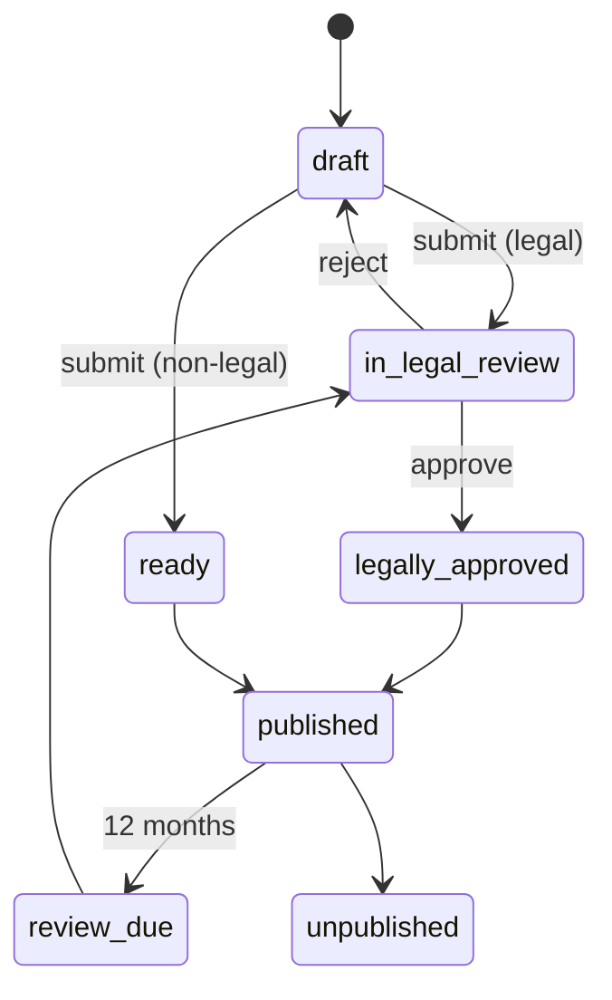

# P13 — Public Website, CMS, SEO and Growth Engine
> Paste after 01_MASTER_PROMPT.md. Prerequisites: P01 (identity, consent ledger), P05 (fee engine and published fee schedules); reads from P02 (Dispute Explorer), P03 (neutral directory), P09 (clause registry, GRM/POSH products). May run in parallel with P08–P11 (separate squad). Estimated effort: 6 sprints (2-week) for a squad of 7 (2 web engineers, 1 backend, 1 SEO/content engineer, 1 designer, 1 QA, 0.5 legal reviewer embedded, 0.5 analytics).

---

## 1. Objective and business outcome

Replace the current equatorresolution.in site — a client-rendered skeleton that carries legally risky content (R4 §1.6, §8) — with a server-rendered, legally governed acquisition engine:

1. **Remove or rewrite every risky item on the live site before any paid acquisition** (FR-P13-01; clause-level corrections and paste-ready copy in Appendix H §5). User instruction: *"remove or modify the risky content."*
2. Make all six product lines (L1–L6) and six verticals visible to search and buyers (today four of six revenue lines are invisible, R4 §1.2).
3. Enforce truth in marketing by construction: no statistic, badge, logo or legal-effect claim can publish without a Claims Register record (NN-17).
4. Build product-led growth surfaces (free tools, clause generator, directory, programmatic pages) feeding a consent-compliant CRM physically separated from case data (NN-15, NN-16).

Exit-gate outcomes: zero risky items live (automated scan + legal sign-off); 100% of indexable routes pass the SSR/SSG check; Lighthouse ≥ 90 performance / 100 SEO / ≥ 95 accessibility on the 20 top templates; every lead has source, consent and routing; one audited metrics snapshot drives every public statistic.

---

## 2. Scope (in / out)

**In:** new public IA and templates (Next.js App Router, `apps/web/(public)`); headless CMS with legal-review workflow; Claims Register; prohibited-phrase linter; programmatic SEO engine; JSON-LD, hreflang, sitemaps; fees page bound to the fee engine; rules, code-of-conduct, AI-governance and appointment-policy pages from versioned rulebooks; trust centre; about/advisory council; careers; contact with legal-entity data from config; free tools; lead capture and native mini-CRM with HubSpot/Zoho sync; partner/referral portal (BCI-compliant advocate mode); marketing automation hooks with DPDP consent; analytics taxonomy and funnels; A/B testing with legal-approved variants; PR metrics feed; neutrality firewall; Hindi + regional workflow; performance and accessibility budgets; live-site remediation hotfix and redirect map.

**Out:** the Dispute Explorer engine itself (P02; P13 builds entry pages and lead hand-off only); the neutral directory data model (P03; P13 renders public profiles); clause registry and GRM/POSH logic (P09); Academy LMS (P10; P13 links to the separate Equator ADR Institute brand); paid-media buying; brand identity redesign beyond tokens already in P00.

---

## 3. Personas and permissions touched

| Actor | Role code / permission bundle | Can | Cannot |
|---|---|---|---|
| Visitor | anonymous | Browse, use free tools, submit forms with consent | Reach any case data |
| Lead/prospect | anonymous → `growth.leads` record | Manage marketing preferences via signed link | — |
| Content author | `cms_editor` (bundle `cms.author`) | Draft pages, posts, FAQs; attach citations and claim references | Publish; approve own legal review |
| Legal reviewer | `legal_reviewer` (bundle `cms.legal_reviewer`; held by qualified counsel) | Approve/reject legal content, claims, statute citations; set "last legally reviewed" | Publish without publisher |
| Publisher | bundle `cms.publisher` | Schedule/publish approved content; unpublish | Publish content lacking legal approval or valid claims |
| Claims owner | bundle `growth.claims_owner` (e.g., `quality_officer`) | Create/maintain Claims Register evidence | Approve own claim |
| Growth operator | `growth_manager` (bundle `growth.operator`) | CRM leads, routing, nurture journeys, experiments | Import case data; target respondents |
| Relationship manager | bundle `growth.rm` | Work assigned leads/opportunities | See case files |
| `partner` | master role | Partner portal: links, codes, lead status, statements | See case content without party consent |
| `neutral_*` | master roles | Edit own public profile fields (moderated) | Display win-rates or outcome stats |
| `institution_admin`, `platform_admin` | master roles | Configure entity details, redirects, flags | Bypass Claims Register gate |
| `dpo` | master role | Consent purposes, data-principal requests on growth data | — |

CMS and growth bundles are permission bundles inside the institution tenant, granted to the master role codes `cms_editor`, `legal_reviewer` and `growth_manager` (master §1.5); publisher, claims-owner and RM bundles are granted to those or to `quality_officer` as shown.

---

## 4. Functional requirements

### 4A. Website remediation (blocking; ships first)

**FR-P13-01 — Website remediation of risky content.** Before any other P13 scope goes live, and as a Day-0 hotfix on the current site, remove or rewrite every item in the Appendix H §5 corrections table (WC-01 … WC-60). Minimum mandatory actions:

| Ref | Live item (route) | Action | Legal basis (summary) |
|---|---|---|---|
| WR-01 | Placeholder posts "Series B", "Smith & Associates", GDPR, featured post dated 24 Oct 2026 (`/blog`) | REMOVE; return `410 Gone`; blog index shows empty state | Consumer Protection Act 2019 (CPA) s.2(28); CCPA Misleading Advertisement Guidelines 2022 |
| WR-02 | USD price card $49/$149 per user, Visa/Amex/ACH (`/pricing`) | REPLACE with INR summary; 301 `/pricing` → `/fees` | CPA s.2(28), s.2(47) |
| WR-03 | "RBI security audited", "RBI-compliant", "ISO 27001 data centers" (`/financial-odr`) | REMOVE / REPLACE | CPA s.2(28); NN-17 |
| WR-04 | 94.2% settlement rate; 4.8 days; 45 days; "hundreds of organizations"; "300+ neutrals"; "former judges" (`/neutrals/join`, `/about`) | REMOVE until Claims Register + metrics feed | CPA s.2(28); CCPA Guidelines 2022 |
| WR-05 | "100% legally binding outcomes", "Global" (`/neutrals/join`, `/about`) | REPLACE | CPA s.2(28); A&C Act s.34 |
| WR-06 | "binding decrees", "Divorce Settlements in 10–15 days", "Aadhaar e-sign execution (Day 8)" (`/matrimonial-odr`) | REPLACE | HMA 1955 s.13B; NN-06 |
| WR-07 | "Section 74 Conciliation Act" under arbitration; s.73 mis-citation (`/matrimonial-odr`) | REPLACE citations | A&C Act 1996 Part III ss.73–74; NN-05 |
| WR-08 | Property & Asset Division via e-sign (`/matrimonial-odr`) | REPLACE with registration caveat | IT Act 2000 s.1(4) + First Schedule; Registration Act 1908 s.17; NN-08 |
| WR-09 | "Trusted by Leaders Across the Ecosystem" over segment names (`/financial-odr`) | REPLACE with "Built for" | CPA s.2(28); NN-17 |
| WR-10 | itequa@gmail.com; privacy@lawdocs.in; no legal entity/CIN/DPO (`/contact`, footer, `/privacy-policy`) | REPLACE with config-driven entity block (Equator Resolution Service Private Limited; particulars from `tenant.legal_entity`, X-15) | Companies Act 2013 s.12(3)(c); DPDP Act 2023 s.8(9) & DPDP Rules 2025 r.9 (in force 13 May 2027) |
| WR-11 | "The People's Court"; "Equa"/"Equa.Law"; "Private ADR Court"; "Deliver justice" | REMOVE / REPLACE | Master §1 positioning; GX-4; CPA s.2(47) |
| WR-12 | US-derived forms (FINRA, Nevada, Vermont, US divorce petition, US panel/payment forms) on the forms page | REMOVE; replace with Indian forms list | Copyright Act 1957 s.51 risk; misleading; master §13(c) |
| WR-13 | Mediation Agreement cl.21 (mediator as witness) | REMOVE; replace with non-compellability clause | A&C Act s.80(b), s.81; Mediation Act s.23 (when notified) |
| WR-14 | Unauthorised-debit / failed-transaction TAT claims "2–6 days" (`/financial-odr`) | REPLACE | RBI TAT circular 20 Sep 2019; RB-IOS 2026 |
| WR-15 | "Mediation Act 2023 compliant", "MCI registered/aligned", "s.27 decree-enforceable", "Singapore Convention"; any copy implying Equator conducts s.12A pre-institution mediation or issues a s.12A report | REPLACE | NN-05; NN-19; X-16; M-06 |
| WR-16 | Client-rendered pages ("Loading…": `/`, `/corporate-odr`, `/file-marital-dispute`, `/terms`) | Server-render; `/terms` content visible | IT Act s.10A (assent requires notice); SEO |
| WR-17 | Broken CTAs ("Start Free Trial" → marital filing; "Book a Demo" → form-less contact; `/login` error) | Fix routing and copy | CPA s.2(28) ("free trial" that does not exist) |

Business rules: (a) a remediation item is closed only with a legal-reviewer approval record and a crawl proving absence; (b) the prohibited-phrase linter (FR-P13-09) runs against the live production crawl nightly and pages on-call on any hit; (c) all removed URLs return 410 or 301 per the redirect map (FR-P13-24); (d) Google Search Console removal requests filed for 410 URLs; (e) cached social cards purged (re-scrape OG).

**FR-P13-02 — Remediation evidence pack.** Generate `docs/compliance/website-remediation-YYYYMMDD.pdf`: before/after screenshots (Playwright), crawl diff, linter report, approver names and timestamps, SHA-256 manifest. Retained 8 years (CCPA inquiry defence).

### 4B. Information architecture and core pages

**FR-P13-03 — Sitemap.** Built from C1 K.1 (EQR-09) + R4 product requirements + C4 B.10, with retired items removed (country pages for USA/UK/Canada/Germany, "Global Presence", "Peacemaker Network", EquaSpaces, "Equator Assurance", foreign office lines). Top navigation: **Resolve** · **Disputes** · **For Organisations** · **Neutrals** · **Fees** · **Rules** · **Learn** · **About**. Persistent actions: Dispute Explorer (primary), File, Respond, Track, language switcher, Login. *v3.1:* the header is superseded by the ten-group mega-menu of Appendix AG §AG.2.1 (Resolve · Disputes · Neutrals · Marketplace · For organisations · Chambers · Training · Resources · About · Help) built under FR-P13-V31-AG01; every destination above stays reachable from the menu or footer, and the menu adds the Appendix P routes P-49 (Marketplace set, P19 screens), P-50 `/trust/how-we-earn`, P-51 `/press`, P-52 `/learn`, P-53 `/rules/complaints-about-equator` and P-54 `/neutrals/panels` *(v3.1)*.

| Section | Routes (en; hi mirrors under `/hi/`) |
|---|---|
| Home | `/` |
| Resolve | `/dispute-explorer`, `/file` (→ app), `/respond`, `/track`, `/settlements-and-awards` (OTP retrieval), `/book-a-call` |
| Disputes (vertical × mechanism) | `/disputes/{fin,com,fam,ins,wrk,int}`, `/disputes/{vertical}/{dispute-type}`, `/mechanisms/{negotiation,conciliation,mediation,arbitration,med-arb,expert-determination}`, `/disputes/{vertical}/{dispute-type}/{city}` (programmatic) |
| For Organisations | `/for/lenders`, `/for/insurers`, `/for/employers`, `/for/listed-companies`, `/for/universities`, `/for/marketplaces-fintech`, `/for/government-and-legal-services`, `/grievance-redressal`, `/posh-internal-committee`, `/developers` (→ docs portal), `/clause-library`, `/clause-generator`, `/request-demo` |
| Neutrals | `/neutrals` (directory), `/neutrals/{slug}`, `/neutrals/join`, `/neutrals/panels`, `/neutrals/code-of-conduct`, `/private-adr-chambers` |
| Fees | `/fees`, `/fees/calculator`, `/fees/{vertical}`, `/fees/enterprise`, `/fees/refunds-and-waivers` |
| Rules | `/rules`, `/rules/{ruleset}/{version}`, `/rules/appointment-policy`, `/rules/ai-governance`, `/rules/code-of-conduct`, `/rules/complaints-about-equator` |
| Learn | `/learn` (knowledge centre), `/learn/{slug}`, `/glossary`, `/letters-library`, `/tools/{tool}`, `/academy` (link-out to Equator ADR Institute) |
| Trust | `/trust`, `/trust/security`, `/trust/sub-processors`, `/trust/dpa`, `/trust/outcomes` (metrics feed + awards set aside, D12), `/trust/how-we-stay-neutral`, `/status` |
| About | `/about`, `/about/advisory-council`, `/about/secretariat`, `/careers`, `/careers/{id}`, `/press`, `/partners`, `/contact` |
| Legal | `/terms`, `/privacy`, `/cookies`, `/disclaimer`, `/grievance-officer`, `/accessibility` |
| Verify | `/verify/clause/{code}` (P09), `/verify/certificate/{id}` (P10), `/verify/document/{hash}` |

*v3.1 reconciliation:* the v2 addendum amends these routes — readable vertical slugs with one-hop 301s from `/disputes/{fin,com,fam,ins,wrk,int}`, `/training` canonical with `/academy` 301, `/decisions` for published outcomes (FR-P13-V2-04, FR-P13-V2-R01), `/help` (FR-P13-V3-X03) and `/pricing/*` (FR-P13-V2-O1); where this table and the addenda differ, the addenda prevail. Top-level menus and their order are owned by Appendix AG *(v3.1)*.

**FR-P13-04 — Vertical × mechanism pages.** Each vertical page (FIN, COM, FAM, INS, WRK, INT) follows a fixed template: (1) **free or statutory forum first** (RBI Ombudsman, Insurance Ombudsman/Bima Bharosa, Consumer Commission/e-Jagriti, Lok Adalat, MSEFC/MSME ODR, Family Court, labour authorities) with when it is better (NN-20); (2) what Equator can and cannot do (from the master mechanism × vertical matrix — FAM shows "no arbitration on divorce, custody or wills"; INS shows "no arbitration for retail policyholders"); (3) how it works; (4) fees summary pulled from the fee engine; (5) documents checklist; (6) FAQs (FAQPage JSON-LD); (7) CTA to Dispute Explorer. Mechanism pages explain the statute that governs (A&C Act Parts I/III; contractual mediation with Mediation Act status note bound to the statute-commencement registry).

**FR-P13-05 — Neutral directory (public).** Renders P03 data: verified credentials, panels, languages, cities, accreditation, CPD status, availability, fee band, "verified" badge, Person JSON-LD. Prohibited: win-rates, settlement-rate per neutral, "lender-friendly/borrower-friendly" tags (NN-16, D12). Ratings only from verified closed-case participants, moderated, shown only when n ≥ 10. Empty directory states never fall back to invented counts.

**FR-P13-06 — Fees page driven by the fee engine.** `/fees` renders the published `core.fee_schedules` version via `GET /v1/public/fee-schedules?vertical=&currency=` (ISR revalidate 300 s and on `equator.billing.fee_schedule.published.v1`). No fee figure is stored in CMS content; CMS blocks reference `{{fee:<tariff_item_code>}}` tokens. Shows: version, effective date, GST treatment, who pays, waivers and concessions, refund policy, enterprise volume tiers, INT currencies (USD/EUR/GBP/SGD/AED with INR equivalent and FX timestamp), and "Subject to Board approval" banner while `schedule.board_approved = false`. Calculator `/fees/calculator` calls the deterministic quote API (P05) — same numbers as checkout. SEBI SMART ODR schedule appears only if `sec.smart_odr.enabled`.

**FR-P13-07 — Rules, code of conduct and policy pages.** Rendered from `core.procedure_rules` versions (P02/P04): table of contents, version selector, diff between versions, PDF download with hash, effective dates; the case-pinning note ("your case follows the version in force on filing", NN-21). Mandatory pages: Arbitration Rules, Mediation/Conciliation Rules, vertical rulebooks, Code of Conduct for Neutrals, **Appointment & Independence Policy** (allocation algorithm description, rotation, conflict checks, no client choice — NN-03), **AI Governance Rule** (D3; NN-01), complaints about Equator, data retention summary.

**FR-P13-08 — Trust centre, about, careers, contact.** Trust centre: security overview, sub-processor list (versioned, change notifications by email subscription), DPA download, status page link, certificates **only if** a Claims Register record with certificate number and expiry exists, VAPT summary (date, CERT-In empanelled auditor name, scope; no findings detail), DPDP grievance officer, "How we stay neutral" (NN-16 commitments), outcomes page fed by FR-P13-21 including Equator's own "awards set aside" count (D12). About: mission, positioning line, legal entity, Advisory Council (profiles with consent records and role descriptions; empty state "being constituted" until real appointments), secretariat. Careers: CMS-driven jobs with JobPosting JSON-LD. Contact: **legal entity name (Equator Resolution Service Private Limited), CIN, registered office, correspondence offices, domain email addresses, phone/WhatsApp, Grievance Officer and DPO name/email/address** injected from the `tenant.legal_entity` configuration (master X-15; stored as `core.tenant_branding.legal_profile`, config, maker–checker); a build check fails on any non-domain email (`@gmail.`, `@yahoo.`, `@lawdocs.in` on Equator pages) or a missing CIN.

### 4C. Headless CMS, legal review and Claims Register

**FR-P13-09 — Headless CMS with legal workflow.** Payload CMS (Next.js-native, self-hosted in ap-south-1; ADR) storing `growth.pages` and versions. Content types: page, vertical page, programmatic template, article, FAQ, glossary term, author profile (credential card), job, press release, case study (consented, anonymised), letter template, tool copy, legal page. Workflow: `draft → in_legal_review → legally_approved → scheduled → published → expired | unpublished`. **Reviewer queue (v3.1):** the legal reviewer's queue is ordered by (1) remediation items (FR-P13-01), (2) pages whose claims expire within 7 days, (3) review-due pages past 12 months, (4) scheduled publish date; saved views "Regulatory-status claims", "Hindi parity pending", "Flag-swap pairs missing a variant"; bulk approve is not available for `legal_content = true` pages *(v3.1)*. Rules: (a) any content tagged `legal_content = true` (all vertical, mechanism, rules, tools, letters, legal pages, and any article citing a statute) requires `cms.legal_reviewer` approval; reviewer ≠ author; (b) **citation fields** mandatory for every statute/case reference: instrument, section, date, source URL, Legal Rules Register ID (Appendix G) — free-text statute citations fail validation; (c) **"Last legally reviewed on {date} by {reviewer credential}"** stamp rendered on legal content; review expiry 12 months (configurable), after which the page shows a review-due banner internally and is queued; (d) **prohibited-phrase linter** (deny-list, regex, per locale) blocks publish: "court" used for Equator, "decree" (except in quoted statute explanations with reviewer override), "judge" for neutrals, "People's Court", "RBI approved/audited/certified/compliant", "SEBI approved", "ISO 27001 certified" (unless certificate claim exists), "100% legally binding", "guarantee(d)" (unless a published guarantee policy claim exists), "MCI registered/recognised", "s.27 decree", any statement that Mediation Act ss.27–28 are in force (while the statutory-mode flag is OFF, X-16), "s.12A certificate"/"satisfies s.12A"/"pre-institution mediation under s.12A" for Equator (while `com.s12a_equator_authorised` is OFF, M-06), "Singapore Convention enforceable", "Global", "Equa", "Equa.Law", "Private ADR Court", "free trial" (unless trial product exists), "best/No.1/leading" superlatives without a claim record; Hindi equivalents (न्यायालय/अदालत for Equator, डिक्री, गारंटी, आरबीआई द्वारा अनुमोदित) included; (e) statute-commencement binding: content blocks can be tied to a Legal Rules Register flag (e.g., `mediation_act.s27.in_force`; until ON, copy states that Mediation Act ss.27–28 are not yet notified — X-16) and swap automatically when the flag changes (C4 A.4).

**FR-P13-10 — Claims Register enforcement (NN-17).** `growth.claims_register` records every publishable claim: canonical text (per locale), type (`statistic | badge | certification | logo | testimonial | case_study | comparative | regulatory_status | legal_effect | award_media`), evidence (S3 object with SHA-256, or source URL snapshot), source date, owner, approver (≠ owner; legal reviewer for `legal_effect`/`regulatory_status`), valid_from, **expires_at (mandatory for statistics; default 35 days for metrics-feed claims, 12 months otherwise)**, permitted surfaces, conditions (e.g., "only with methodology link"). CMS rich text has an inline `claim` node referencing `claim_id`; publish is blocked if (a) any numeric pattern (digits with %, days, ₹, crore, lakh, +, "x times") or comparative/superlative appears outside a `claim` node or an allow-listed legal-rule reference (statutory periods sourced from Appendix G), (b) a referenced claim is not `approved` or is expired, (c) a logo is used without a `logo` claim backed by written permission. Expiry job (hourly) replaces expired claims with their configured fallback text (or removes the block) and triggers ISR revalidation; owner notified at T-7 days. Public `/trust/claims` lists active claims with sources (optional, flag).

**FR-P13-11 — Authors and E-E-A-T.** Author profiles with verified credentials (enrolment number checked against P03 verification where the author is a neutral), conflicts statement, Person JSON-LD; articles show author + legal reviewer.

### 4D. Programmatic SEO and technical SEO

**FR-P13-12 — Programmatic landing engine.** Templates for vertical × dispute type × city × language. Page generated only when: (a) dispute type is enabled for the vertical; (b) city exists in `growth.cities` with local data (DLSA, Consumer Commission, Family Court/DRT/MSEFC address from the signposting directory; Equator office NAP only where a real office exists — Noida, Jaipur, Delhi per config); (c) unique copy block ≥ 250 words approved by legal reviewer per (dispute type × language), plus ≥ 3 local FAQs; (d) Claims Register passes. Launch set: 6 verticals × top 25 dispute types × 20 cities × en/hi, generated in waves of ≤ 500 pages/week with indexation monitoring; pages with < 3 months impressions and 0 clicks are `noindex`ed automatically (thin-content guard).

**FR-P13-13 — Structured data, hreflang, sitemaps, metadata.** JSON-LD: `Organization` (legal name, logo, sameAs, contactPoint), `LegalService` on vertical/city pages only while `seo.schema.legalservice_enabled` is ON (default OFF — X-42, FR-P13-V2-10; areaServed, availableLanguage, priceRange only from fee engine), `FAQPage`, `BreadcrumbList`, `Person` (neutrals, authors), `Course` (academy link pages), `Event`, `JobPosting`, `Article`. No `Review`/`AggregateRating` markup unless platform policy and n ≥ 10 verified ratings. `hreflang` en-IN, hi-IN (+ regional when approved) and `x-default`; emitted only when both locale versions are `published`. Sitemaps split (`pages`, `disputes`, `programmatic-{n}`, `neutrals`, `learn`, `rules`, `images`) with accurate `<lastmod>` from content `updated_at`; index at `/sitemap.xml`. Metadata manager: unique title (≤ 60 chars) and description (≤ 155) per route enforced by lint; canonical on every route; dynamic OG image per page. robots.txt disallows `/app`, `/admin`, `/api`, `/verify` (noindex) and filing flows; search crawlers are allowed and AI-training crawlers are blocked on neutral profiles and published outcomes per the Board-approved AI-crawler policy (X-42; FR-P13-V2-13).

**FR-P13-14 — SSR/SSG build check.** Every public route uses SSG/ISR or SSR (RSC). CI job crawls the built site with JavaScript disabled and fails if any indexable route lacks H1 + main content ≥ 150 words (templates may whitelist utility pages), returns "Loading…", or differs in title/canonical between JS-on and JS-off renders. Same check runs nightly on production.

### 4E. Free tools (PLG)

All tools: no login, results on-page (no email gate for the core result), optional email/WhatsApp copy with separate marketing consent, `growth.tool_runs` logging (no PII unless the user opts in), deterministic engines from `packages/rules` (NN-01: tools compute fees, dates and statutory routes; never case merit or claim value).

**FR-P13-15 — Dispute Explorer entry and hand-off.** SEO entry pages per vertical/dispute type that deep-link into the P02 Explorer with prefilled vertical; on completion offer: free forum (signposting), paid process consultation (`/book-a-call`, `{{fee:ANC.CONSULT}}` — ₹999 for 30 minutes / ₹1,999 for 60 minutes, credited against registration if the matter is filed within 30 days, Appendix B; "Subject to Board approval"; v3.1 correction of the stale "₹1,000" figure, O-R4, FR-P13-V2-O3), filing, enterprise demo. Lead fields added: claim value band, counter-party type, city, language, phone/WhatsApp opt-in, DPDP consent per purpose.

**FR-P13-16 — Calculators.** (1) ODR vs litigation **fee and timeline comparator** — inputs: claim value, forum; outputs: published fee components (Equator fee engine; court-fee schedules from the Legal Rules Register by state) and statutory timelines only; no outcome or "saving %" claim unless a Claims Register record supports it; (2) arbitration fee calculator (Equator schedule; A&C Act Fourth Schedule model fees with the *ONGC v Afcons* (SC, 30 Aug 2022) per-arbitrator ceiling ₹30 lakh applied first and the sole-arbitrator +25% over and above it (Appendix B `FOURTH_SCH_CAP` → `SOLE_25`); SEBI schedule shown only when SEC flag is ON or as a labelled public benchmark); (3) Commercial Courts Act s.12A PIMS fee (PIMS Rules 2018 Schedule II fee payable to the Legal Services Authority; the tool states that Equator is not the s.12A authority — M-06); (4) MSMED Act s.16 interest (3× RBI bank rate, monthly rests; bank-rate table versioned with source); (5) NBFC portfolio recovery-ROI calculator (all inputs user-supplied; output labelled "illustration based on your inputs"); (6) **limitation checker**: Limitation Act 1963 articles mapped in Appendix G (e.g., money due, breach of contract, cheque-bounce complaint window under NI Act s.142), output: indicative last date, rule ID, "confirm with an advocate" notice, exclusions not computed (s.14, s.12A(3) time exclusion shown as notes).

**FR-P13-17 — Clause generator.** Public UI over the P09 clause registry: agreement type, mechanism ladder, seat, language, tribunal size, rules version → DOCX/PDF with registered clause ID; "adopt" requires organisation sign-up (creates a P09 adoption request). Prohibited variants (lender-chosen arbitrator, consumer ouster, retail insurance arbitration) are not offered (NN-03, NN-06).

**FR-P13-18 — POSH compliance checker and grievance SLA health check.** POSH checker: 12-question self-assessment (IC constituted, Presiding Officer senior woman, ≥ one-half women, external member, term, SHe-Box registration, policy displayed, training in last 12 months, annual report filed under s.21, Board-report disclosure under Companies (Accounts) Rules r.8(5)(x) as amended w.e.f. 14 Jul 2025 (G.S.R. 357(E), 30 May 2025), LC awareness, inquiry within 90 days) → Met / Partly met / Not evidenced report, no penalties language (C5 B.2(d) tone rules), CTA to P09 POSH SaaS. Grievance SLA health check: complaint log CSV parsed **in the browser (Web Worker)**; only aggregate statistics leave the device if the user consents; output: % resolved within 30 days, IO-routing gaps, RB-IOS escalation-risk band (deterministic thresholds), CTA to GRM SaaS.

### 4F. Lead capture, CRM, partners

**FR-P13-19 — Lead capture and native mini-CRM.** `growth.leads`, `growth.accounts`, `growth.opportunities` (physically separate database; FR-P13-26). Every form writes: source, UTM (first and last touch), page, persona (party, enterprise, neutral, learner, partner), vertical, dispute type, claim value band, city, language, **volume band** (`<100 | 100–500 | 500–2,000 | >2,000` monthly disputes), consent artefacts (purpose-wise). Scoring: configurable 100-point model (C4 B.12 defaults: org type 25, volume 20, engagement 20, seniority 15, geography 10, quality 10; ≥ 70 → senior RM). **Routing by volume band**: >2,000 → enterprise lead RM, first response SLA 1 business hour; 500–2,000 → enterprise RM, 4 business hours; 100–500 → mid-market queue, 1 business day; <100 → inside sales/automated nurture; individuals → case-manager desk 4 business hours. SLA timers with escalation to head of sales; breaches reported weekly. **Acknowledgement and progressive profiling (v3.1):** the thank-you screen and the confirmation message state who will respond and by when, computed from the routing band's SLA in business hours ("Our enterprise team will call you by 12:00 IST today"), never a shorter promise; a returning lead who opted in is recognised by signed cookie or email OTP and is not asked again for fields already held (organisation, segment, city, volume band) — the form shows them for confirmation and asks only for what is missing; fields never pre-fill from any case data (NN-16) *(v3.1)*. Bi-directional sync adapter to HubSpot or Zoho (configurable) carrying growth data only. *v3.0 (23 Oct 2026) — superseded from P16 by master X-51:* `ops.crm_*` (Appendix X) becomes the CRM system of record; `growth.leads` remains the capture inbox (write path and consent capture unchanged) and `LeadIngestWorkflow` promotes each lead into `ops.crm_leads` within 60 s; `growth.accounts` and `growth.opportunities` migrate once into `ops` and stay as read-only views for two releases; the routing bands, SLA timers and scoring defaults above seed `ops.crm_routing_rules` and `ops.crm_scoring_models`; the HubSpot/Zoho sync moves to the Operations Platform CRM with the same rules.

**FR-P13-20 — Partner and referral portal.** Partner types: CA, CS, law firm/advocate, DSA, HRMS/payroll platform, university, association. Features: registration with KYB, referral links/codes, co-branded landing pages (claims-checked), lead status (stage only; no case content without party consent), clause-adoption tracking, statements. **Payout modes:** (a) non-advocate partners — commission ledger, monthly statements, payout ≤ 30 days via `PAYOUT_PORT`, TDS (Income-tax Act 2025 s.393(1) Table Sl. 1(ii), formerly s.194H: 2%, threshold ₹20,000 per tax year) and GST invoice capture; (b) **Professional relationship-partner mode** — no referral reward of any kind (cash, commission, credits, discounts, gifts or priority) to advocates, CAs, CSs or CMAs or their firms (Bar Council of India Rules, Part VI, Chapter II, Section IV, r.36: no direct or indirect solicitation; r.37: no aiding unauthorised practice by a lay agency; ICAI, ICSI and ICMAI guidelines — [RE] F1.2–F1.5); they may be relationship partners for co-authored content and CLE/CPD sessions only, with `reward_eligible = false` (locked); the system blocks every payout and credit for partners flagged `is_advocate = true` or as a CA, CS or CMA. *(v3.0, 23 Oct 2026: supersedes the v2.1 platform-credits benefit — master X-54, X-62; D3-27.)* Partner status grants administrative priority only, never neutral selection (NN-16); partner relationships disclosed to counterparties in notices (P07 template block).

### 4G. Marketing automation, analytics, experimentation, PR feed

**FR-P13-21 — PR metrics feed (audited monthly snapshot).** Job on the 3rd working day computes from the reporting read model: cases filed, resolved, settlement rate, median days filing→outcome by vertical, ₹ settled, respondent participation rate, clocks breached, awards challenged and **set aside**. Rules: excludes POSH and sealed data; k-anonymity (no cell < 10); methodology versioned; `quality_officer` prepares, legal reviewer approves; on approval it auto-creates Claims Register entries (expiry 35 days) that power the website statistics band, `/trust/outcomes` and press templates — the only source of public numbers.

**FR-P13-22 — Marketing automation hooks with consent.** Consent purposes (in `core.consent_purposes`): `marketing_email`, `marketing_whatsapp`, `marketing_sms`, `newsletter`, `event_updates`, `partner_communications` — each separate from transactional/service messages (DPDP Act 2023 s.6; itemised notice per DPDP Rules 2025 r.3). Journeys (Explorer→call→filing; neutral-applicant nurture; enterprise 8-touch/30-day sequence; disputant 5-touch/10-day sequence) are triggered by growth events and executed through P07 `comms` with DLT-registered promotional templates and Meta marketing-template opt-in; preference centre via signed link; withdrawal propagates to CRM sync within 15 minutes; quiet hours and DND scrubbing for SMS. **Suppression:** any person served as respondent is suppressed (FR-P13-26).

**FR-P13-23 — Analytics event taxonomy and funnels.** PostHog self-hosted (ap-south-1) + GA4 for acquisition, consent-gated, never loaded on `/app`, `/verify`, `/settlements-and-awards` or any case page. Event names (snake_case, versioned schema in `packages/domain/analytics`): `page_viewed`, `cta_clicked`, `lead_created`, `tool_started`, `tool_completed`, `explorer_started`, `explorer_submitted`, `call_booked`, `call_paid`, `case_draft_created`, `case_filed`, `fee_paid`, `respondent_served` (aggregate only), `respondent_responded` (aggregate), `neutral_applied`, `course_enrolled`, `clause_downloaded`, `clause_adopted`, `clause_activated`, `referral_created`, `referral_converted`, `nps_submitted`, `experiment_exposed`. Case-lifecycle events reach growth only as anonymous counts or attached to a lead who is the filer and holds analytics consent. Funnels: Explorer → call → file → respondent joins → settlement → paid; enterprise: demo request → discovery → pilot → MoU → first clause-auto case. Server-side tagging; offline conversion export (Google/Meta) only for consented filers, never respondents.

**FR-P13-24 — A/B testing with legal-approved variants only.** GrowthBook (self-hosted) or PostHog flags. An experiment can start only if every variant is a published CMS version with legal approval and passing claim checks; fee figures and legal-effect statements cannot be varied; experiments on `/fees`, rules, legal pages and vertical "free forum first" blocks are prohibited; exposure logged. Redirect map and 301/410 management also lives here (`growth.redirects`).

**FR-P13-25 — Hindi and regional content workflow.** Locales en-IN, hi-IN at launch; mr, ta, te, kn, bn, gu, pa, ml, or, ur enabled per page by config (NN-23). Workflow: source approved → machine draft (`translation_agent`, Sarvam, legal glossary) → human translator → legal reviewer for legal content → publish; translation memory stored; **parity check** blocks publish if the translated version references different claim IDs, fee tokens or legal-rule IDs than the source. Fonts: Noto Sans Devanagari and script-specific Noto fonts subset per page.

### 4H. Neutrality firewall, performance, accessibility

**FR-P13-26 — Neutrality firewall (NN-16).** Implementation: (a) `growth` schema lives in a **separate Aurora database** with its own credentials; core DB roles have no grants on it and vice versa; (b) only allow-listed events cross (FR-P13-23), through the outbox with a schema validator that rejects case identifiers, party names, pleadings, offers; (c) **respondent suppression list**: HMAC-SHA256 (growth-specific key) of phone and email of every served respondent, written by `notices` on service; growth checks before any marketing send, ad-audience upload or CRM import; respondents can be contacted for marketing only after separate, revocable consent captured outside the case flow; (d) ad pixels never on authenticated or case pages; no lookalike or custom audiences built from customer or case lists; (e) neutral profiles exclude outcome statistics; (f) commercial relationships disclosed to counterparties (P07 notice block) and explained publicly on `/trust/how-we-stay-neutral`; (g) automated test `NN-16_*` seeds a respondent and asserts suppression across email, WhatsApp, SMS, CRM sync and ad export.

**FR-P13-27 — Performance budgets.** p75 field and lab: LCP < 2.5 s on 4G mid-range Android, INP < 200 ms, CLS < 0.1, TTFB < 0.8 s (CloudFront + ISR); JS ≤ 170 KB gzip per public route; images AVIF/WebP with explicit dimensions; fonts preloaded and subset; third-party scripts loaded only after consent and via Partytown/worker where possible. Lighthouse CI gates: performance ≥ 90, SEO = 100, best practices ≥ 95, accessibility ≥ 95.

**FR-P13-28 — Accessibility.** WCAG 2.2 AA: keyboard navigation, focus visible, skip links, landmarks, form labels and error association, 4.5:1 contrast, reduced-motion support, captions/transcripts for videos, accessible charts (data tables), language attribute per block for mixed-script content; axe CI zero serious/critical; manual screen-reader scripts (NVDA, VoiceOver, TalkBack) for home, Explorer entry, fees, contact, demo form, tools; `/accessibility` statement with contact.

---

## 5. Workflows and state machines

### 5.1 Content lifecycle

| State | Event | Guard | Next | Side-effects |
|---|---|---|---|---|
| `draft` | submit | lint passes; citations complete | `in_legal_review` (legal content) / `ready` (non-legal) | reviewer task |
| `in_legal_review` | approve | reviewer ≠ author; claims approved | `legally_approved` | stamp "last legally reviewed" |
| `in_legal_review` | reject | reason required | `draft` | — |
| `legally_approved` / `ready` | schedule/publish | publisher; Claims Register valid at publish time | `scheduled` / `published` | ISR revalidate; sitemap lastmod |
| `published` | claim expires | — | `published` (fallback rendered) or `unpublished` | owner alert |
| `published` | review age > 12 months | — | `review_due` (still live) | reviewer task; T+30 auto-unpublish for `regulatory_status` claims |
| any | unpublish | publisher | `unpublished` | 410/301 per redirect rule |



### 5.2 Claims Register entry
`draft → evidence_attached → approved → active → expiring (T-7) → expired | withdrawn`. Guard: approver ≠ owner; `legal_effect` and `regulatory_status` claims need legal reviewer; statistics need `expires_at`.

### 5.3 Lead
`new → scored → routed → contacted (SLA stop) → qualified → opportunity → won | lost | nurture`; SLA clock starts at `routed`; breach → escalation to head of sales.

### 5.4 Remediation item
`identified → action_defined → implemented_staging → legal_approved → live → verified_by_crawl → closed`; reopen on linter hit.

---

## 6. Screens and UX (web + mobile)

All public pages are responsive (mobile-first, 360 px baseline); no separate app screens. Common states: ISR fallback skeleton never shown to bots; empty states for directory/outcomes use honest copy ("We publish outcomes from {month}; first report due {date}").

| ID | Route | Persona | Purpose and key components | Notes |
|---|---|---|---|---|
| SCR-P13-01 | `/` | visitor | Hero (positioning line), "What happened?" selector to six verticals, free-forum note, how it works, fees teaser (fee tokens), trust band (claims only), For Organisations band, neutral recruitment band, footer with entity block | Hindi at `/hi` |
| SCR-P13-02 | `/disputes/{vertical}` | visitor | Template FR-P13-04 | FAQPage JSON-LD |
| SCR-P13-03 | `/disputes/{v}/{type}/{city}` | visitor | Programmatic page with local forum block | thin-content guard |
| SCR-P13-04 | `/for/{segment}` | enterprise buyer | Problem, regulation-aware value, product modules, compliance notes, demo form with volume band | lead routing |
| SCR-P13-05 | `/grievance-redressal`, `/posh-internal-committee` | CS/compliance buyer | Variant explainer with regulator clocks (from Legal Rules Register), tools CTA | no client logos without claims |
| SCR-P13-06 | `/fees`, `/fees/calculator` | all | Fee-engine tables, version, GST, waivers, calculator | "Subject to Board approval" banner |
| SCR-P13-07 | `/rules/*` | all | Versioned rulebooks, diff, PDF with hash | — |
| SCR-P13-08 | `/neutrals`, `/neutrals/{slug}` | visitor | Directory filters (vertical, language, city, accreditation, availability), profile | no win-rates |
| SCR-P13-09 | `/trust/*` | buyer, DPO | Security, sub-processors, DPA, outcomes, neutrality | certificates only with claim |
| SCR-P13-10 | `/about`, `/about/advisory-council`, `/careers`, `/press` | visitor | Entity, mission, council, jobs, press releases with metrics feed | — |
| SCR-P13-11 | `/contact` | visitor | Entity block from config, office NAP, contact form, GRO/DPO | build fails on non-domain email |
| SCR-P13-12 | `/tools/{tool}` | visitor | Tool UI, result, share, optional consent capture | in-browser parsing for SLA check |
| SCR-P13-13 | `/clause-generator` | buyer, counsel | Builder, preview, DOCX/PDF | adopt → sign-up |
| SCR-P13-14 | `/book-a-call` | party | Slot picker, Razorpay checkout, GST invoice, recording consent | credit to filing |
| SCR-P13-15 | `/partners`, `/app/partner/*` | partner | Programme page; portal: links, codes, leads, statements, advocate mode | BCI guard |
| SCR-P13-16 | `/admin/cms/*` | CMS bundles | Editor with claim nodes, citation panel, lint panel, review queue, preview by locale | — |
| SCR-P13-17 | `/admin/growth/claims` | claims owner, legal reviewer | Register list, evidence viewer, expiry calendar | — |
| SCR-P13-18 | `/admin/growth/crm` | growth operator, RM | Leads, scoring, routing, SLA board, journeys, experiments, redirects (v3.0: CRM functions superseded by the Operations Platform CRM screens from P16 — master X-51) | separate DB |
| SCR-P13-19 | `/preferences/{token}` | lead | Consent and channel preferences, withdraw | signed link, no login |
| SCR-P13-40 | `/how-it-works` | visitor | Resolution-ladder explainer (P-02); "Equator is not a court" | AG §AG.2.1 Resolve; was Appendix C SCR-P13-04 *(v3.1)* |
| SCR-P13-41 | `/mechanisms/{mechanism}` | visitor | Mechanism page template (negotiation, conciliation, mediation, arbitration, med-arb, pre-litigation mediation, expert determination; Appendix P P-21–P-27) | med-arb and expert determination per master §5.2 matrix *(v3.1)* |
| SCR-P13-42 | subtype pages under each hub (`/disputes/{vertical}/…`) | visitor | Subtype page template (P-10–P-19) with Explorer CTA | published only with a legal review stamp *(v3.1)* |
| SCR-P13-43 | `/neutrals/join` | prospective neutral | Eligibility, panels, apply (→ SCR-P03-03; P-36) | no win-rates or earnings promises *(v3.1)* |
| SCR-P13-44 | `/pricing/organisations`, `/pricing/professionals`, `/pricing/business-assure` | enterprise buyer; neutrals, counsel, members; MSMEs | Pricing template (P-39; FR-P13-V2-O1; Appendix O §3.1): *organisations* — segment selector → plan cards → comparison table → calculators; *professionals* — neutral, counsel and membership plan columns, prices visible without login; *business-assure* — three cards, credit explainer, worked example | approval badge; no horizontal scroll at 360 px; "+ GST" with GST-inclusive total beneath. Route-variant aliases SCR-P13-20, -21, -22 (Appendix O §3.1, FR-P13-V2-O1) resolve to this ID; AG §AG.2.1 prevails on screen IDs *(v3.1)* |
| SCR-P13-45 | `/private-adr-chambers` | practitioners | Chambers product page (P-34); practice pages; HR add-on "subject to availability" (P-34) | trial CTA → SCR-P10-01 *(v3.1)* |
| SCR-P13-46 | `/training` | learners | Training overview, programmes and dates (P-37; FR-P13-V2-20 provider cards) | Institute card gated by `academy.institute_referral` *(v3.1)* |
| SCR-P13-47 | `/learn` (+ `/learn/{slug}`, glossary, `/letters-library`) | visitor | Guides and articles, glossary, letters library (P-52) | "last legally reviewed" stamp *(v3.1)* |
| SCR-P13-48 | `/terms`, `/privacy`, `/cookies`, `/disclaimer`, `/grievance-officer`, `/accessibility` | all | Legal pages and Grievance Officer page (P-48) | locked (L) in menus and footer *(v3.1)* |
| SCR-P13-49 | (overlay) | all | Cookie banner and "Cookie settings" re-open | locked (L) *(v3.1)* |
| SCR-P13-51 | `/admin/cms/*` (SEO tab) | CMS bundles | SEO metadata editor (titles, descriptions, canonical, JSON-LD) | tab of SCR-P13-16 *(v3.1)* |
| SCR-P13-52 | `/admin/cms/*` (programmatic tab) | CMS bundles | Programmatic page sets for SCR-P13-03 (matrix, thin-content guard results) | tab of SCR-P13-16 *(v3.1)* |
| SCR-P13-53 → SCR-P13-58 | `/app/partner/*` | partner | Partner portal tabs: -53 dashboard (no case data), -54 referral links and codes, -55 co-branded landing builder, -56 clause-adoption tracking, -57 statements (non-professional partners only; advocates, CAs, CSs and CMAs receive no reward of any kind — X-62), -58 resources | tabs of SCR-P13-15; was Appendix C SCR-P13-27 → -32 *(v3.1)* |

**Screen-ID map (v3.1, D3-47(c)).** The IDs above follow Appendix AG §AG.2.1: SCR-P13-01…19 keep their P13 meaning; SCR-P13-40…58 are the AG allocations for screens that had only Appendix C IDs (SCR-P13-50 unallocated); SCR-P13-60…69 are reserved for the Decisions Library (Appendix R §3.9). SCR-P13-20, -21 and -22 are aliases of SCR-P13-44 (routes in Appendix O §3.1) and are not reused. A CI script fails if any SCR-P13 ID has two meanings across the pack (FR-P13-V31-AG02) *(v3.1)*.

---

## 7. Backend design

### 7.1 Modules touched
`cms` (pages, versions, lint, claims) · `growth` (leads, accounts, opportunities, partners, referrals, payouts, tool runs, events, experiments, redirects, suppression) · `billing` (public fee schedule read API) · `rules` (Legal Rules Register read, statute-commencement flags) · `neutrals` (public directory read model) · `comms` (marketing journeys) · `consent` · `reporting` (metrics feed) · `ai` (translation drafts only) · `audit`.

### 7.2 Tables (growth DB unless stated)
`growth.pages`, `growth.page_versions` (locale, body JSON, legal_content, reviewer_id, reviewed_at, review_due_at, status), `growth.citations` (page_version_id, legal_rule_id, instrument, section, source_url), `growth.claims_register`, `growth.claim_usages` (claim_id, page_version_id, surface), `growth.programmatic_templates`, `growth.cities`, `growth.leads`, `growth.accounts`, `growth.opportunities`, `growth.lead_routing_rules`, `growth.lead_sla_timers`, `growth.partners`, `growth.referrals`, `growth.referral_payouts`, `growth.tool_runs`, `growth.events` (partitioned monthly), `growth.experiments`, `growth.redirects`, `growth.metrics_snapshots`, `growth.suppression_hashes`, `growth.crm_sync_log`. Core: `core.tenant_branding.legal_profile jsonb` (legal_name, cin, registered_office, offices[], emails{general,grievance,dpo}, gro{}, dpo{}).

```sql
CREATE TABLE growth.claims_register (
  id uuid PRIMARY KEY DEFAULT uuidv7(),
  claim_key text NOT NULL UNIQUE,                 -- e.g. 'stat.settlement_rate.2027_01'
  claim_type text NOT NULL CHECK (claim_type IN ('statistic','badge','certification','logo','testimonial',
      'case_study','comparative','regulatory_status','legal_effect','award_media')),
  text_by_locale jsonb NOT NULL,                  -- {"en-IN": "...", "hi-IN": "..."}
  fallback_by_locale jsonb,
  evidence_object_key text, evidence_sha256 char(64), source_url text, source_date date NOT NULL,
  owner_id uuid NOT NULL, approver_id uuid, legal_reviewer_id uuid,
  status text NOT NULL CHECK (status IN ('draft','evidence_attached','approved','active','expired','withdrawn')),
  valid_from timestamptz, expires_at timestamptz,
  permitted_surfaces text[] NOT NULL DEFAULT '{web}',
  CHECK (approver_id IS NULL OR approver_id <> owner_id),
  CHECK (claim_type <> 'statistic' OR expires_at IS NOT NULL),
  CHECK (claim_type NOT IN ('legal_effect','regulatory_status') OR status NOT IN ('approved','active') OR legal_reviewer_id IS NOT NULL),
  CHECK (status NOT IN ('approved','active') OR (evidence_sha256 IS NOT NULL OR source_url IS NOT NULL))
);

CREATE TABLE growth.leads (
  id uuid PRIMARY KEY DEFAULT uuidv7(),
  persona text NOT NULL CHECK (persona IN ('party','enterprise','neutral','learner','partner')),
  email_enc bytea, phone_enc bytea, contact_hmac text,   -- for suppression lookup
  org_name text, vertical text, dispute_type text, claim_value_band text, city text, language text,
  volume_band text CHECK (volume_band IN ('lt_100','100_500','500_2000','gt_2000')),
  utm_first jsonb, utm_last jsonb, source text NOT NULL,
  score int CHECK (score BETWEEN 0 AND 100), status text NOT NULL,
  assigned_to uuid, routed_at timestamptz, first_contact_at timestamptz,
  consent_refs uuid[] NOT NULL,                 -- core.consent_records ids (by value, no FK across DBs)
  suppressed boolean NOT NULL DEFAULT false,
  created_at timestamptz NOT NULL DEFAULT now()
);
```

### 7.3 APIs

| Method / path | Purpose | Auth | Idempotency |
|---|---|---|---|
| GET /v1/public/fee-schedules?vertical=&currency= | Published fee schedule (read model) | public, cached | — |
| POST /v1/public/quotes | Calculator quote (deterministic) | public, rate-limited | Idempotency-Key accepted |
| GET /v1/public/rules · /rules/{ruleset}/{version} | Rulebooks | public | — |
| GET /v1/public/neutrals · /neutrals/{slug} | Directory | public | — |
| GET /v1/public/metrics/current | Approved metrics snapshot | public | — |
| POST /v1/public/leads | Form submission + consents | public + Turnstile/hCaptcha | **required** |
| POST /v1/public/tool-runs | Tool telemetry (aggregate unless consented) | public | keyed |
| POST /v1/public/clause-generator/render | Clause DOCX/PDF | public, rate-limited | keyed |
| POST /v1/public/call-bookings | Paid call booking | public → Razorpay | **required** |
| GET/POST /v1/preferences/{token} | Consent preferences | signed token | keyed |
| CRUD /v1/cms/pages, /v1/cms/page-versions/{id}/{submit,approve,reject,publish,unpublish} | CMS workflow | CMS bundles | keyed |
| CRUD /v1/growth/claims, POST /v1/growth/claims/{id}/{approve,withdraw} | Claims Register | claims owner / legal reviewer | keyed |
| GET/PATCH /v1/growth/leads, POST /v1/growth/leads/{id}/{assign,contact,qualify} | CRM | growth bundles | keyed |
| CRUD /v1/growth/experiments, /v1/growth/redirects | Experiments, redirects | growth.operator (+ legal for experiments) | keyed |
| POST /v1/growth/metrics-snapshots/{id}/approve | Metrics feed approval | quality_officer + legal | keyed |
| GET /v1/partners/me/{links,referrals,statements} | Partner portal | `partner` | — |

### 7.4 Domain events
`equator.cms.page.published.v1` · `equator.cms.page.unpublished.v1` · `equator.cms.claim.expired.v1` · `equator.growth.lead.created.v1` · `equator.growth.lead.routed.v1` · `equator.growth.lead.sla_breached.v1` · `equator.growth.referral.converted.v1` · `equator.growth.metrics_snapshot.approved.v1` · `equator.growth.experiment.started.v1` · consumed: `equator.billing.fee_schedule.published.v1`, `equator.rules.ruleset.published.v1`, `equator.neutrals.profile.published.v1`, `equator.notices.respondent.served.v1` (→ suppression hash only), `equator.consent.consent.withdrawn.v1` (P01 name; v3.0 correction).

### 7.5 Temporal workflows / jobs
`ClaimExpiryJob` (hourly) · `ContentReviewDueJob` (daily) · `MetricsSnapshotWorkflow` (monthly; human signals for approval) · `ProgrammaticWaveWorkflow` (weekly generation + indexation check) · `LeadRoutingWorkflow` (SLA timers, escalation) · `CrmSyncWorkflow` (5-minute incremental, consent-filtered) · `ProductionLintCrawlJob` (nightly; pages on-call) · `SsrCheckCrawlJob` (nightly) · `PartnerPayoutWorkflow` (monthly; advocate block).

---

## 8. Integrations

| Need | Port / adapter | Default | Failure behaviour |
|---|---|---|---|
| CMS | Payload (self-hosted) | Payload 3 on ECS | Static last-good build served from CloudFront |
| CRM sync | `CRM_PORT` (master §4.4; Appendix D) | HubSpot or Zoho (tenant choice) — moves to the Operations Platform CRM from P16 (X-51) | Queue + retry; the system of record is `ops.crm_*` from P16 (before P16, the native mini-CRM) |
| Email/WhatsApp/SMS marketing | `EMAIL_PORT`, `MESSAGING_PORT` via P07 | SES, Gupshup, MSG91 (DLT promotional) | Fallback per P07; never bypass consent |
| Payments (call booking) | `PAYMENTS_PORT` | Razorpay | Cashfree |
| Partner payouts | `PAYOUT_PORT` | RazorpayX/Cashfree Payouts | Manual NEFT with approval |
| Translation drafts | `TRANSLATION_PORT` | Sarvam Translate | IndicTrans2; human translation |
| Analytics | `ANALYTICS_PORT` (master §4.4) | PostHog self-hosted; GA4 | Drop events, never block page |
| Bot protection | `captcha` adapter | Cloudflare Turnstile | hCaptcha |
| Search Console / indexing | GSC API | — | Manual |

---

## 9. Configuration surface

| Item | Editor | Default | Guardrail | Tier (NN-33) |
|---|---|---|---|---|
| Legal entity profile (name, CIN, offices, emails, GRO, DPO) | institution_admin (maker–checker) | Required before launch | Domain-email validator; CIN format `^[LU]\d{5}[A-Z]{2}\d{4}[A-Z]{3}\d{6}$` | G |
| Prohibited-phrase lists per locale | legal reviewer | Seed list FR-P13-09 | Removal of an entry needs 2 legal approvals | G (removal: 2 legal approvals; † rules L) |
| Claim expiry defaults | legal reviewer | Stats 35 days; others 12 months | Stats must expire | G |
| Review cycle | legal reviewer | 12 months | ≤ 24 months | G (L ceiling 24 months) |
| Programmatic matrix | SEO lead + legal | 6 × 25 × 20 × 2 | Unique-copy rule | T (unique-copy rule L) |
| Lead scoring weights, routing bands, SLA timers | growth.operator | C4 B.12 defaults | From P16 these seed `ops.crm_scoring_models` / `ops.crm_routing_rules` (master X-51) | T |
| Partner commission rates | finance + legal | per agreement | Non-professional partners only; no referral reward of any kind to advocates, CAs, CSs or CMAs (locked; master X-54, X-62) | G (professional block L) |
| Consent purposes and texts | dpo | 6 purposes | Itemised, per language | G |
| Experiments | growth.operator + legal | none | Prohibited routes list | T (prohibited routes L) |
| Locale enablement | institution_admin | en, hi | Parity check | G (NN-23 parity) |
| Lead acknowledgement promise text per routing band (`tenant.growth.lead_ack_promise_text`, Appendix V §V.4.10) | growth.operator | from routing SLA (FR-P13-19) | must equal the configured SLA; lint blocks promises shorter than the SLA | T *(v3.1)* |

**Flag names (v3.0, 23 Oct 2026; master X-55).** Marketing-tool flags written as `growth.*` (in this file or in research) are aliases, registered in the Appendix V alias table (X-44), of the `mkt.*` flags owned by Appendix AC §AC.17 — e.g., `growth.brevo.sms_whatsapp.enabled` → `mkt.brevo.sms_whatsapp.enabled`; `ops.adobe_embed.enabled` → `mkt.adobe_embed.enabled`. The seed loader accepts the old names for one release; new code uses the canonical names. Sponsored placement is never a `growth` or `mkt` flag: it is `marketplace.paid_placement` (schema `mkp`; NN-34). Every setting above is registered in `cfg.setting_definitions` with its NN-33 tier (Appendix V §V.4).

---

## 10. Security, privacy and audit

- Growth DB isolated (separate cluster or database + network policy); no cross-DB joins; ADR required.
- Public forms: Turnstile, rate limits per IP/ASN, honeypot, server validation (Zod), file uploads disabled on public forms except CV upload on careers (ClamAV, PDF only, 5 MB).
- CSP strict (nonce-based), HSTS preload, no inline third-party scripts before consent; Subresource Integrity on CDN assets.
- DPDP: itemised notice per form; consent ledger write-through to `core.consent_records`; withdrawal propagation ≤ 15 min; data-principal rights for growth data (access, correction, erasure) via `dpo` workflow; lead retention 24 months of inactivity then delete; children: forms ask "Are you 18 or older?" and block marketing consent if not (DPDP s.9).
- Audit (NN-22): publish/unpublish, claim approvals, linter overrides, redirect changes, experiment starts, payouts — hash-chained audit events.
- CMS access: SSO + TOTP/WebAuthn mandatory; publisher step-up on publish.

---

## 11. AI touchpoints and guardrails

| Use | Agent | Guardrail |
|---|---|---|
| Translation drafts of approved content | `translation_agent` | Human translator + legal reviewer for legal content; parity check |
| Copy QA before legal review | `qa_auditor` | Flags prohibited terms, uncited statute references, numeric claims without claim nodes; advisory only |
| SEO metadata suggestions | `drafting_assistant` (marketing profile) | Suggestions only; lint applies |
| Dispute Explorer | `intake_assistant` (P02) | Unchanged; P13 only links |

No AI-generated statistics, testimonials, case studies, author bios or programmatic copy is publishable without human authorship attribution and legal review. AI never writes copy that assesses a visitor's case (NN-01).

---

## 12. Acceptance criteria (Gherkin)

```gherkin
Feature: P13 public website, CMS, SEO and growth

Scenario: NN-17_unregistered_statistic_blocks_publish
  Given an author adds "94.2% settlement rate" to the neutrals page without a claim node
  When the page is submitted
  Then the linter fails with CLAIM_REQUIRED for "94.2%"
  And the page cannot move to in_legal_review

Scenario: NN-17_prohibited_phrase_blocked_in_hindi
  Given a Hindi page contains "आरबीआई द्वारा अनुमोदित"
  When the publisher attempts to publish
  Then publishing fails with PROHIBITED_PHRASE

Scenario: Expired statistic is replaced by fallback
  Given an active statistic claim expiring today at 10:00 IST
  When ClaimExpiryJob runs at 10:05
  Then the statistics band renders the fallback text
  And the claim owner receives an expiry notice

Scenario: Remediation — placeholder blog removed
  Given the Day-0 hotfix is deployed
  When a crawler requests the "Series B" post URL
  Then the response is 410 Gone
  And the nightly production lint crawl reports zero hits for "Series B", "Smith & Associates" and "GDPR"

Scenario: Remediation — pricing in INR from the fee engine
  When a visitor requests /pricing
  Then they are 301-redirected to /fees
  And every amount on /fees is rendered from the published fee schedule in INR
  And no "$" amount appears on any domestic page

Scenario: Contact page entity block
  Given the legal profile lacks a CIN
  When the site is built
  Then the build fails with ENTITY_PROFILE_INCOMPLETE
  And any page containing "@gmail." fails the build

Scenario: SSR check
  Given the built site
  When the SSR crawler fetches "/" and "/terms" with JavaScript disabled
  Then each response contains an H1 and at least 150 words of main content
  And neither contains "Loading…"

Scenario: Fees page shows Board-approval status
  Given the published fee schedule has board_approved = false
  When /fees renders
  Then the banner "Subject to Board approval" is visible above the tables

Scenario: Programmatic thin-content guard
  Given a dispute type × city combination without an approved unique copy block
  When the weekly wave runs
  Then no page is generated for that combination

Scenario: hreflang only when both locales published
  Given an English page published and its Hindi version in legal review
  Then the English page emits no hi-IN hreflang link

Scenario: NN-16_respondent_suppression
  Given a person served as respondent in a FIN case
  When the same email is submitted on a newsletter form without marketing consent captured outside the case
  Then no marketing message is sent and the lead is marked suppressed
  And the person is excluded from CRM sync and ad audience exports

Scenario: NN-16_no_neutral_win_rates
  When a neutral profile renders
  Then it shows no settlement rate, win rate or party-type preference

Scenario: Lead routing by volume band
  Given a demo request with volume band ">2,000"
  When the lead is created at 11:00 IST on a working day
  Then it is assigned to the enterprise lead RM
  And an SLA breach is raised if first contact is not logged by 12:00 IST

Scenario: Professional relationship-partner mode (v3.1 correction; X-54, X-62)
  Given a partner flagged is_advocate = true with 3 converted referrals
  When the monthly payout runs
  Then no cash payout, credit, discount or priority is created
  And an attempt to record one returns 403 "MKT_ADVOCATE_REWARD_BLOCKED"

Scenario: A/B test requires approved variants
  Given an experiment on the home hero with one variant not legally approved
  When the operator starts the experiment
  Then it fails with VARIANT_NOT_APPROVED
  And experiments on /fees are rejected with EXPERIMENT_ROUTE_PROHIBITED

Scenario: Metrics feed is the only source of public numbers
  Given the January snapshot is approved
  Then claims for settlement rate and median days are created with expiry 35 days
  And the snapshot contains no POSH data and no cell below 10

Scenario: Grievance SLA health check keeps data in the browser
  When a visitor uploads a complaint log CSV without consenting to share
  Then no request containing row-level data leaves the browser

Scenario: NN-20_vertical_page_names_free_forum_first
  When /disputes/ins renders
  Then the first content block names the Insurance Ombudsman and Bima Bharosa before any Equator service

Scenario: Accessibility gate
  When axe runs on the 20 top templates in CI
  Then there are zero serious or critical violations
Scenario: v3.1 lead acknowledgement matches the routing SLA
  Given a demo request with volume band "500–2,000" at 15:00 IST on a working day with business hours 09:00–18:00
  When the thank-you screen renders
  Then it states a response by 10:00 IST on the next working day (4 business hours)
  And no shorter promise can be configured

Scenario: v3.1 BCI and professional partner rows never accrue rewards
  Given partners flagged CA, CS and CMA
  When referrals convert
  Then no credit ledger or payout row exists for them
```

---

## 13. Deliverables and exit gate

- [ ] Day-0 remediation hotfix on the live site; remediation evidence pack signed by legal reviewer; GSC removals filed.
- [ ] New site live in staging with full IA (FR-P13-03), en + hi, SSR check green, Lighthouse gates met.
- [ ] Payload CMS with legal workflow, citation fields, review stamp, linter (en/hi), statute-commencement binding.
- [ ] Claims Register with expiry job; metrics feed with first approved snapshot (or honest empty state).
- [ ] Fees, rules, code of conduct, appointment policy, AI governance, trust centre, about/advisory council, careers, contact (config-driven entity block).
- [ ] Programmatic engine with first wave (≤ 500 pages) and thin-content guard; JSON-LD validated (Rich Results Test); segmented sitemaps with lastmod; hreflang.
- [ ] Free tools: Explorer entries, six calculators/checkers, clause generator, POSH checker, grievance SLA health check.
- [ ] Mini-CRM, routing, SLA timers, HubSpot/Zoho sync; partner portal with advocate mode; marketing journeys with consent; analytics taxonomy and funnels; experimentation with legal gate.
- [ ] Neutrality firewall (separate DB, suppression hashes, pixel isolation) with NN-16 tests green; NN-17, NN-20, NN-23 tests green.
- [ ] Redirect map (all legacy URLs: `/pricing`, `/financial-odr`, `/matrimonial-odr`, `/corporate-odr`, `/file-marital-dispute`, `/neutrals`, `/blog/*`, `.com` → `.in` canonical) deployed.
- [ ] v3.1: consultation fee token, `LegalService` flag, AI-crawler robots policy, pricing screens registered as SCR-P13-44 (aliases SCR-P13-20–22) with the AG §AG.2.1 SCR-P13-40…58 map, lead acknowledgement and progressive profiling, legal-reviewer queue ordering, tier badges *(v3.1)*.
- [ ] `docs/phases/P13-demo.md`; ADRs: CMS choice, growth DB isolation, analytics stack, canonical domain.

---

## 14. Open items and legal verification flags

1. **Canonical domain — resolved (X-14)**: `equatorresolution.in` is primary; `.com` (if held) 301-redirects to `.in`.
2. **Legal entity (M-02, X-15)**: the operating entity is **Equator Resolution Service Private Limited** (C1's "Infrabyx Consultancy (OPC) Private Limited" is superseded). CIN, registered office, GSTIN, DPO and Grievance Officer are `tenant.legal_entity` values to be supplied by the Company Secretary before go-live **[VERIFY — open: MCA21 master-data check of the entity and CIN]**. Do not publish an unverified CIN.
3. DPDP Rules 2025 r.9 (publish contact of the DPO/person answering queries on website/app; repeat in every rights response) — confirmed; Companies Act s.12(3)(c) website particulars — confirmed; Consumer Protection (E-Commerce) Rules 2020 applicability to paid online services — Equator policy: treat own-service sales as inventory e-commerce and comply with r.4 (Appendix O §6.3) **[VERIFY — open (counsel): written view on applicability to institutional ODR services]**.
4. RESOLVED (Oct 2026): BCI Rules Part VI Ch. II, Section IV, r.36 (solicitation) and r.37 (lay agency); r.20 (Section II) bars contingent fees. Partner commissions: Income-tax Act 2025 s.393(1) Table Sl. 1(ii) (old s.194H), 2%, ₹20,000.
5. CCPA Guidelines for Prevention of Misleading Advertisements and Endorsements for Misleading Advertisements 2022 (9 Jun 2022 — date confirmed) clause references used in the corrections table **[VERIFY — open: cite generically as CCPA-G until legal_reviewer maps clauses from the Gazette text]**.
6. Resolved: master §1.5 now defines `cms_editor`, `legal_reviewer` and `growth_manager`; the bundles in §3 are granted to those role codes.
7. Resolved: master §4.4 now lists `CRM_PORT` and `ANALYTICS_PORT`; adapters live under `integrations` (Appendix D).
8. "Private ADR Chambers" is the public label (master L2); EQR-09/10 copy still uses "Private ADR Court(s)" — all public copy migrated here.
9. Litigation-timeline figures used in the fee/timeline comparator need sourced claims (court pendency data) before display; until then the comparator shows fees and statutory periods only.

---

## v2 Addendum (21 October 2026)

> The requirements below are part of this phase's scope and exit gate (master §17). They come from the v2 appendices named in each heading; where they conflict with earlier sections of this phase, the addendum prevails (precedence: master §15, 02 decision log).

### From Appendix K — Dispute Explorer v2 & Dispute-Type Framework

| ID | Requirement | Acceptance criteria |
|---|---|---|
| FR-P13-V2-K01 | Public `/explore` pages server-rendered entry with Explorer CTA on home and vertical pages; "free forum first" block on every vertical landing page (NN-20). | Build check passes (no client-only shell) |
| FR-P13-V2-K02 | Expansion landing pages generated from pack CMS blocks only when the pack is `published`; no "coming soon" claims without a Claims Register entry (NN-17). | Unpublished packs produce no indexable pages |
| FR-P13-V2-K03 | Exclusion explainer page ("What Equator does not do") listing EXC categories in plain language with forum links. | Page passes readability ≤ grade 8 |

### From Appendix O — Revenue, Plans, Billing & Settings

**FR-P13-V2-O1 — Pricing routes.** `/fees`, `/pricing/organisations`, `/pricing/professionals` and `/pricing/business-assure` — one screen SCR-P13-44 with three variants (Appendix AG §AG.2.1; v2 IDs SCR-P13-20, -21, -22 kept as aliases) *(v3.1)* — per §3.1 with plan-card anatomy and comparison-table rules. *Acceptance:* no horizontal scroll at 360 px; values never conveyed by colour alone; prices visible without login; all figures from the published-plans API with approval badge.

**FR-P13-V2-O2 — Plan copy deck.** §3.2 copy in en (hi after legal-translator review); `pricing-copy` linter with the prohibited phrase list. *Acceptance:* every plan page has headline, one-liner, benefits and FAQ from CMS; linter blocks seeded violations.

**FR-P13-V2-O3 — Consultation price alignment.** SCR-P13-14 shows ANC.CONSULT prices (O-R4). *Acceptance:* no "₹1,000" consultation copy remains.

### From Appendix P — Website Copy Deck & SEO/GEO Content System

**FR-P13-V2-01 — Copy deck implementation.** Build every page in §3.1 (P-01–P-48) with the §3 copy as CMS seed content (en; hi hero lines), the field set (SEO title, meta, H1, hero, sections, CTAs, FAQs, schema, internal links) and the templates in §3 (hub, subtype, mechanism, organisation rules). *Acceptance:* every route returns SSR HTML with the seeded H1 and hero; each page version has a legal approval record; Hindi hero lines exist for every page and pass translator + legal review before `/hi/` publication.

**FR-P13-V2-02 — Messaging hierarchy (P-D01, P-D02).** Brand line A-01 in the logo lock-up, home eyebrow, footer, OG images and `Organization.slogan`; descriptor A-03 as home meta/OG description; positioning line A-02 as home H1; identity strip on every hub, subtype, mechanism and Explorer page. *Acceptance:* §8.2 "P-D01 messaging hierarchy rendered" passes; LINT-022 green.

**FR-P13-V2-03 — Catch-line library.** Load §2 lines into a CMS snippet library with fields `line_id`, text, use, check codes, gate/claim key, status; gated lines render only when their claim is `active`; rejected lines (§2.8) seed the deny-list. *Acceptance:* inserting any §2.8 line fails lint; a gated line with an inactive claim renders nothing.

**FR-P13-V2-04 — Routes and redirects (P-D05).** Readable vertical slugs with 301s from `/disputes/{fin,com,fam,ins,wrk,int}`; `/training` canonical with `/academy` 301; `/published-outcomes` 301 → `/decisions` (App. R §3.9.1); `/about/governance`, `/about/corrections`, `/about/editorial-policy`, `/pricing/organisations`, `/pricing/professionals` live; bare `/pricing` keeps the WR-02 301 to `/fees`. *Acceptance:* redirect map test covers every legacy and alias route; no redirect chains longer than one hop.

**FR-P13-V2-05 — Organisation disclaimers.** Segment-specific regulatory-status disclaimer component in the first screen of P-28–P-34; F-01 never rendered in a block containing a regulator name or logo. *Acceptance:* DOM test for each organisation page; lint rule fails when F-01 and a regulator name share a block.

**FR-P13-V2-06 — Claims Register seeds.** Create the §1.6 claim keys (including fallbacks) alongside Appendix H §6 keys; wire `ClaimNode` usages from §2–§3. *Acceptance:* every `{{claim:…}}` in the seeded content resolves to a register row; expired-claim fallback test passes for `svc.first_session_free_respondent`.

**FR-P13-V2-07 — Copy-lint expansion.** Implement LINT-001–LINT-050 (§8.1) in `packages/content-lint` for en and hi, running in the CMS on save, in CI on templates and i18n catalogues, and nightly on the production crawl; † rules non-overridable; overrides audited. *Acceptance:* a fixture corpus with one violating sentence per rule yields exactly the expected rule IDs; zero false positives on the §3 seed content.

**FR-P13-V2-08 — Brand test and review checklist.** Add the §7.3 ten-item checklist (including the brand test) as mandatory reviewer ticks in the `in_legal_review → legally_approved` transition. *Acceptance:* approval API rejects with `VALIDATION_FAILED` when any item is unticked.

**FR-P13-V2-09 — Content components.** Ship `AnswerFirst`, `SignpostCard`, `WhoDecidesChip`, `FeeTeaser/FeeTable`, `ClaimNode`, `LegalCitation`, `FlagSwapBlock`, `ReviewStamp`, `StatBand`, `IdentityStrip` per §5.4, shared by web and the docs portal. *Acceptance:* Storybook stories with axe checks; LINT-021 enforces `AnswerFirst` on hubs, subtypes, mechanisms and help articles.

**FR-P13-V2-10 — Structured-data policy (amends FR-P13-13 and the P13 exit gate).** Emit types per §6.4; `LegalService` behind `seo.schema.legalservice_enabled` (OFF); `HowTo` behind `seo.schema.howto_enabled` (OFF); `FAQPage` optional; validation with the schema.org validator and a JSON-LD/visible-text parity test (replaces the Rich Results Test item in the exit gate). *Acceptance:* §8.2 "Structured data policy" passes on all templates.

**FR-P13-V2-11 — Entity configuration.** `seo.entity` single source (§6.2) feeding footer, contact page, Organization JSON-LD, OG tags and press kit; build fails on missing CIN or a non-domain email. *Acceptance:* changing `entity.legal_name` in config updates every surface in one deploy; snapshot test.

**FR-P13-V2-12 — `llms.txt` and Markdown twins.** Generate `/llms.txt` and `.md` twins for listed pages from the CMS when `seo.llms_txt.enabled` is ON; never list sealed, case, profile or outcome pages. *Acceptance:* file validates against the llmstxt.org structure; each listed URL has a reachable twin with the same ReviewStamp.

**FR-P13-V2-13 — AI-crawler policy.** Versioned, Board-approved robots policy per §6.12 rendered into `/robots.txt` and page-level meta robots; change log with effective date. *Acceptance:* §8.2 "AI-crawler policy applied" passes; policy version shown in `/trust`.

**FR-P13-V2-14 — Programmatic governance additions.** Similarity threshold (≤ 40%, 5-word shingles), human sign-off per template and unique block, quarterly 5% sample audit, per-template kill switch, and exclusion of POSH, criminal-adjacent, custody and signpost-only subtypes. *Acceptance:* §8.2 "Programmatic similarity guard" passes; excluded subtypes never generate pages.

**FR-P13-V2-15 — Freshness and re-review triggers.** Legal Rules Register updates and flag changes queue every citing page for re-review; `dateModified` only on substantive change; "What changed" notes on rules and legal pages; cadence jobs per §7.5. *Acceptance:* updating `LR-IRDAI-003` queues P-07 and P-13 for review within 5 minutes; sitemap `lastmod` unchanged by a no-content rebuild.

**FR-P13-V2-16 — Internal linking CI.** Crawl-based checks for orphans and > 3-click depth, related-links by taxonomy, descriptive anchors (LINT-045, LINT-049). *Acceptance:* CI fails when a new indexable page has no inbound link.

**FR-P13-V2-17 — AI visibility panel.** Monthly job running 50 prompts × vertical × (en, hi) against configured AI search engines; stores citation, URL, accuracy and free-forum mention in the growth DB; generates a content backlog. *Acceptance:* first panel report produced in staging with synthetic runs; no case data in prompts or results (NN-16 schema validator).

**FR-P13-V2-18 — Statute/flag copy registry.** Implement §7.4 rows as `FlagSwapBlock` bindings with both variants approved before publish; date-based swap for the RBI conduct rules on 1 Jan 2027. *Acceptance:* §8.2 "NN-05 Mediation Act copy swaps with the flag" passes; a `FlagSwapBlock` lacking an approved ON variant cannot publish.

**FR-P13-V2-19 — Corrections log and takedown SLA.** `/about/corrections` page and workflow; legal-effect/safety corrections within 24 hours, others within 7 days; nightly linter hits page on-call. *Acceptance:* a seeded legal-effect error opened at 10:00 shows an SLA breach alert at 10:00 next day if not closed.

**FR-P13-V2-20 — Training referral page.** `/training` with ≥ 3 provider cards from configuration in random order, Institute card gated by `academy.institute_referral` with disclosure, Equator QAP status from `qap.not_yet_imi_approved`, `Course` markup only for Equator's own modules. *Acceptance:* §8.2 "Training page neutrality" passes.

**FR-P13-V2-21 — Published outcomes copy.** Copy layer (P-41) for the `/decisions` Library built under FR-P13-V2-R01 (App. R §3.9), gated by `publication.arbitral.enabled` / `publication.consensual.enabled`, with honest empty state, consent-only items, redaction profile, "not precedent" notice and citation format. *Acceptance:* §8.2 "Published outcomes gated" passes; no item renders without an all-party consent record.

**FR-P13-V2-22 — Editorial policy page.** `/about/editorial-policy` covering authorship, legal review, AI assistance, claims and corrections (§6.8). *Acceptance:* page live, legally approved and linked from every article footer.

**FR-P13-V2-23 — App-store and social copy.** Store listings: name "Equator Resolution"; iOS subtitle "Mediation & arbitration online"; Google Play short description "Resolve disputes online: mediation, conciliation and arbitration in India."; full description built from A-03, the identity line and §3 P-01 sections; social bios use A-01 + A-03. All pass LINT-001–LINT-020. *Acceptance:* store-listing text stored in CMS with legal approval; lint report attached to the release ticket.

**FR-P13-V3-P01 — v3.1 copy additions and corrections *(v3.1)*.** Publish P-49 (Marketplace page set, gated by category flags, fixed panel note and sponsored label locked) and P-50 (`/trust/how-we-earn` frame copy over AB-generated rows); apply the v3.1 corrections: Grade B "Principal Neutral" (X-26), B-05 scoped to the institutional directory (NN-34), RBI contact-window copy in force now (LR-RBI-005) with the 1 Jan 2027 swap limited to LR-RBI-006–008, Chambers v3 sections, grievance escalation to the Company Secretary (X-52) and careers rules (NN-35, NN-38). *Acceptance:* with all `platform.mkp.category.*` flags OFF, `/marketplace` returns 404 and is absent from the sitemap; every Marketplace page shows the panel note; LINT blocks "Senior Neutral"; the `/for/lenders` contact-conduct sentence contains no "effective 1 Jan 2027" wording for the time window.

### From Appendix Q — Privacy, Security & Certification Readiness

**FR-P13-V2-Q1 — First-party CMP and GPC.** Consent banner (global opt-in model, equal-prominence reject), `growth.cmp_receipts`, GPC handling and `/.well-known/gpc.json`, `/legal/sub-processors` page, GA4 gated per Q-R7. *Acceptance:* Q-05 and Q-06 pass; no analytics script on `/pay/*`, `/app`, `/verify` or case routes.

### From Appendix R — Case Status, Publication, Execution & Registration

**FR-P13-V2-R01 — Decisions Library front end.** `/decisions`, decision pages, digests, statistics, about/policy, "Report a concern" form (§3.9), `noindex` rules and structured data (§3.13), no third-party trackers. *Acceptance:* R-19 passes; Lighthouse ≥ 90 performance and accessibility on a decision page; withdrawn citations render the tombstone.

**FR-P13-V2-R02 — Tracker and verification public pages.** `/track` and `/v/{code}` copy from §1.8 and §5.3; claims linter blocks court framing (R-LINT-01). *Acceptance:* copy lint passes; pages work without JavaScript.


### From Appendix S — Identity, Logins, Onboarding, Representatives, Dashboards & RBAC

**FR-P13-V2-S1 — Partner portal boundary.** `/partners/login` issues `growth`-audience tokens rejected by every case-context API (`CASE_DATA_TO_GROWTH_FORBIDDEN`); advocate, CA, CS and CMA partners see the relationship-partner notice ("no referral reward of any kind" — X-54, X-62; v3.1 correction of the v2 "credit-only" wording). *Acceptance:* a partner token calling `/v1/cases` returns 403; nightly test confirms no case attribute in `growth` beyond the coarse referral status.

### From Appendix U — Institutional Rules, Codes & Policy Baselines (v2.1, 22 October 2026)

**FR-P13-V2-U04 — Public pages and lint.**
- Pages: `/rules`, `/rules/code-of-conduct`, `/rules/staff-code`, `/rules/clauses`, `/privacy`, `/privacy/cookies`, `/terms`, `/fees/refunds`, `/disclaimer`, `/trust/security`, `/accessibility`, `/grievance`.
- The copy lint adds patterns E-01–E-17, and E-18–E-22 for the v3 surfaces (marketplace, registry, partner and pricing pages; channel lint profiles of Appendix Y) *(v3.1)*.
- The legacy redirect map covers `equa.law`, `vdrc.io` and the Google Sites URLs.

## v3 Addendum (23 October 2026)

The requirements below come from the v3.0 appendices and are part of this phase's scope and exit gate.

### From Appendix V — Configuration Framework, Rule Engine and Settings Catalogue

**FR-P13-V3-V01 — Website and legal-entity settings.** The legal entity profile, prohibited-phrase lists, claim expiry and locale enablement are `cfg` definitions. Copy that depends on an open item reads its fallback text, e.g., `copy.probate_s213_note` (J2-051) and the Lok Adalat limit (J-136). N-tier items such as SAROD fees (J2-271) are enforced as copy-lint rules, not settings.

### From Appendix W — Private ADR Chambers Workspace v3 and Practice HR

**FR-P13-V3-W01 — Practice page renderer.** SSR/SSG routes `/chambers/{slug}` and sub-paths with reserved slugs, canonical-host logic, tombstones and 410s (X-48); `/chambers` bare keeps the 301 to `/private-adr-chambers`. *Acceptance:* the SSR build check passes for all seeded practices; reserved slugs return `CHM_SLUG_RESERVED` at registration.

**FR-P13-V3-W02 — `chambers_practice` lint profile.** Add CHM-LINT-01–CHM-LINT-12 to `packages/content-lint` and run them on save, publish and nightly crawl. *Acceptance:* the §W.16 lint scenarios pass; nightly regressions move pages to `suspended_lint` after 7 days.

**FR-P13-V3-W03 — Structured data and sitemaps for practices.** Per-practice sitemaps, hreflang, `Organization`/`Person`/`Service`/`BreadcrumbList`/`FAQPage` JSON-LD with parity; prohibited types blocked (CHM-LINT-07). *Acceptance:* Rich Results and schema validators show no errors; no `Review` or `AggregateRating` anywhere under `/chambers/`.

**FR-P13-V3-W04 — "Report this page" and intermediary grievance.** Every practice page footer links to a report form routed to Equator's grievance officer with IT Rules 2021 timelines (7-day disposal; 3-hour takedown for specified content) [RE F3.3]. *Acceptance:* a report creates a P09 desk ticket with the page version snapshot attached.

**FR-P13-V3-W05 — `/private-adr-chambers` copy v3.** Add a "Your practice page" feature section (page builder, your domain, multilingual pages, practice HR as an add-on "subject to availability") under the Appendix P rules, with no outcome or ranking claims and a statement that practice pages are separate from Equator's neutral directory. *Acceptance:* LINT-001–LINT-050 pass; the page states "Your practice page does not affect appointments to Equator-administered matters."

### From Appendix X — Equator Operations Platform: CRM, Onboarding, Customer Success, Support and Grievance

**FR-P13-V3-X01 — Capture inbox and promotion (X-51).** `growth.leads` remains the capture store; `LeadIngestWorkflow` promotes leads to `ops.crm_leads` within 60 s with dedupe and suppression. *Acceptance:* a form submission appears in EOP in ≤ 60 s; a respondent-hash match is created as suppressed.

**FR-P13-V3-X02 — Supersede SCR-P13-18.** Remove the growth mini-CRM screen after a one-time migration of `growth.accounts`/`growth.opportunities` into `ops` with a row map. *Acceptance:* migrated counts reconcile exactly; the old screen redirects to EOP.

**FR-P13-V3-X03 — Public help centre.** `/help` (server-rendered, en + hi) publishes `public_help` KB articles through the CMS legal workflow and hosts the contact form with KB deflection. *Acceptance:* an article with a fee figure renders the live fee block; an article with an unapproved claim cannot publish.

**FR-P13-V3-X04 — Preference centre parity.** The signed-link preference centre writes through the consent API and updates `ops.crm_comm_prefs` and connected tools within 15 minutes. *Acceptance:* `ops_consent_parity` collector shows equality after a withdrawal test.

### From Appendix Y — Marketing, Brand, Social Media, PR and Growth Automation

**FR-P13-V3-Y01 — Landing-page block library.** Add the CMS content type `landing_page` with the §Y.7.3 blocks and page-level rules; `CountdownBlock`, `CapacityBlock`, `PriceBlock` and `VideoBlock` validate their bindings at save and publish. *Acceptance:* a countdown without an event/offer end time fails with `MKT_COUNTDOWN_NOT_FIXED`; a video without captions cannot publish.

**FR-P13-V3-Y02 — Lint profiles for channels.** Extend `packages/content-lint` with SL-01–SL-20 and MT checks as profiles `social`, `email`, `sms`, `whatsapp`, `ads`, `press`, shared with the Operations Platform. *Acceptance:* the fixture corpus yields exactly the expected SL IDs.

**FR-P13-V3-Y03 — Claims across surfaces.** `growth.claims_register.permitted_surfaces` gains `social`, `email`, `sms`, `whatsapp`, `press`, `ads`, `event`; `growth.claim_usages` records `mkt` content versions; claim expiry emits events consumed by MA-07. *Acceptance:* expiring a claim holds every scheduled `mkt` item using it within 5 minutes.

**FR-P13-V3-Y04 — Partner portal amendment (X-54).** Partner types CA, CS, law firm/advocate become relationship partners with `reward_eligible = false`; platform credits for advocates removed. *Acceptance:* creating a reward for a professional-class partner fails with `MKT_ADVOCATE_REWARD_BLOCKED`.

**FR-P13-V3-Y05 — Company-scoped consent purposes.** Website forms capture marketing purposes per company scope and channel; double opt-in for newsletters. *Acceptance:* a consent for Equator does not appear in a Finbyx audience.

**FR-P13-V3-Y06 — Lead hand-off to Appendix X CRM with UTM first/last touch and campaign code (X-53).** *Acceptance:* a form submission creates one CRM lead with the campaign code resolved from UTM.

**FR-P13-V3-Y07 — Experiment register mirroring.** P13 experiments are mirrored into `mkt.experiments` with hypothesis and decision fields mandatory. *Acceptance:* an experiment without a hypothesis cannot start.

**FR-P13-V3-Y08 — Operator footer.** BP-04 on every landing and paid-webinar page. *Acceptance:* LINT check fails when absent.

### From Appendix AA — Equator Marketplace and Infrabyx Professional Registry

**FR-P13-V3-AA01 — Marketplace public pages.** SSR `/marketplace`, category and profile pages, `/marketplace/how-ranking-works`, `/marketplace/transparency`, `/marketplace/review-policy`, `/marketplace/terms`, `/marketplace/provider-terms`, `/marketplace/advertise` with the operator footer and grievance officer. *Acceptance:* Lighthouse SEO ≥ 95; pages render without JavaScript; Claims Register binds every number.

**FR-P13-V3-AA02 — Display-ad slots in CMS.** Ad slot component allowed only on pages tagged `content`; blocked tags per AA.10.8; first-party serving; "Advertisement" label. *Acceptance:* `MKP_AD_PLACEMENT_FORBIDDEN` when a slot is placed on a forbidden tag; no third-party ad scripts in the bundle.

**FR-P13-V3-AA03 — Dark-pattern certificate display.** Footer badge and `/trust/dark-patterns` page rendering the latest certified self-audit (AA.10.5). *Acceptance:* the page shows date and signer roles; missing certificate after the annual date blocks re-enabling sponsorship.

### From Appendix AB — Revenue Architecture v3 and Revenue Stream Registry

**FR-P13-V3-AB01 — Generated pricing and "How Equator earns".** `/pricing/*` and `/trust/how-we-earn` render only from approved stream versions and published schedules (§AB.2.9); hand-written prices blocked. *Acceptance:* §AB.14 explanation scenario passes; unpublish within 5 minutes of a kill or pause.

**FR-P13-V3-AB02 — Ad and sponsored slots, OFF.** CMS slot components for RS-25 and the marketplace sponsored slot for RS-19 carry the mandatory labels, page-tag exclusions (case, directory, neutral, fee, grievance, POSH) and no third-party ad scripts (DP-13); both render nothing while their flags are OFF. *Acceptance:* label present, capped at 2 slots, CSP has no ad-network hosts.

**FR-P13-V3-AB03 — Prior-price and countdown components.** Strike-through needs a stored prior price and date; countdowns need a fixed server-side end time and are blocked on tagged pages (CP-4, CP-5). *Acceptance:* seeded violating fixtures fail the CMS linter.

### From Appendix AF — Competitive Research v3: Jupitice, Institutions and Training

**FR-P13-V3-AF01 — Seed the benchmark register from Appendix AF.** Load §AF.8 rows (subject and attribute codes, tags, source references, publication and access dates) and add `source_published_on` and `source_ref` columns to the Appendix T §0.4 table. *Acceptance:* every row has an evidence tag and `verified_on`; Jupitice rows other than the SEBI listing have `public_use_allowed = false`.

**FR-P13-V3-AF02 — Comparative-claim linter covers competitor names.** The CMS linter blocks any page, landing page, social post or sales asset that names a competitor or states a comparative fact unless it links to a public-use benchmark row ≤ 90 days old; it blocks reproduction of any competitor figure classed [C] or [3P]. *Acceptance:* a draft mentioning a Jupitice take-rate or user count fails with `CLAIM_BENCHMARK_STALE` or the new code `MKT_COMPETITOR_FIGURE_BLOCKED` (HTTP 422; the `MKT_` prefix is owned by Appendix Y, which adds the code to its error-code section; register in Appendix F §F.10.4 v3).

## v3.1 Addendum (24 October 2026)

The requirements below come from the v3.1 appendices and are part of this phase's scope and exit gate.

### From Appendix AG — Information Architecture, Navigation, Menus and Workflow Patterns

**FR-P13-V31-AG01 — v3.1 mega-menu (amends FR-P13-03).** Build AG-SCR-13 with the ten groups of AG.2.1, responsive priority, disclosure-navigation semantics, no-JS fallback, Marketplace group gated by enabled categories with the locked separation note, and the Log in menu of Appendix P §3.0. All FR-P13-03 destinations remain reachable. *Acceptance:* every FR-P13-03 route is linked from the menu or footer; Lighthouse accessibility 100 on the header; the menu works with JavaScript disabled.

**FR-P13-V31-AG02 — Screen-ID reconciliation.** Adopt the renumbering map of AG.2.1 (SCR-P13-40 → -58), register it in Appendix C §B.1 and §B.14 in the same PR, and fix references in Appendices C, P and S. *Acceptance:* a script finds no SCR-P13 ID with two meanings across the pack.
