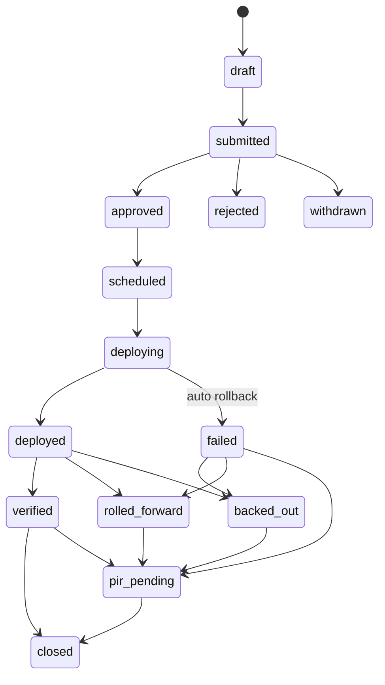

# Appendix AE — Engineering Change, Release, Backup and Audit Management (v3.0, 23 October 2026)

## AE.0 Purpose, sources, precedence

**Purpose.** This appendix answers management brief item 9 ("change and patch management on GitHub branches; backups, VAPT, IS audit, internal and external audit"). It is the build specification for how Equator source code, infrastructure, configuration and AI artefacts move from a developer's branch to production, and how they are patched, backed up, restored, tested and audited. A coding agent implements it as:
- (a) repository settings and CI/CD workflows;
- (b) a NestJS bounded context `eng` (engineering governance and assurance) with its tables, APIs, events and Temporal workflows;
- (c) an engineering-governance console and an auditor workspace;
- (d) runbooks and policy texts that management approves.

**What it extends (does not repeat).**
- P00 FR-P00-01 (monorepo, CODEOWNERS), FR-P00-04…09 (accounts, environments, Terraform, CI, CD, branching), FR-P00-18…20 (audit chain, anchors, buckets), FR-P00-26/27 (flags), FR-P00-46 (mobile guardrails), ADR-0002 (forward-only migrations) and ADR-0025 (region and DR).
- P14 FR-P14-04 (VAPT), -05 (VDP and bounty), -06 (supply chain), -07 (CERT-In), -09 (ISO/SOC 2), -11 (chaos and DR), -12 (SLOs), -13 (runbooks), -21 (access governance).
- Appendix Q SC-01…SC-22, §6.2 (Annex A owners), §6.6 (policy set), §7 (compliance-as-code, collectors, change classes).
- Appendix F §F.5 (audit schema) and §F.10 (errors).
- Appendix D §D.0.4 (provider registry).
- Appendix S (roles, `auditor` grants, break-glass).

**Sources.**
- Research file **[RD]**: §F5 GitHub, §F6 AWS backup and DR, §F7 assurance, DI-D to DI-G. Numbered sources are cited as [RD n], for example [RD 40] GitHub deployments and environments, [RD 41] rulesets, [RD 42] OIDC, [RD 43] GitHub Advanced Security, [RD 44] SemVer, [RD 46] CVSS v4.0, [RD 47] AWS Backup restore testing, [RD 48] Vault Lock, [RD 49] Aurora Global Database, [RD 50] S3 Object Lock, [RD 51] AWS Backup feature availability, [RD 52] Companies (Accounts) Rules r.3, [RD 53] r.13, [RD 54] CARO 2020, [RD 55] r.11(g) FAQ, [RD 56] CERT-In audit guidelines summary, [RD 57] CERT-In Directions, [RD 58] ISO/IEC 27001:2022, [RD 59] internal audit and CARO.
- Facts the research marks not confirmed are configurable parameters here, with `**[VERIFY — open: …]**`.

**Legend.** Configuration tiers follow NN-33: **L** Locked, **G** Governed, **T** Tenant/team-routine. "Platform" settings are changed by the Equator engineering governance roles in §AE.1. Customer tenants see only the tenant-scoped settings in §AE.15.

**Precedence.** Master §15 order applies. Within this appendix's subject matter:
1. Master §3 NN rules and §11 standards.
2. Appendix Q SC controls, which are **outer limits**. This appendix may tighten them, never loosen them.
3. This appendix.
4. Earlier phase text it amends through §AE.19.

Cross-file reconciliations are X-65 and X-66 (§AE.17).

**Dependencies.** Build the P00 addenda (§AE.19 *For P00*) in P00. Build the P14 addenda before go-live. The P11 and P12 blocks belong to those phases.

**Scope boundary.**
- **In scope:** the Equator platform monorepo, the Operations Platform (`apps/ops`), infrastructure, mobile and AI artefacts, plus the Equator legal entity's SaaS admin configuration (Microsoft 365, Brevo, Adobe, GitHub).
- **Group companies:** Finbyx and Udofin may adopt the same engine under their own GitHub organisation and AWS accounts (NN-38). Nothing in this appendix grants Equator engineers access to group-company systems, or the reverse.

---

## AE.1 Governance model, roles and separation of duties

### AE.1.1 Engineering governance roles (workforce; Keycloak client `eq-portal-ops`; phishing-resistant MFA)

| Role code | Who (default, small-company sizing) | Key rights | Must never |
|---|---|---|---|
| `engineer` | Every developer and contractor developer | Branch, PR, review peers' PRs; deploy to `dev`; read non-prod telemetry | Hold production data access; approve own PR; approve a prod deployment containing own commits |
| `tech_lead` | One per squad (2–3 at launch) | Code-owner approvals; change authority for `normal` changes in own area; one of two prod approvers | Approve a change they requested |
| `release_manager` | 1 named + 1 deputy (may be a tech lead on rotation) | Create release tags `rel-*`, `api-v*`, `web-v*`, `mobile-v*`; schedule windows; second prod approver; publish release notes | Be the only approver on a release containing own commits |
| `sre` | 1–2 (platform owner) | Terraform plan/apply via pipeline; backup/DR operations; on-call | Apply Terraform outside the pipeline except break-glass |
| `security_engineer` | 1 | Security gates, vulnerability triage, VAPT coordination | Accept risk on own finding |
| `security_lead` (Q owner code CISO) | 1 (may be part-time or virtual CISO at launch) | Risk acceptances (with risk owner), CAB member, VAPT sign-off, break-glass approver | Approve own break-glass |
| `cab_chair` | CTO / Head of Technology | Chairs CAB; approves `high` changes; freeze overrides | Chair a CAB on own change (deputy chairs) |
| `dpo` (existing) | DPO | CAB seat for privacy-impact changes; break-glass review | — |
| `legal_reviewer` (existing) | Legal or CS team | CAB seat for legal rule packs, notice templates and legal copy; release-note legal check | — |
| `finance_controller` (existing) | Finance | CAB seat for billing, ledger, escrow and payroll changes | Deploy or merge code |
| `internal_auditor` (v3) | Internal audit function (in-house or outsourced firm) | Read-only to `eng` evidence, findings tracker and audit plans | Edit evidence; hold any change, deploy or admin right |
| `auditor` (Appendix S) | External statutory, IS, ISO, SOC 2 or VAPT auditor | Engagement-scoped, time-limited (≤ 90 days), watermarked read access (§AE.8.3) | Any write except comments and requests in the workspace |

**Separation of duties.** These rules are **L**, enforced in the database and in Cerbos policies.
- **SoD-E1.** The requester of a change record cannot approve it.
- **SoD-E2.** At least one production approver must not be an author of any commit in the release (computed from the release's commit list).
- **SoD-E3.** The person who approves a risk acceptance cannot be the owner of the finding.
- **SoD-E4.** An `internal_auditor` or `auditor` cannot hold `engineer`, `sre`, `release_manager`, `platform_admin` or `security_engineer` in the same period.
- **SoD-E5.** Break-glass requester ≠ approver.
- **SoD-E6.** Developers have **no production data access by default** (§AE.14.2).

Where one person holds two seats in a small team, the system still blocks self-approval. If no eligible second person exists, the change waits or escalates to `cab_chair`. A `ENG_NO_ELIGIBLE_APPROVER` alert is raised and the change is never auto-approved.

### AE.1.2 Change Advisory Board (CAB), sized for a small company

| Item | Default (T unless stated) |
|---|---|
| Standing members | `cab_chair` (CTO), `security_lead`, `release_manager`, product owner of the affected module |
| Conditional members (join when the change touches their area; their approval is **required**, L) | `dpo` (new or changed personal-data processing, logging, retention, transfers, AI data use); `legal_reviewer` (legal rule packs, notice or award templates, legal or customer-contract copy, NN-linked behaviour); `finance_controller` (billing, ledger, escrow, payouts, payroll, tax); Head of Case Services (case-operations behaviour, clocks, allocation UI) |
| Quorum | 3 approvals including `cab_chair` (or nominated deputy) and `security_lead`, plus each conditional member who applies (**G**: quorum floor locked at 3) |
| Cadence | Asynchronous by default: approvals in the change record within 1 working day. Weekly 30-minute sync (Tuesday 15:00 IST) for open `high` changes, failed changes and PIRs |
| Minutes | Generated from the change record (`cab_note`, decisions, dissent), stored as an evidence item (A.8.32, CC8.1) |
| Escalation | Disagreement goes to the CEO. Any change touching NN-linked controls that the `legal_reviewer` or `dpo` rejects cannot proceed (L) |

### AE.1.3 RACI (summary)

| Activity | Engineer | Tech lead | Release mgr | SRE | Security | CAB | DPO / Legal / Finance | Internal audit |
|---|---|---|---|---|---|---|---|---|
| PR and code review | R | A (code owner) | I | C | C (security paths) | — | C (owned paths) | — |
| Change record | R | A (`normal`) | C | C | C | A (`high`) | A (conditional) | I |
| Production deploy | — | A (approver 1) | A (approver 2) | R | I | I | I | I |
| Patch SLA | R | A | I | R (base images, infra) | A (triage, SLA) | I | — | I |
| Backup / restore tests | — | I | I | R/A | C | — | I | I |
| VAPT | C | C | I | C | R/A | I | I (DPO for data scope) | I |
| Audit evidence | R (collectors) | C | C | R | A | — | C | R (testing) |
| Risk acceptance | — | C | — | — | A (with risk owner) | I (Critical: CTO + CS informed) | C | I |

---

## AE.2 Source control and branching

### AE.2.1 GitHub plan and organisation (D3-09 applied)

1. **Plan.** GitHub Enterprise Cloud (GHEC) with **GitHub Secret Protection** and **GitHub Code Security** for private repositories.
   - Environment required reviewers, wait timers, admin-bypass control and custom deployment protection rules are available on private repositories only above Free/Pro/Team. On those three plans they work only for public repositories [RD 40; RD F5.1].
   - CodeQL code scanning, dependency review, secret scanning and push protection on private repositories need the paid Code Security and Secret Protection products [RD 43].
   - Dependabot alerts are available on all plans [RD 43].
   - Exact Enterprise wording and India prices: **[VERIFY — open: GitHub Enterprise Cloud plan page wording and INR price; Secret Protection and Code Security per-committer price]**.
2. **Fallback (compensating control, Q §7.3) until GHEC is licensed:**
   - **Production approval.** GitHub Actions only builds, signs and publishes images. Production deployment runs as a Temporal `ReleaseApprovalWorkflow` in `eq-shared`. The workflow assumes the prod deploy role only after `eng.change_approvals` holds two valid approvals (§AE.4.6). The prod role trusts the workflow's task role, never GitHub OIDC.
   - **Scanning.** Semgrep CE, gitleaks, osv-scanner and Trivy replace CodeQL, push protection and dependency review.
   - **Recording.** The gap is recorded as risk `RISK-ENG-001` with a review date.
3. **Organisations.**
   - One GitHub organisation per legal entity: `equator-org` for Equator Resolution Service Pvt Ltd. Finbyx and Udofin each have their own.
   - The enterprise account holds **enterprise-level rulesets** and audit-log streaming.
   - Group shared services, such as the professional registry (D3-05), live in the designated owner entity's organisation, and consumers take them as versioned packages.
   - Cross-company engineers get membership in a second organisation only through a `grp` grant: purpose-bound, time-limited and recorded (NN-38).
4. **Audit-log streaming.** The GitHub enterprise audit log streams to `eq-log-archive` (S3, India, Object Lock), so GitHub admin events meet CERT-In log retention (§AE.8.6).

### AE.2.2 Repository layout

| Repository | Content | Notes |
|---|---|---|
| `equator` | Platform monorepo (master §4.2): `apps/web`, `apps/api`, `apps/worker`, `apps/mobile`, `apps/ops` (Operations Platform, D3-02), `apps/docs-portal`, `packages/*` (incl. `packages/rules/rulepacks/**`, `packages/ai/**`, `packages/export-spec/**`) | Default. RD's optional split into `equator-ops` is **not** taken. `apps/ops` is a bounded context in the monorepo, so one ruleset, one CI and one SBOM cover it. ADR-0031 records this |
| `equator-infra` | Terraform (`infra/terraform/**` moves here) and the policy-as-code (`policies/terraform/*.rego`) | Separate repo so that `infra/prod` state access and apply rights stay with `sre` and nobody else. Required reviewers: platform owner + security |
| `equator-runbooks` | Optional; runbooks may stay in `equator/docs/runbooks` | Keep them in the monorepo unless access needs differ |
| `.github` (org) | Org-wide PR templates, issue forms, `SECURITY.md`, reusable workflows (`workflow_call`), CODEOWNERS fragments | Reusable workflows are pinned by SHA in callers |

### AE.2.3 Branch model (recommended: trunk-based with release branches for hotfix only)

**Decision (D3-43, part 1).** Equator keeps trunk-based development (P00 FR-P00-09):
- feature branches are short-lived, at most **2 working days** (T: `platform.eng.branch.max_age_days`, default 2; a nag at day 2, a block on merge at day 5 without a tech-lead label `long-lived-approved`);
- squash merge into `main`;
- unfinished work ships dark behind Unleash release flags (FR-P00-26);
- **release branches exist only to patch a deployed release**: `release/rel-YYYY.MM.DD-N` is cut from the release tag when a hotfix is needed. Fixes land on `main` first and are cherry-picked to the release branch, never the reverse [RD F5.3].

**Rationale.**
- GitFlow's long-lived `develop` branch adds merge debt and no audit benefit [RD F5.3].
- Auditability comes from immutable tags, image digests and change records, not from branch topology.
- Legal behaviour is pinned per case by PinSet (FR-P00-41), so code releases do not change rules mid-case.

| Ref | Pattern | Created by | Protection |
|---|---|---|---|
| Trunk | `main` | — | Ruleset `rs-main` (§AE.2.5) |
| Feature | `feat/<work-item>-<slug>`, `fix/…`, `chore/…`, `docs/…`, `refactor/…`, `perf/…`, `test/…`, `ci/…` | engineer | Push ruleset only (file-type blocks) |
| Claude Code phase work *(v3.2)* | `cc/<phase>-<slug>` (e.g., `cc/p22-vidhi-notebooks`); the PR body links `docs/phases/PXX-plan.md`, states the IPB files read and the exit-gate status (IPB-09-02, -04, -49) | engineer or Claude Code under an engineer's identity | As feature plus `pr-checklist` validation of the links; never force-push, never edit released migrations, never touch production, never commit secrets, never bypass checks (IPB-09 §09.4.12) |
| Dependency bot | `deps/<ecosystem>/<package>-<version>` (Renovate), `dependabot/**` | bots (GitHub Apps) | As feature |
| Hotfix | `hotfix/<rel-tag>-<work-item>-<slug>` | engineer | As feature; PR targets `release/*` after the fix merges to `main` |
| Release | `release/rel-YYYY.MM.DD-N` | `release_manager` only (ruleset "restrict creations") | Ruleset `rs-release` |
| Tags | `rel-YYYY.MM.DD-N` (umbrella), `api-vX.Y.Z`, `web-vX.Y.Z`, `ops-vX.Y.Z`, `mobile-vX.Y.Z`, `rulepack-<key>@<ver>` (baseline seeds) | `release_manager` (tag ruleset) | Creation, update and deletion restricted; tags immutable |

**Naming rules (L, validated by a `branch-name` check):**
- lower-case ASCII `[a-z0-9._/-]`, at most 80 characters;
- `<work-item>` is the tracker key, for example `EQ-1234`;
- slug at most 40 characters.

**Commits:**
- Conventional Commits (commitlint, FR-P00-01) with scope = bounded-context name, for example `feat(billing): …`;
- trailers: `Refs: EQ-1234` on every commit, and `Change-Record: CHG-2026-000123` on release and hotfix merges.

**Per-PR preview environments** *(v3.2; IPB-09; D3-64)*. Every pull request to `main` deploys an ephemeral preview: namespace `pr-<number>` on the dev cluster, the shared Helm chart with the PR image, a fresh PostgreSQL schema seeded with the `test` profile only, `noindex` and HTTP auth, destroyed on merge or close and in any case after `platform.eng.preview_env.ttl_days` (7). Previews never hold production or masked production data (X-66(c)), never receive real webhooks or outbound messages (`fake` adapters forced), and post their URL to the PR. Playwright e2e and axe run against the preview. The `pr-checklist` check fails when a preview failed to deploy.

**Tenant beta programme** *(v3.2; IPB-09)*. `eng.release_rings` gains ring `beta`: tenants opt in (`tenant.eng.beta_ring.enabled`) after accepting the Beta Terms; beta releases ship behind flags to that ring before `general`; a beta tenant may declare freeze windows (`tenant.eng.beta_ring.freeze_windows`, aligned to hearing calendars) during which no ring promotion reaches it; a beta release never alters a pinned PinSet (FR-P00-41) or a statutory clock; feedback from beta tenants arrives through the IPB-04 widget with the release id. Exit from the ring is immediate.

**Release-notes pipeline** *(v3.2; IPB-07-56, IPB-09)*. Every `eng.change_records` row of class `normal` or above carries a user-facing note (en, hi) reviewed by the content editor; promotion to `general` publishes the release (`rel_`) to `/changelog` (public audience entries), to the in-app What's new cards (once per user per release; never modal on regulated screens) and to the help centre's "What changed" articles; breaking API changes carry the §AE.4.9 notice period; security fixes are described without exploit detail. A release without notes cannot be promoted (`ENG_RELEASE_NOTES_MISSING`).

### AE.2.4 Versioning

- SemVer 2.0.0 per deployable [RD 44]:
  - MAJOR = incompatible change to the declared public API, which is the OpenAPI document plus webhook and CloudEvent schemas;
  - MINOR = backward-compatible feature;
  - PATCH = backward-compatible fix;
  - pre-release suffix `-rc.N`.
- The umbrella platform release `rel-YYYY.MM.DD-N` maps to the set of image digests and the migration version deployed [RD F5.3].
- `GET /v1/meta/version` and SCR-P00 `/admin/env` expose the release tag, the per-service digests, the migration head and the active prompt-registry manifest hash (P11).

### AE.2.5 Rulesets (organisation level; applied to every repository) [RD 41]

| Ruleset | Target | Rules |
|---|---|---|
| `rs-main` | `main` | Require PR. **≥ 1 approval**, rising to **≥ 2** where CODEOWNERS marks a sensitive path (§AE.2.6). Dismiss stale approvals. **Require code-owner review.** **Require approval of the most recent push** (approver ≠ last pusher). Require conversation resolution. Required status checks (strict) per §AE.2.8. **Require code scanning results** with no High or Critical alerts. **Require signed commits.** Require linear history. Block force pushes. Restrict deletions. Require merge queue (§AE.2.9) |
| `rs-release` | `release/*` | Everything in `rs-main`, plus restrict creations to `release-managers`, plus **require deployments to succeed** to `staging` before merge |
| `rs-tags` | `rel-*`, `api-v*`, `web-v*`, `ops-v*`, `mobile-v*`, `rulepack-*` | Restrict creation to `release-managers`; block update and deletion |
| `rs-push` | All branches, including forks | Block file paths and extensions `*.pem`, `*.p12`, `*.pfx`, `*.key`, `.env*`, `*.tfstate*`, `id_rsa*`, `*.keystore`, `*.jks`; block files > 10 MB outside `apps/mobile/assets/**` (T) |
| Bypass list | — | **Empty**, except team `break-glass`. Its membership is time-boxed: granted by `security_lead` for ≤ 4 h through the JIT flow (§AE.14.2). Every bypass auto-creates an `emergency` change record and a Sev-2 security event (L) |

The `github_ruleset_export` collector exports the ruleset and environment JSON weekly and on every change, then diffs it against the approved baseline in `equator-infra/github/baseline/*.json`. A drift without a change record raises `ENG_RULESET_DRIFT` (§AE.8.1).

### AE.2.6 CODEOWNERS (additive to FR-P00-01 and RD DI-D 27)

Team handles are GitHub teams in `equator-org`. A path matched by a **two-owner** line needs approval from both teams (`rs-main` enforces ≥ 2 approvals by code-owner rule).

```text
# --- platform-critical (2 approvals: owner + security) ---
/apps/api/src/**/migrations/**              @equator-org/db-owners @equator-org/security
/db/rls/**                                  @equator-org/db-owners @equator-org/security
/apps/api/src/modules/{auth,identity}/**    @equator-org/identity-owners @equator-org/security
/apps/api/src/modules/{payments,escrow,billing}/**  @equator-org/finance-systems @equator-org/security
/apps/api/src/modules/**/ledger/**          @equator-org/finance-systems @equator-org/security
/apps/api/src/modules/sealed*/**            @equator-org/security @equator-org/dpo-delegates
/packages/crypto/**                         @equator-org/security
/packages/ai/**                             @equator-org/ai-owners @equator-org/security
/.github/**                                 @equator-org/platform-owners @equator-org/security
# --- rule packs: legal and payroll owners are mandatory (NN-33 G-tier baselines) ---
/packages/rules/**                          @equator-org/tech-leads @equator-org/legal-config-owners
/packages/rules/rulepacks/**/legal/**       @equator-org/legal-config-owners @equator-org/tech-leads
/packages/rules/rulepacks/**/payroll/**     @equator-org/payroll-owners @equator-org/legal-config-owners
/packages/rules/rulepacks/**/tax/**         @equator-org/finance-systems @equator-org/legal-config-owners
/apps/api/src/modules/{hr,pay}/**           @equator-org/payroll-owners @equator-org/security
/packages/templates/**/legal/**             @equator-org/legal-config-owners
/packages/i18n/glossary/**                  @equator-org/legal-config-owners
/packages/config/**                         @equator-org/tech-leads @equator-org/legal-config-owners
# --- export, directory, marketplace guardrails ---
/packages/export-spec/**                    @equator-org/records-owners @equator-org/dpo-delegates
/apps/api/src/modules/{mkp,dir}/**          @equator-org/tech-leads @equator-org/legal-config-owners
/apps/api/src/integrations/adapters/m365_graph/**  @equator-org/identity-owners
/apps/mobile/privacy/**                     @equator-org/mobile-owners @equator-org/dpo-delegates
```

**Rule packs are data as well as code.** CODEOWNERS governs only the **baseline seeds, validators and fixtures** in the repository. Tenant and platform rule-pack activations in production follow NN-33 G-tier maker-checker in Ruleset Studio (FR-P00-39): legal-reviewer sign-off, effective dating, preview. A rule-pack merge to `main` never activates a rule pack. The release creates a `draft` ruleset version that still needs Studio approval (L). The settings registry (`packages/config`, Appendix V) follows the same split: a change to a tier-L definition (value, bounds or tier) is a `high` release change that needs an ADR, a passing `NN-*` suite and Head of Legal approval (Appendix V §V.1.1); G and T values change in the Configuration Studio, never by merge.

`legal-config-owners` must include at least one `legal_reviewer`. `payroll-owners` must include the `hr_manager` or a `payroll_checker` delegate who has a GitHub account with read and review rights only.

### AE.2.7 Signed commits and identity

- Signing is required on `main` and `release/*` (`rs-main`). Engineers sign with an **SSH signing key** registered on GitHub, generated on a managed device (SC-15). GPG is allowed.
- Bot commits (Renovate, Dependabot, release tooling) are made by GitHub Apps, whose commits GitHub signs.
- Squash merges through the GitHub UI or merge queue produce commits signed by GitHub.
- GitHub accounts are federated to the workforce IdP via enterprise SAML or OIDC, with SCIM from the HRMS joiner/mover/leaver flow.
- Leaver removal within **≤ 4 h** of exit effective time (`iam.leaver_revoke_hours`, SC-01; L floor).
- Personal access tokens: fine-grained only, maximum 30 days, organisation approval required; classic PATs blocked (T: lifetime; L: classic blocked).
- Deploy keys forbidden. GitHub Apps are preferred over OAuth apps; third-party app access is restricted by organisation policy.

### AE.2.8 Required status checks (names are stable; CI must publish exactly these)

| Check | Tooling | Blocks on |
|---|---|---|
| `ci/lint`, `ci/typecheck` | ESLint flat config incl. `eslint-plugin-boundaries`, tsc | Any error |
| `ci/test-unit`, `ci/coverage` | Vitest/Jest; Turborepo affected | Coverage below FR-P00-07 gates |
| `ci/openapi-breaking` | `oasdiff breaking` | Breaking change without label `api-major` + ADR link + deprecation record (§AE.4.9) |
| `ci/migrations` | Testcontainer Postgres 16; `rls_lint.sql`; pgTAP; `migration-risk` label check; contract-migration age check | Any failure (§AE.4.11) |
| `ci/table-ownership` | `db/ownership.yaml` (FR-P00-02) | Cross-module table access |
| `ci/a11y` | Storybook + axe; Playwright axe on critical journeys | Any serious or critical violation |
| `ci/e2e-component` | Playwright component tests | Failure |
| `sec/codeql` | CodeQL (JS/TS, actions) | High or Critical |
| `sec/semgrep` | Semgrep OWASP + custom rules (FR-P00-07; audit-append rule FR-P00-18) | Error severity |
| `sec/dependency-review` | GitHub dependency review | New dependency with a High/Critical advisory, or a denied licence |
| `sec/secrets` | GitHub push protection + gitleaks on diff | Any finding (push protection blocks pre-merge; delegated bypass only via `security_engineer` with reason) |
| `sec/trivy-fs`, `sec/trivy-image` | Trivy filesystem and built image | Critical/High with fix available (unless an approved risk acceptance exists, §AE.5.6) |
| `sec/iac` (in `equator-infra`) | `terraform fmt/validate`, tflint, Checkov, Conftest | Checkov HIGH; any policy deny |
| `sec/actions-lint` | `zizmor`; actions pinned by SHA | Any finding |
| `supply/sbom` | Syft CycloneDX; upload | Missing SBOM |
| `lic/licence` | Licence policy (deny AGPL/SSPL/BUSL in shipped packages; allow-list) | Denied licence |
| `copy/lint` | Copy lint over `packages/i18n/**`, CMS seed copy and store metadata: forbidden terms ("court" for Equator, outcome or success-rate claims, certification claims not in the Claims Register, "guaranteed", "best neutral"), missing NN-34 sponsored label text, BCI-restricted advocate promotion phrases | Any hit |
| `i18n/parity` | `en-IN` / `hi-IN` key parity; legal-glossary lock | Missing key or modified locked term |
| `privacy/log-pii` | E2E with log sink regex scan (FR-P00-29) | Any PII hit |
| `nn/suite` | All `NN-*` tests in master §3, including **`NO_PAID_PLACEMENT`** (Appendix O; extended by NN-34) and the NN-33…NN-40 tests defined by their owning v3 appendices | **Any failure (L)** |
| `ledger/audit-trail` | Append-only, `deny_mutation`, `*_history` and pgaudit configuration tests (§AE.8.5) | Any failure |
| `export/spec` | `EQ-EXPORT-1.0` validators (NN-37) | Any failure |
| `ai/eval-gate` | promptfoo gate (P11 FR-P11-39/40), path-filtered on `packages/ai/**`, model routes, guard classifiers, corpora | Gate not met (§AE.19 *For P11*) |
| `mobile/data-inventory` | P12 FR-P12-28 inventory check, path-filtered | Undeclared SDK or permission |
| `branch-name`, `pr-template` | Custom action | Invalid branch name; mandatory PR sections empty (§AE.2.10) |
| `std/match` *(v3.1)* | Custom action (§AE.4.2 fast lane) | Never blocks; labels a PR `standard:<ID>` only when it matches an active entry within bounds |

Every check runs on `pull_request` and on `merge_group`. Path filters may skip a check but must report `success (skipped)` so required checks never hang.

### AE.2.9 Merge queue

- `main` and `release/*` use the GitHub merge queue: squash, group size ≤ 5, required checks re-run on the merged group.
- Availability of merge queue for private repositories on the chosen plan: **[VERIFY — open: GitHub merge-queue plan availability for private organisation repositories]**.
- Where merge queue is unavailable, the ruleset requires branches to be up to date (strict status checks).

### AE.2.10 Pull-request template (`.github/pull_request_template.md`; sections are validated by `pr-template`)

```markdown
## Summary
<!-- what and why; link work item: Refs EQ-#### -->
## Change type
- [ ] feature  - [ ] fix  - [ ] security fix  - [ ] dependency/patch  - [ ] refactor  - [ ] config/rule-pack baseline
- [ ] infra    - [ ] AI prompt/model/policy   - [ ] copy/legal text   - [ ] docs only
## Risk (pre-fills the change record risk score, §AE.4.4)
Areas touched: [ ] auth [ ] payments/escrow/ledger [ ] payroll/HR [ ] sealed [ ] RLS/KMS [ ] rules engine/clocks
[ ] allocation/neutral directory/marketplace [ ] AI gateway/policy [ ] exports [ ] public API/webhooks [ ] mobile native
Impact if wrong (1–5): _  Likelihood (1–5): _  Customer-visible: yes/no  Breaking: yes/no
## Rollout and rollback
Flag(s): `release.…` (default OFF?)  Rollout ring plan: ring0 → ring1 → ring2 → ring3
Rollback / roll-forward plan (required; "revert" is not enough for migrations):
## Data migration
migration-risk: none | additive | backfill | contract   Backfill workflow: _   Rehearsed on staging: yes/no
## Privacy impact
New/changed personal data, logs, retention, processors, transfers or AI data use? yes/no → DPIA/ROPA ref:
## Legal and NN impact
Touches NN rule(s): NN-__ (tests updated)   Legal copy/templates/rule packs changed: yes/no → legal_reviewer requested
## Testing evidence
Unit/E2E/a11y/perf links; screenshots for UI; eval report for AI changes
## Release notes
Internal: _   Customer-facing (if any): _   Deprecation/notice needed: yes/no
```

`pr-template` fails when any of these is empty or contradictory: Summary, Change type, Risk, Rollout and rollback, Data migration (when files under `migrations/` change), Privacy impact, Legal and NN impact (when CODEOWNERS legal or DPO paths are touched).

---

## AE.3 Environments, test data, secrets and infrastructure as code

### AE.3.1 Environment catalogue (P00 FR-P00-05 retained; QA mapping made explicit)

| Env | Role in this appendix | Data (L: never production personal data — master §11) | Deploy | Protection (GHEC) | AWS account |
|---|---|---|---|---|---|
| `local` | Developer | Seed `dev` | — | — | none |
| `dev` | Integration of `main` | Seed `demo`, weekly reset | Auto on merge to `main` | none | `eq-dev` |
| `staging` | **Test/QA**: automated E2E, DAST, perf smoke, migration rehearsal, release-candidate verification. Production-like topology, instance families and configuration (Terraform module parity) | **Synthetic at production shape**: generator profiles calibrated from production *aggregate statistics only* (row counts, distributions, field-length histograms exported by `eng.data_shape_export`, no row-level data) | Tag `rc-*` or auto after dev smoke | Deployment branches `main`, `release/*` | `eq-staging` |
| `uat` | Business, legal and pilot acceptance (P14 FR-P14-14) | Curated synthetic | Promotion of the same digest as staging | Required reviewer: product owner | `eq-uat` |
| `perf` | Load and chaos (P14 FR-P14-10/11) | Synthetic at 12-month volume | Manual | `sre` | `eq-staging` (separate VPC) |
| `bounty` | Bug-bounty target (P14 FR-P14-05) | Synthetic | Manual | `security_lead` | `eq-bounty` (new; isolated) |
| `prod` | Live | Real | Promotion of the staging digest | **2 required reviewers** (`release-managers` + `tech-leads`), **prevent self-review**, branches `release/*` and tags `rel-*` only, custom protection rule `equator-change-gate` (§AE.4.6) | `eq-prod` |
| `dr` | Warm standby, ap-south-2 | Aurora Global secondary, S3 CRR | Terraform only; app deploys mirror prod | As `prod` | `eq-prod` (ap-south-2) |

**Masked data in non-production (resolution X-66(c)).**
- Brief item 9 and common practice suggest "staging with masked production data". Master §11 says "never production data in non-prod", and master §11 prevails.
- **Locked rule.** No copy of production personal data, masked or not, leaves `eq-prod`. Masking (ISO 27001 A.8.11) is applied to:
  - logs and traces at source (FR-P00-29);
  - analytics and reporting exports;
  - support screen views (masked display columns, FR-P00-17);
  - auditor samples (§AE.8.3).
- Defect reproduction that needs production data happens **inside production** under JIT break-glass (§AE.14.2). It is never done by copying data out.
- Test information (A.8.33) is synthetic. Test fixtures may not be derived from real documents. CI blocks fixtures that fail the PAN, Aadhaar and phone regex scan.

### AE.3.2 Secrets and credentials

- **AWS Secrets Manager only** (SC-08):
  - rotation ≤ 90 days, 30 days for database service credentials;
  - replicated to ap-south-2 (multi-region secret replicas) so DR does not depend on ap-south-1;
  - KMS key `secrets` per account.
- **CI to AWS by OIDC only** [RD 42]:
  - provider `token.actions.githubusercontent.com`, audience `sts.amazonaws.com`;
  - the prod deploy role's trust is `StringEquals` on `sub = repo:equator-org/equator:environment:prod` (and the same for `equator-infra`); branch subjects are never trusted for prod;
  - the dev role trusts `ref:refs/heads/main`;
  - static AWS keys anywhere are blocked: an SCP denies `iam:CreateAccessKey` outside break-glass, and an IAM Access Analyzer finding is Critical (L).
- **GitHub environment secrets** hold only non-AWS tokens that cannot use OIDC (for example the EAS token). Each has an owner and an expiry and appears in `eng.key_inventory` (§AE.9.4).
- No secret appears in Terraform state in plaintext: `sensitive = true`, data sources resolve at runtime, and the state bucket is KMS-encrypted and versioned.

### AE.3.3 Infrastructure as code with plan review

1. Every infrastructure change is a PR in `equator-infra`. CI posts `terraform plan` per affected stack (env × region × stack, FR-P00-06) as a PR comment and as a signed artefact (plan JSON with SHA-256).
2. **Plan-review rules (L):**
   - a plan that destroys or replaces any resource tagged `eq:data-class ∈ {core, sealed, evidence, audit, ledger, backup, log}` needs a `high` change record and CAB approval;
   - a plan touching SCPs, KMS key policies, Object Lock, Vault Lock, IAM trust policies or CloudTrail needs `security_lead` approval;
   - a plan with drift (state ≠ reality) cannot be applied until the drift is reconciled under its own change record.
3. **Apply** runs only from the pipeline in the `prod` (or `dr`) GitHub environment. It uses the **exact reviewed plan file**: the apply job verifies the plan artefact's SHA-256 against the reviewed comment. Apply links the change record.
4. Nightly drift detection (FR-P00-06) opens an incident ticket on exit code 2. Drift on a security-tagged resource is Sev-2.
5. Policy as code: Checkov custom checks and Conftest Rego (Q §7.1), plus:
   - `aws_backup_vault_lock_configuration` present with compliance mode on prod and DR vaults;
   - `rds.global_db_rpo` set;
   - ap-south-2 opt-in enabled in every account [RD 51];
   - deny any resource outside ap-south-1/ap-south-2 except allow-listed global services (FR-P00-04).

---

## AE.4 Change management

### AE.4.1 Scope

A **change** is any addition, modification or removal that could affect a production service, its data, its security or its legal behaviour:
- code and container releases;
- database migrations;
- infrastructure;
- feature-flag state changes in production for release and ops flags. Legal flags already follow FR-P00-39;
- AI prompt, model, policy or corpus versions (§AE.19 *For P11*);
- mobile store releases and OTA updates (§AE.19 *For P12*);
- certificates and keys;
- **SaaS admin configuration** of Microsoft 365, Brevo, Adobe, GitHub organisation settings, AWS Organizations, the paging tool and the GRC tool [RD DI-D 30].

**Not changes under this section** (they have their own maker-checker): tenant configuration through Ruleset Studio or settings (NN-33), content publishing in the CMS (P13), and business records.

### AE.4.2 Change classes (maps ITIL types to Appendix Q §7.3 classes)

| Class (`eng.change_records.class`) | ITIL type [RD 45] | Definition | Approval (L floor) | Lead time (T default) |
|---|---|---|---|---|
| `standard` | Standard (pre-approved) | An entry in `eng.standard_change_catalogue`, used within its pre-approved bounds, with green CI | Pre-approved by CAB when the catalogue entry was approved. Record auto-created; peer PR review still required | None |
| `normal` | Normal, low/medium risk | Risk score < 15 and no sensitive area | Change authority = the area's `tech_lead` (≠ requester). Prod deploy maker-checker (§AE.4.6) | 1 working day |
| `high` | Normal, high risk (CAB) | Risk score ≥ 15, **or** any sensitive area (auth, payments/escrow/ledger, payroll/HR pay data, sealed, rules engine/clocks, RLS, KMS, AI policy, allocation/directory/marketplace ranking, export spec, Object/Vault Lock, IAM trust, SCP), **or** contract migration, **or** customer-visible breaking change | CAB quorum (§AE.1.2) + conditional members + `cab_note` | 3 working days; breaking changes also respect notice periods (§AE.4.9) |
| `emergency` | Emergency | Restores service in a Sev-1/Sev-2 incident, or closes an actively exploited or KEV-listed vulnerability under its SLA (§AE.5.3) | **1 approver** (`tech_lead`, `release_manager` or `security_lead`; ≠ requester). Retro-review by CAB **≤ 2 working days** (Q §7.3). **Never bypasses CI security gates or NN tests**; only `break-glass` can, and that is a Sev-2 event (L) [RD DI-D 31] | Immediate |

**Seed standard-change catalogue** (each entry has ID, bounds, pre-checks, verification, owner and review date; entries are re-approved annually):

| ID | Standard change | Bounds |
|---|---|---|
| `STD-01` | Dependency patch/minor update by Renovate or Dependabot | CI green, no `high` area code changes, no new transitive licence, outside a freeze |
| `STD-02` | Base-image rebuild (weekly cadence, §AE.5.4) | Same Dockerfile; digest change only |
| `STD-03` | Non-legal copy and UI text fix | `copy/lint` and `i18n/parity` green; no legal-glossary or template change |
| `STD-04` | Certificate renewal (ACM auto, DSC, push certs) | Same subject and key policy |
| `STD-05` | Secret rotation by Secrets Manager | Automated rotation lambda |
| `STD-06` | Scaling within the Terraform-declared min/max | No instance-family change |
| `STD-07` | Release/ops flag ramp along an already-approved rollout plan | Plan approved in the parent change record |
| `STD-08` | SaaS user administration (joiner/mover/leaver, licence assignment) via HRMS → `WORKSPACE_PORT` | Per JML workflow; no tenant-wide policy change |
| `STD-09` | Adding a holiday-calendar row or FX rate correction through its owning governed flow | Owning maker-checker applied |
| `STD-10` | Re-running a failed idempotent job or outbox replay | Runbook RB-11 |
| `STD-11` *(v3.1)* | Internal dashboard or report definition change (Appendix AE §AE.10, EOP report builder) | No schema or migration change; no new personal-data field; no tenant-facing or regulatory report (those are `normal`); `copy/lint` green |

**Standard-change fast lane *(v3.1)*.** The fast lane removes queueing, not controls:
1. **Automatic matching.** The `std/match` CI check classifies each PR against the active catalogue from changed paths, labels, author (bot or human) and diff size; a match **within bounds** sets label `standard:<ID>`. On merge the PR is attached (`eng.change_links`) to that day's open standard record for the same entry, which is created directly in `approved` with `class = standard` and the entry ID (pre-approved by the catalogue, §AE.4.2). A PR that touches anything outside the entry's path allow-list, any sensitive area (§AE.4.2) or any migration is never matched (L) and follows `normal`/`high`.
2. **Daily standard train.** At `platform.eng.standard.train_time` (T, default 11:00 IST, working days, outside freezes) each day's standard records deploy one after another, each as its own release so that every deployment still references exactly one change record (§AE.4.3). The two production approvers (§AE.4.6) review all of the day's standard records on one SCR-AE-02 screen and approve them in one action (one `eng.change_approvals` row per record; SoD-E2 computed per record). Non-deploy entries (`STD-04`, `STD-05`, `STD-06`, `STD-08`) are recorded automatically by their automation and need no train.
3. **Quotas and bounds.** Each entry carries `max_per_week` (default 20 for bots, 10 for human-authored entries) and its bounds; beyond the quota, further matches are classed `normal` with the reason shown on the PR (`ENG_STANDARD_OUT_OF_BOUNDS`, 409).
4. **Automatic demotion.** If an entry's change-failure rate over the trailing 90 days exceeds `platform.eng.standard.max_failure_pct` (G, default 5%) or any Sev-1/Sev-2 incident is linked to one of its changes by PIR, the entry is suspended (`active = false`, `suspended_reason`), in-flight matches become `normal`, `cab_chair` is notified and the entry returns only by CAB re-approval (`ENG_STANDARD_ENTRY_INACTIVE`, 409, on any use while suspended or past `review_due`).
5. **Entry lifecycle.** New entries are proposed in SCR-AE-02 on a template (title, path allow-list, bounds, pre-checks, verification, rollback, owner, quota); CAB approves; review is annual with an alert 30 days before `review_due`.
6. **KPIs.** Standard share of all production changes (target ≥ 50%, T); standard change-failure rate ≤ 2%; median merge-to-production lead time for standard changes ≤ 1 working day; suspended entries reported monthly. *(v3.1)*

### AE.4.3 The change record (`eng.change_records`)

- Every production deployment, infrastructure apply, SaaS admin change and production flag ramp references exactly one change record ID (`CHG-YYYY-NNNNNN`).
- A release may group several PRs.
- The record links:
  - PRs, commits and work items;
  - the release tag and per-service image digests;
  - migrations with their `migration-risk`;
  - flags and rollout plan;
  - Terraform plan hashes;
  - test evidence (CI run URLs, staging verification, eval reports);
  - the rollback/roll-forward plan;
  - the risk score and inputs;
  - approvals;
  - window, deployment and verification timestamps, and the outcome (`successful`, `failed`, `rolled_forward`, `backed_out`) [RD DI-D 30];
  - the PIR (§AE.4.12).
- DDL is in §AE.11.

**Auto-creation.**
- The `deploy.yml` workflow (FR-P00-08) calls `POST /v1/eng/change-records:from-release` when a `rel-*` tag is created. The record is pre-filled from the PR template fields of every included PR, the Changesets summary and the migration list.
- Renovate and Dependabot PRs auto-attach to a `standard` record.
- SaaS admin changes are recorded through the console form, and the weekly `saas_admin_change_recon` collector compares Graph, Brevo and GitHub audit logs against records [RD DI-G]. Each unmatched event opens `ENG_UNRECORDED_SAAS_CHANGE`.

### AE.4.4 Risk scoring (deterministic; `packages/domain/eng/risk.ts`, pure function, 100% branch coverage)

```text
base        = impact (1–5) × likelihood (1–5)                      -- from PR template, max over included PRs
+ 5         if any sensitive area touched (list in §AE.4.2 `high`)
+ 4         if migration-risk = contract;  + 2 if backfill
+ 3         if customer-visible breaking change or public API/webhook schema MAJOR
+ 2         if no automated rollback (blue/green canary not applicable, e.g. data-only or SaaS admin)
+ 2         if change touches ≥ 3 bounded contexts
+ 2         during an active freeze window override
− 2         if fully dark behind a default-OFF flag with rollout plan (floor: never below base)
− 1         if identical change rehearsed in staging in the last 7 days with evidence
score bands: < 7 low · 7–14 medium · ≥ 15 high  → class `high` if ≥ 15 or any sensitive area (L)
```

The weights are **G** (platform setting `platform.eng.change.risk_weights`; changing them needs CAB approval). The rule "sensitive area ⇒ `high`" and the band threshold floor are **L**. The score, its inputs and the function version are stored on the record.

### AE.4.5 Change record state machine

| State | Event | Guard | Next | Side effects |
|---|---|---|---|---|
| `draft` | `submit` | Mandatory fields present; risk computed | `submitted` | `equator.eng.change_record.submitted.v1` |
| `submitted` | `approve` | Class rules met (§AE.4.2); SoD-E1; conditional approvers present | `approved` | Approvals rows; `cab_note` for `high` |
| `submitted` | `reject` / `withdraw` | Reason ≥ 20 characters | `rejected` / `withdrawn` | — |
| `approved` | `schedule` | Window outside freeze (or freeze override approved); notice periods satisfied (§AE.4.9) | `scheduled` | Calendar entry; customer notice jobs |
| `scheduled` | `start_deploy` | Window open; deploy-eligibility check passes (§AE.4.6) | `deploying` | GitHub deployment approved via protection rule |
| `deploying` | `deployed` | All services healthy after canary | `deployed` | `deployed_at`, digests |
| `deploying` | `auto_rollback` | Alarm (FR-P00-08 thresholds) | `failed` | Blue/green reverts; incident opened if customer impact |
| `deployed` | `verify` | Post-deploy checks green (smoke, SLO burn, NN canaries) within `verify_window_minutes` (T, 60) | `verified` | — |
| `deployed`/`failed` | `roll_forward` / `back_out` | Fix change record linked / reverse plan executed | `rolled_forward` / `backed_out` | — |
| `verified`/`rolled_forward`/`backed_out`/`failed` | `pir_required` | Class `high` or `emergency`, outcome ≠ `successful`, or 10% sample of `normal` (T) | `pir_pending` | PIR task due + 5 working days |
| `verified` | `close` | No PIR needed | `closed` | — |
| `pir_pending` | `pir_approved` | PIR complete; actions have owners | `closed` | Problem record if root cause open (§AE.9.1) |
| Emergency path | `approve_emergency` | 1 eligible approver; incident or vulnerability linked | `approved` → (deploy states) | `retro_review_due = +2 working days`. Overdue → `ENG_RETRO_REVIEW_OVERDUE` alert to `cab_chair` and a control-failing flag on A.8.32 |
| Standard path *(v3.1)* | `auto_create_standard` | Active catalogue entry; PR within bounds and weekly quota (`std/match`) | `approved` → `scheduled` at train time → (deploy states) | Entry ID recorded; out of bounds → `ENG_STANDARD_OUT_OF_BOUNDS` and the normal path |



### AE.4.6 Maker-checker for production deployment

1. The GitHub `prod` environment requires **two reviewers**: one from `release-managers` and one from `tech-leads`, with **prevent self-review** [RD 40] and SoD-E2 (computed by the protection rule).
2. **Custom deployment protection rule** `equator-change-gate` (a GitHub App installed on the organisation) calls `GET /v1/eng/change-records/{id}/deploy-eligibility?env=prod&sha=…`. It approves only if all of the following hold:
   - the record status is `scheduled`;
   - the window is open;
   - the release SHA and digests match the record;
   - no blocking freeze applies;
   - required approvals and conditional approvals exist;
   - no open Critical vulnerability without an accepted exception exists on any included image (§AE.5);
   - the latest staging deployment of the same digests succeeded;
   - `nn/suite` and `ai/eval-gate` passed on the release SHA.

   Otherwise it rejects with the reason code (§AE.13).
3. The prod OIDC role is assumable only from `environment:prod` (§AE.3.2). The environment gate is therefore the cryptographic precondition for production credentials [RD F5.2].
4. Fallback without GHEC: `ReleaseApprovalWorkflow` (§AE.2.1 item 2) applies the same checks.
5. Each approval stores approver, time, role, method (GitHub review ID or console) and a hash of the reviewed artefact set (`eng.change_approvals`). Every approval is an audit event (NN-22).

### AE.4.7 Freeze windows (`eng.freeze_windows`)

| Freeze | Scope | Default | Override |
|---|---|---|---|
| Hypercare | All except `emergency` | T0 to T+30 days (P14 FR-P14-18) | `cab_chair` with reason |
| Month-end billing and ledger close | `billing`, `payments`, `escrow`, `ledger`, `rev`, `tax` modules and their migrations | Last 2 working days of the month through the 3rd working day of the next (T) | `cab_chair` + `finance_controller` |
| Payroll run | `hr`, `pay` modules and rule packs | From payroll lock to disbursal confirmation for each payroll calendar (from `pay` schedule) | `cab_chair` + `payroll_checker` |
| Statutory filing peaks | Modules feeding statutory returns, e.g. GST, TDS, labour returns | Configurable dates per return calendar (G: dates sourced from the owning rule pack) | `cab_chair` + `finance_controller` |
| DR drill and VAPT windows | Infrastructure and any service in test scope | Drill/test window ± 24 h | `sre` + `security_lead` |
| Tenant-requested blackout | Enterprise tenants with contract right (e.g. lender year-end) | Per contract: `tenant.eng.rollout.blackout_windows` | Ring rollout skips the tenant; security patches still apply with notice (L) |

A freeze blocks `schedule` with `ENG_FREEZE_ACTIVE`. Security patches meeting §AE.5 SLAs may proceed as `emergency` during any freeze (L).

### AE.4.8 Release notes

| Note | Audience | Content | Approval | Channel |
|---|---|---|---|---|
| Internal | Workforce, CAB, auditors | Generated from Changesets and the change record: features, fixes, migrations, flags and default states, security fixes (CVE IDs after the fix is deployed), known issues, rollback notes, change record IDs | `release_manager` | `docs/releases/rel-….md`; console SCR-AE-03 |
| Customer-facing | Tenant admins; public `/changelog` (P13) | Curated, plain language, en-IN + hi-IN. **No** case data, no security details before fix, no outcome or certification claims (`copy/lint`) | Product owner (maker) + `legal_reviewer` when legal behaviour, notices, fees, terms or NN-linked features change (checker) | Tenant admin console, email to tenant admin contacts via `EMAIL_PORT`, public changelog |
| API changelog | Developer-portal users | OpenAPI diff summary, new and deprecated endpoints, webhook schema versions, `Sunset` dates | `tech_lead` (API owner) | Developer portal (P09) |
| Mobile store notes | App users | Store "What's new" (en, hi) | Same maker-checker as legal text (P12 FR-P12-29) | Store listings |

### AE.4.9 Customer notice periods, breaking changes and API deprecation (G — affects third parties' contractual position)

| Change | Default notice (G; tenant contracts may lengthen, never shorten below floor) | Floor (L) | Mechanism |
|---|---|---|---|
| Public API MAJOR / endpoint or field removal | 180 days (`platform.eng.notice.api_breaking_days`) | 90 days | `Deprecation` (RFC 9745) and `Sunset` (RFC 8594) response headers on deprecated endpoints; developer-portal banner; email to API key owners; usage report per tenant of deprecated calls; old version served in parallel until sunset |
| Webhook / CloudEvent schema MAJOR (`.v1` → `.v2`) | 180 days dual-publish | 90 days | Subscriptions choose version; both published during the overlap |
| Bulk-intake file format or SFTP change | 90 days | 60 days | Template versioning; validator accepts both |
| Breaking UI workflow change for enterprise tenant operators | 30 days | 14 days | In-app notice + admin email + updated user guide |
| Planned maintenance with downtime | 72 hours | 48 hours | Status page + tenant email; window 00:00–05:00 IST (T) |
| Fee, price or plan change | Per Appendix O and contract | Per Appendix O | Not a release-note matter; maker-checker under NN-36 |
| Legal behaviour change (rule packs, clocks, notices) | Per effective date in Ruleset Studio; in-flight cases stay on their PinSet (FR-P00-41) | — | Legal Rules Register |
| Security fix that changes behaviour (e.g. stricter validation) | Without notice when needed to close a vulnerability; notice issued within 2 working days after | — | Security advisory to affected tenants |
| Mobile `min_supported_version` raise (non-security) | 72 hours (P12 FR-P12-27) | 72 hours | Push + in-app banner |

The `ci/openapi-breaking` check requires a linked `eng.deprecations` row (endpoint, replacement, announced_at, sunset_at ≥ announced_at + floor) before a breaking change can merge.

### AE.4.10 Feature flags and progressive delivery

1. **Flags.**
   - Release, ops and experiment flags live in Unleash; legal flags and kill switches live in the database (FR-P00-26/27).
   - Every release flag carries `owner`, `created_in_change`, `expected_removal_by` (T default: 90 days after 100% rollout).
   - The `flag-hygiene` job opens a ticket for overdue flags and blocks new flags for an owner with more than 10 overdue flags (T).
   - Flags gating counsel-dependent, contract-dependent or Board-dependent features (for example `marketplace.paid_placement`, `directory.public_professionals`) are **legal flags**, not Unleash flags (L). They default OFF and name their approver.
2. **Deployment progression** (FR-P00-08): ECS blue/green with CodeDeploy canary 10% for 10 minutes, then linear 30% every 10 minutes, with automatic rollback on alarms.
3. **Per-tenant rollout rings** (Unleash constraints on `tenantId`/`tenantKind`; `tenant.eng.rollout.ring`, T for tenant admin within the allowed set):
   - **ring0:** Equator internal test tenants (`is_test = true`);
   - **ring1:** pilot tenants that opted in to early access;
   - **ring2:** general tenants;
   - **ring3:** regulated and government or court-annexed tenants and tenants with blackout windows. Promoted last, after ≥ 5 working days in ring2 without a Sev-1/Sev-2 linked to the change (T).
4. **Ring promotion gate:** error-rate, SLO-burn and NN-canary metrics for the flag cohort, plus no linked incident. Promotion is a `STD-07` standard change when it follows the approved plan; otherwise it needs a `normal` change.
5. **Kill switches:** every `high` feature ships with a kill switch that can be turned off in ≤ 5 minutes by `release_manager` or `sre` (audited) without a deployment.

### AE.4.11 Database migration practice (ADR-0002 extended; RD F5.3 rules enforced by `ci/migrations`)

1. **Forward-only, expand/contract.**
   - **Expand:** add nullable columns, tables, indexes `CONCURRENTLY`, dual-write.
   - **Migrate:** backfill as a Temporal batch workflow with checkpoints and throttling, never inside the migration transaction.
   - **Contract:** drop or rename only after the release that stopped reading the old structure has been in prod **≥ 7 days**. CI checks this against `eng.deployments` [RD F5.3].
2. Each migration PR carries `migration-risk ∈ {additive, backfill, contract}`; a missing label fails CI.
3. **Backward compatibility (L):** release N's code must run against schema N-1 and N+1 expand states, so blue/green and rollback stay safe. This is tested by the `compat-matrix` job, which runs the previous release's API test suite against the new schema.
4. **Rehearsal (L for `backfill` and `contract`):**
   - run on staging against a production-shaped synthetic dataset at ≥ 100% of production row counts;
   - record duration, lock waits (`lock_timeout` 5 s, `statement_timeout` per step) and replication lag on the Global Database;
   - attach the evidence to the change record.
5. **Roll-forward fix script** in place of a rollback: every migration has a tested compensating script [RD F5.3]. Rollback means the expand state remains and the application rolls back.
6. **Ledger, audit and payroll schemas:**
   - no `UPDATE`/`DELETE` migrations on append-only tables;
   - corrections are new reversing entries;
   - `ALTER TABLE … DISABLE TRIGGER` on these schemas is rejected by CI and by an event trigger in production (§AE.8.5).
7. Migrations run as the one-off ECS task with role `eq_migrator` (FR-P00-08). The task logs to `eng.migrations_register` (version, checksum, started, finished, rows affected, change record).

### AE.4.12 Rollback plans and post-implementation review (PIR)

- **Rollback/roll-forward plans** are mandatory on every non-standard change. A plan states the trigger thresholds, the steps, who executes and the expected duration. "Revert the PR" is not accepted where migrations, external side effects (notices sent, payments initiated) or SaaS changes are involved. Side-effect changes must say how duplicates and gaps are reconciled (outbox and webhook inbox, FR-P00-23/24).
- **PIR** (template in `docs/templates/pir.md`, record `eng.pirs`):
  - **when:** mandatory for `high`, `emergency`, failed, rolled-back or rolled-forward changes; a 10% random sample of `normal` (T);
  - **content:** objective met?, incidents caused, customer impact, timeline, root cause (5-whys), what went well, actions (owner, due date), control gaps (link `eng.audit_findings` if a control failed);
  - **process:** blameless; reviewed in the weekly CAB sync. Actions are tracked to closure, and overdue actions appear on SCR-AE-01.

---

## AE.5 Patch and vulnerability management

### AE.5.1 Intake sources (all normalised into `eng.vulnerabilities`)

| Source | Mechanism | Frequency |
|---|---|---|
| Dependabot alerts (all plans) and Renovate PRs | GitHub API / webhook | Continuous |
| CodeQL, Semgrep, secret scanning | Code-scanning API | Per PR + nightly on `main` |
| Trivy (images), Amazon Inspector (ECR/ECS) | Security Hub findings → EventBridge | On push + weekly authenticated (SC-11) |
| Checkov / Conftest (IaC), AWS Config, Security Hub CIS/FSBP | Security Hub | Continuous |
| DAST (OWASP ZAP baseline + authenticated API scan on staging, SC-12) | CI artefact import | Nightly |
| VAPT, bug bounty, VDP reports (§AE.7) | `POST /v1/eng/vulnerabilities:import` (CSV/JSON) | Per engagement / report |
| Vendor advisories: AWS Security Bulletins, Node.js, PostgreSQL/Aurora, Keycloak, Temporal, Unleash, OpenSearch, Expo/React Native, LiveKit, Cerbos | RSS/API watchers (`advisory-watch` job) matched against SBOM components | Daily |
| **CERT-In advisories and vulnerability notes (CIVN)** | Watcher on CERT-In advisory pages; manual entry fallback by `security_engineer` | Daily **[VERIFY — open: machine-readable CERT-In advisory feed availability; else manual triage]** |
| CISA KEV catalogue; FIRST EPSS | Daily download; enriches severity | Daily |
| Staff endpoints (SC-15) | MDM/EDR reports | Daily |

Each vulnerability is matched to assets through SBOM component purls (CycloneDX per build, SC-13), image digests running in each environment, and the IaC resource inventory. "Running in prod" is computed from `eng.deployments`. A finding in a component that is not deployed is labelled `not_deployed` and keeps its SLA only for the next release.

### AE.5.2 Severity

Severity is computed from **CVSS v4.0 BTE** (base + threat + environmental) where available, otherwise CVSS v3.1 base, on the qualitative scale None/Low/Medium/High/Critical [RD 46]. Overrides (L):
- listed on **CISA KEV** or with a public exploit, **and** internet-exposed → **Critical (KEV)**;
- EPSS ≥ 0.5 (G threshold) → raise by one level;
- affects auth, payments, sealed, ledger/payroll, or the audit chain → environmental requirement set to High;
- a VAPT finding keeps the auditor's severity unless `security_lead` records a documented re-rating, which needs auditor concurrence at retest.

### AE.5.3 SLAs (D3-44; defaults tighter than Q SC-11; Q SC-11 values are the locked outer limits)

| Severity | Default SLA from discovery (`platform.eng.patch.sla_*`, G) | Locked outer limit (Q SC-11) | Route |
|---|---|---|---|
| Critical (KEV or internet-exposed) | **≤ 72 h** | 72 h | `emergency` change |
| Critical (other) | **≤ 72 h** | 7 days | `emergency` change |
| High | **≤ 7 days** | 30 days | `normal` (or `emergency` if exploited) |
| Medium | **≤ 30 days** | 45 days | `normal` / `standard` |
| Low | **Next scheduled release**, not later than 90 days | 90 days | `standard` |
| VAPT findings | P14 FR-P14-04 SLAs (Critical blocks go-live; High ≤ 15 days post-launch; Medium ≤ 45; Low ≤ 90). The stricter of this row and the rows above applies | Same | — |

- The SLA clock starts at `discovered_at`, the earliest of scanner first-seen, advisory publication matched to a deployed component, or report receipt.
- Alerts fire at 50% and 80% of the SLA.
- A breach pages `security_lead`, marks control SC-11 / A.8.8 `failing`, and appears on SCR-AE-01.
- Patch SLAs are platform-wide engineering obligations. Tenants cannot change them. Enterprise contracts may promise stricter SLAs, recorded per tenant for reporting only.

### AE.5.4 Patching cadence for platforms and base images (T defaults; floors L)

| Layer | Cadence | Mechanism |
|---|---|---|
| Container base images (distroless Node 24) | Rebuild **weekly** (Monday 03:00 IST) even without code change; redeploy by Wednesday as `STD-02` | Renovate digest pinning + `rebuild-images` workflow |
| Node.js runtime security releases | Within severity SLA; minor/LTS updates monthly | Renovate |
| npm dependencies | Renovate with **7-day cool-down** for new releases (P14 FR-P14-06), except security fixes (no cool-down) | Renovate grouping by ecosystem |
| Aurora PostgreSQL minor versions | Within 30 days of availability in ap-south-1, in the Sunday 01:00–04:00 IST maintenance window, after staging soak of ≥ 7 days | Terraform `engine_version` + change record |
| OpenSearch service software updates | Within 30 days | Managed update in window |
| Keycloak, Temporal, Unleash, Sentry, LiveKit (self-hosted) | Minor within 30 days; security per SLA | Image rebuild |
| Mobile SDKs and native modules | Every release train (P12 FR-P12-29); security via hotfix train + `min_supported_version` raise | EAS |
| Staff endpoints | OS and browser ≤ 14 days; Critical ≤ 72 h (SC-15) | MDM |
| SaaS (M365, Brevo, GitHub) | Vendor-managed; admin-side security settings reviewed quarterly | `saas_admin_change_recon` |

### AE.5.5 Emergency patch path

1. Triage within 4 h of a Critical intake (business hours; on-call otherwise).
2. Create an `emergency` change record linked to the vulnerability.
3. Fix on `main` through the merge queue. All checks still run; there is no skip.
4. If a release is deployed, cherry-pick to `release/rel-…` or cut a new `rel-*` tag.
5. Get one eligible approver.
6. Deploy with canary.
7. Verify the fix by re-scan or exploit test.
8. Mark the vulnerability `remediated`, with the evidence being the scan result on the new digest.
9. Hold a CAB retro-review within 2 working days.
10. Send a customer security advisory if tenant action is needed or if data exposure is possible. The advisory is a P14 incident-workflow decision, not an engineering one.

Where a fix is not available, apply **mitigation**: WAF rule, feature kill switch, configuration hardening, or isolating the component. Record it as a time-boxed risk acceptance (§AE.5.6).

### AE.5.6 Exceptions and risk acceptance (`eng.risk_acceptances`)

- **Content:** finding(s), reason (no fix available / fix breaks function / false positive / not exploitable in context), compensating controls, residual risk (L×I), **expiry ≤ 90 days** (Q SC-11; L), at most 2 renewals (then CAB, and for Critical, Board risk visibility through `ops.risks` → `eng.risks`, X-65).
- **Approvers:** `security_lead` + the **risk owner** (module owner; SoD-E3). Critical needs `cab_chair` too, and the CS is informed.
- **Never acceptable (L):** a vulnerability that defeats an NN control (tenant isolation, sealed stores, audit chain, card-data boundary, NN-34/NN-36 controls), or any Critical (KEV) beyond 7 days.
- Expiry re-opens the finding with its original severity and an immediate SLA breach.

### AE.5.7 Evidence

- The `patch_sla_report` collector runs weekly. It shows open findings by severity and age, SLA attainment, exceptions and expiries, the base-image age per running service (a running image older than **14 days** is `ENG_IMAGE_STALE`), and KEV coverage.
- Mapped to A.8.8, A.8.19, CC7.1 and PCI DSS 6.3.1/6.3.3 (Q §4.3).
- Artefacts are stored under Object Lock (Q §7.2).

---

## AE.6 Backup, restore and disaster recovery

### AE.6.1 Two-mechanism model (ADR-0025 amended)

**Continuity** and **corruption/ransomware recovery** are separate mechanisms:
- **Continuity** comes from the Aurora Global Database (ap-south-2 secondary) and S3 CRR. They protect against regional loss but **replicate corruption and malicious deletes**.
- **Recovery points** come from AWS Backup (PITR in-region, snapshots, cross-region copies and an immutable air-gapped copy).
- **Aurora cross-Region copies are snapshots; PITR is not available on the copies** [RD 51; RD F6]. Point-in-time recovery to the minute exists only in ap-south-1, within the 35-day PITR window. In ap-south-2, recovery granularity is the copy frequency, which is why there are hourly business-hours snapshot copies for T0/T1 clusters.

### AE.6.2 RPO/RTO tiers (`eng.service_catalogue`; RD F6 tiers adopted; master §11 floor for T0)

| Tier | Systems | RPO | RTO | Mechanism |
|---|---|---|---|---|
| T0 | Aurora `core`, `sealed`, Temporal DB; S3 evidence and documents; audit anchors; Keycloak DB | ≤ 15 min (target ≤ 1 min) | ≤ 2 h | Global DB (`rds.global_db_rpo = 600` s; lag alarm 60 s) [RD 49]; CRR with Object Lock replication; snapshots for corruption |
| T1 | Operations Platform (`ops`, `mkt`) in the business database, which also hosts the P13 `growth` schema (Appendix X D3-20); HRMS (`hr`), payroll (`pay`) and `ctl` (workforce plane); `chm`, `rev`, `mkp`, `xpt`, `grp`; the Infrabyx Professional Registry (`dir`) in its own `grp-registry` cluster (master §4.5). `eng` sits in the core plane with T0 backups (X-50, X-65). Cluster placement per the P15 ADR | ≤ 1 h | ≤ 8 h | Same Aurora pattern (separate cluster or schemas per ADR); hourly snapshot copy |
| T2 | OpenSearch, Redis/Valkey, analytics stores | ≤ 24 h | ≤ 24 h (rebuild) | Rebuild from source of truth; snapshots as accelerator |
| T3 | Workforce SaaS (M365 mail/files, Teams) | Vendor-defined | Vendor-defined | **Decision OFF pending CS** (`platform.eng.backup.m365_third_party.enabled`): third-party M365 backup vs vendor recycle-bin windows only [RD F6] |

Tier assignments are **G** (CAB). The T0 targets cannot be loosened (L, master §11).

### AE.6.3 Backup policy per data store (defaults; retention floors L)

| Data store | Backup | Retention (default; floor) | Copies | Encryption | Restore test |
|---|---|---|---|---|---|
| Aurora `core`, `sealed`, `ops`/`hr`/`pay` clusters | PITR (continuous) + AWS Backup daily snapshot + **hourly snapshot copy 08:00–22:00 IST** to ap-south-2 | PITR 35 d; daily 35 d; monthly 13 mo; **ledger/payroll yearly 8 y** (r.3(5); s.128(5) **[VERIFY — open: s.128(5) period re-read]**) | ap-south-2 vault (snapshots) + **air-gapped vault** (monthly) | KMS `backup` key per account; destination vault key in ap-south-2; sealed cluster copies keep the sealed CMKs (multi-Region keys) | Weekly automated AWS Backup restore test (random point within 7 days) [RD 47] with validation Lambda: `audit.verify_chain()` on restored copy, row counts, checksum sample; quarterly full DR drill |
| Aurora Temporal DB | As T0 above | PITR 35 d; daily 35 d | ap-south-2 | As above | Monthly |
| S3 `evidence` | Versioning + **Object Lock compliance** (8 y default, FR-P00-20) + CRR with Object Lock replication | Per record class; legal hold no expiry [RD 50] | ap-south-2 | SSE-KMS `evidence` | Monthly random sample restore + SHA-256 compare against `core.evidence_ledger` |
| S3 `documents` | Versioning + CRR; AWS Backup for S3 (daily) | Noncurrent versions 90 d; backup 35 d | ap-south-2 | SSE-KMS `documents` | Monthly sample |
| S3 `eq-log-archive` | Object Lock 400 d | 400 d; **floor 180 d** (CERT-In [RD 57]) | ap-south-2 | SSE-KMS | Monthly `log_retention_probe` (Q §7.3) |
| OpenSearch | **Rebuild from Postgres is the recovery path** (indexers replay); manual snapshots daily to `eq-{env}-opensearch-snapshots` (CRR) as accelerator | 14 d | ap-south-2 | SSE-KMS | Quarterly rebuild timing test **[VERIFY — open: automated-snapshot retention and copy limits of Amazon OpenSearch Service for the chosen version]** |
| Redis/Valkey | None (cache / ephemeral queues); BullMQ jobs reconstructible from outbox | — | — | — | DR drill only |
| Secrets Manager | Multi-Region replicas in ap-south-2; definitions in Terraform | Version history per secret | ap-south-2 | KMS | DR drill |
| Configuration: Terraform state, Unleash DB, Keycloak realm, Cerbos policies, GitHub rulesets | State bucket versioned + AWS Backup; Unleash/Keycloak in Aurora (T0/T1); nightly Keycloak realm export (no secrets) and GitHub ruleset/env JSON to `eq-log-archive` | 400 d | ap-south-2 | KMS | Quarterly restore of realm export into staging |
| Source code and CI history | GitHub is primary; **nightly mirror** of all repositories (bare clone + LFS) to `eq-backup` S3 with Object Lock (governance, 400 d) | 400 d | ap-south-2 | KMS | Quarterly restore + build of the latest `rel-*` tag from the mirror |
| ECR images | Immutable tags; replication to ap-south-2 | Release images 13 mo; others 90 d | ap-south-2 | KMS | DR drill |
| Brevo (CRM sync and marketing) | Nightly API export of contacts and deals to a snapshot in the business database (`ops`/`mkt` plane; Appendix AC §AC.11.2, X-51) [RD DI-E] | 13 mo | — | KMS | Quarterly |
| M365 (T3) | Decision OFF pending CS | — | — | — | If adopted: quarterly mailbox and OneDrive item restore |

### AE.6.4 Immutability and ransomware considerations (L unless stated)

1. **Vault Lock compliance mode** on prod and DR vaults after the ≥ 72 h grace time, with `MinRetentionDays = 35` and `MaxRetentionDays = 400`. Ledger and payroll yearly copies go to a separate vault with `MaxRetentionDays` set to cover 8 years [RD 48; RD F6].
2. **Separate backup account `eq-backup`** (new; D3-44):
   - holds the logically air-gapped vault for the monthly copies and the source-code mirror;
   - owned by `security_lead`;
   - no `sre` or `engineer` principal has write or delete rights; restore is shared to recovery accounts via AWS RAM;
   - RD placed the air-gapped vault in `eq-security`. A dedicated account narrows the blast radius further (X-66(d)).
3. **SCPs** deny `account:CloseAccount`, `organizations:LeaveOrganization` and `RemoveAccountFromOrganization` for `eq-prod`, `eq-log-archive` and `eq-backup` [RD 50]. They also deny `backup:DeleteBackupVault`, `backup:DeleteRecoveryPoint`, `backup:PutBackupVaultAccessPolicy` and `rds:DeleteDBClusterSnapshot` except to the break-glass role.
4. **Detection:** the SC-10 detection set is extended with:
   - mass `DeleteObject` or `PutObject` with unfamiliar KMS keys;
   - KMS `ScheduleKeyDeletion` or `DisableKey`;
   - backup job failures ≥ 2 consecutive;
   - Vault Lock or Object Lock configuration API calls;
   - GuardDuty S3 and RDS protection findings.

   All are Sev-2 or higher.
5. **Clean-room recovery:** the ransomware runbook (RB-15, §AE.6.6) restores into a fresh recovery account built from the source-code mirror and Terraform. It never restores into the compromised account. Credentials are rotated before cut-over.
6. The **KMS backup key** policies deny `kms:ScheduleKeyDeletion` except to break-glass. Multi-Region key replicas exist in ap-south-2.

### AE.6.5 Restore testing schedule and evidence (`eng.restore_tests`)

| Test | Frequency (T; floors L) | Pass criteria | Evidence |
|---|---|---|---|
| Automated Aurora restore (AWS Backup restore testing, random recovery point within 7 days) | **Weekly** per T0/T1 cluster (floor: monthly) | Restore completes inside the RTO budget for the tier; validation Lambda green (chain verify, row-count deltas within expected window, sample checksums) | Restore job ID, type "Test", duration, validation output hash [RD 47] |
| PITR to a timestamp (in-region) | Monthly (P14 FR-P14-11) | Data at timestamp T matches the audit chain head at T | Timestamp, chain head, diff report |
| Cross-region snapshot restore in ap-south-2 | Monthly | Restored and validated as above | — |
| Air-gapped vault restore | Quarterly | Restore via RAM share into the recovery account | — |
| S3 evidence sample restore | Monthly (≥ 50 objects or 0.1%, whichever larger) | SHA-256 equals the evidence-ledger hash | Sample list + hashes |
| Log-archive oldest-object probe | Monthly | Objects ≥ 179 d and ≥ 364 d retrievable | Q `log_retention_probe` |
| Source-mirror rebuild | Quarterly | Latest `rel-*` builds reproducibly; digest matches or diff explained | Build log |
| OpenSearch rebuild | Quarterly | Full reindex within the T2 RTO | Timing |

A failed restore test is a Sev-3 incident and marks A.8.13 / A1.3 `failing` until the next pass. Two consecutive failures make it Sev-2.

**Restore-test automation and reporting *(v3.1)*.**
1. **Schedule of record.** `RestoreTestScheduler` derives the required tests from `eng.service_catalogue` (every data store × the test kinds in the table above × frequency) and writes one expected row per due test (`eng.restore_tests.scheduled_for`, `test_plan_id`, `data_store`, `rto_budget_seconds` from the tier). A due test with no result `platform.eng.restore_test.missed_grace_hours` (T, default 24, maximum 72 L) after `scheduled_for` emits `restore_test.missed`, raises `ENG_RESTORE_TEST_MISSED` on SCR-AE-06, opens a Sev-3 incident and marks the control `failing` — a missing test counts as a failed test.
2. **Measured, not just passed.** Each result records `restore_seconds` against `rto_budget_seconds` (headroom %), `rpo_achieved_seconds` (age of the recovery point at restore start versus the tier RPO), the validation checks (`audit.verify_chain()`, row-count deltas, checksum sample, evidence-ledger sample) and the evidence hash. A duration above `platform.eng.restore_test.rto_warning_pct` (T, default 80%) of the budget in two consecutive runs turns the tile amber and opens a capacity task for `sre` (§AE.9.5) before the budget is ever breached.
3. **Failure handling.** A failure auto-creates a ticket with the restore job ID, the failing check and the last good run, links any change deployed in the previous 7 days (`suspected_changes[]`), and schedules an automatic **retest within 24 hours** of the fix being marked done (`retest_of`); the control returns to `passing` only on that retest.
4. **Restore Assurance Report.** `RestoreAssuranceReportJob` publishes weekly (and a monthly roll-up) a PDF/A + XLSX report: coverage matrix (each data store and test kind → last pass, next due, status), RTO headroom and RPO achieved per run, 13-week trend, failures and missed tests with their tickets, open actions and DR-drill results. The report is hashed into `eng.control_evidence` (A.8.13, A1.3, SC-19), sent to `sre`, `security_lead`, `cab_chair` and `internal_auditor`, readable in the auditor workspace, and included automatically in `ASSURANCE_PACK` under `04_Backup_and_DR/` (§AE.8.4).
5. **KPIs** (added to §AE.10.1): restore-test coverage (required tests with a pass in their window ÷ required tests) = 100%; missed tests = 0; median RTO headroom ≥ 30%; retest-after-failure within 24 h = 100%. *(v3.1)*

### AE.6.6 DR runbooks and drills

- **Runbooks** (FR-P14-13 set extended):
  - RB-05 DR failover (Global DB switchover/failover, ECS and Temporal failover, Route 53, smoke tests). Pre-created ap-south-2 parameter groups, alarms and secrets are a precondition, because a promoted cluster does not inherit them [RD 49];
  - **RB-15 ransomware and destructive-compromise recovery** (new);
  - **RB-16 restore from backup** (single cluster or table-level, via restore to a side cluster and logical copy);
  - **RB-17 source-control loss** (GitHub outage or compromise: build from mirror, deploy via `ReleaseApprovalWorkflow`);
  - **RB-18 SaaS workforce suite outage** (M365).
- **Drills:**
  - **quarterly technical DR drill** (master §11; P14 FR-P14-11), alternating planned switchover and simulated failover;
  - an **annual full business DR exercise** (SC-19 BCP exercise) with Case Services, Support and Finance running critical processes (file, respond, pay, sign, join hearing, payroll disbursal) from the DR region for ≥ 4 h;
  - an **annual ransomware tabletop** using RB-15.

  Results go in `eng.dr_drills` (moved from `ops`, X-65): RPO and RTO measured, chain verified, outbox and webhook reconciliation, statutory clocks verified, and actions. A drill that misses an RPO or RTO target is a finding in `eng.audit_findings` with an owner and a due date.

---

## AE.7 Security testing and VAPT

### AE.7.1 Continuous testing in CI/CD

The CI/CD security tests are SAST, SCA, secrets, container, IaC, licence and copy checks (§AE.2.8), DAST nightly on staging (SC-12), the OWASP API Top 10 suite (P14 FR-P14-03), mobile MASVS checks (P12), the AI red-team suite (P11 FR-P11-41), and cosign signature verification at deploy (SC-13).

### AE.7.2 VAPT and CERT-In audit programme

| Item | Rule |
|---|---|
| Auditor | Drawn from **CERT-In's empanelled list** on the engagement date. A snapshot of the list (PDF) and its SHA-256 are stored with the engagement [RD F7.1]. Fees do not depend on findings. The engagement letter covers NDA, DPA and data retention, and the auditor holds no other engagement that impairs independence ([RD 56], secondary summary of the CERT-In 25 Jul 2025 guidelines) |
| Cadence (D3-44) | (a) **Comprehensive annual audit** aligned with the CERT-In guidelines (at least annually and after major change) [RD 56]. (b) **Quarterly VAPT** (master §11; P14 FR-P14-04). (c) **Major-release VAPT** before any release that adds or materially changes auth, payments/escrow/payroll, sealed stores, public APIs, the mobile native layer or the AI Gateway (`major_release` flag on the change record; `high` class). The release cannot reach ring2 until Critical and High findings are fixed or accepted per P14 SLAs |
| Scope | External network; web (public site, portals, consoles, **Operations Platform**, **auditor workspace**); APIs (authenticated per role, OpenAPI-driven); mobile (MASVS/MASTG); cloud configuration (CIS AWS, IAM, SCPs, KMS, Object Lock, Vault Lock, backup accounts); M365 tenant security configuration (Entra, Exchange, SharePoint sharing); GitHub organisation configuration (rulesets, apps, OIDC); LiveKit/telephony; AI Gateway (prompt injection, exfiltration, guardrail bypass; AI-BOM where the guidelines require it [RD 56]); white-box review of RLS, sealed-store isolation and ledger append-only controls; source-code review of sensitive modules (annual) |
| Production coverage | P14 FR-P14-04 tests on staging. The guidelines require a staging-only report to **state that production was not tested** [RD 56]. **Default:** a consented, non-destructive **production verification window** limited to Equator test tenants (`is_test = true`), configuration review and authenticated read-only checks. It is approved as a `high` change with rules of engagement, and needs written consent for any high-risk test. Flag `platform.eng.vapt.production_window.enabled` is **OFF pending CS/CTO risk decision** [RD DI-H]. If it stays OFF, the report carries the caveat and the Board notes the risk acceptance |
| Data handling | Audit data is stored only on systems in India. It is not shared with foreign entities without written authorisation. Critical findings are reported immediately to Equator (and to CERT-In by the auditor, where the guidelines require). Audit metadata is submitted to CERT-In within **5 days** of completion; the auditor holds this obligation and Equator keeps the proof [RD 56]. **[VERIFY — open: CERT-In 25 Jul 2025 guideline original text; secondary summary used]** |
| Report | CVSS (with EPSS), CWE/CVE mapping, affected assets, reproduction, remediation and three-level signatures [RD 56]. The final report is issued only after closure and follow-up. Findings are imported to `eng.vulnerabilities` (`source = 'vapt'`) |
| Remediation and retest | SLAs per §AE.5.3. Retest by the same auditor. Closure needs retest evidence. Re-rating needs auditor concurrence |
| Sign-off | `security_lead` and CTO sign the closure memo. The CS and DPO receive it. The Board or its delegated committee receives an annual summary: findings by severity, SLA attainment, accepted risks |
| Responsible disclosure | `security.txt` + VDP with safe harbour (P14 FR-P14-05) live at go-live. **Private bug bounty** flag `platform.eng.bug_bounty.enabled` **OFF pending Board budget approval**. When ON, it targets the `bounty` environment only, with no production testing |

### AE.7.3 VAPT engagement lifecycle (`eng.vapt_engagements.status`)

`planned → rules_of_engagement_signed → fieldwork → draft_report → remediation → retest → closed`, with the side exit `cancelled`.
- Entry to `fieldwork` requires: the empanelment snapshot hash, the scope document, test accounts provisioned through time-limited `auditor` grants, and a freeze window recorded.
- Entry to `closed` requires: the retest report, the closure memo signed, the CERT-In metadata submission proof attached (where applicable), and every finding `remediated`, `accepted` (with a valid risk acceptance) or `false_positive` (with auditor concurrence).

---

## AE.8 Audit readiness

### AE.8.1 Audit-evidence catalogue (extends Q §7.3 and RD DI-G collectors; output to `eng.control_evidence`, X-65)

| Evidence item | Controls / framework refs | Source → collector | Frequency |
|---|---|---|---|
| Rulesets, environments and OIDC trust JSON vs baseline | ISO 27001 A.8.32, A.8.31, A.8.4; SOC 2 CC8.1 | GitHub API → `github_ruleset_export` | Weekly + on change |
| Deploys ↔ approved change records (must be 100%); emergency retro-reviews overdue (must be 0) | A.8.32; CC8.1; IFC (ITGC change) | `eng.deployments`, `eng.change_records` → `change_record_reconciliation` | Weekly |
| SaaS admin events vs change records | A.8.32, A.8.9 | Graph / Brevo / GitHub audit → `saas_admin_change_recon` | Weekly |
| CI gate summary + SBOM + signature verification per release | A.8.25–A.8.29, A.5.21; CC8.1; SC-12/13 | CI → `ci_gate_summary` | Per release |
| Patch SLA report; exceptions | A.8.8; CC7.1; PCI 6.3.3; CERT-In advisories handling | `eng.vulnerabilities` → `patch_sla_report` | Weekly |
| Backup job reports; Vault Lock and Object Lock state | A.8.13; A1.2; Companies (Accounts) Rules r.3(5) daily India backup | AWS Backup Audit Manager → `backup_job_report`, `vault_lock_state` | Daily |
| Restore-test results | A.8.13; A1.3 | `eng.restore_tests` → `restore_test_results` | Weekly |
| DR drill reports | A.5.30, A.8.14; A1.3; CC9.1 | `eng.dr_drills` → `dr_drill_report` | Per drill |
| VAPT engagement record (empanelment snapshot, scope, report, retest, CERT-In submission proof) | A.8.8, A.5.35; CERT-In guidelines | `eng.vapt_engagements` → `vapt_engagement_record` | Per engagement |
| Log-source coverage; 180-day probe; NTP drift | A.8.15, A.8.16, A.8.17; CERT-In Directions (iv), (i); DPDP Rules r.6(1)(e) | Log pipeline → `log_retention_probe`, `ntp_drift_report`, `log_source_coverage` | Monthly / daily |
| Access reviews; JML SLA; privileged SKU check | A.5.15–A.5.18, A.8.2; CC6.2–CC6.3 | `eng.access_reviews`, HRMS → `access_review_campaign`, `jml_sla_report`, `workspace_sku_role_check` | Quarterly / daily |
| Break-glass and JIT production access log | A.8.2, A.8.18; CC6.1 | `audit.break_glass_events`, `eng.jit_grants` → `jit_access_report` | Weekly |
| Ledger/billing/payroll audit-trail integrity | Companies (Accounts) Rules r.3(1) proviso; Companies (Audit and Auditors) Rules r.11(g); NN-36 | pgaudit + trigger state → `ledger_audit_trail_check` | Daily |
| Key and certificate inventory, rotation status | A.8.24; SC-05/08 | `eng.key_inventory`, `eng.certificates` → `key_rotation_report` | Weekly |
| Vendor reviews due and done | A.5.19–A.5.22; CC9.2; DPDP processor obligations | `eng.processors` (X-65) → `processor_review_due` | Monthly |
| Incidents, PIRs, problems | A.5.24–A.5.28; CC7.3–CC7.5; CERT-In 6-h reports | `eng.incidents`, `eng.problems` → `incident_report` | Monthly |
| Capacity and cost reviews | A.8.6; A1.1 | `eng.capacity_reviews` → `capacity_report` | Monthly |
| Export runs register (assurance packs) | A.5.33; NN-37 | `xpt.export_runs` → `export_run_register` | Per run |
| Policy approvals and acknowledgements | A.5.1, A.5.37; CC5.3 | `eng.policy_documents` (X-65) + HRMS | On change / annual |
| Internal audit reports and management responses | A.5.35, A.5.36; ISO 27001 cl. 9.2; Companies Act s.138 / r.13 (where applicable) | `eng.audit_findings` → `audit_finding_ageing` | Monthly |

**Framework map (summary).**
- **ISO/IEC 27001:2022** Annex A [RD 58]:
  - 5.19–5.22, 5.24–5.30, 5.35–5.37;
  - 8.4, 8.6, 8.8, 8.9, 8.11, 8.13–8.17, 8.19, 8.24–8.34. A.8.34 "protection of information systems during audit testing" applies to VAPT and auditor access.
- **SOC 2 TSC:** CC3.4, CC4.1–4.2, CC6.1–6.3, CC7.1–7.5, CC8.1, CC9.1–9.2, A1.1–A1.3.
- **CERT-In Directions 2022** (i)–(iv) [RD 57] and the 2025 audit guidelines [RD 56].
- **DPDP Act 2023 / Rules 2025:** reasonable security safeguards and log retention, as cited in P14 FR-P14-07.
- **Companies Act 2013:**
  - s.128 and the Companies (Accounts) Rules r.3 (audit trail, India accessibility, daily backup, r.3(6) disclosure) [RD 52];
  - s.138 and r.13 internal audit [RD 53];
  - s.143(3)(i) auditor reporting on internal financial controls **[VERIFY — open: s.143(3)(i) applicability exemptions for private companies]**;
  - Companies (Audit and Auditors) Rules r.11(g) [RD 55];
  - **CARO 2020** where applicable [RD 54], with internal-audit reporting **[VERIFY — open: CARO 2020 clause number for internal audit; RD did not confirm]**.
- **IS audit** requests from regulated lender tenants: an assurance pack per §AE.8.4.

No certification or attestation is claimed until obtained (Q Claims Register).

### AE.8.2 Applicability facts (G; `group.audit.applicability.*`; CS-owned; reviewed each April)

| Key | Content | Source |
|---|---|---|
| `group.audit.applicability.internal_audit_thresholds` | Private company: turnover ≥ ₹200 crore, or outstanding loans/borrowings from banks/PFIs > ₹100 crore at any point in the preceding FY. Unlisted public: paid-up ≥ ₹50 crore, turnover ≥ ₹200 crore, borrowings > ₹100 crore or deposits ≥ ₹25 crore. Listed: always | r.13 [RD 53] |
| `group.audit.applicability.caro_exemption_tests` | Exempt classes and the private-company four-limb test (not holding/subsidiary of a public company; paid-up + reserves ≤ ₹1 crore; borrowings ≤ ₹1 crore; revenue ≤ ₹10 crore) | CARO 2020 [RD 54] |
| `group.audit.applicability.small_company_definition` | Thresholds as amended | **[VERIFY — open: current small-company thresholds; RD NC]** |
| `group.audit.applicability.ledger_retention_years` | 8 | s.128(5) **[VERIFY — open]** |

The Compliance Cockpit shows, per group company, whether internal audit, CARO and IFC reporting apply. **Voluntary internal audit** is recommended for Equator even below the thresholds, so that ISO 27001 cl. 9.2 and SOC 2 CC4.1 are met. Internal audit reports to the Board or Audit function (D3-06 department model).

### AE.8.3 Auditor read-only workspace (`apps/web/(assurance)`, origin `assurance.equatorresolution.in`, Keycloak client `eq-portal-assurance`)

1. **Engagement first.**
   - Every auditor access hangs off an `eng.audit_engagements` row: type ∈ {`statutory`, `internal`, `is_audit`, `iso27001`, `soc2`, `cert_in_vapt`, `tenant_is_audit`, `regulator_inspection`}, firm, scope (control IDs, systems, periods, legal entities), start and end, Equator owner, NDA/DPA references.
   - Approved by `compliance_officer` (maker) and `security_lead` or CS (checker) under NN-36.
2. **Grants.**
   - `auditor` role grants (Appendix S) are scoped to the engagement, last at most **90 days** from grant start (L ceiling; T default = engagement end + 7 days, never beyond the ceiling — a longer engagement needs a fresh grant), and need passkey MFA (aal2-pr).
   - An IP allow-list per firm is optional (T).
   - Expiry is automatic. Each access is logged in `audit.access_log` with purpose `audit:<engagement_id>`.
3. **Read-only by construction.**
   - The workspace reads through views granted to `eq_readonly_audit` (F.1.4).
   - Writes are limited to comments, evidence requests (PBC list) and sample selections.
   - No route can reach case content, sealed stores (NN-07), caucus notes (NN-11) or raw personal data.
4. **Samples.**
   - When an auditor needs to inspect business records, for example invoices, payroll entries or a case's audit trail, they select a sample. The system produces a **redacted rendition** using the export redaction profiles (NN-37, D3-07).
   - An unredacted view needs DPO approval, a recorded purpose and an expiry ≤ 7 days, and is never permitted for sealed data (L).
5. **Watermarking.**
   - Every rendered page and every PDF carries a visible watermark: firm, auditor name, engagement ID and IST timestamp. Each PDF also carries an invisible per-download fingerprint (download ID in XMP metadata) (L).
   - Signed originals are never watermarked. Their hash-verified copies are supplied with a watermarked cover page instead (RD DI-C 20).
6. **Download controls.** Downloads are counted per auditor (T cap: 500 files per day). Bulk downloads go only through an evidence export pack (§AE.8.4). Screen-capture deterrence is a banner, not a technical block.
7. **Workspace contents:**
   - control library with status;
   - evidence catalogue with artefact hashes;
   - change records and approvals;
   - patch and VAPT trackers;
   - backup and restore results;
   - access-review results;
   - policies;
   - audit-trail reports for ledgers;
   - findings tracker with management responses;
   - an `audit.verify_chain()` runner with an offline verifier download (`packages/audit-verify`, ADR-0008).

### AE.8.4 Evidence export packs

- Export scope `ASSURANCE_PACK` and scope `STATUTORY_BOOKS` (RD DI-C 21) are built as `EQ-EXPORT-1.0` archival bags (Appendix AC §AC.13.2–AC.13.4: root `Equator_Export_<Org>_<YYYY-MM-DD>/`, `00_README.pdf`, `00_Contents.xlsx`, `99_Manifest/` with manifest CSV/JSON and checksums; NN-37). RD's `00_READ_ME_FIRST` / `data/02_Records/` layout is superseded by D3-41.
- `STATUTORY_BOOKS` uses the AC taxonomy folders `04_Billing_and_Subscriptions/` and `07_HR_and_Payroll/` for ledgers and registers.
- Assurance evidence sits under `data/08_Reports/` in these subfolders (ledger audit-trail reports are also placed here in `STATUTORY_BOOKS`):
  - `01_Controls/{framework}/{control_id}/`
  - `02_Change_Management/{FY}/`
  - `03_Vulnerability_and_VAPT/`
  - `04_Backup_and_DR/`
  - `05_Access_Reviews/`
  - `06_Incidents/`
  - `07_Policies/`
  - `08_Audit_Trail_Reports/{ledger}/{FY}/`
  - `09_Findings_and_Responses/`
- Approval: maker-checker (`compliance_officer` + `security_lead`; CS for `STATUTORY_BOOKS`).
- Tenant IS-audit packs carry an NDA watermark and include only platform-level evidence and that tenant's own data (NN-38 analogue for tenants).

### AE.8.5 Audit trail for accounting, billing, escrow and payroll (L; NN-36)

The Companies (Accounts) Rules 2014 r.3(1) proviso requires accounting software that records an audit trail of each transaction, with an edit log of each change and the date, and the audit trail "cannot be disabled" [RD 52]. The statutory auditor reports under r.11(g) whether the feature operated throughout the year, was not tampered with and was preserved. The trail must exist at the database level, because direct database changes affect the books [RD 55]. Implementation:
1. Ledger and transaction tables in `billing`, `payments`, `escrow`, `pay`, `rev` are append-only (`deny_mutation`). Corrections are reversing entries.
2. Master data (customers, vendors, GSTIN, rate cards, employee pay components, bank accounts) has `*_history` temporal tables (old, new, changed_by, changed_at IST, reason, change_request_id).
3. `pgaudit` covers DDL and DML on these schemas, shipped to `eq-log-archive`.
4. An **event trigger** in production rejects `ALTER TABLE … DISABLE TRIGGER`, `DROP TRIGGER` and `ALTER … OWNER` on these schemas unless a break-glass session is active. Any attempt raises a Critical SC-10 alert.
5. No feature flag, setting or role can turn the trail off. A settings key that would do so must not exist; the CI test `LEDGER_TRAIL_NOT_DISABLEABLE` scans the settings registry.
6. The daily `ledger_audit_trail_check` collector verifies that triggers, pgaudit and history tables are present and that row counts match the hash chain.
7. Retention: 8 years (§AE.8.2). Books are accessible in India at all times. A daily backup in India is met by ap-south-1 and ap-south-2.
8. The r.3(6) annual disclosure data (service provider, IP addresses as provided, location, cloud address) is generated for the CS [RD 52].

### AE.8.6 Log retention (defaults; floors L)

| Log class | Retention default | Floor | Store |
|---|---|---|---|
| ICT system logs: CloudTrail, VPC flow, ALB/CloudFront/WAF, Keycloak, app access/auth, LiveKit/telephony CDRs, provider webhooks, **GitHub enterprise audit log, Entra/M365 unified audit (ingested hourly via Graph and the Management Activity API [RD F7.1]), Brevo activity** | 400 days | **180 days in India** (CERT-In Directions (iv) [RD 57]); 1 year (DPDP Rules, per P14 FR-P14-07) | `eq-log-archive` (ap-south-1, Object Lock; CRR ap-south-2) |
| Application audit chain (NN-22), `audit.access_log` | 10 years (master §11) | 10 years | Aurora + monthly partition export to Object Lock |
| Ledger/payroll audit trail and pgaudit for ledger schemas | 8 years | 8 years **[VERIFY — open: s.128(5)]** | Object Lock (compliance) |
| Change records, approvals, PIRs, VAPT reports, restore and DR evidence, control evidence | 7 years (Q §7.2 evidence) | 7 years | `s3://eq-prod-evidence/compliance/…` |
| CI run logs and artefacts | GitHub retention 90 days + export of release-run logs to evidence | Release runs: 7 years | Evidence bucket |

### AE.8.7 Internal audit plan support, findings and management responses

- **One register (X-66(g)):** the internal-audit workspace of Appendix Z §Z.12.14 (sampling of payroll runs, payments, claims and vendors in `ctl.audit_samples`) uses the `eng` engagement, evidence-request and finding tables below; there is no second findings tracker in `ctl`.
- **Audit plan** (`eng.audit_plans`):
  - an annual risk-based plan approved by the Board or its delegated committee (r.13(2) where applicable: the Board or Audit Committee sets scope, periodicity and methodology [RD 53]);
  - audit universe = processes, systems and controls;
  - quarterly schedule;
  - ISO 27001 internal audit cycle (cl. 9.2) included.
- **Findings** (`eng.audit_findings`):
  - source ∈ {internal_audit, statutory_audit, is_audit, iso, soc2, vapt, cert_in, tenant_audit, regulator, self_identified, drill, pir};
  - rating ∈ {critical, high, medium, low, observation};
  - fields: criteria, condition, cause, effect, recommendation.
- **Management response:** owner, agreed action, target date, status ∈ {open, in_progress, implemented, validated, closed, risk_accepted}.
- **Validation rule:** `validated` only by the finding's source function. Internal audit validates its own findings; management cannot close them (SoD).
- **Ageing:** overdue items are flagged. Critical or high findings overdue > 30 days are reported to the Board or Audit function.
- Reports for the Board pack are generated quarterly.

---

## AE.9 Incident, problem, vendor, access, key, certificate and capacity management

### AE.9.1 Incident and problem management

- **Incidents** follow P14 §5.1 unchanged: severity matrix, CERT-In 6-hour and DPB clocks, and PIR ≤ 5 working days. The tables move to `eng` (X-65).
- v3 additions:
  - Operations Platform, HRMS, payroll and the M365 tenant are in incident scope [RD F7.1];
  - every incident links the change records deployed in the 72 h before detection (`suspected_changes[]`, computed), so change-failure rate can be measured (§AE.10).
- **Problems** (`eng.problems`):
  - opened from a PIR, from ≥ 2 incidents with the same signature in 30 days, or from an audit finding;
  - states `open → root_cause_identified → known_error → fix_scheduled → resolved → closed`;
  - the known-error database (workaround text) is shared with Support as KB articles (`ops` knowledge base) with no security detail;
  - a fix links to a change record.

### AE.9.2 Vendor risk management cadence (`eng.processors`, X-65; Q §2.7 and D §D.0.4)

| Tier | Examples | Review cadence | Evidence |
|---|---|---|---|
| Critical (hosts or processes Tier-High or case data, or runs prod) | AWS, eSign/eStamp providers, payments, LLM providers, messaging (case notices), GitHub | **Annual** full review + SOC 2/ISO report review each issue + sub-processor change monitoring | DPA, security schedule, SOC 2 Type II / ISO 27001 certificate and SoA, pen-test summary, BCP/DR statement, data-location confirmation |
| High | Microsoft 365, Brevo, paging tool, GRC tool, bounty platform | Annual | DPA, certifications, data-location (e.g., Brevo EU → transfer register [RD DI-B 11]) |
| Medium | Adobe Express, analytics, design tools | Every 2 years | Questionnaire, DPA |
| Low | No personal data | On renewal | Contract |

A provider cannot be enabled in `core.provider_routing` without `dpa_status = 'signed'` and a review date in the future (Q PC-21). The `processor_review_due` collector opens tickets 30 days before the due date. Exit plans and migration rehearsals per NN-40 are reviewed in the same cycle.

### AE.9.3 Access reviews

Q §7.3 and P14 FR-P14-21 apply. Reviews are quarterly for workforce, neutrals, enterprise admins and machine identities, and monthly for privileged, sealed and production-access roles. v3 adds GitHub organisation members and teams, `break-glass` team history, AWS IAM Identity Center permission sets, M365 admin roles, Brevo users and `auditor` grants. A reviewer cannot review their own access. Unactioned items auto-revoke after 10 working days.

### AE.9.4 Key rotation and certificate management

| Asset | Rotation / renewal | Owner | Alert |
|---|---|---|---|
| KMS CMKs | Automatic annual (SC-05); `audit-anchor` asymmetric key: new key per year with old key retained for verification | `security_lead` | Rotation disabled → Critical |
| Secrets Manager secrets | ≤ 90 days; DB service creds 30 days (SC-08) | `sre` | Age > policy |
| Graph app certificates (M365) | ≤ 90 days [RD DI-A 5] | identity owner | 30/14/7 days |
| Webhook secrets (inbound/outbound) | ≤ 90 days; on staff exit | module owner | — |
| TLS (ACM) | Auto-renew; DNS validation monitored | `sre` | ACM `DaysToExpiry` < 30 |
| DSC (export certificates, signing) | Before expiry; token custody two-person | CS | 60/30/7 days |
| Apple/Google signing, push certs, EAS update signing key | Per platform; two-person custody (P14 FR-P14-06) | `release_manager` | 60/30/7 days |
| Domain names, DNSSEC keys | Domains auto-renew ≥ 1 year ahead; DNSSEC KSK annual | `sre` | 90/30 days |
| SSH commit-signing keys, PATs | PAT ≤ 30 days; signing keys revoked at exit | engineer / IdP | — |

`eng.key_inventory` and `eng.certificates` hold every item, with expiry, owner, location (never the secret) and last rotation. The `key_rotation_report` collector feeds A.8.24.

### AE.9.5 Capacity and cost management (FinOps basics)

- Monthly capacity review (SC-22): headroom per service, Aurora ACU/instance utilisation, storage growth, queue lag, load-test deltas. Recorded in `eng.capacity_reviews`.
- **Tagging (L, enforced by Conftest):** `eq:env`, `eq:service`, `eq:owner`, `eq:data-class`, `eq:cost-centre`, `eq:legal-entity`. Untagged resources fail the plan.
- AWS Budgets per account and service, with alerts at 80% and 100%. Cost Anomaly Detection.
- Monthly cost report per service and per cost centre; a per-tenant **estimated** cost allocation for enterprise and dedicated-cluster tenants (aggregates only).
- Quarterly Savings Plans and rightsizing review.
- LLM spend budgets per P11 (cost metering).
- Group-company recharges use cost data only. No customer data crosses entities (NN-38).

---

## AE.10 Engineering governance dashboards and screens

### AE.10.1 Metrics (definitions are L so trends stay comparable; targets T)

| Metric | Definition | Target (T default) |
|---|---|---|
| Deployment frequency | Prod deployments with `outcome` set, per week | Trend |
| Lead time for changes | Median time from first commit in a PR to `verified` in prod | ≤ 3 days |
| Change failure rate | (changes `failed`, `backed_out`, `rolled_forward`, or linked as `suspected_change` to a Sev-1/Sev-2 incident confirmed by PIR) ÷ prod changes, 30-day window | ≤ 10% |
| Failed-deployment recovery time / MTTR | Median time from incident `declared` (or deploy failure) to `recovered` | ≤ 1 h (Sev-1) |
| Unrecorded changes | Deploys or SaaS admin events without an approved record | 0 |
| Emergency share and retro-review timeliness | Emergency ÷ all; retro-reviews ≤ 2 working days | ≤ 15%; 100% |
| Patch SLA compliance | Findings closed within SLA ÷ findings due, by severity, 90-day window | Critical/High 100%; Medium/Low ≥ 95% |
| Open vulnerabilities by age | Count by severity and age band; KEV open | KEV 0 |
| Running-image age | Max age of base image per running service | ≤ 14 days |
| Backup success | Successful backup and copy jobs ÷ scheduled, 7 days | 100% (alert < 100%) |
| Restore tests | Passed ÷ scheduled; last pass date per T0/T1 cluster | 100%; ≤ 7 days |
| Restore coverage and headroom *(v3.1)* | Required tests passed in window ÷ required (§AE.6.5 reporting); missed tests; median RTO headroom | 100%; 0; ≥ 30% |
| Standard-change fast lane *(v3.1)* | Standard ÷ all prod changes; standard change-failure rate; median merge-to-prod for standard | ≥ 50%; ≤ 2%; ≤ 1 working day |
| DR | Last drill date; measured RPO/RTO vs target | Quarterly; within target |
| VAPT findings | Open by severity and SLA status; retest pending | Critical 0 |
| Audit findings | Open by rating, overdue | Overdue high 0 |
| Access reviews | Completion %; revocations pending | 100% by due date |
| Keys and certificates | Items expiring in 30 days without a renewal change | 0 |
| Cost | Month-to-date vs budget per account and service | ≤ 100% |

### AE.10.2 Screens (to be registered in Appendix C)

*Screen IDs (v3.1):* the canonical IDs are **SCR-P21-AE01…AE12** (owning phase P21 for the ID namespace; Appendix AG §AG.0.5 #11, consistent with the `SCR-P19-AB01…AB10` precedent). The `SCR-AE-nn` IDs below remain valid aliases; SCR-AE-02 also hosts the daily standard-train two-person approval and SCR-AE-06 the restore-assurance report, both reachable from the Work Inbox (source `eng`) and the Operations Platform menu Technology → Engineering governance (AG §AG.2.8).

| Screen | Purpose | Roles |
|---|---|---|
| `SCR-AE-01` Engineering governance overview | All §AE.10.1 tiles with red/amber states; links to items | Engineering roles, `cab_chair`, `internal_auditor` (read) |
| `SCR-AE-02` Change calendar and CAB queue | Records by state, freeze windows, conditional-approval gaps, CAB minutes | CAB, `release_manager` |
| `SCR-AE-03` Change record detail | Links, risk, approvals, deployments, verification, PIR | As record ACL |
| `SCR-AE-04` Releases and deprecations | Tags, digests, release notes (internal/customer), API deprecations and sunsets | `release_manager`, `tech_lead` |
| `SCR-AE-05` Vulnerability and patch tracker | Findings, SLA clocks, exceptions, image age | `security_engineer`, `security_lead`, module owners |
| `SCR-AE-06` Backup and DR | Jobs, vault states, restore tests, drills | `sre`, `security_lead` |
| `SCR-AE-07` VAPT engagements | Lifecycle, findings, retest, sign-off | `security_lead` |
| `SCR-AE-08` Audit plan and findings tracker | Plan, findings, management responses, ageing, Board report export | `internal_auditor`, `compliance_officer`, owners |
| `SCR-AE-09` Assurance workspace (auditor) | §AE.8.3 | `auditor` (engagement-scoped) |
| `SCR-AE-10` Production access (JIT / break-glass) | Requests, approvals, active sessions, reviews | `security_lead`, `dpo` |
| `SCR-AE-11` Keys, certificates, vendors | Inventories and due dates | `security_lead`, `compliance_officer` |
| `SCR-AE-12` Capacity and cost | Monthly reviews, budgets, anomalies | `sre`, `cab_chair`, `finance_controller` (read) |

All screens are WCAG 2.2 AA, bilingual labels (en-IN/hi-IN), web only (no mobile surface). They are served on the admin origin (`/eng/*`) for workforce and on the assurance origin for auditors.

---

## AE.11 Data model (`eng` schema)

### AE.11.1 Schema rules

- `eng` is the **engineering governance and assurance** schema, owned by NestJS module `EngModule` (`apps/api/src/modules/eng`). It is platform-scoped: rows carry `legal_entity_id` (`grp`) rather than `tenant_id`, except `eng.deprecation_notices` and `eng.tenant_rollout_prefs`, which carry `tenant_id` with RLS.
- RLS is enabled with policies per role group (engineering, security, audit, DPO).
- `eng` never stores case content, personal data of parties or secrets. People appear only as workforce `user_id`.
- Evidence, approval, PIR and finding-response tables are append-only (`core.deny_mutation()`); status changes go to `*_events` tables. Every write calls `audit.append_event` (NN-22) on the platform chain.
- **X-65:** v2 tables in schema `ops` defined by Appendix Q §2 and §7.2 and P14 §7.2 (incidents, incident_timeline, regulatory_notifications, security_findings, ropa_entries, dpia_records, transfer_register, processors, processor_services, subprocessor_changes, controls, control_tests, control_evidence, risks, policy_documents, access_reviews, perf_runs, chaos_experiments, dr_drills, launch_checklist_items, migration_runs, migration_row_maps, uat_evidence) **move to `eng` with unchanged table and column names**. `ops.security_findings` becomes `eng.vulnerabilities` and keeps a view alias `eng.security_findings`. `ops.processed_events` (FR-P00-23) moves to `core.processed_events`. Read-only compatibility views `ops.<name>` exist for release v3.0 only, in the core database only (never in the business database that hosts EOP `ops`, Appendix X D3-20, X-50). The schema `ops` then belongs exclusively to the Operations Platform (D3-02).
- **Tables outside the X-65 list, placed under X-50** *(v3.1)*. These v2 tables were not in the list above and were placed by the owning phases under X-50 (one schema per bounded context): from P07 and Appendix T, `ops.telecom_declarations` → `eng.telecom_declarations` (cited by Appendix G LR-TEL-006 and Appendix F §F.12 item 10), and the vendor-selection tables `ops.vendor_evaluations`, `ops.rfp_questions`, `ops.vendor_rfp_responses`, `ops.vendor_groups` → `eng.vendor_evaluations`, `eng.rfp_questions`, `eng.vendor_rfp_responses`, `eng.vendor_groups`; from P11 and Appendix Q, `ops.ai_system_register` → `eng.ai_system_register`; from P00, the platform tables `ops.provider_health`, `ops.integration_costs` and `ops.idempotency_keys` → `core.provider_health`, `core.integration_costs`, `core.idempotency_keys` (platform core, not engineering assurance). The same v3.0-only compatibility-view rule applies, and the schema-hygiene check of FR-P14-V3-X01 treats any of these names under `ops` as a failure.

### AE.11.2 Key DDL

```sql
CREATE TABLE eng.change_records (
  id uuid PRIMARY KEY DEFAULT uuidv7(),
  number text NOT NULL UNIQUE CHECK (number ~ '^CHG-[0-9]{4}-[0-9]{6}$'),
  legal_entity_id uuid NOT NULL,                         -- grp.legal_entities
  class text NOT NULL CHECK (class IN ('standard','normal','high','emergency')),
  standard_change_id text REFERENCES eng.standard_change_catalogue(id),
  title text NOT NULL, summary text NOT NULL,
  services text[] NOT NULL, areas text[] NOT NULL DEFAULT '{}',          -- sensitive-area codes
  risk_inputs jsonb NOT NULL, risk_score int NOT NULL, risk_fn_version text NOT NULL,
  migration_risk text NOT NULL DEFAULT 'none' CHECK (migration_risk IN ('none','additive','backfill','contract')),
  customer_visible boolean NOT NULL DEFAULT false, breaking boolean NOT NULL DEFAULT false,
  major_release boolean NOT NULL DEFAULT false,                          -- triggers VAPT (AE.7.2)
  rollout_plan jsonb, rollback_plan text NOT NULL, test_evidence jsonb NOT NULL DEFAULT '[]',
  release_tag text, image_digests jsonb NOT NULL DEFAULT '{}', tf_plan_sha256 char(64)[],
  window_start timestamptz, window_end timestamptz,
  status text NOT NULL CHECK (status IN ('draft','submitted','approved','rejected','withdrawn','scheduled','deploying',
         'deployed','failed','verified','rolled_forward','backed_out','pir_pending','closed')),
  outcome text CHECK (outcome IN ('successful','failed','rolled_forward','backed_out')),
  requested_by uuid NOT NULL, cab_note text,
  incident_id uuid, vulnerability_ids uuid[] NOT NULL DEFAULT '{}',
  deployed_at timestamptz, verified_at timestamptz, retro_review_due date, retro_reviewed_at timestamptz,
  created_at timestamptz NOT NULL DEFAULT now(),
  CHECK (class <> 'standard' OR standard_change_id IS NOT NULL),
  CHECK (class <> 'emergency' OR incident_id IS NOT NULL OR cardinality(vulnerability_ids) > 0),
  CHECK (class <> 'high' OR status NOT IN ('approved','scheduled','deploying','deployed','verified','closed') OR cab_note IS NOT NULL),
  CHECK (window_end IS NULL OR window_end > window_start));

CREATE TABLE eng.change_links (change_id uuid NOT NULL REFERENCES eng.change_records(id),
  kind text NOT NULL CHECK (kind IN ('pr','commit','work_item','deployment','migration','flag','tf_plan','eval_report','saas_event','vapt')),
  ref text NOT NULL, sha text, PRIMARY KEY (change_id, kind, ref));

CREATE TABLE eng.change_approvals (id uuid PRIMARY KEY DEFAULT uuidv7(),
  change_id uuid NOT NULL REFERENCES eng.change_records(id), approver_id uuid NOT NULL,
  capacity text NOT NULL CHECK (capacity IN ('change_authority','cab_chair','cab_member','security','dpo','legal','finance',
            'case_services','prod_release_manager','prod_tech_lead','emergency','retro_review')),
  decision text NOT NULL CHECK (decision IN ('approve','reject','abstain')), reason text,
  method text NOT NULL CHECK (method IN ('console','github_review','github_env')), artefact_set_sha256 char(64) NOT NULL,
  decided_at timestamptz NOT NULL DEFAULT now());
-- trigger eng.enforce_sod(): approver_id <> requested_by (SoD-E1); for capacity prod_*: approver not an author of any
-- commit in change_links(kind='commit') for at least one of the two prod approvals (SoD-E2); append-only.

CREATE TABLE eng.standard_change_catalogue (id text PRIMARY KEY, title text NOT NULL, bounds jsonb NOT NULL,
  prechecks text[] NOT NULL, owner_role text NOT NULL, approved_change_id uuid NOT NULL, review_due date NOT NULL, active boolean NOT NULL,
  path_allowlist text[] NOT NULL DEFAULT '{}', max_per_week int NOT NULL DEFAULT 10,          -- v3.1 fast lane
  failure_rate_90d numeric(5,2), suspended_at timestamptz, suspended_reason text);

CREATE TABLE eng.freeze_windows (id uuid PRIMARY KEY DEFAULT uuidv7(), kind text NOT NULL,
  scope_services text[] NOT NULL, starts_at timestamptz NOT NULL, ends_at timestamptz NOT NULL,
  tenant_id uuid, source text NOT NULL, override_roles text[] NOT NULL, CHECK (ends_at > starts_at));

CREATE TABLE eng.deployments (id uuid PRIMARY KEY DEFAULT uuidv7(), change_id uuid REFERENCES eng.change_records(id),
  env text NOT NULL CHECK (env IN ('dev','staging','uat','perf','bounty','prod','dr')), region text NOT NULL,
  service text NOT NULL, image_digest text NOT NULL, git_sha char(40) NOT NULL, release_tag text,
  started_at timestamptz NOT NULL, finished_at timestamptz,
  result text CHECK (result IN ('succeeded','failed','rolled_back')), github_deployment_id bigint);
-- CHECK via trigger: env IN ('prod','dr') ⇒ change_id IS NOT NULL (ENG_CHANGE_RECORD_REQUIRED).

CREATE TABLE eng.vulnerabilities (id uuid PRIMARY KEY DEFAULT uuidv7(),
  source text NOT NULL CHECK (source IN ('dependabot','renovate','codeql','semgrep','secret_scan','trivy','inspector','iac',
         'dast','vapt','bounty','vdp','vendor_advisory','cert_in_advisory','asvs','internal')),
  external_ref text, cve_ids text[] NOT NULL DEFAULT '{}', cwe_ids text[] NOT NULL DEFAULT '{}',
  component_purl text, asset_ref text NOT NULL, deployed_envs text[] NOT NULL DEFAULT '{}',
  cvss_version text, cvss_vector text, cvss_score numeric(3,1), epss numeric(6,5), kev boolean NOT NULL DEFAULT false,
  internet_exposed boolean NOT NULL DEFAULT false,
  severity text NOT NULL CHECK (severity IN ('critical_kev','critical','high','medium','low','none')),
  discovered_at timestamptz NOT NULL, sla_due_at timestamptz NOT NULL,
  status text NOT NULL CHECK (status IN ('open','triaged','in_remediation','remediated','verified','accepted','false_positive','not_deployed')),
  owner_role text NOT NULL, change_id uuid, risk_acceptance_id uuid, vapt_engagement_id uuid,
  verified_evidence_uri text, closed_at timestamptz);

CREATE TABLE eng.risk_acceptances (id uuid PRIMARY KEY DEFAULT uuidv7(), vulnerability_ids uuid[] NOT NULL,
  reason text NOT NULL CHECK (reason IN ('no_fix','breaks_function','not_exploitable','false_positive_pending')),
  compensating_controls text NOT NULL, residual_likelihood int NOT NULL, residual_impact int NOT NULL,
  risk_owner_id uuid NOT NULL, approved_by uuid[] NOT NULL, expires_at timestamptz NOT NULL, renewal_no int NOT NULL DEFAULT 0,
  created_at timestamptz NOT NULL DEFAULT now(),
  CHECK (expires_at <= created_at + interval '90 days'), CHECK (renewal_no <= 2), CHECK (NOT (risk_owner_id = ANY (approved_by))));

CREATE TABLE eng.service_catalogue (service text PRIMARY KEY, tier text NOT NULL CHECK (tier IN ('T0','T1','T2','T3')),
  rpo_seconds int NOT NULL, rto_seconds int NOT NULL, owner_role text NOT NULL, data_stores text[] NOT NULL, runbooks text[] NOT NULL);

CREATE TABLE eng.backup_jobs (id uuid PRIMARY KEY DEFAULT uuidv7(), aws_job_id text NOT NULL UNIQUE,
  kind text NOT NULL CHECK (kind IN ('backup','copy','air_gap_copy','snapshot_hourly','mirror')), resource_arn text NOT NULL,
  vault text NOT NULL, region text NOT NULL, state text NOT NULL, started_at timestamptz NOT NULL, completed_at timestamptz,
  recovery_point_arn text, size_bytes bigint);

CREATE TABLE eng.restore_tests (id uuid PRIMARY KEY DEFAULT uuidv7(), kind text NOT NULL, service text NOT NULL REFERENCES eng.service_catalogue(service),
  recovery_point_arn text, target_region text NOT NULL, started_at timestamptz, restored_at timestamptz, validated_at timestamptz,
  restore_seconds int, chain_verified boolean, checks jsonb NOT NULL DEFAULT '{}',
  result text NOT NULL CHECK (result IN ('scheduled','pass','fail','missed')),                -- v3.1: expected rows and missed tests
  scheduled_for timestamptz, test_plan_id text, data_store text, rto_budget_seconds int, rpo_achieved_seconds int,   -- v3.1
  retest_of uuid REFERENCES eng.restore_tests(id), ticket_ref text,                                                  -- v3.1
  evidence_uri text, evidence_sha256 char(64),
  CHECK (result IN ('scheduled','missed') OR (evidence_uri IS NOT NULL AND evidence_sha256 IS NOT NULL)));

CREATE TABLE eng.vapt_engagements (id uuid PRIMARY KEY DEFAULT uuidv7(), auditor_firm text NOT NULL,
  empanelment_snapshot_uri text NOT NULL, empanelment_snapshot_sha256 char(64) NOT NULL, empanelment_checked_on date NOT NULL,
  kind text NOT NULL CHECK (kind IN ('annual_comprehensive','quarterly','major_release','retest_only')),
  scope jsonb NOT NULL, production_window boolean NOT NULL DEFAULT false, roe_signed_at timestamptz,
  fieldwork_start date, fieldwork_end date, report_uri text, retest_uri text, closure_memo_uri text,
  cert_in_submission_proof_uri text, status text NOT NULL CHECK (status IN ('planned','rules_of_engagement_signed','fieldwork',
  'draft_report','remediation','retest','closed','cancelled')), change_id uuid);

CREATE TABLE eng.audit_engagements (id uuid PRIMARY KEY DEFAULT uuidv7(), legal_entity_id uuid NOT NULL,
  type text NOT NULL CHECK (type IN ('statutory','internal','is_audit','iso27001','soc2','cert_in_vapt','tenant_is_audit','regulator_inspection')),
  firm text NOT NULL, scope jsonb NOT NULL, period_from date NOT NULL, period_to date NOT NULL,
  starts_on date NOT NULL, ends_on date NOT NULL, owner_id uuid NOT NULL, nda_ref text NOT NULL, dpa_ref text,
  approved_by uuid[] NOT NULL, status text NOT NULL, CHECK (ends_on >= starts_on));
-- The 90-day ceiling applies to each auditor grant (below), not to the engagement; a longer engagement is served by successive grants.

CREATE TABLE eng.auditor_grants (id uuid PRIMARY KEY DEFAULT uuidv7(), engagement_id uuid NOT NULL REFERENCES eng.audit_engagements(id),
  user_id uuid NOT NULL, role_grant_id uuid NOT NULL, ip_allowlist cidr[], starts_at timestamptz NOT NULL DEFAULT now(), expires_at timestamptz NOT NULL,
  download_cap_per_day int NOT NULL DEFAULT 500, revoked_at timestamptz,
  CHECK (expires_at > starts_at AND expires_at <= starts_at + interval '90 days'));

CREATE TABLE eng.evidence_requests (id uuid PRIMARY KEY DEFAULT uuidv7(), engagement_id uuid NOT NULL,
  ref text NOT NULL, description text NOT NULL, control_ids text[], owner_role text NOT NULL, due_on date NOT NULL,
  status text NOT NULL CHECK (status IN ('requested','in_progress','provided','accepted','rejected')), artefact_uris text[]);

CREATE TABLE eng.audit_findings (id uuid PRIMARY KEY DEFAULT uuidv7(), source text NOT NULL, engagement_id uuid,
  rating text NOT NULL CHECK (rating IN ('critical','high','medium','low','observation')),
  criteria text NOT NULL, condition text NOT NULL, cause text, effect text, recommendation text NOT NULL,
  control_ids text[] NOT NULL DEFAULT '{}', owner_role text NOT NULL, raised_on date NOT NULL);
CREATE TABLE eng.management_responses (id uuid PRIMARY KEY DEFAULT uuidv7(), finding_id uuid NOT NULL REFERENCES eng.audit_findings(id),
  response text NOT NULL, action text NOT NULL, owner_id uuid NOT NULL, target_date date NOT NULL,
  status text NOT NULL CHECK (status IN ('open','in_progress','implemented','validated','closed','risk_accepted')),
  validated_by uuid, recorded_at timestamptz NOT NULL DEFAULT now());   -- append-only; latest row = current

CREATE TABLE eng.jit_grants (id uuid PRIMARY KEY DEFAULT uuidv7(), requester_id uuid NOT NULL, approver_id uuid,
  scope text NOT NULL CHECK (scope IN ('prod_readonly_db','prod_admin','prod_data_fix','sealed_ops','github_break_glass','aws_break_glass')),
  justification text NOT NULL CHECK (length(justification) >= 30), incident_or_change_id uuid NOT NULL,
  requested_at timestamptz NOT NULL DEFAULT now(), starts_at timestamptz, expires_at timestamptz,
  session_recording_uri text, break_glass_event_id uuid, reviewed_by uuid, review_outcome text,
  CHECK (approver_id IS NULL OR approver_id <> requester_id), CHECK (expires_at IS NULL OR expires_at <= starts_at + interval '4 hours'));
```

**Further tables (columns abbreviated):**
- `eng.releases` (tag, created_by, digests, migration_head, notes_internal_uri, notes_customer_id);
- `eng.release_notes` (release_tag, audience, locale, body_md, maker, checker, published_at);
- `eng.deprecations` (surface, item, replacement, announced_at, sunset_at, floor_days; CHECK `sunset_at >= announced_at + floor_days`);
- `eng.deprecation_notices` (tenant_id, deprecation_id, sent_at, usage_count);
- `eng.tenant_rollout_prefs` (tenant_id, ring, blackout_windows);
- `eng.migrations_register`;
- `eng.pirs` (change_id, incident_id, timeline, root_cause, actions jsonb);
- `eng.problems`;
- `eng.dr_drills`, `eng.chaos_experiments`, `eng.perf_runs` (moved);
- `eng.repo_ruleset_snapshots` (repo, captured_at, json_sha256, drift boolean);
- `eng.saas_admin_events` (provider, event_id, actor, action, matched_change_id);
- `eng.key_inventory`, `eng.certificates`;
- `eng.capacity_reviews`, `eng.cost_reports`;
- `eng.audit_plans`, `eng.audit_plan_items`;
- `eng.data_shape_exports` (aggregate statistics only; CI asserts no column of personal-data class).

---

## AE.12 APIs, events and workflows

### AE.12.1 APIs

All are `/v1/eng/...`. Rules:
- Workforce roles per §AE.14; step-up aal2-pr ≤ 10 min for writes; `Idempotency-Key` on POST (FR-P00-31).
- Problem+json errors per §AE.13.
- The v2 `/v1/ops/{incidents,security-findings,dr-drills,perf-runs,launch-checklist,migration-runs,uat-evidence,ropa-entries,dpias,kpis}` paths remain reachable for v3.0 only as gateway 308 redirects to `/v1/eng/...`; none may shadow an EOP route under `/v1/ops/*` (Appendix X §X.16; X-65).

| Method and path | Purpose |
|---|---|
| `POST /change-records` · `GET /change-records?status=&class=&service=` · `GET/PATCH /change-records/{id}` | CRUD (PATCH only in `draft`) |
| `POST /change-records:from-release` | Auto-create from tag (CI machine identity; scope `eng.change:create_from_release`) |
| `POST /change-records/{id}:submit` · `:approve` · `:reject` · `:withdraw` · `:schedule` · `:verify` · `:roll-forward` · `:back-out` · `:close` | State transitions (§AE.4.5) |
| `GET /change-records/{id}/deploy-eligibility?env=&sha=` | Protection-rule check (GitHub App, mTLS + app JWT) → `{eligible, reasons[]}` |
| `POST /deployments` (CI) · `GET /deployments?env=&service=` | Deployment ledger |
| `GET/POST /standard-changes` · `GET/POST /freeze-windows` | Catalogue, freezes (CAB maker-checker) |
| `GET/POST /releases` · `POST /releases/{tag}/notes` · `POST /releases/{tag}/notes/{id}:approve` | Releases and notes |
| `GET/POST /deprecations` | API and webhook deprecations |
| `POST /vulnerabilities:import` · `GET /vulnerabilities?severity=&status=` · `PATCH /vulnerabilities/{id}` | Intake and triage |
| `POST /risk-acceptances` · `POST /risk-acceptances/{id}:approve` | Exceptions |
| `GET /service-catalogue` · `GET /backup-jobs` · `GET/POST /restore-tests` · `GET/POST /dr-drills` | Backup and DR |
| `GET/POST /vapt-engagements` · `POST /vapt-engagements/{id}:advance` | VAPT lifecycle |
| `GET/POST /audit-engagements` · `POST /audit-engagements/{id}:approve` · `POST /audit-engagements/{id}/grants` · `DELETE /auditor-grants/{id}` | Auditor access |
| `GET/POST /audit-engagements/{id}/evidence-requests` · `POST /evidence-requests/{id}:provide` | PBC list |
| `GET/POST /audit-findings` · `POST /audit-findings/{id}/responses` · `POST /audit-findings/{id}:validate` | Findings tracker |
| `POST /jit-grants` · `POST /jit-grants/{id}:approve` · `POST /jit-grants/{id}:end` · `POST /jit-grants/{id}:review` | Production access |
| `GET /metrics?from=&to=` · `GET /controls` · `GET /controls/{id}/evidence` | Dashboards and evidence |
| `POST /assurance-packs` (→ `xpt` export run, scope `ASSURANCE_PACK`) | Evidence export |
| `GET /tenant/release-notes` · `GET/PUT /tenant/rollout-prefs` (tenant admin; tenant-scoped) | Customer-facing |

### AE.12.2 Events (CloudEvents `equator.eng.<entity>.<verb>.v1`; platform scope; never deliverable to tenant webhooks except those marked ✓)

`change_record.submitted`, `change_record.approved`, `change_record.rejected`, `change_record.scheduled`, `change_record.deployed`, `change_record.failed`, `change_record.verified`, `change_record.closed`, `change_record.retro_review_overdue`, `deployment.started`, `deployment.finished`, `release.published` ✓ (customer notes only), `deprecation.announced` ✓, `deprecation.sunset_reached` ✓, `maintenance.scheduled` ✓, `freeze_window.started`, `vulnerability.opened`, `vulnerability.sla_warning`, `vulnerability.sla_breached`, `vulnerability.closed`, `risk_acceptance.approved`, `risk_acceptance.expired`, `backup_job.failed`, `restore_test.completed`, `restore_test.missed` *(v3.1)*, `restore_report.published` *(v3.1)*, `standard_change.suspended` *(v3.1)*, `dr_drill.completed`, `vapt_engagement.status_changed`, `audit_engagement.approved`, `auditor_grant.created`, `auditor_grant.expired`, `audit_finding.raised`, `audit_finding.overdue`, `jit_grant.approved`, `jit_grant.ended`, `ruleset.drift_detected`, `saas_change.unrecorded`, `certificate.expiring`, `control.failing`.

### AE.12.3 Temporal workflows and jobs

| Workflow / job | Trigger | Behaviour |
|---|---|---|
| `ChangeRecordWorkflow` | Record submitted | Approval timers, CAB reminders, freeze checks, retro-review timer (+2 working days, holiday calendar) |
| `ReleaseApprovalWorkflow` | Fallback without GHEC (§AE.2.1) | Approvals → assume prod role → deploy → verify |
| `PostDeployVerifyWorkflow` | `deployment.finished` (prod) | Smoke tests, SLO burn, NN canaries for `verify_window_minutes`; sets `verified` or opens an incident |
| `VulnSlaWorkflow` | `vulnerability.opened` | 50% and 80% warnings; breach page; control failing |
| `AdvisoryWatchJob` | Daily | Vendor, CERT-In, KEV and EPSS ingest; SBOM match |
| `RestoreTestValidator` (Lambda + workflow) | AWS Backup restore-test completion | Chain verify, counts, checksums → `eng.restore_tests` |
| `RestoreTestScheduler`, `RestoreAssuranceReportJob` *(v3.1)* | Daily; weekly + monthly | Expected rows, missed-test detection, retest scheduling; Restore Assurance Report to evidence (§AE.6.5) |
| `StandardTrainJob`, `StandardEntryHealthJob` *(v3.1)* | Daily at train time; nightly | Assemble the standard train for two-person approval; 90-day failure rate and auto-suspension (§AE.4.2) |
| `HourlySnapshotCopyJob` | Hourly 08:00–22:00 IST | Aurora snapshot + copy to ap-south-2 for T0/T1 |
| `RepoMirrorJob` | Nightly | Mirror repos to `eq-backup` |
| `GithubRulesetExportJob`, `SaasAdminReconJob` | Weekly + webhook | Drift and unrecorded change detection |
| `AuditorGrantExpiryJob` | Hourly | Revoke at `expires_at`; notify owner |
| `FindingAgeingJob`, `FlagHygieneJob`, `KeyCertExpiryJob`, `CapacityReviewJob` | Daily / monthly | As named |
| `ControlEvidenceWorkflow` (Q §7.3) | Per collector schedule | Collectors in §AE.8.1 |

---

## AE.13 Error codes (canonical; register in Appendix F §F.10.4 v3)

| Code | HTTP | Message (en) |
|---|---|---|
| `ENG_CHANGE_RECORD_REQUIRED` | 409 | A production change needs an approved change record. |
| `ENG_CHANGE_NOT_APPROVED` | 409 | This change record is not approved for deployment. |
| `ENG_SELF_APPROVAL_FORBIDDEN` | 403 | You cannot approve a change you requested or authored. |
| `ENG_NO_ELIGIBLE_APPROVER` | 409 | No eligible approver is available; the change has been escalated. |
| `ENG_CONDITIONAL_APPROVAL_MISSING` | 409 | A required DPO, legal, finance or case-services approval is missing. |
| `ENG_FREEZE_ACTIVE` | 409 | A change freeze is active for this service. |
| `ENG_WINDOW_CLOSED` | 409 | The approved change window is not open. |
| `ENG_DIGEST_MISMATCH` | 409 | The images being deployed do not match the change record. |
| `ENG_STAGING_NOT_VERIFIED` | 409 | These images have not been deployed successfully to staging. |
| `ENG_GATE_FAILED` | 409 | A required release gate (NN suite, AI evals or security scan) has not passed. |
| `ENG_OPEN_CRITICAL_VULN` | 409 | A critical vulnerability without an approved exception affects this release. |
| `ENG_NOTICE_PERIOD_NOT_MET` | 409 | The customer notice period for this breaking change has not elapsed. |
| `ENG_MIGRATION_LABEL_MISSING` | 422 | Migration changes need a migration-risk label. |
| `ENG_CONTRACT_MIGRATION_TOO_EARLY` | 409 | This contract migration needs the prior release in production for at least 7 days. |
| `ENG_RISK_ACCEPTANCE_INVALID` | 422 | This exception is not allowed (expiry, approver or NN-control rule). |
| `ENG_RETRO_REVIEW_OVERDUE` | 409 | An emergency change is overdue for retrospective review. |
| `ENG_RULESET_DRIFT` | 409 | Repository protection settings differ from the approved baseline. |
| `ENG_UNRECORDED_SAAS_CHANGE` | 409 | An administrative change was made without a change record. |
| `ENG_IMAGE_STALE` | 409 | A running image is older than the patch cadence allows. |
| `ENG_AUDITOR_GRANT_EXPIRED` | 403 | Your audit access has expired. |
| `ENG_AUDITOR_SCOPE_EXCEEDED` | 403 | This item is outside the scope of your audit engagement. |
| `ENG_AUDITOR_DOWNLOAD_CAP` | 429 | Daily download limit reached; request an evidence pack instead. |
| `ENG_JIT_APPROVAL_REQUIRED` | 403 | Production access needs an approved just-in-time grant. |
| `ENG_LEDGER_TRAIL_TAMPER_BLOCKED` | 403 | Audit-trail controls on ledger tables cannot be changed. |
| `ENG_FINDING_VALIDATION_FORBIDDEN` | 403 | Only the audit function that raised this finding can validate it. |
| `ENG_STANDARD_OUT_OF_BOUNDS` *(v3.1)* | 409 | This change is outside the standard-change entry's bounds or weekly quota; it is a normal change. |
| `ENG_STANDARD_ENTRY_INACTIVE` *(v3.1)* | 409 | This standard-change entry is suspended or past its review date. |
| `ENG_RESTORE_TEST_MISSED` *(v3.1)* | 409 | A scheduled restore test has no result within the grace period. |

---

## AE.14 RBAC, production access and audit

### AE.14.1 Permission matrix (Cerbos resource `eng.*`; C create, R read, A approve, X execute)

| Resource | engineer | tech_lead | release_manager | sre | security_engineer | security_lead | cab_chair | dpo / legal_reviewer / finance_controller | internal_auditor | auditor (grant) | tenant admin |
|---|---|---|---|---|---|---|---|---|---|---|---|
| Change records | C, R | C, R, A (`normal`, own area) | C, R, X schedule | C, R | R | R, A (CAB) | R, A (CAB, `high`, freeze override) | R, A (conditional) | R | R [scope] | — |
| Prod deployment approval | — | A (approver 1) | A (approver 2) | X (pipeline) | — | A (`emergency`) | A (`emergency`) | — | R | R | — |
| Releases / notes | R | C (API changelog) | C, A internal | R | R | R | R | A customer notes (legal) | R | R | R customer notes |
| Vulnerabilities | R (own modules) | R, U | R | R, U (infra) | C, R, U | R, U | R | R | R | R [VAPT scope] | — |
| Risk acceptances | — | C (as risk owner) | — | C (infra owner) | C | A | A (Critical) | R | R | R | — |
| Backup / DR / restore | — | R | R | C, R, X | R | R | R | R | R | R | — |
| VAPT engagements | — | R | R | R | C, R, U | A (advance, sign-off) | A (closure memo) | R (DPO: data scope) | R | R (own engagement) | — |
| Audit engagements / grants | — | — | — | — | — | A (checker) | — | CS: A (checker, statutory) | C (maker for internal audit) | — | — |
| Audit findings / responses | — | C response (owner) | C response | C response | C response | C response | R | C response | C, R, A validate (own findings) | C, R (own engagement) | — |
| JIT grants | C request | C request, A (non-prod-data scopes) | C request | C request | C request | A (all scopes) | A (`prod_admin`) | DPO: review (`sealed_ops`, data scopes) | R | — | — |
| Tenant rollout prefs / blackout | — | — | R | — | — | — | — | — | — | — | R, U (T, within allowed set) |

`compliance_officer` is maker for audit engagements and evidence requests. `platform_admin` gets no `eng` rights by default (Appendix S); elevation follows the JIT flow.

### AE.14.2 Developers and production data (SoD-E6; L)

1. **Default:** no human principal can read production databases, buckets, logs containing personal data or the sealed stores. Production telemetry exposed to engineers is PII-redacted at source (FR-P00-29).
2. **JIT access** (`eng.jit_grants`) is requested with a scope, a justification of ≥ 30 characters and a linked incident or change record. Approval rules:

   | Scope | Approver | Maximum duration |
   |---|---|---|
   | `prod_readonly_db` | `security_lead`, or `tech_lead` for redacted views only | 2 h |
   | `prod_data_fix` | `security_lead` + data owner; written as a reviewed SQL script under a change record, executed by the `eq_platform` job runner, never typed interactively | ≤ 4 h (grant ceiling, `eng.jit_grants` CHECK) *(v3.1 fix)* |
   | `prod_admin` | `cab_chair` or `security_lead` | ≤ 4 h (grant ceiling) *(v3.1 fix)* |
   | `sealed_ops` | `security_lead` + DPO (NN-07 break-glass, Appendix S) | ≤ 4 h (grant ceiling) *(v3.1 fix)* |
   | `aws_break_glass`, `github_break_glass` | Two-person rule; DPO notified | 4 h |

3. Sessions run through IAM Identity Center permission sets (max 1 h, renewable within the grant) and SSM Session Manager with recording to `eq-log-archive` (SC-04). Database access uses IAM authentication to read-only roles that are still subject to RLS (`eq_platform` with `app.platform_scope` and justification).
4. Every grant writes `audit.break_glass_events` (F.5) and `audit.access_log`. A post-use review by the approver (and by the DPO for data scopes) is due within 2 working days. Monthly break-glass tests run per P14 FR-P14-21.

### AE.14.3 Audit events

Every transition in §AE.4.5, every approval, risk acceptance, grant, auditor access, evidence export, ruleset drift, JIT session and finding validation is a material action (FR-P00-18) on the platform audit chain. `details` carries IDs and digests only.

---

## AE.15 Configuration catalogue

| Key | Default | Tier | Who may change | Guardrail |
|---|---|---|---|---|
| `platform.eng.branch.max_age_days` | 2 (block at 5) | T | `cab_chair` | ≤ 10 |
| `platform.eng.pr.min_approvals` / `.sensitive_min_approvals` | 1 / 2 | L | — | Floors |
| `platform.eng.ruleset.bypass_teams` | `break-glass` only | L | — | — |
| `platform.eng.change.risk_weights` | §AE.4.4 | G | CAB (maker-checker) | "Sensitive ⇒ high" locked |
| `platform.eng.change.normal_lead_time_days` / `.high_lead_time_days` | 1 / 3 | T | `cab_chair` | ≥ 0 / ≥ 1 |
| `platform.eng.cab.quorum` | 3 incl. chair + security | G | Board-delegated CAB charter | ≥ 3 |
| `platform.eng.emergency.retro_review_working_days` | 2 | L | — | Q §7.3 |
| `platform.eng.pir.normal_sample_pct` | 10 | T | `cab_chair` | ≥ 5 |
| `platform.eng.verify_window_minutes` | 60 | T | `release_manager` | ≥ 15 |
| `platform.eng.freeze.*` (month-end, payroll, statutory calendars) | §AE.4.7 | T (dates G where sourced from rule packs) | `cab_chair` | Security patches exempt (L) |
| `platform.eng.notice.api_breaking_days` | 180 | G | CAB + `legal_reviewer` | ≥ 90 (L) |
| `platform.eng.notice.webhook_major_days` / `.bulk_format_days` / `.ui_breaking_days` / `.maintenance_hours` | 180 / 90 / 30 / 72 | G | CAB + `legal_reviewer` | Floors 90 / 60 / 14 / 48 |
| `platform.eng.rollout.ring3_soak_days` | 5 | T | `release_manager` | ≥ 2 |
| `platform.eng.flags.max_age_after_full_rollout_days` | 90 | T | `tech_lead` | — |
| `platform.eng.patch.sla_critical_kev_hours` | 72 | L | — | = 72 |
| `platform.eng.patch.sla_critical_hours` / `.sla_high_days` / `.sla_medium_days` / `.sla_low_days` | 72 / 7 / 30 / next release ≤ 90 | G | `security_lead` + CAB | ≤ 168 h / 30 / 45 / 90 (Q SC-11) |
| `platform.eng.patch.epss_raise_threshold` | 0.5 | G | `security_lead` | 0.1–0.9 |
| `platform.eng.patch.base_image_max_age_days` | 14 | T | `sre` | ≤ 30 |
| `platform.eng.risk_acceptance.max_days` / `.max_renewals` | 90 / 2 | L | — | Q SC-11 |
| `platform.eng.backup.*` retention values | §AE.6.3 | G | `security_lead` + CAB (+ CS for ledger) | Floors L (35 d PITR; 180 d logs; 8 y ledger) |
| `platform.eng.backup.hourly_copy_window` | 08:00–22:00 IST | T | `sre` | T0/T1 only |
| `platform.eng.backup.m365_third_party.enabled` | **OFF** | G | CS decision (D3-04 linked) | Vendor DPA + India data location before ON |
| `platform.eng.restore_test.frequency` | Weekly | T | `sre` | ≥ monthly (L) |
| `platform.eng.restore_test.missed_grace_hours` *(v3.1)* | 24 | T | `sre` | ≤ 72 (L) |
| `platform.eng.restore_test.rto_warning_pct` *(v3.1)* | 80 | T | `sre` | 50–95 |
| `platform.eng.standard.train_time` *(v3.1)* | 11:00 IST, working days | T | `release_manager` | Outside freezes (L) |
| `platform.eng.standard.max_failure_pct` *(v3.1)* | 5 | G | CAB | ≤ 10 |
| `platform.eng.dr.drill_frequency` | Quarterly | L | — | Master §11 |
| `platform.eng.vapt.cadence` | Quarterly + annual comprehensive + major release | G | `security_lead` + CTO | ≥ annual (L) |
| `platform.eng.vapt.production_window.enabled` | **OFF** | G | CS + CTO risk decision | Test tenants only; RoE signed |
| `platform.eng.bug_bounty.enabled` | **OFF** | G | Board (budget) | `bounty` env only |
| `platform.eng.auditor.max_grant_days` | 90 | L | — | Appendix S |
| `platform.eng.auditor.download_cap_per_day` | 500 | T | `compliance_officer` | ≤ 2,000 |
| `platform.eng.auditor.unredacted_sample_max_days` | 7 | G | DPO | Never sealed (L) |
| `platform.eng.logs.retention_days` | 400 | G | `security_lead` + DPO | ≥ 365 (DPDP per P14) and ≥ 180 in India (CERT-In) |
| `group.audit.applicability.*` | §AE.8.2 | G | CS (maker) + legal reviewer (checker) | Source + effective date required |
| `platform.eng.jit.max_hours.*` | §AE.14.2 | L | — | — |
| `tenant.eng.rollout.ring` | `ring2` (regulated kinds `ring3`) | T | Tenant admin | Cannot opt out of security patches (L) |
| `tenant.eng.rollout.blackout_windows` | none | T (contract-bounded) | Tenant admin within contract entitlement | ≤ contract days per year |
| `tenant.eng.release_notes.recipients` / `.locale` | Tenant admins / tenant default | T | Tenant admin | — |

The settings UI shows the tier badge, who may change the value and whether approval is needed (NN-33).

---

## AE.16 Acceptance tests (Gherkin; IDs `AE-xx`; add to Appendix I)

```gherkin
Feature: Engineering change, release, backup and audit management

  Scenario: AE-01 Production deploy without change record is blocked
    Given release tag "rel-2026.11.02-1" exists with no linked change record
    When the deploy workflow requests the prod environment
    Then the equator-change-gate rejects with "ENG_CHANGE_RECORD_REQUIRED"
    And no prod OIDC credentials are issued

  Scenario: AE-02 Self-approval and author approval are prevented
    Given change record CHG-2026-000101 requested by user U1 who authored commit C1 in the release
    When U1 approves as prod_release_manager
    Then the response is 403 "ENG_SELF_APPROVAL_FORBIDDEN"
    And when U2 (author of C2) and U3 (no commits) approve, eligibility is true

  Scenario: AE-03 Sensitive area forces CAB
    Given a PR touching "apps/api/src/modules/payments/**" with impact 1 and likelihood 1
    When the change record is created
    Then its class is "high"
    And approval requires cab_chair, security_lead, finance_controller and a cab_note

  Scenario: AE-04 Payroll rule-pack baseline needs payroll and legal owners
    Given a PR changing "packages/rules/rulepacks/IN-MH/payroll/professional_tax.json"
    When only a tech lead approves
    Then the PR cannot merge
    And after merge the ruleset version is "draft" in Ruleset Studio until legal-reviewer approval

  Scenario: AE-05 NN suite failure blocks merge
    Given a PR that lets a marketplace sponsored listing affect institutional directory order
    When CI runs "nn/suite"
    Then test NO_PAID_PLACEMENT fails and the merge queue rejects the PR

  Scenario: AE-06 Emergency change keeps security gates and gets retro-review
    Given a KEV-listed critical vulnerability in a deployed image
    When an emergency change is approved by one eligible approver
    Then CI security gates and nn/suite still run
    And retro_review_due equals 2 working days after deployment
    And if not reviewed by then, event "change_record.retro_review_overdue.v1" is emitted

  Scenario: AE-07 Patch SLA defaults and locked ceiling
    Given setting platform.eng.patch.sla_high_days = 7
    When security_lead proposes 45
    Then validation fails because the locked ceiling is 30 (Appendix Q SC-11)

  Scenario: AE-08 Risk acceptance cannot exceed 90 days or cover NN controls
    When a risk acceptance with expiry 120 days is submitted
    Then the response is 422 "ENG_RISK_ACCEPTANCE_INVALID"
    And an acceptance for an RLS bypass finding is rejected regardless of expiry

  Scenario: AE-09 Contract migration too early
    Given release R1 stopped reading column "x" and has been in prod 3 days
    When a PR labelled migration-risk "contract" drops "x"
    Then ci/migrations fails with "ENG_CONTRACT_MIGRATION_TOO_EARLY"

  Scenario: AE-10 Freeze window
    Given the month-end billing freeze is active
    When a normal change to the billing module is scheduled
    Then scheduling fails with "ENG_FREEZE_ACTIVE"
    And an emergency security patch to billing is allowed

  Scenario: AE-11 API deprecation notice floor
    Given a breaking OpenAPI change removing endpoint E
    When the deprecation record has sunset_at 60 days after announced_at
    Then ci/openapi-breaking fails with "ENG_NOTICE_PERIOD_NOT_MET"
    And deprecated responses carry "Deprecation" and "Sunset" headers once announced

  Scenario: AE-12 Weekly restore test validates the audit chain
    Given an AWS Backup restore test of cluster "core" from a random recovery point
    When the validator runs
    Then audit.verify_chain() on the restored copy reports no break
    And an eng.restore_tests row with result "pass" and evidence hash is written

  Scenario: AE-13 Backup vault is immutable
    Given the prod vault is in Vault Lock compliance mode after grace
    When any principal calls DeleteRecoveryPoint on a point younger than 35 days
    Then the call fails and a Sev-2 security event is raised

  Scenario: AE-14 Developer has no production data access by default
    Given user with role "engineer" and no JIT grant
    When they query a prod read replica
    Then access is denied with "ENG_JIT_APPROVAL_REQUIRED"
    And a JIT grant for "prod_readonly_db" expires after at most 2 hours with session recording

  Scenario: AE-15 Auditor workspace scope, watermark and expiry
    Given an "is_audit" engagement scoped to controls A.8.13 and A.8.32 for FY 2026-27
    When the auditor downloads change-record evidence
    Then the PDF carries a watermark with firm, auditor, engagement and IST time
    And a request for a case document returns 403 "ENG_AUDITOR_SCOPE_EXCEEDED"
    And after ends_on + 7 days the grant is revoked automatically

  Scenario: AE-16 Ledger audit trail cannot be disabled
    Given production schema "billing"
    When a migration attempts "ALTER TABLE billing.ledger_entries DISABLE TRIGGER ALL"
    Then the event trigger rejects it with "ENG_LEDGER_TRAIL_TAMPER_BLOCKED"
    And a Critical alert is raised
    And the settings registry contains no key that disables the trail

  Scenario: AE-17 VAPT engagement needs empanelment evidence
    Given a VAPT engagement without empanelment_snapshot_sha256
    When it is advanced to "fieldwork"
    Then the transition is refused

  Scenario: AE-18 Unrecorded SaaS admin change detected
    Given an Entra admin role assignment with no matching change record
    When SaasAdminReconJob runs
    Then "ENG_UNRECORDED_SAAS_CHANGE" is raised and control A.8.32 evidence shows the exception

  Scenario: AE-19 Internal audit finding validation is independent
    Given a finding raised by internal audit with response status "implemented"
    When the module owner tries to validate it
    Then the response is 403 "ENG_FINDING_VALIDATION_FORBIDDEN"

  Scenario: AE-20 Standard fast lane matches only within bounds (v3.1)
    Given a Renovate PR updating a patch version with green CI and no sensitive path
    When it merges
    Then the PR is linked to the day's "approved" standard change record for entry "STD-01"
    And the record deploys at the next train time after both eligible reviewers approve the day's standard records
    But a PR that also touches "apps/api/src/modules/payments/**" is never labelled standard

  Scenario: AE-21 Standard entry is suspended after failures (v3.1)
    Given entry "STD-03" has a 90-day change-failure rate of 7%
    When StandardEntryHealthJob runs
    Then "STD-03" becomes inactive and later matches return "ENG_STANDARD_ENTRY_INACTIVE"
    And cab_chair is notified

  Scenario: AE-22 Missed restore test counts as a failure (v3.1)
    Given the weekly restore test for cluster "core" was due 25 hours ago with no result
    When RestoreTestScheduler runs
    Then the expected row becomes "missed", a Sev-3 incident is opened and A.8.13 is "failing"

  Scenario: AE-23 Restore Assurance Report reaches the evidence store (v3.1)
    When RestoreAssuranceReportJob runs on Monday
    Then a PDF/A and XLSX report with the coverage matrix and RTO headroom is hashed into eng.control_evidence
    And the next ASSURANCE_PACK contains it under 04_Backup_and_DR/
```

---

## AE.17 Requirements, decisions and cross-file resolutions (add to 02 §2, 02 §3 and master §15)

**Requirements**

| # | Requirement (source) | Where | Status |
|---|---|---|---|
| R-69 | Change and patch management on GitHub branches, with protected branches, reviews, release control and patch SLAs (management brief item 9, 23 Oct 2026) | App. AE §§AE.1–AE.5; P00 v3 addenda | S |
| R-70 | Backups, VAPT, IS audit, internal and external audit readiness, including auditor access and accounting audit trail (management brief item 9, 23 Oct 2026) | App. AE §§AE.6–AE.9; P14 v3 addenda | S+L |

**Decisions**

| # | Decision | Basis | Where |
|---|---|---|---|
| D3-43 | **Change and release governance model:** trunk-based development with ≤ 2-day branches; release branches only for hotfixing a deployed release; umbrella `rel-*` tags; four change classes (`standard`, `normal`, `high`, `emergency`) mapping the ITIL three types onto Appendix Q §7.3; deterministic risk score with "sensitive area ⇒ CAB" locked; small-company CAB (CTO, security lead, release manager, module product owner, plus DPO, legal and finance as required); two-person production approval with SoD-E1/E2; freeze calendar; customer notice floors for breaking changes | RD F5.3, F5.4, DI-D; Q §7.3 | §AE.2, §AE.4 |
| D3-44 | **Patch, backup and assurance defaults:** patch SLA defaults Critical ≤ 72 h / High ≤ 7 d / Medium ≤ 30 d / Low next release (≤ 90 d), with Q SC-11 values as locked ceilings; weekly base-image rebuild; weekly automated restore tests; dedicated `eq-backup` account holding the air-gapped vault and source mirror; Vault Lock compliance mode; VAPT cadence = annual comprehensive CERT-In-aligned audit + quarterly VAPT + major-release VAPT; production VAPT window and bug bounty OFF pending CS/CTO and Board decisions; auditor workspace with ≤ 90-day watermarked grants | RD F6, F7, DI-E–DI-G; Q SC-11/17; master §11 | §AE.5–§AE.8 |

**Cross-file resolutions**

| # | Topic | Resolution |
|---|---|---|
| X-65 | `ops` schema collision and RD table names | v3 assigns schema `ops` to the Operations Platform (CRM, tickets, onboarding). The v2 security, privacy and compliance-operations tables in `ops` (Appendix Q §2 and §7.2; P14 §7.2) move to schema **`eng`** with unchanged names. `ops.security_findings` becomes `eng.vulnerabilities` (view alias kept). `ops.processed_events` moves to `core.processed_events`. RD's `ops.change_records`, `ops.standard_change_catalogue`, `ops.restore_tests` and `ops.service_catalogue` are `eng.*`. `ops.export_runs` is `xpt.export_runs`. `ops.jml_events` belongs to the HRMS writer's schema (`hr`). API paths `/v1/ops/...` from P14 become `/v1/eng/...`; v3.0 compatibility is a gateway 308 redirect, and no alias may shadow an EOP route under `/v1/ops/*` (Appendix X §X.16). Read-only compatibility views `ops.<name>` exist for v3.0 only, **in the core database only** (never in the business database that hosts EOP `ops`, Appendix X D3-20, X-50). P14's NestJS `OpsModule` is renamed `EngModule` |
| X-66 | Reconciliations in this stream | (a) **Patch SLAs:** Q SC-11 values are the locked outer limits; v3 defaults are tighter (D3-44); P14 FR-P14-04 VAPT SLAs still apply and the stricter rule wins. (b) **VAPT cadence:** master §11 quarterly VAPT is kept and the CERT-In-aligned annual comprehensive audit is added. P14 FR-P14-04's staging-only method is kept, with the "production not tested" statement unless the governed production window is approved. (c) **Masked data:** master §11 prevails, so no production data (masked or not) goes to non-prod; staging is "production-shaped synthetic". "Test/QA" maps to `staging` (automated QA) and `uat` (business acceptance); P00 environment names are unchanged. (d) **Air-gapped vault** owner: a new `eq-backup` account instead of `eq-security` (RD DI-E); FR-P00-04's account list gains `eq-backup` and `eq-bounty`. (e) **Repository split:** `apps/ops` stays in the monorepo (RD DI-D 25 option not taken); Terraform moves to `equator-infra`. (f) **FR-P00-08 prod approval** is "2 reviewers via GitHub Environment on GHEC, else `ReleaseApprovalWorkflow`" (D3-09). (g) **One audit register:** the drafts of Appendix Z §Z.12.14 and P18 §7.2 named `ctl.audit_engagements`, `ctl.evidence_requests` and `ctl.audit_findings` for the internal-audit workspace (both now point to `eng`, integration of 23 October 2026), while this appendix defines `eng.audit_engagements`, `eng.evidence_requests`, `eng.audit_findings`, `eng.management_responses` and `eng.audit_plans`. The `eng` tables are canonical for every engagement type (internal, statutory, IS, ISO, SOC 2, VAPT, tenant, regulator) because `eng` is created in P00 (FR-P00-V3-AE07), before P18; `ctl.audit_samples` stays in `ctl` with a foreign key to `eng.audit_engagements`; the P18 audit workspace reads and writes the `eng` tables, and the three `ctl.*` names exist only as compatibility views in v3.0 |

---

## AE.18 Open items and verification flags

1. **[VERIFY — open: GitHub Enterprise Cloud plan wording for environment protection on private repositories; GHEC, Secret Protection and Code Security INR prices]** (RD F5.1, NC). Owner: CTO. Fallback in §AE.2.1.
2. **[VERIFY — open: merge-queue availability for private organisation repositories on the chosen plan]**. Fallback: strict up-to-date checks.
3. **[VERIFY — open: CERT-In Comprehensive Cyber Security Audit Policy Guidelines (25 Jul 2025) original text]**. RD used a law-firm summary [RD 56]. Confirm the annual cadence, 5-day metadata submission, production-testing statement and AI-BOM scope.
4. **[VERIFY — open: machine-readable CERT-In advisory feed]**. Fallback: manual daily triage.
5. **[VERIFY — open: Companies Act s.128(5) retention period re-read; small-company thresholds; s.143(3)(i) IFC exemptions; CARO 2020 internal-audit clause number]**. Owner: CS. These values are G-tier settings until confirmed.
6. **[VERIFY — open: Amazon OpenSearch Service automated-snapshot retention and copy limits for the deployed version]**. Rebuild from source is the recovery path regardless.
7. **[VERIFY — open: Microsoft 365 Audit (Standard) retention on the confirmed SKU]** (RD open point 2). Daily export to `eq-log-archive` makes CERT-In compliance independent of it.
8. Decisions pending (flags OFF): M365 third-party backup (CS); production VAPT window (CS + CTO); bug bounty (Board budget); GHEC licence (Board/CTO, D3-09).
9. Management to approve policies 24 (DR Plan), 25 (Backup Policy), 26 (Change Management Policy), 28 (Vulnerability and Patch Management Policy), 42 (Penetration Testing and Vulnerability Disclosure Policy), 43 (Test Data and Data Masking Standard), 44 (Capacity Management Procedure) and 47 (Internal Audit Charter and Programme) from Appendix Q §6.6, and the CAB charter, consistent with this appendix.

---

## AE.19 Phase addenda

### For P00

**FR-P00-V3-AE01 — GitHub organisation, plan and rulesets.** Configure `equator-org` under GHEC with Secret Protection and Code Security. Apply rulesets `rs-main`, `rs-release`, `rs-tags` and `rs-push` (§AE.2.5) as code from `equator-infra/github/`, with a baseline export. Federate SSO and SCIM from the workforce IdP. *Acceptance:* `github_ruleset_export` shows no drift; a force-push and an unsigned commit to `main` are both rejected.

**FR-P00-V3-AE02 — Branch, commit and tag conventions.** Enforce §AE.2.3 naming through the `branch-name` check, commitlint trailers (`Refs:`, `Change-Record:`) and the tag ruleset. *Acceptance:* a branch named `Feature/X` fails; `rel-*` creation by a non-release-manager fails.

**FR-P00-V3-AE03 — CODEOWNERS v3.** Replace the FR-P00-01 CODEOWNERS with §AE.2.6, including the legal, payroll, tax, export, marketplace and directory lines. *Acceptance:* AE-04 passes.

**FR-P00-V3-AE04 — Required checks and merge queue.** Publish exactly the §AE.2.8 check names on `pull_request` and `merge_group`, add `copy/lint`, `ledger/audit-trail`, `export/spec`, `pr-template`, and enable the merge queue (§AE.2.9). *Acceptance:* AE-05 passes; a skipped path-filtered check reports success.

**FR-P00-V3-AE05 — PR template.** Add §AE.2.10 to `.github`. `pr-template` validation pre-fills risk inputs into the change record. *Acceptance:* a PR changing a migration without the Data migration section fails.

**FR-P00-V3-AE06 — Environments and OIDC.** Create GitHub environments per §AE.3.1 with required reviewers, prevent self-review, branch and tag restrictions, and the `equator-change-gate` protection rule. Restrict OIDC role trust to `environment:prod` for prod. Add accounts `eq-backup` and `eq-bounty` to FR-P00-04. *Acceptance:* AE-01 passes; a workflow on `main` cannot assume the prod role.

**FR-P00-V3-AE07 — `eng` schema and module.** Create schema `eng` and `EngModule` (§AE.11) and apply X-65 (move v2 `ops` compliance tables; compatibility views; `core.processed_events`). *Acceptance:* `rls_lint.sql` covers `eng`; v2 P14 queries work through the views.

**FR-P00-V3-AE08 — Change records from releases.** Implement `POST /v1/eng/change-records:from-release`, the deployment ledger and the deploy-eligibility API, and make FR-P00-08 call them. Every prod or DR deployment row requires a change record. *Acceptance:* AE-01 and AE-02 pass.

**FR-P00-V3-AE09 — Fallback approval path.** Implement `ReleaseApprovalWorkflow` and a prod deploy role trusting only that workflow, behind the setting `platform.eng.release.approval_mode ∈ {github_environment, temporal_fallback}` (G, CTO). *Acceptance:* in fallback mode, a prod deployment without two approvals fails.

**FR-P00-V3-AE10 — Migration rules in CI.** Add the `migration-risk` label check, the contract-age check against `eng.deployments`, the `compat-matrix` job and `eng.migrations_register`. *Acceptance:* AE-09 passes.

**FR-P00-V3-AE11 — Backup topology.** Extend the Terraform `backup` module per §AE.6.3–6.4: hourly snapshot copy, air-gapped vault in `eq-backup`, Vault Lock compliance mode, multi-Region KMS and secrets replicas, `rds.global_db_rpo = 600`, ap-south-2 opt-in, SCP denies, repository mirror job. Amend ADR-0025 with the two-mechanism model. *Acceptance:* AE-13 passes; the Conftest policy fails a vault without lock.

**FR-P00-V3-AE12 — Restore-test automation.** AWS Backup restore-testing plans and `RestoreTestValidator` writing `eng.restore_tests`. *v3.1:* `RestoreTestScheduler` (expected rows, missed-test detection, 24-hour retest) and `RestoreAssuranceReportJob` (§AE.6.5 reporting). *Acceptance:* AE-12, AE-22 and AE-23 pass in staging.

**FR-P00-V3-AE16 — Standard-change fast lane *(v3.1)*.** `std/match` check, standard train with one two-person approval per train, entry quotas and the nightly `StandardEntryHealthJob` with auto-suspension (§AE.4.2). *Acceptance:* AE-20 and AE-21 pass.

**FR-P00-V3-AE13 — Ledger audit-trail guard.** Add the event trigger, the pgaudit configuration on ledger schemas, the `*_history` pattern generator and the `LEDGER_TRAIL_NOT_DISABLEABLE` settings-registry test (§AE.8.5). *Acceptance:* AE-16 passes.

**FR-P00-V3-AE14 — JIT production access.** `eng.jit_grants`, IAM Identity Center permission sets, SSM session recording, and approval rules per §AE.14.2. *Acceptance:* AE-14 passes.

**FR-P00-V3-AE15 — Version endpoint and release tags.** `GET /v1/meta/version` returns the umbrella tag, digests, migration head and prompt manifest hash. *Acceptance:* the values match `eng.releases` for the deployed tag.

### For P14

**FR-P14-V3-AE01 — Change management operating.** CAB charter approved. `ChangeRecordWorkflow`, freeze windows, PIRs and SCR-AE-02/03 are live. The `change_record_reconciliation` and `saas_admin_change_recon` collectors are running. *Acceptance:* in the 30 days before go-live, zero prod deploys lack a record; AE-03, AE-06, AE-10 and AE-18 pass.

**FR-P14-V3-AE02 — Patch SLA engine.** `eng.vulnerabilities` intake from every §AE.5.1 source, SLA workflow, exceptions and weekly base-image rebuild. *Acceptance:* AE-07 and AE-08 pass; no running image older than 14 days at go/no-go.

**FR-P14-V3-AE03 — Release notes and deprecation policy.** Internal and customer-facing notes with maker-checker; the `/changelog` page; the `Deprecation` and `Sunset` header middleware; notice floors (§AE.4.9). *Acceptance:* AE-11 passes.

**FR-P14-V3-AE04 — Rollout rings.** Unleash ring constraints, tenant rollout preferences and the ring-promotion gate. *Acceptance:* a ring3 tenant receives a flagged feature only after the soak period.

**FR-P14-V3-AE05 — Backup and DR evidence.** First quarterly DR drill (go-live blocker, FR-P14-11), RB-15…RB-18 rehearsed (tabletop), ransomware tabletop held. *Acceptance:* `eng.dr_drills` shows measured RPO ≤ 15 min and RTO ≤ 2 h; four consecutive weekly restore tests have passed.

**FR-P14-V3-AE06 — VAPT programme v3.** Run FR-P14-04 through `eng.vapt_engagements` with an empanelment snapshot, the extended scope (Operations Platform, auditor workspace, M365 and GitHub configuration) and a production-window decision recorded (ON with rules of engagement, or OFF with the caveat and risk acceptance noted by the Board). *Acceptance:* AE-17 passes; closure memo signed before go-live.

**FR-P14-V3-AE07 — Auditor workspace.** `(assurance)` origin, `eq-portal-assurance` client, engagements, grants, PBC lists, watermarking and assurance-pack export. *Acceptance:* AE-15 passes; the CERT-In VAPT auditor uses the workspace for evidence.

**FR-P14-V3-AE08 — Evidence catalogue v3.** Implement the §AE.8.1 collectors not already in Q §7.3. *Acceptance:* each collector has produced evidence at least once in prod-like UAT; no control is `failing` at go/no-go without an approved exception (never NN-linked).

**FR-P14-V3-AE09 — Internal audit support.** Audit plan, findings tracker, management responses and Board report export. *Acceptance:* AE-19 passes; internal audit 1 (FR-P14-09) recorded in `eng.audit_findings`.

**FR-P14-V3-AE10 — Log retention v3.** GitHub enterprise audit log, Entra and M365 unified audit, and Brevo activity ingested into `eq-log-archive`; log-source coverage collector. *Acceptance:* the 180-day probe passes for each new source after 180 days; the coverage report has no gaps at go-live.

**FR-P14-V3-AE11 — Governance dashboards.** SCR-AE-01, 05, 06, 08 and 12 live with §AE.10.1 metrics. *Acceptance:* the go/no-go pack includes a dashboard snapshot; the launch checklist gains items for every KEV-zero, backup-100% and restore-pass condition.

**FR-P14-V3-AE12 — Key, certificate and vendor inventories.** `eng.key_inventory`, `eng.certificates` and vendor tiers per §AE.9.2/9.4, with expiry alerts. *Acceptance:* zero items expiring within 30 days without a renewal change at go-live.

### For P12 (mobile release management)

**FR-P12-V3-AE01 — Mobile change records.** Every store submission and every production OTA update (FR-P12-26) references a change record. A store release is `normal`, or `high` if it changes permissions, native modules, payment flows or data-collection labels. A critical security OTA to 100% is `emergency`, with release manager and security engineer approval (the existing two-person rule). *Acceptance:* an EAS production publish without `CHANGE_RECORD` metadata is rejected by the publish script.

**FR-P12-V3-AE02 — Staged rollout gates recorded.** The FR-P12-29 promotion gates (crash-free ≥ 99.5%, ANR < 0.47%) are recorded as `eng.deployments` rows per stage (`env = 'prod'`, `service = 'mobile-android' | 'mobile-ios'`). *Acceptance:* change-failure rate includes halted rollouts.

**FR-P12-V3-AE03 — Signing-key custody.** Apple and Google signing keys and the EAS update code-signing key are in `eng.key_inventory`, with two-person custody and expiry alerts. *Acceptance:* the inventory shows owners and expiry dates for both stores.

**FR-P12-V3-AE04 — Mobile VAPT on major release.** A mobile release changing native modules, auth or payments sets `major_release = true`, which triggers a MASVS-scoped VAPT before 100% rollout. *Acceptance:* staged rollout cannot pass 10% while Critical or High mobile findings are open.

### For P11 (AI model change management)

**FR-P11-V3-AE01 — AI artefacts are changes.** A new or changed prompt version (`core.ai_prompt_versions`), model route, guard classifier, policy set or corpus version activated in production needs a change record:
- `normal` for prompt versions that passed evals within an unchanged policy set;
- `high` for model or provider changes, guardrail policy changes, new agents, or any change touching GX zero-tolerance suites or sealed-adjacent features;
- `emergency` for kill-switch-driven rollbacks.

*Acceptance:* activating a prompt version in prod without a linked change record returns `ENG_CHANGE_RECORD_REQUIRED`.

**FR-P11-V3-AE02 — Evals as release gates.** `ai/eval-gate` runs the FR-P11-39 harness and enforces the FR-P11-40 thresholds (routing 100%, clocks 100%, zero-tolerance 100%, other suites ≥ 97%, bilingual parity). The eval report hash is stored in `eng.change_links (kind = 'eval_report')`, and deploy-eligibility checks it. *Acceptance:* a seeded GX-1 failure blocks both the AI-only and the platform release.

**FR-P11-V3-AE03 — Versioned manifest.** Each release records a prompt and model manifest (prompt keys, versions, model aliases → provider model IDs, policy-set version, corpus versions) with a hash, exposed through `/v1/meta/version`. Rollback activates the prior manifest (FR-P11-02) as a recorded change. *Acceptance:* the manifest hash in `eng.releases` matches the gateway's active manifest.

**FR-P11-V3-AE04 — Model-provider vendor review.** LLM providers are Critical-tier vendors (§AE.9.2). A provider model deprecation notice creates an `eng.deprecations` row and a `high` change to migrate, with evals re-run. *Acceptance:* a provider deprecation fixture creates the change and the eval tasks.
