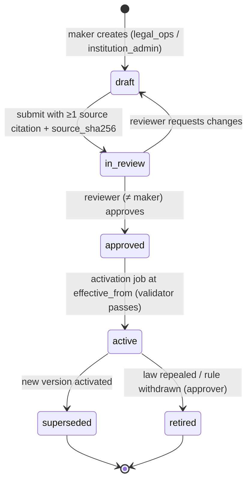

# Appendix G — Legal Rules Register (seed v1.1, law stated as at 20 October 2026)

> Binding reference for every phase. The register is **data**: each row below is seeded into `core.legal_rules` by the P00/P02 migrations and is edited thereafter only through Ruleset Studio with maker–checker (NN-21). The coding agent must never hard-code a legal threshold, period, list or prohibition that appears here; it reads the pinned rule version through the `rules` module. A rule needed by a feature but absent here is created with `status = 'UNVERIFIED'` and the dependent feature stays behind a flag that defaults OFF (Master §0).

## G.1 How to read this register

**Columns**

| Column | Meaning |
|---|---|
| Rule ID | `LR-<AREA>-NNN`. Stable for life; a changed rule gets a new **version**, not a new ID. A replaced rule is `superseded_by` the new ID. |
| Rule statement | Written as a product-enforceable instruction ("the platform must / must not …"). |
| Source | Act + section, rules/regulation + rule number, circular number and date, or case name + court + date/citation. |
| Status (Oct 2026) | `IN_FORCE` · `PARTIALLY_IN_FORCE` (the instrument has commenced in part; the row says which parts) · `NOT_IN_FORCE` (enacted or issued, but the cited provision has not commenced or takes effect on a future date) · `DRAFT` (consultation/bill, not law) · `UNVERIFIED` (legal status itself uncertain). A bracketed qualifier after the token (e.g. "(Equator policy)", "(comply now)") is stored in `status_note`; "Equator policy" rows are institutional rules with `source.kind = policy`. A `NOT_IN_FORCE` protective rule may still be enforced now as Equator policy (fail-safe principle below); a legal flag can never be switched ON on the strength of a `NOT_IN_FORCE` rule. |
| Effective | Date from which the rule binds (or "—" for long-standing/undated law). |
| Verticals | `ALL` or any of FIN, COM, FAM, INS, WRK, INT, SEC, GRM (L4), POSH (L5), EDU (L4 university variant). |
| Enforcement point | `module` + mechanism: **HB** hard block (API 409/422 + DB constraint where stated) · **W** warning (non-blocking, logged acknowledgement) · **C** clock (owned statutory clock, NN-04) · **D** disclosure (mandatory text, versioned) · **S** signposting (forum + last date, NN-20) · **CFG** configuration value consumed by an engine. |
| Flag | Feature flag that gates the dependent behaviour (default in brackets). Blank = always on. |
| Reviewer | Left blank. Filled by the legal reviewer on approval (name, date). |
| Verify | `[VERIFY]` (written **[VERIFY — open: …]**) + what to check, where the research could not confirm against the primary source; `—` or a dated check note once verified. |

**Fail-safe activation principle (binding).** A rule whose effect is *protective* (it blocks, warns, discloses or signposts) may be activated while carrying the VERIFY marker, because erring on the side of protection cannot prejudice a party. A rule whose effect is *permissive* (it enables a mechanism, route, claim or fee that would otherwise be blocked) may not be activated until the VERIFY marker is cleared by the legal reviewer. The activation validator enforces this using the `effect` attribute (`protective` | `permissive` | `computational`). Computational rules (thresholds, rates, formulas) activate while carrying the VERIFY marker only if the UI labels the output "indicative — figure under legal verification".

## G.2 Register

### G.2.1 ARB — Arbitration and Conciliation Act 1996 (arbitration)

| Rule ID | Rule statement | Source | Status | Effective | Verticals | Enforcement point | Flag | Reviewer | Verify |
|---|---|---|---|---|---|---|---|---|---|
| LR-ARB-001 | No enterprise/lender user may choose, nominate, curate or veto an arbitrator; sole/presiding arbitrators are allocated from Equator's open panel by rule-based/rotational allocation with conflict checks and an auditable allocation log (NN-03). | *CORE v ECI-SPIC-SMO-MCML (JV)*, SC 5-J, 8 Nov 2024 (2024 INSC 857); *Perkins Eastman v HSCC* (2020) 20 SCC 760; *TRF v Energo* (2017) 8 SCC 377 | IN_FORCE | 8 Nov 2024 (prospective for 3-member tribunals) | ALL | `neutrals` allocation engine HB; RBAC removes selection controls from `enterprise_*` roles | | | — |
| LR-ARB-002 | A s.12(5) waiver is valid only as an express written agreement executed after the dispute arises, captured as a separate e-signed instrument per party; conduct, filing a claim or a joint s.29A application is not a waiver. Award issuance is blocked while a Seventh Schedule flag is open without a valid waiver. | A&C Act s.12(5) proviso; *Bhadra International v AAI*, SC, 5 Jan 2026; *Bharat Broadband v United Telecoms* (2019) 5 SCC 755 | IN_FORCE | 23 Oct 2015 / 5 Jan 2026 | ALL | `outcomes` award publish HB; `esign` waiver instrument F-FIN-21 | | | — |
| LR-ARB-003 | A lender-originated reference is accepted for arbitration only if the arbitration clause that existed **before** the dispute names Equator (or "an institution administering under the Equator Rules"); references where the lender conferred the appointment on Equator after default are rejected unless a post-dispute submission agreement is e-signed by every party or a s.11 order exists. | *Madhyachal Steels v Clix Capital Services*, Del HC, O.M.P.(T)(COMM.) 66/2026, 24 Aug 2026; *Radiance Galore v Yes Bank*, Bom HC, 2025:BHC-OS:10788 (17 Jul 2025) | IN_FORCE | 24 Aug 2026 | FIN, COM, INT | `intake` clause-validation HB (`FIN_ARB_CLAUSE_NOT_ORIGINATION`) | | | — |
| LR-ARB-004 | Where the clause captured at origination names Equator as administering institution, the appointment is institutional; the clause version, hash, signer and timestamp must be stored at sanction so this can be proved. | *Sundaram Finance Ltd v Hanuman Prasad*, Raj HC (Bipin Gupta J), S.B. CWP 17398/2024, 24 Apr 2026 (agreed institution: MCCI) | IN_FORCE | 24 Apr 2026 | FIN | `enterprise` clause-at-sanction API CFG; Defensibility Score input | | | **[VERIFY — open: contra Guj/Cal HC NBFC decisions not located Oct 2026; re-check quarterly]** |
| LR-ARB-005 | Before any appointment is confirmed the neutral must file the Sixth Schedule disclosure answering every Fifth Schedule item; the duty is continuing and re-triggered when a party, counsel or funder joins. | A&C Act s.12(1), (2); Fifth and Sixth Schedules | IN_FORCE | 23 Oct 2015 | ALL | `neutrals` appointment HB | | | — |
| LR-ARB-006 | A person falling within the Seventh Schedule cannot be appointed (absent a LR-ARB-002 waiver). | A&C Act s.12(5), Seventh Schedule | IN_FORCE | 23 Oct 2015 | ALL | `neutrals` conflict engine HB | | | — |
| LR-ARB-007 | Repeat-appointment counter per neutral per appointing source: more than two appointments by the same party/affiliate in three years is a Fifth Schedule item 22 disclosure and, for lender portfolios, a rotation cap (default 2 per lender per neutral per 36 months). | A&C Act Fifth Schedule item 22 | IN_FORCE | 23 Oct 2015 | FIN, COM, INS | `neutrals` allocation CFG + W | | | — |
| LR-ARB-008 | A challenge to an arbitrator must be made within 15 days of the constitution or of becoming aware of the circumstances. | A&C Act s.13(2) | IN_FORCE | — | ALL | `clocks` C (`arb_challenge_15d`) | | | — |
| LR-ARB-009 | Domestic arbitration: award within 12 months of completion of pleadings; +6 months by consent; thereafter only by court; if 18 months lapse without an extension the mandate terminates and is revived only by a recorded court order (extension or substitution under s.29A(4)–(6)); the court-petition pack is generated before day 540. No award may be back-dated (NN-04). | A&C Act s.29A(1)–(6); *Mohan Lal Fatehpuria v Bharat Textiles*, 2025 INSC 1409 (SC, 10 Dec 2025); *Rohan Builders v Berger Paints*, 2024 SCC OnLine SC 2494; *Viva Highways v MPRDC* (SC, 7 Jan 2026) | IN_FORCE | 30 Aug 2019 (from pleadings) | FIN, COM, FAM, INS, WRK | `clocks` C (`arb_29a`, expiry = pleadings_complete + 365 d; extension tracked separately) | | | — |
| LR-ARB-010 | For international commercial arbitration the s.29A time limit is advisory ("endeavour"), not a mandate-terminating deadline. | A&C Act s.29A(1) proviso | IN_FORCE | 30 Aug 2019 | INT | `clocks` C advisory variant | | | — |
| LR-ARB-011 | Statement of claim and defence must be completed within six months of the arbitrators receiving written notice of appointment. | A&C Act s.23(4) | IN_FORCE | 30 Aug 2019 | ALL (arbitration) | `clocks` C (`arb_pleadings_6m`) | | | — |
| LR-ARB-012 | Fast-track procedure is available only by written agreement; award within six months of the tribunal entering reference. | A&C Act s.29B | IN_FORCE | 23 Oct 2015 | ALL (arbitration) | `proceedings` CFG + C | | | — |
| LR-ARB-013 | An award must be in writing, signed, state reasons (unless agreed otherwise or a s.30 award), and state date and seat; a draft failing these checks cannot be published. | A&C Act s.31(1)–(4) | IN_FORCE | — | ALL | `outcomes` award scrutiny HB | | | — |
| LR-ARB-014 | A signed copy of the award must be delivered to each party and receipt logged per party; s.34 limitation runs from receipt, and delivery to an unconnected official is not valid delivery. | A&C Act s.31(5); *M/s Motilal Agarwala v State of West Bengal*, 2025 INSC 1062 | IN_FORCE | — | ALL | `notices` delivery evidence HB on `outcome_executed` | | | — |
| LR-ARB-015 | Every money award template carries an explicit post-award interest clause; post-award interest under s.31(7)(b) cannot be contracted out. | A&C Act s.31(7); *ONGC v G&T Beckfield*, 2025 INSC 1066 | IN_FORCE | 2025 | ALL | `outcomes` template lint HB | | | — |
| LR-ARB-016 | Set-aside: 3 months from receipt + up to 30 days on sufficient cause, no further condonation; execution status is unavailable until the window has elapsed or a challenge is disposed of. | A&C Act s.34(3); *My Preferred Transformation v Faridabad Implements*, SC 2025 | IN_FORCE | — | ALL | `clocks` C (`arb_s34`); `execution` HB | | | — |
| LR-ARB-017 | Filing a s.34 petition does not automatically stay the award; execution packs must say so. | A&C Act s.36(2)–(3); *BCCI v Kochi Cricket* (2018) 6 SCC 287 | IN_FORCE | 23 Oct 2015 | ALL | `execution` D | | | — |
| LR-ARB-018 | With party agreement the tribunal may use mediation/conciliation; a settlement may be recorded as an award on agreed terms with the same status as any award (basis of consent-award conversion and arb-med-arb). | A&C Act s.30 | IN_FORCE | — | ALL (not FAM status/custody) | `proceedings` consent-award flow CFG | | | — |
| LR-ARB-019 | Non-arbitrable subject matter never receives an award: rights in rem, erga omnes effects, sovereign/public functions, statutory-forum-exclusive matters (incl. matrimonial status, guardianship/custody, testamentary, insolvency, criminal, rent-control eviction, DRT-exclusive bank/FI claims, oppression/mismanagement, IP grant, competition). | *Vidya Drolia v Durga Trading* (2021) 2 SCC 1 (14 Dec 2020); *Booz Allen v SBI Home Finance* (2011) 5 SCC 532 | IN_FORCE | — | ALL | `routing` arbitrability screener HB (NN-06) | | | — |
| LR-ARB-020 | Banks and financial institutions recovering debts of ₹20 lakh or more are confined to the DRT; arbitration is blocked for lender_type ∈ {bank, financial_institution} at or above the threshold. NBFCs that are not "financial institutions" under RDB Act s.2(h) may arbitrate. | RDB Act 1993 ss.1(4), 2(h), 17, 18 (S.O. 4312(E), 6 Sep 2018, under s.1(4): ₹20 lakh); *Vidya Drolia* | IN_FORCE | 6 Sep 2018 | FIN, COM | `routing` HB (`FIN_DRT_EXCLUSIVE`) CFG `rdb_threshold_minor` | | | **[VERIFY — open: current list of institutions notified under RDB s.2(h)(ii); SARFAESI s.2(1)(m)(iv) NBFC notification does not by itself confer RDB status]** |
| LR-ARB-021 | Award templates must use severable operative paragraphs per claim and per interest head with a computation annex. | *Gayatri Balasamy v ISG Novasoft*, 2025 INSC 605 (SC 5-J, 30 Apr 2025) | IN_FORCE | 30 Apr 2025 | ALL | `outcomes` template lint W | | | — |
| LR-ARB-022 | Before terminating for non-payment of deposits, the tribunal gives notice and an opportunity to pay or to seek suspension (s.38(2)); either party may pay the defaulting party's share; termination is by reasoned tribunal order (s.38(2) read with s.32(2)); an aggrieved party must first seek recall before the tribunal, then approach the court under s.14(2); no fresh s.11 petition lies. | A&C Act ss.32(2), 38(2), 14(2); *Harshbir Singh Pannu v Jaswinder Singh*, 2025 INSC 1400 (SC, 9 Dec 2025) | IN_FORCE | — | ALL | `billing` deposit workflow C | | | — |
| LR-ARB-023 | Where the Fourth Schedule is the fee basis, the ceiling is ₹30,00,000 per arbitrator (base + variable), sole arbitrator +25% over and above the ceiling; arbitrators cannot unilaterally fix fees. | A&C Act Fourth Schedule, s.11(14); *ONGC v Afcons Gunanusa JV*, Arb. Pet. (C) 5/2022, SC, 30 Aug 2022, 2022 LiveLaw (SC) 723 | IN_FORCE | 30 Aug 2022 | COM, FIN, INS, WRK | `billing` fee engine CFG + HB on cap | | | — |
| LR-ARB-024 | Arbitral proceedings are confidential save for the award where needed for implementation; no public case pages; NDA-on-access for experts. | A&C Act s.42A | IN_FORCE | 30 Aug 2019 | ALL | `documents` ABAC HB | | | — |
| LR-ARB-025 | An emergency-arbitrator order under Equator Rules in an India-seated arbitration is enforceable as a s.17 order; a foreign-seated EA order is not directly enforceable in India (s.9 application needed) — disclose at EA application. | *Amazon.com NV Investment Holdings v Future Retail* (2022) 1 SCC 209 | IN_FORCE | 6 Aug 2021 | COM, INT | `proceedings` D | | | — |
| LR-ARB-026 | Statutory emergency arbitration (s.9A) and an appellate arbitral tribunal (s.34A) are **not law**; the optional appeal tier is offered only as a contractual two-tier arbitration. | Draft A&C (Amendment) Bill 2024 (released 18 Oct 2024; not introduced as of 20 Oct 2026); *Centrotrade Minerals v Hindustan Copper* (2017) 2 SCC 228 | DRAFT | — | ALL | `proceedings` CFG; copy D | `arb_statutory_ea` (OFF) · `arb_appeal_tier_contractual` (ON) | | **[VERIFY — monitor: re-check PRS bill tracker after Winter Session 2026]** |
| LR-ARB-027 | An arbitration agreement may be concluded by exchange of electronic communications; the platform stores the full consent record (document hash, OTP/eSign evidence, IP, timestamp). | A&C Act s.7(4)(b); *Glencore International v Shree Ganesh Metals*, SC 2025 | IN_FORCE | — | ALL | `esign` + `evidence_ledger` HB on clause capture | | | — |
| LR-ARB-028 | An unstamped or insufficiently stamped arbitration agreement is not void (curable); stamp status is displayed and the clause is e-stamped at origination where the API controls the document. | *In re Interplay between Arbitration Agreements and Indian Stamp Act*, 2023 INSC 1066 (SC 7-J, 13 Dec 2023) | IN_FORCE | 13 Dec 2023 | ALL | `estamp` W | | | — |
| LR-ARB-029 | A non-signatory is joined only by reasoned tribunal order on evidence of consent/conduct; otherwise it cannot attend. | *Cox & Kings v SAP India* (2024) 4 SCC 1; *ASF Buildtech v Shapoorji Pallonji*, SC 2025 | IN_FORCE | 6 Dec 2023 | COM, INT | `proceedings` HB | | | — |
| LR-ARB-030 | For consumer-borrower arbitrations the default seat/venue is the borrower's district (or online hearings with the borrower's district as venue); a distant seat requires a recorded justification. | A&C Act s.20; fairness reasoning in *Madhyachal Steels* (2026) | IN_FORCE (policy derived) | 24 Aug 2026 | FIN | `routing` CFG + W | | | — |
| LR-ARB-031 | The s.21 notice invoking arbitration starts the arbitration; a s.11 application is time-barred three years after failure to appoint following that notice. | A&C Act ss.21, 11; *Arif Azim Co Ltd v Aptech Ltd* (2024) 5 SCC 313, 2024 INSC 155 (SC, 1 Mar 2024) | IN_FORCE | — | COM, INT, FIN | `clocks` C (`arb_s11_3y`) | | | — |
| LR-ARB-032 | Inordinate unexplained delay between final hearing and award can vitiate the award; Equator SLA: award within 3 months of final hearing, Registrar alerts at 60 and 90 days. | *Lancor Holdings v Prem Kumar Menon*, 2025 INSC 1277 | IN_FORCE | 2025 | ALL | `clocks` C (service clock) | | | — |

### G.2.2 MED — Mediation Act 2023 and Commercial Courts Act s.12A

| Rule ID | Rule statement | Source | Status | Effective | Verticals | Enforcement point | Flag | Reviewer | Verify |
|---|---|---|---|---|---|---|---|---|---|
| LR-MED-001 | Only ss.1, 3, 26, 31–38, 45–47, 50–54, 56–57 are in force; mediation runs in **contractual mode** until the statutory-mode flag is switched on by an authorised legal admin with the notification reference (NN-05). | Mediation Act 2023 (Act 32 of 2023); S.O. 4384(E), 9 Oct 2023; corrigendum S.O. 4506(E), 13 Oct 2023; MCI established by S.O. 4781(E), 27 Aug 2026 (s.31(1)) | PARTIALLY_IN_FORCE | 9 Oct 2023 | ALL | `proceedings` CFG | `mediation_statutory_mode` (OFF) | | Checked 20 Oct 2026: no commencement S.O. after S.O. 4384(E)/4506(E); the only later S.O. is 4781(E) of 27 Aug 2026 (MCI establishment, s.31(1)). Re-check every 90 days. |
| LR-MED-002 | No copy, badge or document may claim "MCI-registered/recognised", "Mediation Act-registered mediator" or "s.27 decree-enforceable" while the relevant provisions are not in force (NN-17). | Mediation Act ss.27, 40; MCI established by S.O. 4781(E), 27 Aug 2026 (no members appointed; no regulations) | IN_FORCE (copy rule) | 27 Aug 2026 | ALL | `cms` Claims Register HB; template lint HB | | | — |
| LR-MED-003 | Statutory mode: mediation completes within 120 days from the date fixed for first appearance, extendable by up to 60 days by party agreement; contractual mode uses the same default periods from the ruleset. | Mediation Act s.18 | NOT_IN_FORCE | — (not commenced) | ALL | `clocks` C (`mediation_120_60`, trigger = first appearance) | `mediation_statutory_mode` | | — |
| LR-MED-004 | An MSA is in writing, signed by the parties and authenticated by the mediator; the platform captures a separate mediator authentication signature in both modes. | Mediation Act s.19 | NOT_IN_FORCE (s.19 applied as Equator policy in both modes) | — (not commenced) | ALL | `outcomes` HB on MSA execution | | | — |
| LR-MED-005 | Statutory mode: MSA registration is optional within 180 days with the notified authority; a registration task with 180-day reminder is created; no registering body is notified as of Oct 2026. | Mediation Act s.20 | NOT_IN_FORCE | — (not commenced) | ALL | `execution` task C | `mediation_statutory_mode` | | — |
| LR-MED-006 | Mediation sessions are never audio/video recorded or transcribed; recording controls are disabled in mediation rooms (NN-11). Confidentiality exceptions follow s.23 (threat or plan to commit an offence; domestic violence or child abuse; significant imminent threat to public health or safety; mediator misconduct). | Mediation Act ss.22(2), 23 (applied now as policy); A&C Act s.75 (conciliation) | NOT_IN_FORCE (applied as Equator policy; A&C s.75 in force for conciliation) | — (policy now) | ALL | `hearings` HB | | | — |
| LR-MED-007 | A challenge to a statutory-mode MSA lies only on fraud, corruption, impersonation or non-mediable subject matter within 90 days (+90 for sufficient cause); identity-verification evidence is preserved for the impersonation defence. | Mediation Act s.28 | NOT_IN_FORCE | — (not commenced) | ALL | `clocks` C (`msa_challenge_90_90`) | `mediation_statutory_mode` | | — |
| LR-MED-008 | Online mediation requires written (e-signed) consent of each party to the online mode. | Mediation Act s.30 (applied now as policy) | NOT_IN_FORCE (applied as Equator policy) | — (policy now) | ALL | `consent` HB before first online session | | | — |
| LR-MED-009 | Intake screens out First Schedule matters: disputes barred by law; claims against minors, deities, persons with intellectual disability or high support needs, persons with mental illness, persons of unsound mind; declarations of title against Government or in rem; criminal prosecution (court referral of compoundable offences incl. matrimonial offences under s.6 excepted; outcome not a decree); professional disciplinary proceedings before statutory bodies; third-party rights; NGT matters; tax levy, collection, penalties or offences; Competition Act, TRAI, TDSAT; Electricity Act Commissions/APTEL; PNGRB; SEBI/SAT; land acquisition and compensation; notified matters. Equator's additional (non-statutory) policy screens are in LR-MED-017. | Mediation Act s.6 + First Schedule (applied now as policy) | NOT_IN_FORCE (applied as Equator policy) | — (policy now) | ALL | `routing` HB/S | | | — |
| LR-MED-010 | Lok Adalat and PLA matters are outside the Act; the platform offers a "refer to Lok Adalat/PLA" exit and never routes a Lok Adalat reference through Equator mediation. | Mediation Act s.26 | IN_FORCE | 9 Oct 2023 | FIN, INS, FAM | `routing` S | | | — |
| LR-MED-011 | Statutory mode: the mediator may not act as arbitrator, or as representative or counsel of a party, in the same dispute (no party-agreement carve-out, unlike A&C s.80 — LR-CONC-003); same-neutral med-arb is disabled when statutory mode is ON. | Mediation Act s.17(a) (no party-agreement carve-out) | NOT_IN_FORCE | — (not commenced) | ALL | `proceedings` HB | `mediation_statutory_mode` | | — |
| LR-MED-012 | Contractual-mode settlements are contracts; copy and the settlement pack must state the enforcement route (suit on contract, consent award via s.30, or s.74 where conciliation under Part III was used). | Mediation Act s.27 (not in force); A&C Act ss.30, 73, 74 | IN_FORCE | — | ALL | `outcomes` D | | | — |
| LR-MED-013 | Commercial disputes of specified value (≥ ₹3,00,000) not contemplating urgent interim relief require pre-institution mediation under s.12A before suit; intake must show this. | Commercial Courts Act 2015 s.12A, s.2(1)(i) (2018 amendment); *Patil Automation v Rakheja Engineers* (2022) 10 SCC 1 (mandatory from 20 Aug 2022) | IN_FORCE | 20 Aug 2022 | COM | `routing` D/W | | | — |
| LR-MED-014 | PIMS is conducted by the Authority under the Legal Services Authorities Act (DLSA/SLSA) under the PIMS Rules 2018; Equator **cannot** issue a s.12A non-starter (Form-3) or failure (Form-5) report; its own closure report does not satisfy s.12A. Equator prepares the Form-1 application pack and may mediate privately before or in parallel (LR-MED-018 to LR-MED-021). | CCA s.12A(1)–(2), (5) (as in force); Commercial Courts (PIMS) Rules 2018, G.S.R. 606(E), 3 Jul 2018, rr.2–7; *Dhanbad Fuels v UoI*, 2025 INSC 696 | IN_FORCE | 3 Jul 2018 | COM | `outcomes` HB (`COM_PIMS_CERT_NOT_ISSUABLE`); copy lint HB | | | Resolved: Mediation Act s.64 and the Ninth Schedule substitute s.12A; the new s.12A(2) lets the Central Government authorise '(i) the Authority … LSA Act' or '(ii) a mediation service provider as defined under s.3(m)' by notification; period becomes 120 + 60 days; settlements fall under Mediation Act ss.27–28. Not in force as of 20 Oct 2026. Private-MSP use also needs MCI recognition (s.40), a specific s.12A(2)(ii) notification and new rules (LR-MED-019). Current s.12A(5): settlement has A&C s.30(4) award status. PIMS non-starter report = Form-3 (by the Authority); failure report = Form-5 (by the mediator to the Authority). |
| LR-MED-015 | PIMS must complete in 3 months, extendable by 2 months with consent; limitation is excluded during PIMS. | CCA s.12A(3), (4) | IN_FORCE | — | COM | `clocks` C (tracking only, owner = party) | | | — |
| LR-MED-016 | International mediation = mediation of a commercial dispute where at least one party is (i) an individual who is a national of, or habitually resident in, a country other than India; (ii) a body corporate (incl. LLP) with its place of business outside India; (iii) an association/body of individuals whose place of business is outside India; or (iv) a foreign Government. | Mediation Act 2023 s.3(g) | IN_FORCE | 9 Oct 2023 | INT | `routing` CFG (`intl_mediation_flag`) | | | — |
| LR-MED-017 | Equator policy screen (not statutory): disputes involving allegations of serious fraud, forgery, impersonation or coercion are flagged at intake for registrar review before mediation proceeds; copy never presents this screen as a Mediation Act exclusion. | Equator Mediation Rules (policy; derived from the 2021 Bill list, not the enacted First Schedule) | IN_FORCE (Equator policy) | — | ALL | `routing` W + registrar review task | | | — |
| LR-MED-018 | s.12A Application Pack follows the PIMS Rules: Form-1 application to the competent DLSA/SLSA (fee ₹1,000); Authority notice in Form-2 (10 days to appear and consent); non-starter report in Form-3 issued by the Authority; settlement in Form-4 signed by parties and mediator; failure report in Form-5 by the mediator to the Authority; mediation at the Authority's premises; Schedule II fees ₹15,000 (₹3–10 lakh) to ₹75,000 (above ₹3 crore), shared equally. Equator pre-fills Form-1, tracks the 3 + 2-month clock for reminders only (LR-MED-015; owner = party) and stores the Authority's Form-3/4/5 as uploaded evidence. | Commercial Courts (Pre-Institution Mediation and Settlement) Rules 2018, G.S.R. 606(E), 3 Jul 2018, rr.2–7, Forms 1–6, Schedule II; CCA s.12A(3) | IN_FORCE | 3 Jul 2018 | COM | `intake` pack generator CFG; `documents` evidence store | | | **[VERIFY — open: S.O. number of the 2018 notification authorising LSA Authorities under s.12A(2); State SOP variations (e.g. HC Legal Services Committees)]** |
| LR-MED-019 | Equator may act as the s.12A pre-litigation mediation body only after all four gates are recorded with references: (1) notification of the Mediation Act provision enacting the Ninth Schedule (substituted s.12A); (2) MCI regulations and Equator's recognition as a mediation service provider (ss.3(m), 40); (3) a Central Government notification under the new s.12A(2)(ii) authorising Equator or its class; (4) new rules replacing the PIMS Rules. On ON: clock 120 + 60 days, statutory MSA under Mediation Act ss.19, 27–28, non-settlement report under s.21. Until then the flag stays OFF (M-06). | Mediation Act 2023 ss.3(m), 40, 64 and Ninth Schedule (substituted CCA s.12A(1)–(5)); Master M-06 | NOT_IN_FORCE | — (not commenced) | COM | `rules` activation validator HB (four references required); `proceedings` CFG | `com.s12a_equator_authorised` (OFF) | | — |
| LR-MED-020 | Any Equator mediation closure report (non-settlement or non-commencement) carries the mandatory footer: "Issued under the Equator Mediation Rules. This is not a Non-Starter Report (Form-3) or Failure Report (Form-5) under the Commercial Courts (Pre-Institution Mediation and Settlement) Rules, 2018, and does not satisfy section 12A of the Commercial Courts Act, 2015. It is not a report under section 21 of the Mediation Act, 2023, which is not in force." It never discloses the reasons for non-settlement or the parties' conduct. Copy lint blocks "s.12A certificate", "PIMS certificate", unqualified "pre-institution mediation report", "court-recognised mediation" and "statutory pre-litigation mediation". | CCA s.12A; PIMS Rules 2018 r.3, r.7; Mediation Act s.21 proviso (policy mirror); NN-17 | IN_FORCE (Equator policy grounded in statute) | — | ALL | `templates` footer HB; `cms`/`templates` copy lint HB (`COM_PIMS_CERT_NOT_ISSUABLE`) | | | — |
| LR-MED-021 | Voluntary contractual pre-suit mediation and A&C Part III conciliation are offered now in all verticals (M-06): both parties sign a mediation agreement (e-sign); contractual 120 + 60-day clock; no recording; online-mode consent. Outputs limited to (a) a contractual MSA authenticated by the mediator, (b) a s.30(4) consent award where an arbitration agreement exists or is signed (different neutral by default), (c) a s.73 settlement agreement with s.74 award status where run as conciliation, (d) a closure report under LR-MED-020. | Indian Contract Act 1872; A&C Act ss.30, 61–81 (Part III operative; Mediation Act Sixth Schedule not in force); Master M-06 | IN_FORCE | — | ALL | `proceedings` CFG; `outcomes` output-type HB | | | — |

### G.2.3 CONC — A&C Act Part III (conciliation)

| Rule ID | Rule statement | Source | Status | Effective | Verticals | Enforcement point | Flag | Reviewer | Verify |
|---|---|---|---|---|---|---|---|---|---|
| LR-CONC-001 | Conciliation under Part III remains operative; a settlement agreement signed by the parties and authenticated by the conciliator has the status and effect of an arbitral award on agreed terms. | A&C Act ss.61–81, 73, 74 | IN_FORCE | — | ALL | `outcomes` CFG (enforceable_basis = 's.74 A&C') | | | — |
| LR-CONC-002 | If the other party does not accept the written invitation to conciliate within 30 days (or the period specified), the invitation is treated as rejected. | A&C Act s.62(4) | IN_FORCE | — | ALL | `clocks` C (`conc_invite_30d`) | | | — |
| LR-CONC-003 | A conciliator does not act as arbitrator in the same dispute unless all parties agree; Equator default = different neutral; same neutral only with fresh, informed, e-signed consent of all parties executed after the conciliation/contractual mediation ends plus renewed s.12 disclosure (Master §5.3). Statutory-mode mediation has no such carve-out (LR-MED-011). | A&C Act s.80 | IN_FORCE | — | ALL | `proceedings` HB (`role_switch_consent`) | | | — |
| LR-CONC-004 | Views, admissions, proposals and caucus content from conciliation/mediation are inadmissible and are never placed in the arbitral record (information firewall). | A&C Act s.81; s.75 | IN_FORCE | — | ALL | `documents` ABAC HB; `core.caucus_notes` RLS | | | — |
| LR-CONC-005 | During conciliation parties shall not initiate arbitral or judicial proceedings save to preserve rights; the platform warns before a party files elsewhere and records the reason. | A&C Act s.77 | IN_FORCE | — | ALL | `proceedings` W | | | — |

### G.2.4 EVID / ESIGN / STAMP — evidence, e-signature, stamp and registration

| Rule ID | Rule statement | Source | Status | Effective | Verticals | Enforcement point | Flag | Reviewer | Verify |
|---|---|---|---|---|---|---|---|---|---|
| LR-EVID-001 | Every export bundle carries a SHA-256 hash manifest and a BSA s.63(4) certificate (Part A by party/custodian, Part B by qualified expert) generated from the evidence ledger (NN-10). | Bharatiya Sakshya Adhiniyam 2023 ss.61–63; *Pune Bar Association v UoI*, 2026 SCC OnLine SC 1297 (22 May 2026) | IN_FORCE | 1 Jul 2024 | ALL | `documents` HB on export | | | — |
| LR-EVID-002 | Templates and AI outputs cite BSA s.63 (not Evidence Act s.65B) for electronic records; BNS/BNSS replace IPC/CrPC citations. | BSA 2023; BNS 2023; BNSS 2023 | IN_FORCE | 1 Jul 2024 | ALL | `templates` lint HB; AI `qa_auditor` W | | | — |
| LR-EVID-003 | Platform notices are civil/arbitral notices with deemed-receipt rules; they must never purport to be police/criminal process, which must be served physically. | A&C Act s.3; BNSS s.35; *State of Haryana v Satender Kumar Antil*, 2025 INSC 909 (SC, Jul 2025); *Satender Kumar Antil v CBI* (SC order, 21 Jan 2025) | IN_FORCE | — | ALL | `notices` template lint HB | | | — |
| LR-ESIGN-001 | Electronic signatures use licensed ESP Aadhaar eSign (Second Schedule) or DSC; the ESP response and certificate chain are stored. | IT Act 2000 ss.3, 3A, 5, Second Schedule | IN_FORCE | — | ALL | `esign` CFG | | | — |
| LR-ESIGN-002 | E-signature is not sufficient for: negotiable instruments other than cheques, powers of attorney, trusts, wills/testamentary dispositions, and contracts for sale or conveyance of immovable property or any interest in it. Such instruments route to physical execution, stamping and registration (NN-08). | IT Act 2000 s.1(4) + First Schedule | IN_FORCE | — | ALL (FAM, COM, FIN critical) | `esign` document-type gate HB (`ESIGN_EXCLUDED_INSTRUMENT`); `core.registration_tasks` | | | — |
| LR-ESIGN-003 | Contracts formed electronically are valid; click-wrap acceptance of platform terms and submission agreements is permitted with full audit evidence. | IT Act 2000 s.10A | IN_FORCE | — | ALL | `consent` CFG | | | — |
| LR-ESIGN-004 | For enforcement in the EU, awards are additionally signed with an eIDAS qualified electronic signature or wet-ink counterpart. | EU Reg. 910/2014 Art. 25(2), as amended by Reg. 2024/1183 | IN_FORCE | — | INT | `esign` CFG | `intl_eu_qes_signing` (ON when target = EU) | | — |
| LR-STAMP-001 | Every domestic award is e-stamped at signing under the stamp law of the state where it is executed (last signature), which is not necessarily the seat, with a differential-duty check for the enforcement state; award release is blocked until the stamp certificate is attached (NN-09). Late stamping: Collector certification within one further month on payment of duty alone; thereafter impounding with duty plus penalty. | State Stamp Acts (Article "Award"; Maharashtra Art. 12 ad valorem under Mah. Ord. XII of 2024, partition awards excluded); Indian Stamp Act ss.17, 32(3), 33, 35, 40; *URC Construction v AAI*, Del HC, OMP(ENF.)(COMM.) 155/2026, 1 Sep 2026 | IN_FORCE | 1 Sep 2026 | ALL | `estamp` HB on `outcome_executed` | | | — |
| LR-STAMP-002 | Settlement instruments (MSA, OTS, F&F, consent terms) are e-stamped per the state duty matrix (agreement/settlement article); duty is configuration per state. | State Stamp Acts | IN_FORCE | — | ALL | `estamp` CFG + HB | | | **[VERIFY — duty matrix: MH settled for awards (Ord. XII of 2024); DL, UP, KA award rates secondary-sourced; RJ and settlement/MSA/OTS articles for all five states open]** |
| LR-STAMP-003 | Foreign awards need no Indian stamping for enforcement; the e-stamp step is skipped when seat ≠ India. | *Shriram EPC v Rioglass Solar* (2018) 18 SCC 313 | IN_FORCE | — | INT | `estamp` CFG | | | — |
| LR-STAMP-004 | Non-testamentary instruments that create, declare, assign, limit or extinguish rights of ₹100 or more in immovable property require registration; an unregistered instrument does not affect the property. | Registration Act 1908 ss.17(1)(b), 49 | IN_FORCE | — | FAM, COM, FIN | `execution` HB on closure of property terms (`FAM_REGISTRATION_REQUIRED`) | | | — |
| LR-STAMP-005 | A document must be presented for registration within 4 months of execution (further 4 months on payment of fine). | Registration Act 1908 ss.23, 25 | IN_FORCE | — | FAM, COM, FIN | `clocks` C (`registration_4m`) | | | — |
| LR-STAMP-006 | A compromise decree concerning the suit property is exempt from registration; where litigation is pending, the property route offers a court-recorded compromise. | Registration Act s.17(2)(vi); *Mohammade Yusuf v Rajkumar* (2020) 10 SCC 264; *Mukesh v State of MP* 2024 INSC 1026 | IN_FORCE | — | FAM, COM | `execution` S/W | | | — |
| LR-STAMP-007 | Partition, family settlement and release deeds attract the state partition/settlement/release article (often concessional within family); the duty calculator reads the state matrix. | State Stamp Acts | IN_FORCE | — | FAM | `estamp` CFG | | | **[VERIFY — open: state-wise partition/settlement/release articles and family concessions for each launch state]** |

### G.2.5 DPDP — Digital Personal Data Protection Act 2023 and Rules 2025

| Rule ID | Rule statement | Source | Status | Effective | Verticals | Enforcement point | Flag | Reviewer | Verify |
|---|---|---|---|---|---|---|---|---|---|
| LR-DPDP-001 | DPDP Rules notified; Phase 1 (Board provisions) in force; Phase 2 (Consent Manager registration, Rule 4) from 13 Nov 2026; Phase 3 (core obligations) from 13 May 2027. Build fully compliant now (NN-15). | G.S.R. 843(E) (Act ss.1, 2, 18–26, 35, 38–44 from 13 Nov 2025); DPDP Rules G.S.R. 846(E), 13 Nov 2025 (rules 1, 2, 17–21 from 13 Nov 2025; Rule 4 from 13 Nov 2026; rules 3, 5–16, 22, 23 from 13 May 2027); corrigendum G.S.R. 892(E), 10 Dec 2025 | PARTIALLY_IN_FORCE | 13 Nov 2025 / 13 Nov 2026 / 13 May 2027 | ALL | `consent` CFG | | | — |
| LR-DPDP-002 | Itemised, standalone, plain-language notice per purpose, available in Eighth Schedule languages on request, before collection. | DPDP Act s.5 (incl. s.5(1)(iii) right to complain to the Board; s.5(3) languages); Rule 3 | NOT_IN_FORCE (commences 13 May 2027; comply now) | 13 May 2027 | ALL | `consent` HB (`core.notices_privacy`) | | | — |
| LR-DPDP-003 | Consent must be free, specific, informed, unambiguous and as easy to withdraw as to give; withdrawal propagates to processors. | DPDP Act s.6 | NOT_IN_FORCE (commences 13 May 2027; comply now) | 13 May 2027 | ALL | `consent` HB | | | — |
| LR-DPDP-004 | Respondent data received from a claimant is processed under the s.17(1)(a) exemption (processing necessary for enforcing a legal right or claim; s.8(1) and s.8(5) still apply); s.7(e) is the basis for enforcing awards/orders; the lawful basis is recorded per processing purpose; consent is used for marketing and optional features only (NN-16). | DPDP Act ss.7(e), 17(1)(a) | NOT_IN_FORCE (commences 13 May 2027; comply now) | 13 May 2027 | ALL | `consent` CFG (lawful-basis register) | | | **[VERIFY — open: counsel sign-off on s.17(1)(a) reliance for institutional case administration]** |
| LR-DPDP-005 | Security safeguards incl. encryption, access control and logs retained ≥ 1 year; processor contracts flow down obligations. | DPDP Act s.8(5); Rule 6(1)(e) (logs and personal data retained one year) | NOT_IN_FORCE (commences 13 May 2027; comply now) | 13 May 2027 | ALL | `audit` CFG | | | — |
| LR-DPDP-006 | Personal-data breach: intimate affected principals without delay; detailed report to the Board within 72 hours. | DPDP Act s.8(6); Rule 7(1) and 7(2)(b) (72 hours) | NOT_IN_FORCE (commences 13 May 2027; comply now) | 13 May 2027 | ALL | `admin` breach workflow C | | | — |
| LR-DPDP-007 | Erase when purpose is served or consent withdrawn, subject to legal retention; retain personal data, traffic data and logs ≥ 1 year (Rule 8(3)); Rule 8(1)–(2) bind only Third Schedule classes, but the 48-hour pre-erasure notice is applied as good practice; legal hold overrides. | DPDP Act s.8(7); Rule 8(1)–(3) (Third Schedule 3-year rule for listed classes; 48-h notice r.8(2); minimum one-year retention of data, traffic data and logs r.8(3)) | NOT_IN_FORCE (commences 13 May 2027; comply now) | 13 May 2027 | ALL | `documents` retention jobs CFG | | | — |
| LR-DPDP-008 | Children's data: verifiable parental/guardian consent; no tracking, behavioural monitoring or profiling of minors. | DPDP Act s.9; Rule 10 (parent verified as an identifiable adult, incl. via DigiLocker virtual token); Rule 12 and Fourth Schedule exemptions | NOT_IN_FORCE (commences 13 May 2027; comply now) | 13 May 2027 | FAM, EDU, INS | `consent` HB; analytics exclusion HB | | | — |
| LR-DPDP-009 | Data-principal rights (access, correction, erasure, grievance, nomination) answered within the published period (≤ 90 days; internal SLA 30 days); grievance/DPO contact published. | DPDP Act ss.8(10), 11–14; Rule 14(3) (≤ 90 days) | NOT_IN_FORCE (commences 13 May 2027; comply now) | 13 May 2027 | ALL | `consent` DSR workflow C | | | — |
| LR-DPDP-010 | Cross-border transfer is permitted except to countries restricted by notification; a transfer basis is recorded per case and checked against the negative list before registration (INT gate). | DPDP Act s.16; Rule 15 | NOT_IN_FORCE (commences 13 May 2027; comply now) | 13 May 2027 | INT | `intl` gate G3 HB | | | Checked 20 Oct 2026: no s.16(1) negative list notified; Rule 15 in force 13 May 2027. |
| LR-DPDP-011 | Personal data of Data Principals not within India, processed in India under a contract with a person outside India, is exempt from Chapter II (except s.8(1) and s.8(5)), Chapter III and s.16; record when relied on. | DPDP Act s.17(1)(d) | NOT_IN_FORCE (commences 13 May 2027; comply now) | 13 May 2027 | INT | `consent` CFG | | | — |
| LR-DPDP-012 | Business contact information of the DPO (if any) or a person able to answer processing questions is published prominently on the website and app and included in every response to a rights communication. | DPDP Act s.8(9); Rule 9 | NOT_IN_FORCE (commences 13 May 2027; comply now) | 13 May 2027 | ALL | `cms` site footer HB; `consent` DSR response template HB | | | — |
| LR-DPDP-013 | Processing data of a person with disability who has a lawful guardian needs the guardian's verifiable consent; the guardian's appointment by a court, a designated authority under the RPwD Act 2016 or a local-level committee under the National Trust Act 1999 is verified and recorded. | DPDP Act s.9; Rule 11 | NOT_IN_FORCE (commences 13 May 2027; comply now) | 13 May 2027 | FAM, INS, ALL | `consent` HB (guardian verification record) | | | — |

### G.2.6 RBI — lending, recovery conduct, grievance, financial-sector statutes

| Rule ID | Rule statement | Source | Status | Effective | Verticals | Enforcement point | Flag | Reviewer | Verify |
|---|---|---|---|---|---|---|---|---|---|
| LR-RBI-001 | Complainant must first approach the RE; the Ombudsman entertains the complaint if the RE has not replied in 30 days or the complainant is dissatisfied; it must be filed within 90 days after the 30-day period or the RE's last reply (complaints received before 1 Jul 2026 remain under RB-IOS 2021: 1 year). | Reserve Bank – Integrated Ombudsman Scheme 2026 (RBI FAQ) | IN_FORCE | 1 Jul 2026 | FIN, GRM | `clocks` C (`rbios_re_30d`, `rbios_file_90d`); `routing` S | | | Confirmed against RBI RB-IOS 2026 FAQ (20 Oct 2026); periods held as configuration parameters, never hard-coded (Master X-13). |
| LR-RBI-002 | RB-IOS coverage attribute per lender tenant: banks, RRBs, StCBs/DCCBs, specified UCBs; NBFCs that are deposit-taking or customer-interface with assets ≥ ₹100 crore (excluding HFCs, CICs, PDs, etc.); non-bank PPI issuers; CICs. | RB-IOS 2026 FAQ | IN_FORCE | 1 Jul 2026 | FIN, GRM | `tenancy` CFG; drives signposting text | | | — |
| LR-RBI-003 | RB-IOS does not entertain matters pending before or decided by a court, tribunal or arbitrator; before a borrower opts into Equator arbitration the platform discloses this and records an informed-choice acknowledgement. | RB-IOS 2026 (non-maintainability grounds) | IN_FORCE | 1 Jul 2026 | FIN | `intake` D + HB on arbitration opt-in without acknowledgement | | | — |
| LR-RBI-004 | NBFC Internal Ombudsman (NBFC-D with ≥ 10 branches; NBFC-ND with assets ≥ ₹5,000 crore and a public customer interface): partly resolved or wholly rejected complaints auto-escalate to the IO within 20 days of receipt (cl.14(1)(b)), or early enough to give the IO ≥ 10 days where RBI/NPCI/a card network prescribes a TAT (cl.14(1)(a)); final reply within 30 days of receipt (cl.14(9)); outcome ∈ {fully resolved, partially resolved, wholly rejected} (cl.14(2)); IO cannot be the serving officer. | RBI (Non-Banking Financial Companies – Internal Ombudsman) Directions 2026, RBI/CEPD/2025-26/384, CEPD.PRD.No.S1030/13.01.019/2025-26, 14 Jan 2026 (cl.7(2), 14(2), 14(4) from 30 Jun 2026); parallel RE-specific Directions of the same date (e.g. Commercial Banks, RBI/CEPD/2025-26/381) | IN_FORCE | 14 Jan 2026 (cl.7(2), 14(2), 14(4): 30 Jun 2026) | GRM, FIN | `grm` C (`io_escalation_20d`, `io_final_30d`) + HB (P09) | | | — |
| LR-RBI-005 | Borrower contact (calls, AI voice, WhatsApp, SMS, platform notices connected with recovery) is hard-blocked outside 08:00–19:00 borrower local time unless the borrower has expressly requested otherwise; a borrower's request to avoid particular times is honoured (NN-12). | RBI (NBFC – Responsible Business Conduct) Directions 2025 (28 Nov 2025) as amended by the RBI (NBFC – Responsible Business Conduct) Third Amendment Directions 2026, RBI/2026-27/230, DOR.MCS.REC.No.199/01-01-039/2026-27, 6 Aug 2026, para 100Y(4) (parallel instruments for other REs, e.g. AIFIs RBI/2026-27/229) | NOT_IN_FORCE (effective 1 Jan 2027; enforced now as Equator policy, NN-12) | 1 Jan 2027 | FIN | `comms` HB (`FIN_CONTACT_WINDOW`) | | | **[VERIFY — open: whether pre-existing recovery-agent hours carried into the RBC Directions 2025 already bind REs before 1 Jan 2027; applicability to an ODR institution's calls: LR-RBI-023]** |
| LR-RBI-006 | Recovery-related calls are recorded with an upfront recording notice; time, number and content of calls are logged; recordings are retained ≥ 6 months (until disposal if sub judice). | RBI (NBFC – Responsible Business Conduct) Directions 2025 (28 Nov 2025) as amended by the RBI (NBFC – Responsible Business Conduct) Third Amendment Directions 2026, RBI/2026-27/230, DOR.MCS.REC.No.199/01-01-039/2026-27, 6 Aug 2026, para 100P | NOT_IN_FORCE (effective 1 Jan 2027; enforced now as Equator policy, NN-12) | 1 Jan 2027 | FIN | `voice`/`comms` HB + retention CFG | | | — |
| LR-RBI-007 | Every recovery-related communication carries the RE's grievance redressal officer name, email, phone and address. | RBI (NBFC – Responsible Business Conduct) Directions 2025 (28 Nov 2025) as amended by the RBI (NBFC – Responsible Business Conduct) Third Amendment Directions 2026, RBI/2026-27/230, DOR.MCS.REC.No.199/01-01-039/2026-27, 6 Aug 2026, para 100AA | NOT_IN_FORCE (effective 1 Jan 2027; enforced now as Equator policy, NN-12) | 1 Jan 2027 | FIN | `comms` template lint HB | | | — |
| LR-RBI-008 | Contact is avoided on inappropriate occasions (bereavement, medical emergency, marriage functions, other calamitous occasions), implemented as a blackout calendar; dues are discussed only with the borrower or guarantor (no relatives, friends or co-workers); no threats, abusive language, shaming, false statements, or threatening or anonymous calls. | RBI (NBFC – Responsible Business Conduct) Directions 2025 (28 Nov 2025) as amended by the RBI (NBFC – Responsible Business Conduct) Third Amendment Directions 2026, RBI/2026-27/230, DOR.MCS.REC.No.199/01-01-039/2026-27, 6 Aug 2026, paras 100Y(1), 100Y(6), 100Z(5) | NOT_IN_FORCE (effective 1 Jan 2027; enforced now as Equator policy, NN-12) | 1 Jan 2027 | FIN | `comms` HB (blackout calendar, contact allow-list) | | | — |
| LR-RBI-009 | No recovery contact on Sundays/public holidays: Equator policy default (ON). Not an RBI requirement. | Equator policy; RBI RBC Third Amendment Directions 2026 (6 Aug 2026) contain no such bar (draft of 12 Feb 2026 neither) | IN_FORCE (Equator policy) | — | FIN | `comms` CFG | `fin_sunday_holiday_block` (ON) | | — |
| LR-RBI-010 | Digital lending: identify RE vs LSP/DLA; KFS with APR; cooling-off per RE credit policy, not less than one day; nodal GRO for RE and LSP; unresolved after 30 days → RBI CMS; data stored in India; repayments flow directly to the RE — never through Equator accounts. | RBI (Digital Lending) Directions 2025 (8 May 2025), consolidated for NBFCs in RBI (NBFC – Credit Facilities) Directions 2025 (RBI/DOR/2025-26/347, 28 Nov 2025), Ch. III paras 6–30 (repayment 10(2)–(3); LSP fees 10(4); cooling-off 11; GRO and CMS 12) | IN_FORCE | 8 May 2025 | FIN | `intake` CFG; `payments` HB (NN-13) | | | — |
| LR-RBI-011 | OTS/compromise offers presented on the platform carry the RE's board-approved policy reference and approver role/limit (approver at least one level above the sanctioning authority); wilful-default/fraud accounts are flagged (Board approval; compromise without prejudice to criminal proceedings); 12-month minimum cooling period for fresh exposure (Board may set longer). | RBI Framework for Compromise Settlements and Technical Write-offs, RBI/2023-24/40, 8 Jun 2023; now RBI (NBFC – Resolution of Stressed Assets) Directions 2025, Ch. VI-C paras 86–100, para 16(5) (bank tenants: RE-specific Directions 2025) | IN_FORCE | 8 Jun 2023 | FIN | `outcomes` HB (missing policy ref) + D | | | — |
| LR-RBI-012 | Penal charges are levied as charges, not penal interest, and are not capitalised; calculators and settlement terms keep principal, interest and penal charges separate. | RBI/2023-24/53, DoR.MCS.REC.28/01.01.001/2023-24, 18 Aug 2023 (effective 1 Apr 2024 per RBI/2023-24/102, 29 Dec 2023; existing loans by 30 Jun 2024); now in RBC Directions 2025 | IN_FORCE | 1 Apr 2024 | FIN | `rules` calculator HB on capitalisation | | | — |
| LR-RBI-013 | Credit-information complaints must be resolved within 30 calendar days (CI 21 days + CIC 9 days), failing which compensation of ₹100 per calendar day accrues; the settlement tracker holds a bureau-update obligation with evidence. | RBI 'Framework for compensation to customers for delayed updation/rectification of credit information', RBI/2023-24/72, DoR.FIN.REC.48/20.16.003/2023-24, 26 Oct 2023 (CI 21 days + CIC 9 days); CICRA 2005 | IN_FORCE | 26 Apr 2024 | FIN | `execution` compliance obligation C | | | — |
| LR-RBI-014 | Microfinance: household income ≤ ₹3,00,000; loan repayment obligations ≤ 50% of monthly household income; no coercive recovery. Affordability check warns when a proposed instalment breaches the cap. | Master Direction – RBI (Regulatory Framework for Microfinance Loans) Directions 2022, RBI/DOR/2021-22/89, 14 Mar 2022, paras 3.1 (₹3 lakh), 5.1–5.2 (50% incl. all outstanding loans) | IN_FORCE | 1 Apr 2022 | FIN | `rules` affordability W | | | — |
| LR-RBI-015 | SARFAESI enforcement (s.13(2) notice → 60 days; s.13(4) measures) and DRT adjudication are non-mediable/non-arbitrable; Equator mediates an OTS "around" them, never promises a stay, and signposts the s.17 DRT application (45 days from the s.13(4) measure). | SARFAESI Act 2002 ss.13(2), 13(4), 17(1); *Mardia Chemicals v UoI* (2004) 4 SCC 311 | IN_FORCE | — | FIN | `routing` S + HB on adjudicative route; `clocks` C (`sarfaesi_s17_45d`) | | | — |
| LR-RBI-016 | Once a CIRP is admitted, the s.14 moratorium bars institution/continuation of proceedings against the corporate debtor; proceedings against it are put `on_hold`; personal-guarantor proceedings continue unless a Part III interim moratorium is recorded; s.96 applies from the filing date of a s.94/95 application against the personal guarantor and covers all the guarantor's debts (Part III in force for PGs to CDs from 1 Dec 2019). | IBC 2016 ss.14, 96, 101 | IN_FORCE | — | FIN, COM | `cases` HB (`IBC_MORATORIUM`) | | | — |
| LR-RBI-017 | NI Act s.138: demand notice within 30 days of the bank return memo; drawer has 15 days to pay; complaint within one month of the cause of action. | NI Act 1881 s.138 provisos (a)–(c); s.142(1)(b) | IN_FORCE | — | FIN, COM | `clocks` C (`ni138_notice_30d`, `ni138_pay_15d`, `ni138_complaint_1m`) | | | — |
| LR-RBI-018 | s.138 offences are compoundable; settlement output is a compounding memorandum + payment proof; the platform never threatens conviction; stage-based compounding costs are configuration. Default cost slabs: nil before defence evidence; 5% after defence evidence and before trial judgment; 7.5% Sessions/HC; 10% SC (*Sanjabij Tari*). | NI Act s.147; *Damodar S. Prabhu v Sayed Babalal H.* (2010) 5 SCC 663; *Sanjabij Tari v Kishore S. Borcar*, 2025 INSC 1158 (25 Sep 2025) | IN_FORCE | — | FIN, COM | `rules` calculator CFG; AI guardrail HB | | | — |
| LR-RBI-019 | Interim compensation in s.138 trials up to 20% of the cheque amount; appellate deposit at least 20% of fine/compensation. | NI Act ss.143A, 148 | IN_FORCE | 1 Sep 2018 | FIN, COM | `rules` calculator CFG | | | — |
| LR-RBI-020 | Lok Adalat award is a deemed civil-court decree, final, with no appeal; Permanent Lok Adalat handles public utility services (insurance under s.22A(b); banking/financial institutions where notified) up to ₹1 crore (S.O. 803(E), w.e.f. 20 Mar 2015, under the proviso to s.22C(1)). | Legal Services Authorities Act 1987 ss.21, 22B–22E | IN_FORCE | — | FIN, INS | `routing` S | | | **[VERIFY — open: confirm S.O. 803(E) in the Gazette]** |
| LR-RBI-021 | Regulated data rails (Account Aggregator, CKYC, bureau) are accessed only through the regulated tenant's credentials and consent artefacts; the neutral sees derived summaries only (NN-14). | RBI (NBFC – Account Aggregator) Directions 2025, RBI/DoR/2025-26/368, 28 Nov 2025 (FIU must be a financial-sector-regulated entity, para 8(12); consent artefact paras 15–21); DPDP Act | IN_FORCE | — | FIN | `integrations` `AA_PORT` HB | `fin_aa_evidence` (per tenant, OFF) | | — |
| LR-RBI-022 | The Master Direction – RBI (Internal Ombudsman for Regulated Entities) Directions 2023 (29 Dec 2023) is repealed; templates, GRM copy and regulatory MIS cite the RE-specific Internal Ombudsman Directions of 14 Jan 2026 matching the tenant's RE type (bank, SFB, payments bank, NBFC, non-bank PPI issuer, CIC); a tenant's IO applicability is a tenancy attribute. | RBI RE-specific Internal Ombudsman Directions 2026 (14 Jan 2026), cl.17 (repeal of the 2023 MD) | IN_FORCE | 14 Jan 2026 | GRM, FIN | `templates` citation lint HB; `tenancy` CFG (`io_applicable`) | | | — |
| LR-RBI-023 | The RBC conduct rules (LR-RBI-005 to LR-RBI-008) bind the RE's employees and recovery agents; whether an independent ODR institution's procedural or offer-relay calls are "recovery-related communication" is not settled. Equator applies them to every FIN contact as policy, and lender-number calls carry the RE's grievance details. | RBI NBFC RBC Third Amendment Directions 2026, paras 100P, 100Y, 100AA (term undefined); Master NN-12, X-05 | IN_FORCE (Equator policy) | — | FIN | `comms`/`voice` HB (policy applies to all FIN contacts) | | | **[VERIFY — open: counsel view on whether an ODR institution's calls fall within "recovery-related communication"]** |
| LR-RBI-024 | On full repayment or settlement of a personal loan (incl. secured personal loans), original movable/immovable property documents are released and charges removed within 30 days; for RE-attributable delay ₹5,000 per day is payable; lost/damaged documents: certified copies at RE cost with 30 more days (compensation from day 60). The settlement tracker opens a release obligation with evidence. | RBI 'Responsible Lending Conduct – Release of Movable/Immovable Property Documents on Repayment/Settlement of Personal Loans', RBI/2023-24/60, DoR.MCS.REC.38/01.01.001/2023-24, 13 Sep 2023; now in RBC Directions 2025 | IN_FORCE | 1 Dec 2023 | FIN | `execution` compliance obligation C (`doc_release_30d`) | | | **[VERIFY — open: para number in the NBFC RBC Directions 2025]** |
| LR-RBI-025 | Equator's fees are never added to borrower dues: fees not disclosed in the KFS cannot be charged to the borrower without explicit consent, and fees for services Equator renders to the lender fall on the lender; costs awarded by a tribunal under A&C s.31A are an adjudicated allocation, not a loan charge. | RBI KFS instructions (15 Apr 2024; now RBC Directions 2025); RBI (NBFC – Credit Facilities) Directions 2025 para 10(4)–(5); A&C Act s.31A | IN_FORCE | — | FIN | `billing` HB (no borrower-payable Equator fee in lender programmes); `outcomes` D | | | **[VERIFY — open: s.31A cost-shifting against borrowers in standard-form consumer loans (counsel)]** |

### G.2.7 SEBI — securities (SEC connector, listed-company GRM)

| Rule ID | Rule statement | Source | Status | Effective | Verticals | Enforcement point | Flag | Reviewer | Verify |
|---|---|---|---|---|---|---|---|---|---|
| LR-SEBI-001 | When the SEC connector is ON, the SMART ODR fee schedule is applied exactly (e.g., conciliation ₹5,400 successful / ₹3,840 unsuccessful, i.e. ₹4,800 or ₹3,240 + ₹600 ODR institution; arbitration ₹5,400 to ₹1,55,000, and above ₹1 crore the higher of 1% of the claim or ₹1,20,000, plus ₹35,000) with no Equator surcharge (NN-18). | SEBI ODR Master Circular SEBI/HO/OIAE/OIAE_IAD-3/P/CIR/2023/195 (31 Jul 2023, updated as on 28 Dec 2023), Annexure A | IN_FORCE | 31 Jul 2023 | SEC | `billing` CFG HB | `sec_smart_odr_connector` (OFF) | | **[VERIFY — open: amendments after Dec 2023]** |
| LR-SEBI-002 | SEBI proposes moving case administration from ODR institutions to MIIs; no revenue line may depend on ODRI empanelment. | SEBI consultation paper, 23 Jul 2026 (comments to 13 Aug 2026) | DRAFT | — | SEC | Product governance D | `sec_smart_odr_connector` (OFF) | | **[VERIFY — open: no final SEBI circular found as of 20 Oct 2026; re-check SEBI circulars list monthly]** |
| LR-SEBI-003 | Proposed: a person empanelled as conciliator across MIIs cannot be empanelled as arbitrator, and vice versa; Equator keeps the two SEBI ODR panels segregated as policy while the SEC connector is ON. | SEBI consultation paper 23 Jul 2026 (proposed) | DRAFT | — | SEC | `neutrals` panel CFG HB | `sec_smart_odr_connector` | | **[VERIFY — open: final circular]** |
| LR-SEBI-004 | SCORES 2.0: the entity files its Action Taken Report within 21 calendar days. | SEBI/HO/OIAE/IGRD/CIR/P/2023/156, 20 Sep 2023 | IN_FORCE | 1 Apr 2024 (extended from 4 Dec 2023 by SEBI circular of 1 Dec 2023) | GRM (listed) | `grm` C | | | — |
| LR-SEBI-005 | Listed companies: quarterly statement detailing redressal of investor grievances, filed in the Integrated Filing (Governance) within 30 days of quarter-end and placed before the board; Stakeholders Relationship Committee; grievance email on website. | SEBI LODR 2015 Regs 13(3)–(4) (as substituted by LODR Third Amendment Regs 2024, 12 Dec 2024), 20, 46; SEBI circular SEBI/HO/CFD/CFD-PoD-2/CIR/P/2024/185 (31 Dec 2024) | IN_FORCE | 31 Dec 2024 | GRM (listed) | `grm` C + report generator | | | — |
| LR-SEBI-006 | When the SEC connector is ON, SMART ODR clocks and money rules apply: conciliator appointed within 5 days, conciliation 21 days (+10 by consent); arbitrator appointed within 5 days of reference and fees; arbitration fees deposited within 7 days by the initiator; a market-participant respondent deposits 100% of the admissible claim within 10 days; award within 30 days of appointment (+30); award paid within 15 days; three-member tribunal (claim > ₹30 lakh) fee split 40:30:30 (40 to the award writer); late fees: ₹1,000 if conciliation starts > 6 months after the dispute; arbitration 1–6 months after failed conciliation pays 2×; market participants after 6 months +50% per month. | SEBI ODR Master Circular SEBI/HO/OIAE/OIAE_IAD-3/P/CIR/2023/195 (31 Jul 2023, updated as on 28 Dec 2023) | IN_FORCE | 31 Jul 2023 | SEC | `clocks` C; `billing` CFG HB | `sec_smart_odr_connector` (OFF) | | **[VERIFY — open: amendments after Dec 2023; 23 Jul 2026 draft (LR-SEBI-002)]** |

### G.2.8 IRDAI — insurance

| Rule ID | Rule statement | Source | Status | Effective | Verticals | Enforcement point | Flag | Reviewer | Verify |
|---|---|---|---|---|---|---|---|---|---|
| LR-IRDAI-001 | No arbitration is administered, drafted or suggested for a retail policyholder (incl. group member's own claim); a legacy clause is recorded but is not a bar to other forums. Arbitration only for commercial policies with a separately agreed arbitration agreement, quantum-only where liability is admitted (INS R1). | IRDAI circular IRDAI/NL/CIR/MISC/188/10/2023, 'Amendment of Arbitration Clause in General Insurance Policies', 27 Oct 2023; *Numero Uno Clothing v United India Insurance*, Del HC, 10 Nov 2025 (insurer issuing post-circular commercial policies with arbitration clauses bound by them); Equator Insurance Rules r.5, r.21 | IN_FORCE | 27 Oct 2023 | INS | `routing` HB + DB CHECK (`INS_RETAIL_ARBITRATION`); AI output filter | | | — |
| LR-IRDAI-002 | Insurance Ombudsman eligibility: (1) prior written representation to the insurer rejected, not answered within one month, or answered unsatisfactorily (r.14(3)(a)); (2) complaint within one year of the rejection/reply or of expiry of one month from sending the representation, computed by calendar year (r.14(3)(b)) — a later complaint is labelled "needs condonation" (LR-IRDAI-013), never ineligible; (3) not pending before or decided by a court, consumer forum or arbitrator (r.14(5)). The award is capped at ₹50,00,000 including expenses (r.17(3) proviso (ii)). | Insurance Ombudsman Rules 2017 r.14(3)(a)–(b), r.14(5); cap r.17(3) proviso (ii) as amended by G.S.R. 828(E), 9 Nov 2023; delay condonable r.14(4); "year" = calendar year (General Clauses Act s.3(66)) | IN_FORCE | 9 Nov 2023 | INS | `rules` eligibility engine CFG; `clocks` C (`ombudsman_1y`) | | | **[VERIFY — open: treatment of claims above the ₹50 lakh award cap (default: show the cap and signpost the Consumer Commission alongside)]** |
| LR-IRDAI-003 | Ombudsman award binds the insurer (not the complainant); insurer complies within 30 days of acceptance; signposting text states the forum is free and needs no lawyer. | Insurance Ombudsman Rules 2017 rr.16–17 | IN_FORCE | — | INS | `routing` D/S | | | — |
| LR-IRDAI-004 | Proposed appellate authority under the Ombudsman Rules is draft only. | Draft Insurance Ombudsman (Amendment) Rules 2025, G.S.R. 864(E), 25 Nov 2025 | DRAFT | — | INS | — (monitor) | | | **[VERIFY — open: not notified as of Oct 2026 (still draft per 23 Jun 2026 commentary; proposed r.17A)]** |
| LR-IRDAI-005 | Insurer TAT library: grievance acknowledge immediately, resolve 14 days; cashless authorisation 1 hour; discharge 3 hours; health reimbursement 15 days; death claims 15 days (no investigation) / 45 days (investigation); GI surveyor appointment 24 h, report 15 days, decision 7 days of report; delay interest bank rate + 2% from intimation, suo motu; free-look 30 days; Ombudsman award compliance 30 days, ₹5,000/day for delay. | IRDAI (Protection of Policyholders' Interests and Allied Matters of Insurers) Regulations 2024; Master Circular IRDAI/PP&GR/CIR/MISC/117/9/2024 (5 Sep 2024) | IN_FORCE | 1 Apr 2024 | INS, GRM | `rules` CFG; delay-interest calculator | | | — |
| LR-IRDAI-006 | Internal Insurance Ombudsman (claims ≤ ₹50 lakh; binding on insurer) is a draft framework; the insurer-desk IO role stays behind a flag. | Draft IRDAI (Internal Insurance Ombudsman) Guidelines 2025, 23 Jul 2025 | DRAFT | — | INS, GRM | `grm` CFG | `ins_internal_ombudsman` (OFF) | | **[VERIFY — open: no final Internal Insurance Ombudsman guidelines found to Oct 2026]** |
| LR-IRDAI-007 | A life policy cannot be called in question after 3 years from the later of issue, risk commencement, revival or rider; within 3 years only on fraud/material suppression with grounds and materials communicated in writing. The life schedule computes the date chain. | Insurance Act 1938 s.45 (as substituted by Insurance Laws (Amendment) Act 2015 w.r.e.f. 26 Dec 2014; not amended by the Sabka Bima Sabki Raksha (Amendment of Insurance Laws) Act 2025, in force 5 Feb 2026) | IN_FORCE | 26 Dec 2014 | INS | `rules` calculator CFG | | | — |
| LR-IRDAI-008 | No settlement may waive a non-waivable statutory right or discharge future claims; discharge is limited to this claim under this policy; an under-protest voucher must record the balance reserved (INS R2). | Contract Act s.23; *National Insurance v Boghara Polyfab* (2009) 1 SCC 267; Equator Insurance Rules r.18–19 | IN_FORCE | — | INS | `outcomes` HB + DB CHECK (`INS_STATUTORY_WAIVER`) | | | — |
| LR-IRDAI-009 | No case leaves triage or closes without a delivered signposting event (Ombudsman, Bima Bharosa, consumer commission, others with last date to act) and an owner on every statutory clock; at T-60 on the Ombudsman clock a blocking, recorded prompt is required (INS R3). | Insurance Ombudsman Rules 2017; Equator Insurance Rules r.4, r.6; NN-04, NN-20 | IN_FORCE (policy grounded in rules) | — | INS | `cases` closure guard HB + DB trigger (`INS_SIGNPOSTING_REQUIRED`, `INS_CLOCK_UNOWNED`) | | | — |
| LR-IRDAI-010 | Third-party motor injury/death claims belong to the MACT (application within 6 months of the accident); Equator mediates quantum only with the tribunal's and parties' involvement. | Motor Vehicles Act 1988 ss.165–166 (s.166(3) as amended 2019) | IN_FORCE | 1 Apr 2022 | INS | `routing` HB/S | | | **[VERIFY — open: commencement of MV Act s.166(3) (not researched in the Oct 2026 pass)]** |
| LR-IRDAI-011 | Employment-injury compensation claims go to the authority under the Code on Social Security 2020, Chapter VII; PM-JAY and PMFBY grievances go to their scheme ladders (not the Ombudsman); cattle/farm-package and micro-insurance do go to the Ombudsman. | Code on Social Security 2020, Ch. VII Employees' Compensation (ss.73–91), in force 21 Nov 2025 (S.O. 5319(E)); EC Act 1923 repealed; AB PM-JAY grievance guidelines; PMFBY Revised Operational Guidelines | IN_FORCE | 21 Nov 2025 | INS | `routing` S | | | — |
| LR-IRDAI-012 | Equator never registers or files a Bima Bharosa complaint on a party's behalf and never claims IRDAI standing; it stores the party's token. | IRDAI Bima Bharosa portal; NN-17 | IN_FORCE (policy) | — | INS | `cms`/`intake` HB copy lint | | | — |
| LR-IRDAI-013 | An Ombudsman complaint filed after the one-year period is labelled "needs condonation", not ineligible: signposting states that the Ombudsman may condone delay after calling for the insurer's objections and recording reasons, and the party is helped to state the reason for delay. | Insurance Ombudsman Rules 2017 r.14(4) | IN_FORCE | — | INS | `rules` eligibility engine CFG (state `needs_condonation`); `routing` S/D | | | — |

### G.2.9 LAB / POSH — Labour Codes and POSH Act

| Rule ID | Rule statement | Source | Status | Effective | Verticals | Enforcement point | Flag | Reviewer | Verify |
|---|---|---|---|---|---|---|---|---|---|
| LR-LAB-001 | The four Labour Codes are in force and 29 central Acts (incl. ID Act 1947, Payment of Wages Act, Payment of Gratuity Act) are repealed; templates cite the Codes; state rules are keyed by state. | Code on Wages 2019; IR Code 2020; Code on Social Security 2020; OSH Code 2020 (commenced 21 Nov 2025: CoSS S.O. 5319(E); IR Code S.O. 5320(E); OSH Code S.O. 5321(E); Code on Wages S.O. 5322(E)) | IN_FORCE | 21 Nov 2025 | WRK | `templates` lint HB; `rules` state CFG | | | — |
| LR-LAB-002 | Wages due on removal, dismissal, retrenchment or resignation are payable within 2 working days. | Code on Wages 2019 s.17(2) | IN_FORCE | 21 Nov 2025 | WRK | `clocks` C (`wrk_ff_2wd`) | | | — |
| LR-LAB-003 | "Wages" = basic + DA + retaining allowance; if excluded components exceed 50% of total remuneration, the excess is added back; calculators raise `wage_definition_warning` and compute on the Code basis. | Code on Wages s.2(y) proviso; CoSS s.2(88) | IN_FORCE | 21 Nov 2025 | WRK | `rules` calculator HB/W | | | — |
| LR-LAB-004 | Every industrial establishment with 20 or more workers has a Grievance Redressal Committee (≤ 10 members, equal parity, alternating chair, women ≥ workforce proportion); application within 1 year; GRC may complete in 30 days; then application to the conciliation officer within 60 days. | IR Code 2020 s.4 | IN_FORCE | 21 Nov 2025 | WRK, GRM | `routing` S; `grm` C | | | — |
| LR-LAB-005 | A "worker" (excluding mainly managerial/administrative persons and supervisory persons drawing wages above ₹18,000/month or as notified) cannot be sent to private arbitration of an industrial dispute; only the IR Code voluntary-arbitration route applies. Arbitration is allowed only for non-worker commercial employment contracts (Master §5.2). | IR Code ss.2(zs), 2(q), 42 | IN_FORCE | 21 Nov 2025 | WRK | `routing` HB (`WRK_WORKMAN_ARBITRATION`) via F-WRK-21 workman check | | | — |
| LR-LAB-006 | Voluntary arbitration of an industrial dispute requires the prescribed written agreement with copy to the appropriate Government and conciliation officer. | IR Code s.42 + Central/State IR Rules | IN_FORCE | 21 Nov 2025 | WRK | `proceedings` CFG | `wrk_ir_s42_voluntary_arbitration` (OFF) | | **[VERIFY — open: form under the IR (Central/State) Rules]** |
| LR-LAB-007 | Retrenchment: one month's notice (or wages in lieu) and compensation of 15 days' average pay per completed year of continuous service; employer contributes 15 days' wages to the re-skilling fund. | IR Code ss.70, 83 | IN_FORCE | 21 Nov 2025 | WRK | `rules` calculator CFG (divisor default 26) | | | **[VERIFY — open: s.83 credit within 45 days per Central IR Rules (not verified); day-divisor not statutory — lawyer-configured]** |
| LR-LAB-008 | Prior Government permission for lay-off, retrenchment or closure at 300+ workers; such matters are signposted, not mediated as private disputes. | IR Code Chapter X (s.77 application, 300+ workers; s.78 lay-off; s.79 retrenchment; s.80 closure) | IN_FORCE | 21 Nov 2025 | WRK | `routing` S | | | — |
| LR-LAB-009 | Gratuity = 15 days' wages × completed years ÷ 26-day month basis; 5 years' continuous service (no minimum on death/disablement); fixed-term employees after 1 year (pro rata); ceiling as notified (₹20,00,000); payable within 30 days. | Code on Social Security 2020 ss.53, 56 | IN_FORCE | 21 Nov 2025 | WRK | `rules` calculator CFG | | | **[VERIFY — open: ceiling — no CoSS s.53(3) notification found; ₹20 lakh carried from PGA S.O. 1420(E), 29 Mar 2018; s.56 interest rate notification]** |
| LR-LAB-010 | Gratuity, PF, ESI and wages due are paid, never waived or traded; a settlement with `statutory_dues_waived = true` is rejected. | CoSS 2020; Code on Wages 2019; Contract Act s.23 | IN_FORCE | 21 Nov 2025 | WRK | `outcomes` HB + DB CHECK (`WRK_STATUTORY_DUES_WAIVER`) | | | — |
| LR-LAB-011 | Post-employment restraints are generally void; training bonds are enforceable only to the extent of reasonable compensation; the platform warns, never enforces a restraint term. | Contract Act 1872 s.27; *Superintendence Co. of India v Krishan Murgai* (1981) 2 SCC 246 | IN_FORCE | — | WRK, COM | `outcomes` template W | | | — |
| LR-LAB-012 | Statutory conciliation of industrial disputes is by Government conciliation officers (report within 45 days of commencement; on failure, application to the Industrial Tribunal within 90 days of the failure report; no conciliation of a dispute raised more than 2 years after it arose); Equator offers private pre-conciliation mediation and document packs only and states this. | IR Code s.53(1) proviso, (5), (6) | IN_FORCE | 21 Nov 2025 | WRK | `routing` S/D | | | **[VERIFY — open: s.53 sub-section wording taken from secondary sources; confirm on India Code]** |
| LR-LAB-013 | Wage claims are filed with the claims authority within 3 years of the claim arising; later on sufficient cause (CoW s.45(6) & proviso). | Code on Wages s.45(6) and proviso | IN_FORCE | 21 Nov 2025 | WRK | `routing` S; `clocks` C | | | — |
| LR-POSH-001 | Every employer with 10 or more employees constitutes an Internal Committee; complaints against the employer or from establishments under 10 go to the Local Committee. | POSH Act 2013 ss.4, 6 | IN_FORCE | 9 Dec 2013 | POSH, WRK | `posh` S (P09) | | | — |
| LR-POSH-002 | IC composition: Presiding Officer a senior woman employee; ≥ 2 employee members; 1 external member; at least one-half women (validator `women*2 >= member_count`, not a strict majority). | POSH Act s.4(2) | IN_FORCE | — | POSH | `posh_sealed.ic_constitutions` HB | | | — |
| LR-POSH-003 | Complaint within 3 months of the (last) incident, extendable by 3 months for recorded reasons. | POSH Act s.9(1) | IN_FORCE | — | POSH | `clocks` C | | | — |
| LR-POSH-004 | s.10 conciliation only at the aggrieved woman's written request, before inquiry, and never on a monetary basis (NN-07). | POSH Act s.10 | IN_FORCE | — | POSH, WRK | `posh` HB (`chk_woman_request`, `chk_no_money`) | | | — |
| LR-POSH-005 | Copy of complaint to respondent within 7 working days; reply within 10 working days; inquiry completed within 90 days; no legal practitioner represents either party. | POSH Act s.11(4); POSH Rules 2013 r.7(2), r.7(3), r.7(6) | IN_FORCE | — | POSH | `clocks` C; `posh` HB | | | **[VERIFY — open: 90-day start point; statute silent (default: complaint receipt)]** |
| LR-POSH-006 | Inquiry report within 10 days of completion; employer acts within 60 days; appeal within 90 days. | POSH Act ss.13, 18 | IN_FORCE | — | POSH | `clocks` C | | | — |
| LR-POSH-007 | Identity and proceedings are confidential; no POSH data in analytics, AI, exports or shared dashboards; breach attracts penalty. | POSH Act ss.16–17; POSH Rules r.12 | IN_FORCE | — | POSH | Sealed store HB (NN-07) | | | — |
| LR-POSH-008 | Interim relief on written request: transfer, leave up to 3 months, restraint on respondent reporting on the complainant. | POSH Act s.12 | IN_FORCE | — | POSH | `posh` workflow CFG | | | — |
| LR-POSH-009 | IC annual report to employer and District Officer (complaints received, disposed of, pending > 90 days, awareness programmes, action taken); employer discloses complaint numbers in its Board report; numbers only, aggregated where identifying. | POSH Act ss.21–22; POSH Rules r.14; Companies (Accounts) Rules 2014 r.8(5)(x) (as amended by G.S.R. 357(E), w.e.f. 14 Jul 2025) | IN_FORCE | — | POSH | `posh` report generator HB on identifiers | | | — |
| LR-POSH-010 | Non-compliance penalty up to ₹50,000; doubled on repetition; licence cancellation risk — shown on the employer compliance dashboard. | POSH Act s.26 | IN_FORCE | — | POSH | `posh` D | | | — |
| LR-POSH-011 | IC external member: at least ₹200 per day for IC proceedings plus travel reimbursement, payable by the employer (r.3); eligibility — member of an NGO/association committed to the cause of women, or a person familiar with sexual-harassment issues (social worker with ≥ 5 years' relevant experience, or familiar with labour, service, civil or criminal law) (r.4) — validated at constitution. | POSH Act ss.4(2)(c), 4(4); POSH Rules 2013 rr.3, 4 | IN_FORCE | 9 Dec 2013 | POSH | `posh` constitution validator HB; `billing` external-member fee floor CFG | | | — |

### G.2.10 FAM / SUCC — family, matrimonial, property and succession

| Rule ID | Rule statement | Source | Status | Effective | Verticals | Enforcement point | Flag | Reviewer | Verify |
|---|---|---|---|---|---|---|---|---|---|
| LR-FAM-001 | Matrimonial status (divorce, nullity, restitution, judicial separation), custody/guardianship and testamentary matters never receive an award; outcomes go to mediation and then to the Family Court/competent court (NN-06). | *Booz Allen* (2011) 5 SCC 532; *Vidya Drolia* (2021) 2 SCC 1 | IN_FORCE | — | FAM | `routing` HB + DB CHECK (`FAM_NON_ARBITRABLE`) | | | — |
| LR-FAM-002 | Mutual-consent divorce pack: ≥ 1 year living separately; second motion after 6 months, waivable by the court; settlement recitals support waiver; the SC may dissolve under Art. 142 on irretrievable breakdown. | HMA 1955 s.13B; *Amardeep Singh v Harveen Kaur* (2017) 8 SCC 746; *Shilpa Sailesh v Varun Sreenivasan*, 2023 INSC 468 | IN_FORCE | — | FAM | `templates` s.13B pack CFG; `clocks` C | | | — |
| LR-FAM-003 | No divorce petition within one year of marriage save exceptional hardship/depravity with leave; intake warns. | HMA 1955 s.14 | IN_FORCE | — | FAM | `intake` W | | | — |
| LR-FAM-004 | Regime-specific mutual-consent periods: SMA s.28 (1 year), Divorce Act s.10A (2 years), PMDA s.32B (1 year); Muslim law routes (khula, mubarat) handled outside petitions. | SMA 1954 s.28; Divorce Act 1869 s.10A; PMDA 1936 s.32B | IN_FORCE | — | FAM | `rules` CFG per regime | | | — |
| LR-FAM-005 | In maintenance matters both parties file an affidavit of assets and liabilities before any figure is discussed; the maintenance estimator in a case is unlocked only after both affidavits (F-FAM-07) are on file. | *Rajnesh v Neha* (2021) 2 SCC 324 | IN_FORCE | 4 Nov 2020 | FAM | `rules` calculator HB | | | — |
| LR-FAM-006 | 25% of the payer's net income is a judicial benchmark, not a statutory formula; the estimator labels its levers "indicative, not law". | *Kalyan Dey Chowdhury v Rita Dey Chowdhury* (2017) 14 SCC 200 | IN_FORCE | — | FAM | `rules` calculator D | | | — |
| LR-FAM-007 | Custody/parenting terms are subject to the court's welfare test; never traded for money; templates mark them "subject to court approval". | Guardians and Wards Act 1890 s.17; HMGA 1956 s.13 | IN_FORCE | — | FAM | `outcomes` HB on money-for-custody linkage; D | | | — |
| LR-FAM-008 | DV screening of each party separately is a condition precedent to any joint session; a safety flag blocks joint sessions (shuttle remains); DV disclosures are not privileged where safety requires action. | PWDVA 2005 ss.12, 17–23, 31; Equator Family Rules r.3, r.11 | IN_FORCE | — | FAM | `hearings` HB + DB CHECK (`FAM_SAFETY_JOINT_BLOCKED`); `safety_sealed` | | | — |
| LR-FAM-009 | Non-compoundable matrimonial offences (BNS ss.85–86) are closed only by High Court quashing; dowry death (BNS s.80) and heinous offences are never quashable; the platform never promises quashing. | BNSS s.528; *Gian Singh v State of Punjab* (2012) 10 SCC 303; *B.S. Joshi v State of Haryana* (2003) 4 SCC 675; *Parbatbhai Aahir v State of Gujarat* (2017) 9 SCC 641 | IN_FORCE | 1 Jul 2024 | FAM | `routing` quashability classifier HB/D | | | — |
| LR-FAM-010 | Compoundable offences are compounded under the BNSS table; payments are framed as settlement of civil claims, never as consideration for prosecution; an escrow tranche conditioned on criminal-case closure is blocked where any party carries a safety flag. | BNSS s.359; *Gian Singh* | IN_FORCE | 1 Jul 2024 | FAM | `escrow` HB (`FAM_PRESSURE_CONDITION`) | | | — |
| LR-FAM-011 | Senior Citizens Maintenance Tribunal: maintenance up to ₹10,000/month; application decided within 90 days of notice (+30); no legal practitioner; property transfers conditional on care are voidable at the senior's option. | Maintenance and Welfare of Parents and Senior Citizens Act 2007 ss.5(4), 9(2), 17, 23 | IN_FORCE | — | FAM | `routing` S; `outcomes` W | | | — |
| LR-FAM-012 | Child-inclusive mediation requires consent of both parents, the child's assent and a trained specialist; children are never asked to choose; child data minimised (DPDP s.9). | Equator Family Rules r.9; DPDP Act s.9 | IN_FORCE (policy + statute) | — | FAM | `consent` HB (F-FAM-29) | | | — |
| LR-SUCC-001 | Daughters are coparceners by birth with the same rights and liabilities as sons, irrespective of whether the father was alive on 9 Sep 2005; the succession calculator applies this. | Hindu Succession Act 1956 s.6 (substituted by Act 39 of 2005, w.e.f. 9 Sep 2005); *Vineeta Sharma v Rakesh Sharma* (2020) 9 SCC 1 (11 Aug 2020) | IN_FORCE | 9 Sep 2005 | FAM | `rules` succession calculator CFG | | | — |
| LR-SUCC-002 | A coparcener's interest on death devolves by intestate succession computed on a notional partition immediately before death; wife's inclusion in the notional partition varies by school/state and is a configuration switch with lawyer review. | HSA s.6(3); *Gurupad Khandappa Magdum v Hirabai* (1978) 3 SCC 383; *Vineeta Sharma v Rakesh Sharma* (2020) 9 SCC 1 | IN_FORCE | 9 Sep 2005 | FAM | `rules` calculator CFG (`notional_partition_include_wife`) | | | **[VERIFY — open: wife's/mother's share in notional partition by school/state — lawyer review]** |
| LR-SUCC-003 | Partitions effected before 20 Dec 2004 by registered deed or court decree are not reopened; an oral partition is recognised only on public-document evidence. | HSA s.6(5) and Explanation; *Vineeta Sharma* | IN_FORCE | 9 Sep 2005 | FAM | `rules` calculator HB on pre-2004 partitions | | | — |
| LR-SUCC-004 | Male intestate: Class I heirs take simultaneously; widow(s) one share; each surviving son, daughter and mother one share; each predeceased child's branch one share, split per s.10 rules. Class II applies only if no Class I heir. | HSA ss.8, 9, 10 and Schedule (Class I incl. 2005 additions) | IN_FORCE | — | FAM | `rules` calculator CFG | | | — |
| LR-SUCC-005 | Female intestate devolution follows s.15 (property inherited from parents/husband reverts per s.15(2)); v1 calculator supports s.15(1)(a) only and refers the rest to counsel. | HSA ss.15–16 | IN_FORCE | — | FAM | `rules` calculator HB (scope) | | | — |
| LR-SUCC-006 | Succession of persons not governed by HSA (Parsi, Christian, others under Indian Succession Act 1925; Muslim personal law; Goa Civil Code; customary tribal law) is outside the v1 calculator and is referred. | Indian Succession Act 1925 Part V; Shariat Act 1937; Goa Civil Code; HSA s.2(2) | IN_FORCE | — | FAM | `rules` calculator HB (scope) | `fam_succession_isa` (OFF) | | — |
| LR-SUCC-007 | Probate, letters of administration and will-validity are testamentary (non-arbitrable) and go to the probate court; will interpretation and post-probate distribution may be mediated. | Indian Succession Act 1925 ss.213, 276; NN-06 | IN_FORCE | — | FAM | `routing` HB/S | | | — |
| LR-SUCC-008 | A memorandum recording a past family arrangement needs no registration; a document that itself creates/declares rights in immovable property does (template choice drives the registration task). | *Kale v Deputy Director of Consolidation* (1976) 3 SCC 119; *Ravinder Kaur Grewal v Manjit Kaur* (2020) 9 SCC 706 | IN_FORCE | — | FAM | `outcomes` CFG + `execution` HB | | | — |
| LR-SUCC-009 | A family settlement/partition binds only signatories: all heirs/coparceners in the Family Tree schedule must be parties, or have executed a release/consent, before property terms are finalised; third-party rights are not bound. | Mediation Act First Schedule (third-party rights); Contract Act (privity) | IN_FORCE | — | FAM | `outcomes` HB (`FAM_HEIRS_NOT_JOINED`) | | | — |
| LR-SUCC-010 | A natural guardian cannot transfer, mortgage or release a minor's immovable property without prior court permission; minors' shares trigger a court-permission task before execution. | HMGA 1956 s.8(2) | IN_FORCE | — | FAM | `execution` HB (`FAM_MINOR_PROPERTY_COURT_PERMISSION`) | | | — |
| LR-SUCC-011 | Partition/family-property rights inter se are in personam and arbitrable (award must be stamped and, where it creates rights in immovable property, registered); status, custody and probate are not. | *Vidya Drolia* reasoning; *Lachhman Dass v Ram Lal* (1989) 3 SCC 99; Registration Act s.17 | IN_FORCE | — | FAM | `routing` CFG (FAM arbitration = property only) | `fam_property_arbitration` (ON) | | **[VERIFY — open: no post-2020 HC authority on partition-award arbitrability located Oct 2026]** |
| LR-SUCC-012 | Partition suits and sale in lieu of partition are civil-court remedies; agricultural land partition may lie before revenue authorities under state law; the forum map shows both. | Partition Act 1893 s.2; CPC O.XX r.18; state land-revenue codes | IN_FORCE | — | FAM | `routing` S | | | **[VERIFY — open: revenue-court partition provisions per launch state (e.g. UP Revenue Code 2006 s.116; Rajasthan Tenancy Act s.53)]** |

### G.2.11 EDU — higher education (University GRM variant)

| Rule ID | Rule statement | Source | Status | Effective | Verticals | Enforcement point | Flag | Reviewer | Verify |
|---|---|---|---|---|---|---|---|---|---|
| LR-EDU-001 | Every HEI constitutes SGRC(s); SGRC reports preferably within 15 working days. | UGC (Redressal of Grievances of Students) Regulations 2023 (F.1-13/2022 (CPP-II), 11 Apr 2023), Reg. 5 | IN_FORCE | 11 Apr 2023 | EDU | `grm` C | | | — |
| LR-EDU-002 | Appeal to the University Ombudsperson within 15 days of receipt of SGRC decision (Reg. 5(ix)); Ombudsperson makes all efforts to decide within 30 days (Reg. 7(iv)). | UGC (Redressal of Grievances of Students) Regulations 2023 (F.1-13/2022 (CPP-II), 11 Apr 2023), Regs. 5(ix), 7(iv) | IN_FORCE | 11 Apr 2023 | EDU | `grm` C | | | — |
| LR-EDU-003 | SGRC: Professor chair + four Professors/senior faculty; student special invitee (1-yr term); chair or ≥1 member a woman and chair or ≥1 member SC/ST/OBC (Reg. 5). Ombudsperson: retired VC / retired Professor with Dean/HoD service and 10 years as Professor / former District Judge; 3 years or age 70 (Reg. 6). Validated at constitution. | UGC (Redressal of Grievances of Students) Regulations 2023 (F.1-13/2022 (CPP-II), 11 Apr 2023), Regs. 5, 6 | IN_FORCE | 11 Apr 2023 | EDU | `grm` HB validator | | | — |
| LR-EDU-004 | Ragging and discrimination complaints route to the institution's statutory committees, not ODR. | UGC Regulations on Curbing the Menace of Ragging 2009; UGC (Promotion of Equity in HEIs) Regulations 2012 (operative — the 2026 Regulations stayed by the Supreme Court, Jan 2026) | IN_FORCE | — | EDU | `routing` S | | | **[VERIFY — open: re-check SC stay before launch]** |
| LR-EDU-005 | Technical institutions follow AICTE grievance regulations (Ombudsman per university/region). | AICTE (Redressal of Grievance of Students) Regulations 2019 (F.No. 1-101/PGRC/AICTE/Regulation/2019) | IN_FORCE | Nov 2019 | EDU | `grm` CFG profile | | | **[VERIFY — open: AICTE timelines]** |

### G.2.12 CONS — consumer protection

| Rule ID | Rule statement | Source | Status | Effective | Verticals | Enforcement point | Flag | Reviewer | Verify |
|---|---|---|---|---|---|---|---|---|---|
| LR-CONS-001 | Pecuniary routing by consideration paid: District ≤ ₹50 lakh; State > ₹50 lakh to ₹2 crore; National > ₹2 crore. | Consumer Protection (Jurisdiction of the District Commission, the State Commission and the National Commission) Rules 2021, G.S.R. 912(E), 30 Dec 2021, rr.3–5 | IN_FORCE | 30 Dec 2021 | FIN, INS, COM, FAM | `routing` S CFG | | | — |
| LR-CONS-002 | Consumer complaint limitation: 2 years from the cause of action (condonable). | CPA 2019 s.69 | IN_FORCE | 20 Jul 2020 | FIN, INS, COM | `clocks` C (`consumer_2y`) | | | — |
| LR-CONS-003 | An arbitration clause cannot oust a consumer's election of the Consumer Commission; consumer and homebuyer matters are never forced into arbitration (NN-06). | *Emaar MGF Land v Aftab Singh* (2019) 12 SCC 751 (SC, 10 Dec 2018) | IN_FORCE | — | FIN, INS, COM | `routing` HB/D | | | — |
| LR-CONS-004 | Commissions may refer to consumer mediation cells with consent; no appeal lies against a mediated settlement order; excluded: medical negligence causing grievous injury or death, fraud, forgery or coercion, compounding of offences, criminal offences and public-interest matters. | CPA 2019 ss.37, 74–81 (settlement order s.81(1); no appeal per provisos to ss.41/51/67); Consumer Protection (Mediation) Rules 2020 r.4 (excluded cases); Consumer Protection (Mediation) Regulations 2020 (cell procedure) | IN_FORCE | — | INS, COM | `routing` S | | | **[VERIFY — open: appeal-bar proviso placement]** |
| LR-CONS-005 | Consumer filing is on e-Jagriti (successor to e-Daakhil); signposting deep-links the filing portal. | e-Jagriti, https://e-jagriti.gov.in/ (DoCA/NCDRC; successor to e-Daakhil, launched 7 Sep 2020; e-Jagriti live by Mar 2025) | IN_FORCE | — | FIN, INS, COM | `routing` S CFG | | | **[VERIFY — open: exact launch date; non-blocking]** |
| LR-CONS-006 | E-commerce grievance officer acknowledges in 48 hours and redresses within one month. | Consumer Protection (E-Commerce) Rules 2020 r.4(5) | IN_FORCE | 23 Jul 2020 | GRM | `grm` C | | | — |

### G.2.13 MSME — MSMED Act 2006

| Rule ID | Rule statement | Source | Status | Effective | Verticals | Enforcement point | Flag | Reviewer | Verify |
|---|---|---|---|---|---|---|---|---|---|
| LR-MSME-001 | Buyer pays a micro/small supplier on the agreed date, which cannot exceed 45 days from acceptance/deemed acceptance; absent agreement, by the appointed day (15 days). | MSMED Act 2006 ss.2(b), 15 | IN_FORCE | 2 Oct 2006 | COM | `rules` calculator CFG | | | — |
| LR-MSME-002 | Delayed amounts carry compound interest with monthly rests at three times the RBI bank rate from the day after the due date. | MSMED Act s.16 | IN_FORCE | — | COM | `rules` calculator CFG (`rbi_bank_rate` with source/effective date) | | | Bank Rate 5.75% w.e.f. 7 Oct 2026 (RBI MPS 2026-27); s.16 rate 17.25% p.a., monthly rests. Rate parameter updated on each MPC change. |
| LR-MSME-003 | A micro/small supplier may refer the dispute to the MSEFC (conciliation, then arbitration); s.18 overrides a private arbitration agreement; Equator cannot hold an MSMED claim against the supplier's election of MSEFC and blocks parallel Equator arbitration once an MSEFC reference exists. | MSMED Act s.18; *Gujarat State Civil Supplies Corp v Mahakali Foods* (2023) 6 SCC 401 (SC, 31 Oct 2022) | IN_FORCE | 31 Oct 2022 | COM | `routing` HB (`COM_MSEFC_PENDING`) + D | | | — |
| LR-MSME-004 | MSEFC decides within 90 days of reference. | MSMED Act s.18(5) | IN_FORCE | — | COM | `routing` S (forum fact) | | | — |
| LR-MSME-005 | A buyer challenging an MSEFC award must pre-deposit 75% of the awarded amount. | MSMED Act s.19 | IN_FORCE | — | COM | `routing` D | | | — |
| LR-MSME-006 | MSMED benefits require the supplier to be a micro or small enterprise (medium enterprises excluded from s.17 claims) registered before the contract; the calculator blocks s.16 interest for medium enterprises and warns (does not block) on post-contract registration while the *NBCC* reference is pending. | MSMED Act ss.2(n), 8; *Silpi Industries v Kerala SRTC* (2021) 18 SCC 790; *NBCC (India) Ltd v State of West Bengal*, 2025 INSC 54 (10 Jan 2025): referred to a 3-judge bench whether s.18 needs prior registration (pending) | IN_FORCE | — | COM | `rules` HB (medium enterprise) / W (post-contract registration) | | | — |
| LR-MSME-007 | Limitation applies at the MSEFC arbitration stage (s.18(3), via A&C s.43) but not to s.18(2) conciliation. | *Sonali Power Equipments Pvt Ltd v Chairman, MSEB*, 2025 INSC 864 (SC, Jul 2025) | IN_FORCE | Jul 2025 | COM | `routing` D | | | — |
| LR-MSME-008 | MSE dues unpaid beyond the s.15 period are disallowed for the buyer's tax deduction (old s.43B(h); carried into the Income-tax Act 2025) — shown as information, never as advice. | Income-tax Act 1961 s.43B(h); Income-tax Act 2025 s.37(2)(g) | IN_FORCE | AY 2024-25; tax year 2026-27 onward: s.37(2)(g) | COM | `routing` D | | | — |

### G.2.14 TEL — telecom, messaging and intermediary conduct

| Rule ID | Rule statement | Source | Status | Effective | Verticals | Enforcement point | Flag | Reviewer | Verify |
|---|---|---|---|---|---|---|---|---|---|
| LR-TEL-001 | Commercial SMS/voice only via DLT-registered headers, templates and number resources with consent artefacts; Equator and each client brand register as Principal Entity; communication from an unregistered sender is UCC. | TRAI Telecom Commercial Communications Customer Preference Regulations 2018 (6 of 2018) as amended by the Second Amendment Regulations 2025 (No. 1 of 2025, 12 Feb 2025) and the Third Amendment Regulations 2026 (No. 05 of 2026, 18 Sep 2026), regs 2(bw) proviso, 3(1)–(2) | IN_FORCE | 2018 | ALL | `comms` HB | | | — |
| LR-TEL-002 | Service/transactional voice: 1600xx only for RBI/SEBI/IRDAI/PFRDA REs and Government; 1601xx for notified non-BFSI sectors (Phase I utilities, courier/logistics; allotted directly to the eligible entity); 140xx promotional only. Lender-referred calls use the lender's 1600 number (LR-TEL-008). Equator cannot hold 1600 or 1601 numbers today; its own calls follow LR-TEL-007. | TCCCPR (Second Amendment) Regulations 2025 (No. 1 of 2025, 12 Feb 2025); (Third Amendment) Regulations 2026 (No. 05 of 2026, 18 Sep 2026); TRAI Press Release 91/2026 (10 Jul 2026); TRAI Direction 10 Aug 2026 and PR 113/2026 | IN_FORCE | 12 Feb 2025 / 18 Sep 2026 | ALL | `voice`/`comms` HB | | | — |
| LR-TEL-003 | URLs, APKs and call-back numbers in SMS must be whitelisted; case links use whitelisted domains. | TRAI direction of 20 Aug 2024 (URL/APK/OTT link whitelisting, effective 1 Oct 2024 — PR 60/2024); call-back-number whitelisting date to be fixed by TRAI | IN_FORCE | 1 Oct 2024 | ALL | `comms` HB | | | — |
| LR-TEL-004 | AI voice agents identify themselves as automated and name Equator/the lender in the first utterance (with purpose, recording notice and opt-out); no impersonation of humans, lawyers, police, courts or regulators; human hand-over on request; synthetic voice labelled by a prefixed audio disclosure. | MeitY IT (Intermediary Guidelines and Digital Media Ethics Code) Amendment Rules 2026 (notified 10 Feb 2026, effective 20 Feb 2026; binding on intermediaries, applied to Equator's own calls as policy); TCCCPR Third Amendment 2026 reg 2(ea)/reg 4 (A2P incl. artificial voice — advance declaration); RBI RBC Directions (recording notice) | IN_FORCE | 20 Feb 2026 | ALL | `voice` HB (script policy) | | | **[VERIFY — open: G.S.R. number of the MeitY 2026 amendment]** |
| LR-TEL-005 | WhatsApp messages use opt-in and approved utility templates; no messages to third-party contacts. | Meta WhatsApp Business Policy | IN_FORCE (contractual) | — | ALL | `comms` HB | | | — |
| LR-TEL-006 | AI, robo and pre-recorded calls are A2P calls; before any A2P call the sender declares A2P use and its CLI ranges to each originating access provider, recorded on DLT; undeclared A2P calls are unsolicited commercial communication. The telephony adapter blocks any CLI not in a declared range and keeps proof in `ops.telecom_declarations`. | TCCCPR (Third Amendment) Regulations 2026 (No. 05 of 2026, 18 Sep 2026), regs 2(ea), 4 (reg 4 commences 60 days after Gazette publication) | NOT_IN_FORCE (reg 4 commences ≈ 17 Nov 2026; comply now) | ≈ 17 Nov 2026 | ALL | `voice`/`integrations` TELEPHONY_PORT HB (undeclared CLI) | | | **[VERIFY — open: Gazette publication date and exact 30/60/90-day commencement dates]** |
| LR-TEL-007 | Equator's own service calls (M-05) use fixed-line/SIP DID numbers allotted to Equator, registered against Equator's Principal Entity and declared as A2P CLI ranges; never 140-series and never personal 10-digit mobiles; Equator applies for the 1601 series when a phase covering legal/ODR services is notified. The mode stays OFF until the originating operator's written confirmation of the permitted number type and a telecom-counsel opinion are on file. | TCCCPR 2018 as amended (regs 3, 4); TRAI PR 91/2026; TRAI Direction 10 Aug 2026 and PR 113/2026 (Phase I = utilities, courier/logistics); Master NN-12, M-05 | IN_FORCE | 18 Sep 2026 | ALL | `voice` HB (number-type guard); `integrations` provider config | `voice.equator_service_number.enabled` (OFF) | | **[VERIFY — open: no series designated for ODR/legal services' own service calls as of 20 Oct 2026; operator written confirmation + counsel opinion required]** |
| LR-TEL-008 | Lender-number mode is the default for FIN/INS lender- or insurer-referred matters: calls present the regulated tenant's 1600 number with the tenant as Principal Entity and Equator/its CPaaS chained as telemarketer on DLT, under a written tenant authorisation; CPaaS providers are registered as telemarketers linked to Equator's PE; voice agents reach the PSTN only through Indian SIP trunks. | TCCCPR 2018 as amended; TRAI PR 91/2026; Master NN-12, M-05 | IN_FORCE | 10 Jul 2026 | FIN, INS | `voice` HB (missing `core.number_authorisations` row) | | | — |
| LR-TEL-009 | Service calls need explicit consent (valid 7 days, renewable, or until revoked) registered on the operator's Digital Consent platform; transactional calls answer a customer-initiated transaction within 30 minutes; every outbound list is DND-scrubbed, and explicit-consent service calls are placed to DND-registered numbers only where the consent is registered; TCCCPR revocation affects only the telecom channel, not DPDP consent. | TRAI Telecom Commercial Communications Customer Preference Regulations 2018 (6 of 2018) as amended by the Second Amendment Regulations 2025 (No. 1 of 2025, 12 Feb 2025) and the Third Amendment Regulations 2026 (No. 05 of 2026, 18 Sep 2026), regs 2(bb), 2(bh), 2(bt), 2(y), Schedule II | IN_FORCE | 12 Feb 2025 | ALL | `comms` HB (DND/consent check); `consent` CFG | | | — |
| LR-TEL-010 | Per-CLI hygiene against operator AI "UCC_Detect" flagging: rate caps per CLI, answer-rate and short-duration monitoring, rotation only within declared ranges, and an alarm at ≥ 2 complaints per CLI in 10 days (operator action starts at 5 flagged CLIs or 3 complaints + AI flag in 10 days). | TCCCPR (Third Amendment) Regulations 2026, regs 21A, 25 | IN_FORCE | 18 Sep 2026 | ALL | `voice` CFG + monitoring alert | | | **[VERIFY — open: commencement dates of reg 21A and Annexure items]** |
| LR-TEL-011 | For party-uploaded content Equator applies intermediary due diligence as a safe default: published terms and grievance officer, acknowledgement within 24 hours, disposal within 7 days; takedown within 3 hours of a lawful order; synthetically generated audio/visual material uploaded as evidence is flagged and labelled, never presented as authentic. | IT (Intermediary Guidelines and Digital Media Ethics Code) Rules 2021 r.3, as amended by the Amendment Rules 2026 (in force 20 Feb 2026) | IN_FORCE | 20 Feb 2026 | ALL | `grm`/`documents` C + HB (synthetic-content label) | | | **[VERIFY — open: applicability of intermediary status to Equator (legal judgement; compliance is the default); G.S.R. number]** |

### G.2.15 PAY — payments, escrow

| Rule ID | Rule statement | Source | Status | Effective | Verticals | Enforcement point | Flag | Reviewer | Verify |
|---|---|---|---|---|---|---|---|---|---|
| LR-PAY-001 | Settlement sums between parties never pass through Equator's merchant account; they go to a bank escrow with a trustee or directly party-to-party with proof (NN-13). | RBI (Regulation of Payment Aggregators) Directions 2025, RBI/DPSS/2025-26/141, CO.DPSS.POLC.No.S-633/02-14-008/2025-26, 15 Sep 2025, paras 5(b), 10(a)–(b), 16–18 | IN_FORCE | 15 Sep 2025 | ALL | `payments`/`escrow` HB | | | — |
| LR-PAY-002 | Escrow is tripartite with a regulated bank as agent; release only against recorded milestone evidence; KYC/PMLA performed by the bank on its customers. | Contract Act ss.148–181, 182–238; PMLA 2002 | IN_FORCE | — | ALL | `escrow` HB (`core.escrow_milestones` evidence) | | | — |
| LR-PAY-003 | Recurring instalments by e-mandate/UPI AutoPay follow RBI e-mandate rules: AFA exemption ₹15,000 per debit (₹1 lakh only for insurance premia, MF subscriptions, credit-card bills), so a settlement instalment above ₹15,000 needs AFA on each debit; pre-debit notice ≥ 24 h; customer opt-out honoured. | Digital Payments – E-mandate Framework, 2026 (RBI/DPSS/2026-27/396, 21 Apr 2026) | IN_FORCE | 21 Apr 2026 | FIN, FAM, WRK | `payments` CFG | | | — |
| LR-PAY-004 | Failed digital-payment disputes follow rule-based ODR with TAT-based auto-compensation; escalation to RB-IOS after one month. | RBI/2020-21/21 DPSS.CO.PD No.116/02.12.004/2020-21, 6 Aug 2020; TAT circular 20 Sep 2019 | IN_FORCE | 1 Jan 2021 | GRM (payments) | `grm` CFG | `grm_payments_odr` (OFF) | | — |

### G.2.16 TAX — GST and income tax

| Rule ID | Rule statement | Source | Status | Effective | Verticals | Enforcement point | Flag | Reviewer | Verify |
|---|---|---|---|---|---|---|---|---|---|
| LR-TAX-001 | Equator's administration and neutral-pass-through services carry GST at 18% (IGST or CGST+SGST by place of supply) unless an exemption/RCM applies. | CGST Act 2017; IGST Act 2017 ss.12–13 | IN_FORCE | — | ALL | `billing` CFG (`TAX_INVOICE_PORT`) | | | SAC: 998215 (ADR administration and neutral fees); 998315/997331 (SaaS); 999293 (training); 998599 (other support); see Appendix B §B.10. |
| LR-TAX-002 | Services of an arbitral tribunal to a business entity are under reverse charge, unless exempt under Notification 12/2017 Sl. 45 (recipient other than a business entity, or a business entity below the s.22 registration threshold — stored as configuration tied to s.22, not a fixed ₹20 lakh). | Notification 13/2017-Central Tax (Rate) Sl. 3; Notification 12/2017-Central Tax (Rate) Sl. 45 as amended by Notification 21/2019-CT(Rate) (w.e.f. 1 Oct 2019) | IN_FORCE | 1 Jul 2017 | ALL | `billing` CFG | | | — |
| LR-TAX-003 | Fees invoiced to a recipient outside India, paid in convertible foreign exchange, are export of services, zero-rated under LUT; imported neutral services are under IGST reverse charge; supplies to IFSC units are zero-rated. | IGST Act ss.2(6), 13(2), 16; Notification 10/2017-Integrated Tax (Rate) | IN_FORCE | 1 Jul 2017 | INT | `billing` CFG | `intl_ifsc_schedule` (OFF) | | IFSC: GIFT IFSC units are SEZ units; zero-rated under IGST s.16(1)(b) for authorised operations under LUT; collect the unit's LoA and authorised-operations endorsement; flag stays OFF until the tax memo signs off. |
| LR-TAX-004 | TDS on fees paid to resident neutrals is deducted under s.393(1) Table Sl. 6(iii) (old s.194J). | Income-tax Act 2025 s.393(1), Table Sl. 6(iii) (old s.194J); 10% (2% FTS); threshold ₹50,000 per tax year | IN_FORCE | 1 Apr 2026 | ALL | `payments` payout CFG | | | — |
| LR-TAX-005 | Payments to non-resident neutrals: withholding under s.393(2) Table Sl. 17 (old s.195) at the lower of the rate in force and the DTAA rate, with TRC and Form 41 (old Form 10F); Form 145 (old 15CA) for every remittance and Form 146 (old 15CB) where chargeable and > ₹5 lakh aggregate in the tax year (r.220, Income-tax Rules 2026). Individual arbitrators are generally under DTAA Art. 14 (IPS). | Income-tax Act 2025 s.393(2) Table Sl. 17; s.159(8) (TRC); Income-tax Rules 2026 rr.75, 220 | IN_FORCE | 1 Apr 2026 | INT | `payments` payout HB (missing TRC/forms) | | | **[VERIFY — open: per-treaty Art. 14 conditions table, CA sign-off]** |
| LR-TAX-006 | Loan waivers may have tax consequences for the borrower; the OTS pack shows a neutral "consult your tax adviser" disclosure and never advises. | Income-tax Act 2025 s.26(2)(f) (old s.28(iv)) and s.38(1)(a)(i) (old s.41(1)) | IN_FORCE | 1 Apr 2026 | FIN | `outcomes` D | | | — |
| LR-TAX-007 | If Equator collects consideration for neutral services on its platform it may be an e-commerce operator for TDS at 0.1% of gross (nil threshold); the tax memo records the decision and its interaction with the payer's s.393(1) Sl. 6(iii) deduction before go-live. | Income-tax Act 2025 s.393(1) Table Sl. 8(v) (old s.194-O) | IN_FORCE | 1 Apr 2026 | ALL | `billing` CFG; P14 go-live checklist HB (tax-memo decision recorded) | `billing.eco_withholding` (OFF) | | **[VERIFY — open: applicability to Equator's split-settlement collection model (tax memo)]** |
| LR-TAX-008 | If Equator is an e-commerce operator for GST, it collects TCS at 0.5% of the net value of taxable supplies made through it by registered neutrals and registers compulsorily; the tax memo records the decision before go-live. | CGST Act s.52 (rate 0.5% by Notification 15/2024-CT, w.e.f. 10 Jul 2024); s.24 | IN_FORCE | 10 Jul 2024 | ALL | `billing` CFG; P14 go-live checklist HB | `billing.eco_gst_tcs` (OFF) | | **[VERIFY — open: applicability to Equator's collection model (tax memo)]** |
| LR-TAX-009 | Export-of-services receipts are tracked on two clocks: GST — proceeds in convertible foreign exchange (or permitted INR) within one year of the invoice (or longer period allowed), else IGST with interest within 15 days; FEMA — realisation within 15 months of export, tracked for the AD bank. The former 270-day default is withdrawn. | CGST Rules r.96A(1)(b); FEM (Export of Goods and Services) Regulations 2015 reg. 9, as amended by Notification FEMA 23(R)/(7)/2025-RB, 13 Nov 2025 | IN_FORCE | 13 Nov 2025 | INT | `billing` C (`export_gst_1y`, `fema_realisation_15m`) | | | — |
| LR-TAX-010 | A GST credit note for a supply is issued no later than 30 November following the end of the financial year or the date of filing the annual return, whichever is earlier; refunds after the cut-off are processed without a GST credit note. | CGST Act s.34(2) | IN_FORCE | — | ALL | `billing` refund workflow C + HB | | | — |

### G.2.17 INT — international commercial disputes

| Rule ID | Rule statement | Source | Status | Effective | Verticals | Enforcement point | Flag | Reviewer | Verify |
|---|---|---|---|---|---|---|---|---|---|
| LR-INT-001 | An arbitration is "international commercial arbitration" where at least one party is a foreign national/habitual resident, a body corporate incorporated outside India, an association whose central management and control is exercised outside India, or a foreign government; an Indian-incorporated company controlled from abroad is not foreign. Computed at intake from evidence. | A&C Act s.2(1)(f); *TDM Infrastructure v UE Development* (2008) 14 SCC 271 | IN_FORCE | — | INT, COM | `routing` CFG (`ica_flag`) | | | — |
| LR-INT-002 | Part I applies only where the seat is in India (save ss.9, 27, 37(1)(b), 37(3) unless excluded); agreements before 6 Sep 2012 follow *Bhatia International* logic. | A&C Act s.2(2); *BALCO v Kaiser Aluminium* (2012) 9 SCC 552 | IN_FORCE | 6 Sep 2012 | INT | `routing` CFG (`agreement_date`) + D | | | — |
| LR-INT-003 | Two Indian parties may choose a foreign seat; the award is enforced under Part II with no s.34 challenge in India. | *PASL Wind Solutions v GE Power Conversion India* (2021) 7 SCC 1 | IN_FORCE | 20 Apr 2021 | INT, COM | `routing` D (foreign-seat warning card) | | | — |
| LR-INT-004 | Substantive law, law of the arbitration agreement and seat/lex arbitri are captured separately; a warning fires when governing law and seat differ. | *Disortho S.A.S. v Meril Life Sciences*, 2025 SCC OnLine SC 570 | IN_FORCE | 2025 | INT | `intake` HB (F-INT-04 mandatory) + W | | | — |
| LR-INT-005 | Sole or presiding arbitrator defaults to a nationality other than the parties' where they differ, unless the parties agree otherwise. | A&C Act s.11(9) (mirrored as Equator rule) | IN_FORCE | — | INT | `neutrals` allocation HB (configurable by party agreement) | | | — |
| LR-INT-006 | A Part II foreign award requires a NYC seat notified by India as reciprocating; a non-notified seat cannot be the default and requires an explicit acknowledgement. | A&C Act s.44(b) | IN_FORCE | — | INT | `intake` HB/W (`INT_SEAT_NOT_NOTIFIED`) | | | Gazette check (Oct 2026): Mauritius notified (S.O. 1881(E), 13 Jul 2015); Netherlands notified (S.O. 732(E), 24 Nov 1972); **UAE NOT notified under s.44(b)** (only CPC s.44A, 17 Jan 2020), so a UAE seat triggers `INT_SEAT_NOT_NOTIFIED` (LR-INT-025). **[VERIFY — open: Cyprus, Saudi Arabia: confirm on egazette]** |
| LR-INT-007 | Enforcement pack contains an authenticated award, the arbitration agreement, evidence of foreign-award status and a certified English translation; application lies in the High Court. | A&C Act s.47; NYC Art. IV | IN_FORCE | — | INT | `execution` pack HB | | | — |
| LR-INT-008 | Procedural-fairness evidence (notice receipts, hearing access logs, interpreter logs, upload timestamps) is logged as the s.48(1)(b)/Art. V(1)(b) shield; public-policy review is narrow. | A&C Act s.48; *Vijay Karia v Prysmian* (2020) 11 SCC 1; *Avitel Post Studioz v HSBC PI* (2024) 7 SCC 197 | IN_FORCE | — | INT | `audit` CFG | | | — |
| LR-INT-009 | A foreign award becomes a deemed decree only after the court is satisfied under Part II; status cannot show "enforced" before the s.49 order. | A&C Act s.49; *Kalyani Transco v Bhushan Power & Steel*, 2025 INSC 1165 | IN_FORCE | 26 Sep 2025 | INT | `execution` state guard HB | | | — |
| LR-INT-010 | India signed (7 Aug 2019) but has not ratified the Singapore Convention; no copy may claim Convention enforceability in India; every iMSA offers consent-award conversion for NYC enforceability (NN-19). | UN Convention on International Settlement Agreements Resulting from Mediation (2018) | NOT_IN_FORCE (for India: signed 7 Aug 2019, not ratified; copy rule applies now) | — | INT | `cms` copy HB; `outcomes` D + workflow | | | UNCITRAL status 20 Oct 2026: India signatory 7 Aug 2019, not ratified. Quarterly re-check is a process task, not an open fact. |
| LR-INT-011 | MSAs intended for use in Convention states carry the mediator's signature and an Equator attestation (QR + hash) satisfying Art. 4(1)(b). | Singapore Convention Art. 4 | IN_FORCE | 12 Sep 2020 | INT | `outcomes` CFG | `intl_sgconv_attestation` (ON) | | 25 parties at 20 Oct 2026 (in force for 22; Mauritius 17 Feb 2027, Uzbekistan 28 Feb 2027, UAE 8 Apr 2027). |
| LR-INT-012 | Gate G1: before registration screen all parties, UBOs (≥ 10%), counsel, funders and neutrals against UN, MHA (UAPA), OFAC, EU and UK lists; a hit holds the case for documented review; re-screen annually and on any party change; award release is held if a party becomes designated. | UNSC (Act) 1947 orders; UAPA 1967 ss.35, 51A; OFAC SDN; EU Regs 269/2014, 833/2014; UK sanctions regime | IN_FORCE | — | INT | `intl` gate HB (`SANCTIONS_PORT`; `INT_SANCTIONS_HOLD`) | | | — |
| LR-INT-013 | Gate G2: KYC/UBO of foreign parties with apostilled/legalised incorporation, directors, UBO declaration and signatory authority; trade-based money-laundering red flags (rapid consent award, related parties, no genuine dispute, disproportionate amount) trigger enhanced review before any consent award. | PMLA 2002 (bank-side); FATF trade-based ML guidance | IN_FORCE | — | INT | `intl` gate HB; `outcomes` HB on red-flag consent award | | | — |
| LR-INT-014 | Gate G4: FEMA route recorded — award/settlement damages are current-account; capital-account-linked payments (share transfers, put options) need NDI pricing/regularisation advisory; a curable FEMA breach is not a public-policy bar. | FEMA 1999 s.5; FEM (Non-Debt Instruments) Rules 2019; *Vijay Karia* | IN_FORCE | — | INT | `intl` gate CFG + D | | | — |
| LR-INT-015 | Resident individuals remitting under LRS are capped at USD 2,50,000 per financial year; payer packs flag the cap and cite TCS under Income-tax Act 2025 s.394 (from 1 Apr 2026). | RBI Master Direction – LRS; Income-tax Act 2025 s.394 | IN_FORCE | — | INT | `payments` W | | | — |
| LR-INT-016 | WTO dispute settlement is state-to-state only and ISDS/treaty claims against States are out of scope; such requests are declined and signposted (Department of Commerce, DGTR, DGFT; ICSID/PCA). | WTO DSU Arts. 1, 3, 4, 6; India Model BIT 2016 | IN_FORCE | — | INT | `routing` HB (`INT_OUT_OF_SCOPE_STATE`) + S | | | — |
| LR-INT-017 | Apostille (Hague 1961) for member states; consular legalisation otherwise; MEA apostille via e-Sanad. | Hague Apostille Convention (India party) | IN_FORCE | 14 Jul 2005 | INT | `execution` CFG (`apostille_member`) | | | India accession 26 Oct 2004, in force 14 Jul 2005 (HCCH). UAE, Qatar and Kuwait are not parties, so consular legalisation (UAE: embassy + MOFAIC) applies. Saudi Arabia in force 7 Dec 2022; China 7 Nov 2023. |
| LR-INT-018 | India is not party to the CISG; the clause builder defaults to an express CISG exclusion for Indian sellers unless chosen. | UN CISG 1980 status | IN_FORCE | — | INT | `intake` CFG | | | — |
| LR-INT-019 | Foreign counsel may act in India-seated international commercial arbitration only if (a) BCI-registered or within fly-in/fly-out limits (≤ 60 days in any 12 months, Form C), (b) the client's principal office is outside India, and (c) the issues are confined to foreign and/or international law. Indian-law issues need Indian counsel. Blocked from domestic non-ICA cases. The counsel-mandate gate records an issue-of-law attestation. | BCI Foreign Lawyers Rules 2022 (notified Mar 2023; amended 13 May 2025); *BCI v A.K. Balaji* (2018) 5 SCC 379 | IN_FORCE | Mar 2023 / 13 May 2025 | INT | `identity` counsel mandate HB (incl. issue-of-law attestation) | | | — |
| LR-INT-020 | For EU parties, AI used by or on behalf of an ADR body to research/interpret facts and law is high-risk; Equator limits AI to clerical, translation and summarisation in INT cases with EU parties. | EU AI Act (Reg. 2024/1689) Annex III(8)(a), as amended by Reg. (EU) 2026/1744 (Digital Omnibus on AI, in force 27 Jul 2026) | IN_FORCE (high-risk obligations apply from 2 Dec 2027) | 2 Dec 2027 | INT | `ai` gateway policy HB | | | — |
| LR-INT-021 | A GIFT City IFSC seat is an Indian seat (Part I; Gujarat High Court supervisory); no IFSC arbitration centre is established as of Oct 2026 (IFSCA constituted a further expert committee, reported 24 Jul 2026; establishment under Government consideration). | A&C Act s.2(2); IFSCA statements (Jul 2026) | IN_FORCE | — | INT | `intake` CFG | `intl_ifsc_schedule` (OFF) | | — |
| LR-INT-022 | Letters of credit and demand guarantees are autonomous; Indian courts restrain encashment only for egregious fraud or irretrievable injustice — shown on LC/guarantee disputes. | UCP 600; URDG 758; *U.P. Coop. Federation v Singh Consultants* (1988) 1 SCC 174 | IN_FORCE | — | INT, COM | `intake` D | | | — |
| LR-INT-023 | Cargo claims under Hague-Visby based rules carry a one-year suit time bar; the maritime sub-type opens a time-bar clock. | Carriage of Goods by Sea Act 2025 (Act 19 of 2025, enacted 8 Aug 2025; in force 10 Sep 2025 per India Code), replacing the 1925 Act; Schedule (Hague-Visby Rules) Art. III(6) | IN_FORCE | 10 Sep 2025 | INT | `clocks` C (`hague_visby_1y`) | | | **[VERIFY — open: Schedule article numbering]** |
| LR-INT-024 | Third-party funding is disclosed at filing and on change (funder identity), and conflicts are re-run against the funder. | IBA Guidelines on Conflicts of Interest 2024; ICC Rules Art. 11(7); SIAC Rules 2025 (adopted as Equator rule) | IN_FORCE (institutional rule) | — | INT, COM | `intake` HB (F-INT-06) | | | — |
| LR-INT-025 | A UAE-seated award is not a Part II foreign award in India: the UAE is not notified under A&C s.44(b) (the 2020 notification is under CPC s.44A and covers court decrees only). Selecting a UAE seat raises `INT_SEAT_NOT_NOTIFIED` with an explicit acknowledgement and offers an India seat (incl. GIFT IFSC) or a notified seat; the UAE's accession to the Singapore Convention (in force for it 8 Apr 2027) does not create enforceability in India. | A&C Act s.44(b); CPC s.44A notification, 17 Jan 2020; UNCITRAL Singapore Convention status (20 Oct 2026); NN-19 | IN_FORCE | — | INT | `intake` seat picker HB/W (`INT_SEAT_NOT_NOTIFIED`) | | | — |

**Count:** ARB 32 · MED 21 · CONC 5 · EVID 3 · ESIGN 4 · STAMP 7 · DPDP 13 · RBI 25 · SEBI 6 · IRDAI 13 · LAB 13 · POSH 11 · FAM 12 · SUCC 12 · EDU 5 · CONS 6 · MSME 8 · TEL 11 · PAY 4 · TAX 10 · INT 25 = **246 seed rules** (221 in v1.0; 25 added in v1.1 from the 20 Oct 2026 research and management decisions M-05/M-06).

> Note to the coding agent: the assignment band is 120–200 rules; the register exceeds it because P08 depends on property/succession and international rules that were absent from earlier digests, and v1.1 adds telecom (M-05), pre-suit mediation (M-06), RBI, tax and international rules found by the Oct 2026 research. Do not delete rules to meet a count; the governance process below may merge duplicates.

## G.3 Data model for the register

`core.legal_rules` (one row per rule **version**):

| Column | Type | Notes |
|---|---|---|
| `id` | uuid (v7) PK | |
| `rule_id` | text NOT NULL | `LR-<AREA>-NNN`; CHECK `rule_id ~ '^LR-[A-Z]+-[0-9]{3}$'` |
| `version` | int NOT NULL | UNIQUE (`rule_id`, `version`) |
| `area` | text NOT NULL | ARB, MED, CONC, EVID, ESIGN, STAMP, DPDP, RBI, SEBI, IRDAI, LAB, POSH, FAM, SUCC, EDU, CONS, MSME, TEL, PAY, TAX, INT |
| `statement` | text NOT NULL | product-enforceable statement (en); `statement_i18n` jsonb for hi + others |
| `effect` | text NOT NULL | `protective` · `permissive` · `computational` (drives the fail-safe validator) |
| `source_citations` | jsonb NOT NULL | array of {kind: act/rule/circular/judgment/policy, title, section, number, date, court, url, retrieved_at, source_sha256} |
| `legal_status` | text NOT NULL | `IN_FORCE` · `PARTIALLY_IN_FORCE` · `NOT_IN_FORCE` · `DRAFT` · `UNVERIFIED`; `status_note` text for the bracketed qualifier |
| `verification` | text NOT NULL | `VERIFIED` · `VERIFY_PENDING`; `verify_note` text |
| `effective_from` / `effective_to` | date | |
| `verticals` | text[] NOT NULL | |
| `enforcement` | jsonb NOT NULL | array of {module, mechanism: HB/W/C/D/S/CFG, error_code, test_id} |
| `parameters` | jsonb | typed values consumed by engines, e.g. `{"rdb_threshold_minor": 200000000, "currency": "INR"}` |
| `feature_flag` | text | key in `core.feature_flags` |
| `lifecycle` | text NOT NULL | `draft` · `in_review` · `approved` · `active` · `superseded` · `retired` |
| `propagation_mode` | text NOT NULL default `prospective` | `prospective` · `open_cases_with_notice` · `emergency_block` |
| `owner_user_id` | uuid | accountable legal owner |
| `reviewer_user_id`, `reviewed_at` | uuid, timestamptz | maker ≠ checker (CHECK) |
| `approver_user_id`, `approved_at` | uuid, timestamptz | Head of Legal for `permissive` and `emergency_block` |
| `next_review_due` | date | default +180 d; +90 d when `verification = VERIFY_PENDING` |
| `superseded_by` | uuid FK self | |
| `tenant_id` | uuid NULL | NULL = platform rule; tenants may add **stricter** tenant rules only |

Reconciliation with P00 (FR-P00-43 DDL): the physical table is created in P00; its single `status` column (`VERIFIED`, `UNVERIFIED`, `NOT_IN_FORCE`, `SUPERSEDED`, `REPEALED`) mixes legal status, verification and lifecycle. P00's first migration splits it into `legal_status` (this enum), `verification` and `lifecycle` (`SUPERSEDED` → `superseded`; `REPEALED` → `retired` with `legal_status = NOT_IN_FORCE`), and `rule_code` holds the `LR-<AREA>-NNN` IDs of this register (provisional P00 codes such as `LR-MED-18` map to LR-MED-003/LR-MED-001). Record the mapping in an ADR.

RLS: read for all authenticated staff roles and `auditor`; write only via `config_change_requests` approval path. Every write emits `equator.rules.legal_rule.versioned.v1` and an `audit.audit_events` row.

## G.4 Governance — adding, reviewing, activating and propagating rules

### G.4.1 Lifecycle

1. **Add.** Any of: scheduled horizon scan (Gazette, RBI/SEBI/IRDAI/IFSCA circular feeds, Supreme Court and five High Court judgment alerts, PRS bill tracker), a phase prompt needing a rule, a tenant request, or an incident. The maker records the source with retrieval date and the SHA-256 of the fetched source document (stored in the Object-Lock evidence bucket).
2. **Review.** A legal reviewer (not the maker) checks the source against the primary text, sets `legal_status`, `verification`, `effect` and enforcement points, and writes the automated test ID (`LR-<AREA>-NNN_*`). A `[VERIFY]` marker may be cleared only by attaching the primary source.
3. **Approve.** `protective` and `computational` rules: reviewer approval suffices. `permissive` rules, any rule that relaxes an NN rule's parameters, and any `emergency_block`: Head of Legal approval as second checker plus DPO sign-off where personal data handling changes.
4. **Activate.** The activation validator refuses activation if: (a) `effect = permissive` and `verification = VERIFY_PENDING`; (b) a tenant rule is less strict than the platform rule it overrides; (c) the change would reduce a statutory clock, enable a prohibited mechanism × vertical combination (Master §5.2) or remove a mandatory disclosure (Master §6 guardrails); (d) no automated test is linked; (e) the rule's feature flag does not exist. Activation is a ruleset publish: it produces a new `core.ruleset_versions` row.

### G.4.2 Propagation and pinning (NN-21)

- **Default — prospective.** Cases are pinned at filing to the ruleset version, form-schema version, procedure-rules version and fee-schedule version in force. A new rule version applies only to cases filed after its `effective_from`. Signed outcomes are never altered.
- **`open_cases_with_notice`.** Used when a change in law binds pending matters (e.g., a judgment holding a practice invalid, a statutory clock change that applies to pending proceedings). The activation job runs an **impact analysis**: lists every open case whose pinned ruleset contains the superseded version and whose current state is affected; creates a `core.tasks` item per case for the case manager; emits `equator.rules.rule_change.impacted_case.v1`; generates a party notice from a versioned template; and records a case-level **pin override** (`ruleset_pin_overrides` row: case, rule_id, from_version, to_version, reason, approver). The original pin remains for audit.
- **`emergency_block`.** For an immediate prohibition (e.g., a court ruling that a category of appointment is void): two approvers (Head of Legal + platform_admin), effective immediately, blocks the affected mechanism/route/template across all tenants and open cases, raises a Critical incident, and requires a written post-incident review within 5 working days.
- **Re-evaluation is deterministic.** The `rules` package re-runs routing, eligibility and clock computations for impacted cases in dry-run mode first and shows a diff (old route/clock vs new) for case-manager confirmation; NN-04 owned clocks are never shortened silently.
- **Tenants** may add stricter rules (e.g., an NBFC that blocks all contact on Saturdays) but never weaker ones.

### G.4.3 Review cadence and ownership

| Trigger | Action | Owner |
|---|---|---|
| Every 180 days (90 days for `VERIFY_PENDING`) | Re-verify source, status and parameters; renew `next_review_due` | Rule owner |
| Parliament session end; RBI/IRDAI/SEBI/IFSCA circular; SC/HC judgment alert | Horizon-scan triage within 5 working days; new draft rule if relevant | Legal ops |
| Mediation Act notification (incl. Ninth Schedule) or MCI regulations; DPDP phase dates (13 Nov 2026, 13 May 2027); A&C Amendment Bill introduction; RBC Third Amendment effective date (1 Jan 2027) | Flag-flip and status review (LR-MED-001, LR-MED-019, LR-DPDP-001, LR-ARB-026, LR-RBI-005 to 008) | Head of Legal |
| TRAI notification of a 1601 phase covering legal/ODR services; Third Amendment commencement dates; operator written confirmation of number type | Flag-flip review (LR-TEL-006, LR-TEL-007; `voice.equator_service_number.enabled`) | Head of Legal + telecom counsel |
| Incident or s.34/s.28 challenge citing a platform rule | Root-cause review of the rule within 10 working days | Quality officer + Legal |
| Quarterly | Register health report: counts by status, overdue reviews, rules with no test, `VERIFY_PENDING` ageing | Institution admin |

### G.4.4 Tests

Every rule with an enforcement point has at least one automated test named `LR-<AREA>-NNN_<behaviour>` in `tests/legal-rules/`, and NN-linked rules also carry the `NN-xx_*` test. The CI job `legal-rules-coverage` fails if an `active` rule lacks a passing test or if a test references a non-existent rule ID.

## G.5 Open items

1. Count exceeds the 120–200 band (246); merge candidates after first review: LR-RBI-006/007/008 (one conduct rule with three parameters), LR-STAMP-005/006, LR-TEL-007/008 (one number-resource rule with two modes).
2. Grievance contact: resolved by Master X-14/X-15 — `equatorresolution.in` is the primary domain and the grievance/DPO contacts are `tenant.legal_entity` configuration values (Equator Resolution Service Private Limited), rendered per LR-DPDP-012.
3. Several "policy" rows (LR-IRDAI-009, LR-IRDAI-012, LR-FAM-012, LR-INT-024, LR-RBI-009, LR-RBI-023, LR-MED-017, LR-MED-020) are Equator institutional rules grounded in or mirroring statute; keep them in the register so they are versioned and tested, with `source.kind = policy`.
4. Role for sanctions/KYC decisions: resolved — Master §1.5 now defines `compliance_officer` (sanctions/KYC/UBO decisions); INT gate G1/G2 hold decisions use it (P08 references to `registrar` + `institution_admin` for these decisions align to it).
