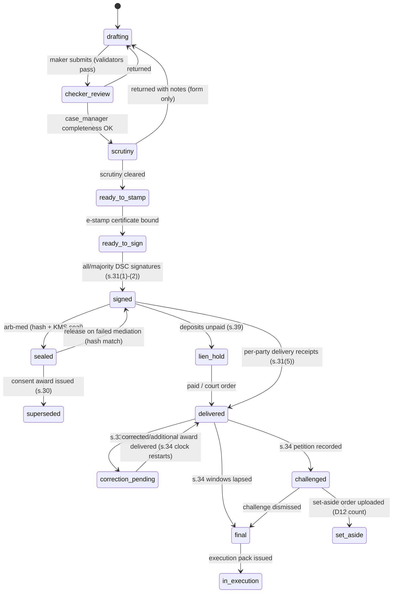

# P06 — Outcomes: Drafting, eSign, eStamp, Awards & Enforcement
> Paste after 01_MASTER_PROMPT.md. Prerequisites: P04 (proceedings, sessions, orders), P05 (fees, escrow, instalment plans, pass-through billing). Estimated effort: 6 sprints (2-week) for a squad of 8 (3 backend, 2 web, 1 mobile, 1 QA/SDET, 1 legal-domain BA with a reviewing advocate on call).
>
> Binding references: Appendix A (proceeding state machines), Appendix B (stamp procurement, certified-copy and execution-pack fees), Appendix D (`ESIGN_PORT`, `ESTAMP_PORT`), Appendix G (Legal Rules Register — every statutory period below is a register entry, not a constant).

## 1. Objective and business outcome

Turn agreements and decisions into **instruments that hold up**: correctly drafted, free of prohibited terms, signed by the right people with the right signature type, stamped at signing, registered where the law requires, delivered with provable receipt, verifiable by QR, admissible with a BSA s.63(4) certificate, and followed through by a compliance tracker and enforcement packs until the matter is genuinely closed.

Business outcomes:
1. **D2 closed loop completed**: offer → acceptance → auto-drafted settlement from agreed heads → e-stamp + e-sign → instalments/escrow (P05) → compliance tracker → auto-escalation on default.
2. **Award defensibility**: no award leaves Equator without passing s.31 validators, s.29A and s.12(5) guards (NN-03, NN-04), institutional scrutiny, stamping (NN-09) and per-party delivery logging — feeding D12's published "awards set aside" count.
3. **Enforcement readiness**: one-click execution packs for every lawful route (A&C s.36; s.74; Mediation Act s.27 when statutory mode is ON; CPC Order XXI; NI Act s.147; HMA s.13B; MSEFC; New York Convention Art. IV).
4. **Safety by design**: per-vertical "must-never-appear" lists stop unlawful or coercive terms before signature, and the immovable-property route (NN-08) prevents void e-signed conveyances.

## 2. Scope (in / out)

**In scope**: settlement builder (heads of terms, clause library, mandatory and prohibited terms, linter); instrument types for all six verticals; award builder (interim, partial, final, consent, additional, corrected, interpretation) with s.31 validators, interest and costs; s.33 workflow; maker–checker and institutional scrutiny; arb-med sealed award vault; eSign orchestration (Leegality primary); eStamp with state duty matrix; NN-08 physical execution and registration task workflow; certified copies with QR verification; BSA s.63(4) certificate and hash manifest; execution/enforcement packs; compliance tracker; challenge-window tracking; closure guards; anonymised, consent-gated outcome publication; mobile signing, tracker and verification.

**Out of scope**: proceeding conduct and orders (P04); payment rails, escrow mechanics and instalment collection (P05 — consumed here); vertical calculators other than interest (P08); POSH s.10 conciliation records and IC reports (P09, sealed — P06 supplies templates only, rendered inside `posh_sealed`); AI agent hardening and eval harness (P11 — P06 integrates `drafting_assistant` and `qa_auditor` behind flags); filing in courts (Equator prepares packs; counsel or the party files); Lok Adalat recording (signposted).

## 3. Personas and permissions touched

| Role | P06 actions | Key guards |
|---|---|---|
| `party`, `party_org_user` | Propose heads, review drafts in own language, sign, upload compliance evidence, request certified copies, consent to publication | `party_org_user` signs only within `core.org_signatories.authority_limit_minor` with authority evidence on file |
| `counsel` | Review/redline drafts, attest, download packs | Mandate scope `outcomes.review`, `outcomes.sign_as_attesting` |
| `neutral_mediator`, `neutral_conciliator` | Build settlement from agreed heads, authenticate MSA/s.73 settlement | Cannot override `block` lint findings |
| `neutral_arbitrator` | Draft and sign awards (DSC), request extensions, correct under s.33, seal arb-med award | Only members of the constituted tribunal; presiding member is maker |
| `neutral_expert` | Sign expert determinations | — |
| `case_manager` | Assemble signing envelopes, run completeness checks (checker 1), manage obligations, generate packs | Cannot alter award text |
| `registrar` | Certify copies (DSC), approve overrides of `require_override` findings, issue execution packs, s.39 lien decisions | Maker ≠ checker |
| `quality_officer` | Institutional scrutiny of draft awards and high-value settlements (form, not substance); publication redaction review | Cannot edit reasoning; returns with notes |
| `safeguarding_lead` | Mandatory review of FAM terms touching criminal proceedings, children or safety flags | Veto on safety-flagged instruments |
| `escrow_officer` | Link milestones to obligations (P05) | Segregated from case_manager on the case |
| `enterprise_operator` | Upload lender/insurer/employer compliance evidence (NOC, bureau acknowledgement, relieving letter) | Org-scoped |
| `institution_admin` | Clause library, prohibited-terms lists, stamp matrix (maker) | Maker–checker with legal reviewer |
| `auditor`, `dpo` | Read audit and certificates; handle publication withdrawals | Scoped |

## 4. Functional requirements

### 4A. Settlement builder

**FR-P06-01 — Instrument types.** `core.settlements.instrument_type` enum: `msa_contractual` (private mediation; a contract while statutory mode is OFF — NN-05), `msa_statutory` (Mediation Act 2023 s.19; available only when the statutory-mode flag is ON), `conciliation_settlement_s73` (A&C Act s.73; status of an arbitral award on agreed terms under s.74), `ots_agreement` (FIN), `ni138_settlement_deed`, `ff_settlement` and `separation_msa` (WRK), `insurance_settlement` with `discharge_voucher` (INS, F-I16/F-I17), `consent_terms_family` (HMA s.13B terms), `memorandum_family_settlement` (records a past arrangement), `family_settlement_deed` and `partition_deed` (operative; NN-08), `commercial_settlement`, `intl_settlement` (iMSA), `posh_s10_settlement` (sealed; non-monetary; rendered only in `posh_sealed`). Consent awards (A&C s.30) are built in the award builder (4B).

**FR-P06-02 — Heads of terms → structured terms.** Drafting starts from structured `core.settlement_terms`, never from free text: `term_type` (`payment_lump_sum`, `payment_instalment`, `waiver_interest`, `waiver_penal`, `transfer_movable`, `transfer_immovable`, `partition_immovable`, `release_of_security`, `return_of_documents`, `noc_issue`, `bureau_correction`, `record_correction`, `policy_reinstatement`, `relieving_letter`, `experience_letter`, `asset_return`, `disposal_of_proceeding`, `compounding_application`, `joint_petition_13b`, `parenting_plan`, `maintenance_periodic`, `maintenance_lump_sum`, `streedhan_return`, `confidentiality`, `non_disparagement`, `non_monetary_apology`, `default_clause`, `dispute_clause`, `costs`, `tax_tds`, `escrow_arrangement`, `custom`), parameters (amounts in minor units + currency, dates, obligor, beneficiary, conditions), and `origin` (`party_proposed`, `jointly_agreed`, `neutral_drafted_from_agreed_heads`, `ai_drafted_from_agreed_heads`). Each term maps to clause templates and to compliance obligations (4H) automatically. Free-text `custom` terms are allowed but always trigger legal-reviewer lint and are never auto-mapped to obligations without a case-manager mapping.

**FR-P06-03 — Clause library.** `core.clauses` (versioned; maker–checker; per-language variants; `legal_review_status` must be `approved` before activation — NN-23) keyed by `clause_code`, vertical(s), instrument types, variable schema and `mandatory_when` predicate. Mandatory clause sets (defaults; configuration):
- **All**: parties and capacity; voluntariness and free consent; read-back in the party's language with interpreter identity where used; counterparts and electronic execution (except NN-08 instruments); default and cure clause; dispute clause (return to mediation, then arbitration only where a valid arbitration agreement exists); costs; confidentiality with statutory carve-outs; governing law; entire agreement.
- **FIN**: NOC and return of documents within 30 days of final payment (RBI/2023-24/60, DoR.MCS.REC.38/01.01.001/2023-24, 13 Sep 2023, personal loans; ₹5,000/day for delay beyond 30 days; 60 days in total if documents are lost or damaged); credit-bureau reporting status consistent with the outcome; return of security cheques; grievance-officer details; RBI compromise-settlement framework disclosures where applicable (RBI/2023-24/40, 8 Jun 2023).
- **INS**: discharge limited to the claim in issue under the policy in issue; pending complaint "disposed of in terms" (never "withdrawn"); reinstatement preserving waiting periods and cumulative bonus; adverse-remark/fraud-flag withdrawal within 15 days including industry databases (Insurance Rules r.18).
- **WRK**: express statement that statutory dues (wages, gratuity, PF, ESI) are paid, not waived; relieving/experience letter timelines; confidentiality not gagging statutory or POSH complaints.
- **FAM**: independent legal advice (ILA) certificate (F-27); custody/parenting terms "subject to the approval of the competent court"; cooling-off/reflection window clause; mediator's affirmation of free will.
- **COM/INT**: interest, costs, tax gross-up/TDS, FEMA route statement (INT), consent-award conversion option (INT, NN-19).

**FR-P06-04 — Prohibited-terms linter ("must-never-appear").** `core.prohibited_terms` rows (code, verticals, instrument types, `severity` ∈ {`block`, `require_override`, `warn`}, structured detector predicate over terms, multilingual lexical patterns, explanation, citation, auto-fix suggestion). The deterministic linter runs on every save and before signing; `qa_auditor` (AI) runs second and can only add `warn` findings for human review — it can never clear a deterministic finding (NN-01). Default lists:

| Code | Vertical | Must never appear | Severity | Basis |
|---|---|---|---|---|
| PT-ALL-01 | All | Unilateral appointment/nomination of an arbitrator by one party, or conferring choice on Equator after the dispute arises | block | NN-03; *CORE v ECI-SPIC* (SC, 8 Nov 2024) |
| PT-ALL-02 | All | Waiver of the right to challenge for fraud, corruption or impersonation | block | A&C s.34(2)(b)(ii), Expl. 1(i) (fraud/corruption = public policy, non-derogable); Contract Act s.28; Mediation Act s.28(2) (not in force) |
| PT-ALL-03 | All | Equator described as court, judge, decree-maker or regulator | block | NN-17; GX-4 |
| PT-ALL-04 | All | "Enforceable as a decree under s.27" / "registered under s.20" / "MCI-registered" while statutory mode OFF | block | NN-05 |
| PT-ALL-05 | All | Settlement sums payable into an Equator account | block | NN-13 |
| PT-ALL-06 | All | Terms binding a non-signatory third party | block unless that person signs | Indian Contract Act 1872 (privity: a settlement cannot bind a non-signatory); Equator policy |
| PT-ALL-07 | All | Promise to give false evidence, turn hostile, or admit criminal guilt as consideration | block | Indian Contract Act 1872 s.23 |
| PT-ALL-08 | All | Any fee, commission or interest to Equator linked to the settled amount | block | Appendix B P3; NN-18 |
| PT-FIN-01 | FIN | Consent to contact outside 08:00–19:00, or to contact relatives, referees or employer for recovery | block | NN-12; NBFC Responsible Business Conduct (Third Amendment) Directions 2026 (RBI/2026-27/230, 6 Aug 2026, effective 1 Jan 2027) |
| PT-FIN-02 | FIN | Borrower waiver of the right to complain to the RBI Ombudsman/Internal Ombudsman about recovery conduct | block | RB-IOS 2026 |
| PT-FIN-03 | FIN | Bureau wording inconsistent with outcome (e.g., promising "closed" where the account will be reported "settled") | block | Neutral Code accuracy rule (FL Annex A) **[VERIFY — open (A2): CIC account-status codes for compromise settlement]** |
| PT-FIN-04 | FIN | Lender right to revise the settlement amount unilaterally | block | Contract Act s.29 (uncertainty) |
| PT-FIN-05 | FIN | Settlement conditioned on withdrawal of a police complaint about harassment | block | Public policy (s.23) |
| PT-INS-01 | INS | Waiver of non-waivable statutory rights or discharge of future/other claims or policies | block | Insurance Rules R2 |
| PT-INS-02 | INS | "Complaint withdrawn" (auto-fix: "disposed of in terms of this settlement") | block | Insurance Rules r.18(41) |
| PT-INS-03 | INS | Reinstatement resetting waiting periods or forfeiting cumulative bonus | block | Insurance Rules r.18 |
| PT-INS-04 | INS | Arbitration clause binding a retail policyholder | block | IRDAI/NL/CIR/MISC/188/10/2023 (27 Oct 2023); master §5.2 |
| PT-INS-05 | INS | Confidentiality barring approach to Ombudsman/IRDAI on other matters | block | Insurance Ombudsman Rules 2017 |
| PT-WRK-01 | WRK | Waiver of wages, gratuity, PF, ESI or other statutory dues | block (`422 statutory_dues_cannot_be_waived`) | Code on Wages 2019; Code on Social Security 2020 |
| PT-WRK-02 | WRK | Confidentiality/non-disparagement that gags statutory, POSH or whistle-blower complaints or cooperation with authorities | block | Public policy; POSH Act 2013 |
| PT-WRK-03 | WRK/POSH | Monetary settlement as the basis of POSH conciliation | block | POSH Act 2013 s.10(1) proviso; NN-07 |
| PT-WRK-04 | WRK | Post-employment restraint of trade | require_override (legal reviewer) | Contract Act s.27 |
| PT-FAM-01 | FAM | Waiver of a child's maintenance or a child's rights | block | Welfare principle; HAMA 1956 s.20 (child's own right to maintenance); HMGA 1956 s.13 (welfare paramount) |
| PT-FAM-02 | FAM | Waiver of future spousal maintenance without lump-sum consideration and ILA certificate | block | Public policy — Contract Act s.23; *Nagendrappa Natikar v Neelamma*, AIR 2013 SC 1541 (15 Mar 2013); lump-sum permanent alimony per *Rajnesh v Neha* (2021) 2 SCC 324 |
| PT-FAM-03 | FAM | Maintenance waiver whose `origin` is neutral- or AI-drafted (coaching) | block | Neutral Code; NN-01 |
| PT-FAM-04 | FAM | Payment conditional on withdrawal of a criminal complaint in circumstances amounting to pressure | require_override by `safeguarding_lead`; allowed form: tranche released on a court order disposing of proceedings, framed as settlement of civil claims | Family Practice Guide 6; *Gian Singh v State of Punjab* (2012) 10 SCC 303 |
| PT-FAM-05 | FAM | Custody/visitation terms presented as final without court approval | block (auto-insert clause) | Guardians and Wards Act 1890; HMGA 1956 |
| PT-FAM-06 | FAM | Any term purporting to dissolve the marriage or decide status | block | NN-06 |
| PT-FAM-07 | FAM | Disposal of a minor's share in property without court permission | block | HMGA 1956 s.8(2) (prior court permission for a natural guardian to mortgage, charge or transfer a minor's immovable property; undivided joint-family interest is governed by ss.6 and 12) |
| PT-FAM-08 | FAM | Joint-contact terms that conflict with a protection order when the safety flag is set | block | PWDVA 2005; NN-07 |
| PT-COM-01 | COM | Settlement of non-arbitrable/non-mediable subject matter (insolvency in rem, oppression under Companies Act ss.241–242) | block | NN-06; *Vidya Drolia* (2020) |
| PT-INT-01 | INT | Payment to or for a sanctioned person or via a prohibited route | block | NN-19 |
| PT-INT-02 | INT | Capital-account transfer (shares, put options) without FEMA advisory acknowledgement | require_override | FEMA 1999; NDI Rules 2019 |
| PT-INT-03 | INT | Collusive-settlement red flags (related parties, no genuine dispute, rapid consent award, amount disproportionate) | require_override + enhanced review | R5 Gate G2 (FATF TBML typology) |

Overrides record approver, reason and citation, and appear in the audit chain and the Independence Evidence Pack.

**FR-P06-05 — Linked-matter and criminal-linkage sequencing.** Where `core.linked_matters` links a FAM matter to a FIN loan (e.g., joint home loan) or a criminal proceeding, the builder enforces sequencing: neither instrument is released for signature without the other (C1 B.8), and criminal-disposal terms require `safeguarding_lead` review. NI Act s.138 matters route to `ni138_settlement_deed` + compounding application (FR-P06-23, pack `ni_s147_compounding`).

**FR-P06-06 — Read-back, cooling-off and authority.** Before signing: (a) the final text is rendered in each party's chosen language with a recorded read-back (or interpreter certificate) — mediator affirmation per C4 C.25; (b) FAM instruments enforce a configurable reflection window (default 3 days; waivable only with ILA certificate); (c) organisational signatories pass an authority check (`authority_limit_minor ≥ settlement value`, board resolution/authority letter on file; INS insurer settlement authority confirmed); failure blocks the envelope.

### 4B. Award builder

**FR-P06-07 — Award types.** `core.awards.award_type`: `interim` (s.31(6)), `partial`, `final`, `consent` (s.30(2)–(4), on agreed terms; same status as any award), `additional` (s.33(4)), `corrected` and `interpretation` (s.33(1)), `emergency_decision` (Equator Rules contractual EA — labelled "order", not "award", until statute provides otherwise), `expert_determination` (contractual, not an award), `appellate` (internal appeal tier D4, under Equator Rules).

**FR-P06-08 — s.31 validators (block issuance on failure).** (1) In writing and signed by the members (s.31(1)); (2) for multi-member tribunals, majority signatures with the reason for any omitted signature stated (s.31(2)); (3) reasons stated unless the parties agreed otherwise or the award is under s.30 (s.31(3)); (4) date and place of arbitration (seat per s.20) stated (s.31(4)); (5) operative paragraphs **severable per claim, counterclaim and interest head** (so a partial set-aside or limited modification does not void the whole — *Gayatri Balasamy v ISG Novasoft*, SC 5-judge bench, 30 Apr 2025); (6) interest: pre-award rate, period and basis (s.31(7)(a)); post-award rate — default "two per cent higher than the current rate of interest prevalent on the date of award" unless the award directs otherwise (s.31(7)(b)), with "current rate of interest" per Interest Act 1978 s.2(b), the reference rate held as data in the Legal Rules Register; (7) costs fixed with reasons under s.31A and s.31(8); (8) all claims and counterclaims addressed and nothing beyond the reference; (9) computation check: every figure recomputed by the deterministic interest/arithmetics engine (MSMED s.16 compound interest at three times the RBI bank rate with monthly rests where applicable); mismatch blocks.

**FR-P06-09 — Statutory guards (NN-03, NN-04, NN-06).** Issuance is blocked if: the s.29A mandate (12 months from completion of pleadings + 6 by consent) has lapsed without a court extension on record — the system offers the s.29A(4) court-application pack instead; award `signed_at` is server time and can never precede the last signature event or be back-dated; any Seventh Schedule flag is open without a valid post-dispute express written waiver signed by each party (*Bhadra International v AAI*, SC 5 Jan 2026); the subject matter is non-arbitrable (status, custody, testamentary, criminal, insolvency in rem); for INS, the claimant is a retail policyholder.

**FR-P06-10 — s.33 correction, interpretation and additional award.** Party request within 30 days of receipt (or agreed period); tribunal decision within 30 days of receipt of request for correction/interpretation, own-motion correction within 30 days of the award date, additional award within 60 days of request; extensions under s.33(6) recorded as orders. Corrected/additional awards are new versions linked to the original, stamped as follows pending legal sign-off: an additional award (s.33(4)) is stamped as a fresh award on its own amount; a correction that increases the amount is stamped for the differential within one month of signing; a clerical correction with no change in amount is not re-stamped **[VERIFY — open: no statutory or judicial authority on re-stamping s.33 outputs as of Oct 2026]**. They are delivered per party and **restart the s.34 clock from disposal of the s.33 request** (s.34(3)). Certified copies of superseded versions show "corrected — see version N" on verification.

**FR-P06-11 — Arb-med sealed award (master §5.3).** Before an arb-med mediation begins, the tribunal finalises and signs the award; the platform records its SHA-256, encrypts the PDF under a dedicated KMS key whose policy permits decryption only on a `sealed_award.release` signal co-approved by the registrar and the presiding arbitrator, and stores it in `core.sealed_awards` (content never visible to parties, case manager or mediator). If mediation settles, a consent award under s.30 is issued and the sealed envelope is crypto-shredded once the consent award's s.34 window lapses (hash retained). If mediation fails, the sealed award is released unchanged; the released file's hash must equal the sealed hash or release is blocked (Critical incident). Stamp duty on the sealed award is handled per FR-P06-15 open item.

**FR-P06-12 — s.39 lien.** Where deposits remain unpaid, the registrar may hold delivery of the signed award under the tribunal's lien (A&C s.39(1)); the system records the lien, notifies parties of the amount and of the right to apply to court under s.39(2), and releases delivery on payment or court order. The s.34 clock does not start until delivery (s.31(5)).

### 4C. Maker–checker and institutional scrutiny

**FR-P06-13 — Outcome review chain.** Every award and every settlement above the configurable scrutiny threshold (default: all FAM property/partition instruments, all INT instruments, COM ≥ ₹1 crore, any instrument with an override) passes: maker (drafting neutral) → checker 1 `case_manager` (completeness: parties, case number, stamps, signatory authorities, annexures) → checker 2 `quality_officer` (institutional scrutiny of **form, not substance**) → tribunal/neutral final sign. Scrutiny checklist (C3 Rules art.21): parties, case number, seat and date; all claims and counterclaims addressed and nothing beyond scope; reasons for each finding; interest and costs with basis; within s.29A with extensions on record; signed by all or majority with reason; operative part clear and enforceable; no patent illegality or public-policy conflict on its face; confidentiality and delivery noted. The quality officer may return with notes but cannot edit reasoning; the neutral decides whether to accept notes. Scrutiny SLA 7 days, compressed to 2 days when the s.29A expiry is ≤ 30 days away; the scrutiny period never extends any statutory clock.

### 4D. eSign

**FR-P06-14 — Signing orchestration.** Via `ESIGN_PORT` (Leegality primary; Digio, Setu, SignDesk fallbacks with ESP auto-switch):
- **Signature types**: Aadhaar eSign OTP/biometric (parties; IT Act 2000 s.3A and Second Schedule), DSC Class 3 (neutrals for awards; registrar for certified copies), **virtual sign** (simple e-signature) only for procedural documents (agreement to mediate, online-mode consent in contractual mode, scheduling consents) and settlements ≤ ₹50,000 outside FAM and outside NN-08 — never for awards, s.12(5) waivers, statutory-mode MSAs, s.73 settlements or INT instruments; eIDAS **QES** via a qualified trust service provider adapter for INT awards intended for EU enforcement.
- **Signer order**: settlement — parties (parallel) → attesting counsel (optional) → neutral authentication (mediator/conciliator) → registrar certification of copies; award — co-arbitrators → presiding arbitrator (all DSC).
- **eStamp first**: the e-stamp certificate is bound to the PDF before the first signature (FR-P06-15).
- **Audit**: the provider's audit trail and signed PDF are downloaded immediately (CDN URLs expire), stored in the Object-Lock bucket, hashed into `core.evidence_ledger`, and signatures validated against the CCA chain; webhooks verified (Leegality `mac` field).
- **Signer drop-out**: unused e-stamp released where the provider supports it; envelope voided; re-issue requires new lint pass.

### 4E. eStamp (NN-09)

**FR-P06-15 — Duty matrix and stamping at signing.** `core.stamp_duty_rules` (new; config): `state_code`, `instrument_type`, `article_ref` (e.g., "Indian Stamp Act 1899, Sch. I, Art. 12 — Award", state equivalents), `duty_formula` (`fixed` | `pct_consideration` | `pct_market_value` | `slab`), min/max, family concessions, `estamp_available` per provider, `physical_only` flag, `stamping_state_rule`, penalty rule, effective dates, `source_ref`, `verification_status`. Determination of state: stamp duty follows the state of execution (signing), not the seat (Indian Stamp Act s.17; *URC Construction*): for settlements, the instrument execution state; for awards, the state where the award is executed, i.e. where the last arbitrator signs. Signing location is captured per signatory, the seat is recorded but does not by itself fix the stamping state, and a differential-duty check is run for the enforcement state where its Act charges instruments received from outside. Flag for legal review where signatories sign in different states **[VERIFY — open: per-state differential-duty provisions]**. Maharashtra is seeded with Sch. I Art. 12 (Award) as ad valorem under Mah. Ord. XII of 2024 (partition awards excluded and charged as partition; §14 item 1); no flat award duty is assumed for any state. Duty is computed deterministically from inputs the parties provide (consideration; market/guidance value entered by the party from the state portal — never estimated by AI, NN-01) and procured via `ESTAMP_PORT` (Leegality BharatStamp; Digio, SignDesk–NeSL, SHCIL partner). Duty is a pure-agent pass-through plus the Appendix B procurement fee (P05). **No domestic award or settlement instrument may be released, delivered or certified without an attached stamp certificate** (*URC Construction (P) Ltd v AAI*, Del HC, OMP (ENF.)(COMM.) 155/2026, 1 Sep 2026: duty chargeable on signing; a deficit is not curable by unilateral deposit after one month; impounding under Indian Stamp Act ss.33, 35, 40 with a tenfold penalty the court cannot waive). States flagged physical-only (Setu docs, checked 20 Oct 2026: Maharashtra, Telangana, West Bengal; re-test at integration) route to franking/e-SBTR/physical stamp paper via partner, wet-ink execution on that paper, scan, upload and hash. Foreign-seated awards require no stamping (*Shriram EPC v Rioglass Solar* (2018) 18 SCC 313); India-seated INT awards do. Open item: whether duty on an arb-med sealed award is triggered at sealing.

### 4F. Immovable property and excluded instruments (NN-08)

**FR-P06-16 — Detection and routing.** If `instrument_type` ∈ {`family_settlement_deed`, `partition_deed`} or any term has `term_type` ∈ {`transfer_immovable`, `partition_immovable`} or the instrument is a power of attorney, trust, will or sale/conveyance of immovable property (IT Act 2000 s.1(4) and First Schedule), the builder sets `execution_route = physical`: the parties e-sign only a **term sheet / heads-of-agreement** obliging them to execute the operative deed physically; the operative deed is generated for physical execution. Wills are never drafted or e-signed (testamentary matters are non-arbitrable; signpost probate). A **Memorandum of Family Settlement** recording a past oral arrangement is offered as an alternative with a lawyer-review flag (*Kale v Deputy Director of Consolidation* (1976) 3 SCC 119); where litigation is pending, the builder suggests a court-recorded compromise (Registration Act s.17(2)(vi); *Mohammade Yusuf v Rajkumar* (2020) 10 SCC 264; *Mukesh v State of MP*, 2024 INSC 1026 — exemption only for suit property and pre-existing rights).

**FR-P06-17 — Registration task workflow.** `core.registration_tasks`: steps — (1) stamp duty computation on market/guidance value and procurement (physical or e-stamp per state); (2) execution checklist: executants' identity and photographs, two witnesses, PAN where the transaction value exceeds ₹20 lakh, including gift deeds and JDAs (Income-tax Rules 2026, from 1 Apr 2026), and Form 97 (which replaced Form 60) only where PAN is not mandatory **[VERIFY — open: rule number]**; TDS at 1% by the transferee where consideration is ₹50 lakh or more (Income-tax Act 2025 s.393(1), Table Sl. No. 3(i), formerly s.194-IA; Form 26QB; rural agricultural land excluded); encumbrance/title documents; (3) appointment booking deep link to the state registration portal (configured per state: Delhi, UP, Rajasthan, Maharashtra, Karnataka at launch); (4) presentation within 4 months of execution (Registration Act 1908 s.23; s.25 extension up to 4 further months on fine); (5) appearance/admission by executants (ss.32, 34); (6) upload of registered deed and certified copy, hash into evidence ledger; (7) mutation follow-up obligation (optional). A service clock `registration_s23` starts at execution with owner = case_manager (NN-04). Escrow milestones can be conditioned on `registration_task.completed`.

### 4G. Certified copies, verification, and electronic evidence

**FR-P06-18 — Certified copies with QR.** `core.certified_copies`: source document version, copy number, issued_to, purpose, registrar DSC signature, issue date, random 128-bit `verify_code`, fee (Appendix B), status (`valid`, `superseded_by_correction`, `set_aside` (manual update on court order), `revoked`). Each page footer carries case number, copy number and QR → `/verify/{code}`. The public verification page (SSR; no login) shows document type, case number, date, issuing institution, signatories' roles (names only where the instrument is not confidential), SHA-256, stamp certificate number and status — **never content** (A&C s.42A confidentiality; NN-11).

**FR-P06-19 — BSA 2023 s.63(4) certificate and hash manifest (NN-10).** Every export bundle (award pack, settlement pack, execution pack, evidence export) contains: `manifest.json` (file path, size, MIME, SHA-256 per file, evidence-ledger entry IDs, Merkle root, generation time, generator version) signed with the institution DSC and timestamped; a pre-filled s.63(4) certificate **Part A** for the producing party (identification of the electronic record, the computer resource, hash algorithm and values, manner of production) with Equator's custodian declaration supporting it; and a **Part B** request option routed to an empanelled cyber-forensics expert (roster with credentials; *Pune Bar Association v Union of India*, SC, 22 May 2026: hash value as electronic fingerprint; Part B signatory with special skill under BSA s.39). Bundle export without manifest and certificate is impossible by construction (`NN-10_bundle_has_certificate`).

### 4H. Compliance tracker

**FR-P06-20 — Obligations.** On execution (signed + stamped), each structured term generates `core.compliance_obligations` (obligor, beneficiary, type, due date, evidence requirement, linked escrow milestone, linked instalment plan, owner). Statutory/default due dates (configurable, each a Legal Rules Register entry):

| Obligation | Default due | Evidence | Basis |
|---|---|---|---|
| NOC and return of property documents (FIN, secured personal loans) | 30 days after final payment | NOC + acknowledgement of documents returned | RBI/2023-24/60 (13 Sep 2023), applies where release falls due on or after 1 Dec 2023; compensation ₹5,000 per day of delay attributable to the RE; +30 days (60 in total) if documents are lost or damaged |
| Credit-bureau correction via lender | Lender submits rectified data ≤ 21 days; borrower-visible confirmation ≤ 30 days | CIC acknowledgement or updated report extract (uploaded by lender or borrower) | RBI 'Framework for compensation to customers for delayed updation/rectification of credit information', RBI/2023-24/72, DoR.FIN.REC.48/20.16.003/2023-24, 26 Oct 2023 (effective ~26 Apr 2024): CI 21 days + CIC 9 days; ₹100/day after 30 days; Equator never writes to bureaus (NN-14) |
| Return of security cheques / hypothecation removal | 7 days after final payment | Acknowledgement / Form 35 (RC) | Settlement term |
| Adverse-remark / fraud-flag withdrawal (INS) | 15 days | Insurer letter + industry-database confirmation | Insurance Rules r.18 |
| Policy reinstatement (INS) | As agreed | Endorsement | Settlement term |
| F&F payment (WRK) | As agreed; statutory reference 2 working days | Bank proof + F&F statement (F-W18) | Code on Wages s.17(2) |
| Relieving and experience letters (WRK) | 7 days | Letters uploaded | Settlement term |
| Gratuity payment | 30 days of becoming payable | Bank proof | Code on Social Security 2020 s.56 (simple interest on delay) **[VERIFY — open: s.56 sub-section]** |
| Joint petition first motion (FAM) | As agreed | Filing proof / CNR | HMA 1955 s.13B(1) |
| Second motion (FAM) | 6 months after first motion (waivable by court) | Order | s.13B(2); *Amardeep Singh v Harveen Kaur* (2017) 8 SCC 746 (waiver application from one week after first motion) |
| Registration of deed | 4 months of execution | Registered deed | Registration Act s.23 |
| Compounding order (NI-138) | Next hearing date | Court order | NI Act s.147 |
| MSA registration (statutory mode only) | 180 days | Registration number | Mediation Act s.20 |
| Maintenance / parenting contact log (FAM) | Per schedule | Payment proof / log entry | Settlement term |

**FR-P06-21 — FIN NOC/escrow sequence (resolves C2 gap 6).** Step 1: lender undertaking + conditional NOC uploaded at signing. Step 2: final escrow tranche released to the lender against the conditional NOC (P05 dual control). Step 3: final NOC and document return within 30 days. Step 4: bureau-update evidence within 30 days. Closure requires steps 3–4 verified, or breached-and-escalated with outcome recorded.

**FR-P06-22 — Breach and auto-escalation.** Overdue obligation → reminder at T+0 → notice to both parties at T+2 working days → cure period (default 7 days) → `breached` → escalation per the instrument's default clause: (a) return-to-mediation session (one session, fee per Appendix B), (b) where an arbitration agreement exists and the parties consented at signing, recording the settlement as a consent award (A&C s.30) by a tribunal constituted for that purpose, (c) execution pack generation (4I), (d) signposting to the competent forum (NN-20). P05's `instalment_plan.defaulted` event enters the same path. Escrow releases linked to a breached obligation are paused.

### 4I. Execution and enforcement packs

**FR-P06-23 — Pack catalogue.** `core.execution_packs` (type, version, generated documents, manifest, BSA certificate, readiness checks, status). Each pack is a template set with readiness guards:

| Pack | Readiness guard | Contents |
|---|---|---|
| `ac_s36_domestic_award` | s.34 window lapsed, or challenge dismissed, or no stay under s.36(2)–(3) on record | Certified award + stamp certificate; arbitration agreement; ToR; per-party delivery proofs (s.31(5)); s.34 status note; execution application draft with CPC Order XXI r.11(2) particulars (decree-holder, judgment-debtor, award date, relief, sum with interest to date, assistance sought: attachment/sale/arrest/delivery); assets schedule supplied by the award-holder; affidavit-of-assets annexure (*Rahul S. Shah v Jinendra Kumar Gandhi* (2021) 6 SCC 418: asset affidavit, disposal within 6 months; reiterated in *Periyammal v V. Rajamani*, SC, 6 Mar 2025); note that execution may be filed where assets are located (*Sundaram Finance v Abdul Samad* (2018) 3 SCC 622) |
| `ac_s74_conciliation` | s.73 settlement signed, authenticated and stamped | Settlement; authentication; status note under s.74; Order XXI annexures |
| `mediation_s27` | **Statutory flag ON**; MSA authenticated (s.19); s.28 window status | MSA; registration (s.20) if done; Order XXI annexures (NN-05: hidden while flag OFF) |
| `mediation_contractual` | Breach recorded | Contract-enforcement brief for counsel (suit on the agreement); consent-award conversion option where an arbitration agreement exists |
| `ni_s147_compounding` | Settlement executed; CNR known | Joint compounding application under NI Act s.147; settlement deed; payment proof (UPI/QR receipts); compounding-cost note (*Damodar S. Prabhu*, 2010; *Sanjabij Tari v Kishore Borcar*, 2025 INSC 1158; cost slabs: nil before defence evidence; 5% of cheque amount after defence evidence and before trial judgment; 7.5% before Sessions Court/HC; 10% before SC, payable to Legal Services Authority or as the court directs) |
| `hma_s13b` | Consent terms executed; safeguarding review done | Joint petition (first motion) draft; second-motion draft; cooling-off waiver application where justified; affidavits; settlement annexure; Family Court report limited to settled/not settled + agreed terms (Family Courts Act 1984 s.9) |
| `msme_msefc` | Udyam-registered supplier; dispute unresolved | MSMED Act 2006 s.18 reference to MSEFC/MSME ODR portal; s.15/s.16 interest computation (three times bank rate, monthly rests); invoices and acceptance evidence; note that a challenge to an MSEFC award requires 75% pre-deposit (s.19); *Mahakali Foods* (SC 2022) note on MSEFC primacy |
| `nyc_art_iv` (INT) | Award final; enforcement country selected | Duly authenticated original or certified copy (Art. IV(1)(a)); arbitration agreement original or certified copy (IV(1)(b)); certified translation by official/sworn translator or diplomatic/consular agent (IV(2)); Registrar authentication certificate; QES and/or wet-ink counterpart; apostille (Hague Apostille Convention — India in force 14 Jul 2005) or consular legalisation per `core.enforcement_country_rules` |
| `ac_s47_foreign_award_india` | Foreign-seated award; seat in an India-notified NYC territory (s.44(b)) | s.47 documents; English translation; High Court of original jurisdiction note; status model `recognition_filed → enforceable_decree` (never "enforced" before the s.49 order) |
| `s29a_court_extension` | Mandate expiry ≤ 60 days or lapsed | Application under s.29A(4)–(5) with chronology from the clocks service |

**FR-P06-24 — Translation and apostille workflow (INT).** `core.translation_requests` (source, target language, certified translator from roster, certification type) and `core.apostille_tasks` (notarisation → state Home/GAD attestation → MEA apostille via e-Sanad or MEA attestation + embassy legalisation) with document courier tracking. Machine translation (P11 `translation_agent`) is labelled "non-certified, for convenience" and never inserted into a pack as a certified translation.

### 4J. Challenge windows

**FR-P06-25 — Challenge clocks (NN-04).** Created per party on the delivery event of the signed award (s.31(5)); delivery to an unconnected official is not valid delivery (*M/s Motilal Agarwala v State of West Bengal*, 2025 INSC 1062):
- `ac_s33_request`: 30 days from receipt.
- `ac_s34_challenge`: 3 calendar months from receipt, or from disposal of a s.33 request; outer `ac_s34_condonable`: further 30 days "but not thereafter" (s.34(3) proviso; *My Preferred Transformation v Faridabad Implements*, SC 2025). Alerts at T-30/T-15/T-7 to the award-holder's view: "challenge window open until …"; to the other party, neutral information without advice.
- `med_s28_challenge`: 90 days (+90 for sufficient cause) — statutory mode only.
- `ac_s36_enforceable_from`: derived = later of all parties' `ac_s34_challenge` expiries; a filed s.34 petition moves the case to `challenged` but does not stay enforcement unless a stay order is uploaded (s.36(2)–(3)).
- Limitation for execution held as a register entry (default 12 years, Limitation Act 1963 Art. 136 **[VERIFY — open: Art. 136 (12 years) is the prevailing view for domestic awards (deemed decree under s.36); some decisions apply Art. 137; keep the 12-year default with counsel sign-off]**; foreign-award enforcement petitions: Art. 137, 3 years — *Government of India v Vedanta Ltd* (2020) 10 SCC 1).

### 4K. Closure guards and publication

**FR-P06-26 — Closure guards.** `closed` is blocked unless: every compliance obligation is `verified`, `waived_in_writing_by_beneficiary` or `escalated_with_outcome`; every required clock is owned and completed or formally stopped (NN-04); for awards, the s.34 window has lapsed or the challenge is disposed of; escrow accounts are `closed` and reconciled (P05); signposting is recorded where the vertical requires (NN-20); certified copies issued to each party; fees settled or written off with approval; for statutory-mode MSAs, s.20 registration done or declined in writing. The checklist (SCR-P06-17) shows which guard blocks.

**FR-P06-27 — Outcome publication.** Publication requests (`core.publication_requests`) produce (a) aggregate statistics with k-anonymity ≥ 10 (D12 KPIs: time to outcome, settlement rate by mechanism, awards issued, awards set aside under s.34 — never win-rates by party type, NN-16), and (b) anonymised award/settlement excerpts **only** with every party's separate, revocable written consent, redaction by `quality_officer` (AI redaction suggestions allowed, human approval mandatory), and never for POSH, FAM safety, health (INS) or sealed-tier matters (NN-07). INS quarterly insurer outcome reporting (Insurance Rules r.25) is aggregate and non-contractable. Consent withdrawal unpublishes within 2 working days.

## 5. Workflows and state machines

### 5.1 Settlement instrument

| State | Event | Guard | Next | Side-effects |
|---|---|---|---|---|
| `heads_agreed` | `draft.generate` | ≥ 1 structured term; parties confirmed | `drafted` | Clause assembly; lint run |
| `drafted` | `lint.pass` | zero `block`; `require_override` approved | `in_review` | — |
| `drafted` | `lint.fail` | — | `drafted` | Findings shown with auto-fixes |
| `in_review` | review chain complete | maker–checker per FR-P06-13; safeguarding review where required | `reflection` (FAM) / `ready_to_stamp` | — |
| `reflection` | window lapsed or waived with ILA | — | `ready_to_stamp` | — |
| `ready_to_stamp` | `estamp.attached` | duty paid; certificate bound | `ready_to_sign` | Pass-through invoice (P05) |
| `ready_to_stamp` | NN-08 route | physical route | `physical_execution` | Registration task created |
| `ready_to_sign` | all party signatures + neutral authentication | authority checks passed | `executed` | `equator.outcomes.settlement.executed.v1`; obligations; P05 instalment plan/escrow |
| `physical_execution` | registered deed uploaded | hash recorded | `executed` | same |
| `executed` | all obligations verified | — | `performed` | Closure guard input |
| `executed` | obligation breached | — | `in_default` | Escalation (FR-P06-22) |
| any pre-`executed` | party withdraws consent | — | `abandoned` | Unused stamp release |

### 5.2 Award



Guards on `drafting → checker_review`: s.31 validators, s.29A mandate valid, no open Seventh Schedule flag without valid waiver, arbitrable subject matter, computation check passed.

### 5.3 Signing envelope

`created → stamp_bound → sent → partially_signed → signed → authenticated (neutral) → completed → archived`; side exits `declined`, `expired` (default 7 days, reminders D+2, D+5 within NN-12 hours for borrowers), `voided`. Every transition stores provider event IDs and audit trail hash.

### 5.4 Compliance obligation

`pending → due → evidence_submitted → verified` | `evidence_submitted → disputed → verified | breached` | `due → overdue → notice_sent → breached → cured | escalated`. Disputes are resolved by the neutral (if mandate continues) or the case manager per the instrument's dispute clause.

### 5.5 Registration task

`created → duty_computed → stamp_procured → appointment_booked → executed_physical → presented → registered → certified_copy_uploaded → closed`, with a `registration_s23` clock from `executed_physical`; `presentation_overdue` at 4 months raises a blocking task and offers the s.25 late-presentation path.

## 6. Screens and UX (web + mobile)

| ID | Route | Persona | Purpose | Key components / fields |
|---|---|---|---|---|
| SCR-P06-01 | `/(app)/cases/[caseId]/outcome` | neutral, case_manager | Outcome workspace | Instrument picker filtered by vertical × mechanism × arbitrability; status rail; blockers |
| SCR-P06-02 | `/(app)/cases/[caseId]/outcome/heads` | neutral, parties | Heads-of-terms builder | Term cards by type with amounts/dates/obligor; origin badges; instalment schedule designer (P05 preview); escrow toggle |
| SCR-P06-03 | `/(app)/cases/[caseId]/outcome/draft` | neutral, counsel | Settlement editor | Clause library panel, rendered draft (bilingual side-by-side), linter panel with severity, auto-fix, citations; redline compare |
| SCR-P06-04 | modal on SCR-03 | registrar, safeguarding_lead | Override decision | Finding, citation, reason (min 50 chars), approver step-up |
| SCR-P06-05 | `/(app)/cases/[caseId]/awards/[awardId]/edit` | neutral_arbitrator | Award builder | Structured sections (parties, procedural history, issues, findings per issue, operative paragraphs per claim/head, interest calculator, costs); validator checklist live; evidence citations to bundle pages; s.29A countdown |
| SCR-P06-06 | `/(admin)/scrutiny` | quality_officer | Scrutiny console | Queue by s.29A urgency; checklist; notes; return/clear |
| SCR-P06-07 | `/(app)/sign/[envelopeId]` | party, counsel, neutral | Signing room | Final PDF with stamp page, language read-back, interpreter certificate, authority confirmation, eSign handoff |
| SCR-P06-08 | `/(app)/cases/[caseId]/signing` | case_manager | Signing tracker | Signer order, statuses, reminders, void/reissue |
| SCR-P06-09 | `/(app)/cases/[caseId]/stamp` | case_manager, parties | eStamp panel | State, article, inputs (consideration, guidance value), duty breakdown, payer split, provider, physical-route banner |
| SCR-P06-10 | `/(app)/cases/[caseId]/registration` | case_manager, parties | Physical execution & registration | Checklist, witness details, appointment link, s.23 clock, uploads |
| SCR-P06-11 | `/(admin)/certified-copies` | registrar | Issue certified copies | Version, recipient, purpose, DSC sign, fee |
| SCR-P06-12 | `/(public)/verify/[code]` | public | Verify document | Status badge, metadata, hash; no content |
| SCR-P06-13 | `/(app)/cases/[caseId]/exports` | parties, counsel, case_manager | Evidence export | Bundle selector, manifest preview, s.63(4) Part A pre-fill, Part B expert request |
| SCR-P06-14 | `/(app)/cases/[caseId]/execution` | award-holder, counsel, registrar | Execution pack builder | Pack type, readiness checks, court/state, assets schedule, generated documents |
| SCR-P06-15 | `/(app)/cases/[caseId]/compliance` | parties, enterprise_operator, case_manager | Compliance tracker | Obligation list with due/overdue, evidence upload, dispute, escrow/instalment linkage |
| SCR-P06-16 | `/(admin)/challenge-windows` | registrar, case_manager | Challenge dashboard | Per-party s.33/s.34/s.28 clocks, challenged cases, set-aside register |
| SCR-P06-17 | `/(app)/cases/[caseId]/closure` | case_manager | Closure checklist | Guard list with blocking reasons and links |
| SCR-P06-18 | `/(admin)/publication` | quality_officer | Publication review | Consent status per party, redaction diff, k-anonymity check |
| SCR-P06-19 | `/(admin)/sealed-awards` | registrar, presiding arbitrator | Sealed vault | Hash, sealed date, release co-approval |

Common states: empty, loading, error (problem+json mapped to plain language), success. Mobile (Expo): SCR-02 (view/propose heads), 07 (signing with Aadhaar eSign webview and biometric confirmation), 12 (scan QR to verify), 13 (download bundle), 15 (camera upload of NOC/relieving letter/proof). Accessibility: signing room is a critical journey — screen-reader script, ≥ 200% zoom without loss, read-back audio option, and no time-out shorter than 20 minutes during signing (WCAG 2.2.1 adjustable).

## 7. Backend design

### 7.1 Modules touched
`outcomes` (settlements, awards, terms, clauses, linter, review chain, sealed awards, publication), `esign`, `estamp`, `execution` (registration tasks, obligations, execution packs, certified copies, translation/apostille), `documents` (templates, rendering, evidence ledger, manifests, BSA certificates), `clocks` (challenge, registration, s.33, s.29A integration), `rules` (prohibited-terms detectors, stamp duty evaluator, interest engine), `payments`/`escrow`/`billing` (P05 consumers), `comms` (P07 notices), `ai` (drafting_assistant, qa_auditor behind flags), `audit`.

### 7.2 Tables
Canonical: `core.settlements`, `core.settlement_terms`, `core.awards`, `core.orders`, `core.esign_requests`, `core.esign_signers`, `core.estamp_requests`, `core.registration_tasks`, `core.execution_packs`, `core.compliance_obligations`, `core.document_templates`, `core.documents`, `core.document_versions`, `core.evidence_ledger`, `core.clocks`, `core.linked_matters`.
New (prefix `core.`): `clauses`, `prohibited_terms`, `lint_findings`, `outcome_reviews`, `stamp_duty_rules`, `certified_copies`, `evidence_certificates`, `export_manifests`, `sealed_awards`, `publication_requests`, `enforcement_country_rules`, `translation_requests`, `apostille_tasks`, `award_deliveries`.

```sql
CREATE TABLE core.settlements (
  id uuid PRIMARY KEY DEFAULT uuidv7(),
  tenant_id uuid NOT NULL,
  case_id uuid NOT NULL REFERENCES core.cases(id),
  proceeding_id uuid REFERENCES core.proceedings(id),
  instrument_type text NOT NULL,
  status text NOT NULL,
  execution_route text NOT NULL DEFAULT 'electronic' CHECK (execution_route IN ('electronic','physical','physical_stamp_paper')),
  enforceable_basis text NOT NULL,          -- 'contract' | 'ac_s74' | 'ac_s30' | 'mediation_s27' (flag) | ...
  statutory_rights_waived boolean NOT NULL DEFAULT false CHECK (statutory_rights_waived = false),
  value_minor bigint, currency char(3),
  language_codes text[] NOT NULL,
  reflection_until timestamptz,
  stamp_request_id uuid REFERENCES core.estamp_requests(id),
  signed_pdf_hash char(64),
  executed_at timestamptz,
  CHECK (NOT (enforceable_basis = 'mediation_s27') OR instrument_type = 'msa_statutory'),
  CHECK (executed_at IS NULL OR execution_route <> 'electronic' OR stamp_request_id IS NOT NULL)   -- NN-09
);

CREATE TABLE core.awards (
  id uuid PRIMARY KEY DEFAULT uuidv7(),
  tenant_id uuid NOT NULL,
  case_id uuid NOT NULL, proceeding_id uuid NOT NULL,
  award_type text NOT NULL,
  version int NOT NULL, supersedes_award_id uuid REFERENCES core.awards(id),
  seat_city text NOT NULL, seat_country char(2) NOT NULL,
  award_date date,
  signed_at timestamptz,                    -- server time only; trigger rejects client-supplied values
  s29a_due_at timestamptz,
  s29a_extension_ref uuid,                  -- consent order or court order document
  interest_terms jsonb, costs_terms jsonb,
  stamp_request_id uuid REFERENCES core.estamp_requests(id),
  sealed boolean NOT NULL DEFAULT false,
  status text NOT NULL,
  enforceable_basis text NOT NULL DEFAULT 'ac_s36',
  signed_pdf_hash char(64),
  CHECK (signed_at IS NULL OR s29a_due_at IS NULL OR signed_at <= s29a_due_at OR s29a_extension_ref IS NOT NULL),  -- NN-04
  CHECK (status NOT IN ('delivered','final','in_execution') OR seat_country <> 'IN' OR stamp_request_id IS NOT NULL) -- NN-09
);

CREATE TABLE core.compliance_obligations (
  id uuid PRIMARY KEY DEFAULT uuidv7(),
  tenant_id uuid NOT NULL,
  case_id uuid NOT NULL,
  source_kind text NOT NULL CHECK (source_kind IN ('settlement','award','order')),
  source_id uuid NOT NULL,
  term_id uuid REFERENCES core.settlement_terms(id),
  obligation_type text NOT NULL,
  obligor_party_id uuid NOT NULL, beneficiary_party_id uuid NOT NULL,
  due_at timestamptz NOT NULL,
  evidence_required jsonb NOT NULL,
  evidence_document_ids uuid[] NOT NULL DEFAULT '{}',
  escrow_milestone_id uuid REFERENCES core.escrow_milestones(id),
  instalment_plan_id uuid REFERENCES core.instalment_plans(id),
  legal_rule_id uuid REFERENCES core.legal_rules(id),
  owner_user_id uuid NOT NULL,              -- NN-04: every obligation clock has an owner
  status text NOT NULL,
  CHECK (status <> 'verified' OR cardinality(evidence_document_ids) > 0)
);

CREATE TABLE core.stamp_duty_rules (
  id uuid PRIMARY KEY DEFAULT uuidv7(),
  state_code char(2) NOT NULL, instrument_type text NOT NULL,
  article_ref text NOT NULL, duty_formula jsonb NOT NULL,
  estamp_available jsonb NOT NULL,          -- {provider: bool}
  physical_only boolean NOT NULL DEFAULT false,
  effective_from date NOT NULL, effective_to date,
  source_ref text NOT NULL, verification_status text NOT NULL CHECK (verification_status IN ('UNVERIFIED','VERIFIED','SUPERSEDED')),
  UNIQUE (state_code, instrument_type, effective_from)
);   -- rules with UNVERIFIED status are usable only behind feature flag 'stamp_state_<code>' (master §0)
```

RLS: caucus-derived content never reaches outcome drafts (firewall check: terms cannot cite caucus note IDs); `sealed_awards` readable by no application role except via the release workflow's service identity; POSH settlements only in `posh_sealed`.

### 7.3 APIs

| Method & path | Purpose | Auth | Idempotency |
|---|---|---|---|
| `POST /v1/cases/{caseId}/settlements` | Create instrument from heads | neutral, case_manager | key |
| `PUT /v1/settlements/{id}/terms` | Replace structured terms | neutral, parties (propose) | version precondition (`If-Match`) |
| `POST /v1/settlements/{id}/lint` | Run linter | case participants | — |
| `POST /v1/lint-findings/{id}/override` | Approve override | registrar / safeguarding_lead (step-up) | key |
| `POST /v1/settlements/{id}/reviews` | Maker/checker decisions | per chain | key |
| `POST /v1/cases/{caseId}/awards` · `PUT /v1/awards/{id}` | Draft award | tribunal | `If-Match` |
| `POST /v1/awards/{id}/validate` | Run s.31 + guards | tribunal, case_manager | — |
| `POST /v1/awards/{id}/scrutiny` | Scrutiny decision | quality_officer | key |
| `POST /v1/awards/{id}/seal` · `/release` | Arb-med seal/release | tribunal + registrar | key |
| `POST /v1/awards/{id}/corrections` | s.33 request/decision | party / tribunal | key |
| `POST /v1/estamp-requests` · `GET /v1/estamp-requests/{id}/quote` | Duty quote and procurement | case_manager | key |
| `POST /v1/esign-envelopes` · `POST /v1/esign-envelopes/{id}/void` | Signing | case_manager | key |
| `POST /v1/awards/{id}/deliveries` | Record per-party delivery | case_manager / system | key |
| `POST /v1/registration-tasks/{id}/steps` | Advance registration | case_manager, parties | key |
| `POST /v1/documents/{docId}/certified-copies` | Issue certified copy | registrar | key |
| `GET /v1/public/verify/{code}` | Verification | public, rate-limited | — |
| `POST /v1/cases/{caseId}/exports` | Bundle + manifest + s.63(4) | parties, counsel | key |
| `POST /v1/cases/{caseId}/execution-packs` | Generate pack | award-holder, counsel, registrar | key |
| `GET/POST /v1/cases/{caseId}/obligations` · `POST /v1/obligations/{id}/evidence` · `/dispute` · `/verify` | Compliance tracker | per role | key |
| `POST /v1/publication-requests` · `/consents` | Publication | quality_officer; parties | key |
| `POST /webhooks/leegality` · `/digio` · `/setu` · `/signdesk` | Provider events | signature/MAC | unique `(provider, event_id)` |

Error codes: `LINT_BLOCKING_FINDINGS`, `OVERRIDE_NOT_PERMITTED`, `AUTHORITY_LIMIT_EXCEEDED`, `NN08_PHYSICAL_EXECUTION_REQUIRED`, `NN09_STAMP_REQUIRED`, `S29A_MANDATE_LAPSED`, `S12_5_WAIVER_MISSING`, `NON_ARBITRABLE_SUBJECT`, `VIRTUAL_SIGN_NOT_PERMITTED`, `SEALED_HASH_MISMATCH`, `STATUTORY_MODE_OFF`, `CLOSURE_GUARD_FAILED`, `PUBLICATION_CONSENT_MISSING`.

### 7.4 Domain events
`equator.outcomes.settlement.drafted.v1`, `.settlement.lint_failed.v1`, `.settlement.executed.v1`, `.settlement.defaulted.v1`, `equator.outcomes.award.drafted.v1`, `.award.scrutiny_returned.v1`, `.award.signed.v1`, `.award.sealed.v1`, `.award.unsealed.v1`, `.award.delivered.v1` (per party), `.award.corrected.v1`, `.award.set_aside.v1`, `equator.esign.envelope.completed.v1`, `equator.estamp.stamp.attached.v1`, `equator.execution.registration_task.completed.v1`, `equator.execution.obligation.verified.v1`, `equator.execution.obligation.breached.v1`, `equator.execution.pack.generated.v1`, `equator.documents.certified_copy.issued.v1`, `equator.clocks.challenge_window.lapsed.v1`, `equator.cases.case.closed.v1`. Consumed: `equator.payments.instalment_plan.defaulted.v1`, `equator.escrow.milestone.released.v1`, `equator.proceedings.mediation.settled.v1`, `equator.proceedings.arbitration.pleadings_completed.v1`.

### 7.5 Temporal workflows
`SettlementExecutionWorkflow` (§5.1, human signals for reviews, reflection timer, stamp, envelope, obligations), `AwardIssuanceWorkflow` (§5.2, guards, scrutiny SLA timers keyed to s.29A, delivery tracking), `SealedAwardWorkflow`, `CorrectionWorkflow` (s.33 timers), `RegistrationTaskWorkflow`, `ComplianceObligationWorkflow` (reminders, cure, escalation), `ExecutionPackWorkflow`, `ApostilleWorkflow`, `PublicationWorkflow` (consent checks, unpublish on withdrawal), `ChallengeWindowWorkflow` (per-party clocks).

## 8. Integrations

| Port | Primary | Fallback | Failure behaviour |
|---|---|---|---|
| `ESIGN_PORT` | Leegality (Aadhaar eSign, DSC, virtual sign; NeSL DDE) | Setu (multi-ESP auto-switch), Digio, SignDesk | ESP outage → provider failover; envelope re-created with same stamp where provider supports transfer, else stamp release + re-procure |
| `ESIGN_PORT` (QES) | QTSP adapter (eIDAS) for INT | Wet-ink counterpart + courier | — |
| `ESTAMP_PORT` | Leegality BharatStamp | Digio; SignDesk–NeSL; SHCIL partner | State unavailable on all → physical stamp-paper route with partner, clock owner notified |
| `TRANSLATION_PORT` | Sarvam/Bhashini (convenience only) | IndicTrans2 | Certified translations always human |
| `KYC_PORT` | Surepass (signatory identity, DigiLocker, eCourts CNR lookup for packs) | IDfy/HyperVerge | CNR entered manually |
| Notices (`MESSAGING_PORT`/`EMAIL_PORT`/`POSTAL_PORT`) | P07 | Manual booking + tracking-number entry (X-02) | Award delivery also by registered post/speed post via `POSTAL_PORT` with tracking and proof-of-delivery import for s.31(5) proof |
| Registration portals | Deep links per state (config) | Manual booking | — |

## 9. Configuration surface (Ruleset Studio)

Clause library and mandatory sets; prohibited-terms lists and severities (tenants may add stricter terms, never relax `block` items from platform lists); instrument types enabled per vertical × mechanism (within master §5.2); reflection window (FAM default 3 days); virtual-sign threshold (₹50,000, excluded verticals/instruments); scrutiny threshold and SLA; stamp duty matrix and award stamping-state rule; registration portals per state; obligation defaults and cure periods (3–30 days bounds); execution pack templates per state/court; enforcement-country rules (NYC party, India-notified s.44, apostille member, translation requirements); publication policy (k ≥ 10); post-award interest reference rate (Legal Rules Register entry); Mediation Act statutory mode flag (NN-05; only an authorised legal admin with notification reference).

## 10. Security, privacy and audit

- Drafts and signed instruments are confidential (A&C s.42A; mediation confidentiality); access by case role; watermarking on preview with viewer ID and timestamp.
- Caucus firewall: no term, clause or award paragraph may reference caucus notes (NN-11, master §5.3); detector blocks pasting text whose hash matches caucus content.
- Sealed award: dedicated KMS key, dual approval, release hash check, crypto-shred procedure with audit.
- Signed PDFs, audit trails, stamp certificates, manifests and certificates stored in S3 Object Lock (compliance mode) and hashed into `core.evidence_ledger` (NN-22).
- FAM safety data, INS health data and POSH data never appear in publication, analytics or AI training (NN-07); POSH s.10 settlements render only inside `posh_sealed`.
- Step-up MFA for overrides, sealing/release, certified-copy issuance, statutory-mode flag changes.
- Every override, lint result, scrutiny decision, signature event, stamp attach, delivery and closure writes a hash-chained audit event.

## 11. AI touchpoints and guardrails

1. `drafting_assistant` (flag `ai.outcomes.drafting`, default ON for settlements, OFF for awards until P11 evals pass): renders settlement clauses from **agreed structured heads** only; it may not introduce new obligations, amounts or waivers; every draft `requires_human_review = true`; terms it creates carry `origin = ai_drafted_from_agreed_heads` (feeds PT-FAM-03). For awards it produces a **skeleton** — parties, procedural history from the case record, issues list, summaries of submissions with bundle-page citations — and leaves findings, reasoning and operative relief blank for the tribunal (C3 1.9; D3).
2. `qa_auditor`: secondary linter (warn-only), citation integrity check (every cited bundle page exists), operative-part vs findings consistency flags; never clears a deterministic finding.
3. `translation_agent`: convenience translations labelled non-certified; human legal review for templates (NN-23).
4. Redaction suggestions for publication; human approval mandatory.
Guardrails: no valuation of claims or settlement adequacy (GX-3), no outcome prediction (GX-2), no advice to waive or accept (GX-1), no sending (GX-7). If the LLM is unavailable, the clause-library builder and all validators work unchanged (NN-02).

## 12. Acceptance criteria (Gherkin)

```gherkin
Feature: P06 Outcomes, signing, stamping, awards and enforcement

  Scenario: NN-08_partition_routes_to_physical_execution
    Given a FAM property mediation among four heirs agrees to partition a house in Jaipur
    When the neutral generates the instrument
    Then execution_route is "physical" and only a heads-of-agreement is offered for e-signature
    And a registration task with a 4-month registration_s23 clock owned by the case manager is created after physical execution

  Scenario: NN-09_no_award_release_without_stamp
    Given a signed India-seated COM award with no stamp certificate attached
    When the case manager attempts delivery or certified-copy issuance
    Then the request fails with NN09_STAMP_REQUIRED

  Scenario: NN-10_bundle_has_certificate
    Given a party exports the execution pack
    Then the bundle contains manifest.json with SHA-256 for every file and a Merkle root signed by the institution DSC
    And a pre-filled BSA s.63(4) certificate Part A, with an option to request Part B from an empanelled expert

  Scenario: NN-06_no_award_on_custody
    Given a FAM case with dispute type "custody"
    When a user attempts to create an award
    Then the request fails with NON_ARBITRABLE_SUBJECT and mediation outcome types only are offered

  Scenario: NN-05_statutory_wording_blocked_when_flag_off
    Given the Mediation Act statutory-mode flag is OFF
    When a draft MSA contains "enforceable as a decree under section 27"
    Then the linter raises PT-ALL-04 with severity block and signing is disabled

  Scenario: NN-03_s12_5_waiver_missing
    Given an arbitrator with an open Seventh Schedule flag and no post-dispute e-signed waiver from the respondent
    When the tribunal validates the final award
    Then validation fails with S12_5_WAIVER_MISSING citing Bhadra International v AAI (5 Jan 2026)

  Scenario: NN-04_s29a_no_backdating
    Given the s.29A mandate expired yesterday with no extension on record
    When the presiding arbitrator signs the award
    Then signing is blocked with S29A_MANDATE_LAPSED and the s.29A court-extension pack is offered
    And no award_date earlier than the server signing time can be stored

  Scenario: NN-07_posh_no_monetary_settlement
    Given a POSH s.10 conciliation requested in writing by the aggrieved woman
    When a term of type payment_lump_sum is added
    Then PT-WRK-03 blocks the term and the instrument remains in posh_sealed only

  Scenario: Maintenance waiver coaching is blocked
    Given a FAM settlement term "waiver of future maintenance" with origin ai_drafted_from_agreed_heads
    Then PT-FAM-03 blocks the term
    And when the same term has origin party_proposed with lump-sum consideration and an ILA certificate, PT-FAM-02 is satisfied

  Scenario: Insurance withdrawal wording auto-fix
    Given an insurance settlement stating the Ombudsman complaint "will be withdrawn"
    Then PT-INS-02 blocks and suggests "disposed of in terms of this settlement"

  Scenario: Authority limit
    Given an NBFC authorised officer with authority limit ₹5,00,000
    When an OTS of ₹6,22,000 is sent for signature with that officer as signatory
    Then envelope creation fails with AUTHORITY_LIMIT_EXCEEDED

  Scenario: Virtual sign not permitted for awards
    When an envelope for an award is created with signType VIRTUAL
    Then it fails with VIRTUAL_SIGN_NOT_PERMITTED

  Scenario: s.34 clock per party and reset after s.33
    Given the award was delivered to the claimant on 2 Feb 2027 and to the respondent on 9 Feb 2027
    Then the respondent's ac_s34_challenge clock expires on 9 May 2027 and the condonable outer clock on 8 Jun 2027
    When the respondent files a s.33 correction request disposed of on 1 Mar 2027
    Then the respondent's s.34 clock restarts from 1 Mar 2027

  Scenario: Arb-med sealed award
    Given the tribunal sealed the award with hash H before mediation
    When mediation fails and release is co-approved by the registrar and presiding arbitrator
    Then the released file's SHA-256 equals H and the award proceeds to stamping and delivery
    And if the hash differs the release is blocked with SEALED_HASH_MISMATCH and a Critical incident is raised

  Scenario: FIN NOC sequence and closure guard
    Given an executed OTS with escrow and a conditional NOC
    When the final tranche is released but no bureau-update evidence is uploaded within 30 days
    Then the obligation becomes breached, a notice is sent, and case closure fails with CLOSURE_GUARD_FAILED

  Scenario: NYC Article IV pack for a German enforcement
    Given a final INT award seated in New Delhi to be enforced in Germany
    When the execution pack nyc_art_iv is generated
    Then it includes an authenticated award copy, the arbitration agreement copy, a certified German translation task, a QES-signed copy option and an apostille task

  Scenario: Publication requires consent of every party
    Given one of two parties has not consented
    When the quality officer attempts to publish an anonymised award excerpt
    Then publication fails with PUBLICATION_CONSENT_MISSING and only aggregate statistics are allowed
```

## 13. Deliverables and exit gate (checklist)

- [ ] Settlement builder with structured terms, clause library (en + hi, legal-reviewed), mandatory sets and prohibited-terms linter seeded with all PT-* codes and golden tests per code.
- [ ] Award builder with s.31 validators, interest/costs engine, severable operative paragraphs, s.29A/s.12(5)/arbitrability guards, s.33 workflow, s.39 lien.
- [ ] Review chain (maker → case_manager → quality_officer) with scrutiny SLA tied to s.29A.
- [ ] Arb-med sealed award vault with KMS policy, dual release, crypto-shred procedure.
- [ ] Leegality integration (Aadhaar eSign, DSC, virtual sign) with Setu/Digio failover; QES adapter stub; audit-trail archiving.
- [ ] eStamp with seeded duty matrix for Delhi, UP, Rajasthan, Maharashtra, Karnataka (status UNVERIFIED until legal sign-off; features behind per-state flags); physical stamp-paper route.
- [ ] NN-08 detection, physical execution and registration task workflow with state portal links.
- [ ] Certified copies with QR and public verification page (SSR).
- [ ] BSA s.63(4) certificate generator and signed hash manifest on every export.
- [ ] Execution packs: all ten types with readiness guards and templates.
- [ ] Compliance tracker with obligation defaults, FIN NOC sequence, breach escalation consuming P05 events.
- [ ] Challenge-window clocks; set-aside register feeding D12 metrics.
- [ ] Closure guards; publication workflow with consent and k-anonymity.
- [ ] Mobile: heads view, signing, QR verify, compliance uploads.
- [ ] NN tests green: `NN-03_*`, `NN-04_*`, `NN-05_*`, `NN-06_*`, `NN-07_*`, `NN-08_*`, `NN-09_*`, `NN-10_*`, `NN-11_caucus_firewall_outcomes`, `NN-13_*` (settlement payment terms), `NN-19_intl_consent_award_offer`, `NN-22_*`.
- [ ] Runbooks: ESP outage during signing, stamp unavailability in a state, sealed-award release, award delivery failure, s.29A near-expiry, publication withdrawal.

## 14. Open items and legal verification flags

1. **[VERIFY — partially resolved]** Awards: MH Sch. I Art. 12 as substituted by Mah. Ord. XII of 2024 (14 Oct 2024): immovable = conveyance duty (Art. 25(b)); movable = 0.75% up to ₹50 lakh; ₹37,500 + 0.5% of the amount up to ₹5 crore; ₹2,62,500 + 0.25% of the amount above ₹5 crore; partition awards excluded (charged as partition). DL ~0.1%, UP ~0.25%, KA 1% (movable) per secondary sources, to be confirmed from the schedules. RJ, and settlement / family-settlement / partition articles in all launch states, still open. Stamping state resolved as state of execution (FR-P06-15); differential-duty provisions per state still open. Whether a sealed arb-med award attracts duty at sealing and whether the superseding consent award attracts separate duty — legal opinion needed before arb-med goes live.
2. Leegality BharatStamp covers 31 States/UTs (confirmed, leegality.com/bharatstamp). **[VERIFY — open: Setu coverage count and Maharashtra/Telangana/West Bengal physical-only flags; obtain state matrices from each provider in writing]**
3. Resolved: release of documents RBI/2023-24/60 (13 Sep 2023); credit-information compensation RBI/2023-24/72 (26 Oct 2023), companion CIC customer-service circular RBI/2023-24/71 (same date). **[VERIFY — open: CIC status codes for compromise settlements (PT-FIN-03)]**
4. Resolved as policy: the s.34(2)(b)(ii) fraud/corruption ground and Mediation Act s.28(2) grounds cannot be waived by agreement (non-derogable; Contract Act s.28). The PT-ALL-02 block stays (protective).
5. Citations: *Gian Singh* (2012) 10 SCC 303; *Amardeep Singh v Harveen Kaur* (2017) 8 SCC 746; *Motilal Agarwala* 2025 INSC 1062; *Sundaram Finance v Abdul Samad* (2018) 3 SCC 622; *Mohammade Yusuf v Rajkumar* (2020) 10 SCC 264; *Kale* (1976) 3 SCC 119; execution directions *Rahul S. Shah* (2021) 6 SCC 418. **[VERIFY — open: reporter citations other than Motilal taken from knowledge]**
6. Resolved: foreign award enforcement petition: Art. 137 Limitation Act, 3 years from accrual, s.5 condonation available (*Government of India v Vedanta Ltd* (2020) 10 SCC 1, SC, 16 Sep 2020). Domestic award executed as a decree under s.36: Art. 136, 12 years from when the award becomes enforceable (High Court line; *Vedanta* does not decide it); counsel sign-off per FR-P06-25.
7. **[VERIFY — open: no authority]** Re-stamping of s.33 outputs; interim rule per FR-P06-10 (additional award = fresh award; amount-changing correction = differential within one month; clerical = none). Legal sign-off required.
8. **Conflict noted**: C1 B.8/B.9 default `enforceable_basis = 's.27 Mediation Act 2023'` for settlements; this phase defaults to `contract` (or `ac_s74`/`ac_s30`) while statutory mode is OFF, per NN-05.
9. **Conflict noted**: C1 states "registration under s.20 required before closure" (commercial); this phase treats s.20 as optional and only within statutory mode (Mediation Act text says "may"), and never applies it to s.30 consent awards or s.73–74 settlements (C3 gap 14).
10. **Policy decision for Board**: PT-FAM-04 resolution of the escrow-for-quashing tension (Family Practice Guide 6) — this phase permits tranche release on a court order disposing of proceedings, framed as settlement of civil claims, only with safeguarding-lead approval.
11. Emergency-arbitrator outcomes are labelled "orders" under Equator Rules because the A&C (Amendment) Bill 2024 (s.9A) is not law; revisit if enacted.
