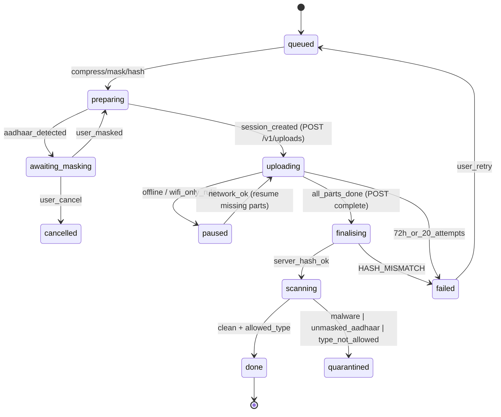
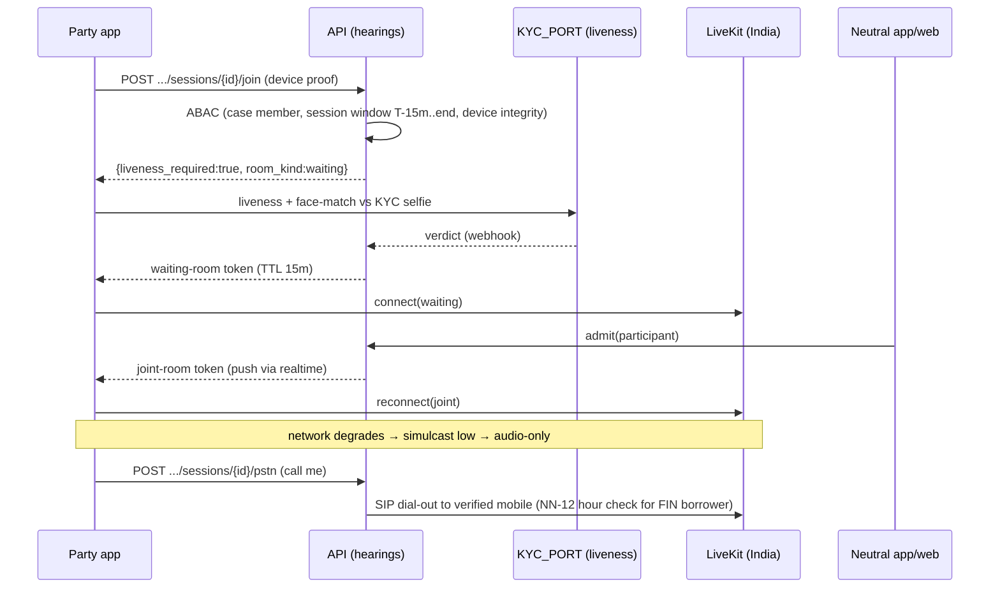

# P12 — Mobile Apps: Parity and Release
> Paste after 01_MASTER_PROMPT.md. Prerequisites: P01–P11 (the mobile shell from P01 and the per-phase mobile screens marked in P02–P11 must exist). Estimated effort: 5 sprints (2-week) for a squad of 7 (2 RN engineers, 1 native/Expo-modules engineer, 1 backend engineer, 1 QA automation (Maestro), 1 designer/accessibility specialist, 0.5 release manager, 0.5 security engineer).

## 1. Objective and business outcome

Ship the Equator iOS and Android apps from one Expo codebase (`apps/mobile`) to the Apple App Store and Google Play, with feature parity against the web for every journey a party, neutral or enterprise grievance operator needs to complete on a phone. The test of success is that a borrower in a Tier-3 town on a ₹7,000 Android phone with a 3G connection can: open a notice from a push or WhatsApp link, read it aloud in Hindi, verify identity, file a response with photographed documents, pay a fee by UPI, join a mediation by video or by phone, and e-sign a settlement — without ever needing a laptop.

Business outcomes:
- **Respondent engagement**: ≥ 60% of served respondents who open a deep link complete their first action on mobile within 72 hours.
- **Hearing reliability**: ≥ 98% of mobile joins succeed first time (video, audio or PSTN).
- **Neutral productivity**: no web-only blocker for a neutral's routine work except DSC signing and AI-draft approval.
- **Store quality**: crash-free sessions ≥ 99.5%; Play user-perceived crash rate < 1.09% and ANR rate < 0.47% (Android vitals overall bad-behaviour thresholds; 8% per phone model); rating ≥ 4.3 after 90 days.
- **Compliance**: zero store rejections for privacy-label mismatch; zero sealed-tier captures on Android; zero PII in crash or analytics payloads (automated scan).

## 2. Scope (in / out)

**In scope**
1. One React Native/Expo app binary per store listing with role-based navigation for three experiences: **Party** (`party`, `party_org_user`, `counsel`), **Neutral** (`neutral_mediator`, `neutral_conciliator`, `neutral_arbitrator`, `neutral_expert`; IC roles read-only notifications only — see out of scope), **Enterprise-lite** (`grievance_officer`, `internal_ombudsman`, `enterprise_operator`, `enterprise_admin` read-mostly). White-label tenant variants built from the same code via `app.config.ts` (`TENANT` env) for Private Chambers or enterprise tenants that buy a branded app.
2. Feature-parity matrix vs web by phase (P01–P11) with an automated parity gate.
3. Offline-first: SQLite read-through cache, drafts, outbound mutation queue, resumable uploads.
4. Camera document capture with edge detection, perspective correction, compression, multi-page PDF assembly and an Aadhaar-masking prompt.
5. Biometric unlock (SecureStore + LocalAuthentication), device binding with hardware-backed keys, root/jailbreak and app-integrity attestation, certificate pinning.
6. Screenshot/screen-recording protection for `high` and `sealed` tiers.
7. Push notifications (Expo Push → FCM/APNs) and deep links (iOS Universal Links, Android App Links, custom scheme fallback) to cases, hearings, payments and signing.
8. In-app video hearings via the LiveKit React Native SDK with waiting room, caucus rooms, low-bandwidth mode and PSTN fallback.
9. eSign via provider SDK or system browser tab with return handling; UPI intent payments; on-platform case chat.
10. Vernacular UI (12 locales per NN-23), text-to-speech read-aloud of notices, TalkBack/VoiceOver accessibility.
11. Size and performance budgets; OTA updates via EAS Update with a written policy; release trains; store compliance (Google Play, Apple App Review Guidelines, data safety/privacy labels, DPDP); Sentry crash reporting and privacy-safe analytics; Maestro E2E tests; low-end Android device matrix.

**Out of scope (web only, by design)**
- POSH IC workspace (sealed inquiry records, IC deliberations) — mobile shows only a content-free push ("You have a new task in the Internal Committee workspace") that deep-links to the web after step-up. Reason: NN-07 sealed store, screen-capture risk on iOS cannot be fully prevented.
- Ruleset Studio, maker–checker configuration, fee schedule editing, panel management, allocation policy, platform admin, DPO consoles.
- Bulk intake upload (CSV/SFTP) and API key management (enterprise-lite shows bulk job status only).
- DSC (USB token) signing — Aadhaar eSign and virtual sign only on mobile.
- Academy LMS course consumption and purchase on iOS (digital content would require Apple In-App Purchase; Academy stays on web/PWA in v1). Campus competition scoring stays web.
- Chambers tenant set-up (self-serve onboarding is web).
- Assisted kiosk mode for lender collection agents (prohibited — conflicts with NN-03 neutrality and NN-12 conduct; see FR-P12-25 for the permitted Equator-staff assisted mode).

## 3. Personas and permissions touched

| Persona (role code) | Mobile experience | Key permissions exercised on mobile | Step-up required |
|---|---|---|---|
| `party` (individual) | Party | `case:read` (own), `case:file`, `response:submit`, `document:upload`, `offer:submit`, `session:join`, `esign:sign`, `invoice:pay`, `message:post`, `consent:grant/withdraw`, `dsr:create` | Signing, payment > ₹10,000 (configurable), consent withdrawal affecting an active case, device re-bind |
| `party_org_user` | Party | as `party` within org authority limits (`core.org_signatories.authority_limit_minor`) | Signing, offers above authority limit (blocked, routed to web approver) |
| `counsel` | Party | mandate-scoped (`core.party_representatives.scope`) | Signing on behalf only where mandate scope includes `sign` |
| `neutral_mediator`, `neutral_conciliator`, `neutral_arbitrator`, `neutral_expert` | Neutral | `appointment:accept/decline`, `disclosure:submit`, `availability:write`, `session:host`, `caucus:open`, `order:approve`, `award:sign` (Aadhaar eSign), `settlement:authenticate`, `message:moderate` | Award/settlement signing, disclosure submission, payout bank change (blocked on mobile — web only) |
| `grievance_officer`, `internal_ombudsman` | Enterprise-lite | `grm_ticket:read/update`, `grm_ticket:respond` (from approved templates), `grm_ticket:offer_odr`, SLA alerts | Offer of ODR (a case is created only on the complainant's e-signed consent) |
| `enterprise_operator`, `enterprise_admin` | Enterprise-lite | dashboards (aggregated MIS), bulk job status, case list (tenant-scoped, no caucus or screening data), approvals of settlement authority (`approve_offer` up to delegated limit) | Offer approval |
| `case_manager` | Neutral experience (staff tab) | task queue, clocks, notices status, hearing logistics | Any sealed-tier access (blocked on mobile) |
| `support_agent` | Assisted mode (FR-P12-25), flag OFF by default | `assist:start` with party OTP consent | Always |

ABAC attributes evaluated server-side on every mobile request exactly as on web (tenant, case membership, role-in-case, tier, purpose, mandate, time-bound grants). Mobile adds three attributes to the policy input: `device.bound` (bool), `device.integrity` (`pass | degraded | fail`), `app.version_supported` (bool). Policy: `sealed` and `high` resources require `device.bound = true AND device.integrity = pass`; signing and payments require `device.integrity ∈ {pass, degraded}`; any request from an unsupported app version receives `426 APP_VERSION_UNSUPPORTED`.

## 4. Functional requirements

**FR-P12-01 — Single app, role-based navigation.** The app ships as one binary (`in.equatorresolution.app` Android; `in.equatorresolution.app` iOS bundle ID **[VERIFY — open: internal decision on final bundle/application IDs]**). After login, the app reads `GET /v1/me/memberships` and renders one or more **role spaces**: `party`, `neutral`, `enterprise`. A user holding roles in several spaces or tenants switches via a space switcher (top-left avatar); each space has its own tab bar defined in Expo Router groups `app/(party)`, `app/(neutral)`, `app/(enterprise)`. The current tenant, acting role and acting case travel on every API call in the gateway-signed `Equator-Context` header (master X-01; defined in P01); the server re-validates membership on every request. `X-Tenant-Id` is not used. Space switching clears in-memory query cache for the previous space; SQLite cache rows are partitioned by `(tenant_id, space)`. White-label variants: `app.config.ts` reads `TENANT` and sets bundle ID, name, icon, splash, colour tokens from `packages/design-tokens/tenants/<slug>.json`, associated domains and push credentials; a variant can never include another tenant's spaces (build-time allow-list `ALLOWED_TENANT_IDS`).

**FR-P12-02 — Feature-parity matrix and parity gate.** `apps/mobile/parity.json` declares, for every web capability ID (`CAP-<phase>-<nn>` taken from phase FRs), its mobile status: `full`, `read_only`, `deep_link_web` (opens web in system browser after SSO hand-off), or `excluded` with a reason code. CI job `parity-check` fails if (a) a web capability added in any phase lacks an entry, (b) a capability marked `full` has no Maestro flow tagged with its ID, or (c) an `excluded` entry lacks an approved reason (`SEALED_TIER`, `STORE_POLICY`, `DSC_HARDWARE`, `ADMIN_ONLY`, `BULK_ONLY`). The matrix in §6.1 is the v1 baseline.

**FR-P12-03 — Authentication on mobile.** OIDC Authorization Code + PKCE via the system browser (`expo-auth-session` with `ASWebAuthenticationSession` / Custom Tabs); no embedded WebView login. Party login: mobile OTP (DLT SMS via MSG91, WhatsApp OTP fallback), email magic link, DigiLocker (via licensed provider). Professionals (neutrals, enterprise users): password + TOTP or passkeys (platform authenticators via WebAuthn in the browser session); enterprise SSO (SAML/OIDC) for tenants that configure it. Tokens: access JWT 10 minutes, refresh token opaque and rotating, device-bound (FR-P12-05), stored only in `expo-secure-store` with `keychainAccessible = WHEN_UNLOCKED_THIS_DEVICE_ONLY` (iOS) and Android Keystore-backed encryption; never in AsyncStorage or SQLite. Sliding refresh window: 30 days for party, 7 days for neutral and enterprise (configurable per tenant, within 1–30 days).

**FR-P12-04 — Biometric unlock and app lock.** After first login, the user may enable biometric unlock (`expo-local-authentication`; Face ID/Touch ID/Android BiometricPrompt Class 3 "strong" only; Class 2 rejected). The refresh token is wrapped by a key that requires user authentication (`requireAuthentication: true` in SecureStore). App lock triggers after 5 minutes in background (party) or 2 minutes (neutral, enterprise) — configurable per tenant within 1–15 minutes. Fallback: device PIN/passcode is **not** accepted as a fallback for step-up (step-up falls back to OTP). Five consecutive biometric failures force full re-login. Biometric enrolment change detected (iOS `evaluatedPolicyDomainState`; Android key invalidation on new enrolment) invalidates the wrapped key and forces OTP re-login — this defeats "add my fingerprint to your phone" attacks.

**FR-P12-05 — Device binding.** On first login the app generates an asymmetric key pair in hardware (iOS Secure Enclave P-256; Android StrongBox/TEE Keystore EC P-256, `setUserAuthenticationRequired` off for the binding key, on for the biometric wrapping key). The public key and an attestation (FR-P12-06) are registered via `POST /v1/devices`, creating `core.devices`. Every token refresh carries a DPoP proof (RFC 9449: signed JWT over method, URI, timestamp, nonce) verified server-side against the bound key; where Keycloak is the IdP (ADR-0003), use its DPoP support (officially supported from Keycloak 26.4) for sender-constrained tokens. Limits: max 3 active bound devices per user (party), 2 (neutral), 2 (enterprise) — configurable. Binding a new device beyond the limit requires OTP + selecting a device to unbind; all bindings and unbindings write audit events and notify the user on all other devices and by SMS. Remote revoke from web (`DELETE /v1/devices/{deviceId}`) triggers FR-P12-24 wipe on next contact.

**FR-P12-06 — App and device integrity.** Android: Play Integrity API (`MEETS_DEVICE_INTEGRITY` required for `pass`; `MEETS_BASIC_INTEGRITY` only → `degraded`; neither → `fail`; `appRecognitionVerdict` must be `PLAY_RECOGNIZED` for store builds). iOS: App Attest (DeviceCheck) assertion on registration and every 24 h. Client-side heuristics (root binaries, Magisk, Frida/hooking, debugger attached, emulator, jailbreak paths) contribute a `local_signals` bitmask but **never decide alone** — the server computes `device.integrity` from the attestation verdict plus signals. Policy effect: `fail` → app runs in "restricted" mode (read standard-tier case status and notices, cannot view `high`/`sealed` content, cannot sign or pay; banner explains why and offers web or a support call); `degraded` → no sealed content, signing allowed with OTP step-up. Attestation outages (Google/Apple API errors) degrade to `degraded`, never to `fail`, and raise an ops alert. Certificate pinning: public-key pins (SPKI SHA-256) for `api.equatorresolution.in` with two backup pins; pin set delivered in the binary and updatable only by a signed app-config payload; pin failure blocks network calls and reports `PIN_VALIDATION_FAILED` to Sentry without payload.

**FR-P12-07 — Screen protection for sealed and high tiers.** Applies to any screen showing a case with `confidentiality_tier ∈ {high, sealed}` or FAM safety / INS health data. Android: `FLAG_SECURE` per screen via `expo-screen-capture` (blocks screenshots, recording, casting; blanks Recents). iOS (no OS screenshot block): branded blank overlay on `sceneWillResignActive`; content replaced when `UIScreen.isCaptured` is true (recording/mirroring); screenshot notification → audit event `equator.mobile.screen.capture_detected.v1` plus warning; secure-layer rendering of sealed documents via the secure-text-entry layer technique (no public iOS API blocks screenshots; the technique relies on undocumented behaviour, so regression-test it on every iOS major release and fall back to capture detection plus watermark). All such document pages carry a watermark (user name, masked phone, timestamp, case number); copy and share are disabled.

**FR-P12-08 — Offline-first cache.** `expo-sqlite` database encrypted with SQLCipher (256-bit key in SecureStore) via the expo-sqlite config plugin `useSQLCipher: true` (prebuild/dev build; not Expo Go); set `PRAGMA key` immediately after open and assert that `PRAGMA cipher_version` is non-empty at start-up. Tables: `cases_cache`, `case_events_cache`, `sessions_cache`, `notices_cache`, `documents_meta_cache`, `tasks_cache`, `threads_cache`, `messages_cache`, `drafts`, `outbox`, `upload_jobs`, `sync_cursors`. Cached: case header, timeline, clocks, upcoming sessions, notices and documents the user marks offline (standard tier only, 200 MB LRU). **Never cached**: sealed-tier content, caucus notes, screening outcomes, health records, POSH content, unapproved AI drafts; high tier is metadata only. Delta sync: `GET /v1/sync/changes?cursor=` (≤ 500 changes per page; full resync if the cursor is > 30 days old). Server truth wins for the case aggregate (C1 K.5); drafts are never auto-merged. Outbox mutations carry `Idempotency-Key` (UUIDv7 at enqueue) and `If-Match`; `412` → `needs_review`, `409/422` → `rejected` with the localised problem+json detail, network/`5xx`/`429` → retry with backoff 2 s → 5 min, abandoned as `failed` after 20 attempts or 72 h with a user prompt.

**FR-P12-09 — Drafts.** Form-engine (`packages/forms`) renders the same JSON-Schema + UI-schema pinned by version (NN-21) on mobile. Drafts autosave every 5 s and on blur into `drafts(id, tenant_id, form_schema_id, form_schema_version, case_id NULL, payload_json_enc, updated_at, server_draft_id)`. Drafts sync to the server (`PUT /v1/form-drafts/{draftId}`) when online so they resume on web. If the form schema version pinned to the case is superseded while a new-filing draft exists, the draft is migrated using the schema's declared migration map or flagged `schema_changed` for user review (never silently dropped). Submission is online-only (filing creates clocks and fees and must be server-validated); the UI states "You can prepare this offline; you must be online to submit."

**FR-P12-10 — Resumable uploads and upload queue.** Upload flow: `POST /v1/uploads` (declares filename, mime, size, sha256 of whole file, case_id, purpose) → server returns `upload_id` and S3 multipart presigned part URLs (part size 5 MB; 8 MB on Wi-Fi) valid 60 min → client uploads parts via background transfer (`expo-file-system` `createUploadTask` / background session on iOS, WorkManager on Android) → `POST /v1/uploads/{uploadId}/complete` with part ETags → server verifies sha256, runs ClamAV scan and mime allow-list (PDF, JPEG, PNG, HEIC→JPEG converted client-side, MP4/M4A for evidence where the case ruleset allows, DOCX), writes `core.documents` + `core.document_versions` + `core.evidence_ledger` (NN-22), emits `equator.documents.upload.completed.v1` and `equator.documents.document.uploaded.v1` (Appendix F §F.9 #60–61). Resume: on reconnect, `GET /v1/uploads/{uploadId}` lists received parts; only missing parts are sent; URLs refreshed if expired. Limits: 50 MB per file on cellular without confirmation, 200 MB hard cap per file, configurable per tenant. Queue UI shows per-file progress, paused (no network / metered network setting "Wi-Fi only for files > 20 MB"), failed (with reason code) and done. Upload jobs survive app kill and device restart.

**FR-P12-11 — Camera document capture.** Uses the platform scanners — Android ML Kit Document Scanner and iOS VisionKit — through an Expo config-plugin module, with a `react-native-vision-camera` + on-device edge-detection fallback for devices without Play services. Edge detection with manual corner adjust, perspective correction, auto-capture when stable for 600 ms, up to 30 pages, reorder/delete, filters (original, greyscale, high-contrast). Compression: JPEG 0.7, long edge ≤ 2,000 px (≈ 200 dpi A4), target ≤ 350 KB per page, assembled client-side into one PDF; each original page's SHA-256 goes into the upload manifest so the evidence ledger shows capture → compressed → PDF. EXIF GPS stripped; capture time and device model kept only if the user opts to include them as evidence metadata.

**FR-P12-12 — Aadhaar-masked image redaction prompt (enforces NN-14).** On every captured or picked image/PDF, an on-device detector (ML Kit text recognition, no network) checks for 12-digit numbers matching the Aadhaar pattern (`\b[2-9]\d{3}\s?\d{4}\s?\d{4}\b` with Verhoeff checksum validation) and Aadhaar card layout cues ("आधार", "Aadhaar", "Unique Identification Authority", "VID"). On a hit the user sees: "This looks like an Aadhaar number. Equator does not need your full Aadhaar number. Mask the first 8 digits before uploading?" with options **Mask automatically** (default; black box over the first 8 digits and any QR code), **Mask manually** (draw), **Upload without masking** (requires typed confirmation of purpose; allowed only where the case form explicitly requires an unmasked document — none in v1 — otherwise the option is hidden). The server re-runs the detector (Sarvam Vision/OCR, `DOC_AI_PORT`) and, if an unmasked Aadhaar number is found, quarantines the file, notifies the uploader and stores only a masked derivative (original destroyed after 24 h, audit event retained). Same prompt for PAN (masked display `ABCDE****F` but not forced) and bank account numbers (prompt only).

**FR-P12-13 — Push notifications.** `PUSH_PORT`: Expo Push primary, direct FCM/APNs fallback; `POST /v1/push-tokens` binds tokens to `device_id`; invalid tokens pruned on receipt errors. Payload rule (NN-07 + P07 template lint): only the template's `safe_fields` (case number, generic event label, date/time) — never names, amounts, counterparty, or health/POSH/family-safety terms; sealed and high-tier events send "You have an update on your matter" with a `data.deeplink` only. Categories: `hearing` (time-sensitive), `deadline` (clock alerts T-7/T-3/T-1 days; hearing T-2 h), `payment`, `signing`, `messages`, `case_updates`, `marketing` (off by default; separate marketing consent; never to served respondents without it — NN-16). Quiet hours: user default 21:00–08:00 for non-critical; FIN recovery-related messages are gated server-side to 08:00–19:00 local (NN-12) regardless of category. Undelivered `hearing`/`deadline` pushes (no receipt in 10 min) fall back to SMS/WhatsApp per the P07 journey.

**FR-P12-14 — Deep links.** iOS Universal Links (`apple-app-site-association`) and Android App Links (`assetlinks.json`, `autoVerify=true`) on `equatorresolution.in` and each white-label domain. Paths: `/m/c/{caseRef}`, `/m/c/{caseRef}/h/{sessionId}`, `/m/pay/{invoiceId}`, `/m/sign/{esignRequestId}`, `/m/n/{noticeId}`, `/m/t/{ticketId}`, `/m/r/{respondentInviteToken}`; custom scheme `equator://` only for OAuth and provider returns. A link is a pointer, never a credential: `GET /v1/deep-links/resolve?path=` re-authorises, and a non-member gets the same "not available" response as for a non-existent case (no existence leak). Respondent invite tokens (`core.deep_link_tokens`): 128-bit random, hashed at rest, 30-day expiry (7–90), ≤ 10 resolutions, bound to the served contact point; OTP to that contact point is required before any case data is shown. Not installed: the same path renders the notice on the web (SSR) with store badges; after install, `POST /v1/deep-links/claim` (attestation + OTP) restores the pending path — no third-party attribution SDK, no clipboard handoff.

**FR-P12-15 — In-app video hearings (LiveKit).** `@livekit/react-native` with its Expo config plugin. `POST /v1/cases/{caseId}/proceedings/{proceedingId}/sessions/{sessionId}/join` returns a room-scoped token (TTL 15 min, renewable), `room_kind` (`waiting`, `joint`, `caucus_<partyRef>`, `breakout`), `recording_state` and `liveness_required`. Requirements: (a) pre-join check of camera, mic, bandwidth, loss and battery (< 15% warning); (b) liveness/face-match against the KYC selfie (`KYC_PORT`) when required; (c) waiting room with neutral admit; (d) caucus isolation by token — a move means a new caucus token and revocation of the joint grant; a client never holds tokens for two caucuses; (e) recording banner whenever recording is on (arbitration only, with all-party and tribunal consent; mediation and conciliation never recorded, in-room chat ephemeral — NN-11); (f) low-bandwidth mode, automatic below 300 kbps downlink or above 5% loss for 10 s: 180p simulcast layer → audio-only → PSTN, screen-share received at 1 fps; (g) PSTN fallback — dial-in number plus 6-digit participant PIN (Exotel / LiveKit SIP), or "Call me" dial-out to the verified mobile, blocked for FIN borrowers outside 08:00–19:00 unless the borrower chose that slot (NN-12, see Open item 8); dial-out presents a calling-line identity chosen by the NN-12 policy (M-05): the referring regulated tenant's authorised 1600-series number in lender-number mode, or an Equator DID declared as an A2P CLI range only while `voice.equator_service_number.enabled` is ON — otherwise dial-out is hidden and dial-in is offered; PSTN joiners hear a spoken disclosure of entity, purpose, recording status and confidentiality; (h) interpreter audio track; (i) background audio for active hearings only (iOS `audio`/`voip` modes; Android foreground service); (j) hand-raise; (k) watermarked view-only document share; (l) 60 s auto-reconnect then "Rejoin"; join/leave written to `core.session_attendance`.

**FR-P12-16 — eSign with return handling.** `ESIGN_PORT` default Leegality (Aadhaar eSign, virtual sign). `POST /v1/esign-requests/{esignRequestId}/mobile-launch` returns the provider URL and a one-time `return_nonce`; the app performs biometric step-up, shows a pre-sign summary (title, hash prefix, pages, signer, "You are signing electronically under the Information Technology Act 2000 s.3A") and opens the provider in the system browser tab (`openAuthSessionAsync`), not an embedded WebView; a native provider SDK, if used, goes in via config plugin **[VERIFY — open: provider-specific mobile SDK vs browser-tab support (Leegality/Digio) at contracting]**. The provider redirects to the `/m/sign/{id}/return` App Link; the app then displays the **server** status, which changes only when the signature-verified provider webhook is processed (`core.webhook_inbox`) — redirect parameters are never trusted. For `instrument_class ∈ {immovable_transfer, partition_immovable, will, trust, power_of_attorney, conveyance}` the eSign control is replaced by the P06 physical execution, stamping and registration checklist with booking (NN-08); the API returns `422 ESIGN_EXCLUDED_INSTRUMENT`. eStamp status (NN-09) is shown read-only.

**FR-P12-17 — UPI intent and payments.** `PAYMENTS_PORT` default Razorpay native SDK. `POST /v1/invoices/{invoiceId}/payment-intents` (idempotent) creates a gateway order for the amount computed by the deterministic fee engine (never client-supplied). UPI intent is offered first (Android installed-app list; iOS `LSApplicationQueriesSchemes` for major UPI apps (Razorpay list, Oct 2026: tez, phonepe, paytmmp, credpay, mobikwik, in.fampay.app, bhim, amazonpay, navi, kiwi, payzapp, jupiter, omnicard, icici, popclubapp, sbiyono, myjio, slice-upi, bobupi, shriramone, indusmobile, whatsapp, kotakbank; re-sync from SDK docs each release)), then UPI QR/collect, cards and netbanking. After the SDK callback the app shows "Confirming…" and polls `GET /v1/payments/{paymentId}` until the webhook-confirmed status is `captured` or `failed` (120 s, then push on resolution); the SDK callback alone never marks an invoice paid. **NN-13**: the app pays only platform invoices; settlement instalments open the escrow virtual-account details or the UPI AutoPay mandate from P05, never an Equator merchant checkout. Store position: fees pay for case-administration and neutral services rendered outside the app — Apple Guideline 3.1.3(e) (goods and services consumed outside the app; IAP not required); the app does not sell discrete in-app multi-party hearings, because 3.1.3(d) exempts only one-to-one real-time person-to-person services. Google Play: Financial features declaration 'Support services → Other' (or 'no financial features' if checkout is web-only). Academy courses are not sold in the iOS app.

**FR-P12-18 — On-platform case chat.** Messaging inside the case, stored in `core.case_threads` / `core.case_messages` (append-only, case record retention, NN-22). Thread kinds: `party_institution` (party ↔ case manager), `neutral_party` (neutral ↔ one party, visible only to them; not a caucus note), `all_parties` (neutral-moderated). No party-to-party thread without a neutral; no counsel–client thread (privilege stays off-platform). If a FAM/WRK case has `safety_flag = true`, `all_parties` is disabled (mirrors `409 SAFETY_FLAG_BLOCKS_JOINT`). Supports text, voice notes ≤ 2 min (optional machine transcription, labelled), attachments through FR-P12-10/12, read receipts (user can disable), reply-to and "report message". Retraction within 10 minutes hides the message but retains it with `retracted_at`. Mediation threads are confidential and never enter an arbitral record without all-party consent (NN-11; P04 firewall). A deterministic lint flags abuse for neutral moderation; no AI rewriting of party messages. Transport: WebSocket `/v1/realtime` (authorised per thread subscription) with push fallback.

**FR-P12-19 — Vernacular UI and read-aloud.** All 12 locales from NN-23 (`en`, `hi`, `mr`, `ta`, `te`, `kn`, `bn`, `gu`, `pa`, `ml`, `or`, `ur`) load from `packages/i18n`; English and Hindi complete at launch; others enabled by tenant configuration only when the catalogue completeness check is ≥ 99% and legal templates have human review status `approved` (NN-23). Urdu renders RTL (`I18nManager.forceRTL` per session with layout tests). Fonts: Noto Sans family subsets bundled for Devanagari, Bengali, Gujarati, Gurmukhi, Kannada, Malayalam, Odia, Tamil, Telugu, Nastaliq (Noto Nastaliq Urdu) — download-on-demand for non-default scripts to respect the size budget. **Read-aloud**: every notice, order and settlement summary has a "Listen" control. Primary engine: server-side TTS via Sarvam (Bulbul) through `TRANSLATION_PORT`/TTS adapter, generated from the **human-approved** notice text in that language, cached as an audio asset hashed and linked to the notice version (`GET /v1/notices/{noticeId}/audio?lang=`); fallback: on-device `expo-speech` if the locale voice exists. Machine-translated content (where no approved translation exists) is labelled "Unofficial machine translation — the English/Hindi version is authoritative" (consistent with R3 §5.4); TTS of a machine translation carries the same spoken disclaimer. Sealed-tier documents are not sent to TTS providers; on-device TTS only.

**FR-P12-20 — Accessibility (NN-23).** WCAG 2.2 AA equivalents for native: every touchable has `accessibilityRole`, `accessibilityLabel` (localised), `accessibilityHint` where action is non-obvious; minimum touch target 48×48 dp (Android) / 44×44 pt (iOS); supports Dynamic Type / font scale up to 200% without truncation of legal text (scrollable containers); colour contrast ≥ 4.5:1 text, 3:1 UI components (tokens enforce); clock pills convey state in text, not colour only ("12 days left — amber"); focus order follows reading order; live regions announce hearing admission, caucus moves, payment result; captions available in hearings when live captions are enabled; reduce-motion respected; no time-limited interaction shorter than 2 minutes except OTP (with "extend" control). Manual TalkBack and VoiceOver scripts for the five critical journeys (file, respond, pay, sign, join hearing) are part of the exit gate.

**FR-P12-21 — Neutral experience.** Tabs: Today (sessions, tasks, clock alerts), Cases, Calendar/Availability, Messages, Profile. Functions: accept/decline appointment with mandatory disclosure step (s.12 A&C Act 1996 disclosure in Sixth Schedule form for arbitrators; P03 disclosure form for mediators) — accept is blocked until disclosure is submitted (`409 DISCLOSURE_REQUIRED`); availability editing synced to `core.neutral_availability`; host sessions (admit, move to caucus, end); review and approve procedural orders drafted on web (approve/return with comments); sign awards and settlement authentications via Aadhaar eSign (FR-P12-16); maker–checker obligations remain (P06). **Caucus notes**: authoring is allowed on mobile as plain text only, written directly to the server (`POST .../caucus-notes`, RLS sealed to author — NN-11), never cached locally, screen-protected (FR-P12-07); reading caucus notes on mobile requires biometric step-up each time. AI-assisted drafting views (P11) are read-only on mobile with the `requires_human_review` banner; approvals of AI drafts must be done on web in v1 (to ensure full-document review).

**FR-P12-22 — Enterprise-lite (GRO/lender operator) experience.** Tabs: Queue, SLA, Escalations, Insights. Queue: GRM tickets assigned to the officer (`grm.tickets`) with regulator clock (e.g., RBI 30-day RE window — NN-04) and colour/text state; respond using approved templates only (free text allowed in the template's free-text slot, with the P11 `grievance_responder` draft visible as a suggestion labelled AI-drafted, requiring the officer's explicit edit/accept); escalate to ODR ("Offer ODR", `POST /v1/grm/tickets/{ticketId}/odr-offers`, P09 FR-P09-31) — sends the complainant the consent link; the case is created only when the complainant e-signs, and any escalation without a consent record returns `409 CONSENT_REQUIRED`. SLA: tiles of tickets at T-7/T-3/breached. Insights: aggregated MIS only (counts, ageing, resolution rate) — no case-identifying data, no neutral performance comparisons that could imply selection influence (NN-03, NN-16). Offer approvals: lender operator may approve a settlement offer within `core.org_signatories.authority_limit_minor`; above-limit offers are shown read-only with "Approve on web". **Hard rule (NN-03)**: no screen in the enterprise space displays a list of neutrals with selection, ranking, preference or veto controls; the app never sends any neutral identifier in an enterprise-originated request (`403 APPOINTMENT_LENDER_TRIGGER_BLOCKED` server-side).

**FR-P12-23 — Size and performance budgets.** Enforced in CI (`mobile-budgets` job on each release-candidate build) and on the device lab:

| Metric | Budget | Measured on |
|---|---|---|
| Android download size (AAB → per-device APK, arm64-v8a) | ≤ 30 MB | `bundletool get-size total` |
| Android download size (armeabi-v7a, low-end) | ≤ 28 MB | same |
| iOS App Store download (thinned, iPhone 12) | ≤ 45 MB | App Store Connect size report |
| Hermes bytecode bundle | ≤ 6 MB | EAS build artefact |
| Cold start to interactive (TTI) | < 2.5 s mid-range (Samsung Galaxy A35-class); < 4.0 s low-end (2–3 GB RAM, Android Go-class) | Macrobenchmark / Maestro timing, median of 10 |
| Warm start | < 1.0 s mid-range | same |
| Case list scroll (200 items) | ≥ 55 fps median, < 5% janky frames, low-end ≥ 45 fps | Perf monitor |
| Memory in video hearing (joint, 4 participants, 360p) | < 300 MB low-end; no OOM in 60-minute soak | Android Studio profiler / Instruments |
| Battery in 60-min audio-only hearing | < 12% on 4,000 mAh reference device | device lab |
| Data use: 60-min audio-only hearing | < 40 MB | network capture |
| API calls on app open | ≤ 4 (me, app-config, sync, unread counts) | proxy log |
| Crash-free sessions | ≥ 99.5% (release gate for promotion beyond 10% rollout) | Sentry |

Techniques mandated: Hermes, inline requires, Expo Router lazy routes, image assets as WebP, fonts on demand, no moment.js/lodash full imports, FlashList for lists, Reanimated for animations, `react-native-mmkv` only for non-sensitive UI prefs.

**FR-P12-24 — Logout, remote wipe and data minimisation on device.** Logout or server-side revoke (device unbound, membership removed, counsel mandate revoked, de-empanelment) triggers on next contact: delete SQLite DB file, delete cached documents directory, delete SecureStore keys, unregister push token, clear in-memory caches, and show login. If the app is offline for > 7 days (party) / 3 days (neutral, enterprise), cached `high`-tier metadata is purged locally on next launch even before contact. App uninstall leaves no recoverable case data (all caches in app sandbox; iOS Keychain items set to `ThisDeviceOnly` and cleared on first launch after reinstall via an install-ID check).

**FR-P12-25 — Assisted mode (feature flag `mobile.assisted_mode`, default OFF).** For Equator `support_agent` or an approved `partner` at a help desk (e.g., DLSA camp, university cell) using a tablet: the agent starts a session for a party who then receives an OTP on their own phone and reads it out or enters it; the session is labelled "Assisted by <agent name>" in the audit and on every document the party submits; the agent cannot sign, pay or view anything after the party ends the session; all assisted sessions are recorded in `audit.access_log` with purpose `assisted_filing`. Lender staff, collection agents, LSP/DSA personnel are hard-excluded from assisted mode (role check + organisation type check) — NN-03/NN-12.

**FR-P12-26 — OTA updates policy (EAS Update).** `runtimeVersion.policy = "fingerprint"` so an update can never target a binary with different native code; channels `production`, `staging`, `uat`, `production-<tenant>`; end-to-end code signing (key in a KMS-backed signing service, certificate embedded in the binary; unsigned updates rejected). Allowed by OTA: JS bug fixes, non-legal copy, UI tweaks, already-reviewed flag-gated features. **Not** allowed by OTA: new permissions or native modules, payment-flow changes, data-collection changes (store labels), legal text (privacy notice, consent, terms, notice templates) unless approved under maker–checker with no store-disclosure impact, or any change of primary purpose (Apple Guideline 2.5.2; Apple Developer Program License Agreement §3.3(B) Executable Code — interpreted code may not change the app's primary purpose, create a storefront or bypass OS security). Rollout 10% (2 h) → 50% (12 h) → 100% with automatic rollback if crash-free sessions for the update fall below 99.0% or error rate doubles; a critical security fix may go to 100% at once with release-manager and security-engineer approval (two-person rule, audited).

**FR-P12-27 — Forced and soft update.** `GET /v1/app/config` returns `min_supported_version`, `recommended_version`, `kill_switches[]`, `pins`, feature flags evaluated for the user. Below `min_supported_version` → blocking "Update required" screen (store link) and every API returns `426 APP_VERSION_UNSUPPORTED`; below `recommended_version` → dismissible banner (max once per day). `min_supported_version` may only be raised by release manager with security justification; minimum 72 h notice via push for non-security raises.

**FR-P12-28 — Store compliance.** Artefacts live in `apps/mobile/store/`. A single source, `apps/mobile/privacy/data-inventory.yaml`, generates the Play Data safety form, Apple privacy labels, iOS `PrivacyInfo.xcprivacy` (required-reason APIs) and the in-app DPDP notice; CI fails if an SDK or permission is added without an inventory update. **Google Play**: Financial features declaration (mandatory for all apps; categories Banking & loans / Payments & transfers / Purchase agreements / Trading & funds / Support services incl. 'Other') — Equator selects 'Support services → Other' (or 'no financial features' if payment is web-only) and no loan category, because it facilitates fee payments and dispute resolution and offers no loans; no `READ_SMS`/`RECEIVE_SMS` (SMS Retriever API instead), no `QUERY_ALL_PACKAGES` (`<queries>` for UPI apps), no background location; foreground-service types declared only for hearings — `microphone` (+ `camera` for video) for WebRTC hearings, `phoneCall` only with a self-managed ConnectionService (`MANAGE_OWN_CALLS`) (Android 14+); target API level Android 16 (API 36) for new apps and updates from 31 Aug 2026 (extension to 1 Nov 2026 on request). **Apple**: submitted from the Equator legal entity's (Equator Resolution Service Private Limited) organisation account (Guideline 5.1.1(ix) — legal services are not a listed regulated field, but the 'require sensitive user information' limb applies); purpose strings for camera, microphone, photos, Face ID and local network in every launch locale; no tracking, so no ATT prompt; review notes with a demo tenant and seeded case. **Both stores**: in-app account deletion (Apple 5.1.1(v); Play account-deletion policy) wired to the P01 DSR erasure workflow, which explains legal-hold retention of case records; listing copy never implies a court, government body or regulator and passes the claims lint against `growth.claims_register` (NN-17). **DPDP (NN-15)**: first-run itemised notice per purpose with language selector, optional purposes (analytics, marketing) off by default, consent rows in `core.consent_records` pinned to `core.notices_privacy` version, withdrawal as easy as grant, DPO/grievance contact in Settings.

**FR-P12-29 — Release trains.** Two-week train aligned to sprints: code freeze Wednesday week 2 → RC build → regression (Maestro full suite on device lab) → store submission Friday → Android staged rollout 1% (day 1) → 10% (day 2) → 50% (day 4) → 100% (day 7); iOS phased release over 7 days. Promotion gates at each step: crash-free ≥ 99.5%, ANR < 0.47%, no new Sentry issue with > 50 users, no P1 bug. Hotfix train on demand. Version scheme `MAJOR.MINOR.PATCH (build)`; `MINOR` per train. Store metadata changes go through the same maker–checker as legal text.

**FR-P12-30 — Crash reporting and privacy-safe analytics.** Sentry RN SDK self-hosted in ap-south-1 (Sentry SaaS offers only US and EU (Germany) data regions, which does not meet NN-15 — ADR), `sendDefaultPii = false`, session replay off, `beforeSend` scrubber that replaces URLs with route templates and drops bodies, headers and any string matching phone, email, PAN, Aadhaar, IFSC or account patterns. Analytics use a first-party pipeline (`POST /v1/telemetry/events` → `ops.telemetry_events`), no third-party analytics SDK, with an allow-listed schema (`app_open`, `screen_view{route_template}`, `journey_step{journey_id, step, outcome}`, `upload_result`, `hearing_join{mode, outcome, net_class}`, `payment_result`, `esign_result`, `tts_play{lang}`, `perf{metric, value}`): no case IDs, no free text, emitted only after `product_analytics` consent and never on sealed-tier screens. Telemetry never reaches `growth` (NN-16).

**FR-P12-31 — Testing: Maestro E2E and device matrix.** Maestro flows in `apps/mobile/e2e/` tagged with capability IDs and NN IDs; run on every PR (smoke: 12 flows on 2 emulators) and nightly (full: ≥ 80 flows on the device matrix). Device matrix v1 (minimum):

| Tier | Devices (representative; equivalents allowed) | OS | Why |
|---|---|---|---|
| Low-end Android | Redmi A3/A5-class (3 GB), Samsung Galaxy A05/A06-class, Realme C-series/Narzo N-series (4 GB), one Android Go device (2 GB) | Android 11–14 | Majority of party users; memory, storage, slow CPU |
| Mid Android | Samsung Galaxy A35/M35-class, Redmi Note 13-class, vivo Y-series | Android 13–15 | Performance budget reference |
| High Android | Pixel 8-class, Samsung S23-class | Android 15–16 | Latest OS behaviours (permissions, foreground services) |
| iOS | iPhone SE (2nd/3rd gen), iPhone 12, iPhone 15/16 | minimum iOS supported by the pinned Expo SDK **[VERIFY — open: minimum iOS for the pinned Expo SDK (SDK 56 released 21 May 2026); read from SDK changelog at pin time]**, latest iOS | Small screen, older A-series chips, Dynamic Island |
| Tablet | Samsung Tab A-class, iPad 9th gen | — | Assisted mode, neutrals |
| Network profiles | 2G-EDGE (no video expected), 3G (750 kbps/250 ms RTT), 4G-poor (1.5 Mbps, 3% loss), Wi-Fi | — | Low-bandwidth hearing, uploads |

Device farm: physical lab in India (Jaipur/Noida office) for low-end devices plus a cloud device farm with India-resident data handling **[VERIFY — open: cloud device-farm India residency not confirmed; default to physical lab]**; no production data on test devices (synthetic seeds only, master §11).

**FR-P12-32 — Kill switches and degradation.** Server-delivered kill switches (via OpenFeature/Unleash): `mobile.video.enabled`, `mobile.esign.enabled`, `mobile.payments.enabled`, `mobile.chat.enabled`, `mobile.tts.enabled`, `mobile.capture.ml_scanner`. When a switch is off the corresponding UI shows the alternative path (web deep link, PSTN, payment link by SMS). Kill-switch flips are audited and require two-person approval.

## 5. Workflows and state machines

### 5.1 Device lifecycle

| State | Event | Guard | Next | Side-effects |
|---|---|---|---|---|
| `unregistered` | `register` | valid login + key pair + attestation verdict received | `bound` / `bound_degraded` / `restricted` | insert `core.devices`; event `equator.mobile.device.registered.v1`; SMS + push to other devices "New device added" |
| `bound` | `attest_refresh` | assertion valid | `bound` | update `last_attested_at` |
| `bound` | `attest_refresh` | verdict degraded | `bound_degraded` | event `equator.mobile.device.integrity_changed.v1`; sealed access revoked |
| `bound`/`bound_degraded` | `attest_fail` | verdict fail | `restricted` | revoke refresh tokens for high/sealed scopes; alert security if tenant policy `notify_on_fail` |
| any active | `unbind` (user/admin/remote) | step-up or admin role | `revoked` | revoke tokens; wipe command queued; event `equator.mobile.device.revoked.v1` |
| `revoked` | `contact` | — | `wiped` | client wipe (FR-P12-24); event `equator.mobile.device.wiped.v1` |
| any | `inactivity_90d` | no refresh for 90 days | `revoked` | housekeeping job |

### 5.2 Upload job (client + server)



### 5.3 Mobile hearing join



## 6. Screens and UX (web + mobile)

### 6.1 Feature-parity matrix (v1 baseline; `F` full, `R` read-only, `W` deep link to web, `—` not applicable/excluded)

| Phase | Capability | Party | Neutral | Ent-lite | Note |
|---|---|---|---|---|---|
| P01 | OTP / magic link / DigiLocker login | F | F | F | system browser PKCE |
| P01 | Passkeys / TOTP / SSO | — | F | F | |
| P01 | Onboarding wizard, KYC (DigiLocker, PAN, selfie liveness) | F | F | R | KYB is web (W) |
| P01 | Consent ledger: view, grant, withdraw | F | F | F | |
| P01 | Profile, contact preferences, quiet hours | F | F | F | |
| P02 | Dispute Explorer (AI intake with deterministic fallback, NN-02) | F | — | — | voice-to-text input |
| P02 | File a case (form engine) | F | — | W | bulk excluded |
| P02 | Respond / counterclaim | F | — | — | |
| P02 | Case status tracker, clocks | F | F | F | |
| P02 | Notices read + acknowledge + read-aloud | F | R | R | |
| P02 | Documents: upload, view, offline (standard tier) | F | F | R | |
| P02 | E-bundles, BSA s.63(4) certificate Part A | R / F (Part A sign) | R | — | bundle build is web |
| P03 | Neutral profile (public directory) view | R | F (own) | — | no ranking/selection UI for enterprise (NN-03) |
| P03 | Appointment accept/decline + disclosure | — | F | — | |
| P03 | Availability | — | F | — | |
| P03 | Challenge to neutral (party) | F | R | — | |
| P04 | Offers / counter-offers / blind bid | F | R | F (approve ≤ limit) | |
| P04 | Video sessions, caucus, PSTN | F | F (host) | — | |
| P04 | Caucus notes | — | F (text, sealed, no cache) | — | |
| P04 | Procedural orders: view / approve | R | F (approve) | — | drafting web |
| P04 | Appeal tier filing | W | R | — | |
| P05 | Quote view, pay invoice (UPI intent) | F | — | F | |
| P05 | Refund request | F | — | — | |
| P05 | Neutral payouts view | — | R | — | bank change web only |
| P05 | Escrow: view milestones, instalment status, UPI AutoPay mandate | F | R | R | NN-13 |
| P06 | Review settlement / award, Aadhaar eSign | F | F | F (org signatory) | DSC = W |
| P06 | eStamp status; physical execution checklist and booking (NN-08) | F | R | R | |
| P06 | Certified copy download, verify QR | F | F | F | |
| P07 | Push, in-app notifications | F | F | F | |
| P07 | WhatsApp/SMS/voice preference management | F | F | F | |
| P07 | Case chat | F | F (moderate) | — | |
| P08 | Vertical calculators (OTS, NI-138 exposure, gratuity/F&F, deduction analysis) | F (read results; indicative label) | R | R | outputs deterministic, labelled "indicative" |
| P08 | FAM safety screening questionnaire | F (own only) | — | — | sealed; never shown to other party |
| P08 | INS health records upload | W | — | — | sealed store, web only in v1 |
| P08 | INT sanctions/KYC/UBO forms | W | — | — | document-heavy |
| P09 | GRM ticket filing (complainant) | F | — | — | |
| P09 | GRM officer queue, respond, escalate | — | — | F | |
| P09 | POSH IC workspace | — | — | — | content-free push → W after step-up |
| P09 | Enterprise MIS (aggregated) | — | — | R | |
| P10 | Chambers member access to chambers cases | F | F | — | same app, tenant switch |
| P10 | Academy LMS | W | W | — | iOS store policy |
| P11 | AI drafts visibility (`requires_human_review`) | R | R (approve on web) | R | NN-01 |
| P13 | Public site, tools | W | W | W | |

### 6.2 Screen catalogue

| ID | Route (Expo Router) | Persona | Purpose | Key components / fields | States | Accessibility notes |
|---|---|---|---|---|---|---|
| SCR-P12-01 | `/(auth)/welcome` | all | language pick, login options | locale list (native names), OTP, DigiLocker, "I'm a professional" | loading, offline ("Connect to sign in") | language names announced in their own language |
| SCR-P12-04 | `/(party)/home` | party | active matters, next actions, deadlines | case cards with clock text, "Respond by 12 Nov 2026 (14 days)" | empty ("No matters yet — check a dispute"), offline banner with last-sync time | |
| SCR-P12-05 | `/(party)/cases/[caseRef]` | party/counsel | case hub | timeline, parties (masked), proceeding, documents, messages, payments, sign | sealed: screen-protect + watermark | headings structure |
| SCR-P12-06 | `/(party)/cases/[caseRef]/notices/[noticeId]` | party | read notice, listen, acknowledge | rendered text, Listen (TTS), language switch, "Acknowledge receipt" | machine-translation label | TTS controls accessible, transcript visible |
| SCR-P12-07 | `/(party)/file/[formSchemaId]` | party | filing/response (form engine) | stepper, autosave indicator, upload slots | draft offline, schema changed | errors linked to fields |
| SCR-P12-08 | `/capture` (modal) | all | document capture | camera, edge overlay, page strip, filters, masking prompt | permission denied → settings link | voice guidance "Hold steady" |
| SCR-P12-09 | `/uploads` | all | upload queue | per-file progress, pause/resume, retry, reason codes | | progress announced at 25% steps |
| SCR-P12-10 | `/hearing/[sessionId]/precheck` | party/neutral | device/network check | camera preview, mic meter, bandwidth result, "Join by phone" | poor network → suggest audio | |
| SCR-P12-11 | `/hearing/[sessionId]/room` | party/neutral | live session | video grid (max 4 visible on low-end), recording banner, caucus indicator, raise hand, interpreter channel, low-bandwidth toggle | reconnecting, moved to caucus, admitted | live-region announcements |
| SCR-P12-12 | `/sign/[esignRequestId]` | party/neutral/org signatory | pre-sign summary → provider | document summary, hash, IT Act s.3A statement, biometric step-up | excluded instrument → physical route screen | |
| SCR-P12-13 | `/pay/[invoiceId]` | party/enterprise | pay fee | quote lines with GST, payer rule, UPI apps, other methods | confirming, failed (reason), captured (receipt) | amounts read as currency ("one thousand rupees") |
| SCR-P12-14 | `/(party)/cases/[caseRef]/threads/[threadId]` | party/neutral | chat | messages, voice note, attach, read receipts toggle | safety-flag mode banner | |
| SCR-P12-15 | `/(neutral)/today` | neutral | daily agenda | sessions, tasks, clock alerts (T-90/60/30 per NN-04) | | |
| SCR-P12-16 | `/(neutral)/appointments/[appointmentId]` | neutral | accept/decline with disclosure | disclosure form, conflicts summary, fee note | disclosure required | |
| SCR-P12-17 | `/(neutral)/availability` | neutral | calendar | weekly grid, exceptions, time zone (INT) | | grid has list alternative |
| SCR-P12-18 | `/(enterprise)/queue` | GRO | ticket queue | regulator clock, category, ageing; filters | | |
| SCR-P12-19 | `/(enterprise)/tickets/[ticketId]` | GRO | respond/escalate | template picker, AI suggestion (labelled), consent status, escalate | consent missing | |
| SCR-P12-20 | `/(enterprise)/insights` | ent admin/operator | MIS tiles | aggregated counts only | | tiles have text values |
| SCR-P12-21 | `/settings/privacy` | all | notices, consents, DSR, delete account, DPO contact | toggles per purpose, history | | |

Also built (standard patterns, no special fields): `/(auth)/biometric-setup`, `/space-switcher`, `/settings/devices` (unbind with step-up), `/update-required`, `/restricted` (integrity failure: reason, web link, support). Mobile variants on web: web remains the superset; P12 adds responsive checks so `/m/*` deep-link paths render meaningful web fallbacks (SSR, no client-only shell — master §4.1).

## 7. Backend design

### 7.1 Modules touched
`identity` (device binding, DPoP verification, step-up), `notifications` (push tokens, in-app), `comms` (push channel, NN-12 gating), `documents` (upload sessions, masking, quarantine), `hearings` (mobile join, PSTN), `esign` (mobile launch/return), `payments` (payment intents), `cases` (sync feed, threads/messages), `admin` (app config, min version, kill switches), `audit`, `integrations` (`PUSH_PORT`, `VIDEO_PORT`, `TELEPHONY_PORT`, `ESIGN_PORT`, `PAYMENTS_PORT`, `DOC_AI_PORT`, TTS adapter).

### 7.2 Tables (new in this phase; full DDL in Appendix F)

```sql
CREATE TABLE core.devices (
  id               uuid PRIMARY KEY DEFAULT uuidv7(),
  tenant_id        uuid NOT NULL REFERENCES core.tenants(id),
  user_id          uuid NOT NULL REFERENCES core.users(id),
  platform         text NOT NULL CHECK (platform IN ('ios','android')),
  app_variant      text NOT NULL,                                 -- 'equator' | white-label slug
  app_version      text NOT NULL,
  os_version       text NOT NULL,
  model_class      text,                                          -- coarse, e.g. 'android_lowend'
  public_key_jwk   jsonb NOT NULL,
  key_attestation  text NOT NULL CHECK (key_attestation IN ('secure_enclave','strongbox','tee','software')),
  integrity        text NOT NULL CHECK (integrity IN ('pass','degraded','fail')),
  local_signals    integer NOT NULL DEFAULT 0,
  status           text NOT NULL DEFAULT 'bound' CHECK (status IN ('bound','bound_degraded','restricted','revoked','wiped')),
  last_attested_at timestamptz,
  last_seen_at     timestamptz,
  revoked_reason   text,
  created_at       timestamptz NOT NULL DEFAULT now(),
  updated_at       timestamptz NOT NULL DEFAULT now()
);
CREATE INDEX ON core.devices (user_id, status);
ALTER TABLE core.devices ENABLE ROW LEVEL SECURITY;
ALTER TABLE core.devices FORCE ROW LEVEL SECURITY;
CREATE POLICY devices_owner ON core.devices
  USING (tenant_id = current_setting('app.tenant_id')::uuid
         AND (user_id = current_setting('app.user_id')::uuid
              OR current_setting('app.roles') ~ '(platform_admin|support_agent)'));
```

Other tables: `core.push_tokens (push_token_id, device_id FK, provider CHECK IN ('expo','fcm','apns'), token_hash, token_enc, locale, categories_enabled text[], status, last_receipt_at)`; `core.upload_sessions (upload_id, tenant_id, user_id, device_id, case_id, purpose, filename, mime, size_bytes, sha256_declared, s3_upload_id, parts_received int[], status CHECK IN ('open','complete','quarantined','expired','failed'), quarantine_reason, expires_at)`; `core.case_threads (thread_id, tenant_id, case_id, thread_kind CHECK IN ('party_institution','neutral_party','all_parties'), party_scope uuid NULL, confidentiality CHECK IN ('mediation_confidential','arbitral_record','administrative'), status)`; `core.case_messages (message_id, tenant_id, thread_id, case_id, author_user_id, body_enc, attachment_document_id, voice_document_id, created_at, retracted_at, moderation_flags text[])` — append-only (UPDATE allowed only on `retracted_at` and `moderation_flags` via trigger guard); `core.deep_link_tokens (token_id, tenant_id, purpose CHECK IN ('respondent_invite','notice_view','pay','sign'), token_hash, contact_point_id, case_id, max_uses DEFAULT 10, use_count, expires_at)`; `core.app_releases (platform, version, build, channel, min_supported boolean, released_at, notes_ref)`; `ops.telemetry_events` (partitioned monthly; allow-listed columns only).

RLS: `case_messages` and `case_threads` policy requires case membership AND (thread_kind ≠ `neutral_party` OR `party_scope` = caller's case_party OR caller is assigned neutral/case_manager). Caucus notes remain in `core.caucus_notes` (author-only RLS, NN-11).

### 7.3 APIs

| Method + path | Purpose | Auth / role | Idempotency |
|---|---|---|---|
| `GET /v1/app/config` | min/recommended version, pins, kill switches, flags | any (anonymous allowed for version) | — |
| `POST /v1/devices` | register device + attestation | authenticated user | `Idempotency-Key` |
| `POST /v1/devices/{deviceId}/attestations` | refresh attestation | device owner | — |
| `GET /v1/me/devices` · `DELETE /v1/devices/{deviceId}` | list / unbind | owner (step-up) or `platform_admin` | — |
| `POST /v1/push-tokens` · `DELETE /v1/push-tokens/{pushTokenId}` | push registration | device owner | upsert |
| `GET /v1/sync/changes?cursor=&limit=` | delta sync | authenticated | — |
| `PUT /v1/form-drafts/{draftId}` · `GET /v1/form-drafts` | server-side drafts | owner | `If-Match` |
| `POST /v1/uploads` · `GET /v1/uploads/{uploadId}` · `POST /v1/uploads/{uploadId}/parts:refresh` · `POST /v1/uploads/{uploadId}/complete` | resumable uploads | case member with `document:upload` | key on create |
| `POST /v1/cases/{caseId}/proceedings/{proceedingId}/sessions/{sessionId}/join` | room token | case member in session window | — |
| `POST /v1/cases/{caseId}/proceedings/{proceedingId}/sessions/{sessionId}/pstn` | dial-in PIN / dial-out | participant | key |
| `POST /v1/esign-requests/{esignRequestId}/mobile-launch` | provider URL + nonce | signer, step-up | key |
| `POST /v1/invoices/{invoiceId}/payment-intents` | gateway order | payer | key |
| `GET /v1/payments/{paymentId}` | server-confirmed status | payer | — |
| `GET /v1/cases/{caseId}/threads` · `POST /v1/cases/{caseId}/threads/{threadId}/messages` · `POST .../messages/{messageId}:retract` | chat | thread members | key on post |
| `GET /v1/notices/{noticeId}/audio?lang=` | TTS audio (approved text only) | notice recipient | — |
| `GET /v1/deep-links/resolve?path=` · `POST /v1/deep-links/claim` | deep-link resolution / deferred claim | varies (claim needs OTP + attestation) | — |
| `POST /v1/telemetry/events` | allow-listed analytics (consent-gated) | authenticated or anonymous install ID | batch id |
| `WS /v1/realtime` | thread and hearing signals | authenticated | — |

Errors used (Appendix F): `APP_VERSION_UNSUPPORTED (426)`, `DEVICE_NOT_BOUND (401)`, `DEVICE_INTEGRITY_FAILED (403)`, `DEVICE_LIMIT_REACHED (409)`, `DPOP_PROOF_INVALID (401)`, `UPLOAD_HASH_MISMATCH (422)`, `UPLOAD_TYPE_NOT_ALLOWED (415)`, `UPLOAD_QUARANTINED (422)`, `AADHAAR_UNMASKED_DETECTED (422)`, `SESSION_NOT_OPEN (409)`, `LIVENESS_REQUIRED (403)`, `ESIGN_EXCLUDED_INSTRUMENT (422)`, `CONTACT_OUTSIDE_WINDOW (409)`, `SAFETY_FLAG_BLOCKS_JOINT (409)`, `DEEPLINK_INVALID (404)`, `SEALED_TIER_DEVICE_REQUIREMENT (403)`.

### 7.4 Domain events (Appendix F catalogue)
`equator.mobile.device.registered.v1`, `equator.mobile.device.integrity_changed.v1`, `equator.mobile.device.revoked.v1`, `equator.mobile.device.wiped.v1`, `equator.mobile.screen.capture_detected.v1`, `equator.mobile.deeplink.rejected.v1`, `equator.documents.upload.completed.v1`, `equator.documents.upload.quarantined.v1`, `equator.messaging.message.posted.v1`, `equator.messaging.message.retracted.v1`, `equator.hearings.participant.joined.v1`, `equator.hearings.participant.pstn_joined.v1`, `equator.hearings.session.low_bandwidth_entered.v1`, `equator.esign.request.mobile_launched.v1`, `equator.payments.intent.created.v1`, `equator.notifications.push.undelivered.v1`.

### 7.5 Temporal workflows / jobs
- `UploadFinaliseWorkflow(uploadId)`: verify hash → ClamAV → mime sniff → Aadhaar detector (`DOC_AI_PORT`) → write document + ledger → emit event; on quarantine, schedule `DestroyQuarantinedOriginal` at +24 h.
- `PushFanoutWorkflow(notificationId)`: resolve devices → NN-12/quiet-hours gate (activity in `comms`) → send → await receipts (10 min) → fallback channel per journey.
- `DeviceHygieneJob` (daily 02:30 IST): revoke inactive > 90 days, prune invalid tokens, re-attest overdue (> 24 h iOS / > 7 days Android).
- `NoticeTtsWorkflow(noticeVersionId, lang)`: generate on approval of translation; cache; hash.
- `OtaGuardJob` (every 15 min during rollout): compare Sentry crash-free for update ID; trigger rollback signal.

## 8. Integrations (ports and adapters)

| Port | Default | Fallback | Failure behaviour on mobile |
|---|---|---|---|
| `PUSH_PORT` | Expo Push (FCM/APNs) | direct FCM HTTP v1 / APNs token auth | undelivered → SMS/WhatsApp fallback per journey |
| `VIDEO_PORT` | LiveKit Cloud India region (Scale+) | self-hosted LiveKit Mumbai; 100ms | SDK reconnect; PSTN fallback via `TELEPHONY_PORT` (Exotel / LiveKit SIP) |
| `TELEPHONY_PORT` | Exotel | Plivo | "Join by phone" number list shows both |
| `ESIGN_PORT` | Leegality | Digio / Setu / SignDesk | no automatic failover once envelope created (R3 §10); user re-initiates |
| `PAYMENTS_PORT` | Razorpay RN SDK | Cashfree RN SDK; payment link by SMS | kill switch → payment link |
| `KYC_PORT` | Surepass (DigiLocker, PAN, liveness) | IDfy / HyperVerge | liveness unavailable → neutral may admit after manual ID check recorded in attendance (rule-configurable) |
| `DOC_AI_PORT` | Sarvam Vision (Aadhaar detection server-side) | Google Document AI (asia-south1 Mumbai single-region, limited processor support — confirm processor availability) | detector down → upload held in `scanning` up to 30 min, then case manager review |
| TTS (via `TRANSLATION_PORT` family) | Sarvam Bulbul | on-device `expo-speech` | "Listen" falls back silently to device voice; label shown |
| Attestation | Play Integrity, App Attest | — | outage → `degraded`, never `fail` |
| Crash | Sentry (self-hosted, ap-south-1) | — | queue locally, max 50 events |

## 9. Configuration surface (Ruleset Studio / tenant settings; maker–checker; NN-21)

| Key | Default | Range / guardrail |
|---|---|---|
| `mobile.app_lock_minutes.party` / `.professional` | 5 / 2 | 1–15 |
| `mobile.refresh_window_days.party` / `.professional` | 30 / 7 | 1–30 |
| `mobile.max_devices.party` / `.neutral` / `.enterprise` | 3 / 2 / 2 | 1–5 |
| `mobile.integrity.sealed_requires` | `pass` | cannot be lowered for `sealed` (platform guardrail) |
| `mobile.payment_stepup_threshold_minor` | 10,00,000 paise (₹10,000) | ≥ 0 |
| `mobile.upload.max_file_mb` / `.cellular_confirm_mb` | 200 / 50 | ≤ 500 |
| `mobile.offline.purge_days.party` / `.professional` | 7 / 3 | 1–30 |
| `mobile.deeplink.respondent_token_days` | 30 | 7–90 |
| `mobile.hearing.low_bandwidth_kbps` | 300 | 150–800 |
| `mobile.hearing.pstn_enabled` | true | per tenant |
| `mobile.chat.read_receipts_default` | on | user overridable |
| `mobile.tts.enabled_locales` | en, hi | only locales with approved catalogues |
| `mobile.assisted_mode` | OFF | ON requires `institution_admin` + DPO approval |
| White-label app variant (per tenant) | none | requires commercial contract flag `branded_app` |

## 10. Security, privacy and audit

- OWASP MASVS L2 for the app (STORAGE, CRYPTO, AUTH, NETWORK, PLATFORM, CODE), with L3-equivalent RESILIENCE controls for signing and sealed access; MASTG test cases executed by the P14 VAPT vendor.
- Sealed data (NN-07): never cached, never in push content, never sent to TTS providers, screen-protected; POSH IC workspace is web-only.
- No PII in client logs (`console` stripped in release; redacting logger). The app never reads the clipboard (OTP via SMS Retriever / iOS one-time-code).
- Audit events (NN-22): device bind/unbind/revoke/wipe, integrity change, step-up result, sealed-screen capture detection, deep-link claim, assisted session start/end, sign launch, payment intent, message retraction, caucus-note read on mobile.
- DPDP: in-app notice, consents, DSR, account deletion; a minor party never holds an account — guardian-led only with verifiable guardian consent (DPDP Act 2023 s.9; DPDP Rules 2025 r.10; NN-15).
- Third-party SDK allow-list (Expo modules, LiveKit, Razorpay, Sentry, ML Kit on-device, provider eSign SDK if used); any addition needs security review and a data-inventory update.

## 11. AI touchpoints and guardrails

- Dispute Explorer on mobile uses the P02/P11 `intake_assistant` through the AI Gateway; voice input transcribed via `TRANSCRIPTION_PORT`; deterministic fallback questionnaire when the LLM is unavailable produces identical routes and clocks (NN-02). The mobile UI renders route/clock/fee only from rules-engine tool results, never from model free text (NN-01).
- AI drafts (P11) appear read-only with `requires_human_review` banner; no "send" control is attached to any AI output on mobile (GX-7).
- No AI in chat moderation suggestions to parties; server-side abuse lint is deterministic (keyword + classifier flag for neutral review only).
- Voice notes transcription is labelled "machine transcription — not a record"; transcripts of mediation threads are never used for AI training or few-shot (NN-07/NN-11).
- On-device ML (document edge detection, Aadhaar detection) is not generative and sends no data off device.

## 12. Acceptance criteria (Gherkin)

```gherkin
Feature: Mobile parity and release

  Scenario: NN-07_mobile_sealed_screen_blocks_capture_android
    Given a FAM case with confidentiality_tier "sealed" and a party logged in on an Android device with integrity "pass"
    When the party opens the case hub
    Then FLAG_SECURE is set on the window
    And an attempted screenshot produces a blank image
    And the Recents thumbnail is blank

  Scenario: NN-07_mobile_sealed_not_cached
    Given a party has opened a sealed-tier case on mobile
    When the SQLite database is inspected after the app is backgrounded
    Then no row in any cache table contains data from that case beyond the case reference and status label

  Scenario: NN-07_push_content_free_for_sealed
    Given a sealed-tier case receives a new order
    When the push notification is generated
    Then the push body equals "You have an update on your matter"
    And the payload contains no party name, amount or dispute-type term

  Scenario: Integrity failure restricts sensitive features
    Given an Android device whose Play Integrity verdict lacks MEETS_BASIC_INTEGRITY
    When the user logs in
    Then the device status is "restricted"
    And requests for high-tier documents return 403 with code "DEVICE_INTEGRITY_FAILED"
    And the restricted screen offers the web link and support call

  Scenario: Resumable upload survives connectivity loss
    Given a 40 MB PDF upload is 60% complete on 3G
    When connectivity is lost for 10 minutes and restored
    Then only the missing parts are uploaded
    And the server-computed SHA-256 equals the declared SHA-256
    And an evidence_ledger entry exists for the document

  Scenario: NN-14_aadhaar_masking_prompt
    Given a party photographs an Aadhaar card showing a valid 12-digit number
    When the capture is confirmed
    Then the masking prompt appears with "Mask automatically" preselected
    And after masking, the uploaded file shows only the last 4 digits
    And the server detector finds no unmasked Aadhaar number

  Scenario: NN-14_server_quarantines_unmasked_aadhaar
    Given an upload bypasses the client prompt and contains an unmasked Aadhaar number
    When the upload is finalised
    Then the document status is "quarantined" with reason "AADHAAR_UNMASKED_DETECTED"
    And only a masked derivative is retained after 24 hours

  Scenario: NN-12_mobile_pstn_dialout_blocked_outside_window
    Given a FIN case where the respondent is a borrower and the local time is 19:30 IST
    And the borrower did not choose a slot at that time
    When the hearing host requests a dial-out to the borrower
    Then the request is rejected with 409 "CONTACT_OUTSIDE_WINDOW"
    And no call is placed

  Scenario: NN-12_mobile_dialout_uses_authorised_cli_only
    Given a FIN hearing referred by NBFC tenant T at 11:00 IST
    And T has no valid 1600-series number authorisation
    And voice.equator_service_number.enabled is OFF
    When a participant requests "Call me"
    Then no dial-out is placed and the app offers the dial-in number and PIN
    And no call is ever presented from a 140-series number or a 10-digit mobile number

  Scenario: NN-11_mediation_session_not_recorded_on_mobile
    Given a mediation session joined from the mobile app
    When any participant requests recording
    Then recording cannot start
    And the in-room chat is not persisted after the session ends

  Scenario: NN-11_caucus_isolation_by_token
    Given the neutral moves party A to caucus room "caucus_A"
    When party B's client requests a token for "caucus_A"
    Then the API returns 403
    And party B cannot subscribe to any track in "caucus_A"

  Scenario: Low-bandwidth fallback to audio then PSTN
    Given a party is in a joint session on a link with 200 kbps downlink
    When the condition persists for 10 seconds
    Then the client switches to audio-only and shows the low-bandwidth banner
    And "Join by phone" displays a dial-in number and PIN mapped to the participant

  Scenario: NN-08_excluded_instrument_not_esigned_on_mobile
    Given a FAM settlement with instrument_class "partition_immovable"
    When the party opens the signing screen
    Then the eSign button is not shown
    And the physical execution checklist with booking is shown
    And a direct API call returns 422 "ESIGN_EXCLUDED_INSTRUMENT"

  Scenario: eSign return does not trust client parameters
    Given a signer completes Aadhaar eSign and the redirect contains status=success
    And the provider webhook has not yet been received
    When the app opens the return link
    Then the screen shows "Confirming your signature"
    And the status changes to "signed" only after the webhook is processed

  Scenario: NN-13_settlement_instalment_not_paid_to_equator_merchant
    Given a FIN settlement instalment of ₹25,000 is due under an escrow arrangement
    When the borrower taps "Pay instalment" in the app
    Then the app shows the escrow virtual account or UPI AutoPay mandate
    And no Razorpay order is created on Equator's merchant account

  Scenario: NN-03_enterprise_space_has_no_neutral_selection
    Given an enterprise_operator logged into the enterprise space
    When any screen in the space is rendered
    Then no neutral list with selection, ranking or veto control is present
    And a crafted request including a neutral_id returns 403 "APPOINTMENT_LENDER_TRIGGER_BLOCKED"

  Scenario: Deep link does not leak case existence
    Given a signed-in user who is not a member of case EQ/FIN/JAI/2027/00042
    When the user opens "https://equatorresolution.in/m/c/EQ-FIN-JAI-2027-00042"
    Then the app shows "This item is not available to you"
    And the response time and message are identical to a non-existent case

  Scenario: Respondent invite token requires OTP to the served contact point
    Given a respondent invite token bound to mobile 98****3210
    When the token is opened on a device
    Then an OTP is sent to 98****3210 only
    And no case data is shown before OTP verification

  Scenario: Forced update blocks unsupported versions
    Given min_supported_version is 1.8.0 and the app is 1.7.3
    When the app calls any API
    Then the API returns 426 "APP_VERSION_UNSUPPORTED"
    And the app shows the update-required screen

  Scenario: NN-23_tts_reads_approved_translation_only
    Given a notice approved in Hindi and only machine-translated in Odia
    When the user selects Odia and taps Listen
    Then the audio begins with the spoken unofficial-translation disclaimer
    And the screen shows the "Unofficial machine translation" label

  Scenario: NN-23_screen_reader_core_journey
    Given TalkBack is enabled at 200% font scale
    When the user completes "respond to a notice" end to end
    Then every control is reachable and announced with a localised label
    And no legal text is truncated

  Scenario: NN-16_no_marketing_push_to_served_respondent
    Given a respondent who was served a notice and has not given marketing consent
    When a marketing campaign push is scheduled for all app users
    Then the respondent's devices are excluded
```

## 13. Deliverables and exit gate (checklist)

- [ ] `apps/mobile` builds for Android (AAB) and iOS (IPA) via EAS Build; reproducible from tagged commit; SBOM attached.
- [ ] `parity.json` complete; `parity-check` CI green; matrix in §6.1 matches implementation.
- [ ] Device binding, attestation, pinning, biometric unlock implemented and pen-tested against MASVS L2 (P14 VAPT report section).
- [ ] Screen protection verified on 3 Android and 3 iOS devices (test evidence with screenshots of blank captures on Android and overlays on iOS).
- [ ] Offline cache encrypted; sealed-tier non-caching verified by DB inspection test.
- [ ] Upload pipeline: resumable, masked, scanned, ledgered; quarantine flow tested.
- [ ] Hearings: joint/caucus/waiting room, low-bandwidth, PSTN dial-in and dial-out tested on low-end device + 3G profile; 60-minute soak without crash.
- [ ] eSign and UPI payments end-to-end in provider sandboxes; webhook-truth behaviour verified.
- [ ] Chat with safety-flag mode and retention; retract audited.
- [ ] 12 locales wired; en + hi complete; Urdu RTL tested; TTS for en + hi notices.
- [ ] TalkBack and VoiceOver manual scripts for the five critical journeys signed off by accessibility specialist.
- [ ] Budgets in FR-P12-23 met on the device matrix (report attached).
- [ ] OTA policy document approved; code signing for updates enabled; rollback rehearsed.
- [ ] Store artefacts: Play Data safety, financial features declaration, Apple privacy labels, `PrivacyInfo.xcprivacy`, purpose strings, review notes; listing text passes claims lint (NN-17).
- [ ] Maestro: ≥ 80 flows, all NN-tagged flows green on device matrix; nightly pipeline live.
- [ ] Internal testing track (Play) and TestFlight to 50 pilot users across 6 verticals for ≥ 2 weeks; crash-free ≥ 99.5%.
- [ ] Production release approved by release manager, security engineer, DPO and legal (store copy) — recorded in `docs/phases/P12-demo.md`.

## 14. Open items and legal verification flags

1. Apple 3.1.3(e) (services consumed outside the app → non-IAP) is the applicable sub-clause; 3.1.3(d) permits non-IAP only for one-to-one real-time services — avoid selling in-app multi-party hearings. Keep the Safari fallback if Review objects. (Judgment — note for App Review.)
2. Resolved: Play Financial features declaration is mandatory; ODR fee facilitation is not a loan/wallet/money-transfer feature → 'Support services → Other' (no licence upload); target API 36 from 31 Aug 2026.
3. Resolved: Android vitals overall bad-behaviour thresholds are 1.09% user-perceived crash rate and 0.47% user-perceived ANR rate (8% per phone model).
4. expo-sqlite SQLCipher (`useSQLCipher`) — confirmed; expo-screen-capture blocks iOS screen recording (iOS 11+) and screenshots (iOS 13+) — confirmed; minimum iOS/Android for the pinned SDK **[VERIFY — open: read at pin time]**.
5. **[VERIFY — open: Leegality/Digio mobile SDK vs browser-tab and WebView policy — obtain from providers at contracting]**
6. Resolved: Sentry SaaS offers US and EU (Germany) data regions only — self-host Sentry in ap-south-1 to meet NN-15 (ADR).
7. **[VERIFY — open: cloud device-farm residency; physical lab only until confirmed]**
8. Whether dial-out to a FIN borrower for a hearing (procedural, agreed slot) is a "recovery-related call" for NN-12 purposes; the build treats it conservatively (blocked outside 08:00–19:00 unless borrower-selected slot). Legal opinion requested. **[VERIFY — open for counsel: 'recovery related communication' is undefined in the RBC Third Amendment Directions 2026 (6 Aug 2026; effective 1 Jan 2027). The 08:00–19:00 window (para 100Y(4)) binds the NBFC's employees and recovery agents; the conservative treatment stands.]**
9. Apple DPLA interpreted-code clause is §3.3(B) (Executable Code) in the current agreement (older numbering 3.3.2 / 3.3.1(B)) — re-read at submission.
10. Open: white-label app variants require separate store listings under the tenant's own developer account or Equator's — commercial/legal decision (impersonation risk under NN-17 if listed by Equator under tenant brand without authority).
