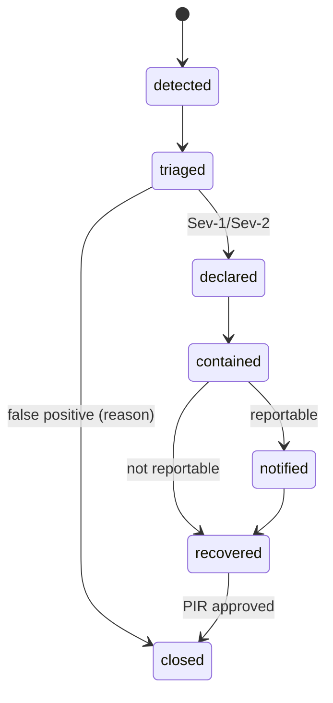
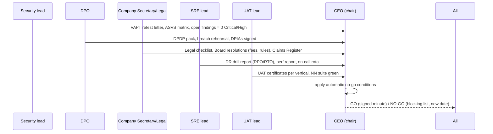

# P14 — Hardening, Compliance and Go-Live
> Paste after 01_MASTER_PROMPT.md. Prerequisites: P00–P13 at their exit gates (P13 may finish in parallel but must be green before the go/no-go). Estimated effort: 5 sprints (2-week) for a squad of 9 (1 security lead, 1 AppSec engineer, 2 SRE, 1 performance engineer, 2 QA/UAT leads, 1 data-migration engineer, 1 compliance analyst) plus the DPO, the Company Secretary/legal lead, an external CERT-In empanelled auditor and pilot users.

## 1. Objective and business outcome

Turn a feature-complete platform into a launchable, defensible institution. P14 proves — with evidence an auditor, a lender's outsourcing-risk team, a regulator or a High Court could inspect — that Equator is secure (OWASP ASVS L2, L3 for authentication, payments and sealed data), compliant (CERT-In Directions 2022, DPDP Act 2023 + Rules 2025, sector obligations flowing down from regulated clients), performant at the master §11 targets, recoverable within RPO ≤ 15 min / RTO ≤ 2 h, operable by runbook, accepted by real users from every vertical, and legally signed off. P14 ends with go-live and 30 days of hypercare.

Business outcomes:
- Zero open Critical/High VAPT findings at go-live; CERT-In empanelled auditor's report and retest letter on file (required in most NBFC/bank vendor due-diligence packs).
- First pilot tenants live in all six verticals plus GRM, POSH, Chambers and Academy, with signed UAT certificates.
- Board-approved fee schedules and rules of procedure published; every public claim backed by the Claims Register (NN-17).
- A DPDP readiness pack that meets the 13 May 2027 hard date six months early (NN-15; R2 §5 recommends internal target 13 Nov 2026).
- "Zero statutory clocks expired on our watch" from day one (NN-04).

## 2. Scope (in / out)

**In scope**: threat modelling (STRIDE per bounded context); ASVS and OWASP API Security Top 10 (2023) verification; VAPT by a CERT-In empanelled auditor (web, API, mobile, cloud, AI); vulnerability disclosure programme and bug bounty; supply-chain integrity; CERT-In Directions compliance; DPDP readiness pack (RoPA, DPIAs, breach runbook, rights SLAs, consent-manager readiness, children); ISO/IEC 27001:2022 and SOC 2 Type I roadmap; performance and load tests (k6); chaos experiments and DR drills; SLO dashboards and alerting; operational runbooks; UAT with real personas; data migration from the existing website build; legal sign-off; launch checklist and go/no-go; hypercare; post-launch KPIs.

**Out of scope**: new product features (any gap found becomes a defect against its origin phase, or a post-launch backlog item); ISO 27001 certification audit itself (Stage 1/Stage 2 follow the roadmap after launch); SOC 2 Type II observation period; SEC connector go-live (flag stays OFF — master §1.2); Mediation Act statutory mode (flag stays OFF until notification — NN-05).

## 3. Personas and permissions touched

| Role code | P14 responsibility | Notable permissions |
|---|---|---|
| `platform_admin` (security bundle) | threat model owner, VAPT coordination, WAF, key rotation | `ops:security_findings:*`; cannot approve own config changes (maker–checker) |
| `dpo` | RoPA, DPIAs, breach decision, DSR SLAs, consent-manager readiness | `ops:dpia:*`, `dsr:*`, `breach:declare`, break-glass notifications |
| `auditor` | scoped read-only evidence access (internal audit, ISO/SOC auditors, VAPT vendor read of reports) | `audit:read` time-bound grant via `core.role_grants` |
| `quality_officer` | UAT sign-off coordination, neutral quality checks | `uat:*` |
| `registrar` | rules of procedure publication, case numbering, legacy case import approval | `rules:publish` (checker) |
| `institution_admin` | fee schedules activation after Board approval; launch checklist owner for institution | `fees:activate` (checker) |
| `case_manager`, `panel_manager`, `escrow_officer`, `safeguarding_lead` | UAT executors; runbook operators | role-specific |
| `support_agent` | hypercare L1 | `support:*` |
| UAT personas | `party`, `counsel`, all `neutral_*`, `enterprise_admin`, `enterprise_operator`, `grievance_officer`, `internal_ombudsman`, `grc_member`, `student_ombudsperson`, `ic_presiding_officer`, `ic_member`, `ic_external_member`, `chambers_admin`, `university_admin`, `sgrc_member`, `student`, `learner`, `trainer`, `partner` | UAT tenant only, synthetic or pilot data |

## 4. Functional requirements

**FR-P14-01 — STRIDE threat model per bounded context.** Produce `docs/security/threat-model/<context>.md` for every module in master §4.3 using a data-flow diagram, STRIDE table, existing controls, residual risk (L×I, 1–5 each) and owner. Minimum threats that must be explicitly analysed and tested:

| Context | Highest-risk threats (STRIDE letter) | Required control evidence |
|---|---|---|
| `identity` | OTP SIM-swap/forwarding (S); refresh-token theft (S/E); passkey downgrade (S) | device binding + DPoP (P12; Keycloak DPoP officially supported from 26.4), risk-based step-up, OTP rate limit 5/15 min, SIM-swap signal where provider supports |
| `tenancy` | cross-tenant read via missing RLS (I); tenant header spoofing (E) | RLS `FORCE` on every tenant table (automated catalogue check), ABAC tenant match, cross-tenant fuzz suite |
| `cases`/`intake` | BOLA on `/v1/cases/{caseId}` (I); forged filing on behalf (S); bulk injection (T) | ABAC on every route, idempotency, CSV formula-injection neutralisation |
| `neutrals`/`routing` | lender influence on allocation (T/E — NN-03); allocation log tampering (R) | `core.allocation_runs` hash-chained; enterprise principals cannot call allocation APIs; Independence Evidence Pack reproducible |
| `hearings` | caucus eavesdropping (I — NN-11); impersonation at join (S); recording without consent (I) | room-scoped tokens, liveness, consent records, LiveKit egress disabled for mediation rooms |
| `documents` | evidence tampering (T — NN-22); malware upload (E); Aadhaar over-collection (I — NN-14) | SHA-256 ledger + S3 Object Lock compliance mode, ClamAV, masking pipeline |
| `outcomes`/`esign`/`estamp` | award back-dating (T — NN-04 s.29A); signature replay (S); excluded instrument e-signed (T — NN-08) | server-side timestamps from NTP-synced clock, maker–checker, provider webhook truth, instrument-class guard |
| `billing`/`payments`/`escrow` | amount tampering (T); webhook forgery (S); settlement funds through merchant account (NN-13) | server-computed amounts, signature verification + inbox uniqueness, escrow rail separation test |
| `comms`/`voice` | contact outside 08:00–19:00 (NN-12); call from an undeclared or unauthorised CLI (NN-12, M-05); template injection (T); voice-agent jailbreak (E) | server-side window gate, DLT template registry, CLI guard against `core.number_authorisations` and declared A2P ranges, scripted agent policies + red-team |
| `ai` | prompt injection from uploaded documents (T/E); advice/prediction leakage (NN-01); sealed data in prompts (I — NN-07) | AI Gateway policy filters, eval gates, sealed-schema credential absence test |
| `posh` (sealed) | any join path from core (I — NN-07); insider browsing (I/R) | separate schema/key/DB role, opaque token, access log on every read, monthly review |
| `enterprise` | API key leakage (S); webhook SSRF (E); mass-assignment (T) | key hashing + prefix display, egress allow-list for webhook targets, DTO allow-lists |
| `growth`/`cms` | case data leaking into CRM (I — NN-16); unbacked claims (NN-17) | network/schema separation, CI query scan, claims-register publish gate |
| mobile | rooted device exfiltration (I); deep-link hijack (S) | P12 FR-05/06/14 |

Threat model reviews are signed by the security lead and the context's tech lead; residual risks ≥ 12 go to the risk register with Board visibility (C1 M.3 convention).

**FR-P14-02 — OWASP ASVS verification.** Use OWASP ASVS 5.0.0 (May 2025; current stable as of Oct 2026), recorded in an ADR; matrix IDs use ASVS 5.0.0 numbering. Level 2 for all surfaces; Level 3 for authentication and session management, payments/escrow/payouts, and sealed-data stores (POSH, health, family safety), and for signing. Deliverable `docs/compliance/asvs-matrix.csv` (requirement ID, level, applicable Y/N with reason, control, automated test ID or manual evidence link, status). Exit criterion: 100% of applicable L2 requirements `pass`; L3 requirements for the named areas `pass` or `accepted_risk` signed by security lead and DPO (max 5 accepted risks, none for sealed data).

**FR-P14-03 — OWASP API Security Top 10 (2023) suite.** Automated test packs in `tests/security/api/` run in CI against the staging OpenAPI: API1 BOLA (every `{id}` path parameter fuzzed with another tenant's and another case's IDs — expected `404` indistinguishable from not-found); API2 broken authentication (expired/forged/`alg:none` JWTs, refresh reuse detection revokes family); API3 broken object property level authorisation (mass-assignment of `status`, `tenant_id`, `confidentiality_tier`, `amount_minor`; response over-exposure diff against role DTOs); API4 unrestricted resource consumption (pagination caps 100, upload caps, bulk row caps, rate limits per tenant and key → `429`); API5 broken function level authorisation (role matrix test: every endpoint × every role code); API6 unrestricted access to sensitive business flows (OTP bombing, offer spamming, notice re-send loops, payment-intent creation floods); API7 SSRF (webhook URLs, document-from-URL imports restricted to allow-list, IMDSv2 enforced); API8 security misconfiguration (headers, CORS allow-list, verbose errors); API9 improper inventory (OpenAPI diff vs deployed routes; deprecated versions blocked); API10 unsafe consumption of APIs (provider webhook signature, schema validation of provider responses, timeouts).

**FR-P14-04 — VAPT by CERT-In empanelled auditor.** Engage an auditor from CERT-In's current empanelled list (process control: check the CERT-In empanelment list on the engagement date). Scope: external network, web apps (public site, portals, consoles), APIs (OpenAPI-driven, authenticated per role), mobile (OWASP MASVS/MASTG for both apps), cloud configuration review (AWS CIS Benchmark, IAM, S3 Object Lock, KMS key policies), LiveKit/telephony surfaces, AI Gateway (prompt injection, data exfiltration, guardrail bypass), and a white-box review of RLS policies and sealed-store isolation. Method: grey-box with test accounts per role; staging environment identical to production configuration; no production sealed data. Severity SLAs: Critical — fix and retest before go-live (blocking); High — fix before go-live or, if not technically feasible, compensating control + DPO/security lead acceptance with fix ≤ 15 days post-launch (max 2); Medium ≤ 45 days; Low ≤ 90 days. Deliverables: report, retest report, auditor's compliance letter, findings imported to `ops.security_findings`. Cadence after launch: quarterly VAPT (master §11) and after any major release touching auth, payments or sealed data. Align audit scope and reporting with CERT-In's Comprehensive Cyber Security Audit Policy Guidelines (25 Jul 2025) — binding on the empanelled auditor; audits at least annually and after major change.

**FR-P14-05 — Vulnerability disclosure and bug bounty.** At go-live: `/.well-known/security.txt` (RFC 9116) with `Contact: security@equatorresolution.in`, `Policy`, `Expires`, `Preferred-Languages: en, hi`; public VDP page with safe-harbour language, scope, out-of-scope (social engineering, DoS, physical, any attempt to access real party data — researchers must stop and report on first sight of personal data), 3-business-day acknowledgement, 90-day coordinated disclosure. Private bug bounty from launch + 90 days on a dedicated bounty environment with synthetic data (no production testing), rewards ₹10,000–₹5,00,000 by CVSS band [subject to Board budget approval]; platform choice in ADR (India payout capability required).

**FR-P14-06 — Supply chain and build integrity.** SBOM (CycloneDX) per build for web, API, worker and mobile; dependency, container (Trivy), IaC (Checkov) and secret scanning gates with zero Critical/High unwaived; container images signed (Sigstore cosign) and verified at deploy by admission policy; SLSA Build Level 2 provenance for release artefacts [target L3 post-launch]; lockfiles enforced; Renovate with 7-day cool-down for new releases; mobile release builds signed with keys held in EAS/Apple/Google key stores with two-person access.

**FR-P14-07 — CERT-In Directions compliance.** Comply with CERT-In Directions under IT Act 2000 s.70B(6) dated 28 April 2022 (No. 20(3)/2022-CERT-In) and FAQs of 19 May 2022 (no amendment through Oct 2026):
1. **6-hour reporting** of the incident types in Annex I of the Directions (e.g., targeted scanning of critical systems, compromise of critical systems/information, unauthorised access to IT systems/data, website defacement, malicious code attacks, attacks on servers/databases, identity theft/spoofing/phishing, data breach, data leak, attacks on cloud systems (Annex I item xviii) and attacks on AI/ML systems (Annex I item xx) — all already in the 2022 Annexure I list of 20 incident types) to CERT-In (incident@cert-in.org.in / portal) within 6 hours of **noticing** or being brought to notice. Runbook RB-04 (breach) and RB-05 (DR) carry this clock; `ops.regulatory_notifications` row with `deadline_at = noticed_at + 6h`, owner, and status.
2. **Logs**: maintain logs of all ICT systems securely for a rolling **180 days within Indian jurisdiction** — ALB/CloudFront/WAF logs, VPC flow logs, CloudTrail, application audit/access logs, auth logs, LiveKit and telephony CDRs, provider webhook logs — in S3 ap-south-1 with Object Lock (governance mode, 400-day retention to also satisfy DPDP Rules 2025 r.6(1)(e) and r.8(3) one-year log retention) replicated to ap-south-2; produce to CERT-In on request.
3. **Time sync**: all systems sync to NTP servers of the National Informatics Centre (NIC) or National Physical Laboratory (NPL), or to sources traceable to them (Amazon Time Sync is acceptable: the CERT-In FAQs permit cloud-native time services provided accuracy does not deviate from NIC/NPL; default config: chrony with `samay1.nic.in` / `samay2.nic.in` and `time.nplindia.org` as primary, Amazon Time Sync as fallback, with the traceability evidence documented); drift alert > 100 ms. Clock correctness also underpins NN-04 and award timestamps.
4. **Point of contact**: designate and register a PoC with CERT-In; record in `docs/compliance/cert-in-poc.md`.
5. Respond to CERT-In directions/information requests within the time specified; runbook entry.

**FR-P14-08 — DPDP readiness pack (NN-15).** Build and approve, with evidence links:
1. **RoPA** (`ops.ropa_entries` + rendered `docs/compliance/ropa.md`): one entry per processing purpose (dispute administration, respondent processing before engagement under s.17(1)(a) (enforcing a legal right or claim) and s.7(e) where enforcing awards/orders, neutral empanelment, communications, recordings, payments, KYC/KYB, GRM processing as processor for tenant fiduciaries, POSH as processor for employer, Academy, growth/marketing (consent only), product analytics (consent), AI processing) with data categories, principals, lawful basis, fiduciary/processor role per tenant type, processors and sub-processors, retention, transfer basis (INT s.16), security measures.
2. **DPIAs** (`ops.dpia_records`): mandatory for POSH sealed store, INS health store, FAM safety and children's data, AI layer (including voice agents), call recording, Account Aggregator evidence (D6), cross-border INT processing. Each: necessity/proportionality, risks (from C1 L.3 DPIA register), controls mapped to tests, residual rating, DPO sign-off. Equator designs as if it were a Significant Data Fiduciary (annual DPIA, independent audit-ready) even before any notification.
3. **Breach runbook** (RB-04): intimation to the Data Protection Board without delay and detailed report within 72 hours (DPDP Rules 2025 r.7(1) principals without delay; r.7(2)(a) Board without delay; r.7(2)(b) detailed report within 72 hours of becoming aware, or a longer period allowed by the Board on written request); intimation to affected principals without delay in plain language in their language; tenant (fiduciary) notification within the contractual window (default 24 h, configurable in DPA ≤ 72 h) where Equator is processor; CERT-In 6 h in parallel.
4. **Rights workflow SLAs** (DSR from P01): acknowledge ≤ 48 h; fulfil access/correction/erasure/nomination/grievance ≤ 30 days internal target, within the Rule-prescribed outer limit (≤ 90 days — DPDP Rules 2025 r.14(3)); erasure honours legal holds and s.17 exemptions with a reasoned response; withdrawal of consent propagated to all processors within 72 h (`equator.consent.consent.withdrawn.v1` consumers verified).
5. **Consent-manager readiness**: integration interface (`CONSENT_MANAGER_PORT` stub with mock CM in sandbox), consent artefact mapping to `core.consent_records`, test with at least one registered CM once registrations open (Rule 4 effective 13 Nov 2026).
6. **Children and persons with disability**: verifiable guardian consent flows (DPDP Rules 2025 r.10; persons with disability r.11); no tracking or behavioural monitoring of minors; Academy/Campus age gate; FAM child records limited to initials and age.
7. **Retention and erasure**: retention jobs per master §11 defaults run in production dry-run mode for 2 weeks with reports before activation; legal-hold overrides tested.
8. **Processor contracts**: DPAs with every processor in the vendor residency register (R3 §11 U-items closed or risk-accepted).
9. **Notices**: itemised privacy notice per purpose in English and Hindi at launch, other Eighth Schedule languages on request.

**FR-P14-09 — ISO/IEC 27001:2022 and SOC 2 roadmap.** ISMS scope: Equator Resolution platform, people and processes in Delhi, Noida and Jaipur offices and AWS ap-south-1/2. Deliverables before go-live: ISMS policy set, risk assessment and treatment plan, Statement of Applicability for the 93 Annex A controls, control-to-test mapping in `docs/compliance/controls.csv` (ISO 27001 Annex A + SOC 2 TSC CC1–CC9, A1, C1, PI1, P1–P8 where in scope), internal audit 1 and management review 1. Roadmap: Stage 1 audit ≤ launch + 60 days; Stage 2 ≤ launch + 150 days; SOC 2 Type I report (Security, Availability, Confidentiality) ≤ launch + 120 days; Type II observation 6 months thereafter; ISO/IEC 27701 assessed in year 2. **NN-17**: no "ISO 27001 certified" or "SOC 2" badge or claim until the certificate/report exists and is registered in `growth.claims_register` with expiry; acceptable interim copy is "controls designed to ISO/IEC 27001:2022".

**FR-P14-10 — Performance and load testing (k6).** k6 scripts in `tests/perf/` run by the k6 operator on EKS/ECS in ap-south-1 against a production-sized `perf` environment (same instance classes; synthetic data at 12-month projected volume: 2 million cases, 20 million documents metadata, 50 million audit events). Targets (master §11):

| Scenario | Load profile | Pass criteria |
|---|---|---|
| S1 portal mix (reads 80% / writes 20%) | ramp to 5,000 concurrent virtual users, 600 RPS, 1 h | p95 read < 300 ms, p95 write < 800 ms, error rate < 0.1% |
| S2 bulk intake | 100,000-row CSV batch via API + SFTP, 3 tenants concurrently | row validation complete ≤ 15 min; cases created ≤ 60 min; zero duplicate cases (idempotency); row-level error report correct |
| S3 notice campaign | 1,000,000 messages/day across email/SMS/WhatsApp/push, compressed into the 08:00–19:00 window (NN-12) — peak 100 msg/s sustained 2 h | outbox lag p95 < 60 s; zero sends outside window; provider throttling handled without loss |
| S4 concurrent hearings | 500 LiveKit rooms, 4 participants avg (2,000 participants), 30% audio-only, 10 caucus moves per room per hour | join success ≥ 99.5%; token API p95 < 300 ms; media quality MOS ≥ 3.5 on 4G profile |
| S5 clock scheduler | 1,000,000 active clocks; daily evaluation plus 10× burst | all alerts generated before thresholds; evaluation completes ≤ 10 min; zero missed (NN-04) |
| S6 webhook inbox | 500 provider events/s for 10 min, 5% duplicates | 100% dedupe; processing lag p95 < 30 s |
| S7 soak | S1 at 60% for 8 h | no memory growth > 10%; no error-rate drift |
| S8 spike | 5× S1 for 5 min | autoscale within 3 min; p95 read < 800 ms during spike; no data loss |
| S9 AI gateway | 50 concurrent drafting requests + 200 explorer sessions | p95 first token < 2.5 s; fallback questionnaire engages on induced LLM outage (NN-02) |
| S10 web vitals | Lighthouse CI + RUM on 4G Moto G-class profile | LCP < 2.5 s, CLS < 0.1, INP < 200 ms on all indexable routes |
| S11 mobile | P12 FR-P12-23 budgets | as specified |

Results stored in `ops.perf_runs` with Grafana snapshots; any miss is a release blocker unless the performance engineer and CTO sign an exception with a fix date.

**FR-P14-11 — Chaos experiments and DR drills.** Chaos (AWS Fault Injection Service in staging and, with approval, in production during low-traffic windows post-hypercare): AZ loss for API tasks; Aurora writer failover; Redis node loss; Temporal frontend loss; provider outages (SMS, WhatsApp, eSign, payments, LLM, video) via adapter fault injection; S3 throttling; clock skew injection (NTP); KMS throttling. Each experiment has a hypothesis, steady-state SLI, abort condition and result in `ops.chaos_experiments`. DR drill (go-live blocker, then quarterly): promote Aurora Global Database secondary in ap-south-2, fail over ECS services and Temporal, switch Route 53, validate — RPO ≤ 15 min measured from last committed transaction, RTO ≤ 2 h measured from declaration to "file / respond / pay / sign / join hearing" smoke tests green; verify audit hash chain continuity (`audit.verify_chain()` returns no break) and evidence ledger integrity; reconcile outbox/webhook inbox (no lost or duplicated side effects); verify statutory clocks recalculated with no missed alerts during the window; controlled failback with reconciliation. Monthly backup restore test (PITR to a timestamp) with checksum comparison.

**FR-P14-12 — Observability, SLO dashboards and alerting.** SLOs as code (`ops/slo/*.yaml`, OpenSLO format) rendered in Grafana: availability 99.9% (core APIs, 30-day window), hearing rooms 99.95% during scheduled sessions, latency SLOs per master §11, outbox lag, webhook lag, bulk throughput, **statutory clock pre-breach firing 100%** (any miss pages immediately as Sev-1), notice delivery success by channel, payment capture reconciliation, AI gateway guardrail block rate and fallback rate, audit-chain verification job success. Multi-window burn-rate alerts (fast: 14.4× over 1 h and 5 min; slow: 6× over 6 h and 30 min). Alert routing: Sev-1/Sev-2 page on-call (incident tool per ADR), Sev-3 ticket, Sev-4 digest. Every alert links to a runbook. Business dashboards: Compliance Cockpit (clocks at T-90/60/30, unowned clocks, signposting-pending closures), Neutrality dashboard (allocation concentration per enterprise client vs caps, NN-03), Contact conduct (attempts by hour, blocked out-of-window attempts, NN-12).

**FR-P14-13 — Runbooks.** Every operational process has a runbook in `docs/runbooks/RB-xx-*.md` with trigger, severity, owner role, preconditions, numbered steps with time targets, communications templates, evidence to capture and closure criteria; each is rehearsed at least once (table-top or live) before go-live and linked from alerts. Mandatory set in §5.3: RB-01 onboard a lender (enterprise) tenant; RB-02 empanel a neutral; RB-03 run a bulk intake batch; RB-04 personal data breach; RB-05 DR failover; RB-06 AI incident; RB-07 voice campaign incident; RB-08 payment reconciliation break; RB-09 statutory clock breach; plus RB-10 audit-chain integrity failure, RB-11 provider outage, RB-12 CERT-In information request, RB-13 legal hold and court order compliance, RB-14 neutral misses a clock / substitution.

**FR-P14-14 — UAT plan.** UAT runs in the `uat` environment with a dedicated tenant set per vertical and pilot users who represent real personas (pilot lender operations and GRO staff, an insurer claims/grievance officer, a corporate legal manager and an MSME owner, an HR head and an employee, family members in a mock partition and a mock divorce-terms case, an international trading company's counsel, empanelled neutrals of each type, a university admin and SGRC member, learners). Pilot users use synthetic case data supplied by Equator; no real disputes are processed in UAT. Structure: Cycle 1 (2 weeks) scripted journeys from Appendix I §(ii); Cycle 2 (1 week) exploratory and negative; Cycle 3 (1 week) regression after fixes plus accessibility and language sessions with screen-reader and Hindi-first users. Defect severity: S1 blocks a journey or breaks an NN rule; S2 major with workaround; S3 minor; S4 cosmetic. Entry: P00–P13 exit gates green, seed data loaded, UAT accounts provisioned with MFA. Exit: 100% of Appendix I journeys executed, ≥ 95% passed, zero open S1, ≤ 5 open S2 each with fix date before go-live, signed UAT certificates per vertical (Appendix I §(v)). Evidence: screenshots, generated documents with hashes, audit-event extracts and timings captured into `ops.uat_evidence`.

**FR-P14-15 — Data migration from the existing website build.** The live site equatorresolution.in is a JavaScript single-page application (R4 §1.1 observed client-only rendering) believed to be a MERN (MongoDB, Express, React, Node) build **[VERIFY — open: legacy stack/collections — obtain schema export from current developer]**. Principles: migrate only what has a lawful basis and a purpose in the new platform; leads go to `growth` (NN-16), never to `core`; no legacy password hashes unless verified Argon2id/bcrypt with cost ≥ 10 (otherwise force OTP login); no free-text dispute narratives from marketing forms into `growth` beyond 12 months; production data never enters non-production environments — rehearsals use a synthetic dataset generated to the legacy schema and statistics; the final run executes inside production under a restricted migration role with reconciliation reports. Mapping:

| Legacy source (assumed) | Target | Transformation and rules |
|---|---|---|
| `users` (name, email, phone, role, passwordHash, createdAt) | `core.users`, `core.persons`, `core.contact_points` | normalise phone to E.164 (+91 default), email lower-case; `role=admin` not migrated (re-provision with MFA); `role=neutral` → membership `neutral_*` with status `pending_reverification`; re-consent on first login (legacy notice v1.0, 2 Jun 2026, recorded as `core.consent_records.source='legacy_import'`, `requires_reconsent=true`) |
| Dispute Explorer submissions (name, email, category, description) | `growth.leads`, `growth.tool_runs` | category mapped to vertical code; description truncated to 0 chars if it contains family-safety, health or POSH indicators (deterministic keyword screen), else retained ≤ 12 months; never creates a case |
| Matrimonial consultation requests | `growth.leads` (vertical `FAM`) | context free-text **not migrated**; NRI flag kept; contact for re-consent before any follow-up |
| Financial-institution demo requests | `growth.accounts`, `growth.opportunities` | volume band mapped; lender type mapped to `lender_type` enum |
| Neutral applications (`/application/neutral`) and uploaded CVs/certificates | `core.neutrals` (status `applicant`), `core.neutral_accreditations` (status `unverified`), `core.documents` (institution tenant) | documents re-hashed and ledgered with `provenance='legacy_import'`; empanelment restarts at P03 verification step; applicant notified |
| Settlements & Awards retrieval records (case reference, email, document) | `core.cases` (`source='legacy_import'`, status `closed`), `core.documents`, `core.evidence_ledger` | legacy numbers `Equa/<yyyy>/<nnnn>` stored in `core.cases.legacy_ref`; documents ledgered as `imported_unverified_provenance`; registrar approval per record; OTP retrieval preserved via new portal |
| Newsletter/marketing subscribers | `growth.leads` with `marketing_consent=true` only if consent evidence (timestamp, source) exists | otherwise excluded |
| Website forms and Word templates | not migrated as data | rebuilt as `core.form_schemas` / `core.document_templates` from C4 §C (already in P02/P06) |
| URLs | 301 map | verified with P13 redirect map; old `/file-marital-dispute`, `/financial-odr`, `/corporate-odr`, `/pricing` mapped |

Reconciliation: per collection, source count = migrated + excluded (with reason) ; SHA-256 of each migrated document matches the ledger; a 2% random sample verified manually by the quality officer; migration report signed by DPO and registrar; legacy database retained read-only and encrypted for 90 days, then destroyed with a destruction certificate (unless a legal hold applies).

**FR-P14-16 — Legal sign-off checklist.** Owned by the Company Secretary/legal lead; each item needs an approver, date and evidence link in `ops.launch_checklist_items` (category `legal`):
1. **Legal Rules Register** (Appendix G): every rule referenced by an enabled feature has `status='VERIFIED'`, source, section, effective date and reviewer; every feature depending on an `UNVERIFIED` rule is OFF (master §0). Specific confirmations: NN-05 statutory-mediation flag OFF with copy audit (no "s.27 decree-enforceable", no "MCI-registered"); s.29A clock logic; s.12(5) waiver flow and appointment engine reviewed against *Central Organisation for Railway Electrification v ECI-SPIC-SMO-MCML (JV)* (SC, 5-judge bench, 8 Nov 2024), *Bhadra International (India) v AAI* (SC, 5 Jan 2026) and *Madhyachal Steels v Clix Capital* (Del HC, 24 Aug 2026); RBI conduct rules (NN-12: NBFC Responsible Business Conduct (Third Amendment) Directions 2026, RBI/2026-27/230, effective 1 Jan 2027 — enforced now; the no-Sunday/holiday default is Equator policy, not RBI law); TRAI TCCCPR 2018 as amended (Second Amendment 2025; Third Amendment Regulations 2026, No. 05 of 2026); M-06: `com.s12a_equator_authorised` OFF with copy audit (no claim that an Equator report satisfies Commercial Courts Act s.12A; PIMS remains with the Legal Services Authority under the PIMS Rules 2018).
2. **Rules of procedure** per mechanism and vertical, Code of Conduct for neutrals, allocation policy, AI Governance Rule (D3), confidentiality and recording policy (NN-11): approved by the Board (or its Rules Committee where delegated) and published as versioned public pages.
3. **Fee schedules**: approved by Board resolution (Companies Act 2013 s.179; at a meeting or by circulation under s.175), with a certified true copy on file; "Subject to Board approval" labels removed only after activation by `institution_admin` (checker) referencing the resolution; GST treatment (SAC 998215; reverse charge for arbitral-tribunal services to business entities under Notification 13/2017-CT(Rate) Sl. 3) reviewed by tax adviser; TDS mapping under the Income-tax Act 2025 confirmed (master §7): s.393(1) Sl. 6(iii) [old 194J], Sl. 1(ii) [old 194H], Sl. 8(v) [old 194-O, if applicable]; s.393(2) Sl. 17 [old 195]; Forms 145/146 (r.220) and Form 41 (r.75); signed off in the tax memo.
4. **Privacy notice, Terms of Use, cookie notice, DPA templates** issued in the name of Equator Resolution Service Private Limited (particulars from `tenant.legal_entity`, X-15) (Equator as processor for lender/insurer/employer/university tenants; as fiduciary for institution cases), sub-processor list, cross-border transfer records for INT (s.16).
5. **Enterprise contract pack**: NN-03 disclosure (no lender selection or veto of neutrals; paid relationship disclosed to counterparties — NN-16); RBI Master Direction on Outsourcing of Information Technology Services (RBI/2023-24/102, 10 Apr 2023, effective 1 Oct 2023; applies to commercial banks, Tier 3–4 UCBs, Top/Upper/Middle-layer NBFCs incl. HFCs, CICs and AIFIs; not Base-layer NBFCs; material IT outsourcing only) flow-down clauses — audit rights, incident reporting so the RE can report to RBI within 6 h (para 17), data localisation, business continuity; LSP/DLA terms under RBI Digital Lending Directions 2025 (for NBFCs now Ch. III of RBI (NBFC – Credit Facilities) Directions 2025) where relevant.
6. **Escrow**: tripartite escrow agreement with bank/trustee executed; payment-aggregator split eligibility (Razorpay Route or equivalent) confirmed in writing consistent with RBI Payment Aggregator Directions (15 Sep 2025) (NN-13).
7. **Communications (NN-12, M-05)**: Equator registered as a DLT Principal Entity with each originating operator, CPaaS providers linked as telemarketers; headers and templates registered; WhatsApp templates approved; lender 1600-series authorisations on file in `core.number_authorisations`; Equator DID ranges declared as A2P CLI ranges (TCCCPR (Third Amendment) Regulations 2026) and recorded in `ops.telecom_declarations`; `voice.equator_service_number.enabled` stays OFF unless the operator's written confirmation and a telecom-counsel opinion are on file; 1601 application tracked for when legal/ODR services are notified; explicit consents registered on the operator consent platform; DND scrubbing evidenced.
8. **Insurance**: professional indemnity (institution and panel), cyber, D&O and crime cover bound before the first live matter (C1 M.2).
9. **Safeguarding**: FAM child-at-risk referral pathway approved (blocking item V-11 in C1 M.2); safeguarding lead appointed.
10. **POSH**: IC SaaS terms; external-member engagement contracts with conflict rules.
11. **Marketing**: every public claim in the Claims Register with evidence and expiry; store listings and website pass the claims lint (NN-17).
12. **Other regimes** (treated as applicable by default): Consumer Protection (E-Commerce) Rules 2020 for consumer-facing fee collection — Equator sells its own services online, so it publishes grievance officer details (r.4(4)), acknowledges in 48 h and redresses in 1 month (r.4(5)), uses no pre-ticked consent (r.4(9)) and gives full fee transparency; IT (Intermediary Guidelines and Digital Media Ethics Code) Rules 2021 for user-generated content surfaces (case chat); accessibility statement.

**FR-P14-17 — Launch checklist and go/no-go.** `ops.launch_checklist_items` holds ≥ 120 items across eight categories (security, compliance, legal, performance/DR, operations, data migration, commercial/support, communications), each with owner role, evidence link and status (`open`, `done`, `waived` — waiver needs CTO + DPO + CS approval, never for NN-linked items). Go/no-go meeting at T-2 days chaired by the CEO with CTO, CS/legal, DPO, Head of Mediation/Registrar, security lead, SRE lead and customer success; decision recorded as a signed minute. Automatic no-go conditions: any NN test failing; any open Critical/High VAPT finding without an accepted plan; DR drill not passed within the last 30 days; any enabled feature depending on an `UNVERIFIED` legal rule; `voice.equator_service_number.enabled` or `com.s12a_equator_authorised` ON without its recorded gate evidence (M-05/M-06); fee schedules not Board-approved; DPDP breach runbook not rehearsed; on-call rota not staffed for 30 days. Launch is staged: Day 0 institution (EDRS) for pilot tenants in FIN, COM and WRK; Day 7 FAM, INS and INT; Day 14 GRM, POSH, Chambers and Academy self-serve; public marketing launch only after Day 14 metrics are within targets.

**FR-P14-18 — Hypercare (T0 to T+30 days).** War room (virtual, with a physical desk in Noida) with daily stand-up at 09:30 IST and close-out at 18:30 IST; on-call 24×7 with 15-minute Sev-1 response; change freeze except hotfixes approved by CTO; elevated alerting thresholds (half the normal burn-rate tolerance); daily review of: NN-tagged alerts, clock risk list, contact-conduct blocks, payment reconciliation, escrow milestones, AI guardrail blocks, crash-free rate, support ticket themes; per-tenant success manager calls twice a week; daily status note to pilot tenants. Exit criteria: 7 consecutive days with no Sev-1/Sev-2, all S2 defects closed, SLOs within target for 14 days, support backlog < 24 h, hypercare report approved.

**FR-P14-19 — Post-launch KPIs.** Published internally weekly and to the Board monthly (aggregates only; no neutral win-rates — NN-16; D12 transparency uses process KPIs):

| KPI | Target (first 90 days) |
|---|---|
| Statutory clocks expired on our watch | 0 |
| NN test suite on production canary | 100% green |
| Availability core APIs / hearing rooms | ≥ 99.9% / ≥ 99.95% |
| Time from filing to scrutiny decision (median) | ≤ 2 working days |
| Respondent engagement within 7 days of service | ≥ 50% (FIN), ≥ 60% (other verticals) |
| Settlement rate in mediated matters | tracked, no target published until 100 closures |
| Median cycle time to outcome by mechanism | tracked vs ruleset time-boxes |
| Awards challenged / set aside (D12 published count) | tracked; every set-aside root-caused |
| Notice delivery success (any channel) | ≥ 97% |
| Payment reconciliation breaks unresolved > 2 days | 0 |
| DSR fulfilled within internal SLA | ≥ 95% |
| Crash-free sessions (mobile) | ≥ 99.5% |
| AI human-review overrides and guardrail blocks | tracked; any NN-01 breach = Sev-2 |
| Neutral allocation concentration per enterprise client | within configured caps 100% |
| CSAT party / neutral | ≥ 4.2 / 5 |

**FR-P14-20 — Edge and application hardening.** CSP with nonces (no `unsafe-inline`), `frame-ancestors` restricted (embed widget uses a separate origin with explicit allow-list per tenant), HSTS with `includeSubDomains; preload`, `Referrer-Policy: strict-origin-when-cross-origin`, `Permissions-Policy` minimal (camera/microphone only on hearing routes); AWS WAF managed rule sets + custom rules (OTP and login rate limits, bulk endpoints mTLS for configured tenants, geo-velocity anomaly scoring), bot management on public forms (non-tracking challenge), ClamAV signatures updated hourly, file-type allow-lists, IMDSv2 only, security groups least privilege, no public S3 buckets (SCP guardrail).

**FR-P14-21 — Access governance and key management.** Quarterly access recertification for all staff and neutral accounts (`ops.access_reviews`), joiner-mover-leaver integration with HR, privileged access via short-lived SSO roles with session recording, break-glass test monthly (justification, DPO notification and audit verified), KMS key rotation (annual automatic for CMKs; per-tenant data keys rotated on tenant request or incident), secrets rotation ≤ 90 days, provider webhook secrets rotated at go-live, separation of duties verified (no one can both change and approve rulesets, fees, panels or payouts — master §6, NN-21).

## 5. Workflows and state machines

### 5.1 Incident lifecycle

| State | Event | Guard | Next | Side-effects |
|---|---|---|---|---|
| `detected` | `triage` | on-call acknowledges ≤ 15 min (Sev-1) | `triaged` | `ops.incidents` row; severity per matrix (missed statutory clock, confidentiality breach, NN rule bypass, audit-chain failure = Sev-1 regardless of scale — C1 L.7) |
| `triaged` | `declare` | Sev-1/2 | `declared` | incident channel; commander assigned; regulatory clocks created: CERT-In 6 h (if reportable), DPB "without delay" + 72 h (if personal data breach), tenant contractual clock |
| `declared` | `contain` | containment action logged | `contained` | evidence preserved (snapshots, log exports with hashes) |
| `contained` | `notify` | DPO decision recorded | `notified` | `ops.regulatory_notifications` sent/filed; principals notified via comms with approved template |
| `notified`/`contained` | `recover` | services verified | `recovered` | status page update |
| `recovered` | `review` | post-incident review ≤ 5 working days | `closed` | blameless PIR, actions in backlog with owners, risk register update |



### 5.2 Go-live decision



### 5.3 Runbooks (summary; full text in `docs/runbooks/`)

| ID | Trigger | Owner | Key steps (time targets) | Evidence / closure |
|---|---|---|---|---|
| RB-01 Onboard lender tenant | signed MSA + order form | `institution_admin` + customer success | (1) KYB of lender via `kyb_checks` (CIN, GSTIN, PAN, RBI CoR number) ≤ 1 day; (2) contract pack incl. NN-03 disclosure and RBI IT outsourcing flow-downs; (3) create tenant `kind=enterprise`, SSO, roles, authority limits (`org_signatories`); (4) DLT linkage, 1600-series number authorisation (`core.number_authorisations`) and quiet-hours config (NN-12); (5) clause-at-sanction API keys (sandbox → production after test cases pass); (6) GRM desk with RBI clocks if L4 bought; (7) sample bulk file dry-run with 100 synthetic rows; (8) go-live sign-off | tenant checklist complete; no neutral-selection permissions in tenant role bundle (automated check) |
| RB-02 Empanel neutral | application received | `panel_manager` | (1) identity KYC and liveness; (2) credentials verification (Bar Council enrolment, mediation training hours, accreditation) ≤ 5 days; (3) conflict-graph seeding (employers, clients, relatives declared); (4) interview/assessment and grade; (5) Code of Conduct + confidentiality + disclosure template e-signed; (6) PI cover expiry recorded; (7) panel memberships with role segregation; (8) payout KYC and TDS profile; (9) activation and directory publication (no win-rates — NN-16) | empanelment record complete; quality officer spot-check 10% |
| RB-03 Bulk intake run | enterprise bulk upload | `case_manager` (bulk) | (1) schema validation report; (2) duplicate/linked-matter check; (3) arbitrability and signposting screen per row (NN-06/NN-20); (4) NN-03 check: no row may carry a nominated neutral; (5) fee quote approval; (6) release rows in waves of 5,000; (7) notice campaign respects NN-12 window and DLT; (8) batch report to tenant | batch reconciliation: accepted + deficient + rejected = submitted |
| RB-04 Personal data breach | suspected unauthorised access/disclosure/loss | `dpo` (decision), incident commander | T+0 declare; T+1 h contain and preserve evidence; T+≤6 h CERT-In report if reportable; DPB intimation without delay; T+≤72 h detailed DPB report; principals notified without delay in their language; tenant fiduciaries within contract window; sealed-data breach → also safeguarding lead and IC/insurer notification as applicable | regulator acknowledgements; PIR; DPIA updated |
| RB-05 DR failover | region impairment > 30 min or data-corruption event | SRE lead | (1) declare; (2) freeze writes; (3) promote ap-south-2 Aurora; (4) fail over ECS/Temporal/Redis; (5) Route 53 switch; (6) smoke tests file/respond/pay/sign/join; (7) verify audit chain and evidence ledger; (8) reconcile outbox and webhook inbox; (9) recompute clocks, issue missed alerts; (10) comms to tenants/parties; RTO ≤ 2 h | measured RPO/RTO; failback plan executed with reconciliation |
| RB-06 AI incident | guardrail breach (advice, prediction, valuation, court impersonation, egress without human action), sealed data in prompt, hallucinated citation in a sent document | AI governance lead + DPO | (1) kill switch for feature/tenant (AI Gateway) ≤ 15 min; (2) deterministic fallback active (NN-02); (3) identify affected interactions from `core.ai_interactions`; (4) notify affected neutrals/parties where an output reached them; (5) correct records; (6) add eval cases; (7) re-enable only after eval suite 100% on zero-tolerance set | eval run IDs; PIR; AI Governance Rule incident register entry |
| RB-07 Voice campaign incident | call outside 08:00–19:00, missing disclosure, call from an undeclared/unauthorised CLI, operator UCC_Detect flag on a CLI, abusive/incorrect script, complaint of harassment | comms ops lead | (1) pause campaign (kill switch) ≤ 10 min; (2) pull call records and transcripts; (3) assess NN-12 breach and lender notification; (4) apologise/contact party per lender policy; (5) fix script/policy; (6) re-approve with legal; (7) report to lender GRO | call record IDs; recordings retained ≥ 6 months (longer if sub judice) |
| RB-08 Payment reconciliation break | daily recon mismatch (gateway settlement vs ledger vs invoices) or split payout failure | `escrow_officer` / finance | (1) classify (missing webhook, duplicate capture, refund mismatch, split failure, escrow release mismatch); (2) fetch gateway report, re-run inbox for missed events; (3) correct via adjusting ledger entries (never edit); (4) refund duplicates ≤ 5 working days; (5) notify affected payer/neutral; (6) escalate if settlement funds touched merchant account (NN-13 breach = Sev-1) | zero unexplained difference; maker–checker approvals |
| RB-09 Statutory clock breach | clock reaches expiry without completed action, or alert pipeline failure | registrar + case manager | (1) Sev-1 declare immediately; (2) notify affected party the same day with remaining options (C1 L.7); (3) neutral/tribunal informed; for s.29A, only court extension remains — no back-dating (NN-04); (4) root cause (unowned clock, scheduler failure, human miss); (5) remediation offer (fee refund/waiver per policy); (6) report to quality committee | PIR; KPI "expired on our watch" updated |
| RB-10 Audit-chain integrity failure | `verify_chain()` reports break | security lead | isolate writer, identify first broken row, compare with WORM backups and evidence ledger, restore from last good hash, Sev-1, forensic report | chain verified end to end |
| RB-11 Provider outage | circuit breaker open > 10 min | SRE | failover per `provider_routing`; stateful eSign/eStamp not auto-failed-over (R3 §10) | provider RCA |
| RB-12 CERT-In request | direction/information request | security lead | log, legal review, respond within stated time | response copy |
| RB-13 Court order / legal hold | order or notice received | registrar + CS | verify authenticity, apply legal hold, comply, record | order register |
| RB-14 Neutral misses a clock / substitution | alert unacknowledged by neutral at T-30 | panel manager | escalate, substitution per rules with guarded clock reset, disclosure renewal | allocation run logged |

## 6. Screens and UX (web + mobile)

| ID | Route | Persona | Purpose | Key components | States | Accessibility / mobile |
|---|---|---|---|---|---|---|
| SCR-P14-01 | `/admin/compliance/cockpit` | registrar, quality_officer, case_manager | clock risk and closure guards | clocks by T-90/60/30, unowned clocks, signposting-pending, s.29A list | empty "No clocks at risk" | text states not colour only; mobile read-only tile in neutral staff tab |
| SCR-P14-02 | `/admin/ops/slo` (Grafana embed with SSO) | SRE, platform_admin | SLO and burn rate | SLO cards, error budgets, links to runbooks | degraded/firing | keyboard navigable |
| SCR-P14-03 | `/admin/ops/incidents` and `/[incidentId]` | incident commander, dpo | incident record | timeline, severity, regulatory clocks (CERT-In 6 h, DPB 72 h), notifications, evidence hashes | draft, declared, closed | — |
| SCR-P14-04 | `/admin/privacy/dsr` | dpo | DSR queue | SLA timers, legal-hold flags, response templates | breached SLA highlighted | — |
| SCR-P14-05 | `/admin/privacy/ropa` and `/dpia` | dpo | RoPA/DPIA register | entries, versions, approvals | — | export PDF |
| SCR-P14-06 | `/admin/launch/readiness` | CEO, leads | launch checklist | category progress, blocking items, waivers, sign-offs | no-go conditions banner | — |
| SCR-P14-07 | `/admin/migration` | migration engineer, registrar, dpo | migration runs | run status, counts, exclusions with reasons, sample verification, approvals | rehearsal/final | — |
| SCR-P14-08 | `/admin/uat` | UAT lead, quality_officer | UAT execution and evidence | journeys, steps, pass/fail, evidence uploads, defects | — | — |
| SCR-P14-09 | `/admin/security/findings` | security lead, auditor | VAPT/bounty/ASVS findings | severity, SLA, owner, retest | overdue | — |
| SCR-P14-10 | `status.equatorresolution.in` (public) | public | service status | components (portal, hearings, payments, notices), incidents | — | SSR, WCAG 2.2 AA |
| SCR-P14-11 | `/security` and `/.well-known/security.txt` | public | VDP | policy, scope, contact | — | en, hi |

## 7. Backend design

### 7.1 Modules touched
`admin` (ops consoles), `audit` (chain verification, access reviews), `consent`/`identity` (DSR, consent-manager port), `reporting` (KPIs), `integrations` (fault injection hooks, provider health), all modules for hardening fixes. New sub-module `ops` (NestJS module `OpsModule`) owning the `ops` schema tables below; it never reads case content — only IDs, counts and evidence links.

### 7.2 Tables (Appendix F has full DDL)

| Table | Key columns | Notes |
|---|---|---|
| `ops.incidents` | `incident_id`, `severity CHECK IN ('sev1','sev2','sev3','sev4')`, `category` (`security`, `privacy_breach`, `clock_breach`, `nn_bypass`, `audit_chain`, `availability`, `ai`, `voice_conduct`, `payments`), `noticed_at`, `declared_at`, `contained_at`, `closed_at`, `commander_user_id`, `tenant_ids uuid[]`, `summary` (no PII) | RLS: ops roles only |
| `ops.incident_timeline` | `incident_id`, `at`, `actor`, `entry`, `evidence_sha256` | append-only |
| `ops.regulatory_notifications` | `notification_id`, `incident_id`, `regulator CHECK IN ('cert_in','dpb','tenant','principals','rbi_via_re','irdai_via_insurer','other')`, `deadline_at`, `sent_at`, `reference`, `status` | 6 h / 72 h clocks owned (NN-04 pattern applied to ops) |
| `ops.security_findings` | `finding_id`, `source CHECK IN ('vapt','bounty','asvs','sast','dast','internal')`, `cvss`, `severity`, `asset`, `sla_due_at`, `status`, `retest_ref` | |
| `ops.ropa_entries`, `ops.dpia_records` | purpose, categories, lawful basis, role, processors, retention, transfers; DPIA risks/controls/residual, approvals | versioned (NN-21 pattern) |
| `core.dsr_requests` | `dsr_id`, `tenant_id`, `principal_person_id`, `kind CHECK IN ('access','correction','erasure','nomination','grievance','withdrawal')`, `received_at`, `ack_due_at`, `due_at`, `legal_hold boolean`, `status`, `response_document_id` | created in P01; SLA config here |
| `ops.perf_runs`, `ops.chaos_experiments`, `ops.dr_drills` | scenario, parameters, results, pass/fail, report link; DR: `rpo_seconds`, `rto_seconds`, `chain_verified` | |
| `ops.launch_checklist_items` | `item_id`, `category`, `title`, `owner_role`, `nn_linked text[]`, `status CHECK IN ('open','done','waived')`, `waiver_approvals jsonb`, `evidence_url` | CHECK: `status <> 'waived' OR cardinality(nn_linked) = 0` |
| `ops.migration_runs`, `ops.migration_row_maps` | run kind (`rehearsal`,`final`), source collection, counts, `legacy_id_hash`, `target_table`, `target_id`, `excluded_reason` | legacy IDs hashed, not stored raw |
| `ops.uat_evidence` | journey ID, step, result, evidence hash, tester, timestamp | |
| `ops.access_reviews` | period, reviewer, subject user, decision, revoked_at | |

### 7.3 APIs (all `platform_admin`/`dpo`/ops roles; step-up for writes; `Idempotency-Key` on POST)

`POST /v1/ops/incidents` · `PATCH /v1/ops/incidents/{incidentId}` · `POST /v1/ops/incidents/{incidentId}/timeline` · `POST /v1/ops/incidents/{incidentId}/regulatory-notifications` · `GET /v1/ops/security-findings` · `POST /v1/ops/security-findings:import` (VAPT CSV) · `GET/POST /v1/ops/ropa-entries` · `GET/POST /v1/ops/dpias` · `POST /v1/ops/dpias/{dpiaId}:approve` (dpo) · `GET /v1/admin/dsr` · `POST /v1/admin/dsr/{dsrId}:respond` · `POST /v1/ops/dr-drills` · `POST /v1/ops/perf-runs` · `GET/PATCH /v1/ops/launch-checklist/items/{itemId}` · `POST /v1/ops/launch-checklist:go-no-go` · `POST /v1/ops/migration-runs` · `POST /v1/ops/migration-runs/{runId}:approve` · `POST /v1/ops/uat-evidence` · `GET /v1/audit/chain:verify?tenantId=&from=&to=` (auditor, platform_admin) · `GET /v1/ops/kpis?period=`.

### 7.4 Domain events
`equator.ops.incident.declared.v1`, `equator.ops.incident.closed.v1`, `equator.ops.regulatory_notification.due.v1`, `equator.ops.regulatory_notification.sent.v1`, `equator.ops.security_finding.opened.v1`, `equator.ops.security_finding.closed.v1`, `equator.ops.dr_drill.completed.v1`, `equator.ops.launch.decision_recorded.v1`, `equator.ops.migration_run.completed.v1`, `equator.audit.chain.verified.v1`, `equator.audit.chain.broken.v1`, `equator.consent.dsr.breached_sla.v1`.

### 7.5 Temporal workflows / jobs
`IncidentRegulatoryClockWorkflow` (6 h CERT-In and 72 h DPB timers with alerts at 50%/80%), `AuditChainVerifyJob` (hourly incremental, nightly full per tenant), `RetentionDryRunJob` (2-week dry run then enforcement), `DsrSlaWorkflow`, `MigrationWorkflow` (extract → transform → load → reconcile → approve), `DrDrillChecklistWorkflow` (timers, smoke tests, evidence capture), `AccessReviewCampaign` (quarterly).

## 8. Integrations (ports and adapters used, with provider defaults and failure behaviour)

| Need | Default | Failure behaviour |
|---|---|---|
| Load testing | k6 OSS + k6 operator (self-hosted, ap-south-1) | — |
| Chaos | AWS Fault Injection Service; adapter-level fault flags | abort on SLO breach threshold |
| Observability | OpenTelemetry → Grafana (Mimir/Loki/Tempo) self-hosted in India; Sentry (India residency) | dual-write critical alerts to CloudWatch alarms |
| Paging/incident | tool selected by ADR (India data handling reviewed) | SMS fallback paging via `MESSAGING_PORT` |
| Status page | self-hosted or SaaS without PII | static fallback on S3/CloudFront |
| Time | chrony → NIC/NPL NTP; Amazon Time Sync fallback | drift alert > 100 ms |
| VAPT / bounty | CERT-In empanelled auditor; bounty platform per ADR | — |
| Consent manager | `CONSENT_MANAGER_PORT` (mock until a registered CM is contracted) | consent captured natively in `core.consent_records` |

## 9. Configuration surface

| Key | Default | Guardrail |
|---|---|---|
| Incident severity matrix | as §5.1 | NN-linked categories fixed at Sev-1 |
| `dsr.ack_hours` / `dsr.fulfil_days` | 48 / 30 | ≤ statutory outer limit |
| `breach.tenant_notice_hours` | 24 | ≤ 72 |
| `cert_in.report_hours` | 6 | cannot be raised |
| SLO targets | master §11 | tenants cannot lower platform SLOs |
| Retention schedules | master §11 | statutory minima enforced; legal hold overrides |
| Hypercare freeze | ON T0–T+30 | CTO override with reason |
| Bounty reward bands | per Board approval | — |

## 10. Security, privacy and audit

- All P14 tooling uses synthetic data except the final migration run, DR drills in production and production smoke tests with designated test tenants (`tenant.kind = institution`, flag `is_test = true`, excluded from KPIs and regulator reports).
- VAPT vendor access via time-bound `auditor` grants and a dedicated staging tenant; no access to production sealed stores; vendor signs NDA and DPA; findings stored encrypted.
- Audit (NN-22) for every incident action, regulatory notification, waiver, go/no-go decision, migration approval, access-review decision and break-glass test.
- Sealed data (NN-07): load tests generate POSH/health/safety records only in the sealed stores of the perf environment; dashboards and KPIs exclude sealed schemas (CI query scan); incident summaries contain no sealed content — references by opaque token only.
- Logs retained 180 days minimum in India (CERT-In) and ≥ 1 year (DPDP Rules 2025 r.6(1)(e) and r.8(3)); audit 10 years (master §11).

## 11. AI touchpoints and guardrails

No new AI features. P14 re-runs the P11 release gates on the release candidate: routing 100%, clocks 100%, zero-tolerance guardrails 100% (GX-1 to GX-7; one failure blocks release), other suites ≥ 97%, bilingual parity, sensitive-data scan, and a red-team exercise (prompt injection via uploaded PDFs and chat, jailbreaks against `voice_agent` scripts in Hindi and English, attempts to elicit outcome predictions or valuations, attempts to pull sealed data). RB-06 rehearsed. AI kill switches verified per feature and per tenant. `analytics_narrator` outputs in KPI reports checked for case-identifying data (NN-16).

## 12. Acceptance criteria (Gherkin)

```gherkin
Feature: Hardening, compliance and go-live

  Scenario: NN-22_audit_chain_verifies_after_dr_failover
    Given the DR drill promotes ap-south-2 to primary
    When audit.verify_chain() runs for every tenant from the last checkpoint
    Then it reports no broken link
    And the measured RPO is at most 900 seconds and RTO at most 7,200 seconds

  Scenario: NN-04_clock_alerts_fire_during_failover_window
    Given 10,000 clocks have T-30 thresholds falling inside the failover window
    When the failover completes
    Then every T-30 escalation is generated within 15 minutes of recovery
    And no clock is marked breached without an alert record

  Scenario: CERT-In 6-hour clock is owned
    Given a security incident of a reportable type is declared at 10:00 IST
    Then an ops.regulatory_notifications row exists with regulator "cert_in" and deadline 16:00 IST
    And alerts fire at 13:00 and 14:48 IST if status is not "sent"

  Scenario: DPDP breach 72-hour report workflow
    Given the DPO declares a personal data breach at 09:00 IST on day 1
    Then a DPB intimation task is due immediately and a detailed report task is due by 09:00 IST on day 4
    And notifications to affected principals are generated in each principal's preferred language

  Scenario: NN-15_dsr_erasure_respects_legal_hold
    Given a party with a closed FIN case under legal hold requests erasure
    When the DPO processes the request
    Then marketing and profile data are erased
    And case records are retained with a reasoned response citing the legal hold
    And the response is sent within 30 days

  Scenario: API1 BOLA returns not-found across tenants
    Given a user in tenant A
    When the user requests GET /v1/cases/{caseId} for a case in tenant B
    Then the response is 404 with code "NOT_FOUND"
    And the response time distribution matches requests for non-existent IDs within 10%

  Scenario: API3 mass assignment blocked
    Given a party updating their response
    When the request body includes "confidentiality_tier": "standard" and "status": "closed"
    Then the response is 422 with code "FIELD_NOT_WRITABLE"
    And the case tier and status are unchanged

  Scenario: NN-03_enterprise_role_bundle_has_no_allocation_permission
    Given every tenant of kind "enterprise"
    When the role bundle scanner runs
    Then no role in any enterprise tenant holds "allocation:run", "appointment:create" or "neutral:veto"

  Scenario: NN-12_notice_campaign_load_respects_window
    Given a 1,000,000-message campaign starts at 18:30 IST for FIN borrowers
    When the load test runs
    Then no SMS, WhatsApp or voice message is sent to a borrower between 19:00 and 08:00 local time
    And remaining messages resume at 08:00 the next day

  Scenario: Bulk intake at target volume
    Given a 100,000-row CSV for tenant "pilot-nbfc"
    When it is submitted via SFTP
    Then validation completes within 10 minutes and case creation within 30 minutes (P09 FR-P09-12; the S2 three-tenant concurrent run allows 15 and 60 minutes)
    And accepted plus deficient plus rejected equals 100,000
    And no row carries a nominated neutral

  Scenario: NN-07_load_test_data_never_in_dashboards
    Given the perf environment holds 5,000 sealed POSH complaints
    When the KPI and SLO dashboards are rendered
    Then no query plan touches the posh_sealed, health_sealed or safety_sealed schemas

  Scenario: Go/no-go blocks on unverified legal rule
    Given feature "fin.ots.arbitration" depends on a legal rule with status "UNVERIFIED"
    And the feature flag is ON in production
    When the go/no-go check runs
    Then the decision is "NO-GO" with blocking reason "LEGAL_RULE_UNVERIFIED"

  Scenario: Waiver cannot cover an NN-linked checklist item
    Given launch checklist item "NN-11 recording consent tested" is open
    When an approver attempts to set its status to "waived"
    Then the update is rejected with 422 "WAIVER_NOT_ALLOWED_NN_ITEM"

  Scenario: NN-16_migration_routes_leads_to_growth_only
    Given 3,000 legacy Dispute Explorer submissions
    When the final migration run completes
    Then each is a growth.leads row or excluded with a reason
    And core.cases contains no row with source "legacy_import" derived from an Explorer submission

  Scenario: NN-17_no_certification_claim_before_certificate
    Given no ISO 27001 certificate is registered in growth.claims_register
    When a CMS editor publishes a page containing "ISO 27001 certified"
    Then publishing is blocked with code "CLAIM_NOT_EVIDENCED"

  Scenario: NN-02_llm_outage_during_load
    Given 200 concurrent Dispute Explorer sessions
    When the LLM provider is fault-injected to fail for 10 minutes
    Then every session continues on the deterministic questionnaire
    And the routes and clocks produced equal those of the AI path for the same inputs

  Scenario: Time synchronisation drift alert
    Given an API node's clock drifts by 150 ms from the NIC reference
    Then a drift alert fires within 5 minutes
    And the node is drained from the load balancer
```

## 13. Deliverables and exit gate (checklist)

- [ ] Threat models for all bounded contexts signed; risk register updated.
- [ ] ASVS matrix 100% L2 pass; L3 areas pass or accepted (≤ 5, none for sealed data).
- [ ] OWASP API Top 10 suite green in CI.
- [ ] CERT-In empanelled VAPT report, retest report, compliance letter; zero open Critical/High.
- [ ] security.txt and VDP live; bounty programme planned for launch + 90 days.
- [ ] SBOMs, signed images, provenance attestation verified at deploy.
- [ ] CERT-In: PoC registered; 180-day India log retention verified by restoring a 179-day-old log; NTP to NIC/NPL with drift alerting.
- [ ] DPDP pack: RoPA, DPIAs (POSH, health, family safety/children, AI/voice, AA, INT), breach runbook rehearsed (table-top with timings), DSR SLAs live, consent-manager port tested with mock, retention dry-run report, processor DPAs.
- [ ] ISO 27001 SoA, controls mapping, internal audit, management review; SOC 2 Type I readiness assessment.
- [ ] k6 scenarios S1–S11 passed (report in `ops.perf_runs`).
- [ ] Chaos experiments executed; DR drill passed within 30 days of go-live; monthly restore test passed.
- [ ] SLO dashboards, burn-rate alerts, Compliance Cockpit, neutrality and contact-conduct dashboards live; every alert links to a runbook.
- [ ] RB-01 to RB-14 written and rehearsed.
- [ ] UAT certificates for FIN, COM, FAM, INS, WRK, INT, GRM, POSH, Chambers, Academy (Appendix I §(v)).
- [ ] Migration final run reconciled and approved by DPO and registrar; legacy DB retention/destruction scheduled.
- [ ] Legal sign-off checklist complete, including Board resolutions for fees and rules.
- [ ] Launch checklist complete; go/no-go minute signed.
- [ ] Hypercare report approved at T+30; KPI dashboard live.

## 14. Open items and legal verification flags

1. Resolved: CERT-In Directions 28 Apr 2022: Annex I has 20 types incl. cloud (xviii) and AI/ML (xx); no amendment through Oct 2026; FAQs (19 May 2022) accept cloud-native time sources if accuracy matches NIC/NPL → Amazon Time Sync acceptable when documented.
2. Resolved: CERT-In Comprehensive Cyber Security Audit Policy Guidelines, 25 Jul 2025 — apply to empanelled auditors and auditees using them; not a statutory mandate for a private ODR company, but govern the VAPT/audit Equator commissions.
3. Resolved: DPDP Rules 2025 (G.S.R. 846(E), 13 Nov 2025): r.6(1)(e) logs 1 year; r.7(2)(b) 72 h; r.8(2) 48-h pre-erasure notice (Third Schedule classes only; good practice for Equator), r.8(3) min 1-year logs; r.10 children; r.14(3) ≤ 90 days.
4. Resolved: ASVS 5.0.0 adopted (current stable).
5. Resolved: Master Direction on Outsourcing of IT Services, RBI/2023-24/102, DoS.CO.CSITEG/SEC.1/31.01.015/2023-24, 10 Apr 2023: SCBs, UCB Tier 3/4, NBFC Top/Upper/Middle layers (HFCs fall here under SBR), CICs, AIFIs; not Base-layer NBFCs. No supersession shown on RBI page as of Oct 2026.
6. RESOLVED (default = comply): E-Commerce Rules 2020 apply to online sale of Equator's services to consumers. IT (Intermediary Guidelines) Rules 2021 r.3 due diligence is applied to party-uploaded content (Equator is not an SSMI). Counsel to confirm the characterisation.
7. **[VERIFY — open: legacy website stack — internal]** Legacy website stack and data stores (assumed MERN); obtain schema export from the current developer before mapping; confirm what personal data the legacy site holds and its consent evidence.
8. If `SEC` is ever enabled: SEBI CSCRF (20 Aug 2024) does not list ODR institutions among its 19 RE categories; expect CSCRF-type controls to flow down by MII contract and the ODR Master Circular's ODRI conditions. Out of P14 scope (flag OFF).
9. Bug bounty reward bands and VAPT budget require Board approval; amounts here are placeholders.
