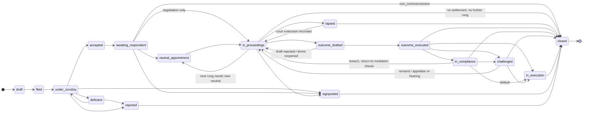
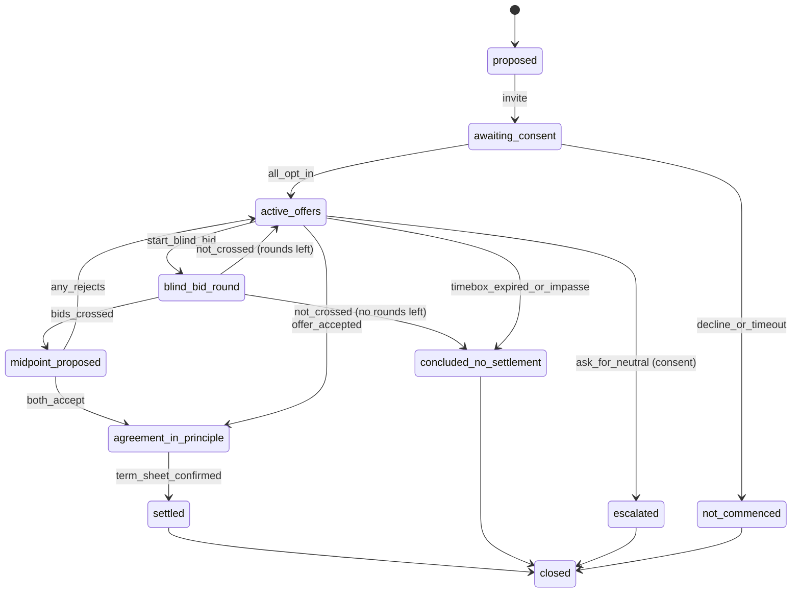
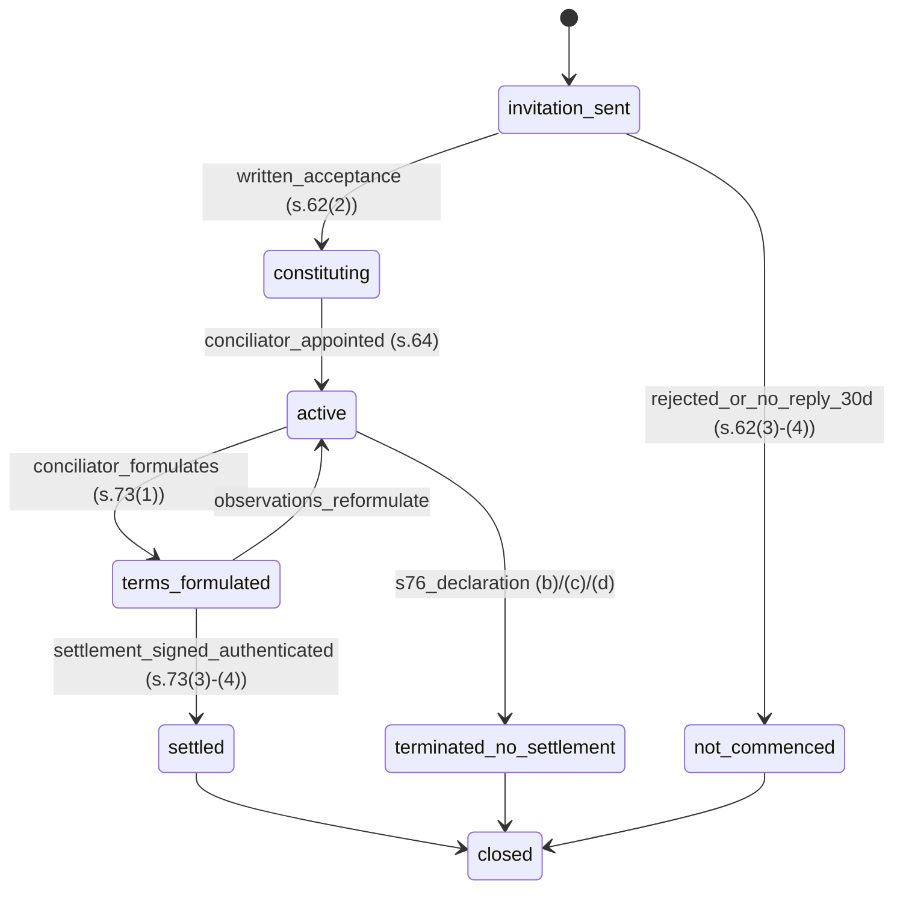
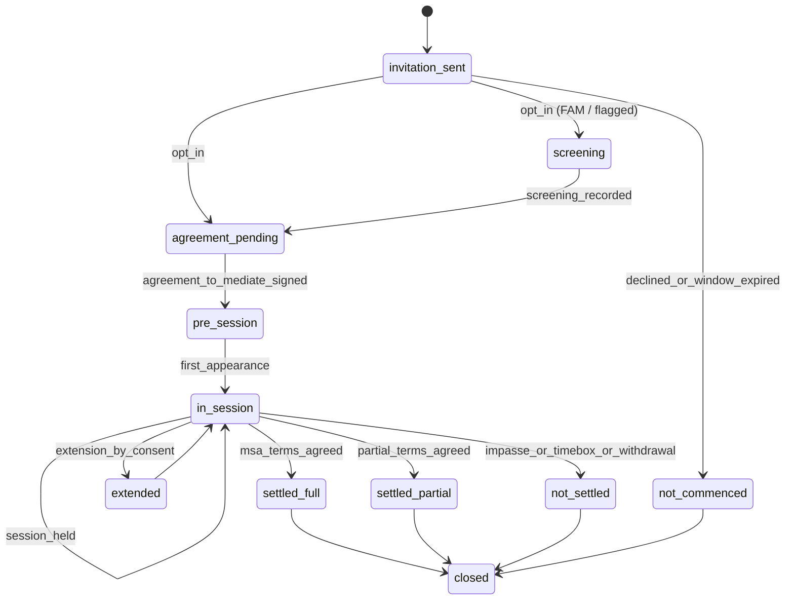
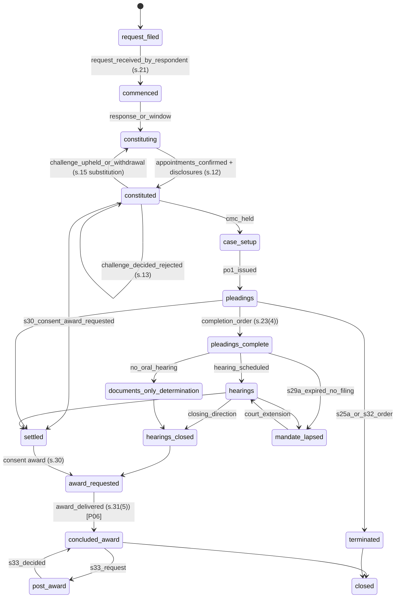
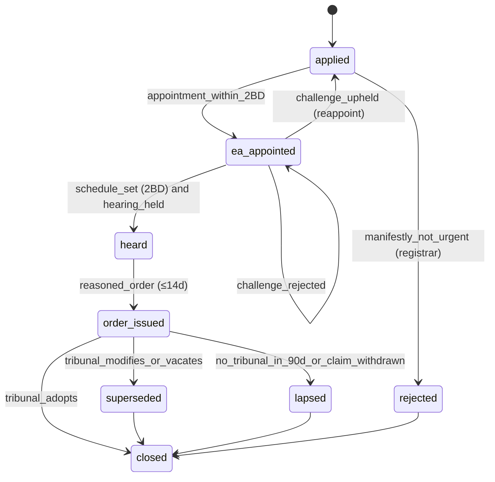
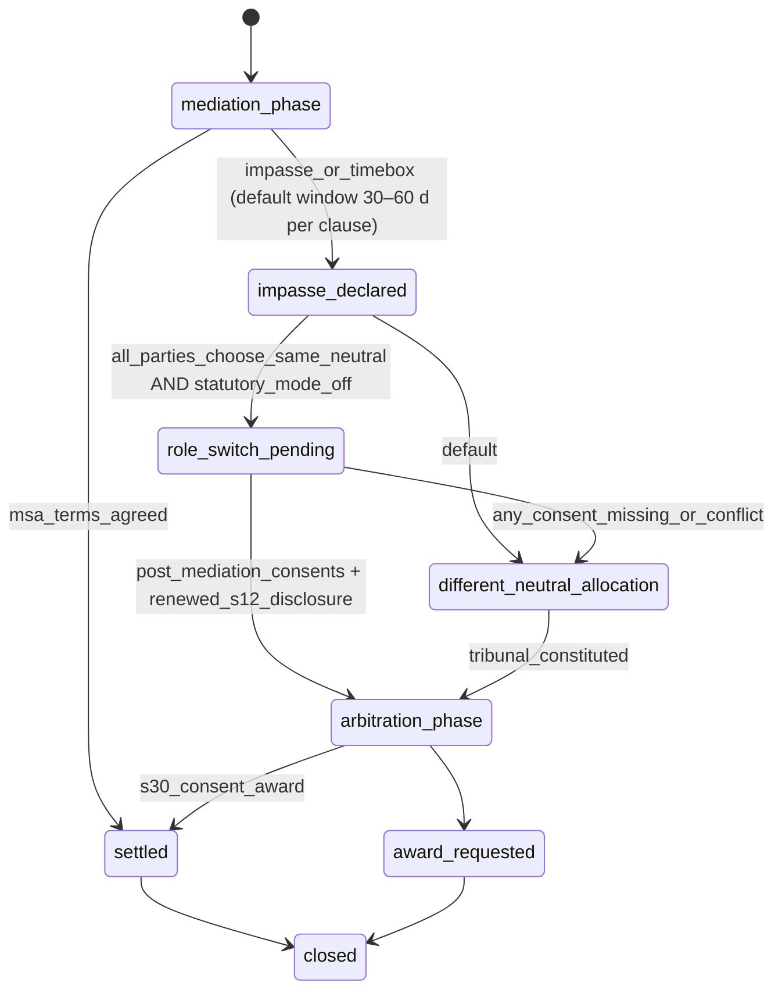
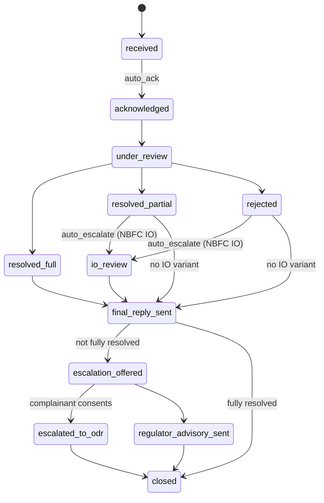
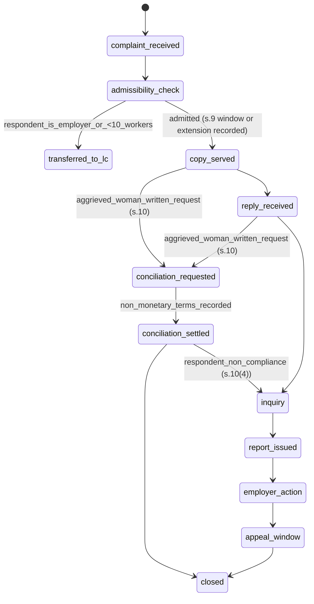
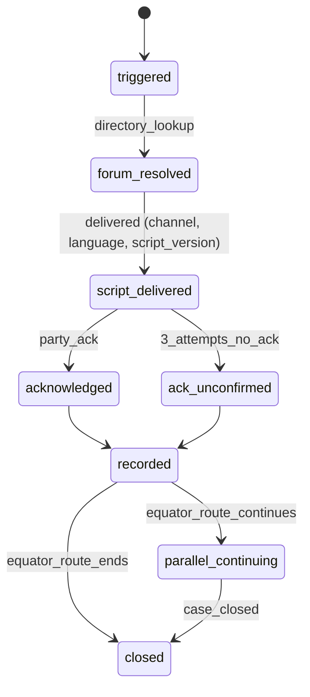

# Appendix A — Workflows and State Machines

> Binding reference for P02, P04, P06, P08 and P09. Encode every machine in `packages/domain/state-machines/` as pure TypeScript definitions; the server (`cases`, `proceedings`, `grm`, `posh`, `routing` modules) is authoritative; Temporal executes durable steps and timers. Every row of every transition table below must have an automated test named `SM-<machine>-<row>`. If this appendix conflicts with `01_MASTER_PROMPT.md`, the master wins and the conflict is raised in `docs/adr/`.

---

## 0. Conventions

- **Columns.** *State* (current), *Event* (command or domain trigger), *Guard* (all conditions must hold; otherwise the transition is refused with a problem+json `code`), *Next* (resulting state), *Side-effects* (writes, tasks, notices), *Clocks* (start ▶, stop ■, extend ⊕, satisfy ✓ — clock kinds from §6), *Events* (CloudEvents emitted; prefix `equator.` omitted in tables, e.g. `cases.case.filed.v1` = `equator.cases.case.filed.v1`).
- **Every transition** writes `core.case_status_history` / `core.proceeding_status_history`, an `audit.audit_events` row (NN-22) and an outbox event; none may be back-dated (server time only).
- **Guards referencing law** resolve through `core.legal_rules`; a guard whose rule is `UNVERIFIED` keeps the dependent feature behind a flag that defaults OFF (master §0).
- **"All parties"** means every `case_parties` row with role `claimant`, `respondent`, `co_claimant` or `co_respondent`, acting personally or through counsel with the needed mandate scope.
- **Owner rule.** Every clock in category `statutory`, `contractual` or `rules_of_procedure` must have an owner while running (NN-04).
- Error codes are lower snake case and catalogued in Appendix F.

---

## 1. State vocabularies

| Machine | States |
|---|---|
| Case (master §5.1) | `draft`, `filed`, `under_scrutiny`, `deficient`, `accepted`, `signposted`, `rejected`, `awaiting_respondent`, `neutral_appointment`, `in_proceedings`, `outcome_drafted`, `outcome_executed`, `in_compliance`, `closed`; side states `on_hold`, `withdrawn`, `lapsed`, `challenged`, `in_execution` |
| Proceeding (common shell) | `proposed`, `awaiting_consent`, `constituting`, `active`, `suspended`, `settled`, `concluded_no_settlement`, `award_requested`, `concluded_award`, `mandate_lapsed`, `not_commenced`, `closed` — mechanisms refine `active` into the sub-states below |
| Grievance ticket | `received`, `acknowledged`, `under_review`, `resolved_full`, `resolved_partial`, `rejected`, `io_review`, `final_reply_sent`, `escalation_offered`, `escalated_to_odr`, `regulator_advisory_sent`, `closed` |
| POSH inquiry (sealed) | `complaint_received`, `admissibility_check`, `copy_served`, `reply_received`, `conciliation_requested`, `conciliation_settled`, `inquiry`, `report_issued`, `employer_action`, `appeal_window`, `closed`, `transferred_to_lc` |
| Signposting | `triggered`, `forum_resolved`, `script_delivered`, `acknowledged`, `ack_unconfirmed`, `recorded`, `parallel_continuing`, `closed` |

`on_hold` and `withdrawn` are reachable from every non-terminal state (§2.4); they are omitted from the diagram for legibility.

---

## 2. Canonical case machine

### 2.1 Notes on the canonical sequence
- Notice precedes neutral appointment (`accepted → awaiting_respondent → neutral_appointment`), matching the FIN, FAM, WRK and INS workflows; for arbitration, "notice" is the s.21 request/notice of arbitration, and commencement is the respondent's receipt (A&C Act 1996 s.21).
- Negotiation needs no neutral, so it goes straight to `in_proceedings`.
- The case state is **derived** (§2.3) from proceedings and compliance; the transitions below are the only permitted derivations.

### 2.2 Transition table

| # | State | Event | Guard | Next | Side-effects | Clocks | Events |
|---|---|---|---|---|---|---|---|
| C01 | — | `create_draft` | authenticated filer; tenant allows vertical | `draft` | form submission pinned to schema version | ▶ `draft_expiry` (30 d, SLA) | `cases.case.drafted.v1` |
| C02 | `draft` | `submit` | schema valid; consents (`dispute_administration`, Rules version, online mode) true; `fee_status ∈ {paid, deferred, waived, offline_verified}`; not POSH (`422 posh_must_be_sealed`); enterprise payload has no neutral fields (`422 neutral_selection_not_permitted`) | `filed` | pin ruleset/form/procedure/fee versions (NN-21); filing reference; route decision; ledger entries for documents; scrutiny task | ■ `draft_expiry`; ▶ `sla_scrutiny` (2 WD; INS 1 WD); ▶ `limitation_*` previews as `pending_trigger` | `cases.case.filed.v1`, `routing.decision.made.v1` |
| C03 | `draft` | `draft_expired` | no activity for 30 d | (deleted) | purge per retention | ■ | `cases.draft.expired.v1` |
| C04 | `filed` | `scrutiny_started` | case manager assigned | `under_scrutiny` | checklist instantiated from rule pack | — | `intake.scrutiny.started.v1` |
| C05 | `under_scrutiny` | `raise_deficiency` | ≥ 1 curable defect recorded | `deficient` | deficiency notice (P02 notice engine) | ■ `sla_scrutiny`; ▶ `deficiency_cure` (15 d, +7 once) | `intake.deficiency.raised.v1` |
| C06 | `deficient` | `cure_submitted` | before `deficiency_cure.due_at`; all open deficiencies addressed | `under_scrutiny` | re-check items | ✓ `deficiency_cure`; ▶ `sla_scrutiny` (1 WD) | `intake.deficiency.cured.v1` |
| C07 | `deficient` | `cure_extension_granted` | first request; before due | `deficient` | — | ⊕ `deficiency_cure` +7 d | `clocks.clock.extended.v1` |
| C08 | `deficient` | `cure_window_expired` | due passed; no cure | `rejected` | reason `deficiency_not_cured`; refund rule hook (P05); notice stating limitation continues | ■ `deficiency_cure` (expired) | `cases.case.rejected.v1` |
| C09 | `under_scrutiny` | `accept` | checklist pass; requested mechanism ∈ route set (master §5.2); arbitrability screen holds for adjudicative mechanisms (NN-06); INT gates recorded (NN-19); FIN arbitration clause names Equator ex ante (NN-03); INS retail never routed to arbitration; FAM screening scheduled | `accepted` | case number `EQ/{VERT}/{CITY}/{YYYY}/{NNNNN}`; clocks created with owners; notice campaign composed | ■ `sla_scrutiny`; ▶ statutory clocks per route (e.g. `limitation_contract`, `ins_ombudsman_1y`, `rbi_ios_filing`) | `cases.case.accepted.v1` |
| C10 | `under_scrutiny` | `signpost` | route set contains only signposting, or claimant elects a statutory/free forum | `signposted` | signposting machine §3.15 started | ■ `sla_scrutiny`; ▶ `signpost_last_date` | `cases.case.signposted.v1` |
| C11 | `under_scrutiny` | `reject` | registrar approval; reason ∈ {duplicate, abusive, outside_mandate, prohibited_subject, sanctions_hit, no_jurisdiction_clause} | `rejected` | notice; refund hook | ■ `sla_scrutiny` | `cases.case.rejected.v1` |
| C12 | `under_scrutiny` | `consolidate_into` | registrar approval; same parties or all-party consent; target case not past `awaiting_respondent` | `closed` | `closure_reason = consolidated`; link `consolidated_into`; claims merged into target | ■ all case clocks (moved to target group where shared) | `cases.case.consolidated.v1` |
| C13 | `accepted` | `notice_dispatched` | ≥ 1 contact point per respondent; ContactWindowGuard passes for FIN borrower channels (NN-12) | `awaiting_respondent` | NoticeCampaignWorkflow started | ▶ `service_second_attempt` (7 d) | `notices.notice.dispatched.v1` |
| C14 | `awaiting_respondent` | `notice_served` | deemed-service rule satisfied (A&C s.3 for arbitration) | `awaiting_respondent` | service certificate | ■ `service_second_attempt`; ▶ `response_window` (14 d; FAM +7 once; arbitration per Rules); arbitration: record `commenced_at` (s.21) | `notices.notice.served.v1` |
| C15 | `awaiting_respondent` | `response_filed` | within window or late-response leave; mechanism needs a neutral | `neutral_appointment` | appointment request to P03 | ✓ `response_window`; ▶ `sla_neutral_appointment` (7 d; arbitration constitution 30 d) | `cases.response.filed.v1` |
| C16 | `awaiting_respondent` | `response_filed` (negotiation) | mechanism = negotiation; both parties opted in | `in_proceedings` | negotiation proceeding opened | ✓ `response_window`; ▶ `neg_timebox` | `proceedings.proceeding.opened.v1` |
| C17 | `awaiting_respondent` | `response_window_expired` (adjudicative) | arbitration/expert determination with binding agreement; service deemed under A&C s.3 | `neutral_appointment` | proceed per s.25 (respondent default does not equal admission) | ■ `response_window` (expired, B-AUTO) | `cases.response.defaulted.v1` |
| C18 | `awaiting_respondent` | `response_window_expired` (consensual) | second attempt done; window expired; no opt-in | `closed` or `signposted` | non-commencement notice/report; signposting event where closure policy requires (NN-20) | ■ `response_window` | `proceedings.report.issued.v1`, `cases.case.closed.v1` |
| C19 | `awaiting_respondent` | `respondent_declined` | written decline (consensual) | `closed` / `signposted` | as C18 | ■ | as C18 |
| C20 | `neutral_appointment` | `appointment_confirmed` | P03: allocation log, conflict clear, acceptance, Sixth Schedule disclosure (arbitration); no lender choice/veto (NN-03); FAM DV-trained mediator where safety flag; INT neutral-nationality default (NN-19) | `in_proceedings` | proceeding moves to `active` (or `constituting` → `active`) | ✓ `sla_neutral_appointment`; ▶ mechanism clocks (§3) | `neutrals.appointment.confirmed.v1`, `proceedings.proceeding.state_changed.v1` |
| C21 | `neutral_appointment` | `appointment_failed` | no eligible neutral after 3 allocation runs | `neutral_appointment` | escalate to panel_manager; widen panel per policy | — | `neutrals.allocation.failed.v1` |
| C22 | `in_proceedings` | `next_rung_opened` | prior proceeding `concluded_no_settlement`; pathway allows next rung; consent/agreement for that rung; new neutral required | `neutral_appointment` | new proceeding (`parent_proceeding_id`); vault carry-forward rules (P04 FR-P04-04) | ▶ `sla_neutral_appointment` | `proceedings.proceeding.opened.v1` |
| C23 | `in_proceedings` | `next_rung_opened` (same neutral or no neutral) | as C22 but neutral continues lawfully (e.g., arb-med under s.30(1)) or none needed | `in_proceedings` | new proceeding | mechanism clocks | `proceedings.proceeding.opened.v1` |
| C24 | `in_proceedings` | `terms_agreed` | settlement terms confirmed by all parties; FIN: authority reference and officer limit; WRK: statutory dues not waived; FAM: maintenance not waived, child terms flagged "subject to court"; INS: discharge limited to this claim | `outcome_drafted` | P06 settlement draft; NN-08 route if immovable property/will/trust/PoA | — | `proceedings.settlement.terms_agreed.v1` |
| C25 | `in_proceedings` | `award_draft_requested` | proceeding `award_requested`; no open Seventh Schedule ground without valid post-dispute waiver; mandate not lapsed | `outcome_drafted` | P06 award drafting | `arb_s29a` keeps running until award signed | `proceedings.award.draft_requested.v1` |
| C26 | `in_proceedings` | `concluded_no_settlement` | no further rung, or parties decline next rung; closure policy satisfied | `closed` | non-settlement report; signposting event if required | ■ mechanism clocks; statutory limitation clocks continue as informational to party until closure notice | `proceedings.proceeding.concluded.v1`, `cases.case.closed.v1` |
| C27 | `in_proceedings` | `concluded_no_settlement` (signposting required) | `closure_policy.require_signposting` and no signposting event yet | `signposted` | signposting machine | ▶ `signpost_last_date` | `cases.case.signposted.v1` |
| C28 | `in_proceedings` | `mandate_lapsed` | `arb_s29a` (domestic) expired with no recorded court filing | `lapsed` | Critical incident; block tribunal actions | `arb_s29a` breached (B-LAPSE) | `proceedings.mandate.lapsed.v1` |
| C29 | `lapsed` | `court_extension_recorded` | court order uploaded and verified by registrar; substitution done if ordered (s.29A(6)) | `in_proceedings` | resume; new due date | ▶ `arb_s29a_court_ext` (as ordered) | `proceedings.mandate.restored.v1` |
| C30 | `lapsed` | `termination_confirmed` | court refuses extension or parties elect not to proceed | `closed` | termination record; refund/fee hooks | ■ | `cases.case.closed.v1` |
| C31 | `in_proceedings` | `s38_termination` | s.38(2) deposit not paid after notice and an opportunity to pay or seek suspension (s.38(2)); other party has not paid the share; termination order under s.32(2) | `lapsed` | termination order; post-termination recall-application task (recall before the tribunal, then s.14(2); no fresh s.11 petition — *Harshbir Singh Pannu v Jaswinder Singh*, 2025 INSC 1400, 9 Dec 2025) | ▶ `s38_recall_window` (30 d, Rules) | `proceedings.proceeding.state_changed.v1` |
| C32 | `outcome_drafted` | `draft_rejected` | maker–checker returns draft; or party withdraws assent before signing (consensual) | `in_proceedings` | reopen proceeding `active` | — | `outcomes.draft.rejected.v1` |
| C33 | `outcome_drafted` | `outcome_executed` | all signatures (parties; mediator/conciliator authentication; tribunal); e-stamp attached per state matrix (NN-09); NN-08 physical execution task created where applicable; award delivered under s.31(5) | `outcome_executed` | certified copies; ledger; BSA s.63(4) certificate (NN-10) | ■ `arb_s29a` ✓; ▶ `arb_s34_window` (3 m + 30 d) / `med_s28_challenge` (flag) / `appeal_filing` (opt-in) / `arb_s33_request` (30 d) / `med_s20_registration` (flag) / `award_stamping` | `outcomes.outcome.executed.v1` |
| C34 | `outcome_executed` | `compliance_started` | outcome has instalments, escrow milestones or external obligations (NOC, bureau update, relieving letter, adverse-remark withdrawal) | `in_compliance` | compliance tracker; escrow milestones (NN-13) | ▶ `compliance_milestone_*` | `execution.compliance.started.v1` |
| C35 | `outcome_executed` | `close` | no compliance obligations; challenge windows either elapsed or tracked post-closure per policy; closure policy satisfied (owned clocks, signposting, registration task) | `closed` | closure notice; retention class set | ■ remaining clocks (cancel with reason) | `cases.case.closed.v1` |
| C36 | `outcome_executed`, `in_compliance` | `challenge_filed` | evidence of filing (court, case no., date): s.34 / Mediation Act s.28 (flag) / internal appeal | `challenged` | legal hold on documents; escrow release paused | ■ `arb_s34_window` ✓ | `execution.challenge.filed.v1` |
| C37 | `outcome_executed`, `in_compliance` | `execution_initiated` | s.34 window elapsed without challenge (or challenge failed); default on obligations | `in_execution` | execution pack (P06): award, agreement, service certificates, stamp certificate, ledger, s.63 certificate | ▶ `execution_limitation` (12 y, informational) | `execution.execution.initiated.v1` |
| C38 | `in_compliance` | `obligations_performed` | all milestones released with evidence; clean-exit conditions (FIN: paid + escrow released + NOC + bureau updated; WRK: relieving + assets + PF/gratuity confirmation) | `closed` | closure notice | ■ all | `cases.case.closed.v1` |
| C39 | `in_compliance` | `breach_return_to_mediation` | settlement contains return-to-mediation clause; 7-day cure notice expired | `in_proceedings` | new mediation proceeding; escrow release paused | ▶ mechanism clocks | `execution.compliance.breached.v1` |
| C40 | `challenged` | `challenge_dismissed` | court/appellate order uploaded | `in_execution` or prior state | resume | — | `execution.challenge.decided.v1` |
| C41 | `challenged` | `award_set_aside` | order uploaded | `closed` | record; signposting of remaining remedies | — | `execution.challenge.decided.v1` |
| C42 | `challenged` | `remanded` | order directs fresh proceedings / s.34(4) adjournment to eliminate grounds / appellate re-hearing | `in_proceedings` | proceeding reopened under order | ▶ per order | `execution.challenge.decided.v1` |
| C43 | `in_execution` | `execution_satisfied` | satisfaction recorded with evidence | `closed` | — | ■ | `cases.case.closed.v1` |
| C44 | `signposted` | `signposting_completed` | signposting event with delivery evidence; party ack or 3 unacknowledged attempts recorded | `closed` | closure notice listing forum and last date | `signpost_last_date` stays as informational | `cases.case.closed.v1` |
| C45 | `rejected` | `close` | notice delivered; refund decision recorded | `closed` | — | — | `cases.case.closed.v1` |
| C46 | any non-terminal | `withdraw` | claimant (or all claimants) with OTP step-up; organisation: authorised signatory; arbitration after constitution: tribunal termination order (s.32(2)(a)) | `withdrawn` | notices; fee hook; linked matters not cascaded | ■ case clocks (cancel `withdrawn`) | `cases.case.withdrawn.v1` |
| C47 | `withdrawn` | `close` | notices delivered; fee consequences recorded | `closed` | — | — | `cases.case.closed.v1` |
| C48 | any non-terminal | `hold` | reason ∈ §2.4; authorised role | `on_hold` | store `held_from_state`; clock policy per reason | per §2.4 | `cases.case.held.v1` |
| C49 | `on_hold` | `resume` | hold reason cleared with evidence | `held_from_state` | — | resume suspended SLAs | `cases.case.resumed.v1` |
| C50 | any | `close` (guarded) | `core.guard_case_closure()` passes: no running unowned clock (`409 unowned_clocks`), signposting where required (`409 signposting_required`), registration task where required | `closed` | retention schedule (8 y), caucus shred timer (12 m), legal hold check | ■ | `cases.case.closed.v1` |

### 2.3 Case-state derivation from proceedings
Computed on every proceeding event (pure function `deriveCaseState(case, proceedings, compliance)`), precedence top-down:
1. Side states set explicitly (`on_hold`, `withdrawn`) win.
2. Any proceeding `mandate_lapsed` → `lapsed`.
3. Any challenge record open → `challenged`; any execution record open → `in_execution`.
4. Compliance obligations open → `in_compliance`.
5. Outcome executed and no obligations → `outcome_executed` (until `close`).
6. Outcome draft open → `outcome_drafted`.
7. Any proceeding in `active`, `suspended`, `award_requested` → `in_proceedings`.
8. Any proceeding in `proposed`/`awaiting_consent`/`constituting` needing a neutral → `neutral_appointment`.
A derived change that is not a legal row of §2.2 raises `case_derivation_conflict` and an ops alert; it is never applied silently.

### 2.4 Side states: `on_hold` reasons and clock policy

| Reason | Who may set | Statutory clocks | Contractual / rules clocks | SLA clocks | Evidence to resume |
|---|---|---|---|---|---|
| `court_stay` | registrar | continue unless a legal rule records the stay's effect (then `suspended` with rule id) | suspended per order | suspended | order vacated/disposed |
| `sensitivity_pause` (FAM counselling, bereavement, medical emergency) | safeguarding_lead, neutral | **continue** (IN-G-06; mediation never pauses limitation) | suspended by consent only | suspended | lead clears |
| `death_or_dissolution` | registrar | per A&C s.40 (arbitration agreement not discharged by death; enforceable by or against legal representatives) and, for court proceedings, CPC O.XXII with Limitation Act Art. 120 (90 days) — owner prompted | suspended | suspended | successor/heir admitted |
| `ibc_moratorium` (IBC 2016 s.14) | registrar | per moratorium rule in register | suspended | suspended | moratorium ends/settlement approved |
| `party_incapacity` | neutral, safeguarding_lead | continue | suspended | suspended | guardian/representative appointed |
| `fee_non_payment` (pre-s.38 notice) | case_manager | continue | continue | suspended | payment |
| `sanctions_review` (INT) | registrar | continue | suspended | suspended | screen cleared |

---

## 3. Mechanism machines

All mechanisms share the shell in §1; the tables below list mechanism-specific rows. Column "Clocks" uses §6 kinds.

### 3.1 Negotiation (assisted / blind-bid)

| # | State | Event | Guard | Next | Side-effects | Clocks | Events |
|---|---|---|---|---|---|---|---|
| N01 | `proposed` | `invite` | negotiation permitted (§5.2 master); counterparty contactable | `awaiting_consent` | invitation notice | ▶ `neg_optin` (7 d) | `proceedings.proceeding.opened.v1` |
| N02 | `awaiting_consent` | `all_opt_in` | each party opt-in recorded | `active_offers` | — | ■ `neg_optin`; ▶ `neg_timebox` (21 d) | `proceedings.proceeding.state_changed.v1` |
| N03 | `active_offers` | `offer_submitted` | round ≤ 6; FIN lender: authority ref + officer limit ≥ amount; coercion lint passes | `active_offers` | offer in `settlement_communications` vault | ▶ `offer_validity` (72 h) | `proceedings.offer.submitted.v1` |
| N04 | `active_offers` | `start_blind_bid` | monetary dispute; both parties agree; not FAM maintenance with vulnerability; no safety flag | `blind_bid_round` | per-proceeding bid key | ▶ `bid_round` (48 h) | — |
| N05 | `blind_bid_round` | `round_closed` | both bids in, or window expired (missing bid = not crossed) | `midpoint_proposed` if `r_max ≥ c_min` else `active_offers` / `concluded_no_settlement` | deterministic midpoint, rounded ₹100; nothing revealed if not crossed | ■ `bid_round`; ▶ `midpoint_acceptance` (72 h) | `proceedings.blind_bid.round_closed.v1` |
| N06 | `midpoint_proposed` | `both_accept` | within 72 h | `agreement_in_principle` | term sheet generated | ■ | — |
| N07 | `active_offers` | `offer_accepted` | offer valid; acceptor has `settle` scope | `agreement_in_principle` | term sheet | ■ `offer_validity` | — |
| N08 | `agreement_in_principle` | `term_sheet_confirmed` | all parties confirm generated term sheet | `settled` | case C24 | ■ `neg_timebox` ✓ | `proceedings.settlement.terms_agreed.v1` |
| N09 | `active_offers` | `ask_for_neutral` | any party; others consent | `escalated` | open conciliation/mediation (case C22) | ■ `neg_timebox` | — |
| N10 | `active_offers` | `neg_timebox_expired` | no agreement; extension not agreed | `concluded_no_settlement` | report (facts only); bids shredded at +30 d | ■ | `proceedings.proceeding.concluded.v1` |

### 3.2 Conciliation (A&C Act 1996 Part III, ss.61–81)

| # | State | Event | Guard | Next | Side-effects | Clocks | Events |
|---|---|---|---|---|---|---|---|
| K01 | `invitation_sent` | `accepted_in_writing` | acceptance by every other party (s.62(2)) | `constituting` | — | ■ `conc_s62_reply` | `proceedings.proceeding.state_changed.v1` |
| K02 | `invitation_sent` | `no_reply_lapse` | 30 d (or stated period) elapsed; inviting party elects (s.62(4)) | `not_commenced` | lapse record | ■ `conc_s62_reply` (expired) | `proceedings.proceeding.concluded.v1` |
| K03 | `constituting` | `conciliator_appointed` | one conciliator unless agreed (s.63); appointment via Equator on request (s.64(2)); disclosure filed | `active` | statements requested (s.65) | ▶ `conc_timebox` (30 d default) | `neutrals.appointment.confirmed.v1` |
| K04 | `active` | `caucus_submission` | s.70 choice recorded (share / keep confidential) | `active` | vault `settlement_communications` | — | — |
| K05 | `active` | `terms_formulated` | conciliator drafts terms (s.73(1)) | `terms_formulated` | terms to parties for observations | ▶ `conc_observations` (7 d) | — |
| K06 | `terms_formulated` | `settlement_signed` | signed by parties; authenticated by conciliator (s.73(3)–(4)) | `settled` | P06: stamp as award-equivalent (s.74; NN-09) | ■ `conc_timebox` ✓ | `proceedings.settlement.terms_agreed.v1` |
| K07 | `active` / `terms_formulated` | `s76_declaration` | (b) conciliator declares efforts unjustified; (c) parties jointly; (d) one party | `terminated_no_settlement` | non-settlement report; next rung offer; s.80 bar noted | ■ | `proceedings.proceeding.concluded.v1` |

Rules: recording blocked (NN-11); confidentiality s.75; inadmissibility s.81; conciliator not to act as arbitrator/counsel unless parties agree (s.80 → med-arb guard §3.8); parties' undertaking not to start proceedings during conciliation save to preserve rights (s.77).

### 3.3 Mediation — contractual mode (default)

| # | State | Event | Guard | Next | Side-effects | Clocks | Events |
|---|---|---|---|---|---|---|---|
| M01 | `invitation_sent` | `opt_in` | respondent opt-in; FAM or safety cue → screening required | `screening` / `agreement_pending` | screening task (sealed) | ■ `response_window` ✓ | — |
| M02 | `screening` | `screening_recorded` | each party screened privately | `agreement_pending` | `safety_flag` set if `shuttle_only`/`not_suitable_safety`; `not_suitable_capacity` → case `on_hold` | — | `hearings.safety_flag.raised.v1` (if flag) |
| M03 | `agreement_pending` | `agreement_signed` | all parties sign Agreement to Mediate incl. confidentiality, non-recording, authority to settle (INS/FIN institutional authority in writing), online-mode consent | `pre_session` | orientation scheduled | ▶ `sla_first_session` (14 d) | — |
| M04 | `pre_session` | `first_appearance` | parties appear before the mediator | `in_session` | attendance register | ■ `sla_first_session`; ▶ `med_contract_timebox` (FIN 60, COM 60, INS 45, WRK 45, FAM 120, INT 60 days) | `hearings.session.started.v1` |
| M05 | `in_session` | `session_scheduled` (joint) | no `safety_flag` (`409 safety_flag_blocks_joint_session`) | `in_session` | rooms | — | `hearings.session.scheduled.v1` |
| M06 | `in_session` | `extension_by_consent` | all-party consent; within max +60 d | `extended` → `in_session` | — | ⊕ `med_contract_timebox` | `clocks.clock.extended.v1` |
| M07 | `in_session` | `msa_terms_agreed` | terms confirmed by all; vertical invariants (no waiver of statutory dues/maintenance; child terms "subject to court"; POSH never folded in) | `settled_full` | P06 settlement; enforcement-route choice (contract; consent award via arb-med-arb; s.73/74 if conciliation chosen) | ✓ `med_contract_timebox` | `proceedings.settlement.terms_agreed.v1` |
| M08 | `in_session` | `partial_terms_agreed` | as M07 for agreed heads | `settled_partial` | partial MSA + handoff memo (FAM F-28) for remaining heads → next rung/signposting | ✓ | same |
| M09 | `in_session` | `impasse` / `timebox_expired` / `party_withdrew` / `fees_unpaid_after_notice` | mediator declaration or event | `not_settled` | non-settlement report (facts only); next rung offer; COM: notice that Equator report ≠ s.12A PIMS | ■ | `proceedings.report.issued.v1` |

### 3.4 Mediation — statutory mode (flag `mediation_statutory_mode`; Mediation Act 2023)
Same graph as §3.3 with these replacements (each behind its provision sub-flag; all OFF until notified — NN-05):

| # | State | Event | Guard | Next | Side-effects | Clocks | Events |
|---|---|---|---|---|---|---|---|
| S01 | `agreement_pending` | `online_consent_signed` | written online-mode consent of every party (s.30) | `agreement_pending` | — | — | — |
| S02 | `pre_session` | `first_appearance` | S01 done for online sessions | `in_session` | — | ▶ `med_s18` (due = date fixed for the first appearance + 120 d, s.18(1); created when that date is fixed, so a non-appearance does not stop it; alerts d90/110/120) | `hearings.session.started.v1` |
| S03 | `in_session` | `extension_by_agreement` | all parties agree; once; ≤ 60 d (s.18(2)) | `extended` | — | ⊕ `med_s18` (alerts d150/170) | `clocks.clock.extended.v1` |
| S04 | `in_session` | `msa_signed` | signed by parties and **authenticated by mediator** (s.19) | `settled_full` | copies to parties and Equator as MSP; MSA registration task (s.20) | ✓ `med_s18`; ▶ `med_s20_registration` (180 d); ▶ `med_s28_challenge` (90 d + 90) on receipt | `proceedings.settlement.terms_agreed.v1` |
| S05 | `in_session` | `med_s18_expired` | no settlement; no (further) extension | `not_settled` | non-settlement report (Mediation Act s.21 in statutory mode; Equator Rules in contractual mode) | ■ (B-AUTO) | `proceedings.report.issued.v1` |
| S06 | any | `start_recording` | — | refused | `422 mediation_recording_prohibited` (s.22) | — | — |
| S07 | any | `same_neutral_arbitrator` | — | refused | statutory bar (Mediation Act s.17(a); no party carve-out; consents do not cure — `409 role_switch_consent_required`) | — | — |

### 3.5 Arbitration (institutional under Equator Rules)

| # | State | Event | Guard | Next | Side-effects | Clocks | Events |
|---|---|---|---|---|---|---|---|
| A01 | `request_filed` | `request_received` | deemed service (A&C s.3) | `commenced` | `commenced_at` (s.21) | ▶ `arb_response` (14 d, +14 once); ▶ `sla_constitution` (30 d) | `proceedings.proceeding.opened.v1` |
| A02 | `commenced` | `response_or_window` | response filed or window expired (proceed; s.25(b) later) | `constituting` | allocation request (P03) | ■ `arb_response` | — |
| A03 | `constituting` | `co_arbitrator_nominated` | three-member and `equal_footing = true` (COM/INT only, NN-03); one nominee per side from roster or outside, confirmed by the Appointments Committee after disclosure and conflict check; within 15 d (otherwise every seat is allocated by Equator) | `constituting` | disclosure request | ▶ `arb_nomination` (15 d) | — |
| A04 | `constituting` | `appointments_confirmed` | every member accepted + Sixth Schedule disclosure; no unwaived Seventh Schedule ground; presiding/sole appointed by Equator Appointments Committee (NN-03); INT nationality default (NN-19) | `constituted` | constitution notice to parties; 15-day challenge window | ■ `sla_constitution`; ▶ `arb_s13_challenge` (15 d); ▶ `arb_s23_4` (6 m from receipt of notice of appointment); ▶ `sla_po1` (21 d) | `proceedings.tribunal.constituted.v1` |
| A05 | `constituted`+ | `challenge_filed` | s.13(2) within 15 d of awareness (late → flagged) | same | Appointments Committee file (P03 FR-P03-28; automatic recusal); arbitrator/other party reply 7 d | ▶ `challenge_decision` (15 d after replies) | `proceedings.challenge.filed.v1` |
| A06 | same | `challenge_upheld` / `arbitrator_withdrew` / `other_party_agreed` | committee decision, withdrawal or other party's agreement (s.13(3)) | `constituting` | substitution (s.15) via P03 | `arb_s29a` continues; `arb_s23_4` per new appointment | `proceedings.challenge.decided.v1` |
| A07 | same | `challenge_rejected` | reasoned decision | same | tribunal continues and makes the award (s.13(4)); s.34 remedy noted (s.13(5)) | ■ `challenge_decision` | `proceedings.challenge.decided.v1` |
| A08 | `constituted` | `cmc_held` | within 21 d target | `case_setup` | PO1 draft | — | — |
| A09 | `case_setup` | `po1_issued` | PO1 dates for SoC/SoD within `arb_s23_4`; signed | `pleadings` | timetable tasks | ■ `sla_po1` ✓ | `proceedings.order.issued.v1` |
| A10 | `pleadings` | `pleading_filed` | per timetable or leave | `pleadings` | exhibits to DMS | `pleading_due_*` ✓ | — |
| A11 | `pleadings` | `claimant_default_s25a` | SoC not filed without sufficient cause | `terminated` | termination order (s.25(a)) | ■ | `proceedings.proceeding.concluded.v1` |
| A12 | `pleadings` | `completion_order` | date ≥ last pleading timestamp | `pleadings_complete` | — | ■ `arb_s23_4` ✓; ▶ `arb_s29a` (12 m; domestic) or `arb_ica_target` (ICA, advisory) | `proceedings.pleadings.completed.v1` |
| A13 | `pleadings_complete`/`hearings` | `s29a_consent_extension` | all parties e-sign before expiry; once; ≤ 6 m (s.29A(3)) | same | — | ⊕ `arb_s29a` | `proceedings.mandate.extended.v1` |
| A14 | same | `court_filing_recorded` | s.29A(5) application filed before expiry (evidence: court, case number, filing date, document) | same | mandate continues until the court disposes of the application (s.29A(4) proviso) | `arb_s29a` prompt recorded; clock shows `pending_court` | — |
| A15 | same | `s29a_expired` | domestic; 12-month period (or consent-extended 18-month period) expired; no s.29A(5) application filed before expiry | `mandate_lapsed` | block actions; incident | `arb_s29a` breached (B-LAPSE) | `proceedings.mandate.lapsed.v1` |
| A16 | `mandate_lapsed` | `court_extension` | court order uploaded extending the mandate and/or substituting the arbitrator (s.29A(4)–(6); post-expiry application maintainable — *Rohan Builders*, 2024 SCC OnLine SC 2494; substitution — *Mohan Lal Fatehpuria*, 2025 INSC 1409, as clarified in *Viva Highways v MPRDC*, SC, 7 Jan 2026) | prior state | fee-reduction flag if delay attributable to tribunal (s.29A(4) proviso) | ▶ `arb_s29a_court_ext` | `proceedings.mandate.restored.v1` |
| A17 | any active | `interim_application` (s.17) | tribunal constituted | same | hearing ≤ 7 d (urgent 48 h); order; compliance tasks | ▶ `s17_hearing` | `proceedings.order.issued.v1` |
| A18 | `pleadings_complete` | `hearing_scheduled` | notice ≥ 7 d (s.24(2)) | `hearings` | rooms; recording only with direction + consents | ▶ `hearing_notice` | `hearings.session.scheduled.v1` |
| A19 | `hearings` | `respondent_absent` | duly notified; no sufficient cause | `hearings` | ex parte continuation (s.25(c)) | — | — |
| A20 | `hearings`/`documents_only_determination` | `closing_direction` | closing submissions in or waived | `hearings_closed` | award record assembled | ▶ `award_target` (3 m, SLA; *Lancor Holdings* 2025 delay risk) | — |
| A21 | `hearings_closed` | `award_draft_requested` | Seventh Schedule clear or valid post-dispute waivers per party (*Bhadra International*, 5 Jan 2026); not lapsed; s.38 deposits resolved | `award_requested` | P06 drafting | — | `proceedings.award.draft_requested.v1` |
| A22 | any active | `settlement_reached` | parties request s.30 award; tribunal does not object | `settled` → `award_requested` | consent award on agreed terms | — | `proceedings.settlement.terms_agreed.v1` |
| A23 | `award_requested` | `award_delivered` | P06: signed (s.31(1)), reasons (s.31(3)), date/place (s.31(4)), interest (s.31(7)), costs (s.31A), stamped (NN-09), delivered to each party (s.31(5)) | `concluded_award` | case C33 | ■ `arb_s29a` ✓; ▶ `arb_s33_request` (30 d); ▶ `arb_s34_window`; ▶ `appeal_filing` (opt-in) | `outcomes.outcome.executed.v1` |
| A24 | `concluded_award` | `s33_request` | within 30 d of receipt; notice to other party | `post_award` | — | ▶ `arb_s33_decision` (30 d; additional award 60 d) | — |
| A25 | `post_award` | `s33_decided` | corrected/interpreted/additional award or refusal | `concluded_award` | P06 issues; s.34 runs from disposal of s.33 request (s.34(3)) | ■ | — |
| A26 | any active | `withdrawal_s32` | claimant withdraws; respondent no legitimate-interest objection upheld | `terminated` | termination order (s.32(2)(a)) | ■ | `proceedings.proceeding.concluded.v1` |
| A27 | any active | `s38_termination` | deposits unpaid after notice and an opportunity to pay or seek suspension (s.38(2)) | `terminated` | (case C31) | — | — |

### 3.6 Emergency arbitration (Equator Rules Schedule 1)

| # | State | Event | Guard | Next | Side-effects | Clocks | Events |
|---|---|---|---|---|---|---|---|
| E01 | `applied` | `ea_appointed` | before tribunal constitution; fee paid/deferred; EA from panel, disclosure ≤ 24 h | `ea_appointed` | — | ■ `ea_appointment` (2 BD); ▶ `ea_challenge` (1 BD); ▶ `ea_schedule` (2 BD); ▶ `ea_decision` (14 d) | `proceedings.ea.appointed.v1` |
| E02 | `ea_appointed` | `order_issued` | reasoned; signed | `order_issued` | India seat: treated as s.17(1) order (*Amazon v Future Retail*); foreign seat: s.9 advisory | ■ `ea_decision` ✓; ▶ `ea_order_lapse` (90 d) | `proceedings.ea.order_issued.v1` |
| E03 | `order_issued` | `tribunal_constituted` | — | `closed` (or `superseded` on modification) | EA barred from tribunal unless all agree | ■ `ea_order_lapse` ✓ | — |
| E04 | `order_issued` | `ea_order_lapse_expired` | no tribunal within 90 d | `lapsed` | notice | (B-AUTO) | `proceedings.ea.order_lapsed.v1` |

### 3.7 Expedited procedure and documents-only fast track

| # | State | Event | Guard | Next | Side-effects | Clocks | Events |
|---|---|---|---|---|---|---|---|
| X01 | `commenced` | `expedited_applied` | parties agree, or claim + counterclaim ≤ ₹3 crore and no objection within 7 d upheld | `constituting` (expedited) | sole arbitrator; page limits | ▶ `sla_constitution_expedited` (14 d) | — |
| X02 | `constituted` (expedited) | `po1_issued` | one CMC; single hearing ≤ 2 d or documents-only | `pleadings` | — | ▶ `arb_expedited_award` (6 m from constitution, contractual); `arb_s29a` still runs (statutory) | — |
| X03 | `commenced` | `s29b_agreed` | written agreement of all parties (s.29B(1)) before/at appointment | `constituting` (fast track) | sole arbitrator (s.29B(2)) | — | — |
| X04 | `constituted` (fast track) | `entered_upon_reference` | tribunal receives notice of appointment | `pleadings` (documents-only) | written Q&A rounds (7 d answers) | ▶ `arb_s29b` (6 m) | — |
| X05 | `pleadings` (fast track) | `oral_hearing_requested` | all parties request, or tribunal considers necessary for clarification | `hearings` | — | `arb_s29b` continues | — |
| X06 | any (fast track) | `s29b_expired` | no extension under applied s.29A provisions | `mandate_lapsed` | as A15 | (B-LAPSE) | `proceedings.mandate.lapsed.v1` |

### 3.8 Med-arb (master §5.3)

| # | State | Event | Guard | Next | Side-effects | Clocks | Events |
|---|---|---|---|---|---|---|---|
| H01 | `mediation_phase` | `impasse_declared` | mediator declaration or `medarb_window` expired | `impasse_declared` | `ended_at` stamped; caucus notes and settlement vault **frozen** | ■ `med_contract_timebox`; ■ `medarb_window` | `proceedings.proceeding.state_changed.v1` |
| H02 | `impasse_declared` | `allocate_different` | default path; mediator excluded from allocation | `different_neutral_allocation` | P03 allocation | ▶ `sla_constitution` | — |
| H03 | `impasse_declared` | `request_same_neutral` | all parties elect; statutory mode OFF (Mediation Act s.17(a) bars it outright, §3.4 S07); conciliation origin relies on A&C s.80 ("unless otherwise agreed") | `role_switch_pending` | consent instruments issued | ▶ `role_switch_consent` (7 d) | — |
| H04 | `role_switch_pending` | `role_switch_completed` | each party's `role_switch_med_arb` consent `signed_at > ended_at` (else `409 role_switch_consent_required`); renewed s.12 disclosure; no Seventh Schedule ground | `arbitration_phase` | arbitrator workspace excludes mediation vaults for life of arbitration | ■ `role_switch_consent`; arbitration clocks (A04+) | `proceedings.role_switch.completed.v1` |
| H05 | `role_switch_pending` | `consent_window_expired` / `consent_refused` | — | `different_neutral_allocation` | — | — | — |
| H06 | `arbitration_phase` | (all §3.5 rows) | vault firewall: any attempt to attach mediation material → `422 vault_firewall_violation` | — | — | — | — |

### 3.9 Arb-med (master §5.3)

| # | State | Event | Guard | Next | Side-effects | Clocks | Events |
|---|---|---|---|---|---|---|---|
| R01 | `hearings_closed` | `switch_to_arb_med` | all parties sign `arb_med_switch_s30_1` (A&C s.30(1)); remaining `arb_s29a` time ≥ mediation window + 15 d | `sealing` | — | — | — |
| R02 | `sealing` | `award_sealed` | tribunal finalises text; SHA-256 recorded in ledger; text encrypted under registrar key; disclosed to no one | `sealed_award_phase` | mediator: different neutral by default (same arbitrator only with all-party consent at R01, and never where the mediation runs in statutory mode — s.17(a)) | ▶ `arbmed_window` (≤ 30 d default) | `proceedings.award.sealed.v1` |
| R03 | `sealed_award_phase` | `mediation_settled` | terms agreed | `award_requested` (consent award s.30) | sealed text crypto-shredded 90 d after consent award delivered; hash retained | ■ `arbmed_window` | `proceedings.settlement.terms_agreed.v1` |
| R04 | `sealed_award_phase` | `mediation_failed` / `arbmed_window_expired` | — | `unsealing` | dual control (registrar + presiding arbitrator) | ■ | — |
| R05 | `unsealing` | `award_released` | text submitted for signature hash-equals sealed hash (`409 sealed_award_mismatch` otherwise); within `arb_s29a` | `award_requested` | P06 signs, stamps at signing (NN-09), delivers | `arb_s29a` ✓ on delivery | `proceedings.award.unsealed.v1` |

### 3.10 Arb-med-arb / consent-award conversion (Equator AMA Protocol)

| # | State | Event | Guard | Next | Side-effects | Clocks | Events |
|---|---|---|---|---|---|---|---|
| B01 | `commenced` | `ama_elected` | clause or all-party `ama_stay` consent | `constituting` | tribunal constituted (or for the purpose) | as A01–A04 | — |
| B02 | `constituted` | `stay_for_mediation` | tribunal stay order | `stayed_mediating` | mediation proceeding (child) under §3.3 (INT: International Mediation Rules) | ▶ `ama_window` (8 weeks, extendable by consent) | `proceedings.order.issued.v1` |
| B03 | `stayed_mediating` | `mediation_settled` | MSA terms agreed | `award_requested` (consent award s.30) | NN-19: consent award is default enforcement route (NYC) while Singapore Convention unratified | ■ `ama_window` | `proceedings.settlement.terms_agreed.v1` |
| B04 | `stayed_mediating` | `mediation_failed` | — | `case_setup` / `pleadings` | stay lifted; mediation vaults firewalled | ■; arbitration clocks resume per s.23(4)/s.29A | `proceedings.order.issued.v1` |
| B05 | (domestic, settlement first) | `consent_award_requested_post_settlement` | arbitration agreement signed; legal-review flag acknowledged **[VERIFY — open: no SC authority found; product default is Part III conciliation (s.73/s.74) for pre-arbitration settlements]** | `constituting` | tribunal constituted for the purpose | — | — |

### 3.11 Expert determination

| # | State | Event | Guard | Next | Side-effects | Clocks | Events |
|---|---|---|---|---|---|---|---|
| D01 | `proposed` | `referral_agreed` | contract clause or all-party agreement; COM/INS/INT only (master §5.2) | `constituting` | — | — | — |
| D02 | `constituting` | `expert_appointed` | `neutral_expert` accreditation (INS: IRDAI-licensed surveyor/loss assessor); disclosure | `active` | terms of reference | ▶ `ed_submissions` (21 d) | `neutrals.appointment.confirmed.v1` |
| D03 | `active` | `site_visit_recorded` | — | `active` | geotagged media to DMS | — | — |
| D04 | `active` | `draft_issued` | optional per ToR | `draft_comments` | — | ▶ `ed_comments` (14 d) | — |
| D05 | `active`/`draft_comments` | `determination_issued` | signed; INS retail: non-binding unless `ed_binding_election` after disclosure | `concluded_award`* | *not an award; outcome code `expert_determination`; P06 records compliance | ▶ `ed_compliance` per ToR | `proceedings.determination.issued.v1` |

### 3.12 Internal appeal tier (optional; Equator Appeal Rules)

| # | State | Event | Guard | Next | Side-effects | Clocks | Events |
|---|---|---|---|---|---|---|---|
| P01 | first-tier `concluded_award` | `appeal_filed` | opt-in recorded; claim ≥ threshold; within `appeal_filing` (30 d of receipt); fee | `appeal_registered` | first-tier award not final | ■ `appeal_filing` ✓ | `proceedings.appeal.filed.v1` |
| P02 | `appeal_registered` | `panel_constituted` | 3 members; none from first tier; disclosures | `appeal_active` | record compiled (open record only) | ▶ `appeal_record` (30 d) | — |
| P03 | `appeal_active` | `record_complete` | — | `appeal_hearing` | one hearing | ▶ `appeal_award` (90 d, contractual) | — |
| P04 | `appeal_hearing` | `appellate_award_delivered` | s.31 requirements; stamping | `closed` | final award; ▶ `arb_s34_window` from receipt of final (appellate) award (two-tier arbitration valid: *Centrotrade Minerals v Hindustan Copper* (2017) 2 SCC 228; s.34(3)) | ■ | `outcomes.outcome.executed.v1` |
| P05 | first-tier `concluded_award` | `appeal_window_expired` | no appeal | — | first-tier award becomes final | ■ | — |

### 3.13 Grievance ticket (GRM SaaS; P09)

| # | State | Event | Guard | Next | Side-effects | Clocks (variant) | Events |
|---|---|---|---|---|---|---|---|
| G01 | — | `ticket_received` | desk active; category valid | `received` → `acknowledged` | ack with reference + GRO details | ▶ RBI: `rbi_re_30d`; INS: `ins_grievance_14d`; IR Code: `wrk_grc_30d`; SEBI: `sebi_scores_atr_21d`; UGC: `ugc_sgrc_15d` | `grm.ticket.received.v1` |
| G02 | `under_review` | `outcome_recorded` | outcome ∈ {fully resolved, partially resolved, wholly rejected} (NBFC IO Directions 2026 taxonomy) | `resolved_full` / `resolved_partial` / `rejected` | — | — | `grm.ticket.outcome_recorded.v1` |
| G03 | `resolved_partial`/`rejected` | `auto_escalate_io` | NBFC IO applicable (NBFC-D ≥ 10 branches; NBFC-ND ≥ ₹5,000 crore with public interface); IO ≠ serving officer | `io_review` | — | ▶ `nbfc_io_escalation` (by day 20, cl.14(1)(b); or ≥ 10 d before regulatory deadline) | `grm.ticket.escalated.v1` |
| G04 | `io_review`/resolved | `final_reply` | within 30 d of complaint (RBI) | `final_reply_sent` | reply includes RB-IOS 2026 advisory: complain to the RBI Ombudsman within the period in rule `LR-RBI-*` (90 d under RB-IOS 2026, effective 1 Jul 2026; configurable, never hard-coded — master X-13) at cms.rbi.org.in / 14448 | ✓ `rbi_re_30d`; ▶ `rbi_ios_filing` (90 d, informational) | `grm.ticket.replied.v1` |
| G05 | `escalation_offered` | `escalate_to_odr` | complainant's separate informed consent incl. note that a pending arbitration may make an RB-IOS complaint non-maintainable | `escalated_to_odr` | P02 case `source = grm_escalation` (`POST /v1/escalations`, `409` without consent) | — | `grm.ticket.escalated_to_odr.v1` |
| G06 | `received` | `posh_detected` | — | refused in GRM core | route to POSH sealed module (§3.14) by opaque token | — | — |

UGC variant: SGRC 15 working days → appeal to Ombudsperson within 15 days of receipt of decision → Ombudsperson 30 days (UGC (Redressal of Grievances of Students) Regulations 2023, Regs. 5(viii), 5(ix), 7(iv)). SEBI variant: ATR within 21 calendar days (SCORES 2.0, SEBI/HO/OIAE/IGRD/CIR/P/2023/156, 20 Sep 2023; effective 1 Apr 2024).

### 3.14 POSH inquiry (sealed module `posh_sealed`; P09)

| # | State | Event | Guard | Next | Side-effects | Clocks | Events (sealed bus) |
|---|---|---|---|---|---|---|---|
| Q01 | — | `complaint_filed` | IC constituted: ≥ 1/2 women (`women*2 >= members`), presiding officer a senior woman, external member present (`422 external_member_required`, `422 women_members_insufficient`) | `complaint_received` | sealed record; opaque token to core only (NN-07) | ▶ `posh_complaint_3m` check (s.9(1); +3 m extension with recorded reasons) | `posh.complaint.received.v1` |
| Q02 | `admissibility_check` | `admitted` | within window or extension recorded | `copy_served` | copy to respondent | ▶ `posh_copy_7wd` (POSH Rules 2013 r.7(2)) | — |
| Q03 | `copy_served` | `reply_received` | — | `reply_received` | — | ▶/✓ `posh_reply_10wd` (r.7(3)) | — |
| Q04 | `copy_served`/`reply_received` | `s10_requested` | written request **by the aggrieved woman** (`422 s10_requires_aggrieved_womans_request`); before inquiry | `conciliation_requested` | — | — | — |
| Q05 | `conciliation_requested` | `s10_settled` | `monetary_basis = false` (`422 s10_no_monetary_basis`) | `conciliation_settled` | terms to employer; copies to both (s.10(2)–(3)) | — | — |
| Q06 | `reply_received`/`conciliation_settled` | `inquiry_commenced` | natural justice; no legal practitioner; external member present for every proceeding | `inquiry` | interim relief on written request (s.12) | ▶ `posh_inquiry_90d` (s.11(4)) **[VERIFY — open (counsel): s.11(4) text checked 22 Oct 2026 — silent on start point; default = complaint receipt (stricter)]** | — |
| Q07 | `inquiry` | `report_issued` | findings: proved / not proved / malicious (unproved ≠ false) | `report_issued` → `employer_action` | report to employer and parties | ✓ `posh_inquiry_90d`; ▶ `posh_report_10d` (s.13(1)) then ▶ `posh_employer_action_60d` (s.13(4)) | — |
| Q08 | `employer_action` | `action_recorded` | — | `appeal_window` | — | ▶ `posh_appeal_90d` (s.18) | — |
| Q09 | `appeal_window` | `window_closed` / `appeal_disposed` | — | `closed` | annual-report counters (s.21–22) aggregated without identities | ■ | — |

Hard rules: no POSH matter is folded into a money settlement; a separable non-POSH civil claim may be a linked core case only with the complainant's consent; POSH data never enters analytics, AI or shared dashboards (NN-07).

### 3.15 Signposting

| # | State | Event | Guard | Next | Side-effects | Clocks | Events |
|---|---|---|---|---|---|---|---|
| T01 | — | `signpost_triggered` | Explorer report, scrutiny decision, rule-pack mandatory disclosure (e.g., INS first contact), non-settlement closure | `triggered` | — | — | — |
| T02 | `triggered` | `forum_resolved` | directory row verified (`reverify_due_at > now`) — else staff verification task first | `forum_resolved` | last date to act computed from legal rule + party dates | ▶ `signpost_last_date` (informational for party; owned by case manager) | — |
| T03 | `forum_resolved` | `script_delivered` | verbatim script where mandated (INS Schedule A); party's language | `script_delivered` | evidence ledger entry (rendered content hash, channel receipt) | — | `routing.signposting.recorded.v1` |
| T04 | `script_delivered` | `party_ack` | OTP/click/verbal (recorded call) | `acknowledged` | — | — | `routing.signposting.acknowledged.v1` |
| T05 | `script_delivered` | `ack_attempts_exhausted` | 3 attempts over 7 d | `ack_unconfirmed` | — | — | — |
| T06 | `acknowledged`/`ack_unconfirmed` | `record` | event row complete | `recorded` | satisfies `closure_policy.require_signposting` | — | — |
| T07 | `recorded` | `last_date_alert` | INS `ombudsman_1y` at ≤ 60 d and case not settled/closed | `recorded` | blocking prompt task (help with Ombudsman form) | AP-L | `clocks.clock.alerted.v1` |

---

## 4. Default resolution ladders per vertical

Ladders are the pinned `pathway` of each vertical's ruleset (configurable within master §5.2 and §6 guardrails). "Time-box" is the default maximum duration of the rung before the engine offers the next rung; statutory limits in §6 always prevail. Signposting rungs run **in parallel** where shown and are never removable.

### 4.1 FIN — Financial & Loan

| Rung | Mechanism | Entry condition | Time-box | Exit / next | Notes |
|---|---|---|---|---|---|
| 0 | Grievance (RE desk, GRM) | borrower complaint against an RE | 30 d (`rbi_re_30d`) | unresolved/partial → NBFC IO (where applicable) → final reply → RB-IOS advisory (90 d, rule `LR-RBI-*`, master X-13) and/or ODR escalation with consent | RB-IOS 2026 (in force 1 Jul 2026); RBI IO Directions for NBFCs of 14 Jan 2026 (auto-escalation within 20 d, cl.14(1)(b)) |
| 0′ | Signposting (parallel) | always at first contact | — | RB-IOS; DRT/SARFAESI (banks/FIs ≥ ₹20 lakh: non-arbitrable, mediate OTS around it); NI Act s.138 → compounding (s.147)/Lok Adalat; Consumer Commission; Lok Adalat/PLA | disclose that a pending arbitration may make an RB-IOS complaint non-maintainable |
| 1 | Negotiation (assisted; blind-bid) | both opt in | 21 d | no agreement → rung 2 | lender offers carry compromise-policy reference + officer limit |
| 2 | Conciliation (Part III) | opt-in (s.62) | 30 d | s.73 settlement (s.74 award status) or s.76 termination → rung 3 | strongest domestic enforceability today for consensual outcome |
| 3 | Mediation (contractual) | opt-in | 60 d (+60 by consent); Equator target 45–60 d | MSA → P06; impasse → rung 4 (only if clause) or closure with signposting | vulnerable-borrower protocol; no blind-bid pressure |
| 4 | Arbitration (sole; institutional) | loan agreement names Equator ex ante (NN-03); NBFC (not bank/FI ≥ ₹20 lakh) | s.29A 12 m (+6) from pleadings | award → compliance/execution | seat/venue default borrower's district or neutral online seat; repeat-appointment cap per lender (Fifth Schedule item 22) |
| 3–4 alt | Med-arb (clause) | tiered clause | mediation window 30 d (F-L19) [config 30–60] | §3.8 | different neutral default |
| post | Compliance | settlement/award | per schedule | clean exit: paid + escrow released + NOC + bureau updated | escrow release T+7 of conditions |

### 4.2 COM — Commercial & Business

| Rung | Mechanism | Entry | Time-box | Exit / next | Notes |
|---|---|---|---|---|---|
| 0′ | Signposting (parallel) | rule pack | — | s.12A PIMS via DLSA/SLSA (specified value ≥ ₹3 lakh, no urgent interim relief; Form-1 application to the Authority, Form-3 non-starter report by the Authority, Form-5 failure report — PIMS Rules 2018, G.S.R. 606(E), 3 Jul 2018; 3 m + 2 m; *Patil Automation* 17 Aug 2022); MSEFC (MSMED s.18; *Mahakali Foods*); NCLT/IBC; RERA; CCI; DRT | Equator report does not satisfy s.12A; Equator prepares the Form-1 pack and tracks `pims_s12a` for the party (master M-06); flag `com.s12a_equator_authorised` OFF |
| 1 | Negotiation (senior management) | tiered clause | 15 d | → rung 2 | — |
| 2 | Mediation (contractual; INT-style rules for cross-border) — includes voluntary pre-suit mediation (master M-06) | opt-in or clause | 30 d under tiered clause; 60 d (+60) voluntary | MSA / non-settlement report → rung 3 | pre-MSEFC mediation offered to MSEs; report carries the "not s.12A / not Form-3 or Form-5" footer (P04 FR-P04-15); runs in parallel with PIMS only where lawful |
| 2 alt | Expert determination | clause/agreement on technical question | 21 d submissions + 14 d comments | determination | valuation, accounts, engineering, IP royalties |
| 3 | Arbitration (institutional; expedited ≤ ₹3 crore; EA available; s.29B on agreement) | valid s.7 agreement; arbitrable (*Vidya Drolia*) | s.29A; expedited 6 m; s.29B 6 m | award | three-member above ₹10 crore |
| 3 alt | Med-arb / arb-med / arb-med-arb | clause or consent | §3.8–3.10 | — | — |
| 4 | Appeal tier (opt-in) | ≥ ₹1 crore | 30 d filing; 90 d appellate award | final award | contractual (*Centrotrade*) |

### 4.3 FAM — Family, Marital & Property (incl. property and succession)

**4.3.1 Marital track**

| Rung | Mechanism | Entry | Time-box | Exit / next | Notes |
|---|---|---|---|---|---|
| pre | Screening (each party, private, every session) | always | before first joint session | suitable / safeguards / shuttle only / not suitable | safety flag blocks joint (FAM-G-01) |
| 0′ | Signposting (parallel) | rule pack | — | Family Court; Magistrate/Protection Officer (PWDVA); police; DLSA/Lok Adalat; helplines; High Court for s.528 BNSS quashing | Equator never mediates a crime |
| 1 | Negotiation (assisted) | both opt in; no safety flag | 14 d | → rung 2 | no blind-bid on maintenance for vulnerable party |
| 2 | Mediation (primary; contractual; statutory-mode-ready) | opt-in | 120 d from first appearance (+60) | full MSA / partial MSA + handoff memo / not settled | custody terms "subject to court"; maintenance never waived; status changes need court decree (HMA s.13B joint petition; cooling-off 6 m waivable — *Amardeep Singh v Harveen Kaur* (2017) 8 SCC 746) |
| 3 | Conciliation (optional) | opt-in | 30 d | s.73/74 for civil/property heads only | — |
| 4 | Arbitration — **property/partition heads only** | arbitration agreement; heads are in personam property rights | s.29A | award + NN-08 physical execution/registration | never status, custody, guardianship, testamentary or criminal heads (NN-06) |
| post | Court interface + compliance | MSA | escrow tranches (first motion → FIR quash/compounding by court → decree + handover) | certificate of attempted mediation | payments framed as civil settlement, never conditional in a way amounting to pressure |

**4.3.2 Property, partition and succession track**

| Rung | Mechanism | Entry | Time-box | Exit / next | Notes |
|---|---|---|---|---|---|
| 0′ | Signposting | rule pack | — | probate/succession court (wills, letters of administration); civil court partition suit; Senior Citizens Maintenance Tribunal (MWPSC Act 2007 ss.5, 7, 9, 23); revenue authorities for mutation | testamentary matters non-arbitrable |
| 1 | Family meeting (assisted negotiation, multi-party) | all heirs/coparceners joined or represented | 21 d | → rung 2 | heir/share calculator applies HSA 1956 s.6 as amended 2005 (*Vineeta Sharma v Rakesh Sharma* (2020) 9 SCC 1) with lawyer-review flag |
| 2 | Mediation (multi-party; shuttle available) | opt-in | 90 d (+60) | memorandum of family settlement (recording past arrangement; no registration — *Kale v Deputy Director of Consolidation* (1976) 3 SCC 119) **or** family settlement/partition deed (operative; stamp + registration — Registration Act 1908 s.17; NN-08) | third-party rights not bound; minors need guardian |
| 3 | Arbitration (partition/co-ownership rights inter se) | arbitration agreement among all co-owners | s.29A | award + registration/stamp workflow | partition among co-owners is in personam (*Vidya Drolia*), so arbitrable. The award must be stamped as an instrument of partition (MH Art.12 excludes partition awards) and registered under Registration Act s.17(1)(b) (*Lachhman Dass v Ram Lal* (1989) 3 SCC 99). **[VERIFY — open (counsel): MH Art.12 exclusion verified 22 Oct 2026 (as substituted by Mah. Ord. XII of 2024); post-2020 SC: *K. Arumuga Velaiah v P.R. Ramasamy*, 2022 SCC OnLine SC 95 — future-division document exempt (s.17(2)(v)), present division by metes and bounds registrable; no post-2020 HC ruling on arbitral partition awards located]** |
| 3 alt | Elder maintenance | — | — | signpost to Tribunal; mediate family support terms | — |

### 4.4 INS — Insurance

| Rung | Mechanism | Entry | Time-box | Exit / next | Notes |
|---|---|---|---|---|---|
| 0 | Insurer grievance (GRM insurer desk) | policyholder complaint | 14 d IRDAI TAT (`ins_grievance_14d`); 30-d reply gateway for Ombudsman | → Bima Bharosa / Ombudsman advisory | IRDAI PPHI Regs 2024 + Master Circular IRDAI/PP&GR/CIR/MISC/117/9/2024 (5 Sep 2024) |
| 0′ | Signposting (first contact; verbatim Schedule A) | always for retail | — | Insurance Ombudsman (≤ ₹50 lakh; within 1 yr, late complaints need condonation under r.14(4); free; binds insurer); Consumer Commission (2 yr); MACT (TP motor); employee-compensation authority (Code on Social Security 2020 Ch. VII; EC Act 1923 repealed 21 Nov 2025); PM-JAY CGRMS; PMFBY DGRC/SGRC | Equator does not pause clocks (IN-G-06) |
| 1 | Negotiation / batched settlement day (grid) | both opt in | 14 d | → rung 2 | no success fee (NN-18) |
| 2 | Mediation (retail and commercial) | opt-in; insurer authority confirmed in writing | 45 d (Equator target 30–45 d) | settlement (pending complaint disposed of in terms; discharge limited to this claim) / unsettled → re-signpost with last dates | fraud alleged by insurer → no Equator mediation of the claim |
| 2 alt | Conciliation | opt-in | 30 d | s.73/74 | — |
| 3 | Expert determination (surveyor/assessor; quantum) | agreement | 21 d + 14 d | determination (retail: non-binding unless elected) | — |
| 4 | Arbitration — **commercial/B2B quantum only, liability admitted**; never retail policyholder | separate arbitration agreement; mediate 30 d before first hearing | s.29A; PO1 within 21 d of constitution | award | insurer–insurer, insurer–reinsurer, subrogation (D11) |

### 4.5 WRK — Workplace & HR

| Rung | Mechanism | Entry | Time-box | Exit / next | Notes |
|---|---|---|---|---|---|
| 0 | GRC (IR Code 2020 s.4; ≥ 20 workers) / HR grievance desk | worker grievance | 30 d (`wrk_grc_30d`); application within 1 yr | → conciliation officer (statutory; signpost) or Equator mediation by consent | — |
| 0′ | Signposting | rule pack | — | POSH → employer IC / Local Committee (sealed module, §3.14); criminal/safety → police; collective industrial disputes → conciliation officer / Industrial Tribunal; wage/PF/ESI enforcement → labour authorities, EPFO, ESIC | WP-G-01: never discourage POSH |
| 1 | Negotiation | opt-in | 14 d | → rung 2 | F&F wages due within 2 working days of separation (Code on Wages s.17(2)) shown as date to watch |
| 2 | Mediation | opt-in; structural-conflict check (Equator IC external member ≠ mediator; `409` unless disclosed) | 45 d (Equator target 30–45 d) | settlement (statutory dues paid, never waived; confidentiality does not gag statutory complaints) | final escrow tranche requires relieving letter + assets returned |
| 3 | Conciliation | opt-in | 30 d | s.73/74 | — |
| 4 | Arbitration — **non-workman commercial employment contracts only**; IR Code s.42 voluntary arbitration for industrial disputes via prescribed form [Verified 22 Oct 2026: IR Code s.42(1)–(4), (8), India Code; Central form = Form V, IR (Central) Rules 2026 r.20 (G.S.R. 342(E), 8 May 2026); State forms per `state_pack`] | agreement | s.29A | award | co-founder exits, senior executives, non-compete |

### 4.6 INT — International Commercial

| Rung | Mechanism | Entry | Time-box | Exit / next | Notes |
|---|---|---|---|---|---|
| gate | NN-19 gates | before registration | — | sanctions (UN/OFAC/EU/UK/MHA), KYC/UBO, DPDP s.16, FEMA route, A&C s.2(1)(f) / Mediation Act s.3(g) test | WTO/ISDS → signpost (DGTR, DGFT, MoCI) |
| 1 | Negotiation | opt-in | 30 d | → rung 2 | USD/EUR/GBP/SGD/AED fees |
| 2 | International mediation (Equator International Mediation Rules or UNCITRAL Mediation Rules 2021, Equator as appointing authority) | clause/opt-in | 60 d (model clause) | settlement → consent award conversion (rung 3 alt) | Singapore Convention: India signed, not ratified — do not market as enforceable in India |
| 3 | International commercial arbitration (India seat incl. GIFT IFSC, or foreign seat) | s.7 agreement; seat/law/agreement-law captured | s.29A advisory (ICA; s.29A(1) proviso); Equator target 12 m from pleadings; award ≤ 3 m from final hearing | award (NYC; s.44 reciprocity badge) | neutral-nationality default; EA (foreign-seat EA order not directly enforceable in India) |
| 3 alt | AMA Protocol (arb-med-arb) | clause/consent | 8 weeks mediation stay | consent award (NYC route) | §3.10 |
| 4 | Appeal tier (opt-in) | ≥ USD threshold set by Board | 30 d / 90 d | final award | — |

### 4.7 SEC — Securities (optional connector; flag OFF)

| Rung | Mechanism | Time-box | Source | Notes |
|---|---|---|---|---|
| 0 | Approach market participant / SCORES 2.0 | ATR within 21 calendar days | SEBI/HO/OIAE/IGRD/CIR/P/2023/156, 20 Sep 2023 (effective 1 Apr 2024) | listed-company grievance SaaS |
| 1 | MII pre-conciliation | 21 d (+10) | SEBI ODR Master Circular (31 Jul 2023; updated 28 Dec 2023, SEBI/HO/OIAE/OIAE_IAD-3/P/CIR/2023/195) | free |
| 2 | Conciliation (ODR institution / MII per framework in force) | 21 d (+10 by consent) (Master Circular) | as above; 23 Jul 2026 consultation (MII administration) is draft, **not final** | regulated fee schedule applied exactly (NN-18): settled ₹4,800, not settled ₹3,240, + ODRI ₹600 |
| 3 | Arbitration | award within 30 d of appointment (+30) (Master Circular) | as above | sole up to ₹30 lakh; 3-member above, fee split 40:30:30 (larger share to the award writer) |

---

## 5. Closure policy (per vertical; `core.closure_policies`)

| Vertical | require_owned_clocks | require_signposting | require_registration_task_done | Clean-exit conditions (in_compliance → closed) |
|---|---|---|---|---|
| FIN | true | true | where NN-08 applies | paid + escrow released + NOC issued + bureau updated |
| COM | true | false | true where NN-08 or statutory-mode s.20 applies (not for s.30 consent awards or s.73/74 settlements) | milestones released with evidence |
| FAM | true | true | true where NN-08 applies | escrow tranches released; court decree uploaded where terms require |
| INS | true | true | false | payment + reinstatement/record correction (adverse-remark withdrawal within 15 d) verified |
| WRK | true | true | false | relieving + experience letters + assets returned + PF/gratuity confirmation |
| INT | true | false | false | per award/settlement; enforcement-country pack issued |
| SEC | true | true | false | per SEBI framework |

Note: the legacy Platform policy set `require_owned_clocks = false` for COM and WRK; this appendix sets it `true` for all verticals because NN-04 makes owned clocks universal. Tenants cannot relax these flags.

---

## 6. Compliance Clock Reference

### 6.1 Alert policies

| Code | Applies to | Info | Blocking task (non-dismissable; cleared by recorded prompt) | Escalation (supervisor + legal-ops) | Critical |
|---|---|---|---|---|---|
| AP-L | periods ≥ 180 days | T-90 | T-60 | T-30 | T-7, then daily |
| AP-M | 30–179 days | 50% elapsed | 75% elapsed | 90% elapsed (not later than T-3) | T-1 |
| AP-S | < 30 days | at start | T-3 (or 50% if period < 6 d) | T-1 | T-0 09:00 local |
| AP-SLA | service SLAs | — | amber at 75% | red at 100% (supervisor) | — |
| AP-INFO | informational (party-facing dates to watch) | at creation; reminders T-30, T-7 to party | — | — | — |
| AP-MED18 | `med_s18` | d90, d110 | d120 (extension decision) | d150 | d170 |
| AP-29A | `arb_s29a` | month 9 (T-90) | month 10 (T-60) | month 11 (T-30) | T-7; extended period: court-pack at day 480, blocking at day 510 |

All thresholds are configurable stricter (never looser) per tenant (NN-04, master §6).

### 6.2 Breach behaviours

| Code | Behaviour |
|---|---|
| B-CRIT | Unprompted expiry of a statutory/contractual clock → Critical incident (Sev-1), page on-call legal-ops and owner's supervisor; dependent transitions blocked until a registrar records the remediation |
| B-LAPSE | Mandate/authority ends → proceeding `mandate_lapsed` / order lapsed; case `lapsed` where applicable; Critical incident if unprompted |
| B-AUTO | Deterministic auto-transition on expiry (e.g., cure window → `rejected`; `med_s18` → non-settlement report; EA order lapse) with notice to parties |
| B-SLA | SLA breach metric, supervisor escalation, enterprise MIS; no legal consequence |
| B-INFO | Display only (party date to watch); no incident; case manager sees the date until closure |

### 6.3 Clock reference table

Period notation: d = calendar days; WD = working days (calendar per §P02 FR-P02-25); m = calendar months; y = calendar years. "Trigger" is the recorded event that starts the clock.

| Clock kind | Category | Trigger | Period | Extension | Source (law / rule) | Alert | Breach |
|---|---|---|---|---|---|---|---|
| `draft_expiry` | service_sla | last draft activity | 30 d | — | Equator policy | AP-SLA | B-AUTO (purge) |
| `sla_scrutiny` | service_sla | `filed` / cure | 2 WD (INS 1 WD; after cure 1 WD) | — | Equator SLA; INS Rule 3 | AP-SLA | B-SLA |
| `deficiency_cure` | rules_of_procedure | deficiency notice served | 15 d | +7 d once on request | Equator Rules | AP-S | B-AUTO (`rejected`) |
| `service_second_attempt` | service_sla | first attempt dispatched | 7 d | — | Equator notice rules | AP-S | B-AUTO (second attempt) |
| `response_window` | rules_of_procedure | deemed service of notice | 14 d (FAM +7 once) | FAM +7 on request | Equator Rules (FIN F-L03; COM art.4; WRK r.4; FAM r.5) | AP-S | B-AUTO (C17/C18) |
| `sla_neutral_appointment` | service_sla | response filed | 7 d | — | Equator SLA | AP-SLA | B-SLA |
| `sla_first_session` | service_sla | agreement to mediate signed / appointment | 14 d (INS 21 d from response) | — | Equator SLA | AP-SLA | B-SLA |
| `limitation_contract` | statutory | cause of action (party-provided, case-manager-verified) | 3 y | none by Equator; exclusions only per law (e.g., PIMS s.12A(4)) | Limitation Act 1963 Schedule Arts. 55, 113; A&C s.43 applies to arbitrations | AP-L | B-CRIT |
| `limitation_execution` | informational | decree/award enforceable | 12 y | — | Limitation Act 1963 Art. 136 | AP-INFO | B-INFO |
| `signpost_last_date` | informational (owned) | signposting event | per forum rule | — | per directory `legal_rule_id` | AP-INFO (party) + AP-L/AP-M (owner) | B-INFO (party); owner prompt required |
| `rbi_re_30d` | statutory | complaint received by RE | 30 d | — | RB-IOS 2026 (in force 1 Jul 2026); RBI (NBFC – Credit Facilities) Directions 2025, Ch. III para 12 (ex-Digital Lending Directions 2025) | AP-M | B-CRIT (grievance SaaS) |
| `rbi_ios_filing` | informational | 30-d window end or RE final reply | 90 d (rule `LR-RBI-*`, configurable — master X-13) | — | RB-IOS 2026 (effective 1 Jul 2026); RBI FAQ | AP-INFO | B-INFO |
| `nbfc_io_escalation` | statutory | complaint received | escalate by day 20 (or ≥ 10 d before regulatory deadline) | — | RBI Internal Ombudsman Directions for NBFCs, 14 Jan 2026, cl.14(1)(b) | AP-S | B-CRIT |
| `rbi_io_final_reply` | statutory | complaint received | 30 d | — | same | AP-M | B-CRIT |
| `ni138_demand_notice` | informational | receipt of bank return memo | 30 d | — | NI Act 1881 s.138(b) | AP-INFO | B-INFO |
| `ni138_payment_window` | informational | receipt of demand notice by drawer | 15 d | — | NI Act s.138(c) | AP-INFO | B-INFO |
| `ni138_complaint` | informational | cause of action (expiry of 15 d) | 1 m | court may condone (s.142(1)(b) proviso) | NI Act s.142(1)(b) | AP-INFO | B-INFO |
| `dld_cooling_off` | informational | loan disbursal | per lender's credit policy, not less than 1 d (no tenor split) | — | RBI (NBFC – Credit Facilities) Directions 2025, Ch. III para 11(1) (ex-Digital Lending Directions 2025) | AP-INFO | B-INFO |
| `rbi_compromise_cooling` | informational | compromise settlement | ≥ 12 m (Board policy; floor 12 m) | — | RBI (NBFC – Resolution of Stressed Assets) Directions 2025, para 95 (ex-RBI/2023-24/40) | AP-INFO | B-INFO |
| `ins_grievance_14d` | statutory | grievance received by insurer | 14 d | — | IRDAI PPHI Regs 2024; Master Circular IRDAI/PP&GR/CIR/MISC/117/9/2024 (5 Sep 2024) | AP-S | B-CRIT (insurer desk) |
| `ins_insurer_reply_30d` | statutory | written representation date | 30 d | — | Insurance Ombudsman Rules 2017 r.14(3)(a) | AP-M | B-INFO (gates Ombudsman eligibility) |
| `ins_ombudsman_1y` | statutory | insurer reply date, else representation + 30 d | 1 y (C-06: same date next year) | — | Insurance Ombudsman Rules 2017 r.14(3)(b) (condonation r.14(4)); award cap ₹50 lakh r.17(3) proviso (ii) (G.S.R. 828(E), 9 Nov 2023) | AP-L (blocking T-60 unless case in settlement/closed) | B-CRIT |
| `ins_consumer_2y` | statutory | cause of action (loss/repudiation) | 2 y | delay condonation by Commission only | CPA 2019 s.69 | AP-L (T-180/T-90/T-30) | B-CRIT |
| `ins_policy_suit_bar` | contractual | repudiation/decision date | per wording (often 12 m) | — | policy condition **[Verified 22 Oct 2026: void to that extent for policies issued on/after 8 Jan 1997 — Contract Act s.28(b); *Union of India v IndusInd Bank* (2016) 9 SCC 720 (prospective); *Oriental Insurance v Sanjesh* (SC, 2022); *H P Spinning Mills v United India* (Del HC DB, 13 Oct 2025). Pre-1997 policies: *Sujir Ganesh Nayak* (1997) 4 SCC 366. Label 'contestable'; never a bar]** | AP-L | B-CRIT |
| `ins_claim_settlement_30d` | informational | per line: claim intimation / submission / survey report | line-specific TAT (health reimbursement 15 d of submission; GI 7 d of survey report; death claims 15 d of intimation, 45 d with investigation); delay interest bank rate + 2% from intimation | — | IRDAI PPHI Regs 2024; Master Circular IRDAI/PP&GR/CIR/MISC/117/9/2024 (5 Sep 2024) (clock ID retained; 2017 "30 days of last document" rule superseded) | AP-INFO | B-INFO |
| `ins_adverse_remark_withdrawal` | contractual | settlement signed | 15 d | — | Equator INS Rule 18 / settlement clause | AP-S | B-CRIT (compliance) |
| `consumer_limitation_2y` | statutory | cause of action | 2 y | condonation by Commission | CPA 2019 s.69 | AP-L | B-CRIT |
| `pims_s12a` | statutory | Form-1 application to the Authority | 3 m | +2 m with consent | CCA 2015 s.12A(3); PIMS Rules 2018 (G.S.R. 606(E), 3 Jul 2018); period excluded from limitation (s.12A(4)) | AP-M | B-INFO (Equator not the Authority; owner = party; Authority's Form-3/4/5 stored as evidence) |
| `s12a_mediation_act` (flag `com.s12a_equator_authorised`, OFF) | statutory | date fixed for first appearance in pre-institution mediation by an authorised MSP | 120 d | +60 d by agreement | CCA s.12A as substituted by the Mediation Act 2023 Ninth Schedule (s.64) read with s.18 — **not notified**; ON only after the four gates in master M-06 | AP-MED18 | B-AUTO (s.21 non-settlement report) |
| `msmed_payment_45d` | informational | acceptance/deemed acceptance | ≤ 45 d | — | MSMED Act 2006 s.15 | AP-INFO | B-INFO |
| `msmed_s18_award` | informational | MSEFC reference | 90 d | — | MSMED s.18(5) | AP-INFO | B-INFO |
| `neg_optin` | rules_of_procedure | invitation | 7 d | — | Equator Rules | AP-S | B-AUTO (`not_commenced`) |
| `neg_timebox` | rules_of_procedure | all opt-in | 21 d | by consent | Equator Rules | AP-S | B-AUTO |
| `offer_validity` | rules_of_procedure | offer submitted | 72 h | per offer (24 h–14 d) | Equator Rules | AP-S | B-AUTO (expired) |
| `bid_round` / `midpoint_acceptance` | rules_of_procedure | round open / proposal | 48 h / 72 h | — | Equator Rules | AP-S | B-AUTO |
| `conc_s62_reply` | statutory | invitation sent | 30 d (or stated period) | — | A&C Act 1996 s.62(4) | AP-S | B-AUTO (inviting party may treat as rejection) |
| `conc_timebox` | rules_of_procedure | conciliator appointed | 30 d | by consent | Equator Rules | AP-M | B-AUTO (report) |
| `med_contract_timebox` | contractual | first appearance | FIN 60 / COM 60 / INS 45 / WRK 45 / FAM 120 / INT 60 d | by all-party consent (max +60 d) | Agreement to Mediate; Equator Rules | AP-M | B-AUTO (non-settlement report) |
| `medarb_window` | contractual | mediation commencement | 30 d (FIN F-L19) – 60 d (clause) | per clause | tiered clause | AP-S/AP-M | B-AUTO (impasse) |
| `med_s18` (flag) | statutory | date fixed for first appearance before mediator | 120 d | +60 d by agreement, once | Mediation Act 2023 s.18(1)–(2) | AP-MED18 | B-AUTO (report) |
| `med_s20_registration` (flag) | statutory | MSA authenticated copy | 180 d | late registration with fee | Mediation Act 2023 s.20 | AP-L | B-CRIT (where closure policy requires) |
| `med_s28_challenge` (flag) | statutory | receipt of MSA | 90 d | +90 d for sufficient cause | Mediation Act 2023 s.28 | AP-M | B-INFO (enforceability gating) |
| `arb_response` | rules_of_procedure | receipt of request (s.21) | 14 d | +14 d once | Equator Arbitration Rules | AP-S | B-AUTO |
| `sla_constitution` | service_sla | commencement | 30 d (expedited 14 d) | — | Equator SLA | AP-SLA | B-SLA |
| `arb_nomination` | rules_of_procedure | constitution notice | 15 d | — | Equator Rules | AP-S | B-AUTO (Equator appoints) |
| `arb_s13_challenge` | statutory | awareness of constitution/circumstance | 15 d | — | A&C s.13(2) | AP-S | B-INFO (late challenge flagged) |
| `challenge_decision` | rules_of_procedure | replies in | 15 d | — | Equator Rules (s.13(1) agreed procedure) | AP-S | B-SLA |
| `sla_po1` | rules_of_procedure | constitution | 21 d | — | Equator Rules; INS Rule 22 | AP-S | B-SLA |
| `arb_s23_4` | statutory | arbitrators' receipt of notice of appointment | 6 m | none by Equator | A&C s.23(4) | AP-M | B-CRIT |
| `arb_s29a` | statutory | completion of pleadings (order) | 12 m | +6 m by all-party consent (s.29A(3)); thereafter court only (s.29A(4)–(5)) | A&C s.29A; *Mohan Lal Fatehpuria*, 2025 INSC 1409 (10 Dec 2025); *Rohan Builders*, 2024 SCC OnLine SC 2494; *Viva Highways v MPRDC* (SC, 7 Jan 2026) | AP-29A | B-LAPSE + B-CRIT |
| `arb_s29a_court_ext` | statutory | court order | as ordered | further court order | A&C s.29A(4)–(6) | AP-L/AP-M | B-LAPSE |
| `arb_ica_target` | informational | completion of pleadings (ICA) | 12 m (endeavour) | — | A&C s.29A(1) proviso | AP-L | B-INFO |
| `arb_s29b` | statutory | tribunal enters upon reference | 6 m | s.29A(3)–(9) as applied by s.29B(5) | A&C s.29B | AP-M | B-LAPSE + B-CRIT |
| `arb_expedited_award` | contractual | constitution | 6 m | Equator may extend | Equator Rules Sch. 2 | AP-M | B-SLA |
| `hearing_notice` | rules_of_procedure | hearing scheduled | ≥ 7 d before hearing | shorter by order | A&C s.24(2); Equator Rules | AP-S | B-INFO (hearing cannot start without order) |
| `s17_hearing` | rules_of_procedure | s.17 application | 7 d (urgent 48 h) | — | Equator Rules | AP-S | B-SLA |
| `award_target` | service_sla | hearings closed | 3 m | — | Equator SLA (*Lancor Holdings*, 2025 INSC 1277) | AP-SLA | B-SLA |
| `award_stamping` | statutory | award signature | at signing (outer: 1 m) | — | state Stamp Acts; *URC Construction v AAI* (Del HC, 1 Sep 2026) | AP-S | B-CRIT (release blocked) |
| `arb_s33_request` | statutory | receipt of award | 30 d | as agreed | A&C s.33(1) | AP-S | B-INFO |
| `arb_s33_decision` | statutory | receipt of request | 30 d (additional award 60 d) | tribunal may extend (s.33(6)) | A&C s.33(2)–(6) | AP-S | B-CRIT |
| `arb_s34_window` | statutory | receipt of signed award (s.31(5)) or disposal of s.33 request | 3 m | +30 d for sufficient cause, no further | A&C s.34(3) | AP-M | B-INFO (gates execution C37) |
| `s38_recall_window` | rules_of_procedure | s.38(2) termination | 30 d | — | Equator Rules; *Harshbir Singh Pannu*, 2025 INSC 1400 (recall is post-termination; then s.14(2)) | AP-S | B-AUTO |
| `ea_appointment` | rules_of_procedure | EA application | 2 business days | — | Equator Rules Sch. 1 | AP-S | B-CRIT |
| `ea_challenge` / `ea_schedule` | rules_of_procedure | EA disclosure / appointment | 1 BD / 2 BD | — | Equator Rules Sch. 1 | AP-S | B-SLA |
| `ea_decision` | rules_of_procedure | EA appointment | 14 d | Equator may extend in exceptional cases | Equator Rules Sch. 1 | AP-S | B-CRIT |
| `ea_order_lapse` | rules_of_procedure | EA order | 90 d | — | Equator Rules Sch. 1 | AP-M | B-AUTO |
| `arbmed_window` | contractual | award sealed | ≤ 30 d and ≥ 15 d before `arb_s29a` due | by consent within guard | Equator Rules; master §5.3 | AP-S | B-AUTO (unseal) |
| `ama_window` | contractual | stay order | 8 weeks | by consent | Equator AMA Protocol | AP-M | B-AUTO (resume) |
| `appeal_filing` | contractual | receipt of first-tier award | 30 d | — | Equator Appeal Rules | AP-S | B-AUTO (award final) |
| `appeal_record` / `appeal_award` | contractual | panel constituted / record complete | 30 d / 90 d | panel may extend once | Equator Appeal Rules | AP-M | B-SLA |
| `ed_submissions` / `ed_comments` | contractual | ToR / draft | 21 d / 14 d | by expert | ToR | AP-S | B-SLA |
| `role_switch_consent` | rules_of_procedure | impasse declared | 7 d | — | Equator Rules | AP-S | B-AUTO (different neutral) |
| `posh_complaint_3m` | statutory | last incident | 3 m | +3 m by IC for recorded reasons | POSH Act 2013 s.9(1) | AP-INFO (complainant) | B-INFO |
| `posh_copy_7wd` | statutory | complaint received | 7 WD | — | POSH Rules 2013 r.7(2) | AP-S | B-CRIT (sealed incident) |
| `posh_reply_10wd` | statutory | copy received by respondent | 10 WD | — | POSH Rules 2013 r.7(3) | AP-S | B-INFO |
| `posh_inquiry_90d` | statutory | complaint receipt (default) **[VERIFY — open (counsel): s.11(4) text checked 22 Oct 2026 — silent on start point]** | 90 d | none | POSH Act s.11(4) | AP-M | B-CRIT (sealed) |
| `posh_report_10d` | statutory | inquiry completion | 10 d | — | POSH Act s.13(1) | AP-S | B-CRIT |
| `posh_employer_action_60d` | statutory | receipt of report | 60 d | — | POSH Act s.13(4) | AP-M | B-CRIT |
| `posh_appeal_90d` | informational | recommendations communicated | 90 d | — | POSH Act s.18(2) | AP-INFO | B-INFO |
| `wrk_wages_2wd` | informational | separation | 2 WD | — | Code on Wages 2019 s.17(2) | AP-INFO | B-INFO |
| `wrk_grc_30d` | statutory | grievance received by GRC | 30 d | — | IR Code 2020 s.4 ('may complete' within 30 days) | AP-M | B-CRIT (GRM) |
| `wrk_grc_application_1y` | informational | cause of grievance | 1 y | — | IR Code 2020 s.4 | AP-INFO | B-INFO |
| `wrk_gratuity_30d` | informational | gratuity becomes payable | 30 d | — | Code on Social Security 2020 s.56(3); interest s.56(4) [Verified 22 Oct 2026] | AP-INFO | B-INFO |
| `sebi_scores_atr_21d` | statutory | complaint on SCORES | 21 d | — | SEBI/HO/OIAE/IGRD/CIR/P/2023/156, 20 Sep 2023 (effective 1 Apr 2024) | AP-S | B-CRIT (SEC flag) |
| `sebi_preconciliation` | statutory | MII complaint | 21 d | +10 d | SEBI ODR Master Circular SEBI/HO/OIAE/OIAE_IAD-3/P/CIR/2023/195 (31 Jul 2023, updated 28 Dec 2023) | AP-S | B-CRIT (SEC flag) |
| `ugc_sgrc_15d` / `ugc_appeal_15d` / `ugc_ombudsperson_30d` | statutory | grievance / SGRC decision / appeal | 15 working days / 15 d / 30 d | — | UGC (Redressal of Grievances of Students) Regs 2023, Regs. 5(viii), 5(ix), 7(iv) | AP-S/AP-M | B-CRIT (GRM) |
| `fam_s13b_cooling` | informational | first motion | 6 m (waivable by court) | court waiver | HMA 1955 s.13B(2); *Amardeep Singh* (2017) | AP-INFO | B-INFO |
| `fam_msa_reflection` | contractual | MSA signed | per clause (default 7 d) | — | FAM MSA clause 12 | AP-S | B-AUTO (MSA effective) |
| `fam_breach_cure` | contractual | breach notice | 7 d | — | FAM return-to-mediation clause | AP-S | B-AUTO (C39) |
| `escrow_milestone_miss` | service_sla | milestone due date passed | notify within 2 WD | — | INS F-I18; escrow runbook | AP-SLA | B-SLA |
| `compliance_milestone_*` | contractual | per settlement schedule | per term | by variation agreement | settlement/award | AP-S/AP-M | B-AUTO (default → C37/C39) |
| `fin_noc_issue` | contractual | full payment | 15 d (clause default) | — | FIN Clause Library #5 | AP-S | B-CRIT (compliance) |

Clock invariants (tested as `NN-04_*`): (1) no statutory/contractual/rules clock runs without an owner; (2) `due_at` changes only via `core.clock_versions` with an instrument; (3) no Equator process (negotiation, mediation, conciliation) suspends a limitation clock unless a legal rule in the register says so; (4) linked matters in a shared clock group see one clock row; (5) every clock in this table has at least one golden-date test including the leap-year case (01 Mar 2024 + 1 y = 01 Mar 2025) and month-end cases (31 Jan + 1 m = 28/29 Feb).

---

## 7. Open items and legal verification flags

1. Mediation Act 2023: appointment s.8, preference s.9, disclosure s.10, termination of mandate s.11, replacement s.12, mediator-as-arbitrator bar s.17, non-settlement report s.21. Statutory sub-flags stay OFF until notified (NN-05).
2. POSH inquiry 90-day start point (complaint receipt vs inquiry commencement); default implemented as complaint receipt (stricter) pending counsel view. **[VERIFY — open (counsel): POSH Act s.11(4) confirmed silent on start point (Gazette text, 22 Oct 2026); complaint-receipt default retained pending counsel]**
3. *Rohan Builders*, 2024 SCC OnLine SC 2494 (12 Sep 2024): post-expiry s.29A(4) applications are maintainable. *Mohan Lal Fatehpuria*, 2025 INSC 1409 (10 Dec 2025): a lapsed mandate is replaced by substitution under s.29A(6). Clarified in *Viva Highways v MPRDC* (SC, 7 Jan 2026). C28–C29 keep `lapsed` recoverable by court order.
4. s.34(3) and s.29A interplay with the contractual appeal tier (§3.12; P04 FR-P04-30). **[VERIFY — open: *Centrotrade* (2017) 2 SCC 228 upholds two-tier arbitration; s.34 runs from the final (appellate) award under the Rules; how s.29A applies to the appellate tier is unsettled; counsel opinion needed]**
5. IR Code 2020 s.4 GRC application window and decision period; s.42 voluntary arbitration form; Code on Social Security gratuity payment period. [Verified 22 Oct 2026: IR Code s.4(5) 1 year, s.4(6) 30 days, s.4(8) 60 days (India Code); s.42 Form V, IR (Central) Rules 2026 r.20; CoSS s.56(3) 30 days]
6. Resolved: Ombudsman Rules r.14(3)–(5), r.17(3) (₹50 lakh, G.S.R. 828(E), 9 Nov 2023); PPHI Master Circular IRDAI/PP&GR/CIR/MISC/117/9/2024 (5 Sep 2024). Resolved: policy suit-bar clauses are void to that extent for policies issued on/after 8 Jan 1997 (Contract Act s.28(b); *IndusInd Bank* (2016) 9 SCC 720; *Oriental Insurance v Sanjesh* (SC, 2022); Del HC DB 13 Oct 2025) — clock shown as 'contestable' **[Verified 22 Oct 2026; open (counsel) only for claim-intimation conditions]**.
7. Resolved: MWPSC Act ss.5(4) proviso (90 + 30 days), 7, 9(2) (₹10,000 cap unchanged), 16, 17, 23. Open: partition arbitrability among co-owners — generally arbitrable (Booz Allen/Vidya Drolia tests) but sale under Partition Act s.2 and registration remain court/registration matters; agricultural holdings may be reserved to revenue courts (e.g. UP Revenue Code 2006 s.116) **[VERIFY — open: counsel note, incl. revenue-court exclusivity]**.
8. Resolved: UGC 2023 Regulations — SGRC 15 working days; appeal 15 days; Ombudsperson 30 days.
9. **Conflict resolved here:** Platform closure policy had `require_owned_clocks = false` for COM and WRK; set to `true` for all verticals under NN-04.
10. **Conflict resolved here:** FIN mediation period (Rules 45–60 d vs Mediation Act 120+60) — contractual time-box 60 d (+60) with Equator target 45–60 d; statutory mode uses s.18.
11. **Conflict resolved here:** FIN med-arb window [30] d (F-L19) vs 60 d (Clause Library #2) — configurable 30–60 d, default 30 d.
12. **Conflict resolved here:** COM s.29A clock — computed as 12 months with the 6-month consent extension tracked separately (the legacy `s29a_expiry = pleadings + 365 + 180` understated risk).
