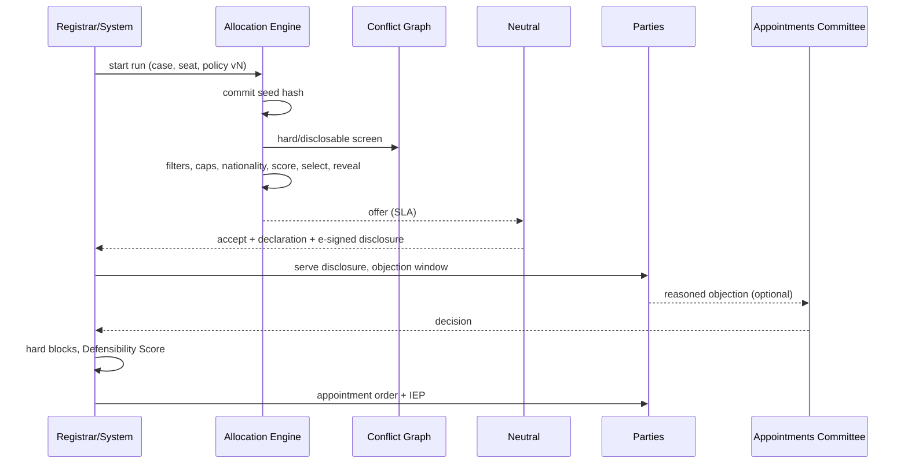

# P03 — Neutrals: Directory, Marketplace, Empanelment & Allocation
> Paste after 01_MASTER_PROMPT.md. Prerequisites: P00, P01, P02 (identity, consent ledger, KYC/KYB, case core, clocks, form engine, DMS, notices). Estimated effort: 4 sprints (2-week) for a squad of 7 (tech lead, 3 full-stack, 1 mobile, 1 QA automation, 1 product analyst with legal-ops background).

---

## 1. Objective and business outcome

Build the **supply side of the institution**: a verified, role-segregated, independently governed panel of mediators, conciliators, arbitrators, experts and POSH external members, and the machinery that puts the right neutral on the right case in a way that survives a s.12, s.13 or s.34 challenge.

Outcomes:
1. **Appointment defensibility (D1, NN-03).** Every Equator appointment is rule-based, conflict-checked, concentration-capped, disclosed in Sixth Schedule format, logged in an **Independence Evidence Pack (IEP)** and scored with a **Defensibility Score**. Enterprise clients have no UI, API or data path to choose, rank, strike or veto a neutral (*CORE v ECI-SPIC-SMO-MCML (JV)*, SC 5-judge bench, 8 Nov 2024; *Bhadra International (India) v Airports Authority of India*, SC, 5 Jan 2026; *Madhyachal Steels v Clix Capital Services*, Del HC, O.M.P.(T)(COMM.) 66/2026, 24 Aug 2026).
2. **Public trust (D12, NN-16, NN-17).** A searchable, indexed **Directory of Neutrals** with verified badges, fee ranges, languages, cities, availability and process-only ratings from verified parties. No win-rates, no per-neutral settlement rates, no "lender-friendly/borrower-friendly" tags. Institution-level "awards set aside" count published.
3. **Panel supply.** Pipeline to the PLAYBOOK targets — FIN arbitrators 50, COM mediators 40, WRK neutrals 30, FAM mediators 35, INT arbitrators 10 (C4 B.3) — and vertical go-live blockers (first 12 ECIN incl. ≥ 3 consumer-side; first 12 ECFM incl. a child-inclusive and a DA-aware specialist).
4. **Neutral workspace** (web + mobile): offers, disclosures, availability, clocks, tasks, CPD, earnings.
5. **"Find a Neutral" marketplace**: direct-hire mediation (quote, payment hold, counterparty consent) and an overflow channel for Private ADR Chambers tenants (consumed by P10).

---

## 2. Scope (in / out)

**In:** application, verification, references, background checks, interview/assessment, Empanelment Committee grading (A/B/C, 0–100), orientation, probation; role-segregated panels by vertical, sector, language, city, seniority; international panel (nationalities, time zones, currency rate cards); availability and capacity; fee bands; public directory and profiles (Person JSON-LD); party-choice flows (list procedure, joint nomination, co-arbitrator nomination); Allocation Engine with hard blocks, IEP and Defensibility Score; s.12 disclosures (Sixth Schedule; Fifth/Seventh Schedule screening; s.12(5) waivers); offers and SLAs; objections, challenges (Appointments Committee), replacement; scorecards, quality audits, institution-level set-aside statistics; CPD and recertification; complaints and discipline; suspension/retirement; workspace dashboard, payouts summary, neutral mobile screens; direct-hire bookings; chambers overflow (core side); verified-party ratings.

**Out:** proceedings, hearing rooms and med-arb execution (P04 — P03 supplies appointment and role-switch eligibility); fee computation, invoices, splits, TDS/GST, payouts (P05 — P03 stores band selection and shows a summary); award/MSA pipelines (P06); vertical rule packs (P08) beyond rubric defaults here; clause-at-sanction validation (P09, consumed as a Defensibility input); chambers tenant UI and plans (P10 reuses these engines in tenant scope); Academy delivery and certificate issue (P10 — P03 consumes events); website shell and Claims Register UI (P13 — P03 ships directory routes and data contract).

---

## 3. Personas and permissions touched

| Role code | Capabilities in P03 | Hard restrictions |
|---|---|---|
| `neutral_mediator`, `neutral_conciliator`, `neutral_arbitrator`, `neutral_expert`, `ic_external_member` | Apply; profile, availability, fee band (within grade), CPD; accept/decline offers; sign disclosures; respond to challenges/complaints; own scorecard and earnings | No access to candidate lists, other neutrals' scorecards, or individual ratings (aggregates only, ≥ 5) |
| `panel_manager` | Verification console, references, interviews, panel membership, CPD audit | Cannot confirm appointments or alter allocation output |
| `registrar` | Start allocation runs, manage offers, record objections, confirm after guards, issue IEP | Any selection outside a run only as `manual_exception` approved by the Appointments Committee |
| `institution_admin` | Allocation policies, rubrics, fee bands, panels (Ruleset Studio, maker–checker, NN-21) | Cannot disable hard blocks or NN rules |
| `quality_officer` | File-audit sampling, scorecard calibration, complaint triage | — |
| Committee members (`core.committee_members`: Empanelment, Appointments, Ethics & Complaints, Appeals) | Decisions with quorum and e-sign | System-enforced recusal; may not hold `partner`, growth or enterprise-account-manager roles (NN-16) |
| `party`, `party_org_user`, `counsel` | Directory, direct-hire, list procedure/joint nomination where permitted, objections, challenges, ratings | Enterprise-side users in repeat-player matters: no choose/rank/strike/veto (NN-03) |
| `enterprise_admin`, `enterprise_operator`, `machine` | Appointment status, IEP and Defensibility Score for own cases; panel statistics | One reasoned objection like any party; nothing else |
| `case_manager` | Monitor SLAs, chase disclosures, view IEP | Cannot run allocation |
| `chambers_admin` | Post overflow listings; view respondents' public profiles | No access to Equator allocation data |
| `auditor`, `dpo` | Scoped read, sealed columns via logged functions | Read-only; break-glass notifies DPO |

New ABAC attributes: `matter_repeat_player`, `is_repeat_player_party`, `equal_footing`, `committee_membership[]`, `assessor_assignment[]` (time-bound grant to a `panel_manager` or senior neutral to score a named application; "assessor" below is this grant, not a role code), `neutral_status`, `panel_codes[]`, `recused_case_ids[]`.

---

## 4. Functional requirements

### 4.1 Application and onboarding

**FR-P03-01 — Application form.** Implement `eqr.form.neutral_application.v2` (merges C4 C.12/C.13 and F3; en/hi; autosave; resumable on mobile):
- *Identity*: name, DOB (≥ 25 years, configurable), gender (optional; aggregate diversity reporting only), `nationalities[]` (ISO 3166-1; dual allowed), residence, address, mobile/email (OTP), photo.
- *Roles and panels*: `roles[]` ∈ {mediator, conciliator, arbitrator, expert, posh_external_member, emergency_arbitrator, appellate_arbitrator}; `verticals[]`; `sectors[]` (Ruleset Studio taxonomy: banking/SARFAESI/DRT, IBC, RERA, MSME, construction, IT/SaaS, IP, maritime, trade finance/LC, health/motor/life/marine/cyber insurance, employment/IR, family property/HUF, succession, matrimonial).
- *Credentials*: Bar enrolment (State Bar Council, number, date, Certificate of Practice); judicial service (service, highest post, retirement order); professional bodies (ICAI, ICSI, ICMAI, IBBI IP, CIArb, IMI; number, CoP); training (provider, hours, certificate — e.g. 40-hour mediation); Equator credentials (ECFC, ECIN, ECCN, ECWN, ECFM, ECM-B, ECM-A — pulled from the Academy register with learner consent); experience (years; matters by type, role and value band; awards authored).
- *Practice*: languages with proficiency, cities, seats, modes, IANA time zone, availability grid, fee-band preference per role, INT rate card (currency, hourly, daily).
- *Integrity*: granular conflict declarations (employment, directorships, retainers, shareholdings, lender/insurer/employer ties, family links to legal professionals, prior appointments in 3 years), disciplinary history, pending criminal proceedings (self-declaration), PI cover (insurer, sum, expiry), three referees.
- *Payment/tax*: PAN (masked), GSTIN, bank (penny-drop), non-resident placeholders (TRC/no-PE, consumed by P05).
- *Profile and consents*: short bio ≤ 300 chars, long bio ≤ 2,000, video ≤ 90 s, **per-field display consent**, Code of Conduct (versioned), itemised DPDP notice, and initialled acknowledgements from C.13 (panel-membership wording only as approved; compensation policy; 2-year renewable term; minimum activity; orientation before activation; on-platform communication; no side-channel fees), each a versioned `core.consent_records` row.

Validation: ≥ 1 role and vertical; arbitrator eligibility matrix per panel (default: bar ≥ 10 years, or judicial service, or professional membership ≥ 10 years with arbitration training, or ECCN/international credential); POSH external member must meet POSH Act 2013 s.4(2)(c) (member from an NGO/association committed to the cause of women, or a person familiar with issues relating to sexual harassment) and POSH Rules 2013 r.4 (social worker with ≥ 5 years' experience in women's empowerment/workplace sexual harassment, or person familiar with labour, service, civil or criminal law); fees under r.3.

**FR-P03-02 — Cycles and statuses.** `rolling` (default) or `windowed` cycles (e.g., 1 Jan–31 Mar per panel); out-of-window applications are `waitlisted` unless the panel is flagged `shortage`. Statuses: `draft → submitted → under_verification ⇄ info_requested → assessment → committee → approved | rejected | waitlisted → empanelled_probation → active`. Auto-acknowledgement ≤ 2 working days with reference `EQ/NEU/{YYYY}/{NNNNN}`.

**FR-P03-03 — Document verification.** Each credential is a `core.neutral_accreditations` row (`verification_method`, `verified_by`, `verified_at`, `evidence_document_id` hashed into the evidence ledger, `valid_until`, `status` ∈ {pending, verified, failed, expired, revoked}). SLA 10 working days.

| Credential | Primary method | Fallback | Currency |
|---|---|---|---|
| Bar enrolment / CoP (Advocates Act 1961 s.17; BCI Certificate and Place of Practice (Verification) Rules 2015 r.9.1 — CoP valid and verified every 5 years [Verified 22 Oct 2026]) | State Bar Council online roll / CoP check **[VERIFY — open (State Bar Council): official portals exist in some States (e.g., Bar Council of Delhi enrolment status) but no API/terms; enable `lookupBarRoll` per State only with the Council's written permission — else staff-assisted check on the official portal]** | Templated letter to the Bar Council, 21-day chase | Re-verify at term renewal |
| Retired judicial officer | Retirement order + HC/State notification | Registry letter; two referee confirmations | Good standing at renewal |
| ICAI / ICSI / ICMAI (CA Act 1949; CS Act 1980; CWA Act 1959) | Institute member verification + CoP **[VERIFY — open (vendor): ICAI 'Trace a Member' needs the searcher's own MRN + captcha (member-only); ICSI/ICMAI not confirmed — use institute letter or CoP upload + staff check]** | Institute letter | Annual CoP check |
| IBBI insolvency professional | IBBI public register | Certificate | Registration validity |
| 40-hour mediation training (MCPC/LSA 'trained mediator' norm; MCI established 27 Aug 2026 but no training or registration regulations as of Oct 2026) | Issuer verification email; Academy register for ECM-B | Certificate + trainer reference | CPD governs |
| ECFC, ECIN, ECCN, ECWN, ECFM, ECM-A/B/T/S | `equator.academy.certificate.issued.v1` after consent | Public verification page | 2 years for vertical credentials; revocation propagates instantly |
| CIArb / IMI / foreign bodies | Directory lookup | Certificate | Per body |
| PI cover | Policy schedule; `pi_cover_expiry` | — | Expiry blocks allocation |
| Identity, PAN, bank | `KYC_PORT` (licensed provider; Aadhaar never stored in full, NN-14) | Video verification | Bank change: step-up + cooling-off (P05) |

`DOC_AI_PORT` may pre-fill fields; a human approves every field (NN-01).

**FR-P03-04 — References and background checks.** Referees get a tokenised form (relationship, years known, five competence items 1–5, integrity concerns, "would you entrust a dispute to this person"); reminders day 3 and 6; window closes day 7; ≥ 2 completed references required. Background checks only under specific consent (purpose `neutral_background_check`, DPDP Act 2023 s.6): identity match; eCourts party-name search via `KYC_PORT`; Bar Council disciplinary status where obtainable; `SANCTIONS_PORT` screening (UN, OFAC, EU, UK, MHA) for INT panels, re-screened annually. Findings go to the committee; never automatic rejection; applicant may respond within 10 days.

**FR-P03-05 — Interview and assessment.** Two assessors, 45 minutes, within 15 working days of verification. Mediator/conciliator: 20-minute role-play on the Academy simulation rubric (/100: opening 12, listening 14, questioning 14, interests 14, process management 12, options 12, impartiality & ethics 12, closure 10; ≥ 3 behavioural observations per criterion) plus 12 ethics scenarios. Arbitrator: 90-minute documents-only award exercise (reasoning, s.31(3) compliance, severable operative paragraphs, interest computation) or a redacted authored award, plus 12 independence scenarios mapped to Fifth/Seventh Schedule items. Expert: technical file review. POSH external member: boundary scenarios (no monetary settlement under POSH Act s.10; questioning a complainant's character = instant fail). Academy fast-track: holders of the vertical credential or ECM-A skip the role-play; ethics is never waived.

**FR-P03-06 — Grading rubric and committee decision.** Two independent scores; divergence > 10 triggers a third; final = mean of the closest two. Grades **A ≥ 80, B 65–79, C 50–64, < 50 not empanelled** (per-panel defaults); non-compensable minima apply regardless of total; an experience band may cap grade (A ≥ 15 years, B ≥ 8 years where defined). Default rubrics (Ruleset Studio, versioned; sources C2, C3, R5):

| Panel family | Weights (100) | Minima / pass |
|---|---|---|
| FIN | financial/regulatory expertise 25; mediation/conciliation skill 20; practice record 15; legal knowledge 15; independence 10; vulnerability & fair-conduct competence 10; availability & digital 5 | voluntariness/affordability scenarios must pass |
| INS | domain 20; mediation 25; independence 20; balance of perspective 15; language & reach 10; availability 10 | independence ≥ 15/20; overall ≥ 65 (no C) |
| COM | standing 25; sector 20; award-writing 20; availability 15; independence 10; language & regional reach 10 | award-writing ≥ 12/20 for arbitrators |
| WRK | employment/IR 25; mediation 20; power-imbalance 15; POSH 15; independence 10; practice record 10; accessibility 5 | POSH-EXT needs POSH ≥ 12/15 + certification |
| FAM | family law 25; mediation 20; safety & DV screening 20; child-inclusive 10; independence 10; accessibility & language 10; practice record 5 | safety ≥ 15/20; overall ≥ 65 |
| INT | international experience 25; procedure & drafting 20; sector (CISG, maritime, LC, EPC) 15; independence 15; languages 10; availability/time zone 10; certifications 5 | independence ≥ 12/15 |

Outcome-based source items ("settlement track record", "settlement durability") are replaced by "practice record" (volume and complexity handled): neutrals are never ranked by settlement rate. The **Empanelment Committee** (≥ 3 members incl. ≥ 1 external; quorum 3; automatic recusal) decides approve (grade, panels, endorsements, probation), reject (reasons), waitlist or defer within 30 days of interview; e-signed by the chair; reapplication after 12 months.

**FR-P03-07 — Orientation, probation, activation.** Activation requires: Code signed; 3-hour orientation (Equator Rules, relevant NN rules, on-platform communication, data protection); payout bank verified (step-up); availability set; ≥ 1 panel membership; FAM safety-screening protocol acknowledgement; INS health-data undertaking (NN-07). Probation = first 3 matters (FAM co-mediated; all 100% audited). A sandbox test offer must succeed. Until then `allocation_eligible = false`.

### 4.2 Panels, availability and fees

**FR-P03-08 — Role-segregated panels.** Panel = `{role} × {vertical} [× sector] [× tier]`: `CON-FIN`, `ARB-FIN`, `MED-COM`, `ARB-COM`, `EA-COM` (emergency arbitrator), `APP-ARB` (appellate tier, D4), `MED-FAM`, `MED-WRK`, `CON-WRK`, `ARB-WRK` (non-workman only), `MED-INS`, `EXP-INS` (surveyor/assessor), `ARB-INS-B2B` (quantum-only), `MED-INT`, `ARB-INT`, `EXP-COM`, `POSH-EXT`. Conciliator membership confers no arbitrator eligibility, and the engine never draws an arbitrator from a `CON-*` panel (R1 T5; Equator policy — SEBI's ODR consultation paper of 23 Jul 2026 proposes conciliator/arbitrator segregation across MIIs, see OI-08) **[VERIFY — open (watch): draft Annexure A para 7 of SEBI paper of 23 Jul 2026; no final circular on SEBI circulars list to 15 Oct 2026 (checked 22 Oct 2026); segregated panels stand on their own merits]**. One role per neutral per case, subject to master §5.3 med-arb consent (never available where the mediation ran in Mediation Act statutory mode — s.17(a) bars a mediator from acting as arbitrator, with no party carve-out); exposed via `GET /v1/neutrals/{id}/role-switch-eligibility?caseId=`. Panel attributes: eligibility matrix, rubric version, required credentials/endorsements, capacity, fee bands, target size, composition targets (INS: retired insurer officers 25%, surveyors 20%, insurance lawyers 20%, consumer-side 15%, ex-Ombudsman staff 10%, medical 10%; FAM: accredited mediators 40%, matrimonial lawyers 20%, mental-health 15%, child-welfare 15%, retired judicial officers 10%), aggregate diversity reporting, `is_international`.

**FR-P03-09 — International panel.** Members carry `nationalities[]`, time zone, bar admissions by jurisdiction, CISG/UNIDROIT/maritime/LC/EPC tags and a **currency rate card** (USD, EUR, GBP, SGD, AED; hourly/daily ranges in minor units); the directory shows the range with an indicative INR figure from a `core.fx_rates` snapshot (source + timestamp, NN-13). INT disclosures also map to the IBA Guidelines on Conflicts of Interest in International Arbitration 2024 (adopted 25 May 2024) Red/Orange/Green lists.

**FR-P03-10 — Availability and capacity.** Weekly availability (30-minute slots), exceptions, time zone, free/busy import from Google/Microsoft (busy blocks only). Capacity defaults: arbitrator documents-only FIN 40 active; oral-hearing arbitrations 12; mediator/conciliator 20; emergency arbitrator 1; POSH external member 6. `accepting_new_matters` toggle. Allocation excludes neutrals at capacity or without availability in the first-session window (default 21 days).

**FR-P03-11 — Fee bands.** Bands come from the fee-schedule version in force (Appendix B; "Subject to Board approval"). Defaults per 2-hour mediation session: Band I ₹3,000–₹5,000; II ₹5,000–₹7,500; III ₹7,500–₹15,000; IV ₹15,000–₹25,000. Small-ticket conciliation ₹1,500–₹4,800 per case. Arbitration < ₹5,00,000 per slab card; above that the A&C Act Fourth Schedule is the ceiling reference (₹30,00,000 per arbitrator, with the sole arbitrator's 25% addition on top, i.e. up to ₹37,50,000; *ONGC v Afcons Gunanusa JV*, SC, 30 Aug 2022). For lender-programme cases Appendix B figures prevail (master X-06). A neutral picks one band per panel within their grade. Regulated schedules override (SEBI SMART ODR when `SEC` is ON, NN-18). FAM: no direct fee negotiation. Directory shows **ranges only**; individual quotes exist only inside a booking.

### 4.3 Directory and profiles

**FR-P03-12 — Directory.** `/neutrals` (SSR/SSG). OpenSearch institution index of display-consented fields only. Filters: role, vertical, sector, language, city/seat, mode, seniority band (A "Senior", B "Experienced", C "Associate"; numeric score never public), credential/endorsement, international (nationality, time zone, currency), fee range, accepting new matters, availability within N days. Default order is **seeded-random per session** so the directory does not concentrate demand; ratings are not a sort key.

**FR-P03-13 — Profile.** `/neutrals/{slug}`: name, photo, roles, panels, seniority band, verified badges (credential type, method, verified date, valid until — never the document), languages, cities, modes, fee range, availability indicator, bios, captioned video, CPD-current indicator, process ratings (≥ 5), and the statement: *"Appointments in Equator-administered matters are made under the Equator Rules by rule-based allocation; this profile does not mean the neutral is available to any party on request."* Never displayed (allow-listed schema + CI lint, NN-16): win-rates, settlement rates, outcome distributions, per-neutral set-asides, "lender/borrower/employer/insurer-friendly" or equivalent tags, client logos, names of organisations that appeared before the neutral. Advocate-neutral profiles follow `profile_display_policy = 'advocate_restricted'` (factual particulars consistent with BCI Rules Part VI Ch. II Section IV r.36) **[VERIFY — open (counsel): r.36 proviso (BCI Res. 50/2008) Schedule — name; address/phone/email; enrolment no., date, State Bar Councils, Bar Association; qualifications; areas of practice — anything else deemed a violation; ratings/video outside it; reach to neutral-panel profiles needs counsel; SLP (C) 25794/2024 pending]**; ratings/video on advocate profiles stay OFF until OI-03 is closed.

**FR-P03-14 — Structured data.** Person JSON-LD: `name`, `jobTitle`, `knowsLanguage`, `hasCredential` (verified `EducationalOccupationalCredential` only), `memberOf` (Equator Resolution), `address.addressLocality` (if consented), `url`, `image`. No `aggregateRating` markup. Profiles in `sitemap-neutrals.xml`; consent withdrawal returns 410 and de-indexes within 24 hours.

**FR-P03-15 — Badges and claims.** Badges render only from `verified`, unexpired accreditations and disappear on expiry. Panel-level public statistics publish only through Claims Register entries (NN-17).

### 4.4 Party-choice flows

**FR-P03-16 — Repeat-player classification (NN-03 gate).** At acceptance the rules engine sets `core.cases.repeat_player_matter = true` if: source ∈ {bulk, api, clause_auto, grm_escalation}; or any party organisation (or its counterparty group: KYB affiliates, RE–LSP pair, co-lending partner) has an active Equator enterprise relationship (subscription, clause registry, bulk programme, GRM/POSH SaaS); or FIN with a lender party; INS with a retail policyholder; WRK employer–employee. Pinned with the ruleset version (NN-21). In repeat-player matters **every seat** is filled by institutional allocation, party-choice flows are disabled for all parties (equal treatment, A&C s.18), and each party has **one reasoned objection** per appointment (FR-P03-27). Party nomination of a co-arbitrator exists only where the registrar has set `core.cases.equal_footing = true` on documented grounds in a COM or INT matter that is not a standard-form/repeat-player relationship (master NN-03; FR-P03-19); lender–borrower, insurer–policyholder, employer–employee and consumer matters never use party nomination.

**FR-P03-17 — List procedure (shortlist/rank/strike).** Non-repeat-player matters where the clause or Rules permit: a run yields N names (default 5; FAM 3 "recommend and rank", C3 r.6). Within 7 days (INT 10) each party strikes up to K (default 2; FAM 0) and ranks the rest; submissions are sealed until the deadline. Lowest combined rank among unstruck names is offered; ties by rotation pointer; non-response = equal ranking; all struck → Appointments Committee appoints from a fresh run excluding struck names.

**FR-P03-18 — Joint nomination.** Two-sided e-signed nomination of a panel or non-panel person. Non-panel nominees get expedited verification, conflict declaration and disclosure within 5 working days; the Appointments Committee confirms unless eligibility or independence checks fail (no other discretion; reasons recorded). Joint nomination applies to mediator, conciliator and expert seats; a sole or presiding arbitrator is always appointed by Equator (master NN-03), and parties wishing to influence that seat use the list procedure (FR-P03-17).

**FR-P03-19 — Three-member tribunals.** Where `equal_footing = true` (COM or INT; master NN-03), each side nominates one co-arbitrator from the panel or outside (FR-P03-18 verification, conflict check and disclosure apply; confirmation by the Appointments Committee). In every other three-member tribunal all seats are filled by institutional allocation. The presiding arbitrator is always appointed by the Appointments Committee from a run after consulting the co-arbitrators; co-arbitrators never appoint the presiding arbitrator themselves, even if the parties so agree (master NN-03 prevails over the A&C s.11(3) default). INT presiding defaults to neutral nationality (FR-P03-23).

### 4.5 Allocation engine and appointment defensibility

**FR-P03-20 — Allocation policies.** Ruleset Studio objects (versioned, maker–checker, pinned per case): method ∈ {`rotation`, `load_balanced`, `rules_weighted`}, panels, filters, weights, caps, offer SLA, max re-offers before committee escalation (3). Defaults: FIN bulk → rotation within `{panel × value band × language}` queues; other repeat-player and institutional COM/FAM/INT → rules_weighted; emergency arbitrator → rotation over the `EA-COM` duty roster.

**FR-P03-21 — Algorithm (deterministic, reproducible).**
1. **Commit**: generate a 256-bit seed; persist `seed_commitment = SHA-256(seed)` before evaluating candidates.
2. **Pool**: active members of required panels with `allocation_eligible = true`.
3. **Hard filters** (exclusion counts recorded; excluded IDs in a sealed column for auditor/committee only): good standing (term, credentials, endorsements, PI cover, CPD grace); matter-required endorsements (FAM safety flag → DA-aware; child issues → child-inclusive; INS retail → ECIN; POSH → POSH-EXT); capacity and availability; conflict `hard` (FR-P03-22); concentration cap and INT nationality (FR-P03-23); shared working language with every party (else interpreter flag); city/seat for in-person; role segregation; prior role in the same case without valid role-switch consent (never valid where the mediation ran in Mediation Act statutory mode, s.17(a)); earlier upheld objections/strikes.
4. **Soft score (0–100)**: sector 30, value band ↔ grade 20, language depth 15, city/seat 10, earliest availability 10, inverse load 10, process-KPI factor 5 (TAT and clock adherence only; never outcomes).
5. **Select**: rotation → next eligible after the queue pointer; load_balanced → lowest load, ties by pointer; rules_weighted → weighted draw among top 5 using the committed seed.
6. **Reveal** the seed; the IEP includes commitment, seed and a reproduction script.
Partner "priority" and AI are never inputs (NN-16, NN-01).

**FR-P03-22 — Conflict graph.** `core.conflict_edges`: neutral → person/organisation/law firm/counterparty group/hashed external; `relation` ∈ {employee, former_employee, director, partner, retainer, shareholder (> 1% or > ₹10,00,000), family, counsel_for, counsel_against, prior_appointment, co_arbitrator, expert_for, advisor, funder_link, social_close}; dates; `source` ∈ {declared, platform_history, kyb_graph, referee, party_disclosure}; `schedule_mapping` (Seventh item, Fifth item, IBA item). Traversal: parties → affiliates (≤ 2 hops) → counsel and firms → funders → named witnesses. Classes: `hard` (Seventh Schedule or configured hard set) → excluded; `disclosable` (Fifth Schedule, 3-year lookback) → auto-inserted into disclosure and objection notice; `informational`. Re-run at allocation, acceptance, every party/counsel/funder/witness addition, and nightly for active appointments (continuing duty, A&C s.12(2)).

**FR-P03-23 — Concentration and nationality.** `concentration_pct = appointments involving counterparty group G ÷ neutral's total appointments`, rolling 24 months. Default cap **40%** (from the INS DB constraint; per-panel config; FIN bulk subject to OI-01), applied once the neutral has ≥ 10 appointments in the window; below 10, an absolute cap of 3 per group. A projected breach excludes the neutral. Fifth Schedule item 22 counts (same party/affiliate within 3 years) are always disclosed, even though institutional appointments are not appointments "by" a party. An empty queue fails with `ALLOCATION_POOL_EXHAUSTED` and a capacity alert; the cap is **never relaxed**; P09 bulk intake checks capacity-under-caps before accepting a batch. **INT (NN-19):** sole/presiding arbitrator may not share any nationality with any party unless all parties agree in a post-dispute e-signed instrument (mirroring A&C s.11(9)).

**FR-P03-24 — Offers.** Offer SLA: 48 h standard; 24 h FIN documents-only; 72 h INT; 4 h emergency arbitrator. Acceptance requires availability confirmation (arbitration: ability to finish within 12 months of completion of pleadings — Sixth Schedule), a fresh conflict declaration and an e-signed disclosure under step-up MFA. Decline reasons: conflict, capacity, availability, expertise, personal, other. Decline/timeout → next candidate; 3 failures → Appointments Committee queue; 3 unexplained declines in 90 days → availability review.

**FR-P03-25 — Disclosures.** `eqr.form.arbitrator_disclosure.v1`: **Sixth Schedule** format (A&C Act 1996, inserted w.e.f. 23 Oct 2015) — name, contact, prior experience, ongoing arbitrations, past/present relationships or interests (financial, business, professional, other), circumstances affecting time and the 12-month completion; auto-screened against every Fifth Schedule (justifiable doubts) and Seventh Schedule (s.12(5) ineligibility) item, pre-populated from the graph, each item confirmed or corrected by the neutral. `eqr.form.mediator_disclosure.v1`: relationships with each party, counsel and witness; interest in subject matter; 3-year prior-appointment count; independence statement; continuing duty — under the Equator Mediation Rules (contractual mode), mapped to Mediation Act 2023 s.10 (conflict of interest and disclosure) for statutory mode (not in force, NN-05). Also `expert_disclosure.v1` and `ic_external_disclosure.v1` (P09). Disclosures are served on all parties (P02); **confirmation is blocked until signed** (R2 rule 25).

**FR-P03-26 — Hard blocks (NN-03).** Confirmation returns 409 (problem+json) on:

| Code | Block |
|---|---|
| `HB_ENTERPRISE_SELECTION` | Choose/rank/strike/veto by an enterprise-side user or `machine` in a repeat-player matter (also 403 at policy layer) |
| `HB_CLAUSE_BASIS_MISSING` | Arbitration agreement did not name Equator (or "an institution administering under the Equator Rules") before the dispute, with no post-dispute all-party agreement and no s.11 order (*Madhyachal Steels*) |
| `HB_POST_DISPUTE_CONFERRAL` | Appointing power conferred on Equator by one party after the dispute arose |
| `HB_SEVENTH_SCHEDULE_OPEN` | Seventh Schedule hit without valid s.12(5) waivers: express written, post-dispute, separately e-signed by **each** party; conduct or click-through never suffices (*Bhadra International*) |
| `HB_DISCLOSURE_UNSIGNED` | Disclosure unsigned or superseded by a newer graph result |
| `HB_CONCENTRATION_CAP` | Confirmation would breach the cap |
| `HB_NATIONALITY_INT` | INT nationality conflict without all-party agreement |
| `HB_NOT_IN_GOOD_STANDING` | Suspended, term/credential/PI expired, CPD lapsed beyond 90-day grace |
| `HB_ROLE_SEGREGATION` | Arbitrator from a conciliator panel; same-case mediator→arbitrator switch where the mediation ran in Mediation Act statutory mode (s.17(a), consent notwithstanding); or any other same-case switch without post-mediation all-party consent and renewed disclosure (contractual mediation; A&C s.80 for conciliation) |
| `HB_SPECIALISM_REQUIRED` | Required endorsement missing (flag read; sealed safety details never read, NN-07) |
| `HB_OBJECTION_PENDING` | Objection or challenge undecided |
| `HB_MANUAL_UNAPPROVED` | `manual_exception` without committee approval and reasons |

Tenants cannot disable hard blocks (master §6). One `NN-03_*` test per code.

**FR-P03-27 — Objection to disclosure.** One reasoned objection per party per appointment within 7 days (mediation, conciliation, expert) or within the A&C s.13(2) 15-day period (arbitration). Before confirmation the Appointments Committee decides within 7 days: upheld → next candidate; dismissed → confirmation with reasons served. After confirmation it is a challenge.

**FR-P03-28 — Challenge (s.13-style under the Equator Rules).** Under A&C s.13(1) parties may agree the procedure; the Equator Rules provide: written challenge on s.12(3) grounds (justifiable doubts as to independence or impartiality; lack of agreed qualifications; for own nominee, only later-discovered reasons, s.12(4)) within 15 days of awareness → service → neutral's response or withdrawal and other parties' position within 7 days (withdrawal or all-party agreement terminates the mandate, s.15(1)) → **Appointments Committee** reasoned order within 15 days, with automatic recusal. A rejected challenge preserves the s.13(5)/s.34 remedy and the order says so. While the challenge is pending, continuation follows the Rules or the tribunal's direction; after an unsuccessful challenge the tribunal must continue and make the award (s.13(4)), and the s.13(5)/s.34 remedy is preserved (OI-06). Mediation challenges mirror this under the Equator Mediation Rules (statutory mapping behind the NN-05 flag). Clock effects are emitted for P04; nothing resets silently (NN-04).

**FR-P03-29 — Replacement.** Triggers: successful challenge, withdrawal, s.14 inability, s.15 termination, death/incapacity, suspension, late conflict, missed clock (P04), unavailability > 14 days. Substitute by the same method as the original (s.15(2)) via a fresh run excluding the outgoing neutral; target 7 days; full case history handed over except sealed caucus notes (NN-11); parties notified; event to P04 on repeating hearings (s.15(3)).

**FR-P03-30 — IEP and Defensibility Score.** On every confirmation or change, generate a versioned IEP (PDF + JSON, SHA-256 manifest, BSA 2023 s.63(4) certificate, NN-10): clause-basis artefacts (clause ID/version, borrower e-sign artefact, post-dispute agreement or s.11 order); repeat-player flag and reason; policy version; method; pool size; exclusion counts; seed commitment, seed and reproduction script; selected neutral; conflict summary; signed disclosure and schedule screens; waivers; concentration statistics per counterparty group; panel rotation statistics (24-month appointments per neutral, Gini); objections and decisions; appointment order; rules version. Equally available to all parties, the tribunal, and the enterprise for its own cases (cf. *Sundaram Finance Ltd v Hanuman Prasad*, Raj HC, S.B. CWP 17398/2024, 24 Apr 2026: appointment by an agreed independent institution is not a unilateral appointment).

**Defensibility Score** (0–100, deterministic): clause basis 25; rule-based run with intact commit–reveal 20; conflict check complete and clear 15; disclosure signed, served, window elapsed 15; concentration headroom (≥ 10 points under cap = full) 10; party voice (objection right notified and honoured) 10; appointment-notice proofs (P02) 5. **Green ≥ 85; Amber 70–84 (Registrar review); Red < 70 (Appointments Committee sign-off).** Any hard block shows "Blocked". Visible to all parties on equal terms.

### 4.6 Marketplace and overflow

**FR-P03-31 — Find a Neutral: direct hire.** "Request this mediator" for mediation, non-repeat-player conciliation, or joint expert determination — **never arbitration by one party**. Disabled where a repeat-player organisation is in dispute with a consumer, borrower, employee or policyholder (NN-03/NN-16), and for FAM until safety screening (P08) is complete (DA-aware neutrals only where flagged). `core.neutral_bookings`: `draft → quote_requested → quoted → hold_authorised → counterparty_invited → counterparty_accepted → conflict_cleared → disclosure_signed → confirmed`; exits `declined | expired | cancelled | refunded`. Quote from the P05 fee engine (e.g., ₹999 registration + session fee within the neutral's band × estimated sessions + GST), valid 7 days. Hold: capture at payment with automatic full refund if the booking is not confirmed within the hold period of 14 days, which covers the 10-day counterparty response window plus conflict clearance and disclosure (Razorpay's manual-capture window is at most 3 days, after which uncaptured payments auto-refund; an authorisation-only hold is used only when confirmation is expected within 3 days; OI-09). Counterparty sees profile and disclosure and may accept, decline or switch to the list procedure (response window 10 days). Confirmation applies the held payment to the case invoice (capturing it first where an authorisation-only hold was used) and creates a case (`source = 'marketplace'`, master §5; OI-14). Only platform and neutral fees move (NN-13).

**FR-P03-32 — Chambers overflow (core side).** Chambers tenants (P10) post anonymised `chambers.marketplace_listings` (role, vertical, sector, language, city, mode, value band, start window, fee within the chambers' schedule). Opted-in neutrals (`accepts_chambers_overflow`) express interest. Before identities are shared, `POST /v1/conflicts/blind-check` compares salted hashes of the chambers' party/counsel identifiers (sent under the chambers' DPA instruction) with the graph and returns only `clear | disclosable | hard`. Appointment happens in the chambers tenant under its rules.

**FR-P03-33 — Ratings from verified parties only.** `eqr.form.post_case_feedback.v1` goes 48 hours after closure to every party and counsel: 8 neutral items (1–4: rapport, control, explained process, active listening, impartiality, mutual understanding, options, opinions only on invitation), 3 case-management items, "Did you feel pressured to settle?", institution/platform ratings, free text, `share_with_neutral` and `publish_on_profile` consents. Only participants of closed matters in which the neutral acted; one per person per matter; 30-day window; routed to the institution, never directly to the neutral; free text moderated (no identifiers, amounts or case facts); only process items publish, as an aggregate after ≥ 5 published ratings; repeat-player organisations capped at 20% of public weight and enterprise-side ratings in bulk matters excluded. "Pressured = yes" opens a quality review.

### 4.7 Quality, CPD, discipline and lifecycle

**FR-P03-34 — Scorecards.** Quarterly `core.neutral_scorecards`: offer response time, acceptance rate, disclosure completeness/timeliness, time to first session, clock adherence (s.29A, s.23(4), POSH 90-day, mediation time-boxes), order/award/MSA turnaround, punctuality and neutral-caused adjournments, party process feedback, "pressured" rate, audit score, CPD currency, complaints. Excluded by design: settlement rate, outcomes by side, recovery amounts. Audit sampling: random 10% of closed files per quarter + 100% of safety-flagged, child and complaint matters + each new neutral's first 3; auditor calibration quarterly.

**FR-P03-35 — Institution transparency (D12).** Nightly: awards made; s.34 petitions known; set aside in full/in part; s.29A compliance %; median time to constitution and to outcome; appointment distribution (Gini). Published only via Claims Register (NN-17), rendered by P13. Per-neutral set-asides feed internal quality review only.

**FR-P03-36 — CPD and recertification.** `core.neutral_cpd_entries` (source, hours, category, evidence, verified). Defaults: ECFC 16 h/yr (6 RBI-update, 4 conduct/vulnerability); ECIN 12 h + ethics refresher per 2-year cycle; ECCN 20 h/yr (6 case law, 4 award-writing) + 2 award reviews; ECWN 20 h/yr (8 POSH for endorsement holders, 6 Labour Codes) + 4 peer supervisions; ECFM 20 h/yr (6 DV, 4 child, 4 law) + 4 supervisions; others 10 h/yr. Term 2 years; `eqr.form.neutral_recertification.v1` opens at T−90 (system-filled matters, CPD, evaluations, complaints; updated disclosures and PI). Minimum activity (2 matters/term) is assessed only against offers received. Shortfall → reminders T−60/−30/−7 → 90-day grace → ineligible until cured.

**FR-P03-37 — Complaints and discipline.** `eqr.form.neutral_complaint.v1` (misconduct, bias, delay, conflict, confidentiality, fees, other): acknowledge ≤ 2 working days → triage by `quality_officer` (S1–S3) ≤ 5 → interim measures (pause allocation; reassign urgent matters) → Ethics & Complaints Committee inquiry with right to respond (14 days) and hearing → outcome ≤ 45 days (dismissed, counselled, warning, suspension, de-empanelled) → appeal within 15 days (decided ≤ 30). Suspension/de-empanelment revoke eligibility and sessions immediately. An undisclosed Seventh Schedule relationship is an S1 incident: immediate suspension, review of all active matters, party notification.

**FR-P03-38 — Pause, retirement, exit.** Pause ≤ 6 months (no offers); retirement stops offers immediately, active matters completed or replaced with notice; financial close-out in P05; records retained (8 years after last matter; audit 10 years); re-empanelment allowed with history informing grade.

### 4.8 Neutral workspace

**FR-P03-39 — Dashboard.** `/app/neutral`: pending offers with countdown; disclosures to sign; cases with stage, next action and amber/red clock pills; hearings this week; tasks; CPD YTD vs requirement; credential expiries; payouts summary; own scorecard snapshot; challenges/complaints awaiting response; "Accepting new matters" toggle.

**FR-P03-40 — Payouts summary.** Read-only projection from P05 per case: fee notes raised/approved, due, paid, TDS, GST invoice status; statement download; bank changes only through the P05 step-up flow.

---

## 5. Workflows and state machines

### 5.1 Neutral lifecycle

| State | Event | Guard | Next | Side-effects |
|---|---|---|---|---|
| draft | submit | mandatory consents; ≥ 1 role and vertical | submitted | `application.submitted`; reference emails |
| under_verification | verification_completed | required credentials verified; ≥ 2 references; findings reviewed | assessment | interview task (≤ 15 WD) |
| assessment | scores_recorded | 2 scores, divergence ≤ 10 or third score | committee | agenda item |
| committee | decision_approved | quorum; recusals; minima met | approved | `empanelment.approved`; memberships `inactive` |
| approved | activation_completed | Code; orientation; bank (step-up); availability | empanelled_probation | sandbox offer |
| empanelled_probation | probation_completed | 3 matters audited ≥ satisfactory | active | memberships `active`; profile published if consented |
| active | suspend | committee order / S1 incident | suspended | eligibility off; tokens revoked; replacement tasks |
| active | term_expired | no approved recertification | paused | eligibility off; reminder journey |
| active / suspended | de_empanel | committee order | de_empanelled | profile 410; replacements |

### 5.2 Appointment



| Status | Event | Guard | Next | Side-effects |
|---|---|---|---|---|
| offered | accept | in SLA; declaration; disclosure signed | accepted_pending_objection | serve disclosure; objection timer (7/15 d) |
| offered | decline / timeout | — | declined / expired | next candidate; after 3 → committee |
| accepted_pending_objection | objection_lodged | in window; first objection of that party | objection_pending | committee task (≤ 7 d) |
| objection_pending | upheld | reasoned order | withdrawn_by_institution | next candidate |
| accepted_pending_objection / objection_pending | window_elapsed / dismissed | no hard block | confirmed | order; IEP v1; `appointment.confirmed`; P04 constitutes proceeding |
| confirmed | challenge_filed | ≤ 15 d of awareness | under_challenge | P04 notified |
| under_challenge | withdrawal / all-party agreement / upheld | — | terminated | replacement run |
| under_challenge | rejected | reasoned order | confirmed | s.13(5)/s.34 notice text |
| confirmed | proceeding_closed | — | completed | scorecard; feedback journey |

### 5.3 Direct-hire booking
States per FR-P03-31; timers: quote 7 days, counterparty 10 days, hold 14 days; each expiry voids/refunds and notifies both sides.

---

## 6. Screens and UX (web + mobile)

All screens: WCAG 2.2 AA; en/hi (NN-23); keyboard operable; error summaries; live-region announcements for countdowns; PII masked by default; empty/loading/error states per design system.

| ID | Route | Persona | Purpose and key components | Notes (states, mobile, a11y) |
|---|---|---|---|---|
| SCR-P03-01 | `/neutrals` | public | Directory: search, facets, `NeutralCard`, seeded-random order | Filters in bottom sheet on mobile; result count in live region |
| SCR-P03-02 | `/neutrals/{slug}` | public | Profile: badges (popover: method, date, expiry), fee range, availability, bios, captioned video, ratings (≥ 5), institutional statement, "Request this mediator" | 410 when withdrawn; deep link `equator://neutrals/{slug}` |
| SCR-P03-03 | `/join/neutral` → `/app/apply` | applicant | 8-step wizard; DOC_AI pre-fill with confirm; conflict grid; unbundled consents | Autosave; camera capture on mobile; step progress announced |
| SCR-P03-04 | `/app/apply/status` | applicant | Stepper, info requests, interview booking, decision letter | Push on change |
| SCR-P03-05 | `/admin/neutrals/verification` | panel_manager | Queue with SLA chips; verify/fail per credential; references; consent-gated findings | Breach banner |
| SCR-P03-06 | `/admin/neutrals/{id}/assessment` | `assessor_assignment` holder | Rubric with ≥ 3 observations enforced; divergence indicator; ethics results | Locked after submit |
| SCR-P03-07 | `/admin/committees/{kind}` | committee | Agenda, dossier, recusal, vote, reasons, e-sign | Quorum indicator |
| SCR-P03-08 | `/admin/panels` | panel_manager | Size vs target, composition, language/city coverage, capacity under caps, shortage flags | Charts with table fallback |
| SCR-P03-09 | `/admin/rules/allocation-policies` | institution_admin | Method, filters, weights, caps, SLAs, dry-run on last 500 cases, maker–checker | Draft/pending/active |
| SCR-P03-10 | `/app/cases/{caseId}/appointment` | registrar | Run, run log (counts only), offer timeline, objections, hard-block panel, Defensibility gauge | Score has text equivalent |
| SCR-P03-11 | `/app/cases/{caseId}/appointment/list` | party, counsel | Candidate cards with disclosures; strike toggles; ranking; countdown | Hidden in repeat-player matters; keyboard reordering announced |
| SCR-P03-12 | `/app/cases/{caseId}/appointment/joint` | party | Nominee search or non-panel entry; two-sided e-sign | Mobile parity |
| SCR-P03-13 | `/app/neutral/offers/{offerId}` | neutral | Case summary (no pleadings), countdown, pre-screen items, disclosure form, e-sign | **Primary mobile flow**; biometric step-up; T−1 h and T−15 min alerts |
| SCR-P03-14 | `/app/cases/{caseId}/disclosures` | party | Disclosure, objection form, deadline | Mobile parity |
| SCR-P03-15 | `/app/cases/{caseId}/challenges` | party, neutral, committee | Grounds, evidence, response, order | Mobile view/respond |
| SCR-P03-16 | `/app/cases/{caseId}/iep` | parties, tribunal, enterprise | Versions, PDF/JSON download, hash, seed verification guide | — |
| SCR-P03-17 | `/app/neutral` | neutral | StatCards (active cases, amber/red clocks, hearings, offers, CPD, payouts), tasks, calendar strip | **Mobile home tab**; onboarding checklist when empty |
| SCR-P03-18 | `/app/neutral/availability` | neutral | Weekly grid, exceptions, capacity, free/busy connect | Quick accepting toggle on mobile |
| SCR-P03-19 | `/app/neutral/scorecard`, `/admin/quality` | neutral, quality_officer | Process KPIs, feedback aggregates, audits | "Insufficient data" state |
| SCR-P03-20 | `/app/neutral/cpd` | neutral | Hours vs requirement, evidence upload, recertification | Grace warning |
| SCR-P03-21 | `/app/complaints/neutral`, `/admin/ethics` | party, committee | Complaint form; committee file; outcome letters | — |
| SCR-P03-22 | `/neutrals/{slug}/book` | party | Eligibility check, minimised issue summary, quote, Razorpay hold, invitation preview | Ineligible explanation; UPI intent on mobile |
| SCR-P03-23 | `/feedback/{token}` | party, counsel | Ratings, pressure question, consents | Already-submitted state |
| SCR-P03-24 | `/app/neutral/earnings` | neutral | Per-case payout summary, statement | — |
| SCR-P03-25 | `/app/neutral/profile` | neutral | Per-field display consents, bio with lint warnings, preview | — |

Neutral mobile app tabs: Home (17), Offers (13), Calendar (18), Cases, Profile (25/20/24). Push: new offer (high priority), offer expiring, objection received, challenge filed, credential expiring (T−30), CPD shortfall. Offline read cache of offers and calendar; accept/sign needs connectivity.

---

## 7. Backend design

### 7.1 Modules touched
`neutrals` (owner), `directory` (public projection), `forms`, `rules` (policies, rubrics, bands), `clocks` (SLA timers), `notices`/`comms`, `esign`, `kyc`, `documents` (evidence ledger, IEP), `billing`/`payments` (quotes, holds via published interfaces), `audit`, `reporting`, `cms` (Claims Register hooks), `chambers` (listing read), `academy` (event consumer).

### 7.2 Tables

Canonical: `core.neutrals`, `core.neutral_accreditations`, `core.neutral_panels`, `core.panel_memberships`, `core.neutral_availability`, `core.neutral_disclosures`, `core.neutral_challenges`, `core.appointments`, `core.allocation_runs`, `core.neutral_scorecards`, `core.neutral_reviews`, `chambers.marketplace_listings`. New (`core.`): `neutral_applications`, `neutral_references`, `neutral_assessments`, `empanelment_decisions`, `committees`, `committee_members`, `conflict_edges`, `counterparty_groups`, `neutral_fee_bands`, `neutral_cpd_entries`, `neutral_complaints`, `neutral_bookings`, `appointment_objections`, `independence_evidence_packs`.

```sql
CREATE TABLE core.allocation_runs (
  id                   uuid PRIMARY KEY DEFAULT uuidv7(),
  tenant_id            uuid NOT NULL,
  case_id              uuid NOT NULL REFERENCES core.cases(id),
  proceeding_id        uuid REFERENCES core.proceedings(id),
  seat                 text NOT NULL CHECK (seat IN ('sole','presiding','co_arbitrator','mediator','co_mediator',
                         'conciliator','expert','emergency','appellate_member','ic_external')),
  method               text NOT NULL CHECK (method IN ('rotation','load_balanced','rules_weighted','list_procedure',
                         'joint_nomination','party_nomination','appointments_committee','manual_exception')),
  policy_version_id    uuid NOT NULL REFERENCES core.ruleset_versions(id),
  repeat_player_matter boolean NOT NULL,
  equal_footing        boolean NOT NULL DEFAULT false,
  initiated_by         uuid NOT NULL REFERENCES core.users(id),
  initiator_is_party   boolean NOT NULL DEFAULT false,
  seed_commitment      char(64) NOT NULL,
  seed_reveal          char(64),
  pool_size            int NOT NULL CHECK (pool_size >= 0),
  exclusion_counts     jsonb NOT NULL,
  excluded_ids_sealed  bytea,
  ranked_candidates    jsonb NOT NULL,
  selected_neutral_id  uuid REFERENCES core.neutrals(id),
  outcome              text NOT NULL DEFAULT 'pending' CHECK (outcome IN ('pending','selected','pool_exhausted','escalated')),
  created_at timestamptz NOT NULL DEFAULT now(), completed_at timestamptz,
  CONSTRAINT nn03_no_party_choice_repeat_player CHECK (NOT repeat_player_matter
      OR method IN ('rotation','load_balanced','rules_weighted','appointments_committee','manual_exception')),
  CONSTRAINT party_methods_only CHECK (NOT initiator_is_party
      OR method IN ('list_procedure','joint_nomination','party_nomination')),
  CONSTRAINT reveal_after_selection CHECK (seed_reveal IS NULL OR outcome <> 'pending'),
  CONSTRAINT nn03_party_nomination_equal_footing CHECK (method <> 'party_nomination'
      OR (equal_footing AND seat = 'co_arbitrator')),
  CONSTRAINT nn03_sole_presiding_by_equator CHECK (seat NOT IN ('sole','presiding')
      OR method NOT IN ('joint_nomination','party_nomination'))
);

CREATE TABLE core.appointments (
  id                uuid PRIMARY KEY DEFAULT uuidv7(),
  tenant_id         uuid NOT NULL,
  case_id           uuid NOT NULL REFERENCES core.cases(id),
  proceeding_id     uuid REFERENCES core.proceedings(id),
  allocation_run_id uuid NOT NULL REFERENCES core.allocation_runs(id),
  neutral_id        uuid NOT NULL REFERENCES core.neutrals(id),
  seat              text NOT NULL,
  status            text NOT NULL CHECK (status IN ('offered','declined','expired','accepted_pending_objection',
                      'objection_pending','withdrawn_by_institution','confirmed','under_challenge','terminated','completed')),
  offer_expires_at  timestamptz NOT NULL,
  disclosure_id     uuid REFERENCES core.neutral_disclosures(id),
  seventh_schedule_clear boolean,
  waiver_bundle_id  uuid,
  defensibility_score smallint CHECK (defensibility_score BETWEEN 0 AND 100),
  confirmed_at      timestamptz,
  CONSTRAINT confirm_requires_disclosure CHECK (status NOT IN ('confirmed','under_challenge','completed') OR disclosure_id IS NOT NULL),
  CONSTRAINT confirm_requires_seventh_clear CHECK (status NOT IN ('confirmed','under_challenge','completed')
      OR seventh_schedule_clear OR waiver_bundle_id IS NOT NULL)
);

CREATE MATERIALIZED VIEW core.mv_neutral_concentration AS
SELECT a.neutral_id, g.counterparty_group_id,
       count(DISTINCT a.id) AS appts_with_group,
       (SELECT count(*) FROM core.appointments x WHERE x.neutral_id = a.neutral_id
          AND x.status IN ('confirmed','under_challenge','completed')
          AND x.confirmed_at >= now() - interval '24 months') AS appts_total
FROM core.appointments a
JOIN core.case_parties cp ON cp.case_id = a.case_id
JOIN core.counterparty_groups g ON g.organisation_id = cp.organisation_id
WHERE a.status IN ('confirmed','under_challenge','completed')
  AND a.confirmed_at >= now() - interval '24 months'
GROUP BY a.neutral_id, g.counterparty_group_id;
```

Key columns elsewhere: `core.cases` (`repeat_player_matter boolean`, `equal_footing boolean NOT NULL DEFAULT false`, `equal_footing_grounds text`, `equal_footing_set_by` — registrar only, audited; both pinned with the ruleset version; Appendix F to be aligned); `core.neutrals` (person_id, user_id, slug, status, grade, `nationalities char(2)[] NOT NULL`, timezone, languages jsonb, cities, modes, is_international, accepting_new_matters, accepts_chambers_overflow, capacity jsonb, pi_cover_expiry, term_start/end, profile_display_policy, display_consent_id; `UNIQUE(tenant_id, slug)`); `core.conflict_edges` (neutral_id, target_kind, target_id **or** target_hash, relation, schedule_mapping text[], dates, source, detail_cipher bytea); `core.panel_memberships` (status ∈ inactive/probation/active/paused/suspended/ended, grade, endorsements[], fee_band_code); `core.neutral_disclosures` (form_kind, version, payload, fifth_hits, seventh_hits, iba_hits, esign_request_id, supersedes_id); `core.neutral_challenges` (grounds_code[], awareness_date, response_due, status, decision_document_id); `core.neutral_reviews` (`UNIQUE(case_id, neutral_id, submitter_person_id)`, publish_consent, moderation_status, is_repeat_player_org); `core.independence_evidence_packs` (appointment_id, version, json/pdf document ids, manifest_sha256, bsa_certificate_document_id).

RLS: tenant isolation everywhere; sealed columns (`excluded_ids_sealed`, `detail_cipher`, background findings) only through logged security-definer functions for `auditor` and committee members; neutrals see own rows; parties see appointments, disclosures and IEP of their cases; enterprise sees IEP of its cases without `ranked_candidates`.

### 7.3 APIs
All POSTs require `Idempotency-Key`; errors are RFC 9457 problem+json.

| Method & path | Purpose | Auth / role |
|---|---|---|
| GET /v1/public/neutrals · GET /v1/public/neutrals/{slug} | Directory, profile | public (rate-limited) |
| POST /v1/neutral-applications · PATCH …/{id} · POST …/{id}/submit | Apply | authenticated owner |
| POST /v1/neutral-applications/{id}/credentials/{credId}/verify | Verification | panel_manager |
| POST /v1/neutral-applications/{id}/assessments | Score | holder of `assessor_assignment` for that application |
| POST /v1/committees/{committeeId}/decisions | Committee decision (quorum, e-sign) | committee member |
| GET/PUT /v1/neutrals/{id}/availability · PUT …/fee-bands | Calendar, band | neutral |
| GET /v1/neutrals/{id}/role-switch-eligibility?caseId= | Med-arb check | registrar, P04 |
| POST /v1/cases/{caseId}/allocation-runs · GET …/{runId} | Run; log | registrar (403 for party/enterprise in repeat-player matters) |
| POST /v1/cases/{caseId}/appointments/{apptId}/accept · /decline · /disclosures | Offer response | neutral (step-up) |
| POST /v1/cases/{caseId}/appointments/{apptId}/objections | Objection | party, counsel |
| POST /v1/cases/{caseId}/appointments/{apptId}/confirm | Confirm (hard blocks) | registrar |
| POST /v1/cases/{caseId}/appointments/{apptId}/challenges · POST /v1/cases/{caseId}/challenges/{id}/response | Challenge | party / neutral |
| POST /v1/cases/{caseId}/list-procedure/{runId}/submissions | Strike/rank | party (non-repeat-player only) |
| POST /v1/cases/{caseId}/joint-nominations | Joint nomination | all parties |
| POST /v1/cases/{caseId}/waivers/s12-5 | Per-party waiver instrument (post-dispute; Seventh Schedule hit only) | registrar |
| GET /v1/cases/{caseId}/defensibility · GET …/iep/{version} | Score, IEP | parties, tribunal, enterprise (own) |
| POST /v1/neutral-bookings · …/{id}/hold · …/{id}/counterparty-response | Direct hire | party; counterparty via tokenised link + OTP |
| POST /v1/feedback/{token} | Rating | verified participant |
| POST /v1/neutrals/{id}/cpd-entries | CPD | neutral; academy `machine` |
| POST /v1/neutral-complaints | Complaint | party, counsel, staff |
| GET /v1/neutrals/me/dashboard | Workspace | neutral |
| POST /v1/conflicts/blind-check | Hashed chambers check | chambers `machine` with DPA flag |

Error codes: `HB_*`, `ALLOCATION_POOL_EXHAUSTED`, `OFFER_EXPIRED`, `OBJECTION_WINDOW_CLOSED`, `OBJECTION_ALREADY_LODGED`, `PARTY_CHOICE_DISABLED_REPEAT_PLAYER`, `DIRECT_HIRE_NOT_PERMITTED`, `RATING_NOT_VERIFIED_PARTY`, `CONSENT_REQUIRED_DISPLAY`.

### 7.4 Domain events
Emitted (`equator.neutrals.*.v1`): `application.submitted`, `credential.verified`, `credential.expired`, `empanelment.approved`, `empanelment.rejected`, `neutral.activated`, `neutral.suspended`, `neutral.retired`, `allocation.run_completed`, `allocation.pool_exhausted`, `appointment.offered`, `appointment.declined`, `disclosure.signed`, `objection.lodged`, `appointment.confirmed`, `challenge.filed`, `challenge.decided`, `appointment.terminated`, `iep.generated`, `booking.confirmed`, `review.published`, `cpd.shortfall`, `complaint.decided`. Consumed: `equator.academy.certificate.issued.v1`, `equator.academy.certificate.revoked.v1`, `equator.cases.party.added.v1`, `equator.cases.case.closed.v1`, `equator.billing.payment.captured.v1`. No payload carries sealed data or conflict narratives.

### 7.5 Temporal workflows / jobs
`EmpanelmentWorkflow`, `ReferenceCheckWorkflow`, `AllocationWorkflow` (run → offer loop → objection window → confirmation), `ChallengeWorkflow` (15/7/15-day timers), `ReplacementWorkflow`, `RecertificationWorkflow` (T−90), `MarketplaceBookingWorkflow`; jobs `ConflictRescanJob` (nightly), `ConcentrationRefreshJob` (hourly), `CredentialExpiryJob` (daily; T−30/T−7), `CpdComplianceJob` (monthly), `PanelHealthJob` (daily), `ScorecardJob` (quarterly), `RatingsAggregationJob` and `InstitutionStatsJob` (nightly), `SanctionsRescreenJob` (annual, INT).

---

## 8. Integrations

| Port | Use | Default | Failure behaviour |
|---|---|---|---|
| `KYC_PORT` | PAN, DigiLocker, penny-drop, GSTIN, eCourts search | Surepass | IDfy; else manual task — never auto-approve |
| `SANCTIONS_PORT` | INT neutral screening | commercial list API | manual list + fuzzy match; INT activation blocked until cleared |
| `ESIGN_PORT` | disclosures, waivers, committee orders, nominations | Leegality | Digio; no confirmation without signature |
| `DOC_AI_PORT` | credential extraction | Sarvam Vision | Google Document AI; manual entry |
| `EMAIL/MESSAGING/PUSH_PORT` | offers, references, disclosures | SES, Gupshup, MSG91, Expo | P07 failover; offer timers pause only if all channels fail (logged) |
| `PAYMENTS_PORT` | booking hold/capture/refund | Razorpay | Cashfree; booking stays `quoted` |
| `VIDEO_PORT` | interviews | LiveKit | 100ms / external link |
| `FX_PORT` | INR equivalents | FBIL reference rate (13:00 IST; USD, GBP, EUR, JPY); SGD/AED via configured cross-rate or AD-bank TT rate | last snapshot ≤ 3 business days (Appendix B FX-5), timestamped; older → indicative INR figure hidden |
| Calendar connectors | free/busy | Google/Microsoft/ICS | manual availability governs |

---

## 9. Configuration surface (Ruleset Studio; versioned; maker–checker; pinned)

| Item | Default | Guardrail |
|---|---|---|
| Panels, eligibility, composition targets | FR-P03-08 | role segregation not disableable |
| Rubrics; grade thresholds | FR-P03-06; 80/65/50 | minima may rise, not be removed; C ≥ 50 |
| Cycles; verification SLA; reference window | rolling; 10 WD; 7 days | — |
| Allocation method per vertical/source | FR-P03-20 | repeat-player → institutional methods only |
| Concentration cap | 40% / 24 m / threshold 10 / absolute 3 | ≤ 50%; window ≥ 12 m |
| Offer SLAs | 48/24/72/4 h | — |
| List procedure N/K/deadline | 5/2/7 d (FAM 3/0) | unavailable in repeat-player matters |
| Objection window | 7 d; arbitration 15 d | arbitration ≥ 15 d (s.13(2)) |
| Fee bands; capacity | Appendix B; FR-P03-10 | regulated schedules override |
| CPD; grace | FR-P03-36; 90 d | — |
| Ratings threshold; repeat-player weight | 5; 20% | outcome items never publishable |
| Profile allow-list | FR-P03-13 | NN-16 fields cannot be added |
| Defensibility weights/bands | FR-P03-30 | hard blocks independent of score |
| Direct-hire matrix | FR-P03-31 | one-party arbitration never enabled |

---

## 10. Security, privacy and audit

- **Consent (NN-15):** purposes `neutral_empanelment_processing` (mandatory), `neutral_background_check`, `neutral_public_profile` (per field), `neutral_reference_contact` (referees get their own notice), `academy_to_resolution_credential_share` (separate fiduciaries). Profile consent withdrawal → 410 within 24 h.
- **Sensitive fields** (conflict narratives, background findings, family relationships, PAN, bank): field-encrypted with tenant KMS keys, masked, never logged or indexed; reads logged in `audit.access_log`; break-glass notifies the DPO.
- **Firewall (NN-16):** directory analytics aggregated without case linkage; served respondents never enter audiences from directory visits; committee members cannot hold growth/partner roles (policy test).
- **Audit (NN-22):** hash-chained events for every state change, verification, score, vote, allocation commit/reveal, offer, disclosure, objection, confirmation, challenge, complaint decision, moderation. Disclosures, waivers, orders and IEPs in S3 Object Lock with evidence-ledger entries.
- **Step-up MFA:** disclosure signing, offer acceptance, committee decisions, bank changes, IEP regeneration.
- **Retention:** rejected applications 3 years; empanelment records 8 years after last matter; disclosures/IEPs with the case (8 years after closure, longer on legal hold); ratings 3 years; background findings 12 months after decision unless relevant to a complaint.

---

## 11. AI touchpoints and guardrails

| Touchpoint | Agent | Allowed | Guardrail |
|---|---|---|---|
| Credential extraction | `document_extractor` | issuer, number, dates, holder with confidence | never sets `verified`; human approves (NN-01) |
| Bio drafting and lint | `drafting_assistant`, `qa_auditor` | plain-language edits; flag win-rates, "100% success", "MCI-recognised", "court", regulator endorsements | neutral accepts each edit; publish blocked on lint failure (NN-16, NN-17) |
| Profile translation | `translation_agent` | hi + regional | human review before publish (NN-23) |
| SLA nudges | `case_manager_copilot` | remind on expiring offers/windows | cannot run allocation, suggest or rank neutrals |

Out of bounds: candidate selection, scoring, rubric marking, conflict classification, challenge/complaint/moderation decisions, and any "best neutral for you" suggestion. `NN-01_ai_never_selects_neutral` asserts (static dependency check + runtime trace) that no `LLM_PORT` call exists in allocation, conflict or committee paths.

---

## 12. Acceptance criteria (Gherkin)

```gherkin
Feature: Neutral empanelment, directory and allocation

Scenario: NN-03_enterprise_cannot_strike_in_repeat_player_matter
  Given a FIN bulk case with repeat_player_matter = true
  And an enterprise_operator of the lender is logged in
  When the operator submits strikes for the case's list procedure
  Then the response is 403 with code "PARTY_CHOICE_DISABLED_REPEAT_PLAYER"

Scenario: NN-03_db_rejects_party_method_on_repeat_player
  Given repeat_player_matter = true
  When any service inserts an allocation_runs row with method "list_procedure"
  Then the insert fails on constraint "nn03_no_party_choice_repeat_player"

Scenario: NN-03_post_dispute_conferral_blocks_confirmation
  Given a loan agreement naming no institution and a lender letter conferring appointment on Equator after default
  When the registrar confirms the appointment
  Then the response is 409 with code "HB_POST_DISPUTE_CONFERRAL"
  And the Defensibility Score shows "Blocked"

Scenario: NN-03_seventh_schedule_requires_waiver_from_each_party
  Given the selected arbitrator was an employee of the claimant 2 years ago
  And only the claimant has e-signed a post-dispute s.12(5) waiver
  When the registrar confirms
  Then the response is 409 with code "HB_SEVENTH_SCHEDULE_OPEN"
  When the respondent e-signs a waiver dated after the dispute arose
  Then confirmation succeeds and both waivers appear in the IEP

Scenario: NN-03_party_nomination_requires_equal_footing
  Given a COM arbitration with equal_footing = false
  When any service inserts an allocation_runs row with method "party_nomination" for seat "co_arbitrator"
  Then the insert fails on constraint "nn03_party_nomination_equal_footing"
  And no method other than institutional allocation can fill the "presiding" seat

Scenario: NN-03_concentration_cap_excludes_neutral
  Given neutral N has 20 appointments in 24 months, 8 involving counterparty group G
  When a run starts for a case where G is a party
  Then N is excluded with filter "concentration" because 9/21 exceeds 40%

Scenario: Pool exhaustion never relaxes the cap
  Given every neutral in queue ARB-FIN/≤₹1L/hi would breach the cap
  When a run starts
  Then outcome is "pool_exhausted", event "allocation.pool_exhausted" is emitted and no offer exists

Scenario: NN-19_int_presiding_neutral_nationality
  Given an INT case between an Indian and a Singapore company
  When a run starts for the presiding seat
  Then no candidate holding IN or SG nationality is ranked
  Unless an all-party post-dispute nationality agreement is on file

Scenario: Seed commitment reproduces the draw
  Given a completed rules_weighted run with commitment C and reveal S
  When a party runs the published script with S and the candidate list
  Then SHA-256(S) equals C and the same neutral is selected

Scenario: Unsigned disclosure blocks confirmation
  Given a neutral accepted but has not e-signed the Sixth Schedule disclosure
  When the registrar confirms
  Then the response is 409 with code "HB_DISCLOSURE_UNSIGNED"

Scenario: Arbitration objection window cannot go below 15 days
  When an institution_admin submits a 10-day arbitration objection window
  Then validation fails citing the A&C s.13(2) default

Scenario: Challenge decided with automatic recusal
  Given a timely challenge alleging an undisclosed retainer
  And committee member M formerly acted for the respondent
  When the Appointments Committee convenes
  Then M is recused and the e-signed order is served on all parties

Scenario: NN-16_profile_never_shows_outcomes
  Given neutral N has 12 closed matters with outcomes
  When the public profile API is called
  Then no field matches settlement_rate, win_rate, outcome, award_for or set_aside

Scenario: NN-16_priority_never_in_allocation
  Given two identical cases except one claimant has partner priority
  When both runs use the same seed
  Then both ranked_candidates lists are identical

Scenario: Ratings only from verified participants, published after five
  Given a user who was not a participant in case C
  When the user submits feedback for neutral N on C
  Then the response is 403 with code "RATING_NOT_VERIFIED_PARTY"
  And N's profile shows "Not enough ratings yet" until 5 ratings are published

Scenario: Direct-hire arbitration refused; decline refunds hold
  When a party selects mechanism "arbitration" in the booking flow
  Then the response is 422 with code "DIRECT_HIRE_NOT_PERMITTED"
  Given a mediation booking with a held payment of ₹8,499
  When the counterparty declines
  Then a full refund (or void of an authorisation-only hold) is initiated within 1 business day and both parties are notified

Scenario: NN-07_safety_flag_read_without_sealed_details
  Given a FAM case flagged requires_da_aware
  When allocation runs
  Then only DA-aware neutrals are eligible and no query touches the safety_sealed schema

Scenario: NN-01_ai_never_selects_neutral
  Given the LLM gateway kill switch is ON
  When an allocation run executes
  Then it produces the same result as with the gateway on and no ai_interactions row references it

Scenario: Certificate revocation removes eligibility
  When "equator.academy.certificate.revoked.v1" arrives for neutral N's ECFC
  Then N's ECFC status is "revoked" and N is ineligible for ECFC panels within 5 minutes

Scenario: NN-22_allocation_audit_chain
  When an allocation run completes
  Then commit, filter summary, selection and reveal audit events exist and chain verification passes
```

---

## 13. Deliverables and exit gate (checklist)

- [ ] Migrations for §7.2 with RLS, `nn03_*` and `confirm_requires_*` constraints, concentration view.
- [ ] Forms (en/hi, legal-review flag): `neutral_application.v2`, `neutral_reference.v1`, `arbitrator_disclosure.v1`, `mediator_disclosure.v1`, `expert_disclosure.v1`, `joint_nomination.v1`, `post_case_feedback.v1`, `neutral_recertification.v1`, `neutral_complaint.v1`.
- [ ] Allocation engine (three methods, filters, caps, nationality, commit–reveal) and public verification script.
- [ ] Conflict graph with every Fifth and Seventh Schedule item and IBA mappings as Legal Rules Register data, legally reviewed.
- [ ] Hard blocks with one `NN-03_*` test each; IEP generator (PDF/JSON, manifest, BSA s.63(4) certificate); Defensibility Score.
- [ ] Directory/profile routes (SSR, JSON-LD, sitemap) and NN-16 profile lint in CI.
- [ ] Party-choice, objection, challenge, replacement flows; direct-hire booking; blind-check endpoint.
- [ ] Neutral workspace (web) and mobile SCR-P03-13/17/18 plus read views.
- [ ] Scorecards, audit sampling, institution statistics, CPD/recertification, complaints/discipline.
- [ ] Seed: 120 neutrals across all panels (12 languages, 25 cities, 10 INT neutrals of 8 nationalities), 3 committee sittings, 200 appointments incl. objections and 2 challenges.
- [ ] `docs/phases/P03-demo.md`: apply → verify → assess → committee → activate → FIN bulk allocation (blocked enterprise strike) → INT presiding allocation → challenge → replacement → profile.

**Exit gate:** 1,000 synthetic FIN bulk cases allocated across a 50-arbitrator panel with zero cap breaches and zero NN-03 violations; every appointment carries an IEP and a Green/Amber score; median allocation-to-confirmation < 52 hours; all Gherkin green; axe passes on SCR-P03-01/02/03/11/13.

---

## 14. Open items and legal verification flags

- **OI-01** 40%/24-month cap comes from the INS DB constraint; one dominant lender may exhaust FIN queues. Board to set per-vertical caps and minimum panel size per committed volume before bulk go-live.
- **OI-02** (resolved by master NN-03) Party nomination of one co-arbitrator per side is permitted only in COM/INT matters flagged `equal_footing = true` by the registrar on documented grounds; the sole/presiding arbitrator is always appointed by Equator (FR-P03-16/18/19).
- **OI-03** BCI Rules Part VI Ch. II r.36 and permitted website particulars: may ratings and video appear on advocate-neutral profiles? **[VERIFY — open (counsel): r.36 Schedule (BCI Res. 50/2008) lists only name, contact, enrolment particulars, qualifications and areas of practice; ratings/video not listed and extra input is deemed a violation; neutral-profile exception untested]** Default: no ratings or video on advocate profiles until counsel confirms.
- **OI-04** BCI Certificate and Place of Practice (Verification) Rules 2015 (rule name confirmed) and State Bar Council online verification. [Verified 22 Oct 2026: 5-year CoP validity/verification — BCI CoP Rules 2015 r.9.1] **[VERIFY — open (State Bar Council): enable `lookupBarRoll` per State only with the Council's written permission for automated lookup]**
- **OI-05** (resolved) Mediation Act 2023 s.8 appointment, s.10 conflict of interest and disclosure, s.11 termination of mandate, s.12 replacement; not in force (NN-05).
- **OI-06** (resolved) An institution may decide challenges under the s.13(1) agreed procedure; s.13(4) (continue and make the award after an unsuccessful challenge) and s.13(5) (s.34 remedy) still apply.
- **OI-07** (resolved) 40-hour MCPC/LSA training norm; practicum count varies (e.g., NSLSA: 10 successful out of ≥ 20); MCI registration mapping awaits MCI regulations (none as of Oct 2026).
- **OI-08** SEBI ODR consultation paper (23 Jul 2026; comments closed 13 Aug 2026; no final circular as of 20 Oct 2026) proposes that a person empanelled as conciliator across MIIs may not be empanelled as arbitrator, and vice versa. It contains no annual evaluation of neutrals, only due diligence during and after empanelment and a panel-review process to be set in the MII SOP. Model segregation as a configurable SEC panel rule (OFF until final); Equator's own `CON-*`/`ARB-*` segregation (FR-P03-08) applies regardless.
- **OI-09** Razorpay holds: the manual-capture window is at most 3 days, so FR-P03-31 uses capture + automatic refund (14-day hold period). [Verified 22 Oct 2026, Razorpay capture settings: capture within 3 days of creation or auto-refund; no UPI-specific exception published — confirm with account manager]
- **OI-10** (closed) POSH Act s.4(2)(c) + POSH Rules 2013 r.4 criteria as in FR-P03-01 validation; fees under r.3.
- **OI-11** (resolved, master X-12) The family credential code is ECFM; C1's "ECMN" is retired. P10 must issue ECFM.
- **OI-12** Source rubrics include outcome items and individual "diversity" scoring; replaced by "practice record" and "language & regional reach". Panel Committee to confirm.
- **OI-13** FAM rubric conflict (Bye-laws vs Readiness Pack, C3 item 28) resolved as safety 20 with 15/20 minimum and overall ≥ 65; confirm.
- **OI-14** (resolved, master §5) Case `source` includes `marketplace`; direct-hire cases use `source = 'marketplace'`. Appendix F's enum must be aligned in the P03 migration (master prevails).
- **OI-15** Empanelment fee (C4 B.13: ₹15–50k + ₹8k/yr) not implemented; default free listing with paid tooling via P10. Board decision.

---

## v2 Addendum (21 October 2026)

> The requirements below are part of this phase's scope and exit gate (master §17). They come from the v2 appendices named in each heading; where they conflict with earlier sections of this phase, the addendum prevails (precedence: master §15, 02 decision log). Bare § references inside each block point to the appendix named in its heading.

### From Appendix N — Neutral Governance, Grading, QAP, Training & Private ADR Chambers

> P03 — v2 addendum from Appendix N. These requirements are part of P03 scope and exit gate. Where they conflict with P03 §1–§14, they prevail (CN-01 to CN-12).

| ID | Requirement | Acceptance criteria |
|---|---|---|
| FR-P03-V2-01 | Governance objects: committees (EIC, APPT Panel/Case benches, CHAL, SCRU, ETHC, RULE, AIOV, TRNS, REVW, NOMS), members with external test, meetings, recusals, `core.institutional_decisions` hash-chained (App. N §1, §11.1) | Composition check rejects decisions without required external share; every decision has reasons, votes, e-sign `aal2-pr`; Gherkin "EIC decision rejected…", "Recused member…", "Adverse decision needs reasons" pass |
| FR-P03-V2-02 | Rename/mapping: Empanelment Committee → APPT Panel Bench; Appointments Committee → APPT Case Bench; challenges → CHAL; Appeals Committee → REVW (App. N §1.3) | No UI string, route or code identifier uses "Court"; label validator test `NN-17_no_court_naming_governance` green |
| FR-P03-V2-03 | Committee portal integration (App. S §2.10, SCR-S-D07): agendas, watermarked papers, vote, declare conflict, sign | Member sees only matters granted by the Registrar's agenda; conflicts auto-block |
| FR-P03-V2-04 | Replace FR-P03-06 score-as-grade with `grading_policy.v2` (App. N §3); keep the /100 rubric as `assessment_score` | Grades derive from basis + gates; migration re-grades all existing neutrals within 90 days with reasons; no down-grade without review |
| FR-P03-V2-05 | Application form `neutral_application.v3` (App. N §2.3) incl. experience basis, start-date source, ADR matters log, trainings, `institute_relationship` | Form schema versioned; en/hi; mobile autosave; Doc-AI pre-fill needs human confirm |
| FR-P03-V2-06 | Deterministic grade pre-check from verified fields only | Self-declared years never yield above C; output shown on submit with §3.2 explainer |
| FR-P03-V2-07 | Journey states incl. `training_required` (180 days), `qap_scheduled`, `qap_passed/failed`, `fast_track_review`, `waiver_confirmed`, `inducting`, `approved_lapsed` and the SLAs in App. N §2.2 | Every transition audited and emits `equator.neutrals.application.status_changed.v1`; SLA breaches raise registrar tasks |
| FR-P03-V2-08 | Status tracker SCR-P03-04 v2 with owner, "act by" date and §2.4 copy (en/hi) | WCAG 2.2 AA; one primary action per screen; push/SMS via DLT template `NEU_STATUS_01` |
| FR-P03-V2-09 | Experience log with verification sources and Equator-record import; outcome stored, never scored | CI lint `NN-28_outcome_never_scored` green |
| FR-P03-V2-10 | EQAP: sittings, components R/W/E/A/X, rubrics and anchors (§4.3–§4.4), two assessors with ≥ 1 external, independence declaration, `trainer_of` bar, calibration, recording deletion after 1 year, feedback report ≤ 10 WD | Gherkin "Assessor who trained…", "Each sitting has an external assessor", "Re-sit wait enforced" pass |
| FR-P03-V2-11 | Fast-track on equal terms for any provider meeting the evidence-pack standard; supersedes FR-P03-05 "Academy fast-track" | Gherkin "Fast-track available on equal terms" and `NN-28_no_course_purchase_advantage` pass |
| FR-P03-V2-12 | EQAP fees identical for all (§4.8), GST-inclusive display, concessions by rule | Quote engine returns same amount irrespective of training provider |
| FR-P03-V2-13 | Endorsement catalogue (§3.6) as versioned Ruleset objects incl. `END-INT` alias and `CTY-*` add-ons; `HB_SPECIALISM_REQUIRED` reads it | Alias resolves by seat; expired endorsement removes eligibility within 5 minutes |
| FR-P03-V2-14 | Hard filter `grade_eligible()` (§4.9) with `HB_GRADE_INELIGIBLE`; `jurisdiction_eligibility_rules` with `HB_JURISDICTION_INELIGIBLE` | One `NN-03_*`/`NN-28_*` test per code; Saudi and EA scenarios pass |
| FR-P03-V2-15 | Allocation pipeline v2 (§6): caps incl. LR-ARB-007 absolute cap for non-bulk (CN-06) and volume fairness; rotation window; first-time guarantee; capped QI weighting (β 0.30 rules_weighted, 0 rotation); remove "value band ↔ grade" from the soft score | Golden vector GV-N-01 reproduces; first-time and rotation scenarios pass; IEP shows window, weights, β and seed |
| FR-P03-V2-16 | Quality Index job, components, shrinkage, capacity ceiling effects; neutral view of own QI | `NN-28_qi_inputs_allow_list` green; QI never in public API |
| FR-P03-V2-17 | Feedback forms F1–F4 (§7.2); moderation ≤ 72 h; right of reply; aggregation thresholds 5 (internal) / 10 (public profile) — amends FR-P03-33 | `NN-28_feedback_no_outcome_items`; "Public rating appears only at ten"; "Right of reply" pass |
| FR-P03-V2-18 | Public complaint form v2, severity S0–S3, investigation, ETHC hearing, sanctions L1–L5, appeal to REVW, anonymised publication (§7.7–§7.9) — amends FR-P03-37 | S1 suspends within 5 minutes; decision clock 45 days from triage; appeal 15 days |
| FR-P03-V2-19 | Re-grading engine and grade history with reason codes and 15-day appeal (§3.8) | "Never" triggers are absent from rule inputs (static check) |
| FR-P03-V2-20 | Directory v2: grade labels Distinguished/Senior/Associate with sub-label; allow-list fields; sort only random/alphabetical; `NO_PAID_PLACEMENT` CI test | Gherkin "Directory refuses paid-style sort", `NO_PAID_PLACEMENT` pass; advocate-neutral video/ratings OFF until OI-03 closes |
| FR-P03-V2-21 | Code of Conduct ECC-2026.1 (§5) published as `core.procedure_rules`, e-signed at induction and accepted per appointment | Version pinned per appointment; Hindi version blocked until legal review |
| FR-P03-V2-22 | CPD per grade + endorsement (higher of), ETR-R 0.5 h credit, sponsored-CPD exclusion | Lapse → ineligible after 90-day grace |
| FR-P03-V2-23 | Transparency dashboard data feed and annual report generator (§6.7) with n < 10 suppression (master X-28) and Claims Register binding | Reproducible query pack hash stored; sealed data excluded |
| FR-P03-V2-24 | IMI Feedback Digest export (§7.10) | Export contains no identities, amounts or case facts |
| FR-P03-V2-25 | Seed data: 3 EIC sub-committee sittings, 12 EQAP candidates (incl. 2 failures and 1 appeal), 120 neutrals graded A/B/C with endorsements, 4 complaints across S1–S3 | `P03-demo.md` extends the click-path: apply → pre-check → training picker → EQAP → Panel Bench → induction → probation → rules_weighted run with QI → complaint → sanction |

**Exit gate additions:** all App. N §12 scenarios green; 1,000-case FIN bulk and 200-case COM rules_weighted simulations show zero cap breaches, first-time share ≥ target where eligible first-timers exist, and no allocation difference attributable to any billing/plan attribute.

---

### From Appendix O — Revenue, Plans, Billing & Settings

**FR-P03-V2-O1 — NO_PAID_PLACEMENT.** Directory, allocation and grading code paths have no grant on billing, plan or membership tables; simulation test per §9. *Acceptance:* CI schema analyser and the 10,000-draw simulation pass.

---

### From Appendix S — Identity, Logins, Onboarding, Representatives, Dashboards & RBAC

**FR-P03-V2-S1 — Neutral portal entries.** `/mediator/login` and `/arbitrator/login` route applicants to the application tracker and empanelled neutrals to their default space; outside party-nominated co-arbitrators receive case-scoped grants only after Appointments Sub-Committee (Case Bench) confirmation (Appendix N §1.3). *Acceptance:* an outside nominee cannot see any other case or the panel directory admin views.

