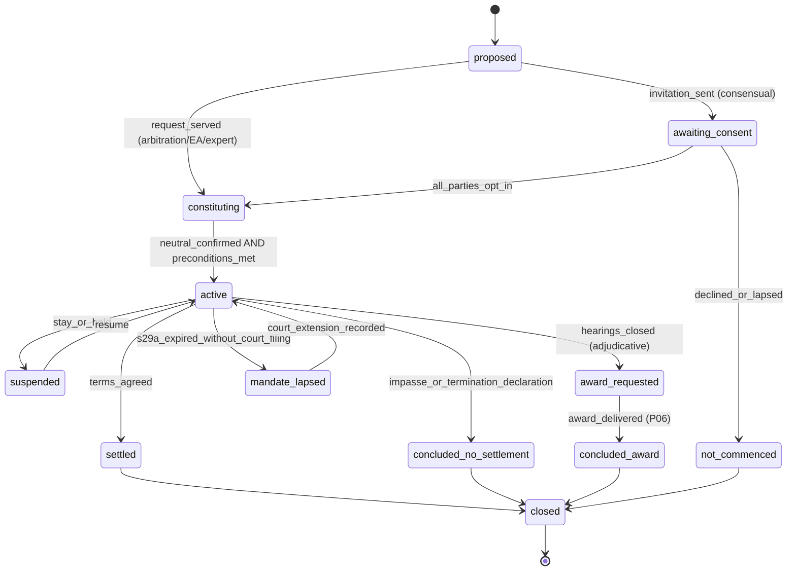

# P04 — Resolution Engines and Virtual Hearings
> Paste after 01_MASTER_PROMPT.md. Prerequisites: P02, P03. Estimated effort: 7 sprints (2-week) for a squad of 10 (3 backend-domain, 1 backend-realtime, 2 web, 1 mobile, 1 QA automation, 1 legal-ops analyst, 1 designer shared with P03).

Binding references: Appendix A §3–§5 (one state machine per mechanism, ladders, Compliance Clock Reference), Appendix D (`VIDEO_PORT` = `VideoRoomPort`, `TRANSCRIPTION_PORT`, `TRANSLATION_PORT`, `TELEPHONY_PORT`, `ESIGN_PORT`, `KYC_PORT`), Appendix E (AI guardrails), Appendix F (DDL, events, errors), Appendix G (Legal Rules Register).

---

## 1. Objective and business outcome

Build "one engine, many configurations": a single proceedings engine that runs negotiation, conciliation, mediation (contractual and statutory modes), arbitration (institutional, documents-only fast track, expedited, emergency arbitrator, optional appeal tier), med-arb, arb-med, arb-med-arb and expert determination as configured state machines over shared building blocks (proceeding, session, offer, order, consent instrument, clock, document vault), plus secure LiveKit hearing rooms with waiting, joint, caucus and breakout rooms, page-synced e-bundles, interpretation, PSTN dial-in and consent-gated recording.

Business outcomes at exit:
- Any accepted case from P02 can run its full ladder to an outcome hand-off (settlement terms or award draft request to P06) without leaving the platform.
- Every arbitration is constituted defensibly (NN-03), every s.29A mandate is clock-owned with no silent lapse (NN-04), and every award draft request is blocked while an unwaived Seventh Schedule ineligibility or a lapsed mandate exists.
- Mediation and conciliation are never recorded (NN-11), caucus content is sealed to its author, and settlement communications never reach an arbitral record.
- A party on a 2G connection or a feature phone can attend by audio or PSTN dial-in with an attendance record.

---

## 2. Scope (in / out)

**In scope**
- Proceedings engine core: proceeding creation guards (master §5.2 matrix, NN-06), ladder escalation, information vaults, orders/directions, procedural consent instruments, sessions, adjournments.
- Negotiation (structured offers, blind-bid with midpoint proposal, guardrails); conciliation (A&C Act 1996 Part III, ss.61–81); mediation contractual mode and statutory mode (flag; Mediation Act 2023 ss.18–30); arbitration lifecycle from request to award-drafting hand-off, s.29A, s.33 request handling and the optional internal appeal tier; emergency arbitrator; interim measures (s.17); hybrids per master §5.3; expert determination.
- Virtual hearings on LiveKit: rooms, tokens, waiting room, joint/caucus/breakout/deliberation/witness rooms, screen share, e-bundle viewer with page sync, interpretation channel, low-bandwidth audio-only, PSTN dial-in, recording consent, transcripts where lawful, attendance register, identity checks, hearing scripts.
- Scheduling across time zones; adjournments and fee hook; sealed caucus notes; safety screening and shuttle protocols.
- Mobile: join hearing (party and neutral), offers and blind-bid, orders and hearing notices, neutral quick actions (admit, move to caucus, end session).

**Out of scope**
- Allocation, disclosures capture, empanelment, conflict engine (P03 — consumed here).
- Settlement agreement and award drafting UI, maker–checker, eSign/eStamp of outcomes, certified copies, execution (P06). P04 emits `award.draft_requested` / `settlement.terms_agreed` with the record.
- Fee computation, deposits collection, refunds (P05). P04 emits billing events (adjournment, EA, appeal, s.29A fee-reduction flag).
- AI voice agents and journeys (P07); vertical calculators (P08); POSH inquiry (P09, sealed module — the machine is in Appendix A §3.14).

---

## 3. Personas and permissions touched

| Role | P04 capabilities | Restrictions |
|---|---|---|
| `neutral_mediator`, `neutral_conciliator` | Run sessions, admit from waiting room, open/visit caucus rooms, write sealed caucus notes, issue directions, propose terms (conciliator s.73(1)), declare termination, issue non-settlement / non-commencement reports | Cannot start recording (API-blocked); cannot see screening details (only `safety_flag` and safeguards required) |
| `neutral_arbitrator` (sole/presiding/co-arbitrator) | PO1, orders, s.17 measures, hearings, recording direction, witness management, pleadings-completion order, deliberation room, award draft request, s.33 decisions | Orders signed and dated at signature (no back-dating); no access to mediation/conciliation vaults or caucus notes |
| `neutral_expert` | Expert determination workspace, site-visit records, draft and final determination | No arbitral powers |
| `party`, `party_org_user`, `counsel` | Join sessions, submit offers/bids, file pleadings and applications, sign consent instruments, request adjournment, challenge (s.13), apply for EA/s.17, appeal | Counsel acts within mandate scope (`appear`, `settle`); FIN lender users never see or influence neutral selection or challenge decisions (NN-03) |
| `case_manager` | Schedule, manage rooms, technical host (cannot speak unless admitted), serve orders, monitor clocks, attendance register | Not admitted into caucus rooms; no caucus notes |
| `registrar` | Constitution confirmation, challenge committee secretariat, mandate/clock records, appeal registration, sealed-award custody (arb-med) | Dual control on sealed-award release |
| `panel_manager` | EA appointment within 2 business days, substitution after challenge/withdrawal/lapse (via P03 allocation) | Cannot appoint outside allocation rules |
| `safeguarding_lead` | Screening oversight, safety-flag escalations, emergency-button response | Sealed schema access with step-up and logging |
| `quality_officer` | Session-level process metrics (duration, adjournments, attendance), never content | — |
| Hearing participants without platform roles (`witness`, `expert_witness`, `interpreter`, `observer`, `support_person`) | Time-bound case-scoped grants in `core.role_grants` (session-only), join via single-use link + OTP | Witness: no chat, no bundle unless directed; observer: requires all-party consent |

---

## 4. Functional requirements

### 4.1 Proceedings engine core

**FR-P04-01 — Proceeding model.** A `core.proceedings` row is one mechanism instance on a case: `mechanism ∈ {negotiation, conciliation, mediation, arbitration, emergency_arbitration, med_arb, arb_med, arb_med_arb, expert_determination, appeal}`, `mode_flags` (`statutory_mode`, `documents_only`, `fast_track_s29b`, `expedited`, `ica`, `appeal_opt_in`), `config_snapshot` (pinned mechanism configuration from the case's ruleset version — time-boxes, clocks, session rules, offer rules, tribunal size, fee items), `state` (per-mechanism machine, Appendix A §3), `phase` (for hybrids: `mediation_phase | arbitration_phase | sealed_award_phase`), `seq_no`, `parent_proceeding_id`, `seat`, `venue`, `language[]`, `commenced_at`, `closed_at`, `outcome_code`. Each mechanism is a configuration of the shared engine (`packages/domain/state-machines/proceedings/*.ts` — XState-style pure definitions; transitions executed by the `proceedings` module, durable steps by Temporal).

**FR-P04-02 — Creation guard.** `POST /v1/cases/{caseId}/proceedings` succeeds only if: the case is `accepted`, `awaiting_respondent` (negotiation/EA only), `neutral_appointment` or `in_proceedings`; the mechanism is permitted for the vertical by master §5.2 and by the tenant's narrower config; the route decision includes the mechanism; and the arbitrability screen holds. Blocked combinations return `422 non_arbitrable_route` (e.g., FAM status/custody/testamentary heads, INS retail policyholder, WRK workman/industrial dispute, FIN bank/FI claims in DRT-exclusive jurisdiction — *Vidya Drolia v Durga Trading Corp* (2021) 2 SCC 1; *Booz Allen & Hamilton v SBI Home Finance* (2011) 5 SCC 532; NN-06). Arbitration additionally requires an arbitration agreement on record (A&C s.7: signed document, exchange of letters/electronic communications, or statements of claim and defence where existence is alleged and not denied) and, for FIN, a clause naming Equator ex ante (NN-03; *Madhyachal Steels v Clix Capital*, Del HC, 24 Aug 2026). Non-arbitrable heads discovered mid-case are severed: a `sever_heads` order moves them to a sibling mediation proceeding or a signposting event.

**FR-P04-03 — Ladder escalation.** On a proceeding concluding without settlement, the engine reads the pinned `pathway` (`rungs[]`, `escalation ∈ {on_fail, sequential, none}`, `mandatory[]`, `time_boxes`) and offers the next rung. Consensual rungs require all-party opt-in; arbitration requires the agreement in FR-P04-02. A new rung creates a new proceeding (`parent_proceeding_id`), carries forward parties, pleadings and documents **except** vault-restricted material (FR-P04-04), and moves the case to `neutral_appointment` if a different neutral is required (Appendix A §2.2).

**FR-P04-04 — Information vaults and firewall.** Every document, message, note and offer is tagged with a vault: `open_record` (pleadings, evidence, orders), `settlement_communications` (offers, without-prejudice material, mediation/conciliation submissions — A&C Act s.81; Mediation Act 2023 ss.22–23 in statutory mode), `caucus_sealed` (caucus notes — author-only), `tribunal_private` (deliberations), `sealed_award` (arb-med). Arbitrators' queries, search indices, bundles and AI retrieval are filtered to `open_record` + `tribunal_private` (own tribunal). Any attempt to attach a `settlement_communications` item to an arbitral bundle or order returns `422 vault_firewall_violation`. Carry-forward on escalation excludes `settlement_communications` and `caucus_sealed`.

**FR-P04-05 — Orders and directions.** Order kinds: `procedural_order`, `direction`, `timetable`, `pleadings_completion`, `interim_measure_s17`, `ea_order`, `adjournment`, `recording_direction`, `consolidation_joinder`, `severance`, `challenge_decision`, `deposit_direction_s38`, `termination_s32`, `s25_default`, `s29a_extension_record`, `s27_court_assistance_request`, `site_visit`, `confidentiality_ring`. Lifecycle: draft (neutral; optional `drafting_assistant` draft flagged `requires_human_review`) → optional institutional form check (case manager; form, not substance) → sign (DSC Class 3 or Aadhaar eSign via `ESIGN_PORT`, step-up MFA) → number (`PO-{n}`, `IO-{n}`, `EA-{n}`) → serve via the P02 notice engine (`order_service`) → ledger (PDF hash) → effective. The order date is the signature timestamp; no field allows an earlier date (`422 backdating_prohibited`). Corrections are new orders that supersede.

### 4.2 Negotiation

**FR-P04-06 — Structured offers.** Offer = `{amount_minor, currency, payment_schedule[], non_monetary_terms[] (from vertical term library: bureau correction, NOC within n days, reinstatement, relieving letter, apology, adverse-remark withdrawal), conditions[], valid_until}`. Default time-box 21 days (configurable 7–45), max 6 rounds, offer validity 72 h (24 h–14 d), counter-offer supersedes. FIN lender offers must carry the RE's compromise-policy approval reference and the authorised officer whose `settlement_limit` ≥ offer amount (RBI Framework for Compromise Settlements and Technical Write-offs, RBI/2023-24/40, 8 Jun 2023, now consolidated for NBFCs in the RBI (NBFC – Resolution of Stressed Assets) Directions, 2025, paras 16 and 86–100; the approver must be at least one level above the sanctioning authority and must not have sanctioned the loan); principal, interest and penal charges are shown separately and penal charges are never capitalised (NBFC Responsible Business Conduct Directions 2025). Offers live in the `settlement_communications` vault. Acceptance creates `settlement.terms_agreed` (hand-off to P06) only after both parties confirm a generated term sheet.

**FR-P04-07 — Blind-bid with midpoint proposal.** For monetary disputes: claimant submits a confidential minimum acceptable figure, respondent a confidential maximum offer (encrypted at rest with a per-proceeding key; visible to no human, including staff). Each round (max 3; 48 h window) the deterministic rules engine evaluates: if respondent_max ≥ claimant_min, the bids "cross" and the engine proposes the midpoint `round_half_up((claimant_min + respondent_max)/2, rounding_unit)` with rounding unit ₹100 (INR) or 1 major unit (other currencies). The midpoint is a *proposal* that both parties must accept within 72 h. If bids do not cross, parties see only "not crossed"; no gap, direction or amounts are revealed (`reveal_gap_band = false` by default; tenants may not enable it for FIN borrowers or FAM). Bids are destroyed (crypto-shredded) 30 days after the proceeding closes; only cross/no-cross outcomes and the accepted figure persist. Blind-bid is disabled for FAM maintenance where either party has a vulnerability flag (master §5.2) and for any party with an open safety flag.

**FR-P04-08 — Guardrails.** `negotiation_facilitator` may rephrase messages into neutral tone (shown as a suggestion; sender approves), generate options *from parameters the parties supply*, and summarise positions; it never values, never recommends a figure, never comments on the strength of a position (GX-1/2/3). Coercion lexicon on outbound messages (threats, criminal-consequence claims, shaming, contact with relatives) blocks sending with an explanation (FL-G-02; NBFC Responsible Business Conduct (Third Amendment) Directions 2026, RBI/2026-27/230, 6 Aug 2026, effective 1 Jan 2027 — enforced now per NN-12). Equality-of-arms prompts: when one side is represented and the other is not, the unrepresented side sees a "you may take advice; this is not a deadline" banner and free-forum links. "Ask for a neutral" is always available and converts the proceeding to conciliation or mediation with consent.

### 4.3 Conciliation (A&C Act 1996 Part III)

**FR-P04-09 — Commencement and conduct.** Invitation (`invitation_to_conciliate_s62`) by a party; proceedings commence when the other party accepts in writing (s.62(2)); no reply within 30 days of the invitation (or the period stated) entitles the inviting party to treat it as rejection (s.62(4)) and the engine records `invitation_lapsed`. One conciliator unless parties agree on more (s.63); Equator recommends/appoints via P03 on request (s.64(2)). Parties submit brief statements, then further statements and documents (s.65). The conciliator may meet parties together or separately (s.69). **Disclosure default (s.70):** factual information received from one party is disclosable to the other so that it can explain; every caucus submission carries an explicit, un-preselected choice "share the substance with the other party" / "keep confidential (s.70 proviso)"; the engine stores the choice and enforces it in what the conciliator can paste or attach into joint-session materials. Confidentiality (s.75) and inadmissibility (s.81) apply; recording blocked (NN-11).

**FR-P04-10 — Settlement and termination.** The conciliator may formulate terms of a possible settlement and reformulate after observations (s.73(1)); the agreed terms are drawn up as a settlement agreement signed by the parties and authenticated by the conciliator (s.73(3)–(4)) — P06 executes signing, stamping as an award-equivalent (s.74: same status and effect as an arbitral award on agreed terms under s.30; NN-09). Termination events (s.76): (a) settlement signed; (b) conciliator's written declaration that further efforts are not justified; (c) parties' joint written declaration; (d) one party's written declaration. Each produces a termination record; (b)–(d) produce a non-settlement report (facts and dates only). During conciliation, parties' undertaking not to initiate arbitral/judicial proceedings (s.77) is shown, with the carve-out for proceedings necessary to preserve rights; the engine never pauses limitation clocks for conciliation unless a legal rule in the register says so (FR-P02-28). The conciliator may act as arbitrator later only if all parties agree (s.80) — enforced via the med-arb rules in FR-P04-31.

### 4.4 Mediation

**FR-P04-11 — Contractual mode (default; NN-05).** Agreement to Mediate (template per vertical: F-L17, F-C18, F-I14 with insurer authority section, F-W, FAM F-08 orientation) signed by all parties before the first joint session, including: voluntariness, confidentiality and non-recording, without-prejudice status, authority to settle (who, up to what amount, approver turnaround; INS and FIN institutional parties must confirm authority in writing before `in_session`), fee terms, online-mode consent, and the statement that mediation does not pause limitation. Time-box from first appearance (configurable per vertical): FIN 60 days, COM 60 days, INS 45 days, WRK 45 days, FAM 120 days, INT 60 days; extensions by all-party consent (default max +60 days). Settlement output is a contract (mediated settlement agreement) handed to P06; enforcement routes offered: contract, consent award via arb-med-arb where an arbitration agreement exists or is made (A&C s.30), s.73/74 recording where the parties choose conciliation. No copy may claim "s.27 decree-enforceable" or "MCI-registered" while the flag is OFF (copy lint test). Contractual mode is also the vehicle for **voluntary pre-suit (pre-litigation) mediation** in every vertical (master M-06); it is never described as statutory pre-litigation mediation or as satisfying CCA s.12A (FR-P04-15).

**FR-P04-12 — Statutory mode (flag `mediation_statutory_mode`, default OFF).** Switching ON requires `institution_admin` + legal approver with the notification reference (S.O. number and date) recorded in the Legal Rules Register, per provision: s.17 (mediator-as-arbitrator bar), s.18 (time limit), s.19 (MSA), s.20 (registration), s.21 (non-settlement report), s.22–23 (confidentiality/privilege), s.27–28 (enforcement/challenge), s.30 (online mediation). Per-provision sub-flags allow partial commencement. When ON: `mediation_s18` clock of 120 days from the *date fixed for the first appearance* before the mediator (s.18(1)), extendable once by up to 60 days by agreement of the parties (s.18(2)) (alerts at days 90, 110, 120, 150, 170); MSA signed by parties and **authenticated by the mediator** (separate signature) under s.19; s.20 registration task with 180-day clock; s.28 challenge window clock (90 days + 90 for sufficient cause) starts on receipt of the MSA; s.30 written online-mode consent per party is a hard precondition to any online session; s.22 recording ban is absolute; same-neutral med-arb is blocked entirely (Mediation Act s.17(a): a mediator shall not act as arbitrator, representative or counsel in arbitral or judicial proceedings on the dispute; no party-agreement carve-out).

**FR-P04-13 — Session modes.** `joint` (all parties), `caucus` (neutral + one side, separate room), `shuttle` (neutral alternates between caucus rooms; parties never share a room or lobby), `async` (structured text threads per side with the neutral; 48 h response SLA; attachments allowed; no real-time presence), `child_inclusive` (FAM; child specialist present; never with a flagged parent), `in_person` and `hybrid` (attendance captured by case manager with ID check). Mediator may move between modes within a session; any `joint` transition passes the safety guard (FR-P04-46).

**FR-P04-14 — Confidentiality and non-recording (NN-11).** Recording, egress and persistent transcription are disabled at the room level for `mediation`, `conciliation` and `negotiation` sessions (`422 mediation_recording_prohibited`); live captions may be shown ephemerally with all-party consent and are not stored. Every participant (including observers, interpreters and support persons) signs a confidentiality undertaking before joining. Shared documents are watermarked; downloads in mediation default to view-only. Mediators are reminded at session start of the exceptions they must handle under their rules (e.g., disclosure of imminent risk to safety — DV disclosures are not privileged per FAM Rules; Mediation Act s.23(2): no privilege or confidentiality for (a) a threat or plan to commit an offence, (b) information relating to domestic violence or child abuse, (c) a significant imminent threat to public health or safety; s.23(1) proviso for mediator-misconduct claims).

**FR-P04-15 — Reports.** `non_commencement_report` (respondent did not respond or declined; facts and dates; no reasons; F-14/F-L03), `non_settlement_report` (mediation ended without settlement; facts, dates, sessions held; no content), `partial_settlement_report` (agreed heads + unresolved heads handed to next rung or signposting; F-28 handoff memo for FAM court route), `certificate_of_attempted_mediation` (for courts/family courts; settled/not settled only — FCA 1984 s.9 context). Reports never contain caucus content, offers or admissions. COM: Equator's report does **not** satisfy CCA 2015 s.12A; where s.12A applies, the report carries a notice that PIMS must be conducted through the Legal Services Authority (DLSA/SLSA) under the PIMS Rules 2018 (G.S.R. 606(E), 3 Jul 2018). Every Equator non-settlement or non-commencement report in a COM matter carries the footer: *"Issued under the Equator Mediation Rules. This is not a Non-Starter Report (Form-3) or Failure Report (Form-5) under the Commercial Courts (Pre-Institution Mediation and Settlement) Rules, 2018, and does not satisfy section 12A of the Commercial Courts Act, 2015. It is not a report under section 21 of the Mediation Act, 2023, which is not in force."* For s.12A matters the platform prepares the Form-1 application pack for the Authority and tracks the 3 + 2-month PIMS period for the party (Appendix A `pims_s12a`, owner = party); Equator may mediate privately before or alongside it. Flag `com.s12a_equator_authorised` (OFF) moves COM to the substituted s.12A (Mediation Act Ninth Schedule; 120 + 60 days; Appendix A `s12a_mediation_act`) only after all four gates in master M-06 close.

### 4.5 Arbitration

**FR-P04-16 — Request and response.** Request for Arbitration (form `arb_request.v1`): parties, arbitration agreement (document + clause pointer), seat, governing law, law of the arbitration agreement (INT mandatory), language, claims, reliefs, tribunal size preference, expedited/fast-track election, EA need, appeal-tier opt-in evidence. Commencement date = the date the respondent receives the request (A&C s.21), taken from the deemed-service record (P02). Response to request within 14 days (extendable by the registrar once by 14 days) including jurisdiction objections (recorded for the tribunal; s.16(2): plea not later than the statement of defence), counterclaims, tribunal-size position.

**FR-P04-17 — Constitution.** Default sole arbitrator; three members where the agreement provides or the parties agree, or where claim + counterclaim exceed the tenant threshold (default ₹10 crore domestic; USD 5,000,000 INT; Subject to Board approval). The sole and presiding arbitrators are always appointed by Equator's Appointments Committee through P03 rule-based allocation, never by the co-arbitrators. Party nomination of one co-arbitrator per side (from the roster, or an outside nominee subject to Equator confirmation, disclosure and conflict check, within 15 days) is available only in COM/INT matters flagged `equal_footing = true` by the registrar (P03 FR-P03-19); in every other matter — including all lender–borrower, insurer–policyholder, employer–employee and consumer matters — all seats are allocated by Equator (*CORE v ECI-SPIC-SMO-MCML (JV)*, SC 5-judge, 8 Nov 2024; NN-03). INT: sole/presiding arbitrator of a nationality different from the parties' unless they agree otherwise (mirrors A&C s.11(9); NN-19). Constitution is confirmed only when every appointee has accepted, filed the Sixth Schedule disclosure (s.12(1)), and the conflict engine reports no unwaived Seventh Schedule ground (s.12(5)). Target ≤ 30 days from commencement (SLA clock).

**FR-P04-18 — Disclosures and s.12(5) waiver.** Disclosures are continuing (s.12(2)): any new circumstance triggers a re-disclosure task and party notice with a 15-day challenge window. A s.12(5) waiver is accepted only as a separate written instrument, e-signed by **each** party, dated after the dispute arose (`signed_at > dispute_arose_at`, where `dispute_arose_at` = earliest of the notice invoking arbitration, the request date or a recorded dispute event); waiver by conduct, participation, filing a claim or a joint extension request is never accepted (*Bhadra International (India) v Airports Authority of India*, SC, 5 Jan 2026). Invalid instruments return `422 s12_5_waiver_invalid`. While any Seventh Schedule flag is open without a valid waiver, `award.draft_requested` and all orders except recusal/substitution are blocked.

**FR-P04-19 — Challenge (s.13).** A party may challenge within 15 days of becoming aware of the constitution or of the circumstances (s.13(2)); later challenges are accepted for record with `late = true` and referred for decision on timeliness. Under the agreed procedure in the Equator Arbitration Rules (s.13(1)), unless the arbitrator withdraws or the other party agrees, the challenge is decided by the Equator Appointments Committee (P03 FR-P03-28; members with any connection to the case are automatically recused) within 15 days of the reply; the arbitrator and other party may respond within 7 days. If rejected, the tribunal continues and the challenging party's remedy is under s.34 (s.13(5)); if upheld, substitution under s.15 via P03 with a clock-impact record (s.29A continues to run; any extension request is the parties' or court's). Challenge decisions are reasoned orders served on all parties.

**FR-P04-20 — Procedural Order No. 1 and terms of reference.** Within 21 days of constitution, the tribunal holds a case-management conference (virtual by default) and issues PO1 using the PO1 builder: seat/venue/language, applicable rules version, timetable (SoC, SoD + counterclaim, reply, rejoinder, document production, witness statements, expert reports, hearing dates), page limits, bundle format (P02 e-bundle templates, exhibit labelling), document production standard (IBA Rules on the Taking of Evidence 2020 optional), virtual-hearing protocol (Seoul Protocol 2020 baseline: test run T-7, witness isolation, contingency/dial-in, interpreter, recording consent), confidentiality (s.42A), deposits (s.38), costs (s.31A), cyber/data protocol, third-party-funding disclosure, AI-use disclosure. Terms of reference (optional, tribunal choice) capture claims, issues and relief sought; for INT they are default ON. The timetable must place SoC and SoD within 6 months of the arbitrators' receipt of notice of appointment (s.23(4)); the PO1 builder flags any date beyond that (`s23_4` clock, Appendix A §6).

**FR-P04-21 — Pleadings and completion.** Pleadings are filed as documents (`pleading_claim`, `pleading_response`, `counterclaim`, `reply`, `rejoinder`) with exhibit bundles. The tribunal issues a `pleadings_completion` order; the system proposes the date of the last pleading filed (server timestamp) and the tribunal may only choose that date or a later date with reasons (never earlier). The order starts the `arb_s29a` clock (domestic) or `arb_ica_target` advisory clock (ICA; s.29A(1) proviso).

**FR-P04-22 — s.29A mandate clock.** `arb_s29a`: 12 months from completion of pleadings (s.29A(1)); alerts AP-L (T-90, T-60 blocking, T-30); consent extension of up to 6 months recorded only with all parties' e-signed consent (s.29A(3)) before expiry; a court-extension petition pack (s.29A(4)–(5): chronology, reasons, orders, s.29A(4) proviso fee-reduction note) is generated at T-60 of the 12-month date where no consent extension is recorded, and at day 480 of a consent-extended mandate (blocking at day 510; Appendix A AP-29A), and a blocking task requires recording either the filing (court, case number, filing date, document) or a reasoned decision not to file. A filing recorded before expiry keeps the mandate alive until the court disposes of the application (s.29A(4) proviso); the design never relies on post-expiry filing. If the period (with any consent extension) expires without a recorded court filing, the proceeding moves to `mandate_lapsed`, the case to `lapsed`, all tribunal actions except recording a court order are blocked (`409 mandate_lapsed`), and a Critical incident opens (NN-04; *Mohan Lal Fatehpuria v Bharat Textiles*, 2025 INSC 1409, 10 Dec 2025). A court order extending the mandate or substituting the arbitrator (s.29A(4)–(6)) is uploaded and recorded to resume: a post-expiry application is maintainable (*Rohan Builders (India) v Berger Paints India*, 2024 SCC OnLine SC 2494), and *Fatehpuria* does not rewrite s.29A(4)–(6) (*Viva Highways v MPRDC*, SC, 7 Jan 2026). Award fee bonus if made within 6 months of entering upon the reference (s.29A(2)) and fee reduction up to 5% per month of delay attributable to the tribunal (s.29A(4) proviso) are emitted as billing flags. No award may be back-dated.

**FR-P04-23 — Documents-only fast track (s.29B).** Available only on written agreement of the parties (`s29b_fast_track` consent instrument) before or at the tribunal's appointment; sole arbitrator; decided on written pleadings, documents and submissions without oral hearing unless all parties request one or the tribunal considers it necessary for clarification; award within 6 months of the tribunal entering upon the reference (`arb_s29b` clock), extension per s.29A(3)–(9) as applied by s.29B(5). UI: documents-only workspace with written Q&A rounds (tribunal questions → 7-day answers).

**FR-P04-24 — Expedited procedure (Equator Rules Schedule 2; contractual).** Applies where the parties agree or, unless a party objects within 7 days and Equator agrees, where claim + counterclaim ≤ ₹3 crore (placeholder, Subject to Board approval); sole arbitrator; constitution within 14 days; one case-management conference; single hearing (≤ 2 days, virtual default) or documents-only; page limits (SoC/SoD 30 pages); award within 6 months of constitution (contractual target; s.29A remains the statutory outer limit for domestic).

**FR-P04-25 — Emergency arbitrator (Equator Rules Schedule 1; contractual — *Amazon.com NV Investment Holdings v Future Retail* (2022) 1 SCC 209).** Application before tribunal constitution, with urgency statement, relief, draft order, proof of service on the other side (or reasons for ex parte request). Equator appoints an EA within 2 business days (`ea_appointment` clock); EA discloses within 24 h; challenge within 1 business day of disclosure; EA fixes a schedule within 2 business days and issues a reasoned order within 14 days of appointment (`ea_decision` clock). The EA order binds the parties, may be modified or vacated by the tribunal, and ceases if the tribunal is not constituted within 90 days of the order (`ea_order_lapse` clock) or the claim is withdrawn. The EA cannot be appointed to the tribunal unless all parties agree. For India-seated arbitrations the EA order is treated as an order under s.17(1), enforceable under s.17(2); for foreign seats the platform shows that an EA order is not directly enforceable in India and a s.9 application may be needed (R5 §1.2). Fee items emitted: EA application fee and EA fee (illustrative ₹50,000 + ₹1,50,000; Board approval).

**FR-P04-26 — Interim measures (s.17).** Application form with urgency, relief category (preservation, security for amount in dispute, detention/sale of goods, injunction, appointment of receiver, other), affidavit, draft order. Hearing within 7 days (urgent: 48 h). Order issued as `interim_measure_s17`, served, and its compliance deadlines become tracked tasks; non-compliance reports go to the tribunal and the party is shown that enforcement lies with the court as if it were a court order (s.17(2)).

**FR-P04-27 — Hearings, witnesses and experts.** Hearing notice ≥ 7 days (urgent shorter by order; "sufficient advance notice", s.24(2)); witness statements filed per PO1; witness sessions use the witness waiting room and isolation rules (FR-P04-38); oath/affirmation script (Oaths Act 1969 s.3(1)(a): 'persons having by law or consent of parties authority to receive evidence' may administer oaths; ss.4 and 8 bind witnesses and interpreters); party-appointed experts and tribunal-appointed experts (s.26) with expert reports and expert-conferencing ("hot-tubbing") sessions; s.27 court-assistance request pack for summoning witnesses. Default rules: s.25(a) claimant fails to file SoC without sufficient cause → termination order; s.25(b) respondent fails SoD → proceed without treating failure as admission; s.25(c) party fails to appear → tribunal may proceed ex parte and make the award on the evidence. Hearings proceed day-to-day as far as possible and adjournments need sufficient cause (s.24(1) proviso) — see FR-P04-44.

**FR-P04-28 — Closing and award-drafting hand-off.** Closing submissions per timetable; the tribunal issues a `hearings_closed` direction; the engine assembles the *award record* (parties and representatives, seat, dates of commencement/constitution/pleadings completion, claims and counterclaims list, issues list from ToR/PO1, orders, open-record bundle references, interest and costs submissions) and emits `equator.proceedings.award.draft_requested.v1` to P06. Guards: no open Seventh Schedule flag without valid waiver; mandate not lapsed; all deposits directed under s.38 either paid or the tribunal has recorded its decision; consent-award requests (s.30) carry the signed settlement terms. P04 pre-checks the **s.31 form requirements** P06 will enforce: in writing and signed by the members (majority with reason for the omitted signature, s.31(1)–(2)); reasons unless agreed otherwise or a s.30 award (s.31(3)); date and place of arbitration (s.31(4)); interest heads including post-award interest that cannot be contracted out (s.31(7); *ONGC v G&T Beckfield*, 2025 INSC 1066); costs (s.31A); severable operative paragraphs per claim and interest head (*Gayatri Balasamy v ISG Novasoft*, SC 5-judge, 30 Apr 2025); delivery of a signed copy to each party (s.31(5)).

**FR-P04-29 — s.33 correction, interpretation and additional award.** Party request within 30 days of receipt of the award (unless another period was agreed) with notice to the other party: correction of computation, clerical or typographical errors; interpretation of a specific point (if agreed by parties); additional award on claims presented but omitted. Tribunal decides corrections/interpretations within 30 days of receipt of request (and may correct on its own initiative within 30 days of the award date); additional award within 60 days; the tribunal may extend the time if necessary (s.33(6)). Engine runs `arb_s33_request` and `arb_s33_decision` clocks; P06 issues the corrected/additional award.

**FR-P04-30 — Optional internal appeal tier (D4).** Available only where the arbitration agreement (or a post-dispute agreement of all parties) opts in and claim + counterclaim ≥ ₹1 crore (default; Board approval) — two-tier arbitration is valid as a matter of party agreement (*Centrotrade Minerals v Hindustan Copper* (2017) 2 SCC 228). Notice of appeal within 30 days of receipt of the first-tier award (`appeal_filing` clock); grounds limited to those in the Equator Appeal Rules (error of law; finding unsupported by any evidence; serious procedural irregularity causing substantial injustice — configurable); appellate panel of 3 allocated by P03 excluding all first-tier members; record-based with one hearing; appellate award within 90 days of the appeal record being complete (contractual). The first-tier award is not final while the appeal window is open or an appeal is pending; the statutory challenge clock (s.34) is computed from receipt of the final award under the Rules, with a protective-filing reminder dated from receipt of the first-tier award **[VERIFY — open (counsel): *Centrotrade* (2017) 2 SCC 228 upholds two-tier arbitration; no SC ruling on the s.34(3) trigger or on s.29A for the appellate tribunal; appeal tier OFF in production until opinion]**. Appeal fee item emitted.

### 4.6 Hybrids (exactly per master §5.3)

**FR-P04-31 — Med-arb.** Mediation phase runs under FR-P04-11/12. On impasse the case proceeds to arbitration with a **different neutral by default** (allocation via P03; the mediator is excluded). The same neutral may continue as arbitrator **only** if (a) every party signs a fresh, informed, written e-signed `role_switch_med_arb` consent whose `signed_at` is after the mediation phase's `ended_at` (consents signed earlier, including in the original clause, are rejected with `409 role_switch_consent_required`), (b) the neutral files a renewed s.12 disclosure, and (c) statutory mode is OFF (FR-P04-12; in statutory mode Mediation Act s.17(a) bars a mediator from acting as arbitrator, with no party carve-out) — conciliation-origin hybrids rest on A&C s.80 ("unless otherwise agreed by the parties"). Caucus notes and `settlement_communications` from the mediation phase are frozen and firewalled: never placed in the arbitral record, excluded from the arbitrator's search and AI retrieval, and (for a same-neutral continuation) hidden from the arbitrator workspace for the life of the arbitration (cf. *Gao Haiyan v Keeneye Holdings* (HKCA 2011) on med-arb bias risk).

**FR-P04-32 — Arb-med.** After hearings close and before mediation begins, the tribunal finalises the award text, which is hashed (SHA-256) and stored encrypted in the `sealed_award` vault under a registrar-held key; the hash and seal timestamp are written to the evidence ledger; the content is disclosed to no one. Parties sign an `arb_med_switch_s30_1` consent (A&C s.30(1)). The mediation window must end at least 15 days before the `arb_s29a` due date (guard). Mediator: different neutral by default; the arbitrator may mediate only with the same all-party consent captured at the switch, and never where the mediation phase runs in statutory mode (Mediation Act s.17(a) would bar the mediator from then signing as arbitrator). If mediation settles, the tribunal makes a consent award on the agreed terms (s.30(2)–(4)) via P06 and the sealed text is crypto-shredded 90 days after the consent award is delivered (hash retained). If not, the registrar and the presiding arbitrator (dual control) unseal; the tribunal signs the **identical** text (hash match enforced; any change blocked with `409 sealed_award_mismatch`) and P06 executes signing, stamping at signing (NN-09) and delivery.

**FR-P04-33 — Arb-med-arb / consent-award conversion.** Equator AMA Protocol: arbitration commences (s.21) and the tribunal is constituted (or constituted for the purpose), the arbitration is stayed, and the parties mediate (default 8 weeks, extendable by consent) under Equator Mediation Rules (International for INT). On settlement, the tribunal records a consent award on agreed terms (s.30), the primary cross-border enforcement route under the New York Convention while India has not ratified the Singapore Convention (NN-19; India signed 7 Aug 2019). On no settlement, the arbitration resumes with the stay lifted; mediation material is firewalled (FR-P04-04). For domestic settlements reached without a pending arbitration, the default route is conciliation under A&C Part III, so that the s.73 settlement has s.74 award status. The "sign an arbitration agreement and request a consent award" variant stays behind a legal-review flag **[VERIFY — open: s.30 presupposes a subsisting dispute "during arbitral proceedings"]**.

### 4.7 Expert determination

**FR-P04-34 — Expert determination.** Contractual process (not arbitration; no s.34 challenge; binding per contract, typically subject only to fraud or manifest error). Steps: referral with question(s) for determination, expert appointment (P03 panel with `neutral_expert` accreditation and disclosures), terms of reference, submissions and documents, site visit/survey (with photo/video upload and geotag), optional draft determination for comments (14 days), final determination (signed). COM: valuation, accounts, engineering, IP royalties. INS: quantum by an IRDAI-licensed surveyor/loss assessor (Insurance Act 1938 s.64UM; IRDAI (Insurance Surveyors and Loss Assessors) Regulations 2015 as amended — draft amendments published Jun 2026) jointly appointed; for **retail policyholders the determination is non-binding on the policyholder** ("independent assessment report") unless the policyholder elects binding effect after a disclosure screen that the Ombudsman/consumer routes remain open (NN-20). Determinations are not awards; conversion into a consent award requires a separate agreement and an arbitral tribunal.

### 4.8 Virtual hearing rooms

**FR-P04-35 — Rooms and tokens.** One LiveKit room per room kind per session: `lobby_{partySide}` (waiting rooms are per side when a safety flag or shuttle mode applies; otherwise one lobby), `joint`, `caucus_{casePartyId}`, `breakout_{n}`, `tribunal_deliberation` (tribunal members only), `witness_waiting`. Room key format: `t{tenantShort}-c{caseShort}-s{sessionShort}-{kind}[-{suffix}]`, region pinned `india` (LiveKit Cloud Scale) or self-hosted Mumbai for residency-strict tenants. Join tokens are minted only by the API (`POST /v1/sessions/{sessionId}/join`) after ABAC + identity check, room-scoped, TTL 15 min (auto-renew while connected), with publish/subscribe grants per role; moving a participant = new token for the target room + removal from the source room (isolation enforced by the SFU, not by UI state).

**FR-P04-36 — Waiting room, admit, caucus, breakout.** Participants arrive in a lobby; the neutral (or a `case_manager` acting as technical host on the neutral's delegation) admits individually or by side. Caucus: neutral opens `caucus_{side}` rooms and moves between them; parties can never hear or see another caucus; the case manager has no caucus access. Breakout: counsel–client private rooms (no neutral), tribunal deliberation room, expert-conferencing room. Hand-raise, side chat (in arbitration retained in the record; in mediation ephemeral and not stored), "request caucus" button, timers.

**FR-P04-37 — Screen share and e-bundle viewer with page sync.** Screen share for neutrals; for parties/counsel only when the neutral grants it. The e-bundle viewer opens P02 bundles (served via short-lived signed URLs, per-viewer watermark with name, time and case number); the presenter's page, zoom and highlight rectangles broadcast over the LiveKit data channel (`bundle.sync` messages: `{bundleId, version, page, rects[], ts}`); participants can "follow presenter" or browse freely; exhibit references (e.g., "C-14, p. 212") are clickable in chat and orders. Viewers only see bundles they are entitled to; witnesses see only documents put to them.

**FR-P04-38 — Witness protocol.** Witness waits in `witness_waiting`; enters `joint` only when called; chat disabled; screen share disabled; optional 360° room check (rotate camera) on tribunal direction; counsel may not message the witness during testimony (data-channel messages to witness identity blocked); oath/affirmation script read and acknowledgement recorded in the attendance register.

**FR-P04-39 — Interpretation channel.** Interpreters (time-bound grant, declaration of accuracy and confidentiality signed) publish to a dedicated audio track `interp-{lang}` in the joint room; participants choose floor or interpretation language; the floor track is ducked for those listening to interpretation. Machine captions/translation (Sarvam) are labelled "unofficial machine translation"; a certified interpreter remains the procedural record (A&C s.22 for arbitration language).

**FR-P04-40 — Low bandwidth and PSTN.** Adaptive simulcast; auto-suggest audio-only below 150 kbps sustained for 10 s; manual audio-only toggle; PSTN dial-in via LiveKit SIP over Exotel numbers with a per-participant 6-digit PIN mapped to the participant identity (PIN valid for that session only); PSTN participants hear a spoken notice of the session rules and, where recording is on, a recording disclosure; neutrals can dial out to a verified number (`dialOutPstn`). PSTN participants are marked in the attendance register with caller-ID match result.

**FR-P04-41 — Recording consent, recording and transcripts (NN-11).** Arbitration only: recording starts only if (a) the tribunal has issued a `recording_direction` order, (b) every party (and every participant whose image/voice is captured, including witnesses and interpreters) has a `recording` consent instrument for that session, and (c) the session is not tagged `settlement_communications`. The API refuses otherwise (`409 recording_consent_missing`; mediation/conciliation/negotiation always `422 mediation_recording_prohibited`). On start: banner for all, spoken disclosure for PSTN. Egress writes to an Object Lock bucket; the file hash is ledgered. Transcripts (Sarvam STT with diarisation, or a human stenographer upload) follow the same gate; transcripts are marked "unverified" until the tribunal approves corrections (7-day party correction window). Any participant may withdraw consent prospectively; recording stops and the tribunal decides how to proceed.

**FR-P04-42 — Identity checks, attendance register and hearing script.** At join: OTP-authenticated session + face match against the P01 KYC selfie (liveness) for parties and witnesses where the tenant/vertical requires it (default ON for arbitration hearings and FIN/INS sessions; OFF for FAM where it could deter attendance, replaced by neutral visual confirmation); re-check every 2 hours and on reconnect after > 5 minutes. Attendance register rows from LiveKit webhooks (`participant_joined/left`) with identity method and result, channel, room; the neutral confirms the register at session end; for arbitration it becomes a signed PDF in the record; for mediation it records attendance only (no content). Hearing scripts (templated per mechanism, vertical and language) guide the opening: not a court; voluntariness (consensual mechanisms); confidentiality and no recording (mediation); recording status and consents (arbitration); identities and appearances; interpreter; contingency (dial-in number, adjournment rule); INS opening verbatim: inadmissible, no admission, rights unaffected and dates on the sheet, neutral will not say who is right.

### 4.9 Scheduling, adjournments, orders service

**FR-P04-43 — Scheduling across time zones.** Store UTC; display each participant's local time; slot finder intersects neutral availability (P03), party preferences and calendars (P02 working calendars per jurisdiction; UAE weekend Sat–Sun; Ramadan hours flag for Gulf participants); fairness heuristic keeps every participant's local time within 08:00–19:00 where possible and rotates inconvenience across sessions (scores shown to the neutral); FIN borrower sessions must be within 08:00–19:00 borrower local time unless the borrower requests otherwise in writing (NN-12). Notices via P02 (`hearing_notice`, ICS attachment, language versions); reminders T-48 h and T-2 h (push/SMS/WhatsApp per consent); tech check (camera, mic, bandwidth) offered T-24 h and test run T-7 for INT hearings.

**FR-P04-44 — Adjournments and fee hook.** Adjournment request (party, reason category, supporting document, proposed dates) → neutral decision (grant/refuse/grant with costs) → `adjournment` order. Arbitration: sufficient cause required; the tribunal may impose costs, including exemplary costs, on a party seeking adjournment without sufficient cause (s.24(1) proviso). Billing hook event `equator.hearings.adjournment.granted.v1` with `{chargeable_case_party_id | null, fee_item_code: ADJ_PARTY_FIRST | ADJ_PARTY_REPEAT | ADJ_NEUTRAL (never charged to parties) | ADJ_FORCE_MAJEURE, cost_order_amount_minor?}` (illustrative defaults ₹2,500 first / ₹5,000 repeat; Board approval; P05 bills). Neutral-initiated adjournments feed P03 scorecards (process KPI, never outcome).

**FR-P04-45 — Sealed caucus notes (NN-11).** `core.caucus_notes`: body encrypted with a per-neutral data key; RLS policy `author_neutral_id = current_setting('app.neutral_id')::uuid`; no read path for case managers, registrars, admins, other neutrals or the same neutral acting in an arbitral capacity (hybrids); break-glass only on legal compulsion with dual control (`dpo` + `registrar`), justification, DPO notification and audit; excluded from search, bundles, exports and all AI processing; retention 12 months after case closure, then crypto-shred. Attempts by others return `403 caucus_sealed` and are audited.

**FR-P04-46 — Safety protocols (FAM and any flagged case).** Screening (`safety_sealed.screenings`; MASIC-informed questionnaire; separate, private, per party, repeated before every session through a private pre-session check-in) is a condition precedent to any joint session. Outcomes: `suitable`, `suitable_with_safeguards`, `shuttle_only`, `not_suitable_safety`, `not_suitable_capacity`. `shuttle_only` or `not_suitable_safety` raises `safety_flag` on the case (opaque boolean in core): joint sessions and joint-room tokens are refused (`409 safety_flag_blocks_joint_session`); shuttle via separate lobbies and staggered start/end times (≥ 10 minutes apart); no shared chat; no display of the other party's contact data; a DV-trained mediator is required (P03 allocation constraint); child-inclusive sessions only with a child specialist. Every party screen in FAM has an **emergency exit** (ends the party's connection, shows state helplines, alerts the `safeguarding_lead`) and Quick exit. `not_suitable_capacity` pauses the proceeding (`on_hold` with reason `party_incapacity`) until a lawful guardian/representative is in place. The other party is never told that screening produced a flag (only that the session will be held separately).

---

## 5. Workflows and state machines

Per-mechanism state machines with full transition tables are in **Appendix A §3**. The proceeding engine lifecycle common to all mechanisms:



Med-arb role switch (same neutral):

```mermaid
sequenceDiagram
  autonumber
  participant M as Mediator
  participant E as Proceedings engine
  participant P as Parties (each)
  participant N as Neutrals (P03)
  M->>E: declare_mediation_impasse
  E->>E: mediation_phase.ended_at = now(); freeze caucus notes and settlement vault
  E->>P: offer choice: different arbitrator (default) / same neutral
  alt all parties choose same neutral
    E->>P: role_switch_med_arb consent (eSign) — guard signed_at > ended_at
    E->>N: renewed s.12 disclosure from neutral; conflict check
    N-->>E: disclosure filed, no Seventh Schedule ground
    E->>E: open arbitration_phase with firewall (arbitrator view excludes mediation vaults)
  else any party declines or statutory mode ON
    E->>N: allocate different arbitrator (mediator excluded)
  end
```

---

## 6. Screens and UX (web + mobile)

| ID | Route | Persona | Purpose / key components | States | Mobile | Accessibility |
|---|---|---|---|---|---|---|
| SCR-P04-01 | `/app/cases/{id}/proceedings` | members, case_manager | Ladder view (rungs, current, blocked with reasons), start next rung, consent status | none active; awaiting consent; blocked | M: list + consent signing | Ladder as ordered list |
| SCR-P04-02 | `/app/proceedings/{pid}/negotiate` | parties, counsel | Offer composer (amount, schedule, non-monetary chips), offer timeline, accept/counter, "ask for a neutral", equality-of-arms banner | open; expired; agreed (term sheet) | M05 offers | Amounts read with currency words |
| SCR-P04-03 | `/app/proceedings/{pid}/blind-bid` | parties | Sealed bid entry (masked), round timer, result card (crossed → midpoint proposal; not crossed) | round open; waiting other side; crossed; not crossed; disabled (vulnerability) | M06 blind-bid | No numbers announced for other side |
| SCR-P04-04 | `/neutral/proceedings/{pid}` | mediator/conciliator | Workspace: sessions, parties (safeguards only), agreement-to-mediate status, authority confirmations, sealed notes panel, s.70 markings, reports | pre-session; in session; terminated | Neutral app N01 quick actions | — |
| SCR-P04-05 | `/neutral/proceedings/{pid}/notes` | author neutral | Sealed caucus notes editor (autosave, encrypted), session tags | sealed (others: 403 page) | N02 | — |
| SCR-P04-06 | `/neutral/arbitration/{pid}` | tribunal | Arbitration console: constitution status, disclosures, challenge panel, PO1 builder, timetable Gantt, pleadings tracker, s.23(4)/s.29A clocks, orders, applications (s.17, EA), deposits, award record and draft request | constituting; active; mandate warning; lapsed (read-only) | N03 orders/approvals | Gantt has table view |
| SCR-P04-07 | `/neutral/arbitration/{pid}/po1` | tribunal | PO1 builder (sections FR-P04-20), conflict check vs s.23(4), preview, sign | draft; signed; served | — | — |
| SCR-P04-08 | `/app/proceedings/{pid}/filings` | parties, counsel | File pleadings/applications (SoC, SoD, counterclaim, s.17, s.13 challenge, s.33 request, appeal notice), exhibits link to DMS | due; filed; late (leave required) | M07 view + upload | — |
| SCR-P04-09 | `/console/challenges/{cid}` | registrar, Appointments Committee | Challenge file, timeliness, responses, decision drafting, sign | pending responses; decided | — | — |
| SCR-P04-10 | `/app/cases/{id}/emergency` | parties, counsel; panel_manager | EA application, urgency checklist, appointment tracker (2 BD), schedule, order | submitted; EA appointed; order issued; lapsed | M: view order | — |
| SCR-P04-11 | `/app/proceedings/{pid}/consents` | parties | Consent instruments (agreement to mediate, online-mode s.30, recording, role switch, s.12(5) waiver, s.29A extension, s.29B, appeal opt-in) with plain-language explainer and eSign | pending; signed; invalid (timing) | M08 signing (biometric gate) | Explainer readable aloud |
| SCR-P04-12 | `/app/sessions/{sid}/schedule` | case_manager, neutral | Slot finder with per-participant local times, fairness score, holiday flags, notice dispatch | conflicts; ready; dispatched | N: accept/decline | Time zones spelled |
| SCR-P04-13 | `/hearing/{sid}/lobby` | all participants | Device check, identity check (face match), consent prompts (confidentiality/recording), waiting state | identity failed (retry/alt); waiting; admitted | M09 join (push deep link) | Screen-reader status updates; captions toggle |
| SCR-P04-14 | `/hearing/{sid}` | all participants | Hearing room: video grid/speaker, controls (mute, camera, hand, caucus request), neutral host panel (admit, move, open caucus, breakout, end), recording indicator, interpreter language picker, chat (per mechanism retention), emergency exit (FAM) | connecting; reconnecting; audio-only; recording on | M09 audio-first layout, PSTN fallback card | Keyboard shortcuts; WCAG 2.2 AA focus order; live captions |
| SCR-P04-15 | `/hearing/{sid}/bundle` | participants | E-bundle viewer with follow-presenter, page sync, exhibit search, highlights | syncing; desynced (rejoin) | Mobile: follow-presenter only | Text layer accessible |
| SCR-P04-16 | `/neutral/sessions/{sid}/register` | neutral, case_manager | Attendance register review/confirm, identity results, PSTN matches | unconfirmed; confirmed | N04 | — |
| SCR-P04-17 | `/neutral/proceedings/{pid}/orders/new` | neutrals | Order composer (kind templates, AI draft optional with review banner), sign, serve | draft; signed; served | N03 approve/sign | — |
| SCR-P04-18 | `/app/sessions/{sid}/adjourn` | parties, neutral | Adjournment request/decision with cost order | requested; granted; refused | M: request | — |
| SCR-P04-19 | `/neutral/hybrid/{pid}/switch` | neutral, parties, registrar | Med-arb role-switch / arb-med seal / AMA stay-and-mediate control panel with guard status | guard unmet; ready; switched; sealed | — | — |
| SCR-P04-20 | `/neutral/expert/{pid}` | neutral_expert | ToR, submissions, site-visit capture, draft and final determination | — | N: site-visit photo capture with geotag | — |
| SCR-P04-21 | `/app/proceedings/{pid}/appeal` | parties; registrar | Appeal notice, grounds, record compilation, panel status | window open; filed; decided | M: view | — |
| SCR-P04-22 | `/safeguarding/screenings` | safeguarding_lead, mediator (outcome only) | Screening queue, outcomes, safeguards plan, re-screen schedule | due; flagged; cleared | — | Sealed-data banner |

Mobile (party app + neutral app via role-based navigation): M05–M09 party; N01–N04 neutral (admit, move to caucus, end session, sign order with biometric step-up, confirm register). Screenshot protection on all hearing, caucus and sealed screens; background-audio permission for audio-only hearings; CallKit/ConnectionService integration for push-to-join.

---

## 7. Backend design

### 7.1 Modules touched
`proceedings` (engine, mechanism configs, offers, blind-bid, orders, consents, vaults, hybrids, expert determination, appeals), `hearings` (scheduling, rooms, tokens, attendance, recordings, transcripts, interpretation, adjournments), `neutrals` (read: appointments, disclosures, challenges, availability; write: challenge decisions, substitution requests), `cases` (state derivation from proceedings), `clocks` (mechanism clocks), `notices` (hearing notices, order service), `documents` (vault tags, bundles, ledger), `esign` (consent instruments and order signatures via `ESIGN_PORT`), `ai` (facilitator, summariser, drafting), `audit`, `notifications`, `billing` (event consumer only, P05). `posh` is untouched (sealed module, P09).

### 7.2 Tables
Added tables are marked (+). All tenant-scoped with RLS; proceeding-level policies require case membership **and** a role-in-proceeding grant.

| Table | Key columns / constraints | Notes |
|---|---|---|
| `core.proceedings` | DDL below | one active proceeding per mechanism per case at a time (partial unique index) |
| `core.proceeding_status_history` | `proceeding_id`, `from_state`, `to_state`, `event`, `guard_snapshot`, `actor`, `occurred_at` | append-only |
| `core.procedural_consents` (+) | `kind`, `proceeding_id`, `case_party_id`/`participant_grant_id`, `instrument_document_version_id`, `esign_request_id`, `signed_at`, `not_before_event`, `revoked_at` | DDL below |
| `core.sessions` | `proceeding_id`, `kind ∈ {joint, caucus, shuttle, async, child_inclusive, hearing, witness, expert_conference, case_management_conference, deliberation, ea_hearing, documents_only_round}`, `mode ∈ {video, audio, pstn_bridge, in_person, hybrid, async_text}`, `scheduled_start`, `scheduled_end`, `status`, `recording_allowed` (generated: false unless mechanism = arbitration), `vault`, `minutes_document_id` | — |
| `core.session_attendance` | `session_id`, `participant_kind`, `user_id`, `pstn_caller_hash`, `room_key`, `joined_at`, `left_at`, `identity_method`, `identity_result`, `face_match_score`, `confirmed_by` | — |
| `core.hearing_rooms` (+) | `session_id`, `room_key UNIQUE`, `room_kind`, `provider`, `region`, `created_at`, `closed_at` | — |
| `core.session_recordings` (+) | `session_id`, `egress_id`, `s3_key`, `sha256`, `consent_ids uuid[]`, `direction_order_id NOT NULL`, `status`; CHECK via trigger: parent proceeding mechanism ∈ {arbitration, emergency_arbitration, appeal}, or a hybrid (`med_arb`, `arb_med`, `arb_med_arb`) in `arbitration_phase` | NN-11 |
| `core.transcripts` | `session_id`, `source ∈ {stt, stenographer}`, `status ∈ {unverified, corrected, approved}`, `document_version_id` | same gate as recordings |
| `core.caucus_notes` | `author_neutral_id`, `proceeding_id`, `session_id`, `body_enc bytea`, `key_id`, `frozen_at`, `shred_after` | RLS author-only; no admin policy |
| `core.offers` | `proceeding_id`, `round`, `kind ∈ {offer, counter_offer, blind_bid, midpoint_proposal, neutral_proposal}`, `from_case_party_id`, `terms jsonb`, `amount_enc bytea` (blind bids), `valid_until`, `status`, `authority_ref`, `vault = 'settlement_communications'` | blind-bid amounts never in plaintext columns |
| `core.orders` | `proceeding_id`, `order_no`, `kind`, `document_version_id`, `signed_by uuid[]`, `signed_at NOT NULL` (on sign), `served_notice_id`, `supersedes_order_id`, `effective_at` CHECK `effective_at >= signed_at` | — |
| `core.appeals` | `first_tier_proceeding_id`, `appellant_case_party_id`, `grounds jsonb`, `filed_at`, `deadline_at`, `appellate_proceeding_id`, `status` | — |
| `core.awards` (shell; P06 owns content) | `proceeding_id`, `status ∈ {draft_requested, sealed, drafting, signed, delivered, corrected}`, `sealed_hash`, `sealed_at`, `sealed_key_id`, `record_manifest_sha256` | arb-med seal |
| `core.adjournments` (+) | `session_id`, `requested_by`, `reason_code`, `decision`, `order_id`, `fee_item_code`, `cost_order_minor` | — |
| `core.vault_tags` (+) | `object_type`, `object_id`, `vault`, `proceeding_id`, `frozen bool` | used by search/bundle/AI filters |
| `safety_sealed.screenings` (+) | `case_token`, `party_token`, `outcome`, `safeguards jsonb`, `screened_by`, `screened_at`, `next_due_at` | separate key; core holds only `cases.safety_flag bool` |

```sql
CREATE TABLE core.proceedings (
  id uuid PRIMARY KEY DEFAULT uuidv7(),
  tenant_id uuid NOT NULL, case_id uuid NOT NULL REFERENCES core.cases(id),
  mechanism text NOT NULL CHECK (mechanism IN ('negotiation','conciliation','mediation','arbitration','emergency_arbitration',
                                               'med_arb','arb_med','arb_med_arb','expert_determination','appeal')),
  phase text CHECK (phase IN ('mediation_phase','arbitration_phase','sealed_award_phase')),
  statutory_mode boolean NOT NULL DEFAULT false, documents_only boolean NOT NULL DEFAULT false,
  fast_track_s29b boolean NOT NULL DEFAULT false, expedited boolean NOT NULL DEFAULT false, ica boolean NOT NULL DEFAULT false,
  config_snapshot jsonb NOT NULL, ruleset_version_id uuid NOT NULL, procedure_rules_id uuid NOT NULL,
  state text NOT NULL, seq_no int NOT NULL, parent_proceeding_id uuid REFERENCES core.proceedings(id),
  tribunal_size smallint CHECK (tribunal_size IN (1,3)), seat_city text, seat_country char(2), language text[] NOT NULL,
  commenced_at timestamptz, constituted_at timestamptz, first_appearance_at timestamptz, pleadings_completed_at timestamptz,
  closed_at timestamptz, outcome_code text,
  CONSTRAINT s29b_sole CHECK (NOT fast_track_s29b OR tribunal_size = 1),
  CONSTRAINT statutory_only_mediation CHECK (NOT statutory_mode OR mechanism IN ('mediation','med_arb','arb_med_arb')),
  UNIQUE (case_id, seq_no)
);
CREATE UNIQUE INDEX one_active_per_mechanism ON core.proceedings(case_id, mechanism)
  WHERE state NOT IN ('closed','not_commenced','concluded_no_settlement','concluded_award','settled');

CREATE TABLE core.procedural_consents (
  id uuid PRIMARY KEY DEFAULT uuidv7(), tenant_id uuid NOT NULL,
  proceeding_id uuid NOT NULL REFERENCES core.proceedings(id), case_party_id uuid, participant_grant_id uuid,
  kind text NOT NULL CHECK (kind IN ('agreement_to_mediate','online_mode_s30','confidentiality_undertaking','recording','transcript',
     'role_switch_med_arb','arb_med_switch_s30_1','s12_5_waiver','s29a_extension','s29b_fast_track','expedited_opt',
     'appeal_tier_opt_in','observer_admission','ed_binding_election','ama_stay')),
  instrument_document_version_id uuid NOT NULL, esign_request_id uuid, signed_at timestamptz NOT NULL,
  not_before_at timestamptz,          -- e.g. mediation ended_at, dispute_arose_at
  revoked_at timestamptz,
  CONSTRAINT timing_valid CHECK (not_before_at IS NULL OR signed_at > not_before_at),
  CONSTRAINT one_signatory CHECK ((case_party_id IS NULL) <> (participant_grant_id IS NULL))
);

ALTER TABLE core.caucus_notes ENABLE ROW LEVEL SECURITY;
ALTER TABLE core.caucus_notes FORCE ROW LEVEL SECURITY;
CREATE POLICY caucus_author_only ON core.caucus_notes
  USING (author_neutral_id = current_setting('app.neutral_id', true)::uuid
         AND current_setting('app.acting_capacity', true) IN ('mediator','conciliator'));
```

Guards implemented as DB triggers in addition to service checks: `trg_no_recording_consensual` (refuses `session_recordings` insert unless mechanism is adjudicative and a `recording_direction` order exists); `trg_joint_requires_no_safety_flag` (refuses `sessions.kind = 'joint'` when `cases.safety_flag`); `trg_award_request_guard` (refuses `awards.status = 'draft_requested'` when an open Seventh Schedule flag lacks valid waivers or proceeding state is `mandate_lapsed`); `trg_sealed_award_hash` (unsealing requires equality of `sha256(text)` and `sealed_hash`).

### 7.3 APIs

| Method / path | Purpose | Auth / role | Idem. |
|---|---|---|---|
| POST `/cases/{caseId}/proceedings` | create proceeding (mechanism, mode flags) | case_manager; parties (negotiation, EA application) | I |
| GET `/cases/{caseId}/proceedings` · GET `/proceedings/{pid}` | ladder and detail | members | — |
| POST `/proceedings/{pid}/transitions` | named event (`opt_in`, `declare_impasse`, `terminate_s76`, `hearings_closed`, `escalate_rung`…) | per event matrix (Appendix A) | I |
| POST `/proceedings/{pid}/offers` · POST `/offers/{oid}/accept|reject|withdraw` | negotiation | parties/counsel (`settle` scope) | I |
| POST `/proceedings/{pid}/blind-bids` | submit sealed bid for current round | party | I |
| GET `/proceedings/{pid}/blind-bids/rounds/{n}` | round result (crossed/not crossed/proposal) | parties | — |
| POST `/proceedings/{pid}/consents` | create consent instrument + eSign request | parties, participants | I |
| POST `/proceedings/{pid}/disclosures/renew` | renewed s.12 disclosure | neutral | I |
| POST `/proceedings/{pid}/challenges` · POST `/challenges/{cid}/decision` | s.13 challenge; committee decision | parties; registrar/committee | I |
| POST `/proceedings/{pid}/orders` · POST `/orders/{oid}/sign` · POST `/orders/{oid}/serve` | orders | neutrals; case_manager (serve) | I |
| POST `/proceedings/{pid}/pleadings-completion` | completion order proposal | tribunal | I |
| POST `/proceedings/{pid}/applications` | s.17, s.33, s.29A consent extension, adjournment, joinder, leave | parties/counsel | I |
| POST `/cases/{caseId}/emergency-applications` | EA application | parties/counsel | I |
| POST `/proceedings/{pid}/award-requests` | award draft request / consent-award request → P06 | tribunal | I |
| POST `/proceedings/{pid}/seal-award` · POST `/proceedings/{pid}/unseal-award` | arb-med | tribunal + registrar (dual) | I |
| POST `/proceedings/{pid}/role-switch` | med-arb same-neutral continuation | registrar after consents | I |
| POST `/proceedings/{pid}/appeals` | notice of appeal | parties | I |
| POST `/proceedings/{pid}/determinations` | expert draft/final determination | neutral_expert | I |
| POST `/proceedings/{pid}/sessions` · PATCH `/sessions/{sid}` | schedule/update session | case_manager, neutral | I |
| POST `/sessions/{sid}/slot-search` | time-zone-aware slot finder | case_manager, neutral | — |
| POST `/sessions/{sid}/join` | identity check + room token | participants | — |
| POST `/sessions/{sid}/participants/{pid}/move` | move between rooms | neutral | — |
| POST `/sessions/{sid}/recordings` · DELETE `/recordings/{rid}` | start/stop recording | tribunal | I |
| POST `/sessions/{sid}/pstn/dial-out` | dial-out verified number | neutral | I |
| GET `/sessions/{sid}/attendance` · POST `/sessions/{sid}/attendance/confirm` | register | neutral, case_manager | — |
| POST `/sessions/{sid}/adjournments` · POST `/adjournments/{aid}/decision` | adjournment | parties; neutral | I |
| POST `/proceedings/{pid}/caucus-notes` · GET `/caucus-notes?proceedingId=` | sealed notes | author neutral only | I |
| POST `/cases/{caseId}/screenings` | record screening (sealed) | mediator (trained), safeguarding_lead | I |
| POST `/webhooks/livekit` | room/participant/egress events | LiveKit signature | dedupe |

### 7.4 Domain events
`equator.proceedings.proceeding.opened.v1`, `.state_changed.v1`, `.concluded.v1`; `equator.proceedings.offer.submitted.v1` (no amounts), `equator.proceedings.blind_bid.round_closed.v1` (crossed bool only), `equator.proceedings.settlement.terms_agreed.v1`; `equator.proceedings.tribunal.constituted.v1`; `equator.proceedings.challenge.filed.v1`, `.challenge.decided.v1`; `equator.proceedings.pleadings.completed.v1`; `equator.proceedings.mandate.extended.v1`, `.mandate.lapsed.v1`, `.mandate.restored.v1`; `equator.proceedings.order.issued.v1`; `equator.proceedings.ea.applied.v1`, `.ea.appointed.v1`, `.ea.order_issued.v1`, `.ea.order_lapsed.v1`; `equator.proceedings.award.draft_requested.v1`, `.award.sealed.v1`, `.award.unsealed.v1`; `equator.proceedings.role_switch.completed.v1`; `equator.proceedings.report.issued.v1` (kind only); `equator.proceedings.appeal.filed.v1`; `equator.proceedings.determination.issued.v1`; `equator.hearings.session.scheduled.v1`, `.session.started.v1`, `.session.ended.v1`, `.participant.joined.v1`, `.recording.started.v1`, `.recording.stopped.v1`, `.adjournment.granted.v1` (billing), `equator.hearings.safety_flag.raised.v1` (no detail; consumers: allocation, scheduling). Billing flags: `equator.proceedings.fee_flag.s29a_bonus.v1`, `.fee_flag.s29a_reduction.v1`. Never published to enterprise webhooks: offers, bids, safety events, caucus anything.

### 7.5 Temporal workflows / jobs
`ProceedingWorkflow` (one per proceeding; parameterised by mechanism config; child workflows below), `NegotiationWorkflow` (time-box, offer expiry timers), `BlindBidRoundWorkflow` (round window; evaluation activity in `packages/rules`; shred timer), `ConstitutionWorkflow` (nominations 15 d, P03 allocation signals, disclosures, confirmation SLA), `ChallengeWorkflow`, `EmergencyArbitratorWorkflow` (2 BD appointment, 14 d decision, 90 d lapse), `PleadingsWatchWorkflow` (s.23(4)), mandate clocks via P02 `ClockWorkflow` with `B-LAPSE` handler, `ArbMedSealWorkflow` (seal → mediation window guard → unseal/shred), `AppealWorkflow`, `HearingSessionWorkflow` (rooms create T-30 min, reminders, tech check, close rooms T+30 min after end, attendance confirmation task), `RecordingEgressWorkflow` (start/stop, hash, ledger), `ScreeningRecurrenceWorkflow` (re-screen before each FAM session), `CaucusNoteShredJob` (daily), `RoomJanitorJob` (orphan rooms every 10 min).

---

## 8. Integrations (ports and adapters)

| Port | Use | Primary → fallback | Failure behaviour |
|---|---|---|---|
| `VIDEO_PORT` (`VideoRoomPort`) | rooms, tokens, moves, egress, PSTN dial-out, webhooks | LiveKit Cloud Scale (region `india`) → self-hosted LiveKit (AWS Mumbai) → 100ms | Mid-session SFU failure: clients auto-reconnect; if > 2 min, session auto-paused, neutral offered PSTN bridge or adjournment (no adverse consequence; FR-P04-44 `ADJ_FORCE_MAJEURE`) |
| `TELEPHONY_PORT` | PSTN dial-in/out numbers via LiveKit SIP | Exotel → Plivo | Dial-in card hidden if both down; session continues on WebRTC |
| `TRANSCRIPTION_PORT` | arbitration transcripts; ephemeral captions | Sarvam Saaras (diarisation) → IndicConformer self-hosted; English → stenographer upload | Transcript marked unavailable; recording (if allowed) remains |
| `TRANSLATION_PORT` | live machine captions (labelled unofficial), document translation for convenience | Sarvam Translate → IndicTrans2 | Human interpreter remains the record |
| `ESIGN_PORT` | consent instruments, orders, determinations | Leegality (Aadhaar eSign, DSC) → Digio/Setu | Queue; proceeding steps not requiring the instrument continue; deadlines unaffected (prompt raised) |
| `KYC_PORT` | face match/liveness at join | Surepass/HyperVerge liveness → neutral visual confirmation + OTP | Fallback logged in register as `identity_method = neutral_visual` |
| `LLM_PORT` (AI Gateway) | facilitator, summariser, drafting | Claude on Bedrock India → Anthropic API | Features degrade to manual; nothing blocks proceedings |
| `EMAIL_PORT`, `MESSAGING_PORT`, `PUSH_PORT` (via P02 notices) | hearing notices, order service, reminders | as P02 | as P02 |

---

## 9. Configuration surface (Ruleset Studio)

| Item | Default | Guardrail |
|---|---|---|
| Mechanism configs per vertical (time-boxes, rounds, offer validity, session rules) | FR-P04-06/11 values | cannot exceed statutory limits or enable prohibited combinations (master §5.2) |
| Pathway/ladder per vertical | Appendix A §4 | mandatory signposting rungs cannot be removed |
| Blind-bid | 3 rounds, 48 h, midpoint, rounding ₹100, `reveal_gap_band=false` | gap reveal never for FIN borrower/FAM |
| Tribunal size threshold | ₹10 crore domestic; USD 5m INT | Board approval |
| Expedited threshold | ₹3 crore | Board approval |
| Appeal tier threshold, grounds, timelines | ₹1 crore; 30 d filing; 90 d appellate award | opt-in only |
| EA timelines and fees | 2 BD / 14 d / 90 d; ₹50,000 + ₹1,50,000 | Board approval |
| Adjournment fee items | ₹2,500 / ₹5,000 | never charged for neutral-caused or force majeure |
| Identity check policy per vertical/mechanism | arbitration + FIN/INS ON; FAM OFF | — |
| Hearing scripts and consent instrument templates | per mechanism × vertical × language | legal review per locale (NN-23) |
| Statutory mediation sub-flags | all OFF | ON only with notification reference + legal approver (NN-05) |
| Recording | arbitration only, with direction + consents | cannot be enabled for consensual mechanisms |
| Caucus-note retention | 12 months post-closure | cannot be extended without legal hold |

---

## 10. Security, privacy and audit

- Room isolation enforced by SFU tokens; token minting audited (`hearing.token.issued` with room kind, never contents); tokens bound to identity and session; replay prevented by short TTL and server-side revocation on move/remove.
- Media encryption in transit (DTLS-SRTP); recordings and transcripts in Object Lock buckets with tenant KMS keys; sealed-tier sessions use end-to-end encryption where the tenant enables LiveKit E2EE (recording then impossible — enforced).
- Sealed stores: caucus notes (author-only RLS + per-neutral key), blind bids (per-proceeding key, shred), sealed awards (registrar key, dual-control unseal), screenings (`safety_sealed`, separate key, no FK) — all excluded from search, analytics, exports and AI (NN-07, NN-11).
- Vault filters applied at query layer and in OpenSearch index aliases (arbitrator alias excludes `settlement_communications`).
- Step-up MFA for signing orders/consents, unseal, recording start, break-glass.
- Audit (NN-22) on every transition, consent, order signature, room move, recording start/stop, register confirmation, sealed-store access attempt (allowed and denied), vault-firewall violation.
- Safety: emergency exit telemetry is minimal (timestamp, session) and routed only to `safeguarding_lead`.
- Mobile: screenshot/screen-recording protection in hearing and caucus views (Android FLAG_SECURE; iOS capture detection with blur), no media cached on device.

---

## 11. AI touchpoints and guardrails

| Touchpoint | Agent | Allowed | Prohibited / control |
|---|---|---|---|
| Negotiation messaging | `negotiation_facilitator` | neutral-tone rewrite suggestions; option lists from party-supplied parameters; position summaries for the sender | no valuation, figure recommendation, merits comment (GX-1/2/3, FL-G-01); no access to blind bids |
| Neutral brief | `case_summariser` | chronology, issues list with bundle page citations from `open_record` only | never reads caucus notes, settlement vault, sealed awards, screenings |
| Orders and PO1 | `drafting_assistant` | first drafts from templates and the record; s.31 checklist pre-check for award record | `requires_human_review = true`; neutral edits and signs; attribution logged; no egress without signature (GX-7) |
| Interpretation support | `translation_agent` | live captions labelled "unofficial machine translation" | never the procedural record; no persistence in mediation |
| Scheduling | `case_manager_copilot` | slot proposals, clock-risk alerts | cannot dispatch notices without approval |
| QA | `qa_auditor` | scans orders/reports for prohibited terms ("court", "decree", "judge" for Equator; "s.27 enforceable" when flag OFF), missing mandatory clauses | blocks issuance until fixed or overridden with reason |

Eval suites gating release: `vault_firewall` (0 leakage across 500 adversarial retrieval prompts), `facilitator_zt` (GX-1/2/3, FAM-G-03, FL-G-01: 100%), `order_drafting_citation_integrity` (≥ 97%; 0 fabricated sections), bilingual parity on scripts.

---

## 12. Acceptance criteria (Gherkin)

```gherkin
Feature: P04 resolution engines and hearings

  Scenario: NN-11_mediation_recording_blocked
    Given a mediation session in progress
    When the mediator calls POST /v1/sessions/{sid}/recordings
    Then the API responds 422 with code "mediation_recording_prohibited"
    And no egress is started in LiveKit

  Scenario: NN-11_arbitration_recording_requires_all_consents
    Given an arbitration hearing with a recording_direction order
    And the respondent's witness has not signed a recording consent
    When the tribunal starts recording
    Then the API responds 409 with code "recording_consent_missing"

  Scenario: NN-11_caucus_notes_sealed
    Given mediator M1 wrote a caucus note in proceeding P
    When the case manager or arbitrator A2 requests the note
    Then the response is 403 with code "caucus_sealed"
    And the denied access is written to the audit chain

  Scenario: Safety flag blocks joint session
    Given screening for the applicant returned "shuttle_only"
    When the mediator schedules a joint session
    Then the API responds 409 with code "safety_flag_blocks_joint_session"
    And a shuttle session with separate lobbies can be scheduled
    And the respondent is told only that sessions will be held separately

  Scenario: Med-arb same neutral requires post-mediation consent
    Given the mediation phase of a med-arb ended on 10 Mar 2027 at 16:00 IST
    And the claimant's role-switch consent was signed on 01 Feb 2027
    When the registrar attempts the role switch to the same neutral
    Then the API responds 409 with code "role_switch_consent_required"

  Scenario: Med-arb same neutral refused in statutory mode
    Given mediation_statutory_mode is ON for a med-arb proceeding
    And every party has e-signed a role-switch consent after the mediation phase ended
    When the registrar attempts the role switch to the same neutral
    Then the API responds 409 with code "role_switch_consent_required" citing Mediation Act s.17(a)
    And a different arbitrator is allocated through P03 with the mediator excluded

  Scenario: Med-arb firewall
    Given a med-arb in arbitration_phase with a different arbitrator
    When the arbitrator searches for "settlement offer"
    Then no item tagged settlement_communications or caucus_sealed is returned
    And attaching a mediation offer to a hearing bundle returns 422 "vault_firewall_violation"

  Scenario: Arb-med sealed award must match on release
    Given the tribunal sealed an award with hash H on 05 Jun 2027
    And mediation ended without settlement
    When the tribunal submits for signature a text whose hash differs from H
    Then the API responds 409 with code "sealed_award_mismatch"

  Scenario: NN-04_s29a_extension_and_lapse
    Given pleadings were completed on 15 Jan 2027 in a domestic arbitration
    Then the arb_s29a clock is due on 15 Jan 2028
    When all parties e-sign a 6-month extension on 10 Jan 2028
    Then the clock is due on 15 Jul 2028
    When 15 Jul 2028 passes with no court filing recorded
    Then the proceeding is "mandate_lapsed" and the case is "lapsed"
    And award draft requests return 409 "mandate_lapsed"
    And a Critical incident is opened

  Scenario: ICA s.29A is advisory
    Given an arbitration with ica = true
    When 12 months pass from completion of pleadings
    Then the arb_ica_target clock is "expired" with breach behaviour B-INFO
    And the proceeding remains "active"

  Scenario: NN-03_waiver_before_dispute_invalid
    Given an arbitrator with a Seventh Schedule relationship to the lender
    And a s.12(5) waiver signed by the borrower on the loan sanction date
    When the waiver is submitted
    Then the API responds 422 with code "s12_5_waiver_invalid"
    And award draft requests are blocked

  Scenario: NN-03_lender_cannot_influence_constitution
    Given a FIN arbitration with a lender enterprise_operator user
    When the user requests the candidate list or a veto endpoint
    Then the API responds 403

  Scenario: Emergency arbitrator timelines
    Given an EA application filed on Friday 02 Jul 2027 at 17:00 IST
    Then the ea_appointment clock is due Tuesday 06 Jul 2027 17:00 IST (2 business days, IN-NAT calendar)
    And after the EA is appointed the ea_decision clock is 14 days
    And if no tribunal is constituted within 90 days of the EA order the order is marked lapsed

  Scenario: Blind-bid crossing proposes midpoint without revealing bids
    Given claimant minimum ₹6,10,000 and respondent maximum ₹6,34,000 in round 1
    Then the bids are reported as crossed
    And the midpoint proposal is ₹6,22,000
    And neither party sees the other's bid

  Scenario: Blind-bid not crossed reveals nothing
    Given claimant minimum ₹8,00,000 and respondent maximum ₹5,00,000
    Then both parties see only "not crossed"

  Scenario: Blind-bid disabled for vulnerable maintenance claimant
    Given a FAM maintenance dispute where the applicant has a vulnerability flag
    When a blind-bid round is requested
    Then the API responds 422 with code "blind_bid_not_permitted"

  Scenario: NN-06_family_status_cannot_be_arbitrated
    Given a FAM case with heads "mutual-consent divorce" and "partition of flat"
    When an arbitration proceeding is created covering both heads
    Then the API responds 422 with code "non_arbitrable_route" for the divorce head
    And an arbitration limited to the partition head can be created with an NN-08 registration warning

  Scenario: NN-05_statutory_mode_off_copy
    Given mediation_statutory_mode is OFF
    When a mediated settlement report is generated
    Then it contains no reference to "s.27" enforceability or "MCI-registered"
    And no mediation_s18 clock exists

  Scenario: Conciliation s.62 lapse and s.70 confidentiality
    Given a conciliation invitation sent on 01 Aug 2027 with no reply
    Then on 31 Aug 2027 the inviting party may record "invitation_lapsed" (A&C s.62(4))
    Given an active conciliation where the respondent marks a caucus submission "keep confidential"
    Then the conciliator cannot attach it to joint-session materials

  Scenario: Orders cannot be back-dated
    When an arbitrator signs an order on 12 Sep 2027 with effective_at 01 Sep 2027
    Then the API responds 422 with code "backdating_prohibited"

  Scenario: Adjournment fee event
    Given the respondent's first adjournment request is granted with costs
    Then "equator.hearings.adjournment.granted.v1" is emitted with fee_item_code "ADJ_PARTY_FIRST" and the respondent as chargeable party

  Scenario: Time-zone fairness
    Given an INT hearing with participants in New Delhi, Dubai and London
    When the slot finder proposes 09:00 IST
    Then the London participant's 04:30 local time is flagged outside 08:00–19:00
    And an alternative slot at 13:30 IST is ranked higher

  Scenario: Appeal tier window and panel independence
    Given a first-tier award received by both parties on 01 Oct 2027 with appeal tier opted in
    When a notice of appeal is filed on 05 Nov 2027
    Then the API responds 422 with code "appeal_window_closed"
    And for a timely appeal the appellate panel excludes all first-tier arbitrators
```

---

## 13. Deliverables and exit gate

- [ ] Migrations for §7.2 with RLS (author-only caucus policy forced), DB triggers for recording, joint-session, award-request and seal guards.
- [ ] `packages/domain` state-machine definitions for all mechanisms in Appendix A §3 with exhaustive transition tests (every row of every table has a test).
- [ ] Negotiation (offers, blind-bid), conciliation, mediation contractual + statutory flag, arbitration (constitution through award request, s.29A/s.29B/expedited/EA/s.17/s.33/appeal tier), hybrids, expert determination.
- [ ] LiveKit integration: rooms, tokens, lobby/caucus/breakout/deliberation/witness rooms, page-sync bundle viewer, interpretation track, audio-only, PSTN dial-in/out, recording gate, transcripts, attendance register, identity checks, hearing scripts (EN/HI).
- [ ] Scheduling with time-zone fairness and holiday calendars; adjournments with billing events; orders with eSign and service.
- [ ] Safety screening (sealed), shuttle protocol, emergency exit; sealed caucus notes with shred job.
- [ ] Mobile M05–M09, N01–N04.
- [ ] NN tests green: NN-03, NN-04 (s.29A, EA, s.23(4) clocks), NN-05, NN-06, NN-07 (screening sealed), NN-11, NN-19 (INT neutral nationality default), NN-21 (config snapshot pinned), NN-22.
- [ ] Load: 500 concurrent hearing rooms (k6 + LiveKit load tester), p95 join < 4 s on 4G; 50 concurrent caucus moves/min without cross-room leakage (automated audio-isolation test).
- [ ] Seed: one complete demo per mechanism per relevant vertical (≥ 20 scripted proceedings); `docs/phases/P04-demo.md`.

Exit gate: all §12 scenarios pass; vault-firewall and caucus-isolation pen tests passed by internal red team; 99.95% hearing-room availability over a 14-day soak of scheduled synthetic sessions.

---

## 14. Open items and legal verification flags

1. Mediation Act 2023 s.17 bars a mediator from acting as arbitrator, counsel or witness (no party-agreement carve-out). Confidentiality exceptions are in s.23 (not s.22). Statutory mode stays OFF until notified (resolved as to numbering).
2. *Rohan Builders (India) v Berger Paints India*, 2024 SCC OnLine SC 2494 (12 Sep 2024): a s.29A(4) application is maintainable after expiry. *Mohan Lal Fatehpuria v Bharat Textiles*, 2025 INSC 1409 (10 Dec 2025): a mandate that has lapsed by operation of law cannot be 'extended'; the arbitrator was substituted under s.29A(6). *Viva Highways v MPRDC* (SC, 7 Jan 2026) clarified that *Fatehpuria* does not rewrite s.29A(4)–(6). The design keeps `mandate_lapsed` recoverable by a recorded court order (extension or substitution).
3. Resolved: s.29B(5) applies s.29A(3)–(9) where a fast-track award is not made within 6 months.
4. Effect of a contractual appellate tier on s.34(3) limitation and s.29A timelines; obtain counsel opinion before enabling the appeal tier in production. **[VERIFY — open: *Centrotrade* (2017) 2 SCC 228 upholds two-tier arbitration; s.34 runs from the final (appellate) award under the Rules; how s.29A applies to the appellate tier is unsettled; counsel opinion needed]**
5. Arb-med: whether an unsigned, sealed final text satisfies the s.29A "award made" requirement if mediation fails close to the deadline; design requires mediation to end ≥ 15 days before the due date and signature on release. **[VERIFY — open: s.31(1) requires a signed award, so an unsigned sealed text is not an award 'made' under s.29A; counsel opinion needed]**
6. Consent-award validity where the settlement precedes commencement of arbitration (domestic AMA variant); flagged for legal review in-product. **[VERIFY — open: no SC authority found; product default is Part III conciliation (s.73/s.74) for pre-arbitration settlements]**
7. Resolved: Oaths Act 1969 s.3(1)(a) empowers persons with authority to receive evidence by law or by consent of parties (incl. arbitral tribunals, virtual or physical); ss.4 and 8 apply to witnesses.
8. Surveyors: Insurance Act s.64UM (not amended by the 2025 Amendment Act) and IRDAI (Insurance Surveyors and Loss Assessors) Regulations 2015; monitor IRDAI draft amendments (Jun 2026).
9. Resolved: compromise framework consolidated in RBI (NBFC – Resolution of Stressed Assets) Directions, 2025 (RBI/DOR/2025-26/357, 28 Nov 2025), Ch. VI-C paras 86–100; para 16(5) approval authority; bank tenants use their RE-specific Resolution of Stressed Assets Directions 2025.
10. **Persona gap (resolved):** master §1.5 now lists `witness`, `expert_witness`, `interpreter`, `observer` and `support_person` as case-scoped participant roles without accounts; P04 implements them as time-bound `core.role_grants` with participant kinds.
11. **Tables added** (for Appendix F): `core.procedural_consents`, `core.hearing_rooms`, `core.session_recordings`, `core.adjournments`, `core.vault_tags`, `safety_sealed.screenings`.
12. **Defaults needing Board approval:** tribunal-size, expedited and appeal thresholds; EA, adjournment and appeal fees.

---

## v2 Addendum (21 October 2026)

> The requirements below are part of this phase's scope and exit gate (master §17). They come from the v2 appendices named in each heading; where they conflict with earlier sections of this phase, the addendum prevails (precedence: master §15, 02 decision log).

### From Appendix K — Dispute Explorer v2 & Dispute-Type Framework

| ID | Requirement | Acceptance criteria |
|---|---|---|
| FR-P04-V2-K01 | On `equator.prelit.engagement.consented.v1`, create the proceeding matching `mechanism_mode` (contractual mediation or Part III conciliation) with pinned rules; `negotiation_assisted` creates a `negotiation` proceeding for structured offers. | Proceeding exists within 1 minute of consent; mode immutable after the first session |
| FR-P04-V2-K02 | Structured pre-litigation offers: `min_open_days ≥ 14`, without-prejudice flag, sealed decline reasons (Singapore O.5 model). | `PRELIT_OFFER_PERIOD_TOO_SHORT` on < 14 days |
| FR-P04-V2-K03 | Free first session (30–45 min) session type `information_and_options` with continuation only on both parties' on-screen consent and fee acceptance. | No substantive session starts without recorded consent |
| FR-P04-V2-K04 | Time standards per App. K §5.8 (Appendix A `med_contract_timebox` values by vertical) with outer contractual cap 120 + 60 days (policy mirror of Mediation Act s.18) as owned clocks (NN-04). | Clock owner mandatory; T-30 escalation fires in tests |
| FR-P04-V2-K05 | Conversion guards: `conciliation_s73` only if the proceeding ran as Part III from the start; consent award only with an arbitration agreement and a different neutral by default (master §5.3). | K-AT-19 passes |

### From Appendix R — Case Status, Publication, Execution & Registration

**FR-P04-V2-R01 — Applications register.** `POST /proceedings/{pid}/applications` writes `core.case_applications` with `DD-R-APP-TYPE`/`DD-R-APP-STATUS`; decisions link to `core.orders`; V6 `intl.procedural_applications` migrates to a 1:1 extension (R-R8). *Acceptance:* a mediation proceeding rejects substantive application types with `MEDIATION_APPLICATION_TYPE_NOT_ALLOWED`.

**FR-P04-V2-R02 — Session records for the portal.** Sessions expose kind, mode, purpose (`DD-R-SESSION-PURPOSE`), per-side attendance and result; arbitration minutes/orders link; caucus sessions visible only to the side concerned. *Acceptance:* R-07 passes.

**FR-P04-V2-R03 — Neutral desk.** §2.2 (directions tracker, applications queue, s.29A cockpit, private notes, deposits, time record, tribunal publication consent). *Acceptance:* every direction in an issued order appears in the tracker within 60 s.

