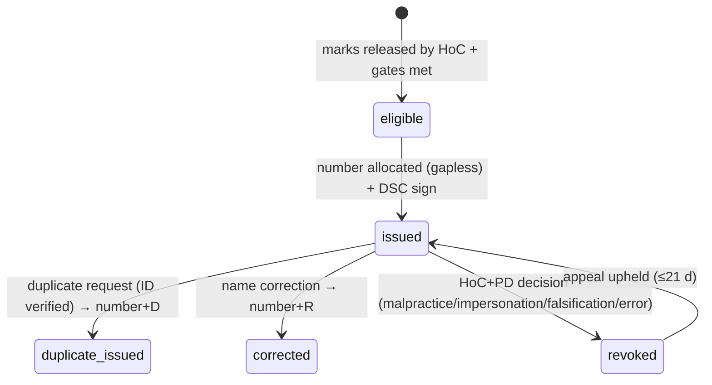
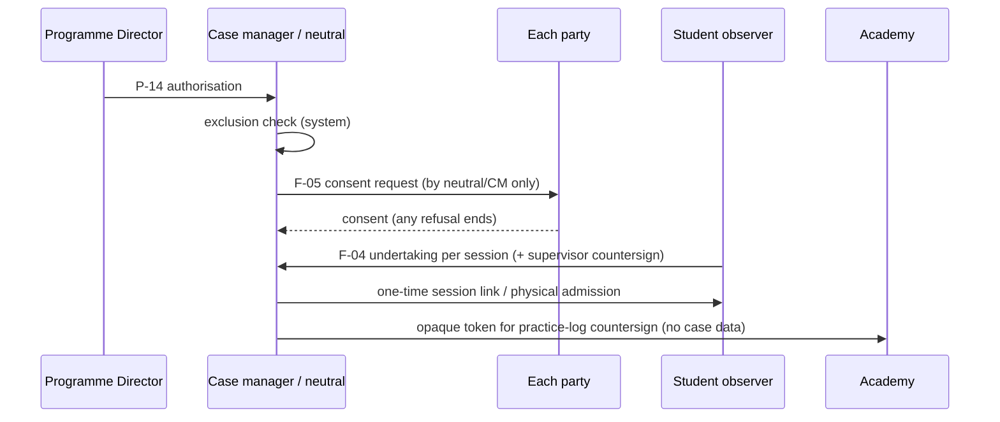

# P10 — Private ADR Chambers SaaS, Equator ADR Academy & Campus
> Paste after 01_MASTER_PROMPT.md. Prerequisites: P03 (neutral engines), P05 (billing, subscriptions, payments); uses P01 identity/consent, P02 case core and forms, P04 video rooms, P07 journeys, P09 GRM `EDU_UGC` desks. Estimated effort: 5 sprints (2-week) for a squad of 8 (tech lead, 4 full-stack, 1 mobile, 1 QA automation, 1 product analyst for academy/campus operations).

---

## 1. Objective and business outcome

Three product lines on the multi-tenant core, each with hard separation:

- **(a) Private ADR Chambers SaaS (L2, D8)** — self-serve, white-label workspaces in which independent neutrals, law firms, chambers of commerce, bar associations and universities administer their own mediations and arbitrations on Equator's engines (forms, clocks, notices, hearings, outcomes, eSign/eStamp, payments, audit), with own panels, rules and fee schedules inside NN guardrails, an overflow/referral channel with Equator, and **Institution-as-a-Service** for bodies that want a branded centre with Equator's secretariat behind it. Revenue: ₹ seat subscriptions + per-case + add-ons (target ARPU ≈ ₹60,000/yr, C1 H.3).
- **(b) Equator ADR Academy** — operated by the **separate legal entity Equator ADR Institute**: programme catalogue, cohorts, live/virtual sessions, side-locked role-play simulations (S-01…S-08), attendance gates, assessments, moderation, appeals, practice logs, nine certificate types with controlled number series and QR verification, CPD, trainer bench, rate card, memberships (₹1,75,000 institutional), university revenue share, GST invoicing. It is the front of the neutral funnel: **Academy → assessment → P03 empanelment**.
- **(c) Campus** — university partner portal, Campus Mediation Cell tooling, student-grievance hand-off to the P09 `EDU_UGC` desk, internships and consented live observation, competitions platform, student ambassadors, partner KPI dashboards — under the DPDP data addendum and the rule that **no student-facing system connects to the live case core**.

---

## 2. Scope (in / out)

**In:** `chambers` module (signup, plans, trial, Razorpay subscriptions via P05, branding, domains, label policy, own panels/rules/fees, seats, run-off, overflow/referral, revenue share, IaaS packages); `academy` module (catalogue, cohorts and task clocks, sessions, simulations, attendance, assessment schemes and rubrics, moderation, calibration, appeals, reassessment, malpractice, practice logs, internships, certification register and verification, CPD, trainer bench, quotations and discount authority, memberships, revenue-share statements, learner dashboard, feedback, institution reports); `campus` module (partner portal and activation, Cell, GRM hand-off, competitions, ambassadors, KPIs and scorecards, data-sharing addenda, student sandbox tier); the core-side **observer participant** type for consented live observation.

**Out:** neutral empanelment engines (P03, reused); fee engine, invoices, GST/TDS, payouts (P05, reused with `issuing_entity`); GRM desks themselves (P09); POSH IC workspaces (P09 — Cell and Academy only route to them); public marketing site and CRM pipeline for university partnerships (P13 `growth`); research data pipeline (I6) and ODR university pilot (I5) — Year-2 items, data model hooks only; AI simulation feedback (flag OFF, §11).

---

## 3. Personas and permissions touched

| Role code | P10 capabilities | Restrictions |
|---|---|---|
| `chambers_admin` | Tenant setup, plan/seats, branding, domain, panels (P03 in tenant scope), rules, fee schedules, revenue-share view, overflow listings | Cannot disable NN rules/hard blocks; cannot see Equator or other tenants' data |
| `case_manager` (chambers seat) | Administer tenant cases on shared engines | Tenant-scoped |
| `neutral_*` | Act in chambers tenants where empanelled; log CPD; countersign practice logs; supervise interns | Countersign requests carry no case data |
| `learner` | Enrol, pay, attend, submit, appeal, view certificates, CPD, practice log | Sees only own-side simulation materials |
| `trainer` | Deliver sessions, mark attendance, score (if assessor-eligible), session logs, incident reports | Cannot assess own cohort unless Lead/Principal and flagged; cannot issue certificates |
| `student` | Campus Cell (member or party), competitions, ambassador portal, sandbox tier | **No credential, token or API grant reaching `core` case tables or sealed schemas** |
| `university_admin` | Partner portal, Cell configuration (non-locked parts), reports, credit-reconciliation list, membership utilisation | Receives outcomes only where credit sought; never live-matter exposure data |
| `institution_admin` (Institute tenant) | Academy configuration, Head of Curriculum (HoC) releases, Programme Director (PD) approvals per delegation matrix | Maker–checker |
| `auditor`, `dpo` | Scoped read; DPO sign-off gates | — |

Academy and campus sub-roles (tenant-scoped grants in `core.role_grants`, not new platform roles): `hoc`, `programme_director`, `finance_controller`, `assessor`, `moderator`, `competition_convenor`, `problem_author`, `session_supervisor`, `scoring_officer`, `competition_judge`, `competition_mediator`, `registration_officer`, `cell_supervisor`, `faculty_convenor`, `student_coordinator`, `cell_member`, `internship_supervisor`, `ambassador`, `coach`, `guardian`. Separation of duties is enforced by policy: author ≠ judge/coach; mediator ≠ scorer; judge ≠ score entry; collector ≠ reconciler; assessor ≠ trainer where possible; HoC ≠ Convenor at scale.

---

## 4. Functional requirements

### 4A. Private ADR Chambers SaaS (`chambers`)

**FR-P10-01 — Naming guardrail.** The bounded context, NestJS module, schema and API namespace are `chambers` (master §4.3). The legacy label "Private ADR Court" and the retired alias `private_court` are not used in code identifiers, routes, UI or templates (master §1.4; OI-01 closed). The public label is tenant-configurable, default **"Private ADR Chambers"**. A label validator (also applied to tenant names, sub-domains, document letterheads and email sender names) rejects: "court", "tribunal" (except the statutory phrase "arbitral tribunal" inside procedural documents), "judge", "decree", "bench", "Lok Adalat", "government", "official", "statutory", "authority", "regulator", "ombudsman", "Supreme", "High Court", "National" + "Centre/Council" combinations, "MCI-registered/recognised", "Mediation Service Provider" (NN-05), the State Emblem (State Emblem of India (Prohibition of Improper Use) Act 2005) or names/emblems in the Schedule to the Emblems and Names (Prevention of Improper Use) Act 1950 (incl. item 7: any name suggesting Government patronage or connection with a statutory body; item 17: Supreme Court/High Court/Parliament names) — consistent with R2 rule 25 and NN-17. Every tenant site carries a non-removable legal footer: tenant legal entity, CIN/registration, "This centre is not a court and does not exercise judicial power", and "Technology provided by Equator Resolution Service Private Limited" on Terms/Privacy pages (processor disclosure; entity particulars rendered from `tenant.legal_entity`, X-15).

**FR-P10-02 — Self-serve signup.** `eqr.form.chambers_membership.v1` (from C4 C.35): applicant type (`solo_neutral`, `neutral_group`, `law_firm`, `chamber_of_commerce`, `bar_association`, `university_centre`, `trade_body`, `other_institution`), legal name, display label (validated), KYB via `KYC_PORT` (PAN, GSTIN, CIN/LLPIN/registration, authorised signatory with board resolution/authority letter), panels, allocation rule, fee schedule choice (template or own), accept referred matters (y/n), plan, DPA acceptance (versioned; the chambers tenant is data fiduciary for its cases and Equator is processor, DPDP Act 2023 s.8(2)), undertakings (Equator Rules template or own rules under platform guardrails; no claim that matters are Equator-administered). Creates `core.tenants (kind='chambers')` + `chambers.workspaces` in `trialing`. Case-number prefix per tenant, e.g. `{PFX}/{VERT}/{YYYY}/{NNNNN}`, with the QR verification page on the tenant domain.

**FR-P10-03 — Plans, add-ons, trial (all "Subject to Board approval").**

| Plan | Price (ex-GST) | Included | Per case beyond allowance | Notable entitlements |
|---|---|---|---|---|
| `CH-SOLO` | ₹1,499/seat/month or ₹14,990/seat/year; 1–2 seats | 5 new cases/month | ₹999 | Equator Rules template, sub-domain, standard templates |
| `CH-PRO` | ₹2,999/seat/month or ₹29,990/seat/year; min 3 seats | 25 new cases/month | ₹899 | Custom domain, own rules and fee schedules, own panel with allocation engine, overflow listings |
| `CH-INST` | ₹4,999/seat/month or ₹49,990/seat/year; min 10 seats | 100 new cases/month | ₹799 | SSO, API keys, own committees, public panel directory, MIS packs, bulk intake (subject to FR-P10-06) |
| `CH-IAAS` | Platform fee ₹3,00,000–₹8,00,000/yr (C4 B.13) + revenue share on administered fees | Contracted | Contracted | Managed secretariat, hearing support, panel portal, co-branded rules (FR-P10-11) |

Add-ons: Equator secretariat (case manager as a service) ₹2,500/case or ₹45,000/month per FTE-equivalent; video beyond 1,000 participant-minutes/seat/month ₹1.50/participant-minute; premium AI drafting ₹999/seat/month (P11 policies apply); WhatsApp/SMS/voice at actuals + 10%; eStamp procurement ₹49/document + duty at actuals; eSign at actuals + ₹20/signature; storage ₹500/100 GB/month; white-label mobile build on request. Seat types: `admin` (1 free), `neutral`, `case_manager`, `read_only` (free, max 5). **Trial: 14 days**, no payment method needed, sandbox mode (cases watermarked "SIMULATED"; no notices to real parties; no live payments); up to 2 live cases once KYB is verified and a payment method/mandate is on file. Subscriptions via P05 (Razorpay Subscriptions; UPI AutoPay/card mandate; proration per FR-P05-36; states `trialing → active → past_due → suspended_soft → cancelled|expired`).

**FR-P10-04 — Case continuity (run-off) guarantee.** Parties' matters are never held hostage to a tenant's billing. On `suspended_soft` or cancellation: no new cases; existing cases continue for parties and appointed neutrals in **run-off mode** for 90 days (clocks, notices, hearings, signing, payments for the case continue; tenant admin features read-only); at day 60 the platform notifies parties and offers (a) transfer to Equator administration with all-party written consent (arbitration: consent is also an agreement on the administering institution) or (b) export of the complete case file with hash manifest and BSA s.63(4) certificate (NN-10). Statutory clocks are never paused by billing state (NN-04). After run-off: data returned/erased per DPA, legal-hold records retained.

**FR-P10-05 — White-label branding and domain.** `core.tenant_branding`: logo (SVG/PNG ≤ 500 KB), colour tokens (WCAG 2.2 AA contrast validator rejects failing palettes, NN-23), fonts from an allow-list, letterhead, email sender (SES domain verification with DKIM/SPF/DMARC checks), favicon, public pages (about, rules, fee schedule, panel directory, contact, grievance officer). `core.tenant_domains`: sub-domain `{slug}.chambers.equatorresolution.in` or custom domain via CNAME + DNS TXT ownership proof, ACM certificate via CloudFront multi-tenant distribution, HSTS. Branding changes go through tenant maker–checker when the tenant has ≥ 2 admins.

**FR-P10-06 — Own panels.** Tenants use the P03 engines in tenant scope: application form variant ("Private chambers" empanelment, C4 C.12), verification, rubric (tenant may edit weights; P03 minima and role segregation cannot be removed), committees, allocation policies, disclosures, challenges, scorecards. NN-03 applies in every tenant: if a tenant accepts references from an enterprise repeat player, the tenant is the institution and the enterprise has no selection or veto. Tenants with fewer than 5 active arbitrators on a panel cannot enable `bulk`, `api` or `clause_auto` sources for arbitration on that panel (a single-neutral "institution" cannot satisfy concentration caps or rotation). Tenant neutrals may also be Equator panel members; conflicts across tenants are checked only through the P03 blind-check endpoint.

**FR-P10-07 — Own rules and fee schedules within NN guardrails.** Rulebook editor forks the Equator Rules template into `core.procedure_rules` (tenant-scoped, versioned, maker–checker, published on the tenant site, pinned per case — NN-21). Fee schedules in `core.fee_schedules (scope='chambers_tenant')`. On submit, the Legal Rules Register validator rejects: any reduced statutory clock (s.29A, s.23(4), POSH 90 days, Mediation Act statutory mode); prohibited mechanism × vertical (master §5.2, e.g. arbitration against a retail policyholder, award on custody); removal of Sixth Schedule disclosure, objection window < 15 days for arbitration, or unilateral-appointment clauses; mediation recording ON by default (NN-11); success fees on insurance claims or contingency fees for advocates (NN-18); deviation from a regulated schedule (SEC); claims of statutory enforceability while NN-05 flag is OFF. Errors cite the rule ID and source.

**FR-P10-08 — Case management on the same engines.** Tenant cases use P02 intake/forms/routing/signposting, P04 proceedings and hearings, P05 billing (tenant is merchant of record via its own Razorpay Route linked account; Equator platform fee split at source), P06 outcomes/eSign/eStamp, P07 journeys (DLT templates/headers under the tenant's own entity where it sends recovery-related messages, NN-12). Case `source = 'private_chambers'`. Signposting and NN rules apply identically.

**FR-P10-09 — Overflow and referral marketplace with Equator.** `chambers.marketplace_listings.kind` ∈ {`neutral_request` (tenant seeks a neutral from Equator's panel — P03 FR-P03-32 blind check), `matter_referral_out` (tenant refers a matter to Equator administration; requires all-party consent artefact), `matter_referral_in` (Equator refers to a tenant, e.g. local in-person facility or language panel, only with all-party consent), `facility_offer` (hearing rooms)}. Listings are anonymised until acceptance; only vertical, mechanism, language, city, value band, start window. Referral does not change who appoints: the administering institution under the parties' agreement appoints.

**FR-P10-10 — Revenue share configuration.** `chambers.revenue_share_agreements`: parties, basis (`admin_fee`, `platform_fee`, `per_case`, `subscription`), percentage or fixed, cap, term (default 12 months per referred matter), settlement cycle (monthly, statement by D10, payment D30), TDS treatment. Default referral fee: 10% of the administering institution's admin fee for 12 months. **Advocate/law-firm tenants and bar associations receive non-cash credits only** (subscription/case credits), never cash referral fees (BCI Rules Part VI Ch. II, Section IV, r.36: no direct or indirect solicitation; see also r.37; NN-17). Neutral selection is never influenced by referral status (NN-16).

**FR-P10-11 — Institution-as-a-Service (D8).** Package for chambers of commerce, bar associations, universities and trade bodies: branded centre site and rules; panel portal for the body's members (P03 tenant engines); **managed secretariat** (Equator case managers working inside the tenant under documented instructions, logged as `secretariat_operator` grants, DPA processor role); hearing support (video plus partner's physical rooms bookable via `facility_offer`); training bundle from the Academy (separately invoiced by Equator ADR Institute); MIS; co-branding attribution "Administered by {Body}. Technology and secretariat services by Equator Resolution." University centres are `chambers` tenants with `sub_kind='university_centre'`: **students cannot hold any role in a chambers tenant** (policy denies `student` and `learner` memberships; enforced by `NN-campus_no_student_in_case_core` test).

**FR-P10-12 — Chambers onboarding checklist and health.** Wizard: KYB → branding → rules (template or own; validator pass) → fee schedule → panel (≥ 1 active neutral per enabled mechanism) → templates → payment linked account (Route KYC) → DLT/WhatsApp sender (if notices sent in own name) → go-live. Health dashboard: active cases, clock risks, seat utilisation, allowance consumption, subscription state.

### 4B. Equator ADR Academy (`academy`)

**FR-P10-13 — Entity separation.** The Academy is a tenant `kind='academy'` owned by **Equator ADR Institute**. Every contract, quotation, invoice, certificate, letter and payment carries `issuing_entity` ∈ {`EQUATOR_ADR_INSTITUTE`, `EQUATOR_RESOLUTION`}; a single invoice spanning both entities is rejected (C5 04.5 s.1). The Institute has its own GSTIN, Razorpay merchant account (`core.provider_routing` per tenant), invoice series (`EQI/UAP/{YYYY}/{NNNN}` programmes, `EQI/COMP/{YYYY}/{NNNN}` competitions, `CN-` credit notes; advisory under Equator Resolution `EQR/ADV/{YYYY}/{NNNN}`), DPO contact and privacy notice. Learner data is the Institute's; transfer to Equator Resolution (e.g., certificate to P03 empanelment) only on the learner's separate consent (`academy_to_resolution_credential_share`).

**FR-P10-14 — Programme catalogue.** `academy.courses` = programme master from 05.1: code, title, family (student, faculty/professional, institutional, competition/coaching, event), duration/hours, min/max cohort, outcome flags P/C/R (a programme with none is retired), price basis, assessment scheme, credential code, room standard, status pipeline `proposal → approved_to_develop → design → pilot → review → priced → catalogued → retired|archived`. Rules: no sale before `pilot` complete; no quote for a programme not `catalogued`; retirement triggers (not delivered 18 months; feedback < 3.8/5 persistently; law change; superseded) remove it from collateral within 30 days. Seed all codes: T-40-S, T-20-S, C-CERT, W-MA, W-NEG, W-DRAFT, W-ARB, W-ODR, W-CAUCUS, W-COACH, W-ETH, W-12A, W-CROSS, W-COMM, W-WORK, W-FOUND, SCH-RES; T-FDP, T-FDP-3, T-TTT, T-ASSESS, T-40-P, T-20-P, T-CURR, T-RES; A-POSH, A-SGRC, A-CELL, ADV-A, ADV-B, ADV-IC, LIC-CURR, LIC-CASE; CMP-* and COACH-*; vertical neutral programmes ECFC (82 h + 5 supervised), ECIN (84 h + 3 co-mediations), ECCN (100 h), ECWN (88 h), ECFM (96 h + 4 co-mediations). Max cohort is a hard cap (T-40-S 30 "not waived", OI-05).

**FR-P10-15 — Cohorts and task clock.** `academy.cohorts` with venue/virtual, trainers, room standard check (skills ≤ 30 needs movable furniture + 3 breakouts; simulation-intensive 4–6 breakouts; fixed-bench lecture theatre = no-go). Task clock from start date D: dates/bench −45; PO −42; registration opens −40 (DPDP notice live); room spec −35; trainer letters −30; checkpoint −21; materials −14; travel −10; **go/no-go −7** (≥ minimum = Go; 80–99% = Go with PD approval; < 80% = No-go → postpone/combine/convert/cancel; no trainer or room = No-go; no PO → PD decision, default defer); feedback +2, marks +5, moderation +10, results +12, certificates +14, institution report +21, settlement +30. Each task is a `core.tasks` row with owner; overdue tasks escalate per 07.8 levels.

**FR-P10-16 — Registration and enrolment.** F-01 (name as on institution roll, institution + enrolment no., programme/year, email, mobile, DOB, optional accessibility/dietary, emergency contact) with one mandatory processing consent and **unbundled, un-ticked** optional marketing and publication consents; notice version + timestamp stored. Under 18 → F-03 guardian consent with identity verification fields (verifiable consent, DPDP Act 2023 s.9(1); DPDP Rules 2025 r.10, in force 13 May 2027 — built compliant now); minors' accounts have analytics, tracking and targeted messaging disabled (s.9(3)). Global malpractice exclusion list checked at registration. Pre-registration only (no walk-ins); payment through the gateway only. The registration system is the single source of truth for participant numbers.

**FR-P10-17 — Sessions (live and virtual).** `academy.sessions` imported from curriculum session tables (e.g., T-40 1.1–5.6 with time, method, outcome). Virtual sessions use P04 `VIDEO_PORT` rooms in the academy tenant with breakouts; **no recording** without written approval of HoC and all participants' consent; never any live-proceedings content. In-person sessions use QR check-in by trainer. Trainer submits P-08 session log the same day; P-09 incident report same day for any incident.

**FR-P10-18 — Role-play simulations (S-01…S-08).** `academy.simulation_packs` (S-01 unpaid final instalment, COM, 2 parties, 5/30/25 min; S-02 delayed consignment, COM/MSME; S-03 disputed OTS, FIN; S-04 full-and-final, WRK; S-05 repudiated claim, INS; S-06 dissolving partnership; S-07 delay chain, 3 parties, 12/90/45; S-08 succession, FAM/COM, 3 parties) with artefacts: General Information, Confidential Instructions per side, counsel brief, observer sheet, **faculty notes**. Access rules: a participant sees GI + own side only; never the other side or faculty notes; every view logged; read and session timers; a participant who has seen an opposing brief (log or self-report) is reassigned; materials expire at session end; watermarked with learner ID; download disabled. Simulations and competition problems are mutually exclusive before public release. Institute materials are never pushed to any institutional system (05.8 s.6). Tablet capture of the 14-item observer sheet (Not yet/Developing/Competent/Strong + 3 "worked", 1 change, "moment it turned") and party feedback slips (5 items + 2 text) completed before debrief; debrief prompt sequence self → parties → observers → trainer.

**FR-P10-19 — Attendance gates.** Per session AM/PM (P-07); trainer certifies; retention 7 years. Gates: **T-40 90%, T-20 100%, C-CERT 90%, T-FDP 90%**, no discretion to waive; below gate → not assessed, transfer offered.

**FR-P10-20 — Assessment schemes and rubrics.** Configurable schemes: T-40 written 30 / simulation 50 / viva 20, pass 50% overall and ≥ 50% simulation (written = 20 MCQ + 3 short + 1 problem, closed book); T-20 portfolio 25 / simulation 60 (two assessors) / viva 15, pass 55% and ≥ 55% simulation; T-20 entry gates (T-40 passed with ≥ 50% simulation; supervised practice count (configurable; MCPC/LSA practice e.g. 10 successful mediations out of ≥ 20); portfolio ≥ 14 days before; ≥ 3 months after T-40); C-CERT continuous 15 / mid-term 15 / case analysis 15 / simulation 30 / drafting 15 / log + viva 10; T-TTT observed teaching 40 / design 30 / debrief 30, pass 60%; T-ASSESS calibration 50 / benchmark 50, pass 70% within tolerance; vertical programmes per C2/C3 (e.g. ECFC voluntariness & affordability must pass; ECIN ethics 90% no compensation; ECCN award drafting must pass and "award vulnerable on natural justice or jurisdiction = no certification"; ECWN POSH boundary must pass, instant fail for mediating or monetising POSH; ECFM screening simulation must pass). **Simulation rubric /100**: opening 12, listening 14, questioning 14, interests 14, process management 12, options 12, impartiality & ethics 12, closure 10; bands Excellent 85–100, Competent 50–70, Not yet < 50; **≥ 3 behavioural observations per criterion enforced**; settlement is not evidence of competence. Candidate numbers anonymise written work; assessor ≠ trainer flag; nothing disclosed on the day.

**FR-P10-21 — Moderation and calibration.** Auto-sample for double marking: within 5 marks of any boundary + 10% random + every fail. Divergence > 10 → third marker; final = mean of closest two. Cohort distribution anomaly (> 1.5 SD) → event review, never individual mark changes. **Results release only on HoC sign-off.** Calibration benchmark before every assessed cohort; assessor > 8 marks off → retrain and blocked from marking; records 3 years.

**FR-P10-22 — Appeals, reassessment, malpractice.** Appeals on procedural irregularity, rubric not followed, or new mitigating evidence (never academic judgement): to HoC ≤ 14 days of result → independent review ≤ 21 days → Committee ≤ 14 days (fee refundable if upheld, amount configurable) → final ≤ 30 days; appellant acknowledges marks may go down; KPI appeal rate < 3%. Reassessment: T-40 one resit of the failed component ≤ 6 months; T-20 one simulation resit ≥ 3 months later after further supervised mediations; second failure → repeat. Malpractice typed outcomes: plagiarism (zero; fail on repeat); impersonation or fabricated practice logs → fail + **permanent exclusion** + institution informed; unauthorised material → zero; falsified attendance → gate failure; independent investigator, written allegation, right to respond.

**FR-P10-23 — Practice log and supervised practice.** P-13 entries: date, internal matter reference (opaque token minted by the neutral's workspace, no party name, no case number), sector, role (co-mediation 1.0, supervised clinic 1.0, observation 0.5 capped at configurable %; simulations, competitions and coaching never count), duration, outcome category, supervising neutral. Neutral countersigns in the academy tenant within 7 days (request carries no case data); HoC audits 20% before T-20 admission; falsification → permanent exclusion.

**FR-P10-24 — Certification: nine types, number series, QR verification.**

| Code | Credential | Awarded for | Series |
|---|---|---|---|
| ECM-B | Certificate of Completion — Basic Mediation Training (40 hours) | T-40 passed | `EQI/B/{YYYY}/{NNNNN}` |
| ECM-A | Certificate of Advanced Practice — Mediation (20 hours) | T-20 passed after supervised practice | `EQI/A/{YYYY}/{NNNNN}` |
| ECM-C | Certificate in Mediation and Dispute Resolution (joint) | C-CERT passed — **flag OFF until U2 clears** | `EQI/C/{YYYY}/{NNNNN}` |
| ECM-T | Trainer Accreditation | T-TTT passed and observed | `EQI/T/{YYYY}/{NNNNN}` |
| ECM-S | Assessor Accreditation | T-ASSESS passed | `EQI/S/{YYYY}/{NNNNN}` |
| ECM-F | Faculty Development in ADR | T-FDP completed | `EQI/F/{YYYY}/{NNNNN}` |
| ECM-P | Certificate of Participation | workshop attended | `EQI/P/{YYYY}/{NNNNN}` |
| ECM-I | Internship Completion | internship completed and assessed | `EQI/I/{YYYY}/{NNNNN}` |
| ECM-X | Competition certificate | participation/placing/award | `EQI/X/{YYYY}/{NNNNN}` |

Vertical neutral credentials (ECFC, ECIN, ECCN, ECWN, ECFM) are issued in a separate family `EQI/N/{CODE}/{YYYY}/{NNNNN}` behind flag `academy.vertical_credentials` (OI-03). Issue controls: generated **only from the register after HoC releases marks**; never on request, never below an attendance gate or without an assessment record; gapless sequence per series (DB sequence + gap investigation report); facsimile signature only with dual authorisation; PDF signed (DSC via `ESIGN_PORT`) with QR to `/verify/{number}`. Mandatory content: name as on roll, title, contact hours, dates, venue, number, issue date, HoC signature, verification reference, and (≥ 7 pt) *"This certificate evidences completion of training and assessment conducted by Equator ADR Institute. It is not a degree or diploma and is not a statutory qualification. It is not accredited, recognised or approved by the Mediation Council of India or by any Government authority. Verify at {verification URL} quoting the certificate number."* ECM-B adds "structured in line with prevailing court-annexed mediation training norms" (only where the programme has ≥ 40 contact hours); ECM-I adds level, weeks, hours, attendance %, outcomes, grade and "not a certificate of employment". Lifecycle: duplicate = same number + `D` (ID verified, fee); correction = same number + `R`; revocation (malpractice, impersonation, falsification, error) by HoC + PD, holder and institution notified, verification shows "Revoked" instantly and `equator.academy.certificate.revoked.v1` is emitted (P03 consumes); appeal ≤ 21 days. Register is permanent (minimum data set survives MOU exit and consent withdrawal). Public verification: number → name, programme, dates, status — nothing else; marks never shown without written consent; free; rate-limited; every request logged; members get a bulk-verifier mode.

**FR-P10-25 — CPD.** `academy.cpd_records` (source: webinars, calibration, forums, programmes; hours; category; evidence). Requirements configurable for T-20 holders, trainers and empanelled neutrals (C5 03.7 [●]); with the learner's consent each record is emitted to P03 (`core.neutral_cpd_entries`). CPD drives renewal of sandbox-tier access (FR-P10-44).

**FR-P10-26 — Trainer bench.** `academy.trainers`: tier Associate (co-facilitate only) / Lead (lead, assess not own cohort) / Principal (certify trainers, design, competition assessor); 9-stage pathway (approach → screening → gap assessment → bridging → T-TTT → shadow → Committee certification → observed first solo → annual maintenance); register fields (city, tier, programmes, T-TTT date, assessor status, last observation/score, CPD YTD, days YTD, availability, conflicts, status; 12 months idle → inactive). P-11 observation (10 criteria; < 4.0 → plan, re-observe ≤ 90 days, blocked from assessed cohorts). **Quoting rule: no student certificate course in a city with < 4 certified trainers incl. ≥ 1 Lead.** Per-engagement conflict disclosure; cancellation terms (Institute < 7 days → 50% fee; trainer < 14 days → nil); trainer payment ≤ 21 days (P05 payouts, `issuing_entity = EQUATOR_ADR_INSTITUTE`). Feedback thresholds (FR-P10-29) can suspend a trainer.

**FR-P10-27 — Pricing, quotations and discount authority.** Rate card (04.1 s.5, INR ex-tax, effective-dated `core.fee_schedules scope='academy'`; floors stored but **never exposed** outside Finance/PD): per participant T-40-S ₹12,500 list / ₹9,500 partner (min cohort 25); T-20-S ₹7,500/₹5,500; C-CERT ₹14,000/₹11,000; W-HALF-S ₹1,500; W-FULL-S ₹2,800; W-SERIES ₹3,800; SCH-RES ₹26,000; SCH-DAY ₹16,000; T-40-P ₹38,000; T-20-P ₹22,000; T-TTT ₹45,000; T-ASSESS ₹12,000. Institution-paid: T-FDP ₹3,50,000; T-FDP-3 ₹2,25,000; W-FULL-I ₹65,000; W-HALF-I ₹38,000; A-POSH ₹85,000; A-SGRC ₹95,000; A-CELL ₹1,45,000; CUSTOM ₹28,000/day. Advisory/licensing/coaching: ADV-A ₹3,60,000 p.a.; ADV-B ₹1,80,000; ADV-IC ₹18,000/sitting; ADV-OMB ₹22,000/matter (advisory lines invoiced by Equator Resolution); COACH-INTL ₹2,25,000/team/season; COACH-NAT ₹1,10,000; LIC-CURR ₹1,25,000 p.a.; LIC-CASE ₹65,000 p.a. Quotation object (P-03): rate-card version, cohort ≥ minimum, trainer availability, list/quoted/discount + approval, split, collector, settlement date, validity 60 days, tax wording "exclusive of applicable taxes" only (OI-06). Discount authority: list/partner — BD; ≤ 10% — PD; 10.01–25% — PD + FC with volume/multi-year commitment; > 25%, below floor or free paid programme — Programme Board (exceptions register). Terms: 40% advance, balance on completion, 30-day payment; institution cancellation > 30 days nil / 15–30 days 25% / 7–14 days 50% / < 7 days 100% + costs; one free postponement > 21 days.

**FR-P10-28 — Memberships.** Equator Institutional Membership: **₹1,75,000 p.a.** ex-tax (3-year ₹1,60,000/yr paid annually in advance; additional campus ₹1,20,000); 12-month term from commencement; **no commencement before payment**; no auto-renewal (renewal notice at 60 days with utilisation report); non-refundable except Institute convenience termination (pro rata). Inclusions as quantity-limited, non-carry-forward entitlements in `academy.membership_entitlements`: unlimited national webinars; one half-day workshop (lost if unscheduled); two competition entries fee-waived; one guest lecture; curriculum consultation × 2; **student sandbox access for the membership year**; priority internship review for 5 nominated students (shared only with each student's consent); 10% discount on other catalogue programmes (not stacking; excludes certificate courses, FDPs, full-day workshops, coaching, residential schools, advisory, competition hosting, external IC member, bespoke content); unlimited certificate verification; "Equator Member Institution" mark (ceases 30 days after lapse); named contact (2-working-day response); annual activity report. Utilisation tracker; month-9 unused-inclusions report; on expiry platform access ceases within 30 days, certificates stay valid.

**FR-P10-29 — Feedback, quality and institution reports.** Daily anonymous feedback (8 Likert + 3 text; private-concern item routes to a confidential channel, never to the trainer). Thresholds: ≥ 4.3 noted; 3.8–3.99 HoC review; 3.5–3.79 RCA + re-observation + partner informed; < 3.5 programme suspended at that institution and trainer de-allocated; response rate < 70% displayed with the score. Institution report auto-generated ≤ 21 days: **registered / attended / completed / certified as four separate numbers**, attendance, assessment distribution, feedback, consented photos, issues, recommendations, annexed register and certificate list.

**FR-P10-30 — Revenue share, payments and GST.** Standard splits (Equator : institution): T-40-S, T-20-S 70:30; C-CERT 65:35; workshops 75:25; residential 60:40; hosted competition surplus 60:40; advisory/licensing/coaching 100:0; variation > 10 pp needs Programme Board. **Net Collections = Gross cleared receipts − Refunds issued in period − Gateway charges actually incurred (capped at configurable %)**; taxes excluded; scholarships borne by the granting party; no bad-debt sharing; late fees included. Worked test: 40 × ₹9,500 = ₹3,80,000 − ₹28,500 − ₹4,200 = ₹3,47,300 → Equator ₹2,43,110 / institution ₹1,04,190. Collector: Equator (default) or institution as collecting agent with no set-off; never split collection. Settlement clock: D0 lists locked → D7 refund window closes → D10 statement (P-17, prepared and checked by two different users) → D12 issued → D19 confirm/query → D21 recipient invoices → D30 settle → D32 ledger; escalation D35/D45/D60 (L-22 + interest)/D90. Participant refunds: > 21 days 90%; 8–21 days 50%; ≤ 7 days or after start nil; Institute cancels → 100% or transfer; medical → transfer within 12 months; safeguarding/POSH complaint → withdrawal **without loss of fee**; refunds ≤ 21 days to original instrument. Payments via P05 (`purpose='academy_fee'`); GST computed by the tax engine on invoices (18% default — Institute courses under SAC 999293, OI-06; place-of-supply rules) while quotes and collateral carry only the "exclusive of applicable taxes" wording until U1 clears; TDS on trainer payouts under Income-tax Act 2025 s.393(1) Table Sl. 6(iii) (old s.194J): 10% once ₹50,000 per tax year is crossed.

**FR-P10-31 — Learner dashboard.** `/academy/me`: enrolments and cohort timeline, session schedule and join links, own-side simulation materials (time-boxed), assessment results after release, appeals, certificates (download, share link, QR), CPD ledger, practice log with countersign status, membership-linked entitlements, invoices/receipts, consent centre (withdraw/modify, F-11, actioned ≤ 30 days), and the empanelment funnel card.

**FR-P10-32 — Empanelment funnel integration.** Funnel: course → assessment → certificate → **"Apply to the Equator panel"** (pre-fills P03 `neutral_application.v2` with consented credentials) → P03 verification/committee → co-mediation → solo. The Academy may only signal eligibility; it never decides empanelment. T-FDP participants get a PD follow-up task within 14 days. Funnel analytics are aggregate (applications, approvals by programme) and exclude individual assessment marks unless the learner consents.

### 4C. Campus (`campus`)

**FR-P10-33 — University partner portal and activation.** Tenant `kind='university'` per institution (multi-campus groups supported). `campus.partner_institutions`: tier (P-01 score: 78–100 Tier 1 Anchor; 55–77 Tier 2 Programme; 32–54 Tier 3 Associate; < 32 decline; auto-decline on conflict, active dispute with the group, regulatory action, over-broad exclusivity), MOU dates, nodal officers, champion, minimum activities (cl.6.4), data addendum version. A partnership is **not live until P-05 Activity Calendar is signed by both nodal officers**; escalation D25 / D45 (L-18) / D60 "Signed but not activated"; below-minimum activity in two consecutive years → automatic lapse. Portal views: calendar status, programme bookings (P-06), invoices (Institute), credit-reconciliation list upload (name, enrolment no., programme — university → Institute), outcomes where credit is sought, membership utilisation, Cell aggregates, competition entries, reports. DPO sign-off is a hard gate before any student-facing environment opens (control 2; U3).

**FR-P10-34 — Campus Mediation Cell.** `campus.cells` with Faculty Convenor, Equator Supervisor, Student Coordinator, 12–20 members, one-year renewable terms. Establishment wizard (12 items: recognition, ToR containing s.4 boundaries verbatim, Supervisor, selection, training + signed boundary session, co-mediations, bookable private room, forms/log, escalation contacts incl. IC and counselling, public launch stating boundaries, 12 supervisions + annual review diarised). Member selection (application → statement → role-play interview; weights judgement 30, listening 25, impartiality 20, reliability 15, communication 10; exclusion flags for student-government office, campus-political prominence, disciplinary roles). **System rule:** no member may be sole/lead mediator until foundation training + signed 3-hour boundary session + 2 supervised co-mediations are recorded. Scope boundaries are **platform-locked** (only the money threshold is tenant-editable).

Process state machine: `referral → screening → allocation (two mediators, conflict-checked, either may decline without reason) → consent (both parties, written, withdrawable) → confidentiality acknowledged by all present → session (private room, working hours only, never hostel rooms or after hours, ≤ 90 min — booking constraints) → outcome (written agreement stating it is **not enforceable**) → anonymised log → follow-up at 2 weeks → supervision discussion`; side states `referred_out`, `withdrawn`, `declined`, `no_agreement`. Screening hard-stops: the form **refuses to proceed and displays the referral route** for sexual harassment/misconduct (→ Internal Committee via Convenor), ragging (→ anti-ragging committee), caste/religion/gender/disability discrimination (→ statutory committee), criminal allegation/violence/threat, student–staff matters, academic misconduct, mental-health/self-harm/safety (→ Convenor + counselling, immediately), money above threshold or contractual claim, matters before a formal body, member connected to a party; UI default text "If you are not certain it is in scope, it is not in scope. Refer it." Confidentiality limits shown and acknowledged: harm risk → Convenor; out-of-scope → referral; anonymised supervision; **"Nothing said in a Cell mediation is protected by the Mediation Act, 2023."** Members keep no notes (no notes field exists). Records: anonymised log (reference, date, category, mediators, outcome, follow-up) 3 years — anonymised **at entry**; consent forms 1 year; written agreements held by parties, Cell retains none; referrals-out 3 years. One-click recusal with no reason field; urgent contacts visible to every member; automatic debrief offer after flagged sessions; monthly supervision export (anonymised) to Supervisor.

**FR-P10-35 — Student GRM hand-off.** From Cell screening or the student portal, "Raise a formal grievance" creates, with the student's explicit consent, a ticket in the university's P09 `EDU_UGC` (or `EDU_AICTE`) desk in the **university's own GRM tenant** via `POST /v1/grm/desks/{deskId}/tickets` (category pre-selected, narrative entered by the student; Cell notes never transferred). Where the university has no GRM subscription, the hand-off shows the SGRC/Ombudsperson contacts and the University Grants Commission (Redressal of Grievances of Students) Regulations 2023 route (SGRC 15 working days → appeal 15 days → Ombudsperson 30 days). Sexual harassment never goes to SGRC — route to the IC (UGC 2015 Regulations; POSH Act 2013). Equator staff see nothing unless the university grants time-bound reviewer access; the same Equator person cannot be process adviser and investigator on a matter (conflict flag).

**FR-P10-36 — Internships and supervised practice.** `academy.internships` ladder: I Observership 2–4 weeks (1:6, no live exposure); II Case Support 4–8 weeks (Level I or 40-hour certificate; 1:4; anonymised documents only); III Advanced Placement 8–12 weeks (Level II and 40-hour certificate; 1:3; observation with consent); IV Research 4–12 weeks (1:4; anonymised data only). Cohort size = supervisor capacity × ratio; a supervisor at capacity cannot accept more. Intake W−8 … W0 (CV, transcript, 300-word statement, endorsement; two-person shortlist; 20-minute scored interview: motivation 25, academics 15, experience 15, communication 20, ethical-scenario judgement 25); offer L-13 with undertakings and F-04; guardian consent < 18. Weekly ≥ 30-min supervision (P-12), midpoint review; intern permissions enforced (may draft memos, take consented notes, observe with consent, schedule; may not advise, contact parties unsupervised, record/screenshot, sign, hold out as mediator, remove documents). Completion: supervisor 50 / written output 30 / exit viva 20; grades Outstanding/Good/Satisfactory/Not completed; ECM-I ≤ 7 days; conversion tracked; confidentiality breach → termination, certificate withheld.

**FR-P10-37 — Consented live observation (the only bridge).** Workflow (no shortcut): PD written authorisation (P-14) → case manager selects a suitable matter, system-checked against hard exclusions (family/matrimonial with children or violence; safeguarding dimension; vulnerable or unrepresented party; **matter involving a partner institution**; active regulatory/criminal investigation; any privacy request; any sealed-tier case) → **the neutral or case manager (never the student) seeks F-05 consent from every party; one refusal ends it, no reason asked** → F-04 undertaking per session, supervisor countersigns → observation (introduced by name; may be asked to leave; silent; no device; leaves caucus; paper notes destroyed in the student's presence) → process-only debrief. In the case core this creates a `core.case_observers` row (legal name, F-04 document, F-05 per party, P-14 reference, session IDs) with **no foreign key, identifier or token linking to any academy or campus record**; the observer gets no platform account in the case tenant (session joining uses a one-time, device-bound, audio/video-only link for virtual sessions, or physical presence). The Academy receives only the P-13 practice-log entry and countersignature. Mediation sessions are never recorded (NN-11). Breach → same-day PD + DPO, affected party notified. Students never co-mediate Equator-administered live matters.

**FR-P10-38 — Competitions: registration and problems.** `campus.competitions` (formats: `mediation`, `arbitration_moot`, `negotiation`, `odr_challenge`, `community`, `intra`, `school` — school/minors behind flag until spec, OI-08). Registration: teams of 4 from one institution, ≤ 2 per institution; eligibility on day 1 (full-time UG/PG, no practice enrolment, not employed in law/DR, ≤ 2 prior editions) **certified by Dean/Registrar** in-system; F-06 per member, F-08 for the single coach; fee ₹7,500 national / ₹4,500 regional / +₹2,000 late (entry confirmed only on receipt; refund 50% before draw, none after); media consent optional. Problem lifecycle `authoring (M−7) → draft → interests audit + ZOPA test → test run → committee approved (M−2) → sealed (M−1; author stands down and becomes ineligible to judge, coach or attend) → released (M0) → public (M+12, into the licensable casebook)`. Artefacts: General Information; Confidential Information per side; Mediator Brief & Assessor Notes (judges/mediators only, ≥ 7 days ahead); knockout supplementary briefs (≥ 60 min before); clarifications to all. The host organising team has **no access** to materials before release.

**FR-P10-39 — Side-locked despatch and draw.** GI released simultaneously by one automated despatch; confidential briefs only after the draw; **a team can only ever receive its own side's brief** (DB constraint on `campus.despatch_log`: `(team_id, problem_id, side)` must equal the team's drawn side); every despatch and view logged; release gate requires F-06, F-07, F-08 complete. Accidental-receipt workflow: good-faith disclosure → remedial direction; concealment → disqualification by Committee; leak options supplementary release / re-draw / disqualification. Draw: three prelims per team with balanced sides; **same-institution teams never meet in prelims**; each member appears in ≥ 1 prelim; top 8 → QF/SF/Final. Mediation Plan ≤ 2 pages per prelim, visible to judges only; late = 0.

**FR-P10-40 — Judge allocation with conflicts.** F-07 declarations; automatic exclusions: current/former faculty of an institution → never that institution; alumnus → disclosed, Convenor discretion; coached this edition or authored the problem → ineligible; employer/pending offer → not that team; relative → not allotted; sponsor nominees same rules. Per session 2 judges, 1 mediator, 1 supervisor; reserves 4 judges, 2 mediators. Mandatory calibration: ≤ 5 marks from benchmark OK; 6–8 discussed; > 8 re-score, then second-judge-only or not allocated; scores kept 3 years, never disclosed. Judge metrics (calibration, co-judge variance, observation completeness, timeliness, anonymous team rating, conduct); outside tolerance on ≥ 2 → not re-invited. "Judge" is a competition role label inside `campus` only; a lint allow-list scopes the term to competition namespaces (brief rule on court/judge branding; OI-09).

**FR-P10-41 — Scoresheets, entry, ranking, challenges.** Mediation scoresheet /50: Plan 4 (interests, alternatives, information strategy, options & process; 1/0.5/0 each) + Session 46 (A1 Opening 5, A2 Communication 6, A3 Consistency with confidential instructions 5, B1 Information gathering 7, B2 Collaboration 5, B3 Joint options 4, C1 Working with the mediator 8, D1 Teamwork 6) less penalties ≤ 3 (rule named). Validation: Won/Lost, **no ties**, 3 observations, arithmetic tick, signature. Individual award sheet /10; Spirit of Mediation nominated by mediators only. **Paper is the record**: supervisor completeness check → locked scoring room → entry by Scoring Officer + **second-person verification against the sheet (system-enforced: verifier ≠ enterer ≠ judge)** → system and manual arithmetic re-check within 3 points; discrepancies go back to the judge, never corrected unilaterally. Ranking: wins → points → lowest differential → plan score; walkover = mean of the present team's other sessions; single-judge fallback applied to ≥ 1 session of every affected team; **Convenor signs before publication**; sheets returned +7 days. Challenges: written, ≤ 30 min → supervisor report ≤ 2 h → Convenor ≤ 4 h → Committee final before next round; academic judgement excluded; frivolous ≤ 3 points; integrity rulings kept permanently. Variants via scoring-engine config: Arbitration Moot (memorials 40% /100: issues 15, analysis 30, structure 20, facts 15, rebuttal 10, compliance 10; oral 60% per speaker /100: record 15, analysis 25, tribunal questions 25, structure 15, advocacy 15, courtesy 5); Negotiation (teams of 2, 60 min, /50: preparation 8, information exchange 10, value creation 12, value claiming 8, relationship 7, teamwork 5; price-only deals capped mid-band). Post-event: finalist follow-up task within 14 days; sponsor report ≤ 30 days; opt-in CV book ≤ 21 days; sponsor judging seats (Title 4 / Associate 2 / Round 1) with no influence on results; sponsor exclusion screening (tobacco, gambling, high-cost student lenders, entities under consumer-protection action).

**FR-P10-42 — Student Ambassador Programme.** `campus.ambassadors`: one-year renewable appointment (2 weeks' notice), entitlements (one free certificate place, priority internship review, appointment certificate, webinar/competition access, content credit), signed acknowledgement. Content workflow: draft → Marketing review ≤ 2 working days → publish; 100% pre-approval in the first term, then standing approval for defined types; content lint for prohibited statements ("recognised/accredited/approved", placement promises, "court", outcome claims — NN-17). **Consent lookup** returns yes/no only for F-02 media status of a named participant; never minors without guardian consent, distressed persons, or rooms where live matters are held; removal requests actioned same day (≤ 3 business days; immediate for confidentiality/data/safeguarding).

**FR-P10-43 — Partner KPIs and dashboards.** Programme KPIs (10.2): students trained 250/900/2,000 (Y1/Y2/Y3); certified 200/720/1,600; advanced certifications 15/60/140; interns 24/70/140; intern conversion 2/8/20; trainer bench 12/22/35; faculty empanelled 6/20/40; partner institutions 6/35/68; competition teams 40/52/64; quality thresholds (feedback ≥ 4.0; on-date delivery ≥ 95%; reports in 21 days 100%; appeals < 3%; calibration ≤ 8 marks; would-renew ≥ 85%; serious incidents 0). Partnership scorecard (nine tests T1–T9 with tier benchmarks, e.g. T2 revenue ≥ ₹17 lakh Tier 1 / ≥ ₹6 lakh Tier 2; T6 effort ≤ 104/39/8 person-days) → recommendation (renew / higher tier / lower tier / lapse / terminate); failing ≥ 2 tests in consecutive years → restructure or lapse. Effort timesheets logged weekly at time worked (back-dating > 7 days blocked). Data-quality rules: registered/attended/completed/certified always separate; attendance only from the register; revenue on delivery; contribution after all direct costs; KPIs without an owner are hidden.

**FR-P10-44 — Student sandbox tier (I1).** Separate tenant `kind='academy'`, environment `sandbox_students`: Unified Dispute Explorer in teaching mode, simulated case environment seeded only with S-01…S-08 synthetic data, walkthroughs (intake, clocks, escrow, signposting), templates, statute set, webinar library, own record. Read-only for platform data; separate credentials; DPDP consent at registration; access = membership year or programme + 12 months, renewable by CPD (single entitlement policy, OI-07); revoked with certificate revocation.

**FR-P10-45 — "No student-facing system connects to the live case core" (control 9).** Student-facing systems = Academy LMS, sandbox tier, Cell tooling, competitions, ambassador portal, internship workspace. Enforcement: (1) separate Postgres roles for `academy`/`campus` modules with no GRANT on `core` case tables, vertical schemas, `posh_sealed`, `health_sealed`, `safety_sealed` (migration test); (2) Nest module-boundary lint: `academy`/`campus` may import only `identity`, `consent`, `billing`, `payments`, `documents` (own buckets), `notifications`, `audit`, and P09 GRM's public ticket-create interface; (3) separate OpenSearch indices and S3 buckets; (4) policy engine denies any `student`/`learner`/campus grant on tenants of kind `institution`, `chambers`, `enterprise`; (5) only three one-way bridges exist — observer artefacts on the case side (FR-P10-37), practice-log countersign requests carrying an opaque token, and certificate/CPD events to P03 under consent; (6) CI test `NN-campus_no_case_core_path` fails on any new dependency edge.

**FR-P10-46 — DPDP addendum constraints.** Each partnership stores the Data Addendum version and the **closed data map** (nine data sets): registration (Institute only); attendance/assessment (university gets outcomes only where credit sought); credit-reconciliation list (university → Institute); internship records (evaluation to university where credit sought); competition registration; images by media release; faculty empanelment incl. PAN/bank (Equator Resolution); **live-matter exposure data — never disclosed to the university**; anonymised research extracts. Any export outside the map is blocked unless a variation signed by both DPOs is recorded. Retention: registration/attendance/assessment 7 years from certification; register permanent (minimum set); internship 7 years; competition 3 years; images 3 years or withdrawal; consent records retention + 3 years; then erase/anonymise with an erasure record. Rights requests misdirected to the other party forwarded ≤ 3 business days; breach notification to the other party ≤ 24 hours; exit: return/erase within 60 days with certificate; cross-border transfer prohibited without written consent; India residency. Safeguarding: two-adult rule for under-18 participants (scheduling constraint), communication only through platform channels, residential ratio ≥ 1:15, incident levels L1–L4 with L4 to MD + GC immediately and DPO ≤ 1 hour where personal data is involved; restricted vault (PD, MD, GC, DPO only) for safeguarding/POSH records.

---

## 5. Workflows and state machines

### 5.1 Chambers workspace

| State | Event | Guard | Next | Side-effects |
|---|---|---|---|---|
| trialing | kyb_verified + mandate_set | label/rules validators pass | trialing (live-enabled) | up to 2 live cases |
| trialing | trial_ended | payment method present | active | first charge; `equator.chambers.workspace.activated.v1` |
| trialing | trial_ended | no payment method | suspended_soft | sandbox read-only; 30-day data hold |
| active | payment_failed | — | past_due | Razorpay retries; banner; dunning journey |
| past_due | retries_exhausted (7 d) | — | suspended_soft | no new cases; run-off starts (90 d) |
| suspended_soft | payment_recovered | — | active | — |
| suspended_soft | runoff_day_60 | open cases exist | suspended_soft | party notices: transfer/export options |
| any | cancel | — | cancelled | run-off; export; DPA return/erase |

### 5.2 Certificate



### 5.3 Cell matter
`referral → screening → (referred_out | allocated) → consented → acknowledged → in_session → (agreement_recorded | no_agreement | withdrawn | declined) → logged → follow_up_due (+14 d) → closed`. Guards: screening hard-stops; two conflict-checked mediators with lead eligibility; booking within working hours in a registered private room.

### 5.4 Competition edition
`setup → registration_open → registration_closed → eligibility_certified → draw_done → prelims → challenges_window → knockouts → results_signed (Convenor) → published → sheets_returned (+7 d) → post_event (sponsor report ≤ 30 d)`. Problem state machine per FR-P10-38 runs in parallel; `released` requires `eligibility_certified` and F-07 completion.

### 5.5 Live observation


---

## 6. Screens and UX (web + mobile)

WCAG 2.2 AA; en/hi; academy and campus also offer regional languages per partner; empty/loading/error states per design system; minors' sessions show no analytics banners or marketing.

| ID | Route | Persona | Purpose and key components | Notes |
|---|---|---|---|---|
| SCR-P10-01 | `/chambers/start` | prospect | Signup: applicant type, label (live validator), KYB, plan, DPA | Validator explains rejected words |
| SCR-P10-02 | `/chambers/admin/onboarding` | chambers_admin | Checklist wizard (FR-P10-12) | Progress persisted |
| SCR-P10-03 | `/chambers/admin/branding` | chambers_admin | Logo, tokens with contrast checker, domain (CNAME/TXT status), email sender | Preview light/dark |
| SCR-P10-04 | `/chambers/admin/rules`, `/fees` | chambers_admin | Rulebook/fee editor, validator results with rule IDs, maker–checker | Diff view between versions |
| SCR-P10-05 | `/chambers/admin/billing` | chambers_admin | Plan, seats, allowance usage, proration preview, mandate | P05 SCR-P05-12 embedded |
| SCR-P10-06 | `/chambers/admin/marketplace` | chambers_admin | Overflow/referral listings, responses, revenue-share statements | Anonymised until acceptance |
| SCR-P10-07 | `{tenant-domain}/` | public | Tenant site: about, rules, fees, panel, case-status lookup | Mandatory legal footer |
| SCR-P10-08 | `/academy/programmes` | public, learner | Catalogue with Course JSON-LD, cohorts, prices (list) | Floors never rendered |
| SCR-P10-09 | `/academy/enrol/{cohortId}` | learner | F-01 (+F-03 for minors), payment, receipt | Guardian flow on mobile |
| SCR-P10-10 | `/academy/me` | learner | Dashboard (FR-P10-31) | Mobile tab "Learn" |
| SCR-P10-11 | `/academy/sim/{assignmentId}` | learner | Own-side brief, timers, watermark, no download | Expires at session end; screenshot deterrence on mobile |
| SCR-P10-12 | `/academy/trainer/cohorts/{id}` | trainer | Attendance (AM/PM), session log, incident report, observer sheets | Tablet-first |
| SCR-P10-13 | `/academy/assess/{cohortId}` | assessor, moderator | Rubric with ≥ 3 observations, candidate numbers, moderation queue, calibration | Locked after submit |
| SCR-P10-14 | `/academy/admin/results` | hoc | Distribution, anomaly flags, release sign-off | Release requires step-up |
| SCR-P10-15 | `/academy/admin/certificates` | hoc, pd | Register, issue batch, duplicates/corrections/revocations | Gapless check report |
| SCR-P10-16 | `/verify` and `/verify/{number}` | public | Number → name, programme, dates, status | Rate-limited; bulk mode for members |
| SCR-P10-17 | `/academy/admin/quotes` | BD, PD, FC | Quotation builder, discount approvals by authority | Floors visible to PD/FC only |
| SCR-P10-18 | `/academy/admin/revenue-share` | FC | Statements P-17 (preparer ≠ checker), settlement clock | Worked-example golden test |
| SCR-P10-19 | `/academy/admin/trainers` | HoC | Bench register, observations, availability | — |
| SCR-P10-20 | `/campus/portal` | university_admin | Calendar (P-05) status, bookings, credit list upload, reports, membership utilisation | No live-matter data anywhere |
| SCR-P10-21 | `/campus/cell` | coordinator, members | Referral, screening (hard-stop panel), allocation, consent, booking, log, follow-up | Recusal button; urgent contacts |
| SCR-P10-22 | `/campus/cell/refer` | student | Self-referral; "Raise a formal grievance" hand-off | Mobile-first |
| SCR-P10-23 | `/campus/competitions/{id}/register` | team, Dean/Registrar | Team form, eligibility certification, F-06/F-08, fee | — |
| SCR-P10-24 | `/campus/competitions/{id}/materials` | team | Own-side brief only; despatch receipts | Accidental-receipt disclosure button |
| SCR-P10-25 | `/campus/competitions/{id}/officials` | convenor | Judge allocation with conflict matrix, calibration | — |
| SCR-P10-26 | `/campus/competitions/{id}/scoring` | scoring officer, verifier | Two-person entry, arithmetic check, discrepancy queue, ranking, Convenor sign | Desktop only |
| SCR-P10-27 | `/campus/ambassadors` | ambassador, marketing | Content drafts, lint, approval, consent lookup (yes/no) | — |
| SCR-P10-28 | `/academy/internships` | intern, supervisor | Supervision logs, midpoint, completion assessment | — |
| SCR-P10-29 | `/campus/partners/{id}/scorecard` | PD, university_admin | KPIs, T1–T9, recommendation | — |

Mobile (Expo, role-based navigation): learner "Learn" tab (SCR-10/11, certificates with QR share, CPD), trainer attendance (SCR-12, offline queue then sync), Cell referral (SCR-22), competition materials (SCR-24, device-bound session). Students' mobile builds point only to the academy/campus API base; case-core endpoints are not compiled into the student navigation bundle.

---

## 7. Backend design

### 7.1 Modules touched
`chambers` (owner), `academy` (owner), `campus` (owner), `tenancy` (tenant kinds, domains, branding), `neutrals` (tenant-scoped reuse; CPD/certificate consumers), `rules` (rulebook/fee validators), `billing`/`payments` (subscriptions, academy fees, revenue-share statements, `issuing_entity`), `hearings` (video rooms), `grm` (ticket-create interface only), `cases` (observer artefacts only), `documents`, `esign`, `comms`, `audit`, `reporting`.

### 7.2 Tables
Canonical: `chambers.workspaces`, `chambers.members`, `chambers.marketplace_listings`; `academy.courses`, `academy.cohorts`, `academy.enrolments`, `academy.sessions`, `academy.assessments`, `academy.submissions`, `academy.certificates`, `academy.cpd_records`, `academy.trainers`; `campus.cells`, `campus.competitions`, `campus.teams`, `campus.scoresheets`, `campus.ambassadors`; `core.tenants`, `core.tenant_domains`, `core.tenant_branding`, `core.plans`, `core.subscriptions`, `core.procedure_rules`, `core.fee_schedules`.
New: `chambers.revenue_share_agreements`, `chambers.label_policies`, `chambers.runoff_events`; `academy.attendance`, `academy.simulation_packs`, `academy.simulation_assignments`, `academy.material_access_log`, `academy.moderation_samples`, `academy.calibration_runs`, `academy.appeals`, `academy.malpractice_cases`, `academy.exclusion_list`, `academy.practice_log_entries`, `academy.internships`, `academy.supervision_logs`, `academy.quotations`, `academy.discount_approvals`, `academy.memberships`, `academy.membership_entitlements`, `academy.revenue_share_statements`, `academy.feedback_responses`, `academy.institution_reports`, `academy.certificate_verifications`; `campus.partner_institutions`, `campus.activity_calendars`, `campus.data_addenda`, `campus.cell_members`, `campus.cell_matters`, `campus.cell_referrals`, `campus.problems`, `campus.problem_artifacts`, `campus.despatch_log`, `campus.officials`, `campus.official_conflicts`, `campus.rounds`, `campus.pairings`, `campus.score_entries`, `campus.challenges`, `campus.ambassador_content`, `campus.effort_timesheets`; core: `core.case_observers`.

```sql
CREATE TABLE chambers.workspaces (
  id            uuid PRIMARY KEY DEFAULT uuidv7(),
  tenant_id     uuid NOT NULL UNIQUE REFERENCES core.tenants(id),
  sub_kind      text NOT NULL CHECK (sub_kind IN ('solo_neutral','neutral_group','law_firm','chamber_of_commerce',
                  'bar_association','university_centre','trade_body','other_institution')),
  public_label  text NOT NULL DEFAULT 'Private ADR Chambers',
  label_policy_version uuid NOT NULL REFERENCES chambers.label_policies(id),
  case_prefix   text NOT NULL CHECK (case_prefix ~ '^[A-Z]{2,6}$'),
  plan_code     text NOT NULL,
  subscription_id uuid REFERENCES core.subscriptions(id),
  status        text NOT NULL CHECK (status IN ('trialing','active','past_due','suspended_soft','cancelled','expired')),
  runoff_until  date,
  dpa_version   text NOT NULL,
  is_advocate_entity boolean NOT NULL DEFAULT false,   -- drives non-cash referral rewards
  CONSTRAINT runoff_when_suspended CHECK (runoff_until IS NULL OR status IN ('suspended_soft','cancelled','expired'))
);

CREATE TABLE academy.certificates (
  id              uuid PRIMARY KEY DEFAULT uuidv7(),
  tenant_id       uuid NOT NULL,                       -- academy tenant
  issuing_entity  text NOT NULL CHECK (issuing_entity = 'EQUATOR_ADR_INSTITUTE'),
  credential_code text NOT NULL CHECK (credential_code IN ('ECM-B','ECM-A','ECM-C','ECM-T','ECM-S','ECM-F','ECM-P','ECM-I','ECM-X',
                    'ECFC','ECIN','ECCN','ECWN','ECFM')),
  series_year     smallint NOT NULL,
  serial          int NOT NULL CHECK (serial > 0),
  suffix          char(1) CHECK (suffix IN ('D','R')),
  number          text NOT NULL UNIQUE,                -- composed by CertificateIssueWorkflow, e.g. EQI/B/2027/00042[D]
  enrolment_id    uuid NOT NULL REFERENCES academy.enrolments(id),
  name_on_roll    text NOT NULL,
  hours           numeric(5,1),
  results_release_id uuid NOT NULL,                    -- HoC release record
  attendance_gate_met boolean NOT NULL CHECK (attendance_gate_met),
  status          text NOT NULL CHECK (status IN ('valid','duplicate_issued','revoked')),
  revoked_reason  text, revoked_at timestamptz,
  signed_pdf_document_id uuid,
  UNIQUE (credential_code, series_year, serial, suffix)
);

CREATE TABLE campus.score_entries (
  id            uuid PRIMARY KEY DEFAULT uuidv7(),
  scoresheet_id uuid NOT NULL REFERENCES campus.scoresheets(id),
  judge_official_id uuid NOT NULL REFERENCES campus.officials(id),
  entered_by    uuid NOT NULL REFERENCES core.users(id),
  verified_by   uuid REFERENCES core.users(id),
  payload       jsonb NOT NULL,
  arithmetic_ok boolean NOT NULL,
  status        text NOT NULL CHECK (status IN ('entered','verified','discrepancy_returned')),
  CONSTRAINT two_person CHECK (verified_by IS NULL OR verified_by <> entered_by)
  -- judge ≠ enterer/verifier enforced by trigger trg_score_entry_separation
);

CREATE TABLE core.case_observers (
  id                 uuid PRIMARY KEY DEFAULT uuidv7(),
  tenant_id          uuid NOT NULL,
  case_id            uuid NOT NULL REFERENCES core.cases(id),
  legal_name         text NOT NULL,
  authorisation_ref  text NOT NULL,              -- P-14 reference (no academy id)
  f04_document_ids   uuid[] NOT NULL,
  f05_consents       jsonb NOT NULL,             -- one entry per party; all must be 'granted'
  session_ids        uuid[] NOT NULL DEFAULT '{}',
  created_at timestamptz NOT NULL DEFAULT now()
  -- deliberately no column referencing academy.* or campus.*; no user_id
);
```
(Gapless serials via a per-series counter row locked `FOR UPDATE`; the `judge_not_enterer` rule is a trigger because Postgres CHECK cannot sub-query.) `campus.despatch_log` has a trigger asserting `side = pairing.side_for(team_id)`; `academy.simulation_assignments` exposes artefacts through a security-definer view filtered by the learner's side. RLS: tenant isolation; learners read own rows; university users read only aggregate views and the closed data map's permitted sets; safeguarding/POSH incident records in a restricted schema readable by PD, MD, GC, DPO only.

### 7.3 APIs
All POSTs take `Idempotency-Key`; problem+json errors.

| Method & path | Purpose | Auth |
|---|---|---|
| POST /v1/chambers/signup · POST /v1/chambers/labels/validate | Signup; label check | public (rate-limited) |
| GET/PUT /v1/chambers/{tenantId}/branding · POST …/domains · POST …/domains/{id}/verify | Branding, domain | chambers_admin |
| POST /v1/chambers/{tenantId}/procedure-rules · …/fee-schedules · POST …/{id}/submit | Rules/fees (validator) | chambers_admin (maker–checker) |
| POST /v1/chambers/{tenantId}/listings · POST /v1/chambers/listings/{id}/responses | Overflow/referral | chambers_admin; Equator registrar |
| GET /v1/chambers/{tenantId}/revenue-share/statements | Statements | chambers_admin |
| POST /v1/chambers/{tenantId}/cases/{caseId}/transfer-to-equator | Run-off transfer (all-party consent artefacts) | chambers_admin / registrar |
| GET /v1/academy/programmes · GET …/cohorts | Catalogue | public |
| POST /v1/academy/enrolments · POST …/{id}/guardian-consent | Enrol | learner / guardian |
| POST /v1/academy/cohorts/{id}/attendance | Attendance | trainer |
| GET /v1/academy/sim-assignments/{id}/artifacts | Own-side materials | learner (side-scoped) |
| POST /v1/academy/assessments/{id}/scores · POST …/moderation · POST /v1/academy/cohorts/{id}/results/release | Assess, moderate, release | assessor; moderator; hoc (step-up) |
| POST /v1/academy/appeals · POST /v1/academy/malpractice-cases | Appeals, malpractice | learner; hoc |
| POST /v1/academy/certificates/issue-batch · POST …/{id}/revoke · POST …/{id}/duplicate | Certificates | hoc (+pd for revoke) |
| GET /v1/public/certificates/{number} | Verification | public |
| POST /v1/academy/practice-log · POST …/{id}/countersign | Practice log | learner; neutral |
| POST /v1/academy/quotations · POST …/{id}/discount-approvals | Quotes | BD; PD/FC/Programme Board |
| POST /v1/academy/memberships · GET …/{id}/utilisation | Membership | BD; university_admin |
| POST /v1/academy/revenue-share/statements · POST …/{id}/check | Statements | FC (preparer ≠ checker) |
| POST /v1/campus/cells · POST …/{id}/matters · POST /v1/campus/matters/{id}/screen | Cell | coordinator |
| POST /v1/campus/matters/{id}/grm-handoff | Hand-off to P09 desk (student consent) | student |
| POST /v1/campus/competitions/{id}/teams · POST …/eligibility-certifications | Registration | team; Dean/Registrar |
| POST /v1/campus/competitions/{id}/draw · POST …/despatch | Draw, side-locked despatch | convenor |
| POST /v1/campus/competitions/{id}/officials/allocate | Judge allocation with conflicts | convenor |
| POST /v1/campus/scoresheets/{id}/entries · POST /v1/campus/score-entries/{id}/verify | Two-person entry | scoring officer; verifier |
| POST /v1/campus/competitions/{id}/results/sign | Convenor sign | convenor (step-up) |
| POST /v1/cases/{caseId}/observers | Observer artefacts (case side) | case_manager/neutral |

Error codes: `LABEL_PROHIBITED_TERM`, `RULESET_GUARDRAIL_VIOLATION`, `PLAN_ALLOWANCE_EXCEEDED`, `BULK_ARBITRATION_PANEL_TOO_SMALL`, `ADVOCATE_CASH_REFERRAL_PROHIBITED`, `ATTENDANCE_GATE_NOT_MET`, `RESULTS_NOT_RELEASED`, `CERT_SERIES_GAP`, `SIM_SIDE_FORBIDDEN`, `CELL_OUT_OF_SCOPE_REFER`, `LEAD_MEDIATOR_NOT_QUALIFIED`, `DESPATCH_WRONG_SIDE`, `SCORE_SAME_PERSON`, `OBSERVER_CONSENT_INCOMPLETE`, `STUDENT_ROLE_FORBIDDEN_IN_TENANT`, `DATA_MAP_VIOLATION`.

### 7.4 Domain events
`equator.chambers.workspace.created.v1`, `…workspace.activated.v1`, `…workspace.suspended.v1`, `…runoff.started.v1`, `…listing.posted.v1`, `…referral.accepted.v1`; `equator.academy.enrolment.confirmed.v1`, `…cohort.go_no_go.v1`, `…results.released.v1`, `…certificate.issued.v1`, `…certificate.revoked.v1`, `…cpd.recorded.v1`, `…appeal.decided.v1`, `…membership.activated.v1`, `…revenue_share.statement_issued.v1`; `equator.campus.cell.matter_referred_out.v1`, `…grm.handoff_created.v1`, `…competition.draw_completed.v1`, `…competition.results_signed.v1`, `…observation.authorised.v1` (case side, no academy IDs). Certificate and CPD events carry learner IDs only when the learner's sharing consent is active; otherwise they are not emitted to `neutrals`.

### 7.5 Temporal workflows / jobs
`ChambersOnboardingWorkflow`, `ChambersRunoffWorkflow` (90-day timers, day-60 notices), `CohortLifecycleWorkflow` (D−45 … D+30 task clock, go/no-go), `ResultsReleaseWorkflow` (moderation → HoC signal), `CertificateIssueWorkflow` (gapless allocation, DSC sign, notify), `AppealWorkflow` (14/21/14/30-day timers), `RevenueShareSettlementWorkflow` (D0–D90), `MembershipLifecycleWorkflow` (month-9 report, T−60 renewal, +30 access cut-off), `InternshipWorkflow`, `CellMatterWorkflow` (follow-up +14 d), `CompetitionEditionWorkflow` (28-week countdown), `ProblemLifecycleWorkflow` (M−7 … M+12), `PartnershipActivationWorkflow` (D25/D45/D60), jobs: `CertificateGapAuditJob` (daily), `ConsentWithdrawalJob` (≤ 30 days SLA), `RetentionEraseJob`, `PartnerScorecardJob` (quarterly), `TrainerIdleJob` (12-month inactivity).

---

## 8. Integrations

| Port | Use | Default | Failure |
|---|---|---|---|
| `PAYMENTS_PORT` | Chambers subscriptions (Equator merchant), tenant Route linked accounts, Academy fees on **Institute's own merchant** | Razorpay (Subscriptions, Route, Payment Links) | Cashfree; enrolment held 30 min then released |
| `TAX_INVOICE_PORT` | GST invoices/IRN per issuing entity | P05 provider | queue + 20-day IRN alert (P05) |
| `KYC_PORT` | Chambers KYB, guardian ID verification fields, trainer KYC | Surepass | manual review |
| `ESIGN_PORT` | DPA, rulebook publication sign-off, certificates (DSC), F-04/F-05, MOUs | Leegality | Digio; certificate issue waits (never unsigned) |
| `EMAIL_PORT` + domain verification | Tenant sender domains | AWS SES | Resend; fallback to `noreply@` platform domain with tenant display name |
| `VIDEO_PORT` | Academy virtual sessions, breakouts; observer one-time links | LiveKit | 100ms |
| `MESSAGING_PORT`, `PUSH_PORT` | Cohort reminders, competition despatch notices (no briefs via WhatsApp/SMS — links only) | Gupshup, MSG91, Expo | per P07 |
| DNS/TLS (AWS ACM, CloudFront) | Custom domains | ACM DNS validation | sub-domain stays live |
| P09 GRM interface | Student hand-off | internal | show statutory contacts; ticket draft saved for student |

---

## 9. Configuration surface (Ruleset Studio; versioned; maker–checker)

| Item | Default | Guardrail |
|---|---|---|
| Chambers label policy (deny-list) | FR-P10-01 | platform-owned; tenants cannot edit |
| Plans, prices, allowances, add-ons, trial | FR-P10-03 | "Subject to Board approval"; trial ≤ 30 days |
| Run-off period | 90 days | ≥ 60 days |
| Min arbitrators for bulk/API sources | 5 | ≥ 5 |
| Revenue-share defaults | 10% admin fee, 12 months | advocate entities: credits only |
| Programme catalogue, schemes, rubrics, gates | FR-P10-14/19/20 | gates cannot be waived per cohort; rubric ≥ 3 observations |
| Cohort task clock offsets | FR-P10-15 | go/no-go cannot be removed |
| Rate card, floors, discount matrix | FR-P10-27 | floors hidden; > 25% → Programme Board |
| Revenue-share splits; gateway cap | FR-P10-30 | variation > 10 pp → Programme Board |
| Membership price/inclusions | FR-P10-28 | no commencement before payment |
| Certificate templates and statement text | FR-P10-24 | mandatory statement non-removable; ECM-C flag OFF until U2 |
| Cell scope/out-of-scope table | FR-P10-34 | platform-locked except money threshold |
| Competition formats, scoresheets, fees | FR-P10-38–41 | side-lock and two-person entry non-configurable |
| Data map and retention | FR-P10-46 | variation requires both DPOs |
| Blank parameters (C5 [●]): supervised-practice quantum, observation cap %, CPD hours, appeal/resit/duplicate fees, Cell money threshold, DLSA value limit, intern attendance %, stipends, gateway cap, interest % | unset → feature using them disabled | must be set before the dependent feature activates |

---

## 10. Security, privacy and audit

- **Tenancy:** chambers, academy, university and sandbox tenants are RLS-isolated; academy/campus DB roles have no grants on case-core or sealed schemas (FR-P10-45); MFA mandatory for all admin roles in academy/campus/chambers (control 5); access logs ≥ 12 months.
- **Fiduciary roles:** chambers tenant = data fiduciary, Equator = processor (DPA); Equator ADR Institute and each university = independent fiduciaries for data each collects (addendum cl.2); Equator Resolution receives Academy data only on learner consent.
- **Consent (NN-15):** F-01/F-02/F-03/F-06/F-07/F-08/F-09/F-10/F-11 as versioned consent purposes; no pre-ticked boxes; withdrawal actioned ≤ 30 days (CL-17); notice version + timestamp kept for retention + 3 years.
- **Children (DPDP s.9):** verifiable guardian consent, no tracking/behavioural monitoring/targeted ads (analytics SDKs disabled for minor accounts), two-adult rule, platform-only messaging.
- **Materials security:** simulation and competition artefacts watermarked, view-logged, download-disabled, expiring; leak investigations use the access log.
- **Audit (NN-22):** hash-chained events for label/rule/fee approvals, subscription state changes, run-off decisions, results release, certificate issue/revocation, despatch, score entry/verification, Convenor sign, observer authorisations; certificates and signed results in S3 Object Lock with evidence-ledger entries.
- **DPO gates:** DPO sign-off before any student-facing environment opens (U3); research extracts and AI features on academy data need DPO approval and India residency.

---

## 11. AI touchpoints and guardrails

| Touchpoint | Agent | Allowed | Guardrail |
|---|---|---|---|
| Chambers rulebook drafting help | `drafting_assistant` + `qa_auditor` | redline suggestions against Equator template; lint for prohibited terms | validator, not AI, decides; human accepts each edit |
| Course content translation | `translation_agent` | translate learner-facing materials | human review; simulation confidential briefs never sent to the model without HoC approval |
| Ambassador/CMS content lint | `qa_auditor` | flag "recognised/accredited", placement promises, "court" | publication gated by human approver |
| Partner report narrative | `analytics_narrator` | narrative over aggregate KPIs | aggregates only; no learner identities |
| Simulation feedback to learners | — | **flag `academy.ai_sim_feedback` OFF** | requires DPO approval, India-resident inference, and never contributes marks (C5 E.13) |

AI never marks assessments, decides appeals, moderates results, issues certificates, scores competitions, screens Cell referrals or allocates judges (NN-01). No live-case data enters any academy prompt.

---

## 12. Acceptance criteria (Gherkin)

```gherkin
Feature: Private ADR Chambers, Academy and Campus

Scenario: Naming guardrail rejects court branding
  When a prospect submits the public label "Jaipur Private Arbitration Court"
  Then the response is 422 with code "LABEL_PROHIBITED_TERM" naming "court"
  And the default label "Private ADR Chambers" is suggested

Scenario: Tenant rulebook cannot shorten statutory clocks
  Given a chambers_admin edits the rulebook so the s.29A period is 9 months
  When the version is submitted
  Then validation fails with code "RULESET_GUARDRAIL_VIOLATION" citing the Legal Rules Register entry for A&C s.29A

Scenario: NN-03 applies inside a chambers tenant
  Given a chambers tenant accepts bulk references from an NBFC client
  When the NBFC's enterprise user tries to strike a proposed arbitrator
  Then the response is 403 with code "PARTY_CHOICE_DISABLED_REPEAT_PLAYER"

Scenario: Small tenant cannot enable bulk arbitration
  Given a solo_neutral tenant with 1 active arbitrator
  When the admin enables source "bulk" for arbitration
  Then the response is 422 with code "BULK_ARBITRATION_PANEL_TOO_SMALL"

Scenario: Run-off protects parties when a subscription lapses
  Given a chambers tenant with 4 open cases moves to suspended_soft
  Then no new case can be filed in the tenant
  And the 4 cases continue with clocks running and hearings available for 90 days
  And on day 60 every party receives transfer and export options

Scenario: Advocate tenant referral reward is non-cash
  Given a law_firm tenant with is_advocate_entity = true refers a matter to Equator
  When the referral is accepted
  Then the reward is booked as subscription credit and no payout is created

Scenario: Attendance gate blocks assessment
  Given a T-40 learner with 86% attendance
  When an assessor opens the learner's simulation assessment
  Then the response is 409 with code "ATTENDANCE_GATE_NOT_MET"

Scenario: Learner sees only own-side brief
  Given learner L assigned side A of S-03
  When L requests the side B confidential instructions or faculty notes
  Then the response is 403 with code "SIM_SIDE_FORBIDDEN" and the attempt is logged

Scenario: Certificates issue only after HoC release and without gaps
  Given marks for cohort C are moderated but not released
  When a certificate batch is requested
  Then the response is 409 with code "RESULTS_NOT_RELEASED"
  When the HoC releases results
  Then ECM-B numbers EQI/B/2027/00041 to EQI/B/2027/00065 are issued with no gaps

Scenario: Revocation propagates to verification and empanelment
  Given certificate EQI/N/ECFC/2027/00007 is revoked for falsified practice logs
  Then GET /v1/public/certificates/EQI/N/ECFC/2027/00007 shows status "Revoked"
  And event "equator.academy.certificate.revoked.v1" is consumed by neutrals within 5 minutes

Scenario: Revenue share computed on net collections
  Given 40 participants at ₹9,500, refunds ₹28,500 and gateway charges ₹4,200 on a T-40-S 70:30 programme
  When the statement is generated
  Then net is ₹3,47,300, Equator share ₹2,43,110 and institution share ₹1,04,190
  And the statement cannot be checked by the user who prepared it

Scenario: Single invoice across two entities is rejected
  When finance creates one invoice with an ECM programme line and an ADV-A advisory line
  Then the response is 422 because issuing entities differ

Scenario: Cell screening hard-stops out-of-scope matters
  Given a Cell referral categorised "ragging"
  When the coordinator attempts to allocate mediators
  Then the response is 422 with code "CELL_OUT_OF_SCOPE_REFER"
  And the referral route to the anti-ragging committee is displayed

Scenario: Unqualified member cannot lead a Cell mediation
  Given a member with foundation training and 1 supervised co-mediation
  When allocated as lead mediator
  Then the response is 422 with code "LEAD_MEDIATOR_NOT_QUALIFIED"

Scenario: Competition team receives only its own side
  Given team T drawn as side "Mediation Party B" in round 2
  When the despatch job attempts to send side A's brief to T
  Then the trigger rejects it with code "DESPATCH_WRONG_SIDE"

Scenario: Two-person score entry
  Given scoring officer U entered a scoresheet
  When U tries to verify the same entry
  Then the response is 409 with code "SCORE_SAME_PERSON"

Scenario: Judge conflict excludes faculty
  Given judge J is current faculty at University X
  When officials are allocated to a round involving a University X team
  Then J is not allocated to that session

Scenario: NN-campus_no_case_core_path
  Given the campus and academy database roles
  When the migration test queries grants on core.cases, core.case_parties, posh_sealed.complaints and safety_sealed tables
  Then no SELECT, INSERT, UPDATE or DELETE grant exists
  And the module-boundary lint reports zero imports from cases, proceedings or hearings in academy or campus

Scenario: Students cannot hold roles in chambers tenants
  When a university_centre chambers admin invites a user with membership role "student"
  Then the response is 403 with code "STUDENT_ROLE_FORBIDDEN_IN_TENANT"

Scenario: One party's refusal ends live observation
  Given a P-14 authorisation for matter M with three parties
  When one party declines F-05 consent
  Then no core.case_observers row becomes active and no reason is requested from that party

Scenario: Minor accounts have no tracking
  Given a learner aged 16 with verified guardian consent
  When the learner uses the dashboard
  Then no analytics or marketing events are emitted for that account
```

---

## 13. Deliverables and exit gate (checklist)

- [ ] Migrations (chambers, academy, campus, `core.case_observers`) with RLS, triggers (side-lock, two-person, gapless series) and DB-role grant tests.
- [ ] Chambers: signup, label validator, plans/trial/subscriptions via P05, branding/domains, rules/fee validators, tenant panels on P03 engines, run-off, overflow/referral, revenue share, IaaS package, onboarding wizard.
- [ ] Academy: catalogue seeded with all 05.1 codes and vertical programmes, cohort task clock, sessions, S-01…S-08 packs (synthetic text placeholders until content is licensed), attendance gates, schemes and rubrics, moderation/calibration, appeals/resits/malpractice, practice log, nine certificate types + vertical family (flagged), verification page with QR, CPD, trainer bench, quotes with discount authority, memberships, revenue-share statements, learner dashboard.
- [ ] Campus: partner portal and activation, Cell tooling with locked scope, GRM hand-off, internships, observer protocol, competitions (registration → results), ambassadors, KPIs/scorecards, data addendum enforcement, sandbox tier.
- [ ] Forms F-01…F-11, P-03/P-05/P-07/P-09/P-11/P-12/P-13/P-14/P-17, `chambers_membership.v1` in the form engine (en/hi).
- [ ] Seed: 6 chambers tenants (one per main sub-kind), 2 universities (Jaipur, Bengaluru), 3 cohorts, 120 learners incl. 5 minors, 1 competition edition with 24 teams, 1 Cell with 14 members.
- [ ] `docs/phases/P10-demo.md` and all Gherkin green; axe on SCR-P10-01/09/11/16/21/24.

**Exit gate:** a bar-association tenant goes from signup to its first live mediation with own branding and rules in < 1 working day; a T-40 cohort runs end to end to ECM-B issue and verification, and the certificate pre-fills a P03 application; a competition edition completes with zero wrong-side despatches and 100% two-person verified scores; the `NN-campus_no_case_core_path` test and DPO sign-off are recorded.

---

## 14. Open items and legal verification flags

- **OI-01** CLOSED — master §1.4 now names the L2 internal module `chambers` and bars "court" in identifiers, routes and UI.
- **OI-02** Emblems and Names Act 1950 Schedule confirmed (no bar on "National"/"Indian" as such; item 7 government-patronage names; item 17 court names); "National"/"Union"/"Central"/"Bharat" naming restrictions to be checked under Companies (Incorporation) Rules 2014 r.8B. **[VERIFY — open: r.8B sub-rule]**
- **OI-03** C5's nine-credential family excludes vertical neutral credentials (ECFC/ECIN/ECCN/ECWN/ECFM, from C2/C3). Proposed series `EQI/N/{CODE}/{YYYY}/{NNNNN}` behind a flag; Curriculum & Certification Committee to approve.
- **OI-04** BCI Rules on referral rewards for advocate entities; default: no referral rewards to advocates other than non-cash platform credits. **[VERIFY — open: BCI Rules Part VI Ch. II (rr.36–37 and the solicitation/commission rules) on non-cash credits]**
- **OI-05** Cohort cap conflict: T-40-S max 30 "not waived" vs economics at 40 (C5 E.1). Cap held at 30 pending business decision.
- **OI-06** Tax: U1 bars rate/SAC/exemption in external documents yet invoices must show GST (CGST Rules 2017 r.46); the education exemption (Notification 12/2017-CT(Rate) Sl. 66) does not cover the Institute's non-statutory certificate courses, so 18% under SAC 999293 applies. **[VERIFY — open: revenue-share invoicing direction and university-awarded qualifications, for the tax memo]**
- **OI-07** Student-tier expiry: four conflicting rules (C5 E.5); adopted "membership year or programme + 12 months, renewable by CPD". Confirm.
- **OI-08** School/minor products (CMP-SCH, E-SCHOOL) lack a spec; feature-flagged OFF.
- **OI-09** "Judge" is used as a competition role label only; confirm acceptability under the no-"judge"-branding rule or rename to "assessor" in UI.
- **OI-10** CLOSED — see P09 (Reg. 5, 6, 7(iv) of the UGC (Redressal of Grievances of Students) Regulations 2023).
- **OI-11** CLOSED — DPDP Rules 2025 r.10 (verifiable parental consent) and r.11 (guardians of persons with disability) are in force from 13 May 2027 (rules 3, 5–16 phase); Rule 4 (Consent Managers) from 13 Nov 2026. Academy go-live (U3 gate) builds to these now.
- **OI-12** Legal form of Equator ADR Institute (company/Section 8/trust), its GSTIN and Razorpay merchant onboarding are prerequisites for live Academy payments.
- **OI-13** Chambers prices (₹1,499–₹4,999/seat/month from R4; ₹60k ARPU and ₹800–1,000/case from C4) are proposals; Board approval required. All Academy prices are from the 04.1 draft rate card (effective date blank).
- **OI-14** C5 notes MCI "not yet constituted"; master records establishment on 27 Aug 2026 (S.O. 4781(E); no members or regulations yet). Certificate statement retains "not accredited… by the Mediation Council of India"; credential metadata must allow later MCI mapping without reissuing numbers.
- **OI-15** RESOLVED (Oct 2026): TDS on trainer and neutral payouts under Income-tax Act 2025 s.393(1) Table Sl. 6(iii) (old s.194J): 10% (2% if fees for technical services), threshold ₹50,000 per payee per tax year.

---

## v2 Addendum (21 October 2026)

> The requirements below are part of this phase's scope and exit gate (master §17). They come from the v2 appendices named in each heading; where they conflict with earlier sections of this phase, the addendum prevails (precedence: master §15, 02 decision log). Bare § references inside each block point to the appendix named in its heading.

### From Appendix N — Neutral Governance, Grading, QAP, Training & Private ADR Chambers

> P10 — v2 addendum from Appendix N. Part of P10 scope and exit gate.

| ID | Requirement | Acceptance criteria |
|---|---|---|
| FR-P10-V2-01 | Private ADR Chambers marketing page `/private-adr-chambers` (outline and copy, App. N §8.6), SSR, plans pulled from Appendix O; `/chambers` redirects | Lighthouse SEO ≥ 95; GST-inclusive toggle; no "court" wording; Claims Register binds any statistic |
| FR-P10-V2-02 | Add plan `NEU-PANEL` (₹0) to the plan catalogue. `CH-LITE` (₹699/month; ₹6,990/year; 2 private matters/month) and the plan-dependent marketplace take (15/15/12/10% [Board]) are specified once, in FR-P10-V2-O1 and FR-P10-V2-O2 (Appendix O §10A) | Entitlements enforced; cancellation steps ≤ sign-up steps (NN-29) |
| FR-P10-V2-03 | Chambers Subscription Terms `CH-TOS-2026.1` (§8.5) versioned and e-accepted; DPA with tenant as fiduciary and Equator as processor | Acceptance stored per tenant; export endpoint delivers JSON + PDF/A + hash manifest + BSA s.63(4) certificate |
| FR-P10-V2-04 | Code adoption: tenant adopts ECC or an equivalent passing the 15-Part minimum-content validator | Tenant cannot go live without an adopted code |
| FR-P10-V2-05 | Separation guarantee: a neutral's Chambers plan never affects Equator profile, tier or allocation | Gherkin "Chambers plan never changes Equator allocation" passes |
| FR-P10-V2-06 | Onboarding wizard per §8.4 with "do this later" for non-blocking steps; target go-live ≤ 1 working day for LITE/SOLO | Median time-to-live measured; KYB failures route to manual review |
| FR-P10-V2-07 | Equator Tech Readiness ETR-1…ETR-4, ETR-R in the LMS under `issuing_entity = EQUATOR_RESOLUTION`, free to empanelled neutrals and applicants; ETR-2 live mock observed | Completion emits `equator.neutrals.tech_readiness.completed.v1`; Grade A activation blocked without ETR-2 |
| FR-P10-V2-08 | Tech Concierge role, assignment, scope limits, logging and assisted mode (§10) | Gherkin "Concierge cannot enter a caucus without consent" passes; banner shown to parties |
| FR-P10-V2-09 | Provider picker (≥ 3, alphabetical/randomised, persistent disclosure, no pre-selection) and Institute referral with opaque token behind `academy.institute_referral` = OFF; Appendix O FR-P10-V2-O6 (referral card) is implemented within this requirement | Picker scenarios pass; no PII in referral URLs (DAST check) |
| FR-P10-V2-10 | Credential verification intake from any provider (verify endpoint or Verifiable Credential), minimised payload, nightly revocation polling | Payload with scores/recordings rejected; revocation removes eligibility ≤ 5 minutes |
| FR-P10-V2-11 | Academy and Institute copy compliance: certificates and catalogue never say "IMI accredited/certified course", "QAP" or "Grade A/B" course names; ECM-B described as IMI-recognised only if it is the IMI RMTP programme | Claims-lint passes on all academy templates; Institute course names mapped to "Advanced Practitioner"/"Senior Practitioner Refresher" in any Equator surface |
| FR-P10-V2-12 | Specialisation tracks and country add-ons catalogue (§9.3–§9.4) with hours, assessment and CPD; Institute courses accepted only when hours are published and assessed | Catalogue objects versioned; add-on quiz ≥ 80% grants `CTY-*` for 2 years |
| FR-P10-V2-13 | Close P10 OI-12 with the entity reconciliation in App. N §9.1 (Equa Trainings / Infrabyx Consultancy (OPC) Private Limited vs "Equator ADR Institute"): legal entity, GSTIN, merchant account, privacy notice | Referral flag cannot be switched ON while `institute.entity_reconciled` = false |
| FR-P10-V2-14 | IMI QAP readiness pack (§4.10) prepared by Ops with Registrar; EQAP public page `/neutrals/assessment` with fees, rubric, re-sit rules, calendar, non-discrimination statement | Page published; wording matches `CLM-EQAP-STATUS` |

**Exit gate additions:** a CH-LITE tenant goes from sign-up to first simulated matter in one session; ETR-2 mock observed and recorded for 3 seeded Grade A neutrals; provider picker audit over 1,000 sessions shows no Institute-first bias.

### From Appendix O — Revenue, Plans, Billing & Settings

IDs carry the `O` suffix so they do not collide with the Appendix N IDs FR-P10-V2-01…14 above.

**FR-P10-V2-O1 — CH-LITE plan.** Add CH-LITE (₹699/month; ₹6,990/year; 1 seat; 2 private matters/month; sub-domain only; 14-day trial without card; auto-renew OFF) to FR-P10-03 and the sign-up flow (SCR-P10-01). *Acceptance:* a Lite tenant cannot enable custom domain, own panel or extra seats; upgrade to Solo prorates per FR-P05-36.

**FR-P10-V2-O2 — Plan-dependent marketplace take.** Lite/Solo 15%, Pro 12%, Institution 10% (O-R2) in `chambers.revenue_share_agreements` defaults and §B.7.7. *Acceptance:* payout statements show the plan-specific rate; 0% on Equator-administered cases is unchanged.

**FR-P10-V2-O3 — Premium AI drafting scope.** The CH add-on applies only to neutral and secretariat drafting (O-R5). *Acceptance:* party-role users in a Chambers case cannot access the add-on; party drafting uses the Pleadings Studio with fair-use parity.

**FR-P10-V2-O4 — Pause.** Chambers pause up to 3 months per year: no new matters; existing matters continue. *Acceptance:* clocks, hearings and notices continue in paused tenants; a fourth month is refused.

**FR-P10-V2-O5 — Membership ladder and Users' Forum.** Implement §2.9 (`core.memberships`, SCR-P05-29), entry rules, no auto-renew default, post-nominals behind flag. *Acceptance:* Member entry accepts certificates from any recognised provider (not only the Institute); `NO_PAID_PLACEMENT` passes; Forum member list renders on `/trust/how-we-stay-neutral`.

**FR-P10-V2-O6 — Institute referral card.** §2.10 (implemented within FR-P10-V2-09 above): ≥ 3 providers, alphabetical or seeded-random order, related-entity disclosure, referral fee flag OFF. *Acceptance:* card hidden while `academy.institute_referral` is OFF; when ON, disclosure text present and order alphabetical or randomised per session, never Institute-first.

**FR-P10-V2-O7 — Chambers billing in settings.** Chambers admins use SCR-P05-19 → SCR-P05-31 in tenant scope with tenant branding; run-off banner during suspension. *Acceptance:* parties in a suspended tenant see the run-off notice, not a billing error.

