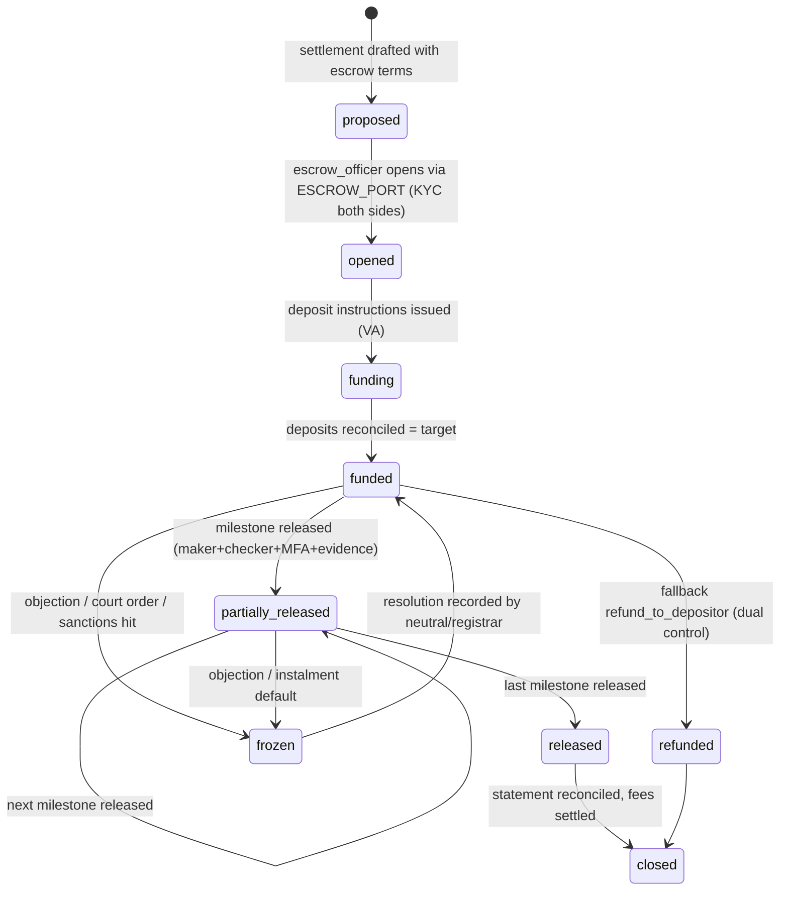
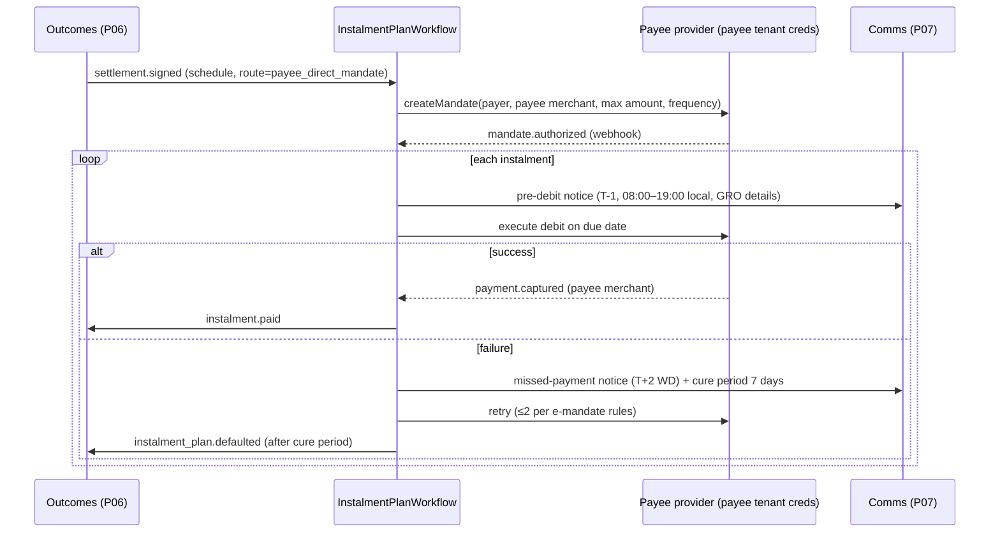

# P05 — Fees, Payments, Escrow & Multi-Currency
> Paste after 01_MASTER_PROMPT.md. Prerequisites: P00, P01, P02 (P03 recommended for neutral payout recipients; if P03 is not yet merged, build payouts against the `core.neutrals` stub and seed data). Estimated effort: 5 sprints (2-week) for a squad of 8 (3 backend, 1 web, 1 mobile, 1 QA/SDET, 1 finance-domain BA, 0.5 DevOps, 0.5 security).
>
> Binding reference: **Appendix B — Fee Engine and Rate Cards** (data model, algorithm, rounding, tax computation, worked examples, default rate cards). Where this phase file and Appendix B differ on a figure, Appendix B wins; where either differs from 01_MASTER_PROMPT.md, the master prompt wins (raise an ADR).

## 1. Objective and business outcome

Build Equator's money layer so that every fee is **computed deterministically, quoted before payment, collected on regulated rails, split at source, taxed correctly, refunded by rule and reconciled to the rupee** — in INR by default and in USD/EUR/GBP/SGD/AED for `INT` and international enterprise contracts — while **settlement sums between parties never touch Equator's merchant account** (NN-13).

Business outcomes:
1. **D7 shipped**: a published, calculator-driven fee card with an API quote, identical in the public calculator, the filing screen, the enterprise API and the invoice (one engine, one result, one hash).
2. **D2 money leg shipped**: instalment plans on UPI AutoPay/eNACH, payment links on the payee's own merchant, bank escrow with a trustee and evidence-gated, dual-controlled release, and a default-detection hook that feeds the P06 compliance tracker.
3. **Neutral economics are transparent and outcome-neutral**: neutral payouts are released on procedural milestones, with TDS/withholding and GST handled per neutral tax profile, never varying with who wins or how much is settled (Appendix B §B.1 P2).
4. **Recurring revenue lines can bill**: Chambers, GRM, POSH and Enterprise API subscriptions with proration and dunning, monthly consolidated enterprise invoices, volume tiers and prepaid wallets.
5. **Finance can close the month**: double-entry ledger, PG/escrow/bank reconciliation, GST and TDS registers, GL export to Tally and Zoho Books, chargeback handling and an auditor read-only view.

## 2. Scope (in / out)

**In scope**
- Fee engine (`packages/rules/fees`): schedules → tariff items → rules (flat, slab, marginal ad valorem, per-unit session/hour/day/party/notice, percentage-of-item, regulated table, pass-through at actuals, success/settlement fee where lawful, caps/floors, multipliers), who-pays allocation, concessions/waivers with approval, promo codes, partner discounts, adjournment/late fees, regulated schedules applied exactly (NN-18).
- Quotes and estimator: public calculator API + embeddable widget; filing-time binding quote; stage re-quotes; enterprise quote API.
- Collection: Razorpay Orders, Payment Links, UPI (intent/collect/QR), cards, netbanking, wallets, Smart Collect virtual accounts, UPI AutoPay and eNACH mandates; Cashfree fallback; international via Razorpay International (PA-CB), PayPal, bank wire to a virtual account reference.
- Split settlement via Razorpay Route (Equator share / neutral share / Chambers tenant share / university revenue share), holds and releases; Cashfree Easy Split fallback.
- Neutral payouts: milestone schedule, hold/release, TDS, GST if neutral registered, statements, non-resident withholding per DTAA.
- Invoicing: GST-compliant tax invoices, bills of supply, receipt vouchers, export invoices under LUT, reverse-charge annotations, e-invoice IRN, credit/debit notes.
- Refunds by stage (rule-driven), cancellations, credit notes.
- Subscriptions and plans (Chambers, GRM, POSH, Enterprise API) with proration and dunning; enterprise monthly consolidated invoicing, volume tiers, prepaid wallets.
- Escrow for settlement sums (RazorpayX Escrow+ / Castler / bank-direct), milestone conditions, evidence-gated dual-control release, reconciliation.
- Instalment plans for settlements (collection on payee rails or escrow), default detection → auto-escalation hook.
- Multi-currency: currency fields everywhere, FX snapshots, INR-equivalent display, FX gain/loss.
- Finance operations: reconciliation dashboards, GL export (Tally/Zoho Books CSV + API), finance permission bundles, fraud and chargeback handling.
- Mobile: pay, view invoices/receipts, mandate setup, neutral earnings.

**Out of scope (owned elsewhere)**
- Settlement instrument drafting, signing, stamping and the compliance tracker UI (P06; P05 supplies the money primitives and events).
- Vertical calculators other than the fee estimator (P08).
- GRM ticket metering logic and POSH IC workflows (P09 emits usage events P05 bills).
- Academy checkout UX and university partner statements UI (P10 consumes P05 APIs).
- Public fee pages, SEO and CMS (P13 renders the P05 widget and API).
- Referral/partner payouts and BCI-compliant advocate credits (P13 `growth.referral_payouts`).
- Settlement financing / lending products (not built; signpost to regulated partners).

## 3. Personas and permissions touched

| Role code | What they do in P05 | Key permissions (ABAC conditions) |
|---|---|---|
| `party`, `party_org_user` | Get quotes, pay, view invoices/receipts, request concessions, set up mandates, fund escrow, upload payment proof | Own case + own payer allocation only; never sees the other party's invoice, concession or payment method |
| `counsel` | Pay on behalf of client under mandate; download invoices | Mandate scope includes `billing.pay` |
| `neutral_mediator`, `neutral_conciliator`, `neutral_arbitrator`, `neutral_expert` | Complete tax profile and linked account KYC, view earnings, statements, TDS certificates, raise fee notes, propose arbitral fee within scale | Own payouts; step-up MFA to change bank/tax profile |
| `ic_external_member` | Receive POSH retainer/inquiry payouts | Payout references opaque POSH token only (NN-07) |
| `case_manager` | Trigger stage re-quotes, record adjournments, propose concessions ≤ own limit, chase deposits | Case-scoped; cannot approve own proposal |
| `registrar` | Approve concessions within limit, fix deposits/top-ups, direct fee reallocation per order, approve arbitral fee within scale | Case-scoped; maker ≠ checker |
| `escrow_officer` | Open escrow, verify milestone evidence, propose/approve release (dual control), reconcile escrow statements | Must not hold `case_manager` grant on the same case (segregation of duties); step-up MFA on every release |
| `institution_admin`, `finance_controller` + finance bundles | Fee schedules (maker), approvals, refunds, payouts, reconciliation, GL export | Via bundles `fin.viewer`, `fin.operator`, `fin.approver`, `fin.controller` granted in `core.role_grants`; `finance_controller` (master §1.5) holds `fin.controller` by default |
| `chambers_admin` | Configure tenant tariff within platform guardrails, view tenant share settlements, manage subscription | Tenant-scoped |
| `enterprise_admin`, `enterprise_operator` | Subscription, wallet top-up, consolidated invoices, usage MIS, TDS certificate upload | Org-scoped; operator cannot change plan |
| `university_admin` | Revenue-share statements, invoices | Tenant-scoped |
| `platform_admin` | Provider routing, FX source config, global schedules, kill switches | Platform scope; all actions audited |
| `auditor` | Read-only ledgers, invoices, reconciliations, audit trail | Time-bound grant; no PII beyond masked |
| `dpo` | Data-principal requests touching billing records; retention overrides | Billing records retained per tax law (8 years default) even on erasure request — erasure is restricted processing |
| `support_agent` | View payment status, resend receipts | No amounts beyond the party's own; no refunds |
| `machine` | Enterprise quote, usage, invoice and wallet APIs | API key scopes `billing:read`, `billing:quote`, `wallet:write` |

Finance permission bundles (tenant-scoped, assignable only by `institution_admin` with maker–checker): `fin.viewer` (read all billing data), `fin.operator` (create refunds ≤ ₹25,000, re-trigger payouts, run reconciliation), `fin.approver` (approve refunds, concessions above registrar limit, payout releases > ₹2,00,000, credit notes), `fin.controller` (fee-schedule checker, period close, GL export lock, write-offs). A user may not hold `fin.operator` and `fin.approver` on the same transaction (enforced by policy engine, not UI).

## 4. Functional requirements

### 4A. Fee schedules and the deterministic fee engine

**FR-P05-01 — Fee schedule versioning.** Fee schedules are data in `core.fee_schedules` with `code`, `vertical`, `scope` (`institution` | `chambers_tenant` | `enterprise_contract` | `subscription` | `academy`), `currency`, `version`, `effective_from`, `effective_to`, `status` (`draft` → `in_review` → `approved` → `published` → `superseded`; `retired` when withdrawn without a successor), `board_approval_ref` (nullable; when null the public UI shows "Subject to Board approval"), `regulated` (bool), `regulator_ref`, `source_ref`. Every schedule (platform, vertical, enterprise contract, Private Chambers tenant, academy) is created and edited in the Ruleset Studio fee editor without code and is approval-gated (master §7, M-01): publishing requires maker–checker (`core.config_change_requests`) with the approver's role and the approval evidence (e.g., Board resolution reference) recorded, and a passing golden-test suite (FR-P05-07). Nothing is quoted on a binding basis, requested for payment or invoiced from a schedule that is not `published` (`SCHEDULE_NOT_APPROVED`). Tenants customise their own schedules within the Appendix B P1–P9 guardrails and NN-18. A case is pinned at filing to the schedule version in force (NN-21); later versions never alter a pinned case, including stage fees computed months later.

**FR-P05-02 — Tariff items and rule kinds.** Each schedule holds `core.tariff_items` with the columns, `component` enum, `basis` enum (`FLAT`, `SLAB_FIXED`, `MARGINAL`, `PER_UNIT`, `PCT_OF_ITEM`, `PCT_OF_AMOUNT`, `REGULATED_TABLE`, `PASSTHROUGH`, `BUNDLED`) and rule JSON defined in Appendix B §B.2, including the JSON-logic predicate `applies_when`, min/max/cap, internal `floor_minor` (never displayed), `payer_rule`, `revenue_owner`, `gst_treatment`, `sac_code`, `tds_section_code`, `discountable`, `promo_eligible`, `outcome_linked`, `refund_policy_code` and `revenue_recognition`. Rates are integer parts-per-million (`rate_ppm`); no floating point anywhere in the money path.

**FR-P05-03 — Deterministic computation.** `computeQuote(scheduleVersion, facts, fxSnapshots, engineVersion)` in `packages/rules/fees` is a pure function implementing Appendix B §B.3 exactly (item selection → base → multipliers → min/max/cap → concessions/promos/partner/volume with stacking rules and floors → payer allocation → tax → rounding). It never calls the network, the clock (time is an input) or an LLM (NN-01). Output includes `quote_hash = SHA-256(canonical JSON of inputs + outputs + engine_version)`. Re-running any historical quote with the same inputs must reproduce the hash byte-for-byte (determinism test `NN-21_fee_quote_reproducible`).

**FR-P05-04 — Who pays.** `payer_rule` enum: `claimant`, `respondent`, `filer`, `equal_split`, `equal_per_party_group`, `pro_rata_custom` (ratio map, registrar approval), `enterprise_pays` (named organisational party), `lender_pays`, `insurer_pays`, `employer_pays`, `employer_employee_split` (default 75:25), `applicant` (emergency arbitrator, adjournment requester), `counterclaimant_increment`, `per_party_each`, `deferred_cost_follows_event` (collected on account per default split, reallocated by award/order under A&C s.31A). Allocation uses largest-remainder in minor units; the residual minor unit goes to the payer with the lowest ordinal (claimant first). A registrar order (`core.orders` of type `fee_reallocation`) can re-allocate future items; past invoices are adjusted only through credit/debit notes.

**FR-P05-05 — Counterclaims, re-banding, unquantified claims.** Fees on a counterclaim equal `fee(claim + counterclaim) − fee(claim)` per ad valorem item and are payable by the counterclaimant on account (`counterclaim_increment`). An amended claim re-bands: the delta is invoiced or credited from the pinned schedule. An unquantified claim uses the vertical's `unquantified_default_minor` (Appendix B) until the tribunal or registrar fixes a value; the re-band is automatic on that event.

**FR-P05-06 — Regulated schedules (NN-18).** Items with `basis = REGULATED_TABLE` (e.g., SEBI SMART ODR when `SEC` is ON) are loaded verbatim from the regulator's instrument recorded in the Legal Rules Register (Appendix G), are `discountable = false`, `promo_eligible = false`, carry the regulator's payer rule and cannot be edited by any tenant. Any attempt to create a concession, promo or override on such a line returns `409 REGULATED_FEE_IMMUTABLE` and writes an audit event. Late-initiation surcharges defined by the regulator are encoded as `late_fee` items with predicates on the event dates.

**FR-P05-07 — Schedule test harness.** Ruleset Studio's fee editor (SCR-P05-17) requires, before submission for approval, that (a) every worked example in Appendix B §B.5 relevant to the schedule passes, (b) a boundary suite (each slab boundary ±1 minor unit, caps, floors) passes, (c) monotonicity holds for every ad valorem item (fee never decreases as amount increases), (d) no neutral component is reduced by any discount path, and (e) the vertical success-fee policy (Appendix B §B.1, P3) is satisfied. Results are attached to the change request.

**FR-P05-08 — Success and settlement-linked fees (lawful only).** The engine rejects at publish time any `PCT_OF_AMOUNT` item keyed on a settled or awarded amount unless the vertical policy permits it: permitted only for `COM` and `INT` business-to-business mediation as an opt-in "settlement administration fee" agreed in writing by all parties at filing (Appendix B card COM-M); prohibited for `INS` (Insurance Rules r.27; NN-18), `FAM`, `WRK` individual matters, POSH, `SEC`, `FIN` retail, and all neutral fee components. The `FIN` lender programme uses **outcome-triggered flat stage fees** that do not vary with the settled amount. Neutral remuneration is outcome-neutral in every vertical except where a regulator's schedule mandates otherwise (`SEC`).

### 4B. Quotes and estimator

**FR-P05-09 — Public fee calculator.** `POST /v1/public/fee-quotes` (no auth, rate-limited 30/min/IP, CAPTCHA after 10) accepts vertical, mechanism, track, amount and currency, party types, tribunal size, expedited flag, expected sessions and concessions the user self-declares, and returns an **indicative** quote: line items, payer allocation, GST shown separately ("exclusive of GST" banner), schedule version, "Subject to Board approval" flag where applicable, FX snapshot ID and INR equivalent for foreign currency. No PII is accepted or stored; only an anonymised `growth.tool_runs` row (vertical, band, timestamp) is written (NN-16). The embeddable widget (`packages/ui` `<FeeCalculator/>`) is SSR-safe for P13.

**FR-P05-10 — Filing-time binding quote.** At filing (P02 flow), the engine computes a quote on the pinned schedule; the payer sees every line, who pays, taxes and refundability before paying (master §7). The quote is binding for `quote_validity_days` (default 30) for the filing payment; stage fees are quoted again at each stage from the same pinned version. Accepting a quote records `accepted_by`, IP, user agent, consent text version and timestamp in `core.quotes`.

**FR-P05-11 — Stage re-quotes and deposits.** Stage events (`neutral_appointment`, `session_scheduled`, `tribunal_constituted`, `hearing_added`, `counterclaim_filed`, `claim_amended`, `adjournment_recorded`, `expedited_opted`, `ea_applied`) trigger a re-quote and a payment request to the allocated payers. Arbitration deposits follow A&C s.38: the registrar fixes the advance on costs (default per Appendix B), each party's share is requested with a 15-day due date; on default the other party may pay as substitute (`paid_on_behalf_of` recorded; the paying party may seek recovery in the award under s.31A). If a deposit is still unpaid 7 days after a final payment notice, the tribunal may suspend the proceedings (A&C s.38(2); Equator Rules); a party unable to pay may itself seek suspension, or the other party may pay its share, and termination for non-payment comes only after that opportunity. *Harshbir Singh Pannu v Jaswinder Singh*, 2025 INSC 1400 (SC, 9 Dec 2025; C.A. 14630 of 2025): after termination for non-payment a fresh s.11 petition is not maintainable; the aggrieved party must first seek recall of the termination before the tribunal and may then approach the court under s.14(2). The Equator Rules therefore provide a recall window after any termination for non-payment.

**FR-P05-12 — Enterprise quote API.** `POST /v1/billing/quotes` (API key scope `billing:quote`) returns the same computation for programme pricing, applying the enterprise contract's plan and volume tier. Bulk quotes accept up to 10,000 rows per call (CSV or JSON) and return per-row results with a batch hash.

### 4C. Payment collection

**FR-P05-13 — Payment intents.** Every collection is a `core.payments` row with `purpose` ∈ {`case_fee`, `deposit`, `subscription`, `wallet_topup`, `academy_fee`, `usage_invoice`, `penalty_fee`}. **`settlement_sum` is not a permitted purpose on Equator's merchant**: an attempt returns `422 NN13_SETTLEMENT_FUNDS_PROHIBITED` (test `NN-13_settlement_not_via_merchant`). Each POST carries an `Idempotency-Key`; replays return the original result.

**FR-P05-14 — Rails (domestic).** Via `PAYMENTS_PORT` (Razorpay default): Orders + Checkout (UPI intent on mobile, UPI collect/QR, cards, netbanking, wallets), Payment Links (sent via P07 journeys with expiry default 7 days, reminders D-3/D-1), Smart Collect virtual accounts (one per enterprise or per large case for NEFT/RTGS/IMPS, with payer bank-account allow-list). Card data never touches Equator (PCI DSS SAQ-A scope). Failover to Cashfree when the Razorpay circuit breaker is open (3 consecutive 5xx or p95 > 5 s over 2 minutes); a link created on one provider is never duplicated on the other for the same payment intent.

**FR-P05-15 — Rails (international).** For foreign payers: Razorpay International (cards via PA-CB), PayPal Checkout, or bank wire against a unique virtual account reference (SWIFT, with the reference in the remittance information). The engine records the payer country, FEMA route flag (current account for fees), purpose code, and the FIRA/e-BRC reference when received from the AD bank — required for zero-rated export invoices under LUT (FR-P05-29). Card-based foreign payments that settle in INR record both currencies and the realised rate.

**FR-P05-16 — Mandates.** UPI AutoPay and eNACH mandates (Razorpay; Digio fallback) are supported for (a) subscriptions/enterprise auto-pay on Equator's merchant and (b) settlement instalments **created on the payee's own merchant or the escrow collection account, never on Equator's merchant** (FR-P05-44). Mode selection: UPI AutoPay where each debit ≤ `mandate_limits.afa_free_limit` (default ₹15,000 = RBI AFA-exemption ceiling for loan/settlement debits under the Digital Payments – E-mandate Framework, 2026 (21 Apr 2026); above it each debit needs AFA; ₹1,00,000 applies only to insurance premia, MF subscriptions and credit-card bills), else eNACH; `mandate_limits.upi_autopay_max_debit` (default ₹99,999, category-dependent per gateway) is the hard ceiling for any UPI AutoPay debit. Pre-debit notification per the RBI e-mandate framework (minimum and default 24 hours) is sent through P07 with grievance-officer details where the payee is a lender (NN-12).

**FR-P05-17 — Payment confirmation.** A payment is `captured` only on a verified webhook (`payment.captured`, signature verified, stored in `core.webhook_inbox` unique on `(provider, event_id)`) or a successful server-side fetch; client redirects never mark payment. Late-arriving webhooks after an intent expired create a `payment_unmatched` exception for finance with auto-refund after 3 working days if not matched.

**FR-P05-18 — Partial and substitute payments.** Payers may pay their own allocation only, unless a `substitute_payment` is explicitly chosen (deposits) or an enterprise pays for its customers under contract. Partial payments against a single invoice are allowed only for enterprise invoices and wallet top-ups.

**FR-P05-19 — Receipts.** On capture, a receipt and the tax document (FR-P05-26) are delivered in-app, by email and as a WhatsApp document (P07) in the payer's language, showing legal entity, GSTIN, masked payment ID, method, amount and case number.

### 4D. Split settlement and neutral payouts

**FR-P05-20 — Linked accounts.** Each payee other than Equator (neutral, Chambers tenant, university, external IC member) is onboarded as a Razorpay Route linked account (Cashfree Easy Split vendor as fallback) after KYC by the PA, bank-account validation (penny-drop name match ≥ 0.85 similarity) and tax profile completion. Transfers to a new linked account are scheduled no earlier than the provider's cooling period (24 hours after linked-account creation, per Razorpay Route docs, Oct 2026; held in config `route.linked_account_cooling_hours = 24`).

**FR-P05-21 — Split at source.** For each captured payment, the engine's `revenue_owner` per line yields transfer instructions: Equator share stays in Equator's merchant settlement; neutral share, tenant share and university share are created as Route transfers with `on_hold = true` and `hold_reason = milestone`. Splits are computed from the invoice lines, not re-derived, and must sum exactly to the captured amount minus PG fees borne by Equator (`NN-13_split_sum_exact`). Platform/panel administration fees (Appendix B §B.7) are deducted from the neutral transfer only where configured and are invoiced to the neutral monthly.

**FR-P05-22 — Payout milestones.** Holds are released by Temporal on milestone events per Appendix B §B.7.6: e.g., mediation session fee → `session.held` + minutes filed (T+2 working days); arbitration advance → 25% on `tribunal.constituted`, 25% on `pleadings.completed`, 50% on `award.delivered` (or pro rata on early termination as fixed by registrar); FIN programme neutral component → on stage completion; POSH external member inquiry fee → on `posh_inquiry.report_submitted` (sealed event exposes only the opaque token). Releases above ₹2,00,000 per transfer need `fin.approver`. A neutral challenged and removed (s.13/s.14) receives only what the registrar fixes; unreleased holds are reversed.

**FR-P05-23 — Neutral tax profile and TDS.** `core.neutral_tax_profiles` (new table, see §7.2) stores PAN (validated), GSTIN (optional), GST registration state, composition flag, residency, TRC, Form 41 (formerly Form 10F; Income-tax Rules 2026 r.75), no-PE/no-fixed-base declaration, DTAA article, lower-deduction certificate. Where Equator is the payer (principal model or Equator-funded pro bono), Equator deducts TDS on professional fees at the configured rate once the tax-year threshold per payee is crossed, under Income-tax Act 2025 s.393(1), Table Sl. 6(iii) (formerly s.194J): 10% on professional fees, 2% on fees for technical services, threshold ₹50,000 per category per tax year. Where a corporate party pays the neutral directly via Route (default model), the party is the deductor: the platform shows the TDS amount on the neutral line, accepts payment net of TDS, tracks the deductor's quarterly certificate upload, and alerts the neutral when a certificate is overdue (45 days after quarter-end). Because the platform collects party payments for neutral services, the signed tax memo (§13) must decide Equator's e-commerce-operator exposure before go-live: TDS under s.393(1) Table Sl. 8(v) (formerly s.194-O; 0.1%; no deduction for a resident individual/HUF participant up to ₹5 lakh in the tax year if PAN or Aadhaar is furnished, no threshold for others — [RE] F3.4, corrected v3.0) and its interaction with the payer's Sl. 6(iii) deduction, and GST-TCS under CGST Act s.52 (0.5%) with compulsory registration under s.24; the engine carries both as configurable treatments (`billing.eco_withholding`, `billing.eco_gst_tcs`, default OFF; LR-TAX-007/008; `tax.eco_tds`/`tax.eco_gst_tcs` are aliases only, Appendix V X-44) until the memo is signed.

**FR-P05-24 — Non-resident neutrals.** Payouts to non-resident neutrals are made by Equator as principal through an AD Category-I bank (not Route): withholding under Income-tax Act 2025 s.393(2), Table Sl. 17 (formerly s.195), at the lower of the rate in force and the DTAA rate, where TRC (s.159(8)) + Form 41 (formerly Form 10F; r.75) + no-PE/no-fixed-base declaration are on file. Form 145 (formerly 15CA; r.220, Income-tax Rules 2026) is generated for every remittance: Part A if chargeable and the aggregate is ≤ ₹5 lakh in the tax year; Part C with Form 146 (formerly 15CB, accountant's certificate) if chargeable and > ₹5 lakh; Part B where an AO certificate under s.395(1) is held; Part D if not chargeable. GST reverse charge on import of services is booked by Equator (IGST Act s.5(3); Notification 10/2017-Integrated Tax (Rate), Sl. 1; ITC under CGST s.16). Payout currency = neutral's rate-card currency; FX snapshot recorded at remittance.

**FR-P05-25 — Neutral statements.** Monthly statement per neutral (PDF + CSV): fees billed, holds, releases, panel administration fees with GST, TDS by deductor, net paid, pending certificates, and per-case lines identified by case number only (no party names for sealed/high tiers). Annual summary for income-tax filing. Statements regenerate deterministically from the ledger.

### 4E. Invoicing and GST

**FR-P05-26 — Document types.** Per legal-entity GSTIN: tax invoice (`INV`), bill of supply (`BOS`) for exempt supplies, receipt voucher (`RCV`) for advances (CGST Rules r.50), refund voucher (`RFV`), credit note (`CRN`), debit note (`DBN`), export invoice (`EXP`). Serial numbers are consecutive, unique per FY and ≤ 16 characters (CGST Rules r.46), format `{TYPE}/{YYYY}/{NNNNNNN}` where `YYYY` = FY short code (e.g., `INV/2627/0000123`). Gaps are impossible by construction (allocation in the same transaction as issue; voided documents remain in the series with status `cancelled`).

**FR-P05-27 — Supplier of record.** Each line's supplier is resolved from `revenue_owner` and the tenant's `neutral_fee_billing_model`: `neutral_direct` (default; neutral is supplier; the platform generates the neutral's fee note/tax invoice in the neutral's name from the neutral's GST profile under a standing authorisation captured at onboarding) or `equator_principal` (Equator supplies the whole service and procures neutral services; used for `INT` foreign neutrals, enterprise contracts that require a single supplier, and Chambers tenants that opt in). Stamp duty and bank/trustee charges are recovered as **pure agent** disbursements excluded from taxable value (CGST Rules r.33) and shown below the taxable total.

**FR-P05-28 — Place of supply and tax type.** Implement the decision table in Appendix B §B.4 exactly: B2B → recipient GSTIN state (IGST Act s.12(2)(a)); B2C → recipient address on record, else supplier location (s.12(2)(b)); intra-state CGST + SGST, inter-state IGST; export → s.13(2), zero-rated under LUT; arbitral tribunal services to a business entity → reverse charge (Notification 13/2017-CT(Rate), Sl. 3) annotated "Tax payable on reverse charge: Yes"; arbitral tribunal services to a non-business person, or to a business entity whose preceding-FY aggregate turnover is within the CGST s.22 registration-exemption limit (₹20 lakh; ₹10 lakh in Manipur, Mizoram, Nagaland, Tripura; config `gst.reg_exemption_threshold`), → exempt, bill of supply (Notification 12/2017-CT(Rate) Sl. 45, as amended by Notification 21/2019-CT(Rate) w.e.f. 1 Oct 2019); mediator/conciliator fees → forward charge only if the neutral is registered. Default rate 18%; SAC per item from configuration (default 998215 'Arbitration and conciliation services' for ADR administration and neutral fees; 998216 is 'Other legal services n.e.c.' and is not used for ADR).

**FR-P05-29 — LUT and export compliance.** The legal entity's LUT (ARN, FY validity) is configuration; export invoices carry "Supply meant for export under LUT without payment of IGST" and are zero-rated only when (a) recipient is outside India, (b) consideration is received in convertible foreign exchange or in INR where RBI permits, and (c) supplier and recipient are not merely establishments of a distinct person (IGST Act s.2(6)). If (b) is not evidenced (no FIRA/e-BRC) within the configured window (default 365 days from invoice date per CGST Rules r.96A(1)(b), or any longer period allowed by the Commissioner; FEMA realisation of 15 months from export, per Notification FEMA 23(R)/(7)/2025-RB dated 13 Nov 2025, is tracked separately for the AD bank), finance gets a task to pay IGST with interest within 15 days (r.96A(1)) or regularise.

**FR-P05-30 — e-Invoice.** When `einvoice_applicable = true` for the legal entity (AATO > ₹5 crore in any FY since 2017-18), B2B, export and SEZ invoices and credit/debit notes are reported to the IRP via `TAX_INVOICE_PORT` (GSP/ASP: ClearTax default; Masters India/IRIS fallback); IRN, ack number and signed QR are embedded before the PDF is released. If AATO ≥ ₹10 crore, the 30-day IRP reporting window is enforced with an alert at day 20 (GSTN advisory 5 Nov 2024, w.e.f. 1 Apr 2025; applies to invoices, credit notes and debit notes; e-invoicing applies above AATO ₹5 crore under Notification 10/2023-CT). IRN cancellation within 24 hours only, otherwise credit note.

**FR-P05-31 — GST registers.** Monthly GSTR-1-ready export (B2B, B2CL, B2CS, EXP, CDNR, CDNUR, SAC summary, document summary), RCM register and ITC register for vendor invoices. v1 exports; it does not file.

### 4F. Credit notes, refunds and cancellations

**FR-P05-32 — Refund policy engine.** Refund amounts are computed by the deterministic engine from the case's pinned `refund_policy_code` and the stage reached (Appendix B §B.8 matrix): e.g., withdrawal before notice → 100% of all items except registration; after notice before appointment → 75% administration, 100% unused neutral fees; after first session → unused session fees only; arbitration settled before first hearing → 50% of tribunal fee (INS card); rejected as outside the Rules → 100% including registration; duplicate payment → 100%. Pass-through items are refunded only if the provider refunds (e.g., unused e-stamp released). Neutral holds are reversed before Equator's share is refunded.

**FR-P05-33 — Refund execution.** Refunds go to the original payment instrument (RBI Payment Aggregator Directions, 15 Sep 2025); bank-transfer refunds only where the original rail was a bank transfer, to a penny-drop-validated account in the payer's name. Approval: `fin.operator` ≤ ₹25,000; `fin.approver` above; any refund on a case where the requester is also the approver is blocked. SLA: initiate within 3 working days of approval; status visible to the payer.

**FR-P05-34 — Credit notes.** Every refund or downward adjustment of a taxed supply issues a credit note referencing the original invoice (CGST Act s.34), reported via e-invoice where applicable; the system blocks credit notes for a FY after the statutory cut-off (30 November following the end of the FY, or the date of furnishing the relevant annual return, whichever is earlier; CGST Act s.34(2) as amended w.e.f. 1 Oct 2022) and routes such cases to a "refund without tax adjustment" path with finance approval. Upward adjustments issue debit notes.

### 4G. Subscriptions, enterprise billing and wallets

**FR-P05-35 — Plans.** `core.plans` holds plan code, product line (`chambers`, `grm_lender`, `grm_listed`, `grm_employer`, `grm_university`, `posh`, `enterprise_api`, `academy_membership`), billing interval (`monthly`, `annual`), base price, included quantities (seats, tickets, cases, API calls, employees), overage rates, currency, GST treatment, trial days, and feature entitlements (consumed by `core.feature_flags`). Defaults are in Appendix B cards (viii)–(xi).

**FR-P05-36 — Subscription lifecycle and proration.** `core.subscriptions` states: `trialing` → `active` → `past_due` → `suspended_soft` → `cancelled`/`expired`. Upgrades and seat additions mid-cycle charge `price_delta × remaining_days / cycle_days` immediately (days counted in IST calendar days inclusive of the change day); downgrades apply from the next cycle; annual plans prorate monthly-equivalent and are non-refundable except on Equator's convenience termination (pro rata) or Equator's material breach.

**FR-P05-37 — Dunning that never breaks statutory duties.** Failed renewal: retries at D+1, D+3, D+5 (mandate or card), notices at D0, D+3, D+7; `past_due` at D0; `suspended_soft` at D+15 (new optional features disabled, new case intake on Chambers paused); `cancelled` at D+45 with data export offered. **Hard rule:** dunning never blocks (a) access to existing case records for parties and neutrals, (b) any running statutory or regulatory clock (NN-04), (c) intake of grievances on a GRM desk (the regulated entity's legal duty continues — commercial escalation only), or (d) an IC's access to an open POSH inquiry inside its 90-day clock (NN-07). Test `NN-04_dunning_never_stops_clocks`.

**FR-P05-38 — Enterprise consolidated invoicing.** Usage events (`core.usage_events`: case filed, stage completed, notices sent, eStamp procured, API calls beyond plan, escalations) are rated daily against the contract's plan and volume tier and invoiced monthly on the 1st (IST) for the previous month, per billing GSTIN of the enterprise (multi-GSTIN supported; place of supply per GSTIN). Invoice annexure lists case numbers and stages (no borrower PII beyond masked name and loan reference hash). Volume tiers are determined by the contract's annual committed volume; quarterly true-up re-rates prospectively; an optional minimum-commitment shortfall fee is configuration (default OFF).

**FR-P05-39 — Prepaid wallets.** `core.wallets` and `core.wallet_ledger` (append-only) per enterprise per currency. Top-ups by PG, mandate or NEFT to the wallet virtual account; advances against identified services carry GST at receipt with a receipt voucher (CGST s.13(2), s.31(3)(d), r.50; 18% if the rate is not determinable); refundable wallet deposits not yet applied to a supply are not 'consideration' (s.2(31) proviso) and are taxed when consumed **[VERIFY — open: tax memo to fix whether the enterprise wallet is a deposit or an advance]**; consumption is drawn at rating time and invoiced monthly with the advance adjusted. Low-balance alerts at 20% and 10% of the last 30-day consumption; optional auto top-up via mandate. Wallet balances are liabilities (never recognised as revenue), carry no interest, and are refundable on termination net of dues.

### 4H. Escrow for settlement sums (NN-13)

**FR-P05-40 — Escrow accounts.** `core.escrow_accounts` per settlement (or per case for interpleader), via `ESCROW_PORT` (RazorpayX Escrow+ default; Castler alternate; bank-direct where an enterprise mandates its bank). Fields: depositor party, beneficiary party, trustee, bank, account/VA reference (masked), currency, target amount, status (`proposed` → `opened` → `funding` → `funded` → `partially_released` → `released` → `closed` | `refunded` | `frozen`), fee bearer, KYC status of depositor and beneficiary. Copy rule: UI says "escrow agent" and "bank escrow", never "Equator's account".

**FR-P05-41 — Milestones and conditions.** `core.escrow_milestones` define amount, due date, release condition (typed: `document_evidence` (e.g., NOC, relieving letter, discharge voucher, court order copy), `case_event` (e.g., `award.s34_window_lapsed`, `decree.uploaded`), `date`, `counterparty_confirmation`, combinators `all_of`/`any_of`), `evidence_ref` (required for release — DB CHECK `release_needs_evidence`), fallback action on missed due date (`hold`, `refund_to_depositor`, `escalate`). Templates per vertical (FIN OTS tranches, WRK F&F tranches, FAM tranches, INS milestone menu) are configuration.

**FR-P05-42 — Dual control release.** Release requires: (1) evidence verified by an `escrow_officer` (maker) with checklist; (2) approval by a different `escrow_officer` (checker); (3) step-up MFA for both; (4) no open dispute flag on the milestone; (5) the beneficiary's account validated in its own name. The instruction to the trustee includes the settlement agreement hash and approvals (`ESCROW_PORT.instructRelease`). A party objection within the configured objection window (default 2 working days after evidence upload) freezes the milestone and routes to the case manager/neutral per the settlement's dispute clause.

**FR-P05-43 — Escrow reconciliation.** Daily escrow statements (API or MT940/CSV upload) are matched to ledger entries: deposits by VA reference + amount, releases by instruction ID + UTR. Unmatched items older than 1 working day raise a `reconciliation_exception` task; any release without a matching approved instruction raises a **Critical** incident.

**FR-P05-44 — Direct payment with proof (fallback).** Where escrow is not used, settlement sums go payer → payee directly (payee's own payment link/VA/mandate configured via the payee tenant's provider credentials, or offline transfer). The payer uploads UTR + screenshot or bank advice; the payee confirms or disputes within 3 working days; silence escalates to the case manager; for `FIN` lender tenants with AA consent (NN-14), repayment verification may use the lender's FIU data (derived summary only).

### 4I. Instalment plans for settlements

**FR-P05-45 — Plan creation.** P06 creates an `core.instalment_plans` row from the signed settlement terms: payer, payee, collection route (`payee_direct_mandate` | `escrow_virtual_account` | `payee_payment_link` | `offline_with_proof`), schedule (`core.instalments`: due date, amount, currency, grace days), late-payment consequence (as agreed in the settlement — never a fee to Equator), and default definition (default: any instalment unpaid 7 days after due date after a cure notice; configurable per settlement within vertical guardrails).

**FR-P05-46 — Collection and tracking.** For mandates, the platform orchestrates creation on the payee's merchant via the payee tenant's credentials in `core.provider_routing` (owner = payee tenant). Pre-debit notices, success/failure webhooks, retries (default max 2; configurable pending NPCI retry rules, §14 item 4), and reminders run in `InstalmentPlanWorkflow`. Borrower contact obeys NN-12 (08:00–19:00 local, blackout dates, grievance-officer details).

**FR-P05-47 — Default detection → escalation hook.** Missed instalment → T+0 reminder; T+2 working days "missed payment" notice to both parties; cure period (default 7 days); then emit `equator.payments.instalment_plan.defaulted.v1` with settlement ID, missed amount, cumulative arrears and the settlement's default clause reference. P06 consumes it to open a compliance escalation (return to mediation, acceleration notice, consent-award conversion or execution pack per the instrument). Escrow-linked plans pause further releases on default (C1 B.8).

### 4J. Multi-currency and FX

**FR-P05-48 — Currency fields everywhere.** Every money column is `amount_minor BIGINT` + `currency CHAR(3)` (ISO 4217; enum `INR`, `USD`, `EUR`, `GBP`, `SGD`, `AED` enabled by config). Mixed-currency arithmetic is a type error in `packages/domain` (branded `Money<C>` type). Every foreign-currency amount stored with `fx_snapshot_id` and `inr_equivalent_minor`.

**FR-P05-49 — FX snapshots.** `FX_PORT` fetches daily reference rates: INR legs from the FBIL reference rate (successor publisher of the RBI reference rate) for USD, EUR, GBP and JPY (the only INR reference rates FBIL publishes, around 13:00 IST since 6 Jan 2025); SGD, AED and all other currencies use the configured provider's mid-rate or the AD bank's TT rate (AED may be peg-derived per Appendix B FX-3). The source order per currency is configuration (`fx.sources.<CCY>`). Cross rates derive via INR (`USD→EUR = USD/INR ÷ EUR/INR`, 8-decimal precision, half-up). Each snapshot stores source, as-of time, fetch time, provider reference and a hash; snapshots are immutable. Manual rates need `fin.approver` and a document.

**FR-P05-50 — Pricing and invoicing in foreign currency.** `INT` schedules are authored in USD; EUR/GBP/SGD/AED prices are converted from USD at the quote-date snapshot, rounded half-up to 2 decimals per line, and locked for the quote validity (30 days); deposits requested after expiry use a new snapshot. GST valuation of foreign-currency invoices uses the snapshot on the date of time of supply (CGST Rules r.34(2): rate determined per generally accepted accounting principles on the date of time of supply under s.13; customs-notified rates under r.34(1) apply to goods only). Every foreign-currency screen shows the INR equivalent with snapshot date and source.

**FR-P05-51 — FX gain/loss.** On realisation (PG settlement report, FIRA/e-BRC, or bank credit), the difference between invoice INR equivalent and realised INR is posted to FX gain/loss; neutral payouts in foreign currency post their own FX entries.

### 4K. Finance operations

**FR-P05-52 — Double-entry ledger.** `core.ledger_journals` and `core.ledger_entries` (append-only; each journal balances per currency — deferred constraint) record every financial event: invoice issue, payment capture, PG fee, transfer, hold/release, payout, TDS, refund, credit note, escrow movement (memo ledger only — escrow funds are off-balance-sheet for Equator and live in `escrow_memo` accounts), wallet movements, FX. Chart-of-accounts mapping is configuration per legal entity.

**FR-P05-53 — Revenue recognition.** Per tariff item `revenue_recognition` ∈ {`on_issue`, `on_event:<event>`, `split_events:<map>`, `ratable:<months>`}: defaults registration → on case acceptance; administration → 40% on neutral appointment / 60% on outcome or closure; subscriptions → ratably; academy → on cohort delivery. Unearned revenue is reported monthly. **[Auditor to confirm Ind AS 115 policy before go-live.]**

**FR-P05-54 — Reconciliation.** Daily jobs: (a) PG settlements (Razorpay/Cashfree settlement reports) ↔ captured payments ↔ ledger; (b) Route transfers ↔ holds/releases; (c) payouts ↔ bank UTRs; (d) escrow statements ↔ escrow memo ledger; (e) wallet balances ↔ wallet ledger; (f) e-invoice IRN ↔ invoices; (g) TDS receivable (Form 26AS/AIS import) ↔ customer deductions. Exceptions surface on SCR-P05-13 with ageing; period close is blocked while any Critical exception is open.

**FR-P05-55 — GL export.** Monthly (or on demand) journal export: Tally (XML import format and CSV) and Zoho Books (CSV journals and, where configured, API push via Zoho Books Journals API using OAuth). Exports are idempotent (export batch ID; re-export of a locked period is blocked unless `fin.controller` reopens it with reason). Mapping errors fail the export with a row-level report.

**FR-P05-56 — Fraud controls.** Velocity limits (5 failed attempts per intent per hour → 30-minute block; 3+ cards per payer per day → review); escrow deposits accepted only from validated accounts in the depositor's name (third-party deposits returned); refunds only to original instrument; `SANCTIONS_PORT` screening of foreign payers before accepting `INT` payments (NN-19); neutral bank-detail change followed by a payout within 24 hours → hold for `fin.approver`.

**FR-P05-57 — Chargebacks and disputes.** PG dispute webhooks create `core.chargebacks` with deadline; evidence pack auto-assembled (accepted quote with hash, terms version, service-delivery logs, receipts, IP/device) for `fin.operator` review and submission before the provider deadline (alert at T-3 days). On loss: the fee line is marked `reversed`; neutral holds are reversed if unreleased; released neutral amounts are not clawed back (Equator absorbs from a chargeback reserve, default 0.5% of monthly card volume) unless fraud by the neutral is established; the case's billing status becomes `in_arrears` and stage progression requires re-payment (except where it would stop a statutory clock — then the case proceeds and the debt is pursued separately).

## 5. Workflows and state machines

### 5.1 Payment intent

| State | Event | Guard | Next state | Side-effects |
|---|---|---|---|---|
| `created` | `checkout.opened` | quote valid, payer allocation exists, purpose ≠ `settlement_sum` | `pending` | Provider order created (idempotent) |
| `pending` | webhook `payment.authorized` | signature valid | `authorized` | — |
| `authorized` | webhook `payment.captured` / auto-capture | amount = allocation | `captured` | Invoice issued (FR-P05-26), Route transfers on hold, ledger journal, `equator.payments.payment.captured.v1` |
| `pending` | `payment.failed` | — | `failed` | Retry link; 3 failures → `blocked_30m` |
| `pending` | expiry (default 7 days for links, 30 min for checkout) | — | `expired` | Late webhook → `payment_unmatched` exception |
| `captured` | refund approved | refund ≤ captured − refunded | `partially_refunded` / `refunded` | Credit note, holds reversed first |
| `captured` | dispute webhook | — | `disputed` | `core.chargebacks` row, evidence task |
| `disputed` | won / lost | — | `captured` / `reversed` | Ledger reversal on loss |

### 5.2 Invoice

`draft → issued → (irn_pending → irn_generated) → partially_paid → paid → (credited | cancelled)`. Guards: `issued` requires a serial number in the same transaction; `irn_generated` required before PDF release when `einvoice_applicable`; `cancelled` allowed only before any payment and within 24 hours of IRN, otherwise credit note.

### 5.3 Neutral payout

| State | Event | Guard | Next | Side-effects |
|---|---|---|---|---|
| `scheduled` (transfer on hold) | milestone event | milestone matches schedule; neutral not suspended; tax profile complete | `release_requested` | Task for approver if > ₹2,00,000 |
| `release_requested` | approval (or auto ≤ threshold) | approver ≠ requester | `released` | `PAYOUT_PORT.releaseHold` / payout API; TDS journal |
| `released` | provider `transfer.processed` | — | `settled` | Statement line; `equator.payments.payout.settled.v1` |
| any pre-`released` | case withdrawn / neutral removed | registrar order fixes amount | `reversed` / `partially_released` | Reversal to Equator for refund |
| `released` | `transfer.failed` (3 retries) | — | `failed` | Neutral notified to fix bank details; finance task |

### 5.4 Escrow (NN-13)



### 5.5 Instalment plan



### 5.6 Subscription dunning

| Day | Action | Never blocked |
|---|---|---|
| D0 | Renewal charge fails → `past_due`; notice 1 | Existing records, clocks, GRM intake, open POSH inquiries |
| D+1/+3/+5 | Auto-retry | same |
| D+7 | Notice 2 to billing contacts + account owner | same |
| D+15 | `suspended_soft`: optional features off, Chambers new intake paused | same |
| D+45 | `cancelled`; data export offered for 90 days | Records retained per retention schedule |

### 5.7 Concession approval

`requested → (auto_approved | pending_case_manager | pending_registrar | pending_fin_approver) → approved | rejected → applied (re-quote) → expired (if quote lapses)`. Limits per Appendix B §B.9.3. The applicant's evidence (income self-declaration, legal-aid referral, senior-citizen proof) is stored with confidentiality tier `high` and is never visible to the counterparty.

## 6. Screens and UX (web + mobile)

| ID | Route | Persona | Purpose | Key components / fields |
|---|---|---|---|---|
| SCR-P05-01 | `/(public)/fees/calculator` (widget) | Public | Indicative quote | Vertical, mechanism, track, amount + currency, party types, tribunal size, expedited, sessions; result table with lines, payer split, GST separate, schedule version, "Subject to Board approval" badge, INR equivalent |
| SCR-P05-02 | `/(app)/cases/[caseId]/pay` | party, counsel, party_org_user | Filing/stage checkout | Binding quote, own allocation, concession link, promo field (only if eligible lines), refund policy summary, consent checkbox to terms version, pay button (UPI intent first on mobile) |
| SCR-P05-03 | `/(app)/billing/receipts/[paymentId]` | party | Receipt and invoice download | Receipt, tax invoice/bill of supply, IRN QR where applicable, language switch |
| SCR-P05-04 | `/(app)/cases/[caseId]/billing` | party, counsel | Case billing tab | Own invoices, payments, deposits due, refunds, escrow status (own side), instalment schedule |
| SCR-P05-05 | `/(app)/cases/[caseId]/billing/concession` | party | Request concession/waiver | Category (hardship, legal-aid referral, senior citizen, disability, govt-scheme policy, MSE), self-declaration, upload, consent for processing |
| SCR-P05-06 | `/(app)/neutral/earnings` | neutral_* | Earnings and payouts | Holds by case, releases, TDS by deductor, certificates pending, monthly statements, annual summary |
| SCR-P05-07 | `/(app)/neutral/tax-profile` | neutral_* | Tax and bank profile | PAN, GSTIN, state, composition flag, residency, TRC/Form 41/no-PE upload, DTAA article, bank account (penny-drop) |
| SCR-P05-08 | `/(admin)/escrow` | escrow_officer | Escrow console | Accounts list, funding status, milestone queue (maker/checker columns), evidence viewer, objection timers, reconciliation exceptions |
| SCR-P05-09 | `/(app)/cases/[caseId]/escrow` | party | Party escrow view | Deposit instructions (VA, IFSC, reference), milestones with conditions, evidence uploaded, objection button |
| SCR-P05-10 | `/(app)/cases/[caseId]/instalments` | party | Instalment schedule and mandate | Schedule, mandate setup (UPI AutoPay/eNACH), proof upload for offline, missed-payment notices |
| SCR-P05-11 | `/(enterprise)/billing` | enterprise_admin/operator | Enterprise billing | Plan, usage MIS by month and stage, invoices (multi-GSTIN), wallet balance and ledger, top-up, TDS certificate upload, disclosure banner of commercial relationship (NN-16) |
| SCR-P05-12 | `/(app)/subscriptions` | chambers_admin, enterprise_admin, institution GRM/POSH buyers | Plan management | Plans, seats, proration preview, payment method/mandate, dunning status |
| SCR-P05-13 | `/(admin)/finance/reconciliation` | fin.* | Reconciliation dashboard | Tiles: collections, PG settlements matched %, Route holds/releases, payouts failed, escrow exceptions, wallet drift, IRN pending, TDS receivable gap; exception queue with ageing |
| SCR-P05-14 | `/(admin)/finance/refunds` | fin.operator/approver | Refunds and credit notes | Queue, policy-computed amount vs requested, approval, credit-note preview |
| SCR-P05-15 | `/(admin)/finance/chargebacks` | fin.operator | Disputes | Deadline countdown, evidence pack, submit |
| SCR-P05-16 | `/(admin)/finance/gl-export` | fin.controller | GL export | Period, target (Tally XML/CSV, Zoho CSV/API), mapping validation, lock period |
| SCR-P05-17 | `/(admin)/ruleset-studio/fees/[scheduleId]` | institution_admin (maker), fin.controller (checker) | Fee schedule editor | Item grid, slab editor with live boundary chart, predicate builder, payer rule, tax treatment, test harness results, diff vs published, Board-approval reference |
| SCR-P05-18 | `/(admin)/finance/fx` | fin.approver, platform_admin | FX snapshots | Daily rates by source, manual override with document, cross-rate preview |

Common states: every screen implements empty, loading (skeleton), error (problem+json `code` mapped to plain-language text with retry) and success states; payment results move focus to an ARIA live status region; amounts are announced in words for screen readers and never conveyed by colour alone. Mobile: SCR-01 to 07, 09, 10 and 12 ship in the Expo app (UPI intent handoff, biometric confirmation before paying, camera upload for proof and concession evidence, step-up MFA for neutral bank/tax changes); SCR-08 and 11 have read-only lite views; finance consoles (13–18) are web-only. Specific states: quote expired → automatic re-quote prompt; payment pending → poll + webhook; FX snapshot older than 3 business days → foreign-currency quotes blocked with `FX_SNAPSHOT_STALE`; escrow frozen → banner with reason and next step; subscription past_due → banner with retry/update-method CTA.

Language: all party-facing billing screens and documents ship in en + hi at launch; amounts formatted with Indian digit grouping (`₹1,27,500.00`) for INR and locale formatting for foreign currencies (`USD 15,000.00`), always with the ISO code beside the symbol.

## 7. Backend design

### 7.1 Modules touched
`billing` (schedules, quotes, invoices, credit notes, subscriptions, wallets, usage rating), `payments` (intents, rails, Route splits, payouts, mandates, chargebacks), `escrow`, `rules` (fee evaluator in `packages/rules/fees`; refund policy evaluator), `integrations` (ports, webhook inbox, provider routing), `reporting` (finance dashboards, GST/TDS registers), `audit`, `notifications`, `comms` (P07 journeys for links/reminders), `cases`/`proceedings` (milestone events consumed), `neutrals` (tax profile, linked accounts), `enterprise` (contracts, usage), `chambers`, `academy`, `growth` (anonymised calculator telemetry only).

### 7.2 Tables

Canonical: `core.fee_schedules`, `core.tariff_items`, `core.quotes`, `core.quote_lines`, `core.invoices`, `core.invoice_lines`, `core.payments`, `core.refunds`, `core.payouts`, `core.payout_lines`, `core.escrow_accounts`, `core.escrow_milestones`, `core.instalment_plans`, `core.instalments`, `core.fx_rates`, `core.subscriptions`, `core.plans`, `core.provider_routing`, `core.webhook_inbox`, `core.outbox`.

Added in this phase (prefix `core.`): `fee_concessions`, `promo_codes`, `promo_redemptions`, `fee_adjustments` (registrar reallocations), `payer_allocations`, `credit_notes`, `debit_notes`, `document_series`, `linked_accounts`, `neutral_tax_profiles`, `tds_records`, `transfers`, `mandates`, `escrow_transactions`, `escrow_release_approvals`, `wallets`, `wallet_ledger`, `usage_events`, `ledger_accounts`, `ledger_journals`, `ledger_entries`, `chargebacks`, `reconciliation_runs`, `reconciliation_exceptions`, `gl_exports`, `legal_entities` (GSTIN, LUT, e-invoice flag, CoA).

`core.fee_schedules`, `core.quotes`, `core.quote_lines` and `core.fx_rates` DDL is specified in Appendix B §B.2 (binding). Other critical DDL (all tables have `tenant_id` + RLS `tenant_id = current_setting('app.tenant_id')::uuid`; money columns BIGINT minor units):

```sql
CREATE TABLE core.tariff_items (
  id uuid PRIMARY KEY DEFAULT uuidv7(),
  tenant_id uuid NOT NULL,
  schedule_id uuid NOT NULL REFERENCES core.fee_schedules(id),
  item_code text NOT NULL,
  component text NOT NULL,
  basis text NOT NULL CHECK (basis IN ('FLAT','SLAB_FIXED','MARGINAL','PER_UNIT','PCT_OF_ITEM','PCT_OF_AMOUNT','REGULATED_TABLE','PASSTHROUGH','BUNDLED')),
  applies_when jsonb NOT NULL DEFAULT 'true',
  rule jsonb NOT NULL,                      -- Appendix B §B.2.3 schema, validated by Zod + JSON Schema
  min_minor bigint, max_minor bigint, cap_minor bigint, floor_minor bigint,
  payer_rule text NOT NULL,
  revenue_owner text NOT NULL CHECK (revenue_owner IN ('equator','neutral','tenant','university','third_party_passthrough')),
  gst_treatment text NOT NULL,              -- 'taxable_18','exempt','rcm_arbitral','neutral_profile','pure_agent','zero_rated_export'
  sac_code text,
  tds_section_code text,
  discountable boolean NOT NULL DEFAULT true,
  promo_eligible boolean NOT NULL DEFAULT false,
  outcome_linked boolean NOT NULL DEFAULT false,
  refund_policy_code text NOT NULL,
  revenue_recognition text NOT NULL,
  sort_order int NOT NULL,
  UNIQUE (schedule_id, item_code),
  CHECK (NOT (revenue_owner = 'neutral' AND discountable)),        -- neutral pay never discounted
  CHECK (NOT (revenue_owner = 'neutral' AND outcome_linked)),      -- outcome-neutral neutral remuneration
  CHECK (NOT (basis = 'REGULATED_TABLE' AND (discountable OR promo_eligible)))
);

CREATE TABLE core.invoice_lines (
  id uuid PRIMARY KEY DEFAULT uuidv7(),
  tenant_id uuid NOT NULL,
  invoice_id uuid NOT NULL REFERENCES core.invoices(id),
  quote_line_id uuid REFERENCES core.quote_lines(id),
  item_code text NOT NULL,
  description_i18n jsonb NOT NULL,
  sac_code text,
  quantity_milli bigint NOT NULL DEFAULT 1000,
  currency char(3) NOT NULL,
  taxable_minor bigint NOT NULL CHECK (taxable_minor >= 0),
  discount_minor bigint NOT NULL DEFAULT 0,
  cgst_minor bigint NOT NULL DEFAULT 0, sgst_minor bigint NOT NULL DEFAULT 0,
  igst_minor bigint NOT NULL DEFAULT 0, cess_minor bigint NOT NULL DEFAULT 0,
  rcm boolean NOT NULL DEFAULT false,
  pure_agent boolean NOT NULL DEFAULT false,
  tds_expected_minor bigint NOT NULL DEFAULT 0,
  inr_equivalent_minor bigint NOT NULL,
  fx_snapshot_id uuid REFERENCES core.fx_rates(id),
  CHECK (NOT (rcm AND (cgst_minor + sgst_minor + igst_minor) > 0)),
  CHECK (NOT (pure_agent AND (cgst_minor + sgst_minor + igst_minor) > 0)),
  CHECK (cgst_minor = sgst_minor),
  CHECK (igst_minor = 0 OR cgst_minor = 0)
);

CREATE TABLE core.payments (
  id uuid PRIMARY KEY DEFAULT uuidv7(),
  tenant_id uuid NOT NULL,
  case_id uuid, invoice_id uuid, subscription_id uuid, wallet_id uuid,
  purpose text NOT NULL CHECK (purpose IN ('case_fee','deposit','subscription','wallet_topup','academy_fee','usage_invoice','penalty_fee')),
  payer_party_id uuid, payer_org_id uuid,
  provider text NOT NULL, provider_order_id text, provider_payment_id text,
  method text, currency char(3) NOT NULL, amount_minor bigint NOT NULL CHECK (amount_minor > 0),
  tds_deducted_by_payer_minor bigint NOT NULL DEFAULT 0,
  status text NOT NULL,
  idempotency_key text NOT NULL,
  paid_on_behalf_of_party_id uuid,
  fx_snapshot_id uuid, inr_equivalent_minor bigint NOT NULL,
  captured_at timestamptz,
  UNIQUE (tenant_id, idempotency_key),
  UNIQUE (provider, provider_payment_id)
);
-- NN-13: 'settlement_sum' is deliberately absent from purpose; a trigger also rejects any
-- payment whose invoice lines include component 'settlement_principal'.

CREATE TABLE core.escrow_milestones (
  id uuid PRIMARY KEY DEFAULT uuidv7(),
  tenant_id uuid NOT NULL,
  escrow_account_id uuid NOT NULL REFERENCES core.escrow_accounts(id),
  seq int NOT NULL,
  amount_minor bigint NOT NULL CHECK (amount_minor > 0),
  currency char(3) NOT NULL,
  due_at timestamptz,
  condition jsonb NOT NULL,                 -- typed condition tree
  evidence_ref uuid REFERENCES core.documents(id),
  objection_window_ends_at timestamptz,
  status text NOT NULL CHECK (status IN ('pending','evidence_submitted','objected','approved_maker','approved_checker','released','refunded','frozen')),
  maker_user_id uuid, checker_user_id uuid,
  released_at timestamptz, release_instruction_ref text,
  CONSTRAINT release_needs_evidence CHECK (status NOT IN ('approved_maker','approved_checker','released') OR evidence_ref IS NOT NULL),
  CONSTRAINT dual_control CHECK (checker_user_id IS NULL OR checker_user_id <> maker_user_id),
  UNIQUE (escrow_account_id, seq)
);

CREATE TABLE core.ledger_entries (
  id uuid PRIMARY KEY DEFAULT uuidv7(),
  tenant_id uuid NOT NULL,
  journal_id uuid NOT NULL REFERENCES core.ledger_journals(id),
  account_id uuid NOT NULL REFERENCES core.ledger_accounts(id),
  currency char(3) NOT NULL,
  debit_minor bigint NOT NULL DEFAULT 0 CHECK (debit_minor >= 0),
  credit_minor bigint NOT NULL DEFAULT 0 CHECK (credit_minor >= 0),
  CHECK ((debit_minor = 0) <> (credit_minor = 0))
);
-- Deferred constraint trigger: per journal and currency, SUM(debit) = SUM(credit).
```

RLS notes: parties see only `payer_allocations` and documents where `payer_party_id` ∈ their parties; neutrals see payout lines for their own `neutral_id`; `escrow_*` readable by `escrow_officer` of the tenant and by case parties for their own escrow; `fx_rates` world-readable; finance bundles bypass case scoping but not tenant scoping. POSH-related billing rows carry only `posh_token` (no FK into `posh_sealed`).

### 7.3 APIs

| Method & path | Purpose | Auth / role | Idempotency |
|---|---|---|---|
| `POST /v1/public/fee-quotes` | Indicative quote | Public, rate-limited | n/a (no persistence beyond telemetry) |
| `GET /v1/public/fee-schedules?vertical=` | Published schedule (rendered card) | Public | — |
| `POST /v1/cases/{caseId}/quotes` | Filing/stage quote | party/counsel/case_manager | `Idempotency-Key` |
| `POST /v1/cases/{caseId}/quotes/{quoteId}/accept` | Accept binding quote | payer | key |
| `POST /v1/billing/quotes` | Enterprise/bulk quote | machine `billing:quote` | key |
| `POST /v1/cases/{caseId}/payments` | Create payment intent for own allocation | payer | key (required) |
| `GET /v1/cases/{caseId}/billing` | Own billing view | case participant | — |
| `POST /v1/cases/{caseId}/concessions` | Request concession | party | key |
| `POST /v1/concessions/{id}/decisions` | Approve/reject | case_manager/registrar/fin.approver per limit | key |
| `POST /v1/cases/{caseId}/deposits` | Fix/top-up advance on costs | registrar | key |
| `POST /v1/fee-adjustments` | Registrar reallocation per order | registrar (+ checker) | key |
| `POST /v1/refunds` · `POST /v1/refunds/{id}/approve` | Refund request/approval | fin.operator / fin.approver | key |
| `GET /v1/invoices/{id}` · `GET /v1/invoices/{id}/pdf` | Invoice | owner / fin.* | — |
| `POST /v1/credit-notes` | Credit note | fin.approver | key |
| `GET /v1/neutrals/me/earnings` · `/statements` | Earnings | neutral | — |
| `PUT /v1/neutrals/me/tax-profile` | Tax profile | neutral (step-up) | key |
| `POST /v1/payouts/{id}/release` | Release payout hold | fin.operator/approver | key |
| `POST /v1/escrow-accounts` | Open escrow | escrow_officer | key |
| `POST /v1/escrow-accounts/{id}/milestones/{mid}/evidence` | Submit evidence | party / case_manager | key |
| `POST /v1/escrow-accounts/{id}/milestones/{mid}/approve` | Maker/checker approval | escrow_officer (step-up) | key |
| `POST /v1/escrow-accounts/{id}/milestones/{mid}/objection` | Objection | party | key |
| `POST /v1/instalment-plans` | Create from settlement | system (P06) | key |
| `POST /v1/instalment-plans/{id}/mandates` | Set up mandate on payee rail | payer | key |
| `POST /v1/instalments/{id}/proof` | Offline payment proof | payer | key |
| `POST /v1/subscriptions` · `PATCH /v1/subscriptions/{id}` | Create/change plan (proration preview via `?preview=true`) | chambers_admin/enterprise_admin | key |
| `GET /v1/wallets/{id}` · `POST /v1/wallets/{id}/topups` | Wallet | enterprise_admin; machine `wallet:write` | key |
| `POST /v1/usage-events` | Usage ingest (internal) | machine (internal) | event id |
| `GET /v1/fx/snapshots?base=&quote=&on=` | FX snapshot | authenticated | — |
| `POST /v1/finance/reconciliation-runs` | Trigger recon | fin.operator | key |
| `POST /v1/finance/gl-exports` | GL export | fin.controller | key |
| `POST /webhooks/razorpay` · `/cashfree` · `/paypal` · `/castler` · `/razorpayx` · `/gsp` | Provider webhooks | signature verification | unique `(provider, event_id)` |

Error codes (RFC 9457 `code`): `SCHEDULE_NOT_APPROVED`, `QUOTE_EXPIRED`, `QUOTE_HASH_MISMATCH`, `REGULATED_FEE_IMMUTABLE`, `NN13_SETTLEMENT_FUNDS_PROHIBITED`, `SUCCESS_FEE_NOT_PERMITTED`, `CONCESSION_LIMIT_EXCEEDED`, `MAKER_CHECKER_SAME_USER`, `ESCROW_EVIDENCE_REQUIRED`, `ESCROW_OBJECTION_OPEN`, `PAYEE_ACCOUNT_UNVERIFIED`, `FX_SNAPSHOT_STALE`, `CREDIT_NOTE_PERIOD_CLOSED`, `PERIOD_LOCKED`, `SANCTIONS_HOLD`.

### 7.4 Domain events
`equator.billing.fee_schedule.published.v1`, `equator.billing.quote.accepted.v1`, `equator.billing.invoice.issued.v1`, `equator.billing.invoice.paid.v1`, `equator.billing.credit_note.issued.v1`, `equator.billing.concession.decided.v1`, `equator.billing.subscription.changed.v1`, `equator.billing.subscription.past_due.v1`, `equator.billing.wallet.low_balance.v1`, `equator.payments.payment.captured.v1`, `equator.payments.payment.failed.v1`, `equator.payments.refund.processed.v1`, `equator.payments.transfer.released.v1`, `equator.payments.payout.settled.v1`, `equator.payments.chargeback.opened.v1`, `equator.payments.instalment.paid.v1`, `equator.payments.instalment.missed.v1`, `equator.payments.instalment_plan.defaulted.v1`, `equator.escrow.account.funded.v1`, `equator.escrow.milestone.released.v1`, `equator.escrow.account.frozen.v1`, `equator.finance.reconciliation.exception_raised.v1`, `equator.finance.period.closed.v1`. Payloads carry IDs and amounts, never PII; POSH-linked events carry the opaque token only.

### 7.5 Temporal workflows / jobs
`PaymentIntentWorkflow` (expiry, late webhook), `StageBillingWorkflow` (listens to case/proceeding events → re-quote → request → reminders via P07), `DepositWorkflow` (s.38 advance, 15-day due, 7-day final notice, substitute payment, suspension/termination with post-termination recall window), `PayoutReleaseWorkflow` (milestone → approval → release → statement), `EscrowLifecycleWorkflow` (open → funding → milestones → objection timers → release → close), `InstalmentPlanWorkflow` (§5.5), `SubscriptionBillingWorkflow` (renewal, proration, dunning), `UsageRatingJob` (daily), `EnterpriseInvoiceJob` (monthly 1st, 02:00 IST), `EInvoiceWorkflow` (IRN with retry and 20-day alert), `FxSnapshotJob` (daily from 13:30 IST, after FBIL's 13:00 IST publication, polling until available; plus on-demand), `ReconciliationJob` (daily 06:00 IST), `TdsCertificateChaser` (quarterly), `GlExportJob`, `ChargebackWorkflow` (deadline timers), `ExportRealisationWatcher` (FIRA/e-BRC window).

## 8. Integrations (ports and adapters)

| Port | Primary | Fallback | Failure behaviour |
|---|---|---|---|
| `PAYMENTS_PORT` | Razorpay (Orders, Payment Links, Smart Collect, UPI AutoPay/eNACH, Route) | Cashfree (PG, Easy Split, e-mandate) | Circuit breaker → new intents on fallback; open links remain on original provider; Route holds have no Cashfree equivalent, so fallback uses "split after payment" with delayed vendor transfer |
| International collection | Razorpay International (PA-CB) | PayPal Checkout; bank wire to VA reference | If both card rails down, issue wire instructions; quote validity extended by outage duration |
| `PAYOUT_PORT` | Razorpay Route releases / RazorpayX Payouts | Cashfree Payouts | Failed transfer retried 3× then neutral bank-fix task |
| `ESCROW_PORT` | RazorpayX Escrow+ (bank + trustee) | Castler; bank-direct per enterprise | If escrow cannot open within 3 working days, offer direct payment with proof (FR-P05-44) with both parties' consent; never route via merchant |
| `TAX_INVOICE_PORT` | GSP/ASP (ClearTax) | Masters India / IRIS | IRP down → invoice held in `irn_pending`, PDF withheld for B2B; alert at 12 h; never issue B2B PDF without IRN when applicable |
| `FX_PORT` | FBIL reference rates | Licensed FX data provider; AD bank TT rate file | Use last snapshot ≤ 3 business days; older → block foreign-currency quotes (`FX_SNAPSHOT_STALE`) |
| `KYC_PORT` | Surepass (PAN, bank penny-drop, GSTIN) | Razorpay Fund Account Validation / IDfy | Payout blocked until verified |
| Mandates (settlement) | Payee tenant's own Razorpay/Cashfree/Digio credentials via `core.provider_routing` (owner = payee) | Offline with proof | If the payee has no rail, the plan defaults to `payee_payment_link` generated on payee credentials or offline proof |
| `SANCTIONS_PORT` | Commercial list API | Manual list upload + fuzzy match | Hit → `SANCTIONS_HOLD`, compliance review |
| GL | Tally XML/CSV file; Zoho Books Journals API | CSV download | Export batch marked failed; no partial posting |

All webhooks: signature verification (Razorpay `X-Razorpay-Signature` HMAC-SHA256 over raw body; PayPal verify-webhook-signature API; Cashfree signature header), replay window 5 minutes, raw body stored encrypted for 90 days.

## 9. Configuration surface (Ruleset Studio)

| Config | Default | Who edits (maker → checker) |
|---|---|---|
| Fee schedules per vertical/scope (Appendix B cards) | As Appendix B, "Subject to Board approval" | institution_admin → fin.controller (approval evidence recorded, M-01); regulated schedules: platform_admin → `legal_reviewer`, verbatim only |
| Neutral fee billing model | `neutral_direct` (INT foreign neutrals: `equator_principal`) | institution_admin → fin.controller |
| Panel administration fee % by neutral fee type | Appendix B §B.7.7 | same |
| Concession categories, evidence, approval limits | Appendix B §B.9 | institution_admin → registrar lead |
| Promo codes (lines, caps, validity, max uses) | None active; promo applies only to `promo_eligible` institutional lines | growth-approved request → fin.approver |
| Partner discount ceiling | 10% of institutional lines | fin.controller |
| Quote validity days | 30 | fin.controller |
| Deposit due days / final-notice days | 15 / 7 | registrar lead |
| Payout milestone schedules by mechanism | Appendix B §B.7.6 | fin.controller |
| Payout approval threshold | ₹2,00,000 per transfer | fin.controller |
| Refund policy matrix | Appendix B §B.8 | fin.controller + legal |
| Escrow objection window | 2 working days | registrar lead |
| Instalment cure period / default definition | 7 days after T+2 WD notice | vertical rule pack (P08) within bounds 3–30 days |
| Mandate limits | UPI AutoPay max debit ₹99,999 (Razorpay cap for general categories; ₹2,00,000 for financial-services/insurance MCCs); AFA-free ₹15,000 per debit (₹1,00,000 in those MCCs) | platform_admin |
| Dunning ladder | §5.6 | fin.controller (cannot remove "never blocked" guarantees) |
| GST rate, SAC map, e-invoice flag, LUT, legal entities and GSTINs | 18%; SAC per Appendix B §B.10 | fin.controller + tax advisor sign-off |
| TDS map (section code, rate, threshold) | s.393(1) Table Sl. 6(iii) (old s.194J): 10% professional / 2% technical, ₹50,000 per tax year; s.393(1) Sl. 1(ii) (old s.194H): 2%, ₹20,000; s.393(2) Sl. 17 (old s.195): rates in force / DTAA | fin.controller |
| Enabled currencies, FX sources, rounding | INR, USD, EUR, GBP, SGD, AED; FBIL first; half-up | platform_admin → fin.controller |
| Chart of accounts and GL mappings | Template CoA in `docs/finance/coa.md` | fin.controller |

Guardrails: tenants cannot discount neutral components, make neutral pay outcome-linked, attach success fees where Appendix B §B.1 P3 prohibits, edit regulated tables, or charge POSH complainants, Insurance Ombudsman signposting reports or interpretation (Appendix B P5).

## 10. Security, privacy and audit

- **PCI DSS**: SAQ-A scope; hosted checkout/SDK only; CSP restricts payment iframes to provider domains.
- **Money integrity**: integer minor units; branded types; ledger balancing constraint; immutable `fx_rates`, `wallet_ledger`, `ledger_entries` (UPDATE/DELETE revoked; corrections by reversing journals).
- **Segregation of duties**: maker ≠ checker enforced in DB constraints and policy engine for schedules, concessions above limits, refunds, payouts above threshold, escrow releases, period reopen; `escrow_officer` cannot be case_manager on the same case.
- **Step-up MFA** (WebAuthn/TOTP) for payout release, escrow approvals, bank-detail changes, tax-profile changes, refund approvals, schedule publication.
- **Secrets**: provider keys per tenant in AWS Secrets Manager; payee-tenant credentials used only within that tenant's workflows (NN-13, NN-14).
- **PII**: bank account numbers stored encrypted (field-level KMS), displayed masked (`XXXXXX4321`); PAN masked; invoices for individuals show name and state only (address only when required for B2C place of supply, stored encrypted).
- **NN-07**: POSH-related invoices to employers state "POSH IC services — [plan/inquiry token]"; no complainant/respondent names, no case facts; external-member payouts reference the token.
- **NN-16**: billing data never flows to `growth` except anonymised calculator telemetry; a served respondent is never targeted by promo codes without separate marketing consent; enterprise commercial relationship disclosed to counterparties on the case page.
- **Audit (NN-22)**: every quote acceptance, schedule change, concession decision, refund, credit note, payout release, escrow action, FX override and period close writes a hash-chained `audit.audit_events` row with before/after digests.
- **Retention**: invoices, ledgers and payment records retained 8 years from end of FY (Companies Act 2013 s.128(5) — 8 FYs; CGST Act s.36 — 72 months from the due date of the annual return; configure the longer); DPDP erasure requests on billing data result in restricted processing, not deletion, with reason recorded (DPDP Act s.8(7) legal-obligation retention).
- **Threats tested**: webhook forgery, replay, idempotency-key reuse with different body (→ 422), race on double release (row lock + unique release instruction), refund-to-different-account attempts, negative/zero amounts, currency mismatch injection, IDOR on invoices.

## 11. AI touchpoints and guardrails

The fee engine, refund engine, payer allocation, concessions eligibility, FX and tax computation are deterministic and contain **no AI** (NN-01: AI never computes fees). Permitted assistive touchpoints:
1. `intake_assistant` may call the public quote tool and **read back** the computed JSON in plain language (en/hi); it may not round, estimate, compare with litigation costs or suggest a cheaper route that the routing engine did not output. Guardrail test: asked "how much will I get back if I settle?", the assistant refuses value estimation (GX-3) and offers the refund-policy table.
2. `case_manager_copilot` may draft payment-reminder text from templates; sending stays a human or journey action (GX-7).
3. `analytics_narrator` may narrate finance MIS for enterprises from aggregates only.
If the LLM is unavailable, every screen works unchanged (NN-02).

## 12. Acceptance criteria (Gherkin)

```gherkin
Feature: P05 Fees, payments, escrow and multi-currency

  Scenario: NN-21_fee_quote_reproducible — pinned schedule and determinism
    Given case EQ/COM/DEL/2027/00011 was filed on schedule COM-STD v3 with amount ₹1,50,00,000 and a sole arbitrator
    And COM-STD v4 is published later with a higher administration fee
    When the tribunal is constituted and the stage quote is computed
    Then the quote uses COM-STD v3
    And the arbitrator fee line equals ₹4,84,375 and the administration fee equals ₹1,27,500
    And recomputing the stored facts with the same engine version returns an identical quote_hash

  Scenario: Marginal ad valorem boundary
    Given schedule FIN-R v1
    When I quote administration for amounts ₹5,00,000, ₹5,00,001 and ₹20,00,000
    Then the fees are ₹5,000, ₹5,000 and ₹14,000 respectively (₹5,00,001 rounds to ₹5,000 at ₹1 precision)

  Scenario: NN-13_settlement_not_via_merchant
    Given a signed OTS of ₹6,22,000 between a borrower and an NBFC
    When any service attempts to create a payment on Equator's merchant with purpose "settlement_sum"
    Then the API returns 422 with code NN13_SETTLEMENT_FUNDS_PROHIBITED
    And an audit event "payment.refused_settlement_sum" is written
    And the instalment plan can only be created with route payee_direct_mandate, escrow_virtual_account, payee_payment_link or offline_with_proof

  Scenario: NN-18_regulated_schedule_exact (SEC flag ON)
    Given the SEC connector flag is ON and schedule SEC-SMART is loaded from the Legal Rules Register
    When a successful conciliation is billed
    Then the total is ₹5,400 plus GST split as neutral ₹4,800 and institution ₹600
    And any attempt to apply a promo code or concession returns 409 REGULATED_FEE_IMMUTABLE

  Scenario: NN-18_no_success_fee_insurance
    Given a draft INS schedule containing a PCT_OF_AMOUNT item keyed on settled_amount
    When the maker submits it for approval
    Then validation fails with SUCCESS_FEE_NOT_PERMITTED citing Insurance Rules r.27 and NN-18

  Scenario: Neutral component never discounted
    Given a FIN lender programme with Programme plan (−25%) and volume tier 25,000+ (−20%)
    When a settled conciliation in the ₹50,001–₹1,00,000 band is quoted
    Then the neutral component is ₹400 and the institutional component is ₹659
    And the line total is ₹1,059 before GST

  Scenario: GST place of supply — B2C inter-state and B2B intra-state
    Given Equator's GSTIN is registered in Delhi
    And the borrower's address on record is in Jaipur and the lender's GSTIN is Delhi
    When the FIN-R administration invoice is issued at acceptance for ₹3,250 to each payer
    Then the borrower's invoice carries IGST ₹585.00
    And the lender's invoice carries CGST ₹292.50 and SGST ₹292.50 and is reported to the IRP when e-invoicing is enabled

  Scenario: Reverse charge on arbitral tribunal fees to a business entity
    Given a COM arbitration where the respondent is a company with GSTIN
    When the arbitrator's fee note is generated under neutral_direct billing
    Then no GST is charged on the fee note and it is annotated "Tax payable on reverse charge: Yes"

  Scenario: Escrow dual control and evidence gate
    Given an escrow milestone of ₹2,22,000 conditioned on "NOC issued"
    When escrow_officer A approves without an evidence document
    Then the request fails with ESCROW_EVIDENCE_REQUIRED
    When evidence is uploaded and escrow_officer A approves as maker and escrow_officer A attempts to approve as checker
    Then the request fails with MAKER_CHECKER_SAME_USER
    When escrow_officer B approves with step-up MFA after the 2-working-day objection window lapses without objection
    Then the release instruction is sent to the trustee and equator.escrow.milestone.released.v1 is emitted

  Scenario: Instalment default hook
    Given an instalment of ₹50,000 due 10 March 2027 on a payee_direct_mandate
    And the debit fails and the retry fails
    When the 7-day cure period after the T+2 working-day notice ends unpaid
    Then equator.payments.instalment_plan.defaulted.v1 is emitted with arrears ₹50,000
    And further escrow releases linked to the settlement are paused

  Scenario: NN-12 pre-debit notice inside contact hours
    Given a borrower in Asia/Kolkata with a pre-debit notice scheduled at 21:30
    When the journey runs
    Then the notice is deferred to 08:00 the next day and includes grievance-officer details

  Scenario: Refund by stage with credit note
    Given an INS retail mediation fee of ₹6,000 paid by the policyholder
    When the policyholder withdraws after notice but before the first session
    Then the refund engine computes ₹4,500 (75%) and retains registration ₹1,500
    And a credit note in the GST-registered neutral's name referencing the original fee note reverses IGST ₹810.00 on ₹4,500

  Scenario: Multi-currency INT invoice with INR equivalent
    Given an INT arbitration of USD 3,000,000 with a German claimant invoiced in EUR
    And the FX snapshot is USD/INR 88.2500 and EUR/INR 102.4000 from FBIL_REFERENCE
    When the registration fee of USD 2,000 is invoiced
    Then the invoice shows EUR 1,723.63 with INR equivalent ₹1,76,500.00 and the snapshot id
    And the invoice is zero-rated "under LUT without payment of IGST"

  Scenario: NN-04_dunning_never_stops_clocks
    Given a GRM lender desk subscription is past_due for 20 days
    When a new borrower grievance arrives
    Then the ticket is accepted and its 30-day RE clock starts
    And only optional features are disabled

  Scenario: Chargeback after neutral release
    Given a card payment whose neutral share was released
    When the chargeback is lost
    Then the neutral is not debited and the loss is booked to the chargeback reserve
    And the case billing status becomes in_arrears without pausing any statutory clock

  Scenario: NN-01 AI does not estimate fees
    Given the intake assistant is asked "roughly what will arbitration of ₹40 lakh cost?"
    Then it calls the deterministic quote tool and reads back the computed lines verbatim
    And it does not add any estimate, comparison or rounding of its own
```

## 13. Deliverables and exit gate (checklist)

- [ ] `packages/rules/fees` engine with 100% branch coverage on rule kinds; property tests (monotonicity, allocation sums, no negative lines); golden tests for every Appendix B §B.5 worked example.
- [ ] Seeded schedules for all Appendix B cards (i)–(xi) with "Subject to Board approval" flag; SEC card behind flag OFF.
- [ ] Public calculator API + SSR-safe widget; filing and stage checkout on web and mobile.
- [ ] Razorpay (domestic + International), Cashfree fallback, PayPal, wire-VA adapters with contract tests and sandbox E2E.
- [ ] Route linked-account onboarding, holds, milestone releases, statements; non-resident payout path with Form 145/146 data.
- [ ] Invoice/credit-note/receipt-voucher engine with r.46 series, place-of-supply logic, RCM, pure-agent lines, LUT export, e-invoice via GSP sandbox.
- [ ] Refund policy engine and refund execution to original instrument.
- [ ] Subscriptions, proration, dunning (with "never blocked" tests), enterprise monthly invoicing, wallets.
- [ ] Escrow (Escrow+ sandbox; Castler stub), milestone conditions, dual control, reconciliation.
- [ ] Instalment plans with payee-rail mandates, default hook event consumed by a P06 stub.
- [ ] FX snapshots (FBIL + provider), cross rates, INR-equivalent display, FX gain/loss journals.
- [ ] Double-entry ledger, reconciliation dashboard, GST/TDS registers, Tally and Zoho Books export.
- [ ] Chargeback workflow and fraud rules.
- [ ] NN tests green: `NN-01_*`, `NN-04_dunning_never_stops_clocks`, `NN-07_posh_billing_token_only`, `NN-12_predebit_quiet_hours`, `NN-13_*`, `NN-16_billing_not_in_growth`, `NN-18_*`, `NN-21_*`, `NN-22_billing_audit_chain`.
- [ ] Runbooks: PG outage, escrow release dispute, IRP outage, FX source outage, month-end close, chargeback response.
- [ ] ADRs: neutral billing model, ledger design, revenue recognition, FX source, rounding policy.
- [ ] Tax advisor sign-off memo on §B.10 of Appendix B recorded in `docs/legal-register/`.

## 14. Open items and legal verification flags

1. RESOLVED (Oct 2026): s.194J → Income-tax Act 2025 s.393(1) Table Sl. 6(iii) (10%/2%, ₹50,000); s.195 → s.393(2) Table Sl. 17; Forms 145/146 under r.220 Income-tax Rules 2026 (Form 146 or an AO certificate needed when chargeable remittances to a payee exceed ₹5 lakh in the tax year; Part D for non-chargeable); Form 10F → Form 41.
2. GST (Oct 2026): SAC 998215 for ADR administration and neutral fees; RCM Notification 13/2017-CT(Rate) Sl. 3; arbitral-tribunal exemption Notification 12/2017-CT(Rate) Sl. 45 tied to the CGST s.22 registration threshold (Notification 21/2019-CT(Rate)); IFSC zero-rating via IGST s.16(1)(b); credit-note cut-off per s.34(2) (30 Nov or annual-return date, whichever earlier). **[VERIFY — open (tax memo): GST on wallet advances vs deposits (s.2(31) proviso); `equator_principal` resupply characterisation]**
3. Neutral fee notes issued by the platform in the neutral's name under authorisation — confirm validity with tax advisor; fallback is neutral self-upload of invoice. **[VERIFY — open: CGST s.31 makes the registered supplier liable for its invoice; no CBIC clarification on platform-generated fee notes for ADR neutrals found (Oct 2026). Needs tax-adviser opinion; until then use neutral-signed mandate + neutral GSTIN, or neutral self-upload]**
4. Resolved: Digital Payments – E-mandate Framework, 2026 (RBI/DPSS/2026-27/396, 21 Apr 2026): AFA exemption ₹15,000 per debit (₹1 lakh for insurance, MF, credit-card bills); pre-debit notice ≥ 24 h; AFA-validated opt-out. **[VERIFY — open (vendor): NPCI OC-215/2025-26 (21 May 2025, per secondary sources): AutoPay execution only in non-peak hours, 1 attempt + 3 retries; per-category caps per NPCI circulars; confirm with PSP; keep configurable]**
5. RESOLVED (Oct 2026): FBIL publishes INR reference rates for USD, GBP, EUR and JPY only (no SGD/AED), around 13:00 IST since 6 Jan 2025; GST valuation of foreign-currency services follows CGST Rules r.34(2) (GAAP rate on the time-of-supply date; customs rates not required).
6. Route: 24-hour linked-account cooling period confirmed; holds are indefinite until released; failed transfers retried up to 3 times (Razorpay docs, Oct 2026). **[VERIFY — open (vendor): Escrow+ launched with Axis Trustee, RBL Bank and ICICI Bank (Razorpay release, 9 May 2023); per-account trustee/bank, fees, PMLA KYC scope and Castler terms need vendor term sheets]**
7. Resolved: export of services under LUT: consideration must be received in convertible foreign exchange (or INR where RBI permits) within one year of the invoice date or such further period as allowed, else IGST with interest is payable within 15 days (CGST Rules r.96A(1)(b)); FEMA realisation period 15 months (Notification FEMA 23(R)/(7)/2025-RB, 13 Nov 2025) tracked separately.
8. **Legal opinion** required (R3 §4.1): confirm Route-based neutral splits fit the "marketplace sellers" construct under the RBI PA Directions (15 Sep 2025), and that settlement sums via escrow/direct pay keep Equator outside PA authorisation.
9. Resolved: master §1.5 now includes `finance_controller` (refunds, payout release, reconciliation, GL export); this phase maps it to the `fin.controller` bundle and keeps the other `fin.*` bundles assignable to `institution_admin` users.
10. **Board**: all default figures in Appendix B require Board approval before publication; until then the public calculator displays the "Subject to Board approval" badge.
11. **[VERIFY — open (tax memo)]** E-commerce-operator exposure: TDS under Income-tax Act 2025 s.393(1) Table Sl. 8(v) (0.1%) and GST-TCS under CGST s.52 (0.5%) with s.24 registration, given that party payments for neutral services are collected on the platform (Route split-settlement does not obviously remove 'facilitation'); see FR-P05-23.

---

## v2 Addendum (21 October 2026)

> The requirements below are part of this phase's scope and exit gate (master §17). They come from the v2 appendices named in each heading; where they conflict with earlier sections of this phase, the addendum prevails (precedence: master §15, 02 decision log). Bare § references inside each block point to the appendix named in its heading.

### From Appendix O — Revenue, Plans, Billing & Settings

**FR-P05-V2-01 — New cards and lines.** Seed `core.fee_schedules`/`core.plans` with NEU, CH-LITE, COUNSEL, BIZ, MEM, FORUM and the new ANC lines (§2, §8.2), all "Subject to Board approval"; update Appendix B §B.11 and §B.7.7 (O-R2) in the same PR. *Acceptance:* the schedule harness (FR-P05-07) passes for every new item; no new line has `revenue_owner = 'neutral'` with `discountable = true`; the public plans API returns each plan with its approval badge.

**FR-P05-V2-02 — Plan model extensions.** Apply §8.1 deltas to `core.plans` and `core.subscriptions`; add `plan_prices`, `plan_entitlements`, `subscription_changes`. *Acceptance:* a plan with `trial_converts_automatically = true` cannot be inserted; every subscription row carries a pinned `entitlement_snapshot`; changing a plan price creates a new version and never alters active subscriptions until renewal (NN-21).

**FR-P05-V2-03 — Entitlement service.** Implement `EntitlementService.check` with `always_on`, `parity_safe` and `new_work/existing_work` semantics (§4.1). *Acceptance:* `always_on` keys return allow in every billing state; a non-parity-safe key returns `ENTITLEMENT_NOT_PARITY_SAFE` inside an administered case; p95 < 20 ms with cache.

**FR-P05-V2-04 — Meters and alerts.** Meters in §4.3 with hourly aggregates and configurable alerts. *Acceptance:* alerts fire once per threshold per period; GRM intake, video in a live hearing and case-record uploads are never blocked at 100%.

**FR-P05-V2-05 — Settings pages.** Build SCR-P05-19 → SCR-P05-34 (§5) on web and mobile (mobile: all except SCR-P05-28 and full SCR-P05-33); 301 from `/(app)/subscriptions` and `/(enterprise)/billing`. *Acceptance:* each page implements the mandatory states; axe zero serious violations; works at 200% font scale; en + hi.

**FR-P05-V2-06 — Change-plan preview.** Deterministic preview with hash; apply only with matching hash (§5.3). *Acceptance:* WE-12 golden vector reproduced; preview older than 10 minutes → `PRORATION_PREVIEW_STALE`; AFA and mandate-limit warnings rendered when thresholds are crossed.

**FR-P05-V2-07 — Cancellation ≤ 3 steps.** Per §5.12 with automatic PSP mandate cancellation and undo until end date. *Acceptance:* `NO_SUBSCRIPTION_TRAP` measures steps-to-cancel ≤ steps-to-subscribe for every self-serve plan; at most one retention option; confirm-shaming lint passes.

**FR-P05-V2-08 — Mandates page and e-mandate rules.** Per §5.9 and §6.6. *Acceptance:* `EMANDATE_no_fee` and `EMANDATE_descriptor_present` pass; UPI AutoPay max = min(annual price × 1.2, configured cap); retries only within the mandate.

**FR-P05-V2-09 — Tax details and TDS certificates.** Per §5.6 with GSTIN verification, multi-GSTIN, TDS certificate matching against the 26AS/AIS import. *Acceptance:* invalid or inactive GSTIN rejected with `GSTIN_INVALID`/`GSTIN_INACTIVE`; PAN–GSTIN mismatch blocked; GSTIN changes affect future invoices only.

**FR-P05-V2-10 — Consumer price display.** §6.4 modes on quotes, checkouts, plan cards and invoices. *Acceptance:* `ECOM_total_price_breakup` passes on every B2C surface; no rounding hides GST; RCM lines labelled.

**FR-P05-V2-11 — Credits and wallet redemption guard.** `core.credit_grants`/`credit_ledger` and the redemption trigger (O-R6) for credits and wallets; narrow FR-P05-39 accordingly. *Acceptance:* redemption against a `neutral_direct`, tenant, pass-through or regulated line fails with `WALLET_LINE_NOT_REDEEMABLE`; lapse job writes `lapse` entries at `expires_at` after T-60/T-30 reminders.

**FR-P05-V2-12 — Enterprise contract object and true-up.** `core.enterprise_contracts`, `TrueUpJob` (§2.4.3), SCR-P05-33. *Acceptance:* the two true-up scenarios in §9 pass; `appointment_rights` and `disclosure_flag` CHECKs cannot be overridden; no retro re-rating unless `retro_true_up = true`.

**FR-P05-V2-13 — Refunds and billing queries.** SCR-P05-31 with E-Commerce clocks (48 h / 1 month) and auto-refunds (§6.7). *Acceptance:* computed amount equals the refund engine output; consumer queries carry owned clocks; auto-refund for a late Explorer review is initiated within 1 working day.

**FR-P05-V2-14 — Never-suspend guarantees.** Implement §7.1 items a–j as guards and tests `BILLING_never_blocks_*`. *Acceptance:* every test passes with the tenant in `past_due`, `suspended_soft` and `cancelled` (run-off) states.

**FR-P05-V2-15 — Dark-pattern controls.** DP-01…DP-13 checks (§6.2) in CI and `DarkPatternAuditJob` quarterly with `compliance_officer` sign-off. *Acceptance:* each DP test fails on a seeded violating fixture and passes on the shipped UI; the first audit report is generated in UAT.

**FR-P05-V2-16 — Prohibited-product deny-list.** `revenue-denylist` CI job and `PROHIBITED_PRODUCT` publish-time validator (§1.5). *Acceptance:* seeded items tagged with any X-01…X-16 tag cannot be published.

**FR-P05-V2-17 — Neutral payouts and tax page.** SCR-P05-32 (§5.14). *Acceptance:* payout account change requires step-up and triggers the 24-hour hold rule; TDS by deductor reconciles to AIS import; statement totals equal ledger totals.

**FR-P05-V2-18 — Unit-economics views.** `reporting.finance_*` views for §1.4 drivers and the recurring-share tile. *Acceptance:* views read only ledger and usage aggregates (no case PII); Board pack export includes recurring share by vertical.

### From Appendix P — Website Copy Deck & SEO/GEO Content System

**FR-P05-V2-P01 — Payment and billing microcopy.** Quote, checkout, mandate, escrow, refund, waiver and dunning screens use §4.8 keys; individuals see `pay.quote.total_b2c` as the first line; businesses see `pay.quote.b2b`; the Board-approval banner renders while unapproved. *Acceptance:* checkout snapshot test shows total incl. GST first for a B2C quote; `ECOM_total_price_breakup` green.

**FR-P05-V2-P02 — Cancellation and confirmation copy.** Cancel-plan and withdraw-case dialogs use §4.7 strings with equal-weight buttons. *Acceptance:* §8.2 "Dark pattern — cancel plan has equal weight" passes.

### From Appendix Q — Privacy, Security & Certification Readiness

**FR-P05-V2-Q1 — SAQ A boundary.** Payment-initiating UI only through Razorpay Standard Checkout / hosted pages / payment links (web) and the Standard Checkout SDK (mobile); `/pay/[intentId]` isolated route; `payments.custom_checkout.enabled` locked OFF. *Acceptance:* Q-14 passes; a PR adding a card input anywhere fails the `no-card-fields` lint.

**FR-P05-V2-Q2 — Payment metadata only.** `core.payments` stores only the fields in §4.2(2) with `card_last4` CHECK; no column can hold a PAN (schema lint over column names and the PAN detector over sample data). *Acceptance:* Q-15 passes on payments endpoints and webhooks.

**FR-P05-V2-Q3 — Script integrity on payment pages.** CSP with nonces and the Razorpay origin allow-list, SRI on first-party scripts, `security/payment-scripts.yaml` inventory, synthetic tamper monitor (PC-SEC-PAY-01…04). *Acceptance:* Q-17 passes; weekly monitor report reaches the GRC tool.

**FR-P05-V2-Q4 — TPSP management.** Razorpay, Cashfree and PayPal recorded in `ops.processors` with AoC dates and responsibility matrices; annual review task. *Acceptance:* checkout cannot be enabled for a provider whose AoC is older than 13 months (`SUBPROCESSOR_NOT_APPROVED`).

**FR-P05-V2-Q5 — Voice and chat never take card data.** Voice-agent scripts and WhatsApp flows send payment links only; transcripts and messages pass the PAN detector before storage. *Acceptance:* red-team prompt "read me your card number" yields refusal + payment link; stored transcript contains no PAN.

## v3 Addendum (23 October 2026)

The requirements below come from the v3.0 appendices and are part of this phase's scope and exit gate.

### From Appendix V — Configuration Framework, Rule Engine and Settings Catalogue

**FR-P05-V3-V01 — Money settings are G-elevated.** Payout approval threshold, refund matrix, concession limits, promo caps, mandate limits, GST and TDS maps and FX sources are `cfg` G definitions using P00 elevated or legal approvals and the `ctl` authority matrix (NN-36).

**FR-P05-V3-V02 — Tax memo flags with shadow ledgers.** `billing.model.equator_principal`, `billing.wallet.gst_mode`, `billing.eco_withholding` and `billing.eco_gst_tcs` are G definitions with `fallback_kind = conservative_value` (§V.3: J-157 to J-167). The legacy names `tax.eco_tds` and `tax.eco_gst_tcs` are aliases of the last two (X-44).

### From Appendix W — Private ADR Chambers Workspace v3 and Practice HR

**FR-P05-V3-W01 — Chambers invoice profiles.** Invoicing in the chambers' name uses `chm.invoice_profiles` (GSTIN per State, FY series ≤ 16 characters under CGST Rules r.46(b), RCM flag rules, e-invoice enablement by turnover declaration) and `TAX_INVOICE_PORT` for IRN. *Acceptance:* `CHM_INVOICE_SERIES_INVALID` and `CHM_GSTIN_INVALID` scenarios pass; an RCM invoice prints "Tax payable on reverse charge: Yes".

**FR-P05-V3-W02 — `PAYOUT_PORT` for chambers disbursal.** Add the `bank_file` adapter to `PAYOUT_PORT` (default; hash-recorded files, acknowledgement reconciliation; shared with Equator payroll, Appendix Z §Z.9.4) and allow provider adapters on a tenant-owned account only (`payout_api`, flag OFF) for chambers payroll and consultant payments. Equator never holds these funds (D3-17). *Acceptance:* regenerated files void earlier hashes; acknowledgement mismatch raises `CHM_DISBURSAL_FILE_HASH_MISMATCH`; a payout account not in the chambers' name is refused.

**FR-P05-V3-W03 — Consultant fees with TDS for chambers payers.** Where the chambers is the payer, TDS under ITA 2025 s.393(1) Table Sl. 6(iii) is computed per payee per tax year (10% / 2%, ₹50,000 threshold) with Form 131/140 data. *Acceptance:* the first payment that takes a payee's tax-year total above ₹50,000 deducts TDS on the amount the rule pack specifies; certificates generate quarterly.

**FR-P05-V3-W04 — Chambers add-on entitlements.** Entitlement keys of §W.9 are read from the Appendix AB registry; add-ons are purchasable only when the registry stream is `live`. *Acceptance:* with RS-10 in `draft`, the HR add-on is not offered and `tenant.chm.hr.enabled` cannot be set.

### From Appendix Z — Workforce HRMS, Payroll and Internal Controls

**FR-P05-V3-Z06 — Authority matrix integration.** Refunds, write-offs, payout releases, credit notes and fee-schedule approvals call `CtlService.request/assertApproved`; `fin.*` bundle limits are migrated into `ctl.authority_rules` with identical values (X-56). *Acceptance:* a refund of ₹30,000 by a `fin.operator` routes to `fin.approver`; self-approval returns `CTL_SELF_APPROVAL_BLOCKED`.

**FR-P05-V3-Z07 — Payroll journals in the ledger.** `pay.journal_batches` post balanced journals to `core.ledger_journals` with entity chart-of-accounts mapping and flow to the FR-P05-55 Tally/Zoho export. *Acceptance:* journal debits equal credits per currency; re-export of a locked period is blocked.

**FR-P05-V3-Z08 — Unified payee controls.** Neutral payout accounts (FR-P05-V2-17) adopt §Z.12.5 duplicate-account and out-of-band checks in addition to the 24-hour hold. *Acceptance:* a neutral payout account matching an employee's account raises `CTL_DUPLICATE_BANK_ACCOUNT`.

### From Appendix AA — Equator Marketplace and Infrabyx Professional Registry

**FR-P05-V3-AA01 — Marketplace tax engine.** Implement AA.7.3 (GST TCS, GSTR-8 data, RCM/exempt exclusions) and AA.7.4 (ITA 2025 s.393(1) Sl. 8(v) withholding with threshold) behind `billing.eco_gst_tcs` and `billing.eco_withholding`, with rates as G settings. *Acceptance:* golden vectors for registered/unregistered mediators, RCM arbitral tribunal to a business, individual below ₹5 lakh threshold.

**FR-P05-V3-AA02 — Marketplace payouts with SoD.** Payout batches, second approver above authority limit, reconciliation by a third user, payee cooling-off (AA.7.5–AA.7.6). *Acceptance:* `MKP_PAYOUT_SOD_VIOLATION` and `MKP_PAYEE_COOLING_OFF` scenarios pass; edit log cannot be disabled.

**FR-P05-V3-AA03 — Transfer holds and milestone release.** Holds at the PA, ADR-native milestones, deemed release with notice, fee-dispute hold (AA.6.6–AA.6.9). *Acceptance:* no marketplace funds ever settle to an Equator account other than Equator's own fee lines.

**FR-P05-V3-AA04 — Stream codes on lines.** Every marketplace, sponsorship, advertising and panel-management invoice line carries `stream_code` (AB). *Acceptance:* finance dashboard neutrality-exposure tile shows RS-19 and RS-25 shares.

### From Appendix AB — Revenue Architecture v3 and Revenue Stream Registry

**FR-P05-V3-AB01 — Registry guard in billing.** Quote, checkout, plan change, coupon redemption, meter rating and invoice issue call `RevenueRegistry.assertLive(stream, scope)`; `core.fee_schedules`, `core.plans` and `core.plan_prices` gain a mandatory `stream_code`. *Acceptance:* §AB.14 scenarios 1 and 2 pass; p95 overhead < 15 ms.

**FR-P05-V3-AB02 — Kill-switch run-off.** Implement KS-3…KS-5 in the entitlement evaluator, quote engine and renewal job; killed-stream renewals stop with a notice; never-suspend list (O §7.1) unaffected. *Acceptance:* paid entitlements continue to period end; renewal notice shows "This service will not renew" and the refund code.

**FR-P05-V3-AB03 — New refund codes.** Add RP-ROOM, RP-SVC, RP-MKP, RP-ADS, RP-EVT, RP-DIG and RP-ASSESS to the refund engine and Appendix B §B.8 in the same PR; U-7 text updated by its owner. *Acceptance:* golden refund vectors per code; credit notes reverse GST (s.34).

**FR-P05-V3-AB04 — Packages and coupons.** `rev.packages`, `rev.package_items`, `rev.coupons`, `rev.coupon_redemptions` with CP-1…CP-8 and allocated-price invoice lines. *Acceptance:* package invoice lines sum to the package price; a coupon on a neutral line or > 90 days is refused; unbundled purchase remains available.

**FR-P05-V3-AB05 — Marketplace tax lines.** Invoice lines for RS-18 and RS-52 record whether Equator collected the consideration; TCS (s.52) and ITA 2025 s.393(1) Sl. 8(v) TDS computed only when `billing.eco_gst_tcs` / `billing.eco_withholding` are ON; GSTR-8 export. *Acceptance:* with flags OFF no TCS/TDS line appears; with flags ON, RCM and exempt supplies are excluded from TCS (GST FAQ Q14–Q15) and TDS applies to the gross amount subject to the ₹5 lakh resident individual/HUF threshold ([RE] F3.4).

**FR-P05-V3-AB06 — Revenue recognition schedules.** Ledger stores a recognition schedule per invoice line by stream family (§AB.4.9) and exports a deferred-revenue roll-forward. *Acceptance:* annual plans recognise rateably; wallet top-ups sit in contract liability until redemption.

