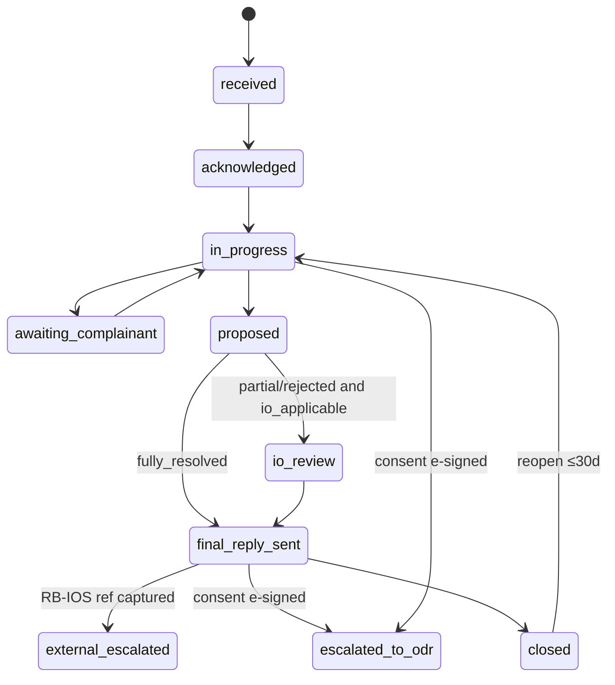

# P09 — Enterprise Platform, GRM SaaS, POSH/IC SaaS and Ecosystem Connectors
> Paste after 01_MASTER_PROMPT.md. Prerequisites: P00–P08 complete (P08 vertical packs mandatory; P05 billing, P06 eSign/eStamp and P07 comms are consumed directly). Estimated effort: 8 sprints (2-week) for a squad of 10 (two sub-squads: Enterprise/Connectors 5; GRM/POSH 5).

---

## 1. Objective and business outcome

Turn the case engine into three sellable B2B products and the connectors that feed them:

| Line | Product built here | Business outcome (exit-gate measurable) |
|---|---|---|
| L3 Enterprise API & Bulk Intake | Developer portal, sandbox, OAuth2/API keys, webhooks, JS widget, SDKs, **clause-at-sanction API** (D1), bulk intake (100,000 rows/batch), lender/insurer/employer/listed-company consoles, AA evidence module (D6), SLA/MIS/regulatory exports | A Finbyx-originated loan carries an Equator clause e-signed at sanction; on default the case is created automatically with a Defensibility Score; a 100,000-row batch validates in ≤ 10 min and generates notices that obey NN-12 |
| L4 GRM SaaS (D5) | Four regulator-clocked grievance variants with one-click escalation to Equator ODR | A lender GRO resolves, auto-routes to the Internal Ombudsman, issues the 30-day final reply and produces the RB-IOS advisory without a missed clock |
| L5 POSH/IC SaaS | Sealed IC workspace (NN-07), external-member marketplace, statutory clocks, annual report and Board-report annexure | An employer constitutes a valid IC, runs a complaint through inquiry in ≤ 90 days and files the s.21 annual report, with zero POSH data outside `posh_sealed` |
| D10 connectors | MSME ODR/MSEFC, ONDC IGM, eCourts/NJDG lookups, Sahamati inter-member dispute framework, Digital Lok Adalat-as-a-Service, SEC/SMART ODR (flag OFF) | Each connector runs end-to-end in sandbox with deterministic fallbacks (manual export packs) |

Rationale (R1 §5): no Indian competitor combines appointment-defensible lender intake, e-stamp/e-sign, settlement collection, grievance-to-ODR escalation and a published fee card; this phase delivers the first and fourth and exposes the rest through APIs.

---

## 2. Scope (in / out)

**In scope**
- `apps/docs-portal` (developer portal), sandbox tenants, OAuth2 client-credentials, API keys with scopes, OpenAPI 3.1 publication, TypeScript/Java/Python SDKs, webhooks (subscriptions, HMAC signing, retries, replay), JS embed widget.
- Clause registry, clause-at-sanction API, borrower e-sign capture, public verification seal page; Finbyx and Udofin connectors first.
- Bulk intake (CSV, XLSX, SFTP, API) with validation report, dedupe, per-row errors, idempotency and notice generation.
- Lender, insurer, employer and listed-company consoles; SLA configuration; MIS packs; regulatory exports; board-ready exports.
- AA-powered evidence module via the lender tenant's FIU (NN-14).
- Data-sharing agreements (DSAs) and DPAs per tenant as a provisioning gate.
- GRM SaaS: Lender→Borrower (RBI), Listed Company→Shareholder/Investor (SEBI), Employer→Employee (IR Code/HR), University/College→Student (UGC/AICTE); insurer desk profile (IRDAI) inside the insurer console.
- POSH/IC SaaS in `posh_sealed`.
- SEC connector (SMART ODR) behind `sec.smart_odr.enabled = false`.
- Government/ecosystem connectors: MSME ODR/MSEFC, ONDC IGM, eCourts/NJDG lookups, Sahamati inter-member dispute framework, Digital Lok Adalat-as-a-Service.
- Web screens for all of the above; mobile "Enterprise/GRO lite" screens marked below.

**Out of scope (do not build here)**
- Public marketing pages for these products, pricing pages, lead capture (P13).
- AI gateway hardening, red-team and agent catalogue expansion (P11); this phase uses `grievance_responder`, `analytics_narrator`, `document_extractor`, `translation_agent` as already registered.
- Private ADR Chambers tenant self-serve (P10).
- Store release of mobile apps (P12).
- Applying for SEBI ODRI or Sahamati empanelment, ONDC network-participant registration or SLSA procurement (business tasks; the product must be ready for them).
- Passing any Lok Adalat award: the Lok Adalat bench passes it under the Legal Services Authorities Act 1987 s.21; Equator is the technology provider only.

---

## 3. Personas and permissions touched

| Role code | What it can do in P09 | Key restrictions |
|---|---|---|
| `enterprise_admin` | Manage org, users, API keys, webhooks, SLAs, clause versions, consoles, exports, DSAs | Cannot choose, veto or rank neutrals (NN-03); cannot read sealed POSH content |
| `enterprise_operator` | Upload bulk jobs, view portfolio, work tickets assigned to them; RTA staff are `enterprise_operator` scoped to the RTA organisation | Row-level access limited to assigned desks/portfolios |
| `machine` | API calls per granted scopes | No UI; no sealed scopes ever issuable |
| `grievance_officer` | GRO/nodal officer; SGRC secretary; works tickets, approves AI drafts, sends replies | Cannot also act as `internal_ombudsman` on the same ticket (role separation, RBI (NBFC – Internal Ombudsman) Directions 2026) |
| `internal_ombudsman` | RBI Internal Ombudsman review (NBFC/bank IO Directions 2026) | Read-only on GRO drafts; decides only the escalated question |
| `grc_member` | IR Code s.4 Grievance Redressal Committee member; hears and decides `WRK_IRCODE` grievances | Conflict declaration per matter; employer and worker sides equal |
| `student_ombudsperson` | UGC 2023 Ombudsperson; decides appeals from SGRC decisions (`EDU_UGC`, `EDU_AICTE`) | Decides only the appeal; conflict declaration (UGC Regs 2023 Reg. 6) |
| `university_admin` | Configure SGRC/Ombudsperson, portal branding, reports | No access to individual POSH matters (IC only) |
| `sgrc_member` | Hear and decide SGRC grievances | Conflict declaration per matter |
| `student` | File and track grievances, appeal to Ombudsperson | — |
| `party` | Complainant/borrower/investor/employee in GRM; escalation consent; e-sign clause | Sees own tickets only |
| `ic_presiding_officer`, `ic_member`, `ic_external_member` | Sealed POSH workspace | Separate KMS key; step-up MFA every session; no export except statutory reports |
| `case_manager`, `registrar` | Receive escalated tickets and clause-auto cases into the ODR pipeline | — |
| `panel_manager` | Curate POSH external-member marketplace listings | Never sees complaint data |
| `safeguarding_lead` | Receives safety escalations from GRM/POSH triage | Break-glass logged |
| `dpo` | DSAs/DPAs, data-principal requests, break-glass review | — |
| `auditor` | Scoped read-only (regulator/statutory auditor/IC audit) | Time-bound grant |
| `quality_officer` | Audits GRM reply quality samples | Cannot see POSH |
| `support_agent`, `platform_admin` | Provisioning, connector health | Sealed data only via joint break-glass |

---

## 4. Functional requirements

### 4A. Developer platform

**FR-P09-01 — Developer portal and sandbox.** `apps/docs-portal` (Next.js, SSG) at `developers.equatorresolution.in`: OpenAPI 3.1 reference, guides (quick start, clause-at-sanction, bulk, webhooks, GRM, errors), changelog, status. Self-serve sign-up creates a **sandbox tenant** (`environment = sandbox`) seeded with synthetic data (200 cases across six verticals, 50 GRM tickets, no POSH) and an `eq_test_` key. Sandbox `provider_routing` resolves to simulator adapters (realistic receipts and webhooks; nothing real is sent); data purges every 30 days. `eq_live_` keys are issued only after FR-P09-23 passes.

**FR-P09-02 — OAuth2 client credentials, API keys and scopes.** Two credential types: (a) OAuth2 client-credentials via the identity provider (Keycloak), 15-minute access tokens, optional sender-constrained tokens for enterprise tier (mTLS-bound, or DPoP — officially supported by Keycloak from 26.4); (b) static API keys (`core.api_keys`, SHA-256 hashed, shown once, prefix + last-4 visible, expiry ≤ 365 days, rotation with 7-day overlap). Scopes (allow-list): `cases:read`, `cases:write`, `bulk:write`, `clauses:read`, `clauses:write`, `notices:read`, `webhooks:manage`, `grm:read`, `grm:write`, `reports:read`, `evidence:aa:write`, `connectors:read`. **No scope can grant POSH, health-sealed or family-safety-sealed data**; a request for such a scope returns `403 SCOPE_NOT_GRANTABLE`. IP allow-list per key (optional). Every token/key maps to a `machine` identity; all calls audited (NN-22).

**FR-P09-03 — OpenAPI and SDKs.** Spec generated from NestJS decorators, Spectral-linted, contract-tested; breaking changes only in `/v2` with 12-month `Deprecation`/`Sunset` headers. SDKs per release: TypeScript (`@equator/sdk`), Java (LOS/LMS vendors), Python — each with idempotency helper, webhook verifier and pagination iterator. Errors: RFC 9457 with stable `code` (Appendix F).

**FR-P09-04 — Webhooks.** `core.webhook_subscriptions` per tenant: HTTPS URL (public IP, no redirects), event-type filter, rotatable secret (24 h dual-signing). Header `X-Equator-Signature: t=<unix>,v1=<hex HMAC-SHA256(secret, t + "." + raw_body)>`; receivers reject `|now − t| > 300 s`. At-least-once delivery, `event_id` dedupe, 10 s timeout, 7 retries (1 m, 5 m, 30 m, 2 h, 6 h, 12 h, 24 h); auto-pause after 72 h of failures with admin email. **Replay** of one delivery or a time range (30-day retention) via API and console. CloudEvents 1.0, thin payloads (IDs, status, links); sealed and POSH events are never emitted (NN-07).

**FR-P09-05 — JS embed widget.** `embed.equatorresolution.in/v1/widget.js` with an origin-restricted publishable key (`pk_live_…`). Modes: `resolve` (start a dispute/OTS conversation inside a lender or marketplace app), `status` (reference + OTP), `grievance` (white-label GRM form). Sandboxed iframe, no third-party cookies, tenant theming, `postMessage` events (`equator:ready|submitted|closed`). The widget always shows "Operated by Equator Resolution for {Tenant}" and, for FIN tenants, the GRO details (NN-12); the host cannot suppress them.

**FR-P09-06 — Rate limits and quotas.** Token-bucket per key and per tenant (defaults: 50 rps read, 10 rps write, 2 concurrent bulk jobs; enterprise tier configurable). `429` with `Retry-After`. Monthly API-call metering feeds billing (P05) as usage records.

### 4B. Clause-at-sanction (D1)

**FR-P09-07 — Clause registry.** `core.clause_registry` holds Equator-authored model clauses (`arbitration_institutional`, `med_arb`, `mediation_first`, `odr_ladder`, `grievance_first_then_odr`) with versions (`core.clause_registry_versions`: text per language, rules-of-procedure version, seat, language, tribunal size, fee-bearing rule, disclosure text, legal reviewer, effective dates, SHA-256). Tenants adopt a version per agreement type (`core.clause_adoptions`). The validator rejects (`422 CLAUSE_VARIANT_PROHIBITED`) any variant that lets the enterprise choose or veto the arbitrator, confers appointment on Equator only after the dispute arises, ousts the Consumer Commission in consumer/homebuyer contracts (*Emaar MGF Land Ltd v Aftab Singh*, SC, 10 Dec 2018, (2019) 12 SCC 751) or provides retail-policyholder arbitration (NN-03, NN-06). The clause must name **Equator Resolution as administering institution ex ante** (*Sundaram Finance Ltd v Hanuman Prasad*, Raj HC, S.B. CWP 17398/2024, 24 Apr 2026 — appointment by an institution agreed ex ante is not unilateral; *CORE v ECI-SPIC-SMO-MCML*, SC, 8 Nov 2024).

**FR-P09-08 — Clause-at-sanction API (Finbyx, Udofin first).** At sanction the LOS calls `POST /v1/clause-instances` (`clauses:write`, `Idempotency-Key` required) with adoption ID, loan reference, borrower name, masked mobile, language, product and sanction date. Equator returns the rendered clause (HTML + PDF), a same-language plain explainer, KFS snippet, `verification_code` (10-char base32), QR and the commercial-relationship disclosure (NN-16) for embedding in the loan agreement. After execution the LOS posts `/acceptance` with the signed-agreement SHA-256 and eSign evidence (ESP name, transaction ID, certificate serial, timestamp, clause page). If the LOS uses Equator's eSign (`ESIGN_PORT`), acceptance is automatic. States: `issued → embedded → accepted | lapsed (30 days) | revoked (loan cancelled in the Digital Lending Directions 2025 look-up period)`. Finbyx/Udofin adapters subscribe to sanction and default events with configurable field mapping; generic REST/SFTP for others.

**FR-P09-09 — Verification seal page.** Public SSR route `/verify/clause/{verification_code}` shows: clause type, version and effective date, institution name, adopting organisation, acceptance date, borrower name masked (`R***** K****`), language, link to the rules version and fee schedule, and "How Equator stays independent" (appointment policy). No loan amount, mobile or address. Rate-limited, `noindex`. Every view logged (no IP stored beyond 24 h). Revoked/lapsed instances show their state.

**FR-P09-10 — Clause-auto cases and Defensibility Score.** A default event (Finbyx/Udofin webhook or `POST /v1/cases`, `source = clause_auto`) links the accepted clause instance, pins versions (NN-21) and surfaces the P03/P08 **Defensibility Score**. Arbitration is hard-blocked unless there is an accepted ex-ante clause instance, a post-dispute e-signed borrower consent or an uploaded s.11 order; a s.12(5) waiver counts only as a separate e-signed instrument executed after the dispute arose (*Bhadra International v AAI*, SC, 5 Jan 2026). Lender-only triggers return `403 APPOINTMENT_LENDER_TRIGGER_BLOCKED` (*Radiance Galore v Yes Bank*, Bom HC, 2025:BHC-OS:10788, 17 Jul 2025; *Madhyachal Steels v Clix Capital*, Del HC, 24 Aug 2026). The Independence Evidence Pack downloads per case.

### 4C. Bulk intake

**FR-P09-11 — Channels and formats.** Bulk jobs via (a) console upload (CSV UTF-8, XLSX; ≤ 200 MB), (b) SFTP drop (`sftp.equatorresolution.in`, per-tenant chroot, key-only auth, PGP encryption optional, `.done` marker file), (c) `POST /v1/bulk-jobs` with presigned S3 upload, (d) Finbyx/Udofin connector push. Template per dispute type is a pinned form schema (`core.form_schema_versions`) published in the portal with column dictionary and sample file. Maximum 100,000 rows per job (NFR §11 load target); larger files rejected with `413 BULK_ROW_LIMIT`.

**FR-P09-12 — Validation, dedupe, per-row errors, idempotency.** Temporal `BulkIntakeWorkflow`: checksum → virus scan → parse → per-row schema validation → business rules (claim > 0, E.164 mobile, pincode→state for stamp duty, supported language, vertical × mechanism permitted per master §5.2) → **legal gates** (no arbitration row without a qualifying consent artefact; SARFAESI/DRT flags; fraud/wilful-defaulter blocks compromise offers) → dedupe → stage. `(tenant_id, external_ref)` is unique, so replays return the existing case; soft match on open `(loan_account_no, dispute_type)` gives `ROW_DUPLICATE`. Job idempotency: `Idempotency-Key` + file SHA-256 (7 days). Rows end `accepted | rejected | duplicate | held_for_review` (job counters per Appendix F `core.bulk_jobs`: `accepted`; `deficient` = held_for_review; `rejected` incl. duplicates) with codes (`ROW_SCHEMA_INVALID`, `ROW_MOBILE_INVALID`, `ROW_CONSENT_MISSING`, `ROW_VERTICAL_DISABLED`, `ROW_DUPLICATE`). XLSX/JSON validation report; operator commits accepted rows or aborts; commit atomic per row. Targets: 100,000 rows validated ≤ 10 min, committed ≤ 30 min.

**FR-P09-13 — Notice generation from bulk.** Committed rows start the case-notice journey (P07) with tenant templates; quiet hours 08:00–19:00 borrower local time, frequency caps, blackout dates, GRO footer, DLT templates, DND scrubbing and operator-registered consent for automated calls, and a calling-line identity chosen by the NN-12 policy (M-05): the referring regulated tenant's 1600-series number under a valid `core.number_authorisations` row (default for FIN/INS lender- or insurer-referred matters), or an Equator DID declared as an A2P CLI range only while `voice.equator_service_number.enabled` is ON; never 140-series or personal mobiles. Notices are staggered (default 5,000/min/tenant) and carry the commercial-relationship disclosure and free-forum signposting (NN-16, NN-20). Bulk job dashboard shows funnel: staged → notified → delivered → opened → responded.

### 4D. Consoles, SLAs, MIS, evidence, agreements

**FR-P09-14 — Lender console.** `/app/enterprise/lender`: portfolio (filters: product, DPD bucket, state, language, stage, mechanism, Defensibility band, clause version); drill-down limited to the lender's party view (never caucus notes or borrower vulnerability flags); Defensibility distribution listing cases < 70 with the missing component; clause coverage (accepted instances ÷ loans sanctioned since adoption); OTS approval queue (RE policy-approval reference and approver role mandatory — RBI Framework for Compromise Settlements and Technical Write-offs, RBI/2023-24/40, 8 Jun 2023; for NBFCs now RBI (NBFC – Resolution of Stressed Assets) Directions, 2025, paras 16, 86–100 — approver at least one level above the sanctioning authority, para 16(5)); instalment/escrow status; GRM tab. No view ranks or scores individual neutrals (NN-16).

**FR-P09-15 — ROI dashboard; Ombudsman escalations avoided.** Deterministic metrics with in-console definitions: recovery ₹ (verified instalment/escrow receipts), cost per resolved case, settlement rate, cure rate (0 DPD within 90 days of settlement), median time to first payment, award-to-execution status, 12-month re-default. **"Ombudsman escalations avoided"** is labelled *estimated*: GRM tickets with `escalation_risk = high` at intake, closed fully resolved at RE stage, with no RB-IOS reference captured within 120 days of final reply. No causal language. `analytics_narrator` narrates aggregates only, human-approved.

**FR-P09-16 — Board-ready exports.** Quarterly PDF + XLSX: portfolio summary, ROI metrics with definitions, clock breaches, Defensibility distribution, GRM statistics in RBI taxonomy, Independence Evidence Pack index, methodology, data-as-of timestamp, SHA-256 manifest (NN-10); watermarked with tenant and requester.

**FR-P09-17 — Insurer console.** `/app/enterprise/insurer`: claim-dispute desk (INS cases + GRM profile `INS_IRDAI`, 14-day grievance resolution per IRDAI Master Circular on Protection of Policyholders' Interests, Ref. IRDAI/PP&GR/CIR/MISC/117/9/2024 dated 5 Sep 2024); **batched settlement days** (one neutral, ≤ 30 files, policyholder free to decline, outcome per file); **SPOC** register per line; **authority limits** (`settlement_authority_limit_minor` per representative; offers above limit need named-approver e-sign before tabling); 14-day claim-file production clock. Health data renders only from `health_sealed` via short-lived signed URLs, never in dashboards (NN-07). Retail-policyholder arbitration is impossible (DB CHECK + `422 INS_RETAIL_ARBITRATION_BLOCKED`). Every desk page carries the Insurance Ombudsman/Bima Bharosa signpost (NN-20).

**FR-P09-18 — Employer console.** `/app/enterprise/employer`: WRK portfolio (F&F, separation, non-compete, co-founder), bulk separations (`wrk.separation.v1`), GRC desk, statutory-dues floor (`422 STATUTORY_WAIVER_FORBIDDEN`, rule `WRK_STATUTORY_DUES_WAIVER`), and POSH **compliance status only** (IC validity, training coverage %, annual-report status, counts open and > 90 days — no identities or narrative). Structural-conflict guard: an individual Equator supplies as the employer's IC external member is never assigned as neutral in a money dispute with that employer; same-employee matters need both parties' written informed consent (`409 CONFLICT_DETECTED`, rule `WRK_STRUCTURAL_CONFLICT`).

**FR-P09-19 — Listed-company console.** `/app/enterprise/listed`: investor desk, SCORES register, RTA coordination (RTA staff as `enterprise_operator` of the RTA org, ticket-level assignment, RTA SLA), SRC pack (received/resolved/pending, ageing, categories, ATR compliance), **LODR Reg 13(3) quarterly investor-grievance statement** generator, filed in the Integrated Filing (Governance) due quarter-end + 30 days (SEBI circular SEBI/HO/CFD/CFD-PoD-2/CIR/P/2024/185, 31 Dec 2024; Reg 13 as substituted 12 Dec 2024); internal target configurable (default 21 days), Reg 46 disclosure widget, SMART ODR reference capture.

**FR-P09-20 — SLA configuration.** Enterprise SLA policies (`grm.sla_policies` for GRM; `core.enterprise_sla_policies` for case administration) define targets per tenant, vertical and stage (acknowledgement, scrutiny, assignment, first session). Statutory clocks come from the Legal Rules Register and **cannot be lengthened or disabled** by tenants (master §6 guardrail); tenants may only set stricter internal targets. Business calendars per state (holiday tables).

**FR-P09-21 — MIS packs and regulatory exports.** Scheduled packs (daily/weekly/monthly/quarterly) to email/SFTP/API: case MIS, GRM MIS, clock-breach report, notice delivery report. Regulatory export templates (versioned, maker–checker): RBI GRM statistics by complaint category and outcome taxonomy; NBFC IO review statistics; LODR Reg 13(3) statement; SCORES ATR log; IR Code GRC register; UGC SGRC register and annual compliance report; POSH s.21 annual report (generated only inside the sealed module, FR-P09-41). Exports carry SHA-256 manifest and generation audit.

**FR-P09-22 — AA-powered evidence module (D6).** Enabled only when the lender tenant has `aa_fiu_credentials` (its own FIU licence and TSP, e.g., Setu/Finvu); Equator never acts as FIU (NN-14). The consent request is raised **through the lender's FIU** with purpose "dispute resolution", range ≤ 24 months; FI data lands in a lender-keyed store (`fin.aa_fi_payloads`, TTL = consent expiry or 30 days, whichever earlier). A deterministic matcher (`packages/rules`) reconciles debits to the EMI ledger and produces a **derived summary** (matched EMIs, unmatched claims, bounce count, monthly inflow band, months covered). Three affordability-based instalment options are computed by the rules engine from borrower-declared parameters and lender OTS policy — never by AI (NN-01). Neutrals see the derived summary only; no Equator role can decrypt raw FI data. Revocation purges payload and summary within 24 h. Fallback: uploaded statement + OCR (`DOC_AI_PORT`).

**FR-P09-23 — Data-sharing agreements and DPAs.** No live key, SFTP account or connector until an executed DPA/DSA exists in `core.data_sharing_agreements`: roles (Equator processor for GRM/POSH/console data; fiduciary status for administered cases **[VERIFY — open (counsel): sign role matrix per product line (Appendix Q §1.1) — s.2(i) fiduciary for institution-administered cases, s.2(k) processor for tenant GRM/POSH data; record role in each DPA]**), purposes, categories, retention, sub-processor list version, India residency, breach notice (Equator → tenant ≤ 24 h), audit rights, DPDP s.16 clause (INT only), RBI outsourcing annex for FIN tenants (Digital Lending Directions 2025: India storage, no device scraping, RE name on borrower screens). E-signed, version-pinned, renewal alerts T-60/T-30.

### 4E. GRM SaaS (D5)

**FR-P09-24 — GRM core.** Desks (`grm.desks`: variant `FIN_RBI | SEC_LODR | WRK_IRCODE | WRK_HR | WRK_WHISTLE | EDU_UGC | EDU_AICTE | INS_IRDAI`, regulator-profile version, branding, portal slug). Intake: white-label form, widget, **email-in** (SES inbound, threaded), **WhatsApp** (BSP utility templates), **IVR** (Exotel menu → call-back ticket, recording disclosure), **walk-in assisted** (operator entry confirmed by complainant OTP or signed upload). Variant taxonomies seeded from regulator categories. **Auto-acknowledgement** with `GRM/{DESK}/{YYYY}/{NNNNNN}`, GRO contact and next escalation forum/timeline in the complainant's language. Assignment: round-robin, language/skill, branch, load cap; duplicates flagged (same complainant + category within 30 days).

**FR-P09-25 — SLA clocks and escalation matrix.** Each ticket starts clocks from `grm.sla_policies` (statutory floor + tenant stricter target): owner, info at T-50%, blocking task at T-25%, escalation at T-10% of the period (configurable, never weaker than NN-04's statutory alerts for statutory clocks). Escalation matrix (level 1 GRO → level 2 nodal/principal officer → level 3 IO/Ombudsperson/SRC chair) per desk. Breach of a statutory clock opens a Critical incident and a `grm.escalations` record; a ticket cannot close while any statutory clock is unowned.

**FR-P09-26 — Variant: Lender → Borrower (RBI).** Profile `FIN_RBI` encodes: RBI (Digital Lending) Directions 2025 (8 May 2025; for NBFCs now Ch. III of the RBI (NBFC – Credit Facilities) Directions 2025, para 12) nodal GRO for RE **and** LSP shown on DLA/website/KFS; NBFC Responsible Business Conduct Directions 2025 (28 Nov 2025), as amended by the Third Amendment Directions 2026 (RBI/2026-27/230, 6 Aug 2026; recovery-conduct paras effective 1 Jan 2027); **RB-IOS 2026 (in force 1 Jul 2026)**, covering deposit-taking NBFCs and customer-interface NBFCs with assets ≥ ₹100 crore (`rbios_covered`); **RBI (NBFC – Internal Ombudsman) Directions 2026 (RBI/CEPD/2025-26/384, 14 Jan 2026; cl.7(2), 14(2) and 14(4) from 30 Jun 2026)**, which repealed the RE-wide IO Directions 2023, applicable to NBFC-D with ≥ 10 branches and NBFC-ND with assets ≥ ₹5,000 crore and a public customer interface, as on 31 Mar 2025 (`io_applicable`); bank tenants use the RBI (Commercial Banks – Internal Ombudsman) Directions 2026 (RBI/CEPD/2025-26/381; banks with ≥ 10 outlets), same rule. Rules: (1) 30-day RE clock from receipt (IO Directions cl.14(9)); (2) outcome taxonomy fixed to `fully_resolved | partially_resolved | wholly_rejected` (cl.14(2)); (3) **partial/rejected outcomes auto-escalate to the Internal Ombudsman** within 20 days of receipt (cl.14(1)(b)) — earlier where an RBI/NPCI/card-network TAT applies, so that the IO has ≥ 10 days (cl.14(1)(a)) — and no final rejection issues without IO review; (4) the day-30 final reply carries the RB-IOS advisory (`cms.rbi.org.in`, 14448) with the **90-day filing window** countdown (RB-IOS 2026; period read from rule `LR-RBI-*`, never hard-coded — master X-13); (5) **Ombudsman reference capture** (CMS number, date, outcome) moves the ticket to `external_escalated`; (6) `rbios_covered` drives advisory text; (7) recovery-conduct complaints are tagged `conduct` and never become ODR debt cases (C4 E.2). Before any ODR offer the borrower acknowledges that a matter pending before an arbitrator may make an RB-IOS complaint non-maintainable (RB-IOS 2026 FAQ).

**FR-P09-27 — Variant: Listed Company → Shareholder/Investor (SEBI).** Profile `SEC_LODR`: SEBI LODR Regulations 2015 Reg 13 (grievance mechanism, SCORES registration, quarterly statement detailing redressal of investor grievances to the exchange under Reg 13(3) (as substituted by the LODR Third Amendment Regulations 2024), filed in the Integrated Filing (Governance) within 30 days of quarter-end, placed before the board under Reg 13(4)), Reg 20 (SRC), Reg 46 (website), Reg 6 (compliance officer); Companies Act 2013 s.178(5)–(6) (SRC mandatory where a company has more than 1,000 shareholders, debenture-holders, deposit-holders and other security holders at any time in the FY). **SCORES 2.0** (SEBI/HO/OIAE/IGRD/CIR/P/2023/156, 20 Sep 2023; effective 1 Apr 2024): 21-calendar-day ATR clock; SCORES number, review stage and status captured (manual sync; API adapter behind a flag). Transmission, duplicate-certificate and dividend tickets route to the RTA queue; the company GRO keeps ownership. SMART ODR escalation references captured (FR-P09-43).

**FR-P09-28 — Variant: Employer → Employee (IR Code + HR policy).** `WRK_IRCODE` for industrial establishments with ≥ 20 workers (IR Code 2020 s.4; in force 21 Nov 2025): GRC register and validator (equal employer/worker members, ≤ 10 total (s.4(4)), chair alternating yearly between the employer and worker sides, women workers represented in not less than their proportion of the workforce), 1-year intake limitation, **30-day decision clock** (s.4(6) is directory — "may complete … within thirty days"; the product treats it as the target and alerts on breach), reasoned decision template, conciliation-officer export pack (a worker aggrieved by the decision, or whose grievance is not resolved within 30 days, may apply to the conciliation officer through the trade union within 60 days — s.4(8)) [Verified 22 Oct 2026: IR (Central) Rules 2026 r.7 (written application, no form), r.8 (through trade union, 60 days)] **[VERIFY — open: State IR Rules equivalents]**. `WRK_HR` covers HR-policy grievances (default 15 working days). **`WRK_WHISTLE`** is a separate anonymous desk (reporter token, no IP/device capture, ethics/audit-committee access list), never merged with POSH; anything classified as sexual harassment is routed to the IC (FR-P09-34) and the complainant is told the IC is the statutory forum.

**FR-P09-29 — Variant: University/College → Student (UGC/AICTE).** Profile `EDU_UGC` per UGC (Redressal of Grievances of Students) Regulations 2023 (F.1-13/2022 (CPP-II), notified 11 Apr 2023): SGRC registry with composition check (Professor chair + four Professors/senior faculty; student special invitee; chair or ≥ 1 member a woman; chair or ≥ 1 member SC/ST/OBC — Reg. 5) and Ombudsperson record (retired Vice-Chancellor / retired Professor with Dean/HoD service and 10 years as Professor / former District Judge; 3 years or age 70, whichever earlier — Reg. 6); clocks: acknowledgement 2 working days (product default), **SGRC 15 working days (Reg. 5(viii), "preferably"), appeal window 15 days from receipt of the decision (Reg. 5(ix)), Ombudsperson 30 days (Reg. 7(iv), "all efforts")**. Auto-routing out of SGRC: sexual harassment → IC (UGC SH Regulations 2015); ragging → anti-ragging committee (UGC 2009 Regulations); discrimination → equal-opportunity committee (UGC Promotion of Equity Regulations 2012 apply while the 2026 Regulations remain stayed by the Supreme Court); safety/self-harm → `safeguarding_lead` immediately. `EDU_AICTE` mirrors it (AICTE (Redressal of Grievance of Students) Regulations 2019, F.No. 1-101/PGRC/AICTE/Regulation/2019) **[VERIFY — open (provisional): SGRC 15 days from complaint; appeal to Ombudsperson 15 days (secondary, 22 Oct 2026); Ombudsperson period not found]**. Annual compliance report and accreditation evidence pack. Equator staff see no student file except under an explicit, time-bound tenant grant (C5 B.2(e)).

**FR-P09-30 — AI-drafted responses (`grievance_responder`).** On all desks except `WRK_WHISTLE` and POSH, the GRO may request a draft built from ticket text, tenant policy snippets and the variant checklist (RBI: outcome category, reasons, GRO contact, RB-IOS advisory with 90-day window; SEBI: ATR fields). `requires_human_review = true`; only a human click sends, with step-up for final replies; edits are diffed into `core.ai_interactions`. The agent may not concede liability, state amounts absent from ticket data, predict Ombudsman outcomes or advise the complainant (NN-01). LLM unavailable → deterministic template (NN-02).

**FR-P09-31 — Escalation to Equator ODR.** "Offer ODR" (blocked for conduct, POSH and whistle-blower tickets) sends a consent link: explainer, mechanism (default conciliation/mediation; arbitration only under an existing NN-03-compliant agreement and the vertical matrix), fees (default **enterprise pays**; complainant ₹0 for FIN/INS consumers), free-forum alternatives with deadlines (NN-20) and, for FIN, the RB-IOS maintainability notice. E-signed consent creates a case (`source = grm_escalation`) with the ticket bundle attached and versions pinned; declined offers are recorded and not repeated for 14 days.

**FR-P09-32 — Evidence bundle and regulator MIS.** Each ticket maintains an evidence bundle (intake record, communications with delivery receipts, AI-draft provenance, IO review, final reply, external references) exportable as paginated PDF with SHA-256 manifest and BSA 2023 s.63(4) certificate Part A (NN-10). Regulator MIS per FR-P09-21.

**FR-P09-33 — White-label public portal and analytics.** Public portal at `{slug}.grievance.equatorresolution.in` or custom domain (`core.tenant_domains`, ACM certificate), tenant branding, languages (en, hi + configured), accessibility WCAG 2.2 AA; shows GRO/IO/compliance-officer details, escalation path and timelines from the profile. Analytics: volumes, category heatmap, ageing, first-response time, resolution-within-SLA %, reopen rate, escalation rate, outcome mix; drill-down to tickets only for authorised roles; aggregates with n < 5 suppressed in exports outside the tenant.

**FR-P09-34 — Separation of channels.** Whistle-blower (FR-P09-28), POSH (4F) and safeguarding reports are physically separate stores/desks; cross-desk search is impossible; a mis-filed POSH complaint in a GRM desk is moved to `posh_sealed` with the original GRM row hard-redacted (body replaced with opaque token) and an audit event.

### 4F. POSH / Internal Committee SaaS (sealed per NN-07)

**FR-P09-35 — IC constitution and validator.** `posh_sealed.ic_constitutions` per workplace under the POSH Act 2013 s.4: **Presiding Officer a woman employed at a senior level**; **≥ 2 employee members** committed to the cause of women or with social-work/legal background; **1 external member** from an NGO/association committed to the cause of women or a person familiar with sexual-harassment issues (s.4(2)(c); eligibility per POSH Rules 2013 r.4); **at least one-half of nominated members women** (not "majority"; NN-07); term ≤ 3 years. Activation is blocked if any rule fails, if an establishment of ≥ 10 employees has no IC, or if the external member has an open conflict. Constitution order, member acceptances and annual declarations are e-signed. Quorum: 3 including the Presiding Officer (POSH Rules r.7(7)); Equator policy default: external member present at every inquiry sitting.

**FR-P09-36 — External-member marketplace.** Profiles are `core.neutrals` with accreditation `posh_external_member` (ECWN POSH endorsement ≥ 12/15 + separate certification, C3 §2.10): languages, cities, sectors, experience, fee card (default **₹60,000/year retainer; ₹15,000 per inquiry**, Subject to Board approval; benchmark ₹50,000/year, ₹10,000/day, R4 §4.3). `panel_manager` proposes ≥ 2 rotation- and conflict-checked options; the employer appoints (the IC member is its statutory appointee, not an Equator neutral); engagement e-signed; employer pays via P05, never the complainant. The statutory allowance (POSH Act s.4(4); POSH Rules r.3: ₹200 per day of proceedings plus travel, payable by the employer) is a floor; the retainer is a commercial fee above it.

**FR-P09-37 — Complaint intake.** Channels: sealed IC portal, sealed email-in, assisted entry by an IC member, SHe-Box referral record; fields per F-W07. Limitation: **3 months** from the incident (or last in a series), extendable by **3 months** for reasons recorded by the IC (s.9(1)); extension without a recorded reason is blocked. Complaints by legal heirs or others where she cannot file (s.9(2)) supported. Intake never asks about character or sexual history. Copy to respondent within **7 working days** (POSH Rules r.7(2)); reply within **10 working days** (r.7(3)).

**FR-P09-38 — s.10 conciliation guardrails.** Conciliation can be opened **only on the aggrieved woman's written request**, before inquiry; the IC/respondent cannot initiate it. Settlement terms are non-monetary (apology, corrective action, transfer, no-retaliation assurance, working arrangements); DB CHECK `monetary_basis = false` and API `422 POSH_MONETARY_TERM_BLOCKED`; a request not made by her returns `422 POSH_S10_NOT_REQUESTED`. Terms recorded and forwarded to employer; copies to both parties; no further inquiry once settled (s.10(4)); if terms are not complied with, inquiry proceeds on her request (s.10(4) proviso/s.11(1)). She may opt for inquiry at any time.

**FR-P09-39 — Inquiry, interim relief, report, action, appeal.** Inquiry (s.11) with natural-justice checklist, **no legal practitioners** (Rules r.7(6)), sealed video rooms not recorded by default, and findings `proved | not_proved | malicious_or_false` (s.14; "not proved" is never labelled false). Clocks: **inquiry 90 days** (s.11(4), not extendable in product; counted from complaint receipt by default — see §5.2); **report within 10 days** (s.13(1)); **employer action within 60 days** (s.13(4)); **appeal 90 days** (s.18; Rules r.11). **Interim relief** on her written request: transfer or leave up to 3 months beyond entitlement (s.12); restraining the respondent from reporting on her work, writing her confidential report or supervising her academic activity (Rules r.8). s.15 compensation factors appear as a checklist only — no calculator or AI. Presiding Officer owns each clock (NN-04).

**FR-P09-40 — Confidentiality and penalties.** s.16 bars publishing identities, proceedings, recommendations and action taken (information on justice secured without identities is allowed). Controls: separate schema, DB role and KMS key; access only for that IC's members; step-up MFA per session; per-viewer watermark; downloads limited to statutory packs; nothing in analytics, AI, search, webhooks or exports (NN-07). Confidentiality breaches are recorded for employer action under s.17 (POSH Rules r.12: penalty of ₹5,000 recovered by the employer). Break-glass requires `dpo` + `platform_admin` jointly, with written reason, and notifies the Presiding Officer.

**FR-P09-41 — Annual report and Board disclosure.** Inside the sealed module: IC annual report under **s.21** (calendar year; to employer and District Officer) — received, disposed, pending > 90 days, s.10 requested/settled, findings mix, appeals, workshops, action taken (POSH Rules 2013 r.14: complaints received, disposed, pending > 90 days, workshops/awareness programmes, nature of action taken; other fields are Equator additions); employer disclosure under **s.22**; for companies, the **Board's Report** disclosures under Companies (Accounts) Rules 2014 r.8(5)(x) as amended by the Companies (Accounts) Second Amendment Rules 2025 (G.S.R. 357(E), 30 May 2025; effective 14 Jul 2025): complaints received, disposed of, pending > 90 days; plus the Maternity Benefit Act 1961 compliance statement (separate clause) and employee gender composition (female/male/transgender) per the MCA Board-report extract format. Numbers only; signed PDF/XLSX for the Company Secretary — the only POSH artefact that leaves the module.

**FR-P09-42 — SHe-Box, training, Local Committee.** (a) SHe-Box helper: checklist, IC-details export in the MWCD portal's field order (portal relaunched 29 Aug 2024; export field order taken from the live portal at build), deep link, registration status. (b) Awareness/IC training tracking (s.19(c)): sessions, attendance (HRMS sync or upload), coverage %, certificates in `wrk.posh_training_events` (no complaint data). (c) **Local Committee referral** (ss.6–7): for establishments with < 10 workers or complaints against the employer, signpost the district Local Committee via the District Officer directory, record a signposting event (NN-20), offer a covering-letter template and show the police-complaint option (s.19(g)).

### 4G. SEC connector (feature flag OFF)

**FR-P09-43 — SMART ODR integration.** Module `sec` behind `sec.smart_odr.enabled = false` (master §1.2). When ON (authorised legal admin, with empanelment reference): receive SMART ODR references (manual import of portal case pack; neither the 2023 Master Circular nor the 23 Jul 2026 draft provides an API for ODR institutions, and the draft moves the ODR Portal to MIIs via a nodal MII); apply SEBI ODR Master Circular (SEBI/HO/OIAE/OIAE_IAD-3/P/CIR/2023/195, 31 Jul 2023 as updated 28 Dec 2023) timelines as a pinned ruleset: conciliator appointed within 5 days; conciliation 21 days (+10 by consent); arbitration fees deposited by the initiating party within 7 days of opting for arbitration (a market-participant respondent also deposits 100% of the admissible claim within 10 days); arbitrator appointed within 5 days of reference and fees; award within 30 days of appointment (+30 days); documents-only ≤ ₹1 lakh; 3-member tribunal where claim or counter-claim > ₹30 lakh (neutral fee split 40:30:30, larger share to the arbitrator who writes the award); notice of intent to challenge under s.34 within 7 days; award payment 15 days. **Fee schedule applied exactly (NN-18)**, + GST and stamp duty; conciliation fees are borne by the MII and recovered from the market participant complained against, never passed on to the investor:

| Stage / claim | Neutral fee | ODRI fee | Total |
|---|---|---|---|
| Pre-conciliation | ₹0 | ₹0 | ₹0 |
| Conciliation — settled | ₹4,800 | ₹600 | ₹5,400 |
| Conciliation — not settled | ₹3,240 (SEBI Master Circular /195, 28 Dec 2023, Annexure A) | ₹600 | ₹3,840 |
| Arbitration ≤ ₹1 lakh | ₹4,800 | ₹600 | ₹5,400 |
| > ₹1–10 lakh | ₹8,000 | ₹1,000 | ₹9,000 |
| > ₹10–20 lakh | ₹12,000 | ₹1,500 | ₹13,500 |
| > ₹20–30 lakh | ₹16,000 | ₹2,000 | ₹18,000 |
| > ₹30–50 lakh | ₹60,000 | ₹7,500 | ₹67,500 |
| > ₹50 lakh–1 crore | ₹1,20,000 | ₹15,000 | ₹1,35,000 |
| > ₹1 crore | max(₹1,20,000, 1% of claim) | ₹35,000 | ≥ ₹1,55,000 |

Late fees: conciliation ₹1,000 if initiated more than 6 months after the transaction or dispute (payable by the initiator); arbitration fee doubles (non-refundable) if initiated more than 1 month and up to 6 months after failed conciliation; a Market Participant initiating after 6 months pays +50% of the table fee per additional month. A second, **unpublished** ruleset version models the SEBI consultation paper of 23 Jul 2026 (comments closed 13 Aug 2026; no final circular as of 20 Oct 2026; MII-administered model; conciliation fee ₹6,000; arbitration ₹5,400–₹1,35,000; award 3+2 months) for impact testing only. No revenue forecast or SLA may depend on this module.

### 4H. Government and ecosystem connectors (D10)

**FR-P09-44 — MSME ODR / MSEFC.** If a COM claimant supplier is Udyam-registered before the contract date (KYB via `KYC_PORT`; registration after the contract date raises a warning, not a hard block, pending the reference in *NBCC v State of West Bengal*, 2025 INSC 54), intake discloses that MSMED Act 2006 s.18 allows reference to the MSEFC and prevails over a private arbitration clause (*Gujarat State Civil Supplies v Mahakali Foods*, SC, 31 Oct 2022), computes s.16 interest (three times the RBI Bank Rate read from configuration, compounded with monthly rests — e.g. 17.25% at the 5.75% Bank Rate of 7 Oct 2026) in the rules engine, offers pre-MSEFC mediation only with informed consent, and on failure generates an **MSEFC reference pack** (claim, invoices, Udyam certificate, interest computation, delivery proof) in the MSME ODR portal's field order (no public API as of Oct 2026; portal live since 27 Jun 2025 and, per MoMSME reporting, mandatory for new MSEFC delayed-payment filings from 15 Oct 2025; default manual pack). Signposting event recorded.

**FR-P09-45 — ONDC IGM.** Adapter implementing ONDC Issue & Grievance Management protocol endpoints (`issue`, `on_issue`, `issue_status`, `on_issue_status`) as an ODR service provider, per the ONDC IGM specification version configured **[VERIFY — open: ONDC publishes IGM 2.0.0 (developer guide branch draft-igm-2.0.0); the four endpoints listed are the IGM 1.0.x set, so confirm the 2.0.0 endpoint set. ODR providers are 'empanelled' by ONDC and listed on ondc.org, but no public onboarding route was found; contact ONDC.]** Issues escalated by network participants create COM/consumer cases (`source = api`), with ONDC context IDs stored and status callbacks emitted per state transition. Behind flag `connectors.ondc.enabled` until network registration completes.

**FR-P09-46 — eCourts/NJDG lookups.** Parallel-litigation check by CNR or party name through `KYC_PORT` (Surepass eCourt CNR); results displayed with the provider disclaimer "aggregated from public eCourts data; not an official court record" (no official public NJDG developer API, R3). Used at intake and before award issue to flag pending proceedings (NN-06 / RB-IOS maintainability). Results cached 7 days; never published.

**FR-P09-47 — Sahamati inter-member dispute framework.** Adapter and rulebook profile for AA-network disputes: eligibility checks (complaint first raised with the FI; counterparty is an AA-network participant), Sahamati mediation/arbitration rules as a pinned ruleset, neutral eligibility flag `nism_sahamati_certified`, AA consent-log evidence import. Behind flag `connectors.vikalp.enabled`; Sahamati's ODR-institution empanelment for inter-member AA disputes is closed with no next round announced — the product must be demonstrable for the next round [Corrected 22 Oct 2026, sahamati.org.in/odr: no 'Vikalp' name — Sahamati calls it the 'Inter-Member dispute resolution framework'; empanelment CLOSED (deadline 15 Apr 2025); display as 'Sahamati inter-member ODR'].

**FR-P09-48 — Digital Lok Adalat-as-a-Service.** Tenant kind `institution`, profile `LSA`, for SLSAs/DLSAs: bulk pre-litigation intake from banks/utilities, notices, pre-counselling sessions, bench allocation, scheduling, settlement recording and settled-matter exports for the bench. **The award is passed by the Lok Adalat** (Legal Services Authorities Act 1987 s.21; Permanent Lok Adalats under Chapter VI-A for public utility services — s.22A(b) lists insurance service, while banking and other services qualify only where notified); documents carry the authority's branding, never Equator's as decision-maker. Retention and residency per the authority's DSA.

---

## 5. Workflows and state machines

### 5.1 GRM ticket (variant `FIN_RBI`; other variants differ only in clocks and taxonomy)

| State | Event | Guard | Next state | Side-effects |
|---|---|---|---|---|
| `received` | auto | channel payload valid | `acknowledged` | ticket no.; auto-ack with GRO + escalation info; start `RE_30D` clock |
| `acknowledged` | assign | assignee active, not conflicted | `in_progress` | task; SLA tracking |
| `in_progress` | request info | — | `awaiting_complainant` | clock continues (RBI clock not paused) |
| `awaiting_complainant` | reply / 7 days | — | `in_progress` | reminder at day 5 |
| `in_progress` | propose outcome | outcome ∈ taxonomy | `proposed` | AI draft optional |
| `proposed` | outcome = fully_resolved | human approval | `final_reply_sent` | reply with RB-IOS advisory |
| `proposed` | outcome ∈ {partially_resolved, wholly_rejected} | `io_applicable` | `io_review` | IO task; escalation within 20 days of receipt (cl.14(1)(b)) |
| `io_review` | IO decision | IO ≠ GRO | `final_reply_sent` | IO reasons appended |
| `final_reply_sent` | complainant files RB-IOS | CMS ref captured | `external_escalated` | `RBIOS_FILING` clock informational (period from `LR-RBI-*`; 90 days under RB-IOS 2026) |
| `final_reply_sent` / `in_progress` | complainant accepts ODR | consent e-signed; not `conduct` | `escalated_to_odr` | case created `source=grm_escalation` |
| any open | day 30 elapses without final reply | — | (same) + `breached` flag | Critical incident; escalation level 3 |
| `final_reply_sent` | 30 days no activity | no open clock | `closed` | survey |
| `closed` | reopen within 30 days | — | `in_progress` | new clock if new grievance |



### 5.2 Regulator clock matrix (seeded into `grm.sla_policies` + Legal Rules Register)

| Variant | Clock | Period | Start | Default owner | Source |
|---|---|---|---|---|---|
| FIN_RBI | RE resolution | 30 days | receipt | GRO | RB-IOS 2026; DL Directions 2025 |
| FIN_RBI | IO routing | by day 20 | receipt | GRO | RBI (NBFC – Internal Ombudsman) Directions 2026, cl.14(1)(b): within 20 days of receipt; where an RBI/NPCI/card-network TAT applies, early enough to give the IO ≥ 10 days (cl.14(1)(a)); final reply ≤ 30 days (cl.14(9)) |
| FIN_RBI | RB-IOS filing window (advisory) | 90 days (rule `LR-RBI-*`, X-13) | day 30 or last reply | complainant (info) | RB-IOS 2026 |
| SEC_LODR | SCORES ATR | 21 calendar days | SCORES receipt | Compliance officer | SEBI/HO/OIAE/IGRD/CIR/P/2023/156 (20 Sep 2023; effective 1 Apr 2024) |
| SEC_LODR | Reg 13(3) statement | quarter-end + 30 days (Integrated Filing–Governance) | quarter-end | Compliance officer | LODR Reg 13(3); SEBI circular 31 Dec 2024 |
| WRK_IRCODE | GRC decision | 30 days (directory) | application | GRC chair | IR Code 2020 s.4(6) |
| WRK_IRCODE | intake limitation | 1 year | cause of action | system | IR Code s.4 |
| WRK_IRCODE | application to conciliation officer (advisory) | 60 days | GRC decision or expiry of 30 days | worker (info) | IR Code s.4(8) |
| WRK_HR | policy SLA | 15 working days (config) | receipt | HRBP | tenant policy |
| EDU_UGC | SGRC decision | 15 working days (preferably) | receipt | SGRC chair | UGC Regs 2023 Reg. 5(viii) |
| EDU_UGC | appeal window | 15 days | receipt of SGRC decision | student (info) | UGC Regs 2023 Reg. 5(ix) |
| EDU_UGC | Ombudsperson decision | 30 days (all efforts) | appeal | `student_ombudsperson` | UGC Regs 2023 Reg. 7(iv) |
| INS_IRDAI | insurer grievance | 14 days | receipt | insurer GRO | IRDAI Master Circular IRDAI/PP&GR/CIR/MISC/117/9/2024 (5 Sep 2024) |
| POSH | complaint limitation | 3 + 3 months | incident | Presiding Officer | POSH Act s.9 |
| POSH | copy to respondent | 7 working days | complaint receipt | Presiding Officer | Rules r.7(2) |
| POSH | respondent's reply | 10 working days | receipt of copy | Presiding Officer | Rules r.7(3) |
| POSH | inquiry | 90 days | complaint receipt (default) **[VERIFY — open (counsel): s.11(4) text checked 22 Oct 2026 — silent on start point]** | Presiding Officer | s.11(4) |
| POSH | report | 10 days | inquiry completion | Presiding Officer | s.13(1) |
| POSH | employer action | 60 days | report receipt | employer nodal | s.13(4) |
| POSH | appeal | 90 days | recommendation communicated | party (info) | s.18; Rules r.11 |

### 5.3 POSH complaint (sealed)

| State | Event | Guard | Next | Side-effects |
|---|---|---|---|---|
| `received` | register | within limitation or extension recorded | `notice_to_respondent` | 7-working-day clock; 90-day inquiry clock (default start = receipt, §5.2) |
| `notice_to_respondent` | copy served | — | `awaiting_reply` | 10-working-day clock |
| `awaiting_reply` | s.10 requested by aggrieved woman | written request; `requested_by = aggrieved` | `conciliation` | none monetary |
| `conciliation` | terms recorded | `monetary_basis = false` | `settled_s10` | forward to employer |
| `settled_s10` | non-compliance reported by her | — | `inquiry` | 90-day clock re-based on her request (configurable legal rule; owner Presiding Officer) |
| `awaiting_reply` | reply / timeout | — | `inquiry` | inquiry record opened; 90-day clock continues |
| `inquiry` | interim relief requested | written request | `inquiry` | employer task; relief log |
| `inquiry` | findings signed | quorum met incl. external member | `report_drafted` | 10-day clock |
| `report_drafted` | report issued | ≤ 10 days | `employer_action` | 60-day clock; 90-day appeal info |
| `employer_action` | action recorded | — | `appeal_window` | — |
| `appeal_window` | 90 days lapse | — | `closed` | retention 7 years (default) |
| any | withdrawal by complainant | written | `withdrawn` | reasons optional |
| `received` | establishment < 10 or against employer | — | `referred_to_lc` | signposting event |

### 5.4 Bulk job and clause instance

Bulk: `uploaded → scanning → parsing → validating → validated → committing → committed | partially_committed | aborted | failed`; commit by `enterprise_admin` or operator with `bulk:commit`; validated jobs expire after 7 days. Clause instance: `issued → embedded → accepted`; `issued|embedded → lapsed` (30 days); `accepted → revoked` (filed cases keep the evidence snapshot).

```mermaid
sequenceDiagram
  participant LOS as Finbyx LOS
  participant API as Equator API
  participant ESP as eSign (Leegality)
  participant B as Borrower
  LOS->>API: POST /v1/clause-instances (Idempotency-Key)
  API-->>LOS: clause HTML/PDF, explainer, verification_code, QR
  LOS->>B: Loan agreement incl. Equator clause
  B->>ESP: Aadhaar eSign
  ESP-->>LOS: signed PDF + txn
  LOS->>API: POST /v1/clause-instances/{id}/acceptance (hash, txn)
  API-->>LOS: 200 accepted; webhook clause_instance.accepted.v1
  Note over LOS,API: On default: POST /v1/cases source=clause_auto → Defensibility Score
```

---

## 6. Screens and UX (web + mobile)

Common rules: every screen has skeleton loading, empty, error (problem+json `detail` shown, retry) and success states; WCAG 2.2 AA (charts always paired with a data table; clock state conveyed by text + colour; AI content labelled "Draft — human review required"; `aria-live` for job progress); en/hi at launch. "Lite" = Enterprise/GRO lite mobile screen in this phase.

| ID | Route | Persona | Purpose and key components | Notable states | Mobile |
|---|---|---|---|---|---|
| SCR-P09-01 | `developers.…/` | developers | Portal home, quick start, API reference, SDKs, changelog | static | responsive |
| SCR-P09-02 | `/app/enterprise/developers/keys` | enterprise_admin | Keys/OAuth clients, scope checklist (sealed scopes absent), IP allow-list, rotate/revoke; key shown once | DSA-missing gate banner | — |
| SCR-P09-03 | `/app/enterprise/developers/webhooks` | enterprise_admin | Subscriptions, test event, delivery log, single/range replay | paused banner | — |
| SCR-P09-04 | `/app/enterprise/clauses` | enterprise_admin | Clause library, adopt version, agreement-type map, coverage % | none adopted | lite (read) |
| SCR-P09-05 | `/verify/clause/{code}` | public | Seal verification | valid / lapsed / revoked / not found | responsive |
| SCR-P09-06 | `/app/enterprise/bulk` | enterprise_operator | Upload, templates, job list, validation report, commit/abort, notice funnel | validating progress | lite (status) |
| SCR-P09-07 | `/app/enterprise/lender` (+ `/roi`) | enterprise_admin/operator | Portfolio, Defensibility distribution, coverage, OTS approvals, ROI, board export | sandbox empty | lite (KPIs, approvals) |
| SCR-P09-08 | `/app/enterprise/insurer` | enterprise_admin | Claim desk, batched-day planner (≤ 30 files), SPOC, authority limits | — | lite (approvals) |
| SCR-P09-09 | `/app/enterprise/employer` | enterprise_admin | WRK portfolio, GRC link, POSH compliance status (aggregate) | — | lite |
| SCR-P09-10 | `/app/enterprise/listed` | enterprise_admin | Investor desk, SCORES register, RTA queue, SRC pack, Reg 13(3) | — | lite |
| SCR-P09-11 | `/app/enterprise/settings/{sla,agreements}` | enterprise_admin, dpo | SLA policies (statutory rows locked with citation); DSA/DPA status, sign, renewals | missing DSA blocks live keys | — |
| SCR-P09-12 | `/app/grm/{desk}/inbox` | grievance_officer | Queue with clock pills, channel, category, language, assignee | breach banner | **GRO lite** |
| SCR-P09-13 | `/app/grm/{desk}/tickets/{id}` | grievance_officer, internal_ombudsman, grc_member, sgrc_member, student_ombudsperson | Timeline, AI draft + checklist, fixed outcome taxonomy, IO routing, Offer ODR, external refs, evidence bundle | draft / IO review / sent | lite (approve, send, call) |
| SCR-P09-14 | `{slug}.grievance…/` | party, student | White-label portal: file, track (ref + OTP), escalation path | submitted / tracking | responsive + WhatsApp |
| SCR-P09-15 | `/app/grm/{desk}/{reports,committees}` | GRO, enterprise_admin, university_admin | MIS, regulator exports; GRC/SGRC/Ombudsperson registry with validators | invalid composition | — |
| SCR-P09-16 | `/app/posh/ic` | ic_presiding_officer, enterprise_admin | IC constitution, validator, members, orders | invalid / valid | — |
| SCR-P09-17 | `/app/posh/cases/{token}` | IC members | Sealed workspace: complaint, clocks, s.10 panel, inquiry record, interim relief, findings, report, appeal; viewer watermark | step-up each session | **none** (security) |
| SCR-P09-18 | `/app/posh/{marketplace,reports}` | enterprise_admin, ic_presiding_officer | External-member search/engage; s.21 report, Board annexure, SHe-Box export, training coverage | — | — |
| SCR-P09-19 | `/admin/connectors` | platform_admin | Connector health, flags, last sync, errors | flag OFF | — |
| SCR-P09-20 | `/app/lsa/{authority}/sittings` | institution_admin (LSA) | Lok Adalat sitting planner, bench lists, settled-matter export | — | — |

---

## 7. Backend design

### 7.1 Modules touched
`enterprise` (keys, OAuth clients, webhooks, bulk, clauses, consoles, SLAs, DSAs) · `grm` · `posh` (sealed) · `integrations` (Finbyx, Udofin, AA, connectors) · `reporting` · `clocks` · `comms` · `cases`/`intake` (clause_auto, grm_escalation) · `consent` · `billing` (usage, subscriptions) · `ai` · `audit` · `sec` (flagged).

### 7.2 Tables (new or extended; key columns)
- `core.api_keys` (+ `scopes text[]`, `ip_allowlist cidr[]`, `environment`, `expires_at`, `last_used_at`); `core.oauth_clients` (client_id, tenant_id, scopes, mtls_cert_thumbprint, status).
- `core.webhook_subscriptions` (url, event_types text[], secret_ref, secret_prev_ref, status, paused_reason); `core.webhook_deliveries` (event_id, attempt, status_code, latency_ms, next_attempt_at, replay_of) — partitioned monthly.
- `core.clause_registry`, `core.clause_registry_versions`, `core.clause_adoptions`, `core.clause_instances`.
- `core.bulk_jobs` (+ `channel`, `file_sha256`, `idempotency_key`, `row_count`, `counts jsonb`, `status`), `core.bulk_job_rows` (row_no, external_ref, status, error_codes text[], case_id) — partitioned by job.
- `core.enterprise_sla_policies`; `core.data_sharing_agreements`; `core.reports` (+ `pack_type`, `manifest_sha256`).
- `fin.aa_consent_requests`, `fin.aa_fi_payloads` (encrypted, TTL), `fin.aa_derived_summaries`.
- `grm.desks`, `grm.tickets`, `grm.ticket_events`, `grm.sla_policies`, `grm.escalations`, `grm.regulatory_reports`, `grm.committees`, `grm.committee_members`, `grm.external_refs` (RB-IOS/SCORES/SMART ODR refs).
- `posh_sealed.ic_constitutions`, `posh_sealed.ic_members`, `posh_sealed.complaints`, `posh_sealed.inquiry_events`, `posh_sealed.conciliations`, `posh_sealed.interim_reliefs`, `posh_sealed.reports`, `posh_sealed.annual_reports`; `wrk.posh_training_events`.
- `core.connector_accounts`, `core.connector_sync_runs`; `sec.smartodr_references`.

Critical DDL:

```sql
CREATE TABLE core.clause_instances (
  id uuid PRIMARY KEY DEFAULT uuidv7(),
  tenant_id uuid NOT NULL REFERENCES core.tenants(id),
  adoption_id uuid NOT NULL REFERENCES core.clause_adoptions(id),
  clause_version_id uuid NOT NULL REFERENCES core.clause_registry_versions(id),
  external_loan_ref text NOT NULL,
  borrower_display_masked text NOT NULL,
  language char(2) NOT NULL,
  verification_code char(10) NOT NULL UNIQUE,
  status text NOT NULL CHECK (status IN ('issued','embedded','accepted','lapsed','revoked')),
  signed_agreement_sha256 char(64),
  esign_provider text, esign_txn_id text, esign_signed_at timestamptz,
  accepted_at timestamptz,
  created_at timestamptz NOT NULL DEFAULT now(),
  UNIQUE (tenant_id, external_loan_ref, clause_version_id),
  CHECK (status <> 'accepted' OR (signed_agreement_sha256 IS NOT NULL AND esign_txn_id IS NOT NULL))
);
ALTER TABLE core.clause_instances ENABLE ROW LEVEL SECURITY;
CREATE POLICY ci_tenant ON core.clause_instances USING (tenant_id = current_setting('app.tenant_id')::uuid);
-- public seal page reads via SECURITY DEFINER function returning masked projection only

CREATE TABLE grm.tickets (
  id uuid PRIMARY KEY DEFAULT uuidv7(),
  tenant_id uuid NOT NULL, desk_id uuid NOT NULL REFERENCES grm.desks(id),
  ticket_no text NOT NULL UNIQUE,
  variant text NOT NULL CHECK (variant IN ('FIN_RBI','SEC_LODR','WRK_IRCODE','WRK_HR','WRK_WHISTLE','EDU_UGC','EDU_AICTE','INS_IRDAI')),
  channel text NOT NULL CHECK (channel IN ('web','widget','email','whatsapp','ivr','walk_in','scores','api')),
  complainant_person_id uuid,            -- NULL only for WRK_WHISTLE
  anonymous_token text,                   -- WRK_WHISTLE only
  category text NOT NULL, sub_category text,
  status text NOT NULL,
  outcome text CHECK (outcome IN ('fully_resolved','partially_resolved','wholly_rejected')),
  conduct_flag boolean NOT NULL DEFAULT false,
  io_applicable boolean NOT NULL DEFAULT false,
  gro_user_id uuid, io_user_id uuid,
  escalation_risk text CHECK (escalation_risk IN ('low','medium','high')),
  received_at timestamptz NOT NULL, final_reply_at timestamptz,
  linked_case_id uuid REFERENCES core.cases(id),
  ruleset_version_id uuid NOT NULL,
  CHECK (io_user_id IS NULL OR io_user_id <> gro_user_id),
  CHECK (NOT (conduct_flag AND linked_case_id IS NOT NULL)),
  CHECK ((variant = 'WRK_WHISTLE') = (complainant_person_id IS NULL))
);

CREATE TABLE posh_sealed.complaints (
  id uuid PRIMARY KEY DEFAULT uuidv7(),
  opaque_token text NOT NULL UNIQUE,      -- the only value core may store
  ic_constitution_id uuid NOT NULL REFERENCES posh_sealed.ic_constitutions(id),
  incident_last_date date NOT NULL,
  received_on date NOT NULL,
  limitation_extended_reason text,
  status text NOT NULL,
  inquiry_commenced_on date,
  inquiry_clock_start date NOT NULL,       -- default = received_on (stricter reading of s.11(4)); legal rule may substitute commencement
  inquiry_due_on date GENERATED ALWAYS AS (inquiry_clock_start + 90) STORED,
  payload_cipher bytea NOT NULL,           -- envelope-encrypted with posh KMS key
  CHECK (inquiry_clock_start >= received_on),
  CHECK (received_on <= incident_last_date + interval '6 months'),
  CHECK (received_on <= incident_last_date + interval '3 months' OR limitation_extended_reason IS NOT NULL)
);
CREATE TABLE posh_sealed.conciliations (
  complaint_id uuid PRIMARY KEY REFERENCES posh_sealed.complaints(id),
  requested_by_aggrieved boolean NOT NULL CHECK (requested_by_aggrieved),
  request_doc_sha256 char(64) NOT NULL,
  monetary_basis boolean NOT NULL DEFAULT false CHECK (monetary_basis = false),
  terms_cipher bytea, recorded_at timestamptz
);
-- No FK from any core table into posh_sealed; DB role app_core has no USAGE on schema posh_sealed.
```

### 7.3 APIs (all `/v1`; problem+json errors; cursor pagination)

| Method / path | Purpose | Auth / role | Idempotency |
|---|---|---|---|
| POST /oauth/token (IdP) | Client-credentials token | OAuth client | — |
| POST /v1/api-keys · DELETE /v1/api-keys/{id} · POST /v1/api-keys/{id}/rotate | Key lifecycle | enterprise_admin + step-up | Idempotency-Key |
| GET/POST/PATCH /v1/webhook-subscriptions | Manage subscriptions | `webhooks:manage` | POST keyed |
| GET /v1/webhook-deliveries · POST /v1/webhook-deliveries/{id}/replay · POST /v1/webhook-deliveries/replay (range) | Logs and replay | `webhooks:manage` | replay keyed |
| GET /v1/clauses · GET /v1/clauses/{id}/versions | Clause library | `clauses:read` | — |
| POST /v1/clause-adoptions | Adopt version | enterprise_admin | keyed |
| POST /v1/clause-instances | Clause-at-sanction | `clauses:write` | **required** |
| POST /v1/clause-instances/{id}/acceptance | Record e-sign acceptance | `clauses:write` | **required** |
| GET /v1/public/clause-verifications/{code} | Seal page data (masked) | public, rate-limited | — |
| POST /v1/bulk-jobs · GET /v1/bulk-jobs/{id} · GET /v1/bulk-jobs/{id}/report · POST /v1/bulk-jobs/{id}/commit · POST /v1/bulk-jobs/{id}/abort | Bulk intake | `bulk:write` | **required** on create/commit |
| POST /v1/cases (source=clause_auto/api) | Create case | `cases:write` | **required** |
| GET /v1/cases/{id}/defensibility · GET /v1/cases/{id}/independence-pack | D1 evidence | `cases:read` (enterprise party only) | — |
| GET /v1/portfolios/lender · GET /v1/portfolios/lender/roi | Console data | `reports:read` | — |
| POST /v1/reports (pack_type) · GET /v1/reports/{id} | MIS/board/regulatory packs | `reports:read` | keyed |
| POST /v1/cases/{id}/aa-consent-requests · GET /v1/cases/{id}/aa-summary | AA evidence | `evidence:aa:write`; neutral read of summary | keyed |
| POST /v1/grm/desks · GET /v1/grm/desks/{id} | Desk config | enterprise_admin / university_admin | keyed |
| POST /v1/grm/tickets · GET /v1/grm/tickets · GET /v1/grm/tickets/{id} | Intake/list/read | `grm:write` / `grm:read` / portal party | **required** on create |
| POST /v1/grm/tickets/{id}/assign · /outcome · /io-review · /final-reply · /external-refs · /reopen | Lifecycle | grievance_officer / internal_ombudsman / grc_member / sgrc_member / student_ombudsperson (per variant) | keyed |
| POST /v1/grm/tickets/{id}/ai-drafts | Request draft | grievance_officer | keyed |
| POST /v1/grm/tickets/{id}/odr-offers · POST /v1/grm/odr-offers/{id}/consent | Escalation to ODR | GRO / party | **required** |
| GET /v1/grm/desks/{id}/regulatory-reports?type=lodr_13_3&period=… | Regulator exports | enterprise_admin | — |
| POST /v1/grm/committees · /members | GRC/SGRC registry | enterprise_admin / university_admin | keyed |
| POST /v1/posh/ic-constitutions · POST /v1/posh/ic-constitutions/{id}/activate | IC set-up | enterprise_admin + IC PO | keyed |
| POST /v1/posh/complaints · GET /v1/posh/complaints/{token} | Sealed intake/read | IC members (separate audience `posh-api`) | **required** |
| POST /v1/posh/complaints/{token}/conciliation-requests · /inquiry/events · /interim-reliefs · /findings · /reports · /appeals | Sealed lifecycle | IC roles | keyed |
| GET /v1/posh/annual-reports/{year} · GET /v1/posh/board-annexure/{fy} | Statutory outputs | ic_presiding_officer; CS via shared signed link | — |
| GET /v1/posh/marketplace/external-members · POST /v1/posh/engagements | Marketplace | enterprise_admin | keyed |
| POST /v1/connectors/{name}/sync · GET /v1/connectors/{name}/status | Connector ops | platform_admin | keyed |
| POST /v1/ondc/igm/issue · /issue_status (protocol callbacks) | ONDC IGM | network signature | dedupe on message_id |
| POST /webhooks/finbyx · /webhooks/udofin · /webhooks/aa/{tsp} | Inbound | HMAC verified | `(provider,event_id)` unique |

POSH endpoints are served by a separate NestJS module with its own DB role, KMS key and token audience; core API gateways cannot proxy them.

### 7.4 Domain events (outbox → CloudEvents)
`equator.enterprise.api_key.created.v1` · `equator.enterprise.clause_instance.issued.v1` · `…clause_instance.accepted.v1` · `…clause_instance.revoked.v1` · `equator.enterprise.bulk_job.validated.v1` · `…bulk_job.committed.v1` · `equator.cases.case.filed.v1` (source clause_auto/grm_escalation) · `equator.enterprise.report.generated.v1` · `equator.evidence.aa_summary.created.v1` · `equator.grm.ticket.created.v1` · `…ticket.acknowledged.v1` · `…ticket.io_routed.v1` · `…ticket.final_reply_sent.v1` · `…ticket.external_escalated.v1` · `…ticket.escalated_to_odr.v1` · `…ticket.clock_breached.v1` · `equator.posh.complaint.registered.v1` (internal bus only; payload = opaque token + clock dates; never webhook) · `equator.posh.annual_report.filed.v1` · `equator.connectors.sync.completed.v1`.

### 7.5 Temporal workflows / jobs
`BulkIntakeWorkflow` (activities: scan, parse-chunk 5,000 rows, validate, dedupe, commit-chunk; heartbeat; resumable) · `ClauseInstanceLapseWorkflow` (30-day timer) · `WebhookDeliveryWorkflow` (retry schedule, auto-pause) · `GrmTicketWorkflow` (clocks, IO routing timer, final-reply deadline, survey) · `OdrOfferWorkflow` (14-day expiry) · `AaConsentWorkflow` (consent wait, FI fetch via lender FIU, derive, TTL purge) · `PoshComplaintWorkflow` (runs in sealed worker pool with POSH KMS grant only) · `RegulatoryReportWorkflow` (cron: quarter-end +1 day draft, +14 days reminder) · `ConnectorSyncWorkflow` per connector · `DsaRenewalWorkflow`.

---

## 8. Integrations (ports and adapters)

| Need | Port / adapter | Default provider | Failure behaviour |
|---|---|---|---|
| LOS/LMS sanction and default events | `integrations.finbyx`, `integrations.udofin` | Finbyx, Udofin (group) | Queue in inbox; nightly reconciliation poll; generic SFTP fallback |
| eSign of clause/consents | `ESIGN_PORT` | Leegality | Failover to Digio/Setu; consent remains pending, never auto-accepted |
| Notices from bulk / GRM replies | `MESSAGING_PORT`, `EMAIL_PORT`, `TELEPHONY_PORT`, `VOICE_PORT` | Gupshup, MSG91, SES, Exotel | Circuit-breaker to fallback; NN-12 checks before each send (window, blackout, DND/consent registration, authorised CLI) |
| Email-in for GRM | `EMAIL_PORT` (inbound) | SES inbound → S3 → parser | Dead-letter queue + ops alert |
| AA evidence | `AA_PORT` | Lender tenant's FIU/TSP (Setu/Finvu) | Manual statement upload + OCR (`DOC_AI_PORT`) |
| eCourts lookups, Udyam KYB | `KYC_PORT` | Surepass | Manual entry with "unverified" flag |
| Government/ecosystem | `CONNECTOR_PORT` (new; adapters: `smart_odr`, `ondc_igm`, `msme_odr`, `vikalp`, `scores`, `lsa_export`) | — | Manual export packs (PDF/XLSX/CSV) per connector |
| Payments for subscriptions/escalation fees | `PAYMENTS_PORT` | Razorpay Subscriptions | Retry + dunning (P05) |
| AI drafting | `LLM_PORT` via AI Gateway | Claude on Bedrock (India) | Deterministic template (NN-02) |

---

## 9. Configuration surface (Ruleset Studio)

| Item | Who edits | Default | Guardrail |
|---|---|---|---|
| Clause texts and versions | Equator legal (maker–checker) | 5 clause types × en/hi | Validator FR-P09-07; version pinning |
| Bulk templates per dispute type | institution_admin | FIN personal loan, MSME loan, credit card, cheque; WRK separation; INS motor/health | Form-schema versions pinned |
| Webhook retry schedule | platform_admin | 7 attempts/24 h | Max 72 h |
| SLA policies | enterprise_admin | Statutory floor | Cannot weaken statutory clocks |
| GRM taxonomy per variant | enterprise_admin within regulator profile | Seeded | Regulator outcome taxonomy immutable for FIN_RBI |
| IO routing day | Equator legal | Day 20 from receipt (cl.14(1)(b)) | Never later; earlier where a regulator/NPCI/card-network TAT requires ≥ 10 days of IO review (cl.14(1)(a)) |
| Calling-line identity for bulk/GRM calls | Equator legal | Lender-number (1600) mode for FIN/INS regulated-tenant matters; Equator DID OFF | `voice.equator_service_number.enabled` ON only with operator written confirmation + telecom-counsel opinion on file (NN-12, M-05) |
| Escalation matrix | enterprise_admin | 3 levels | Level 3 mandatory for statutory clocks |
| Who pays on ODR escalation | Equator legal per vertical | Enterprise pays; complainant ₹0 | Consumer complainant fee > 0 requires legal approval |
| POSH fee card, external-member card | institution_admin | ₹60,000/yr; ₹15,000/inquiry | Subject to Board approval; never charged to complainant |
| POSH clocks | — | Statutory | Not editable |
| SEC fee schedule | Equator legal | SEBI schedule (table above) | Must equal regulator figures (NN-18) |
| Connector flags | authorised legal admin | All OFF except eCourts lookup | Turning ON requires reference document upload |
| AA data window and TTL | Equator legal | 24 months; TTL 30 days | Consent expiry overrides |

---

## 10. Security, privacy and audit

- **Sealing (NN-07):** `posh_sealed` in a dedicated Aurora database (same cluster acceptable only with separate DB, role and KMS key — decide in ADR); core stores only `opaque_token`; OpenSearch never indexes POSH or whistle-blower content; logs redact payloads; backups encrypted with the POSH key; restore drills performed by two-person rule.
- **Machine identities:** keys hashed (SHA-256 + pepper); OAuth tokens 15 min; mTLS optional; per-key audit of every call (path, scope, status, latency) to `audit.access_log`.
- **Webhooks:** HMAC-SHA256, timestamp tolerance 300 s, secret rotation with dual-sign; SSRF protection (deny private ranges, DNS re-resolution check).
- **Bulk files:** ClamAV scan, MIME sniffing, formula-injection neutralisation in exported XLSX (prefix `'` for cells starting `= + - @`), S3 Object Lock for originals (evidence), 90-day retention of raw files then delete (case data retained in tables).
- **AA data:** lender KMS key; raw payload TTL; no Equator user role can decrypt raw FI data; derived summary only.
- **DPDP (NN-15):** GRM complainant notices itemised per purpose; tenant is data fiduciary for GRM and POSH (Equator processor) per DSA; data-principal requests routed to the tenant DPO with SLA tracking; retention: GRM 8 years after closure (configurable to regulator norms), POSH 7 years default, whistle-blower per tenant policy.
- **Neutrality (NN-16):** consoles never expose neutral-level outcome statistics; enterprise relationship disclosures auto-inserted in notices and consent links; enterprise "priority" affects queue order of administrative tasks only.
- **Audit (NN-22):** every API key creation, scope change, clause adoption, bulk commit, outcome selection, IO decision, ODR offer, POSH access and export writes a hash-chained `audit.audit_events` row; POSH audit stored in sealed audit table with periodic hash anchoring to the core chain (hash only).

---

## 11. AI touchpoints and guardrails

| Agent | Use in P09 | Guardrails |
|---|---|---|
| `grievance_responder` | Draft GRM replies with regulator checklist | HITL send; no liability admission, no amounts beyond ticket data, no outcome prediction; prohibited on WRK_WHISTLE and POSH; eval suite: 200 bilingual tickets/variant, checklist completeness ≥ 97%, zero-tolerance GX failures = 0 |
| `analytics_narrator` | Narrative for ROI and MIS packs | Aggregates only; n < 5 suppression; no causal claims; human approval before export |
| `document_extractor` | Optional: map non-standard bulk columns to template; extract fields from uploaded loan PDFs | Suggestions shown as mapping preview; operator confirms; never auto-commits |
| `translation_agent` | Translate complainant messages and draft replies (en↔hi + configured) | Legal templates require human review (NN-23) |
| POSH module | **None.** No LLM call may receive POSH data; enforced by AI Gateway policy `deny_schema(posh_sealed)` and a CI test | — |

All interactions logged in `core.ai_interactions` with prompt version, model, policy version and source IDs. Kill switch per agent per tenant.

---

## 12. Acceptance criteria (Gherkin)

```gherkin
Feature: P09 enterprise, GRM and POSH

Scenario: NN-03_clause_instance_requires_ex_ante_institution
  Given a tenant tries to adopt a clause variant allowing the lender to nominate the arbitrator
  When the adoption is submitted
  Then the API returns 422 CLAUSE_VARIANT_PROHIBITED
  And no adoption row is created

Scenario: NN-03_unilateral_trigger_blocked
  Given a FIN case with no accepted clause instance, no post-dispute consent and no s.11 order
  When the lender calls POST /v1/cases/{id}/appointments
  Then the API returns 403 APPOINTMENT_LENDER_TRIGGER_BLOCKED
  And an audit event records the blocked attempt

Scenario: Clause-at-sanction happy path
  Given an adopted personal-loan clause version in Hindi
  When Finbyx calls POST /v1/clause-instances with an Idempotency-Key
  And later posts acceptance with signed-agreement hash and ESP transaction id
  Then the instance status is "accepted"
  And /verify/clause/{code} shows the masked borrower name and no loan amount
  And webhook equator.enterprise.clause_instance.accepted.v1 is delivered with a valid signature

Scenario: Bulk intake of 100,000 rows with errors and duplicates
  Given a CSV of 100,000 rows of which 1,200 have invalid mobiles and 300 duplicate open cases
  When the job is uploaded
  Then validation completes within 10 minutes
  And the report lists 1,200 ROW_MOBILE_INVALID and 300 ROW_DUPLICATE
  And re-uploading the same file with the same Idempotency-Key returns the original job id

Scenario: NN-12_bulk_notices_respect_quiet_hours
  Given a committed bulk job at 18:55 IST for borrowers in Asia/Kolkata
  When the notice journey runs
  Then no SMS, WhatsApp or voice contact is attempted between 19:00 and 08:00 local time
  And every message includes the lender's GRO name, email, phone and address
  And every voice call presents the lender's 1600-series number under a valid number authorisation

Scenario: NN-12_equator_did_blocked_while_flag_off
  Given voice.equator_service_number.enabled is OFF
  And a bulk FIN job whose lender tenant has no valid 1600-series number authorisation
  When the notice journey schedules a voice reminder
  Then no call is placed from an Equator DID, a 140-series number or a 10-digit mobile number
  And the journey continues on messaging channels with a policy-block event recorded

Scenario: NN-14_aa_requires_lender_fiu
  Given a lender tenant without AA FIU credentials
  When a case manager requests repayment verification via AA
  Then the request is refused with 412 AA_FIU_NOT_CONFIGURED
  And the manual statement upload option is offered

Scenario: AA derived summary only for neutrals
  Given an AA consent fulfilled through the lender's FIU
  When the neutral opens the evidence tab
  Then only the derived summary is visible
  And any request for raw FI data returns 403

Scenario: RBI variant auto-routes partial resolution to Internal Ombudsman
  Given an io_applicable NBFC desk and a ticket received 12 days ago
  When the GRO selects outcome "partially_resolved"
  Then the ticket moves to io_review
  And the GRO cannot send a final reply until the IO decides
  And the IO user must differ from the GRO user

Scenario: NN-04_rbi_30_day_clock_breach
  Given a FIN_RBI ticket with no final reply on day 30
  When the clock expires
  Then a Critical incident is opened and the level-3 escalation owner is notified
  And the ticket cannot be closed until a final reply with the RB-IOS 90-day advisory is sent

Scenario: Conduct complaints never become debt cases
  Given a ticket tagged conduct (calls outside permitted hours)
  When the GRO clicks "Offer ODR"
  Then the action is disabled with reason "Recovery-conduct grievances stay in grievance redressal"

Scenario: Listed company Reg 13(3) statement
  Given an SEC_LODR desk with 14 opening, 40 received and 46 resolved complaints in the quarter
  When the quarterly statement is generated
  Then it shows pending = 8 and the filing due date = quarter-end + 30 days (Integrated Filing – Governance)
  And the SRC pack lists SCORES tickets whose ATR exceeded 21 calendar days

Scenario: UGC appeal to Ombudsperson
  Given an EDU_UGC grievance decided by the SGRC
  When the student appeals within the configured appeal window
  Then a 30-day Ombudsperson clock starts with the Ombudsperson as owner
  And the SGRC decision and record are attached to the appeal

Scenario: NN-07_posh_misfiled_in_grm_is_moved_and_redacted
  Given an employee files a sexual-harassment complaint in the WRK_HR desk
  When the GRO classifies it as POSH
  Then the content moves to posh_sealed under a new opaque token
  And the GRM ticket body is replaced by the token and a redaction audit event
  And the complainant is informed that the Internal Committee is the statutory forum

Scenario: NN-07_s10_conciliation_only_on_her_request_and_never_monetary
  Given a sealed POSH complaint
  When the respondent requests conciliation
  Then the request is rejected with 422 POSH_S10_NOT_REQUESTED
  When the aggrieved woman submits a written request with terms including a payment of ₹50,000
  Then the API returns 422 POSH_MONETARY_TERM_BLOCKED

Scenario: NN-07_ic_women_rule_is_one_half
  Given an IC with 4 nominated members of whom 2 are women including a senior woman Presiding Officer and one external member
  When the constitution is validated
  Then it passes
  Given an IC with 5 nominated members of whom 2 are women
  Then validation fails with IC_COMPOSITION_INVALID

Scenario: NN-07_no_posh_data_to_ai_or_webhooks
  Given any POSH complaint event
  When the outbox publishes
  Then no webhook subscription receives it
  And the AI Gateway rejects any prompt whose context references schema posh_sealed

Scenario: POSH limitation extension requires reason
  Given an incident dated 4 months before receipt
  When the complaint is registered without an extension reason
  Then registration fails with POSH_LIMITATION_EXTENSION_REASON_REQUIRED

Scenario: NN-18_sec_fee_schedule_exact
  Given sec.smart_odr.enabled is ON in staging
  When a quote is produced for arbitration of a ₹12,00,000 claim
  Then the quote shows neutral fee ₹12,000 and ODR institution fee ₹1,500 plus GST
  And the quote cannot be edited by any tenant role

Scenario: NN-18_sec_unsettled_conciliation_and_three_member_split
  Given sec.smart_odr.enabled is ON in staging
  When a quote is produced for a conciliation that did not settle
  Then it shows conciliator fee ₹3,240 and ODR institution fee ₹600, total ₹3,840 plus GST
  When a quote is produced for arbitration of a ₹40,00,000 claim before a three-member tribunal
  Then the neutral fee ₹60,000 is split ₹24,000 to the award-writing arbitrator and ₹18,000 to each co-arbitrator

Scenario: SEC connector is off by default
  Given a fresh production deployment
  Then sec.smart_odr.enabled is false and the SMART ODR menu is not rendered

Scenario: MSME supplier signposted to MSEFC
  Given a COM intake by a supplier with a Udyam registration dated before the contract
  When triage runs
  Then the MSEFC route under MSMED s.18 is shown with the s.16 interest computed by the rules engine
  And a signposting event is recorded before any Equator mechanism is offered

Scenario: Webhook replay and signature tolerance
  Given a delivery that failed 7 times
  When the admin replays it
  Then a new attempt is made with a fresh timestamp and signature
  And a receiver using the SDK verifier rejects a captured payload older than 300 seconds

Scenario: Production key gated by DPA
  Given a tenant without an executed DSA/DPA
  When the admin requests a live API key
  Then the request fails with 412 DPA_REQUIRED
```

---

## 13. Deliverables and exit gate

- [ ] Developer portal, sandbox self-serve, OAuth2 + scoped keys (sealed scopes ungrantable), webhooks with signing/retry/replay, SDKs (TS/Java/Python), JS widget in a demo host.
- [ ] Clause registry (5 types, en/hi), validator, Finbyx + Udofin adapters, seal page, clause-auto cases with Defensibility Score and Independence Evidence Pack.
- [ ] Bulk intake on all four channels; 100,000-row k6 run within 10/30 minutes; idempotency tests.
- [ ] Lender, insurer, employer and listed-company consoles; board-ready exports with published metric definitions; AA module (Setu sandbox) with OCR fallback; DSA/DPA gate.
- [ ] GRM four variants + insurer profile; six intake channels; clocks, IO routing, RB-IOS/SCORES/SMART ODR references, ODR escalation, evidence bundle, regulator exports, white-label portal.
- [ ] POSH sealed module end-to-end with sealing penetration test; annual report and Board annexure.
- [ ] SEC connector built and OFF; MSME pack, ONDC IGM sandbox, eCourts lookup, Sahamati inter-member framework profile, LSA tenant demo.
- [ ] NN-03/04/07/12/14/16/18/20/22 tests green; ≥ 22 Gherkin scenarios passing; seed data (3 lenders incl. a Jaipur NBFC on Finbyx, 1 insurer, 2 employers, 1 listed company + RTA, 1 university); `docs/phases/P09-demo.md`; ADRs for POSH DB isolation, `CONNECTOR_PORT`, webhook signature format, AA residency/TTL.

---

## 14. Open items and legal verification flags

1. Resolved: Reg 13 substituted by LODR (Third Amendment) Regs 2024 (12 Dec 2024, effective 31 Dec 2024); the Reg 13(3) statement goes in Integrated Filing (Governance) within 30 days of quarter-end (SEBI circular 31 Dec 2024; NSE/CML/2025/16). s.178(5): > 1,000 security holders.
2. Resolved: UGC (Redressal of Grievances of Students) Regulations 2023, notified 11 Apr 2023; SGRC 15 working days (Reg. 5(viii)); appeal 15 days (Reg. 5(ix)); Ombudsperson 30 days (Reg. 7(iv)); composition Reg. 5(ii)–(iii). AICTE: 2019 Regulations (07.11.2019) **[VERIFY — open (provisional): SGRC 15 days, appeal 15 days (secondary); Ombudsperson period not found]**.
3. IR Code s.4: max 10 members (confirmed); escalation = application to conciliation officer through trade union within 60 days; forms per Central/State IR Rules (Central r.7–8, G.S.R. 342(E)) **[VERIFY — open (watch): State forms — UP, RJ reported final; MH draft; DL, KA unconfirmed (22 Oct 2026)]**.
4. Resolved: NBFC IO Directions 2026 cl.14(1): auto-escalate partly resolved or rejected complaints within 20 days of receipt (≥ 10 days IO review where a regulator/NPCI/card TAT applies); final reply 30 days. Bank tenants: RBI (Commercial Banks – IO) Directions 2026 (RBI/CEPD/2025-26/381; banks with ≥ 10 outlets), same rule. The 2023 RE-wide IO Directions are repealed. SFB, Payments Bank, PPI and CIC variants also exist.
5. Resolved: r.7(2)/(3) working days; r.8 interim relief (restrain respondent from reporting on her work/writing her CR/supervising academic activity); r.11 appeal to authority under IESO Act s.2(a) subject to Act s.18 (90 days); r.12 penalty ₹5,000; r.14 contents (received, disposed, pending > 90 days, workshops, action taken); external-member allowance r.3 ₹200/day. Open: s.11(4) 90-day start point — statute silent; default complaint receipt (schema `inquiry_clock_start`) **[VERIFY — open (counsel): s.11(4) text checked 22 Oct 2026 — silent; counsel to confirm start point]**.
6. Resolved: amendment operates on r.8(5)(x) (G.S.R. 357(E), 30 May 2025, w.e.f. 14 Jul 2025); SHe-Box relaunched 29 Aug 2024. Export field order: take from live portal.
7. Resolved: the ODR Master Circular is SEBI/HO/OIAE/OIAE_IAD-3/P/CIR/2023/195 dated 31 Jul 2023, updated as on 28 Dec 2023 (consolidates /131 of 31 Jul 2023, /135 of 4 Aug 2023 and the amending circular /191 of 20 Dec 2023); unsuccessful-conciliation fee ₹3,240 + ₹600; three-member split 40:30:30; late fees per para 28(b)–(c) **[VERIFY — open (watch): no amending circular to 15 Oct 2026 (checked 22 Oct 2026); 23 Jul 2026 draft pending]**.
8. ONDC IGM: current line 2.0.0 (draft-labelled developer guide); ODR-provider onboarding route not public **[VERIFY — open: confirm with ONDC]**. Sahamati ODR-institution empanelment for inter-member AA disputes is CLOSED and no next round is announced; Sahamati calls it the 'Inter-Member dispute resolution framework' — no 'Vikalp' name [Corrected 22 Oct 2026, sahamati.org.in/odr]. MSME ODR portal integration route **[VERIFY — open: API availability; manual pack default]**.
9. Resolved: IRDAI Master Circular on Protection of Policyholders' Interests 2024, IRDAI/PP&GR/CIR/MISC/117/9/2024, 5 Sep 2024. RBI compromise framework (RBI/2023-24/40) now in RBI (NBFC – Resolution of Stressed Assets) Directions 2025, paras 86–100.
10. **Master-prompt items:** (a) master §4.4 port list lacks a generic government/ecosystem connector port — this phase introduces `CONNECTOR_PORT`; add to Appendix D. (b) Resolved: master §1.5 role codes `student_ombudsperson` (UGC Ombudsperson) and `grc_member` (IR Code GRC) are used (§3). (c) Data-fiduciary characterisation of Equator for administered cases vs processor for SaaS desks needs counsel sign-off (DSA template).
11. Product decision: whether employers may choose external members from the marketplace shortlist (implemented: yes, because the IC member is the employer's statutory appointee, not an Equator neutral) — confirm with legal against NN-16.

---

## v2 Addendum (21 October 2026)

> The requirements below are part of this phase's scope and exit gate (master §17). They come from the v2 appendices named in each heading; where they conflict with earlier sections of this phase, the addendum prevails (precedence: master §15, 02 decision log). Bare § references inside each block point to the appendix named in its heading.

### From Appendix K — Dispute Explorer v2 & Dispute-Type Framework

| ID | Requirement | Acceptance criteria |
|---|---|---|
| FR-P09-V2-K01 | Portfolio protocols (PL-16): enterprise tenants pre-agree acceptance of Equator invitations, SLAs and FFS-3 funding with the funding-neutrality statement. | Disclosure shown to every respondent (K-AT-25) |
| FR-P09-V2-K02 | Webhooks for the W-marked prelit events (§8.3), never for sealed tier. | Subscription to a sealed event type rejected |
| FR-P09-V2-K03 | `CONNECTOR_PORT.ondc_igm` behind `pack.ecm.enabled` once K-OI-07 is resolved. | Connector disabled while flag OFF |

### From Appendix O — Revenue, Plans, Billing & Settings

**FR-P09-V2-O1 — Enterprise contract fields.** Enterprise onboarding captures §2.4.1 clause heads into `core.enterprise_contracts`, including authority-to-settle evidence before L2 conciliation offers. *Acceptance:* an L2 offer by a lender without authority evidence is blocked; contract view shows NN-03/NN-16 disclosure text.

---

## v3 Addendum (23 October 2026)

The requirements below come from the v3.0 appendices and are part of this phase's scope and exit gate.

### From Appendix V — Configuration Framework, Rule Engine and Settings Catalogue

**FR-P09-V3-V01 — Enterprise settings catalogue.** Implement §V.4.6. SLA policies, escalation matrix, GRM taxonomy and IO routing day are `cfg` definitions: floors are G; tenant targets are bounded T. POSH settings are stored in the sealed store with the same model.

**FR-P09-V3-V02 — Onboarding setting packs.** Ship the packs "NBFC lender — RBI", "Insurer — IRDAI", "Employer — IR Code GRC", "University — UGC" and "POSH IC" (§V.5) and apply one during tenant onboarding.

### From Appendix X — Equator Operations Platform: CRM, Onboarding, Customer Success, Support and Grievance

**FR-P09-V3-X01 — GRM variant `EQ_SERVICE`.** Add the `EQ_SERVICE` variant to `grm.sla_policies` for the Equator institution tenant with the rule packs of §X.8.3, a `level2_review` state replacing `io_review`, and the final-reply template set of §X.8.4. *Acceptance:* a converted EOP ticket creates a GRM grievance whose clock starts at the ticket's original received time; the clock cannot be paused (`OPS_GRIEVANCE_CLOCK_LOCKED`).

**FR-P09-V3-X02 — Enterprise ticket webhooks.** Expose `ops.ticket.*` and `ops.project.*` metadata events through the P09 webhook service to the customer's own subscription. *Acceptance:* the payload contains IDs, status and timestamps only; a sealed or case-content field fails schema validation.

**FR-P09-V3-X03 — Console "Help" panel.** Every enterprise console page gets the `/app/help` panel creating EOP tickets with tenant and role attached and an optional link to one of the user's own cases. *Acceptance:* a case not visible to the user cannot be linked (`OPS_CASE_LINK_UNVERIFIED`).

**FR-P09-V3-X04 — Service-stats read model.** Publish the `svc_account_service_stats` aggregate read model per enterprise tenant (§X.2.3). *Acceptance:* the read model holds only the allow-listed fields; the CI schema check fails on any addition without an ADR.

### From Appendix AA — Equator Marketplace and Infrabyx Professional Registry

**FR-P09-V3-AA01 — Enterprise procurement and the neutral block.** Vendor panels, bulk service requests, RFQs, SLAs and reporting for ancillary services (AA.9.2); `MKP_ENTERPRISE_NEUTRAL_PROCUREMENT_BLOCKED` for neutrals. *Acceptance:* a lender can tender 2,000 notice translations; a lender attempt to empanel mediators returns 403.

**FR-P09-V3-AA02 — Lender Professional Panel Register.** Lender console module for panel registers, invitations, RFQs, engagements and SLAs on the registry (AA.12.6), Finbyx and Udofin connectors through `REGISTRY_PORT` under the GDSA. *Acceptance:* tenant notes never leave the tenant (`DIR_TENANT_SCOPE`); pricing is per tenant/seat only.

**FR-P09-V3-AA03 — External-member flow unchanged.** FR-P09-36 remains Equator-curated (X-59 (d)); POSH external members are never on surface (ii) or sponsor-eligible. *Acceptance:* no POSH category exists in `mkp.provider_categories`.

### From Appendix AD — Group Companies and Cross-Functional Operations

**FR-P09-V3-AD01 — Finbyx/Udofin connectors as the lender's processor channel.** Webhook subscriptions to Finbyx- or Udofin-hosted endpoints are owned by the lender tenant admin, scoped to that lender's cases, labelled "processor for {lender}", and excluded from every group dashboard (X-64). *Acceptance:* AD-T15.
**FR-P09-V3-AD02 — Referral signposting.** After an award or settlement, the party sees execution and registration signposts with its export ready (Appendix R), and may authorise a referral to a professional it chooses (AD.11). *Acceptance:* AD-T14.

