# Phase P15 — Configuration Studio and Tenant Settings
> Paste after `01_MASTER_PROMPT.md`.
>
> **Dependencies:**
> - **P00** (tenancy, RLS, audit chain, Ruleset Studio, `core.config_change_requests`, `core.feature_flags`, `core.legal_rules`, PinSet);
> - **P01** (identity, step-up, Keycloak realms, Cerbos, memberships, delegations).
>
> **Sequencing:**
> - P15 runs **in parallel with P02 and later phases**. Each of those phases registers its settings in the P15 registry as it builds them (D3-11), using the SDK delivered in P15 sprint 1.
> - P15 must be **complete before P16–P21** start. They depend on the scope tree, the settings shell, setting packs and the rule-pack engine.
>
> **Binding specification:** Appendix V (three-tier model, rule engine, classification of open items, settings catalogue, `cfg` DDL, APIs, events, errors). **Estimated effort:** 6 two-week sprints for a squad of 8 (configuration core 4; Studio UX and catalogue 4).

---

## 1. Objective and business outcome

Equator is sold to third-party organisations and works under laws that change often. This phase delivers the **Configuration Studio**: one place where every user type changes what they are allowed to change, without a super admin, while legal and safety values stay governed (NN-33).

| Outcome | Exit-gate measure |
|---|---|
| Routine changes without a super admin | A newly onboarded lender tenant can do each of the following in ≤ 30 minutes with no Equator staff action, all audited and reversible:<br>• set branding (contrast-checked);<br>• set units, roles, queues, SLAs above floors, notification channels, quiet hours (narrow-only), status labels and non-legal templates;<br>• apply the "NBFC lender — RBI" setting pack |
| Legal values governed | Every G change passes maker ≠ checker, preview, citation and effective date. No L value can be changed through any API or UI (tests `NN-33_*`) |
| Regulator changes handled as data | A new State Professional Tax slab, or an RBI conduct change, can be drafted, previewed against golden cases, impact-analysed, scheduled for a future date and activated, without a code release. Pinned cases are unaffected (NN-21) |
| Open items configurable | All 469 Appendix J items are loaded with tier, key or rule pack, changer and fallback (Appendix V §V.3). Closing an item is a G change request, not a deployment |
| Visible fallbacks | Every unverified or overdue rule shows its fallback where it is used. The Configuration Health dashboard counts fallbacks per tenant |
| Portability of configuration | A tenant exports its settings as a signed JSON bundle and imports it into a sandbox with a diff. L and out-of-bounds values are rejected |

---

## 2. Scope (in / out)

**In scope**
- `cfg` schema, registry, resolver SDK (`packages/config`), scope tree (platform → group → tenant → unit → user), inheritance, overrides, locks and merge strategies (Appendix V §V.1).
- The T-tier change pipeline (immediate, audited, one-click rollback) and the G-tier integration with `core.config_change_requests` (P00).
- The rule-pack engine:
  - catalogue, lifecycle, citations and verification;
  - effective dating and intra-period splits;
  - golden cases, preview and tenant sandbox;
  - impact analysis and rollback;
  - review dates, regulatory-watch feed and configured fallback;
  - tenant adoption, adaptation and rule challenges (Appendix V §V.2).
- The Configuration Studio shell in `apps/web` (`/settings`, `/admin/settings`, `/chambers/settings`) and a shell component for `apps/ops` (`/ops/settings`, used by P16):
  - search, tier badges, "who can change this", inherited and overridden indicators;
  - preview, validation, history, approval inbox, rollback;
  - JSON export and import, setting packs, configuration health.
- The common organisation catalogue (Appendix V §V.4.1) implemented end to end: organisation profile, branding, domains, languages, time, structure, users and access (permission sets, role templates, delegated administration, temporary access, access reviews, support sessions), notifications, integrations (API keys, webhooks, SSO), custom fields, tags, saved views, dashboards host, data import, export, retention, legal hold and deletion requests, security, privacy and consent settings, AI toggles, profile and marketplace opt-in, and feature availability.
- Persona catalogues (Appendix V §V.4.2 to §V.4.8) as navigation and permission maps, with settings implemented where they belong to P15 (personal preferences, organisation) and **slots** for settings owned by other phases. The owning phase registers and renders the forms inside the shell.
- Loading Appendix V §V.3 into `core.open_items` (X-46). Seeding rule-pack metadata for existing P02, P05, P07, P08 and P09 configuration (registration only; their engines remain in their phases).

**Out of scope**
- The engines that consume settings: clock engine (P02), fee engine (P05), journeys (P07), vertical calculators (P08), GRM (P09), HR and payroll (P18), Operations Platform modules (P16 and P17). P15 provides the registry, resolver, pipeline and UI host.
- Release and experiment flags in Unleash (P00). These are not tenant settings.
- Business-transaction approvals (payments, payroll runs, refunds): `ctl.approval_requests` (Appendix Z, X-56). P15 handles only approvals of configuration.
- Legal content of rule packs beyond seeding metadata: the Appendix G rows and domain packs are authored by the owning phases and the legal team.

---

## 3. Personas and permissions touched

| Role | What they do in P15 |
|---|---|
| Any signed-in user (`party`, `counsel`, `representative`, neutrals, staff) | User-scope preferences: language, accessibility, notification channels within tenant policy, saved views, digest |
| Unit admin (delegated) | T settings for the unit; locks for child units; proposes G changes for the unit |
| `institution_admin`, `enterprise_admin`, `chambers_admin`, `chambers_owner`, `university_admin` | Tenant-scope T changes. Propose G changes. Act as tenant checker (≠ maker). Apply setting packs. Grant support sessions. Run access reviews |
| `legal_reviewer` (tenant) | Approves tenant adaptations of rule packs, tenant contractual rules and legal templates (D3-12) |
| `legal_ops` (platform) | Authors platform rule-pack versions; triages the regulatory-watch feed |
| `legal_reviewer` (platform), Head of Legal | Approve platform packs. Head of Legal is the second approver for `permissive` packs, retire and emergency block |
| `dpo` | Privacy, retention, legal hold, deletion and cross-border settings; privacy packs |
| `finance_controller`, `accounts_checker`, CFO with tax adviser | Money and tax settings (NN-36), tax packs |
| Payroll Compliance Officer (`compliance_officer` with responsibility `payroll_compliance`), Company Secretary, `finance_controller` | Payroll packs (Appendix Z §Z.2.4, §Z.2.6); entity particulars (X-15) |
| `platform_admin` | Platform operations only. Tenant settings only within a tenant-granted support session (D3-14). Emergency block with Head of Legal |
| `auditor`, `internal_auditor` | Read history, approvals and exports |
| `machine` | Read resolved settings through the SDK; never writes |

**Permissions introduced** (Cerbos resources `cfg_setting`, `rule_pack`, `cfg_pack`, `support_session`, `access_review`):
- settings: `cfg:read`, `cfg:read:history`, `cfg:write:t`, `cfg:lock`, `cfg:export`, `cfg:import`, `cfg:pack:apply`, `cfg:regwatch:triage`;
- rule packs: `cfg:rulepack:adopt`, `cfg:rulepack:adapt`, `cfg:rulepack:author`;
- access: `access:jit:request`, `access:jit:approve`, `access:review`, `support_session:grant`.
- Existing `config:propose`, `config:approve` and `config.approve.legal` (P00) are reused for G changes.

---

## 4. Functional requirements

### 4A. Registry and resolver

**FR-P15-01 — Setting definitions registry.** Create `cfg.setting_definitions` (Appendix V §V.6.1). Every definition declares: key, module, labels and help (en, hi), tier, risk class (G), value type, JSON Schema, allowed scopes, child direction, merge strategy, protective direction, bounds, default, fallback kind and value, `case_pinned`, `group_lockable`, `affects_third_party_rights`, owner role, approver roles, linked `legal_rule_codes`, linked feature flag, entitlement and audit class. Definitions are code-reviewed seeds in `packages/config/definitions/<module>/*.yaml`, loaded by migration. Tenants cannot create definitions; they create custom fields (FR-P15-42).

**FR-P15-02 — Registry-before-use (D3-11).** `packages/config` exposes typed accessors generated from the YAML (`cfg.notify.quietHours(ctx)`). A Semgrep rule and a runtime guard fail any read of a key that is not in the registry: CI fails, and in production the read returns `CFG_UNREGISTERED_KEY` and logs an error. Test `CFG-REG-01`.

**FR-P15-03 — Aliases (X-44).** `cfg.setting_aliases` maps legacy names to canonical keys: P00 `legal.*` and `kill.*` flags, Appendix J flags (e.g., `fam.s15_prelit`, `wrk_ir_s42_voluntary_arbitration`, `lookupBarRoll`) and P02 to P14 configuration items. Reads through an alias log a deprecation counter. New code must use canonical keys (lint).

**FR-P15-04 — Resolver.** `cfg.resolve(key, ctx)`, where `ctx = {tenantId, unitPath, userId, caseId?, at?}`, applies the resolution order of Appendix V §V.1.4:
1. L;
2. case PinSet;
3. emergency block;
4. platform G rule;
5. tenant G;
6. T;
7. default;
8. fallback.

It returns `{value, tier, sourceScope, lockedBy, version, fallbackApplied, fallbackKind, pin}`. Rules:
- Resolution is deterministic and pure given the snapshot.
- Results are cached in Redis for 60 s per `(key, scope path)` and busted by `equator.cfg.setting.changed.v1`.
- `resolveMany(keys, ctx)` batches.
- The client SDKs (web server components, Expo) receive resolved values only, never raw scope rows.

**FR-P15-05 — Merge strategies.** Implement `most_specific`, `strictest`, `intersection`, `union`, `longest` and `additive` (Appendix V §V.1.4), with property-based tests: `strictest` never yields a value less protective than any input; `intersection` never widens.

**FR-P15-06 — Case-pinned settings.** For definitions with `case_pinned = true` (e.g., status-label sets used in served notices, notice templates), the first use in a case adds `{key, versionId}` to the case PinSet (P00 FR-P00-41). Later resolution for that case returns the pinned version.

**FR-P15-07 — Legal flags as G definitions.** Each `core.feature_flags` key gets a definition with `value_type = boolean`, tier G, `risk_class = legal`, linked rule codes and `fallback_kind = flag_off`. Turning a flag ON still runs the P00 `flags.guard_legal()` trigger. The Studio shows the notification reference and the cited rules.

**FR-P15-08 — Entitlement-aware availability.** Definitions with `entitlement` are resolved against `rev` entitlements (Appendix AB; settings §AB.8). Unavailable settings show "Available on {plan}" with a neutral link to plans; there is no countdown or urgency (NN-29). Writes return `CFG_ENTITLEMENT_REQUIRED`.

### 4B. Scopes, inheritance and locks

**FR-P15-09 — Scope tree.** `cfg.scopes` holds one platform node, optional group nodes (Appendix AD), one node per tenant (created by the P00 tenant-provisioning workflow) and unit nodes (departments, offices, teams, programmes, GRM variants). A path stored as `ltree` gives fast ancestor queries. Every unit maps to exactly one legal entity (NN-38).

**FR-P15-10 — Overrides.** A write at a scope creates a new `cfg.setting_values` version for `(scope, key)`. Rules:
- the scope must be in `allowed_scopes`;
- the value must pass the JSON Schema and bounds;
- child direction is checked against the parent's resolved value;
- an optional `expires_at` lets temporary overrides lapse automatically (event `…setting.changed.v1` with `reason = expiry`).

**FR-P15-11 — Locks.** An admin at a parent scope may lock a T value for all descendants. Rules:
- writes beneath a locked parent fail with `CFG_LOCKED_BY_PARENT`;
- the UI shows "Locked by {scope} ({role}, {date})" and a **Request change** action, which creates an approval item for the locker;
- a group lock (e.g., MFA policy across group tenants) is allowed only for definitions flagged `group_lockable`;
- locks never grant data access (NN-38).

**FR-P15-12 — Re-parenting and unit deletion.** Deleting or moving a unit shows the overrides that would be re-parented or dropped. The admin confirms, and the change is one change set (audited). Overrides are never dropped silently.

**FR-P15-13 — Group scope.** Group admins (`group_admin`) may set group-scope values for `group_lockable` definitions: security baseline, brand kit, HR policy templates, retention defaults. Group values inherit into tenants that are members of the group. Cross-company data access is a `grp` grant (Appendix AD), never a setting.

### 4C. T-tier change pipeline

**FR-P15-14 — Immediate apply.** A T write by a user holding `cfg:write:t` at the scope:
1. validates;
2. writes `cfg.setting_values` (new version) and `cfg.setting_changes` (append-only);
3. writes an audit event (NN-22);
4. emits `equator.cfg.setting.changed.v1`;
5. busts caches.

The change takes effect within 60 s. Responses include the change ID for rollback.

**FR-P15-15 — Optional tenant approval for T.** A tenant may mark selected T definitions as "approval required in my organisation", e.g., status labels or the channel order. Writes then become pending `cfg.change_sets` that need a tenant checker (≠ maker). This is a tenant choice, never a platform requirement.

**FR-P15-16 — Rollback.** "Restore this version" on any history row writes a new version equal to the chosen prior value. The change row is marked `rolled_back_by`. The operation is audited and emits `equator.cfg.setting.rolled_back.v1`. Rollback is refused (`CFG_LOCKED_BY_PARENT`) if a parent lock now exists.

**FR-P15-17 — Change sets.** Multi-setting edits (a form with several fields, a pack application, an import) are grouped in `cfg.change_sets`. T items apply together. G items become linked change requests. The set shows a single diff and history entry.

### 4D. G-tier pipeline (integration with P00)

**FR-P15-18 — G writes create change requests.** A G write creates a `core.config_change_requests` row, extended with `tier`, `scope_kind`, `scope_id`, `impact_report` and `fallback_kind` (FR-P00-V3-V01). The response is `202 Accepted` with `CFG_APPROVAL_REQUIRED` in the body and the change-request ID. Risk class, required approvals and step-up follow FR-P00-39. Legal-class changes need `legal_rule_refs`, and legal flags need a `notification_ref`.

**FR-P15-19 — Tenant checker and tenant legal reviewer.** For tenant-scope G changes, the approver set is resolved from the definition's `approver_roles` within the tenant:
- a tenant checker (≠ maker);
- a tenant `legal_reviewer` where the definition is flagged `affects_third_party_rights`.

The reviewer's qualification (advocate enrolment number or in-house counsel designation) is recorded once in the reviewer's profile and shown on approvals (D3-12).

**FR-P15-20 — Platform functional approvers.** Platform-scope G changes route to the functional owner defined in the definition:
- Head of Legal or `legal_reviewer` for legal packs;
- CFO with tax adviser for tax;
- DPO for privacy;
- CTO for integrations;
- Company Secretary for entity particulars;
- Payroll Compliance Officer → Company Secretary or `finance_controller` for payroll, with legal-reviewer sign-off where employees' statutory rights are affected (Appendix Z §Z.2.6).

`platform_admin` is **not** an approver for these (D3-14).

**FR-P15-21 — Money settings.** Definitions with `audit_class = money` (thresholds, refund matrices, fee schedules, payout milestones, bank-detail cooling-off) additionally check the `ctl` authority matrix band of the approver (NN-36) and record the approval in `ctl`.

**FR-P15-22 — Effective dating for G settings.** Every G change carries `effective_from`. The minimum lead time is 0 for `standard`, 24 h for `legal`, and 7 days for changes to party-facing notice text unless `urgent_effective` is approved by the Head of Legal. Scheduled changes appear in the Studio calendar (SCR-P15-11).

### 4E. Rule-pack engine

**FR-P15-23 — Rule-pack kind and metadata.** Register config kind `rule_pack` in P00. Each version is a `core.ruleset_versions` row with content:

```json
{rules:[{rule_id, statement, effect, enforcement:[{module, mechanism, error_code, test_id}], legal_rule_codes:[], params_ref:[]}],
 params:[{code, applies_to_class, value, unit, verification_status, source_ref}],
 applicability:{jurisdiction, sphere, dispute_types:[], party_classes:[], date_basis},
 transition:{...}}
```

Its side row in `cfg.rule_pack_meta` holds key, jurisdiction, sphere, domain, effect, applicability, `applies_to`, propagation mode, verification status, citations, source hashes, fallback kind, review date, volatility, owner role and golden-suite hash. Parameters are materialised into `cfg.rule_params`. Appendix Z's `pay.rule_params` is built from it as a read model.

**FR-P15-24 — Catalogue seed.** Seed pack shells and metadata for the catalogue in Appendix V §V.2.1 (labour, payroll, RBI, SEBI, IRDAI, clocks, stamp, consumer, privacy, telecom, arbitration, mediation, conciliation, family, insolvency, corporate, MSME, tax, international, court formats, professions and marketplace, grievance):
- content comes from the existing P02, P05, P07, P08 and P09 configuration and from Appendix G parameters;
- each pack is seeded `active` only where Appendix G status and verification allow (fail-safe principle);
- otherwise the pack is seeded `draft`, with its fallback in force.

**FR-P15-25 — Lifecycle.** Implement `draft → review → approved → scheduled → active → superseded → retired`, with `rejected` and `withdrawn` (Appendix V §V.2.2), on top of P00 `ConfigActivationWorkflow`. The guards at each transition:

| Transition | Guard |
|---|---|
| Submit | Validators pass; citations present; golden suite present; fallback declared |
| Approve | Approvals per effect class (Appendix V §V.2.3); preview ≤ 24 h old and green; impact report attached |
| Activate | Re-validation passes; cited rules still eligible |
| Retire | Head of Legal; dependent flags forced OFF; definitions fall back |

**FR-P15-26 — Verification and fail-safe validator.** The activation validator enforces Appendix G §G.1 and Appendix V §V.2.4:

| Effect / parameter status | Validator behaviour |
|---|---|
| `permissive` | Needs every cited rule `VERIFIED` and `IN_FORCE` or `PARTIALLY_IN_FORCE` |
| `protective` | May activate `SECONDARY_ONLY` |
| `computational` | May activate `SECONDARY_ONLY` only with the "indicative" label and, for payroll, per-run acknowledgement |
| `NOT_CONFIRMED` parameters | Block finalisation in consuming engines |

Error `CFG_RULE_NOT_ELIGIBLE`.

**FR-P15-27 — Citation lint.** Validators reject party-facing text (templates, copy fields, AI output templates) that contains a serial number, paragraph number, G.S.R. number or S.O. number not marked verified in `core.legal_rules`. They suggest the "title and date" form instead (LG-16).

**FR-P15-28 — Effective dating, splits and transitions.**
- Several future versions may be scheduled.
- Parameters that change inside a period are pro-rated on a calendar-day basis unless the parameter overrides this. The golden test is the EPF ceiling of ₹15,000 from 1 to 16 Sep 2026 and ₹25,000 from 17 to 30 Sep 2026 [RC A-2].
- `applies_to` and transition tables are evaluated by `packages/rules`.
- Propagation modes are `prospective`, `open_cases_with_notice` and `emergency_block` (Appendix G §G.4.2).

**FR-P15-29 — Golden cases, preview and sandbox.**
- Platform golden cases live in the repository (CODEOWNERS per Appendix AE §AE.2.6). Tenant golden cases (`cfg.golden_cases`, synthetic only, enforced by CHECK) are added from the Studio.
- `POST …/preview` runs the active and proposed versions side by side in the worker sandbox (no outbox; fake adapters) and stores the diff on the change request.
- Each tenant may create a **sandbox tenant** cloned from its configuration (not its data) with synthetic seed data. It is used to try packs and settings, and is deleted after 30 days of inactivity.

**FR-P15-30 — Impact analysis.** `RulePackImpactWorkflow` runs at submit and before activation and produces the report in Appendix V §V.2.7: tenants by adoption mode and pin deadline, open cases by PinSet, shifted clock dates (dry run), dependent templates, journeys and settings, flag eligibility changes, and linked open items. The report contains IDs and counts only. Digests go to affected tenant admins. Under `open_cases_with_notice`, case tasks are created.

**FR-P15-31 — Rollback.**
- Rollback of a pack is a change request whose content equals a prior version, with the same approvals. Preview is waived for restoring the immediately previous version within 7 days.
- Effects already produced are listed in a rollback report and remediated by business transactions. They are never auto-reversed.
- Emergency rollback: Head of Legal + `platform_admin`.

**FR-P15-32 — Review dates and alerts.** `RulePackReviewWorkflow` runs daily. It emits `equator.cfg.rule_pack.review_due.v1` at T−14 days and on the due date and creates owner tasks. On overdue, computational definitions linked to the pack switch to their fallback for **new** decisions, with label "under review", until the review is recorded. Defaults: 180 days; 90 days for `SECONDARY_ONLY`; 30 days for `volatile`.

**FR-P15-33 — Regulatory-watch feed.** `RegWatchIngestWorkflow` (every 6 hours, through `REGWATCH_PORT`; §8) collects items from the configured sources into `cfg.reg_watch_items`:
- e-Gazette;
- RBI, SEBI, IRDAI, IFSCA, TRAI, MeitY, EPFO and ESIC press releases and circulars;
- MoLE and State labour departments;
- PRS;
- Supreme Court and High Court judgment alerts;
- vendor changelogs.

Recurring calendar items (Appendix V §V.2.9) are generated yearly. Each item has a triage due date of 5 working days and is assigned to the domain owner role. Triage outcomes are `no_impact`, `draft_change` (creates a draft pack version prefilled with the source link and hash), `open_item` (creates or updates a `core.open_items` row) and `flag_review`. Appendix J `watch` items reopen automatically when a linked trigger fires.

**FR-P15-34 — Configured fallback (D3-13).** The resolver applies `fallback_kind` (Appendix V §V.2.10) when a value is unapproved, its cited rule is ineligible, its review is overdue, or the pack or provider is unavailable. Every consuming API carries:
- `fallback_applied`;
- `fallback_kind`;
- a localised label key.

UI components render the label ("Indicative — figure under legal verification", "Feature not available yet: {reason}", "Confirm with the Sub-Registrar"). Each application writes an audit event (batched per case per day) and `equator.cfg.fallback.activated.v1`.

**FR-P15-35 — Tenant adoption, adaptation and contractual rules (D3-12).**
- `PUT /v1/cfg/rule-packs/{key}/adoption` supports the modes `auto_follow`, `pinned` (with `pin_deadline ≤ max_pin_days`) and `adapted`.
- An adaptation is a tenant `core.rulesets` overlay row restricted to the pack's overlay allow-list. The validator checks stricter-or-within-range (`CFG_ADAPTATION_RELAXES_FLOOR`).
- Tenant contractual rules are tenant packs `rulepack.T-<tenant>.<domain>.<name>@<ver>`.
- The disclaimer text for each mode (Appendix V §V.2.11) is versioned and accepted by the adopting admin.
- Counterparty-facing disclosure blocks ("{Tenant} policy", "{Tenant} rule") are injected automatically into process notices that rely on an adaptation or tenant rule.

**FR-P15-36 — Rule challenges.** A tenant may challenge a platform rule (`cfg.rule_challenges`) with sources. Equator legal must respond within 10 working days. The outcome is recorded and, where accepted, linked to a draft pack version. Challenges never change behaviour until a new version is approved.

### 4F. Organisation catalogue (Appendix V §V.4.1)

**FR-P15-37 — Organisation profile and legal entity.**
- Implement `org.display_name` with the restricted-word list (L), `org.legal_entity` (G, re-verification against KYB through P01 `KYC_PORT` MCA21 and GSTN checks, `CFG_KYB_MISMATCH`), `org.grievance_officer`, `org.dpo_contact` and `org.nodal_officer` (G), and `org.contact_channels` (T).
- Entity particulars for Equator itself (X-15) are platform-scope G values owned by the Company Secretary (J-170 fallback: footer particulars withheld until the MCA master data is uploaded).

**FR-P15-38 — Branding and accessibility.** `brand.logo`, `brand.favicon`, `brand.colours`, `brand.fonts` and `brand.email_sender`. Rules:
- the colour validator computes WCAG 2.2 contrast for every token pair used by the design system (text on surface, text on primary, UI borders, focus ring) in light and dark modes, and rejects pairs below 4.5:1 (text) or 3:1 (large text and UI);
- clock colours (`#2E7D5B`, `#B9822E`, `#8A2E4F`) and error colours are L;
- fonts come from an approved list covering every enabled script;
- the email sender requires aligned SPF, DKIM and DMARC (checked through `EMAIL_PORT` domain verification).

**FR-P15-39 — Domains.** `domains.custom` (G): DNS TXT verification, ACM certificate issuance, CloudFront alternate domain, HSTS (L). Removing a domain needs a 7-day notice banner to the tenant's users.

**FR-P15-40 — Languages and time.**
- `i18n.enabled_locales` and `i18n.default_locale` (T). A locale without approved legal templates is UI-only, with a banner (NN-23).
- `time.timezone` (T).
- `time.working_calendar` (T≥G): national holidays locked; State festival choices within the State's count; per-office State.

**FR-P15-41 — Structure, users and access.**
- `org.units`, cost centres and locations (T).
- `access.invite_policy`.
- `access.role_assignments`: standard roles T; privileged roles G (NN-36: maker ≠ grantee, step-up, expiry ≤ 12 months).
- `access.permission_sets` and `access.role_templates`: G-elevated `role_bundle`; deltas against the platform bundle shown; SoD conflicts blocked per Appendix S §6.7.
- `access.delegated_admin` (a unit admin with a scoped permission set; a delegate never grants beyond what they hold, `CFG_DELEGATION_EXCEEDS_GRANTOR`).
- `access.delegations` (Appendix S §6.4 limits).
- **Temporary access** (`cfg.temporary_access`): requester ≠ approver, ≤ 72 h, reason, auto-revoke by `TempAccessExpiryWorkflow`.
- **Access reviews** (`cfg.access_reviews`): privileged quarterly, others half-yearly, configurable shorter; the reviewer certifies or revokes each grant; overdue reviews alert the tenant admin and the DPO.
- **Support sessions** (D3-14): tenant-granted, scoped `read` or `configure`, ≤ 72 h, visible banner to tenant admins, every action tagged with `support_session_id`.

**FR-P15-42 — Custom data and reporting host.**
- `custom.fields` (≤ 100 per object; types text, number, date, enum, multi-enum, money, user, unit; special-category or identifier types need DPO approval (G); never on sealed objects).
- `custom.tags`, `custom.picklists`.
- `reports.saved_views` (user or tenant).
- `reports.dashboards` (widget catalogue from P09 and P16; NN-07 and X-28 suppression rules enforced by the query layer).
- `reports.scheduled_exports` (G when personal data; destination allow-list).

**FR-P15-43 — Notifications, integrations and security settings.**
- Notifications: `notify.channels_enabled` and `notify.channel_order` (legal-service journeys keep ≥ 2 channels, L); `notify.quiet_hours` (narrow-only; the NN-12 floor shown locked); `notify.digests`; `notify.templates` for non-legal text; `notify.sender_ids` (G with DLT evidence).
- Integrations: `integrations.api_keys` (G; scopes; ≤ 365 days; shown once); `integrations.webhooks` (T without personal data, G with personal data and a DPA); `integrations.sso` and `integrations.scim` (G; test sign-in before enforcement; a break-glass admin retained).
- Security: `security.mfa_policy`, session lengths, allowed domains and device rules (raise-only above platform L baselines); `security.ip_allow_list` (G; the admin's own IP must be included).

**FR-P15-44 — Data lifecycle, privacy and AI settings.**
- Data: `data.import` (T for reference data; G for people, cases and money; dry run first); `data.export.full` (NN-37; P21 builds the package, P15 hosts the request and its approval); `data.retention` (T≥G, longest wins, statutory minimum L, outcomes ≥ 13 years); `data.legal_hold` (G); `data.deletion_requests` (G, DPO, 7-day cooling-off, blocked under hold).
- Privacy: `privacy.notices`, `privacy.consent_purposes` and `privacy.cross_border` (G); `privacy.dsr_sla_days` (shorter only).
- AI: `ai.features.<feature>` (T to switch OFF; G to switch ON case-affecting features); `ai.translation_engines` and `ai.ocr_engines` (G; India-resident defaults, X-33); `ai.voice_agent.*` (G; disclosure nodes L).
- Profile and marketplace: `profile.public_page` (T; claims through the Claims Register, NN-17); `marketplace.listing` (T opt-in, Private Practice Marketplace only). `marketplace.paid_placement` is a platform G flag, OFF until Board approval and counsel sign-off, never tenant-editable; `marketplace.paid_placement.advocates` is L OFF (Appendix AA §AA.15; NN-34).
- `platform.availability.<feature>` by plan, jurisdiction and segment (G platform).

### 4G. Persona catalogues

**FR-P15-45 — Personal settings (party, representative, neutral, staff).** Implement user-scope settings from Appendix V §V.4.2 to §V.4.4 inside the shell, reusing Appendix S §7 screens:
- profile;
- security and devices;
- notifications (legal notices cannot be switched off, with an explanation);
- language and accessibility;
- privacy and consents;
- connected accounts;
- representatives;
- calendar feeds;
- digests;
- opt-in directory and marketplace listing values.

Fields owned by P03 (neutral profile and availability) and P05 (billing) are rendered in P15 slots by their phases.

**FR-P15-46 — Advocate and neutral display policy guard.** The profile editor applies `profile_display_policy` (L field set). Advocate and advocate-neutral profiles show only the BCI r.36 Schedule fields (J-032, J2-090). The editor hides other fields and explains why, and the API rejects them.

**FR-P15-47 — Chambers catalogue host.** Provide the `/chambers/settings` shell and the navigation for Appendix V §V.4.5. Appendix W (catalogue §W.8) and P20 implement the chambers-specific forms; P15 provides scopes, tiers, packs ("Private Chambers — Solo", "Private Chambers — Institution") and approvals.

**FR-P15-48 — Enterprise catalogue host.** Provide navigation and permission maps for lender, insurer, employer, university and POSH tenants (Appendix V §V.4.6). P09 registers the variant settings (FR-P09-V3-V01). POSH settings use the same model in `posh_sealed.settings` with sealed-store keys; the P15 UI reaches them only through the sealed module's API (NN-07).

**FR-P15-49 — Operations Platform shell.** Export the `SettingsShell` React component and API client for `apps/ops` (`/ops/settings`), with scope `tenant = Equator Resolution Service Private Limited` and units per D3-06. P16 to P18 register their modules (Appendix X §X.13, Y §Y.12, Z §Z.15).

**FR-P15-50 — Group administration.** Provide group-scope screens for `group_lockable` definitions and group policy templates (Appendix V §V.4.8). Cross-company grants link out to P21 (Appendix AD).

### 4H. Studio UX

**FR-P15-51 — Search.** Server-side search over keys, labels, synonyms and help text (en, hi), filtered to settings the user may read. Results show module, tier badge, current value (masked for secrets) and source scope. Typing a full key navigates to it. The search index is rebuilt on definition deploy.

**FR-P15-52 — Tier badge, "who can change this", inherited and overridden indicators.**
- Every setting row renders `TierBadge` (🔒 / ⚖ / ✎ with text, not colour alone).
- A "Who can change this" popover lists roles, approvers, bounds, cited rules and effective scope.
- Chips show "Inherited from …", "Overridden here" or "Locked by …", with **Compare with parent** and **Reset to inherited**.

**FR-P15-53 — Preview and validation.**
- Inline validation on change, with `CFG_*` codes, localised text and a fix hint.
- Preview panes:
  - branding (light and dark, contrast report);
  - templates (each enabled language);
  - notifications (per channel, DLT template ID);
  - rule packs (golden diff).
- Warnings that affect children ("narrows quiet hours for 3 units") need acknowledgement.

**FR-P15-54 — History, approval inbox and rollback.**
- History per setting and module (actor, time, from and to, reason, change ID, approvals), filterable and exportable as CSV.
- The approval inbox lists "Waiting for me" and "My requests" with SLA timers. It shows diff, validation, preview, impact and citations. Step-up is needed to decide, and G-legal items cannot be bulk-approved.
- Rollback actions per FR-P15-16 and FR-P15-31.

**FR-P15-55 — Export and import (`eq-settings-1.0`).**
- `GET /v1/cfg/export?scopes=` produces a ZIP with `settings.json` (values by scope; definitions referenced by key and version), `rule_pack_adoptions.json`, `locks.json`, `manifest.json` and `manifest.csv` (SHA-256 per file) and a `00_README.txt` explaining the contents in plain English. The bundle is signed (KMS) and never contains secrets: only `secret_ref` names (`CFG_SECRET_IN_EXPORT`).
- This bundle is the machine-readable transfer format for settings. For NN-37 portability, settings also appear in every `EQ-EXPORT-1.0` package under `09_Settings_and_Configuration/` (`Settings.xlsx` with tiers, `Rule_Packs.xlsx`; Appendix AC §AC.13.6).
- Import is a dry run by default. It shows a diff, applies T items as a change set, converts G items into draft change requests and rejects L or out-of-bounds items with a report (`CFG_IMPORT_CONTAINS_LOCKED`).
- Export of sensitive classes (security settings, retention, privacy) needs a tenant checker (NN-36).

**FR-P15-56 — Setting packs.** `cfg.setting_packs` are curated, versioned bundles of T values, draft G adaptations and rule-pack adoptions for onboarding: "NBFC lender — RBI", "Insurer — IRDAI", "Employer — IR Code GRC", "University — UGC", "POSH IC", "Private Chambers — Solo", "Private Chambers — Institution", "Group company".
- Applying a pack previews the diff and creates one change set. G items wait for their approvers.
- Platform pack edits are G (product owner + legal reviewer for legal content).
- Tenants may save their own configuration as a private pack for their units or group.

**FR-P15-57 — Configuration health dashboard.** SCR-P15-14 shows, per tenant and for the platform:
- overdue reviews;
- fallbacks in force (by kind);
- pending approvals and their ages;
- support sessions active;
- access reviews due;
- divergence from the recommended pack;
- linked open items by disposition and launch gate.

It is exportable for audit (FR-P14-V3-V02).

### 4I. Open-item linkage

**FR-P15-58 — Load Appendix V §V.3.**
- Migration `cfg_0007_open_items_classification` adds the X-46 columns to `core.open_items` and loads all 469 rows: `config_category`, `tier`, `cfg_key`, `rule_pack`, `changed_by`, `fallback_text`.
- Test `CFG-OI-01` verifies the count (469), that no row lacks a category or tier, and that every G key exists in the registry or as an alias.
- N-tier rows carry no key and are excluded from the registry check.
- Test `CFG-OI-02` verifies that no key carries two tiers across rows (a locked guard and its governed parameter have separate keys; Appendix V §V.3.1).

**FR-P15-59 — Closure through configuration.** When an open item's approver records closure (Appendix J §J.6), the Studio offers **Apply final value**. This opens a G change request that moves the linked key or pack from its fallback to the final value, citing the closure evidence. P14's go-live checklist reads launch gates (Appendix J §J.5.2) from `core.open_items` joined to `cfg` resolution (FR-P14-V3-V01).

---

## 5. Workflows and state machines

### 5.1 T-tier change

| State | Event | Guard | Next | Side effects |
|---|---|---|---|---|
| (none) | save | `cfg:write:t` at scope; validators pass; no parent lock; tenant approval not required | applied | `setting_values` v+1; `setting_changes` row; audit; event; cache bust |
| (none) | save | Tenant marked the key "approval required" | pending | `change_sets` row; notify tenant checkers |
| pending | approve | Checker ≠ maker | applied | As above |
| pending | reject / withdraw | Reason ≥ 10 characters / actor = maker | rejected / withdrawn | Audit |
| applied | rollback | `cfg:write:t`; target version exists; no parent lock now | applied (new version) | `rolled_back_by` set; event `…rolled_back.v1` |
| applied | expire | `expires_at` reached | applied (inherited) | Event with `reason = expiry` |

### 5.2 G-tier change

Uses P00 §5.1 (`draft → submitted → in_review → approved → scheduled → active → superseded`). P15 adds:
- approver-set resolution (FR-P15-19 and FR-P15-20);
- the `ctl` band check for money (FR-P15-21);
- the impact report;
- the fallback declaration;
- the tenant `legal_reviewer` step.

On activation, P15 writes the `cfg.setting_values` version with `source = g_change_request`.

### 5.3 Rule-pack version

```mermaid
stateDiagram-v2
  [*] --> draft
  draft --> review: submit [validators, citations, golden suite, fallback]
  review --> draft: request changes
  review --> rejected: reject
  review --> approved: approve [maker≠checker, step-up, approvals per effect, preview green, impact attached]
  approved --> scheduled: schedule [effective_from > now + lead time]
  approved --> active: activate [effective_from ≤ now, lead time met]
  scheduled --> active: timer [re-validation green, cited rules eligible]
  scheduled --> withdrawn: cancel
  draft --> withdrawn: withdraw
  active --> superseded: newer version active
  active --> retired: retire [Head of Legal; replacement or none]
  superseded --> [*]
  retired --> [*]
```



### 5.4 Tenant adoption

| State | Event | Guard | Next |
|---|---|---|---|
| not_adopted | adopt(auto_follow) | `cfg:rulepack:adopt`; disclaimer accepted | auto_follow |
| not_adopted / auto_follow | pin(version) | Version active or superseded ≤ `max_pin_days` ago | pinned |
| pinned | deadline reached | — | auto_follow (forced), with notice 14 days before; `CFG_PIN_DEADLINE_PASSED` on any attempt to extend |
| auto_follow / pinned | adapt(overlay) | Overlay paths on the allow-list; stricter or within range; TLR approval if `affects_third_party_rights` | adapted |
| adapted | platform version activates | Overlay re-validated against the new version | adapted, or `platform_baseline` fallback + task if revalidation fails |
| any | withdraw adoption | Only for optional packs; mandatory packs (statutory) cannot be un-adopted | not_adopted |

### 5.5 Settings import

```
upload → schema check (CFG_IMPORT_SCHEMA_INVALID) → signature check (warn if unsigned)
  → dry-run diff {T: apply-set, G: draft CRs, L/out-of-bounds: rejected list}
  → admin confirms → change set applied (T) + CRs created (G) → report (PDF + JSON)
```

### 5.6 Support session (D3-14)

`requested by Equator staff (ticket ID) → granted by tenant admin (scope, duration ≤ 72 h) → active (banner, actions tagged) → ended (expiry / revoke) → summary e-mailed to tenant admins (actions list)`

A staff write without an active `configure` session returns `CFG_SUPPORT_SESSION_REQUIRED`.

### 5.7 Temporary access

`requested (role, reason ≥ 20 chars, duration ≤ 72 h) → approved (approver ≠ requester; SoD check) → active → expired/revoked → listed in next access review`

### 5.8 Regulatory-watch item

`detected → pending triage (due +5 WD) → {no_impact | draft_change → pack draft | open_item → core.open_items | flag_review → flag CR}`. An overdue triage escalates to the Head of Legal.

### 5.9 Resolver with fallback (pseudo-code)

```ts
function resolve(key, ctx) {
  const def = registry.get(aliasToKey(key)) ?? fail('CFG_UNREGISTERED_KEY');
  if (def.tier === 'L') return lockedValue(def);
  const pinned = ctx.caseId && def.case_pinned ? pins.get(ctx.caseId, def.key) : null;
  if (pinned) return pinned;
  if (emergency.isBlocked(def.key, ctx)) return emergency.value(def.key);
  const layers = collectLayers(def, ctx);         // platform G, tenant G, T by scope path, user
  let v = merge(def.merge_strategy, def.protective_direction, layers) ?? def.default_value;
  const health = eligibility(def, v, ctx.at);     // approved? cited rules eligible? review overdue? provider up?
  if (!health.ok) return applyFallback(def, v, health.reason);   // D3-13, audit + event
  return { value: v, tier: def.tier, sourceScope: layers.winner, lockedBy: layers.lock, fallbackApplied: false };
}
```

---

## 6. Screens and UX (web + mobile)

| Screen | Route | Roles | Purpose | Key elements |
|---|---|---|---|---|
| SCR-P15-01 | `/settings` (home) | All | Settings home | Left rail by module (§V.4); search box; "Recently changed"; health tiles for admins |
| SCR-P15-02 | `/settings/search?q=` | All | Search results | Key, label, module, tier badge, value, source scope |
| SCR-P15-03 | `/settings/{module}` | Per module | Module page | Setting rows with badge, value control, inherited or overridden chip, "Who can change this", preview pane |
| SCR-P15-04 | `/settings/{module}/{key}/history` | Readers with history | History | Timeline, diff, restore (T), propose rollback (G) |
| SCR-P15-05 | `/settings/approvals` | Checkers, reviewers | Approval inbox | Waiting for me / My requests, SLA timers, diff, validation, preview, impact, citations, approve or reject (step-up) |
| SCR-P15-06 | `/settings/organisation/profile` | Tenant admin | Profile and legal entity | KYB comparison; grievance officer and DPO |
| SCR-P15-07 | `/settings/organisation/branding` | Brand delegate | Branding | Logo upload, colour pickers with live contrast meter, font picker, light/dark preview, email sender verification |
| SCR-P15-08 | `/settings/organisation/structure` | Tenant and unit admins | Units, offices, cost centres | Tree editor, legal entity per unit, re-parenting diff |
| SCR-P15-09 | `/settings/access` | Tenant admin | Users, roles, permission sets, delegated admins, temporary access, access reviews, support sessions | SoD warnings; privileged grants as G |
| SCR-P15-10 | `/settings/rules` | Legal roles; admins read | Rules and legal (P00 Ruleset Studio area, X-43) | Rule-pack catalogue by jurisdiction and domain; adoption mode; versions; review dates |
| SCR-P15-11 | `/settings/rules/{pack}` | Legal roles | Pack detail | Rules, parameters with verification chips, citations, golden cases, preview diff, impact report, schedule calendar, adapt overlay editor, challenge |
| SCR-P15-12 | `/settings/rules/watch` | `legal_ops`, DPO, Payroll Compliance Officer | Regulatory-watch feed | Items, triage due, actions |
| SCR-P15-13 | `/settings/packs` | Tenant admin | Setting packs | Pack list, preview diff, apply, save my configuration as a pack |
| SCR-P15-14 | `/settings/health` | Admins, auditors | Configuration health | Overdue reviews, fallbacks, pending approvals, sessions, access reviews, divergence, open items and launch gates |
| SCR-P15-15 | `/settings/transfer` | Tenant admin | Export and import | Export scopes; import upload; dry-run diff; report |
| SCR-P15-16 | `/settings/sandbox` | Tenant admin, legal roles | Sandbox tenant | Create, reset, delete; run golden cases |
| SCR-P15-17 | `/settings/notifications` (tenant) | Tenant admin | Channels, order, quiet hours, digests, sender IDs, non-legal templates | Locked NN-12 floor shown; DLT IDs |
| SCR-P15-18 | `/settings/integrations` | Integration admin | API keys, webhooks, SSO/SCIM, connectors | Key shown once; test sign-in; connector SoR |
| SCR-P15-19 | `/settings/data` | DPO, data admin | Import, export, retention, legal hold, deletion requests | Statutory minimum locked; hold banners |
| SCR-P15-20 | `/settings/security` | Tenant admin | MFA, sessions, domains, IP allow-list, device rules | Raise-only above baseline; lock-out check |
| SCR-P15-21 | `/settings/ai` | Tenant admin, TLR | AI feature toggles and engines | ON for case-affecting features goes to TLR |
| SCR-P15-22 | `/settings/me/*` | Every user | Personal settings (Appendix S §7 screens in the shell) | Legal notices explanation; quiet hours narrow-only |
| SCR-P15-23 | `/admin/settings/registry` | Platform product owner, CTO, auditors | Registry browser | Definitions, tiers, aliases, owners, usage counts |
| SCR-P15-24 | `/group/settings` | `group_admin` | Group scope and locks | Group templates; tenants affected |

**Mobile (P12 parity).**
- Personal settings (SCR-P15-22), the approval inbox (SCR-P15-05: approve or reject with passkey step-up) and the health tiles are available in the app.
- Studio editing of rule packs, imports and branding is web-only. The app shows "Open on the web".

**Accessibility.**
- Every control is keyboard-operable.
- Badges carry text, not colour alone.
- Contrast meters announce results to screen readers.
- All labels and help text are in en and hi.

---

## 7. Backend design

### 7.1 Modules touched

| Location | Role in P15 |
|---|---|
| `apps/api` module `config` (new bounded context) | Registry, resolver API, T pipeline, locks, packs, import/export, support sessions, temporary access, access reviews, health |
| `rules` (P00) | Extended: rule-pack kind, lifecycle, validators, preview, impact, review, watch |
| `packages/config` (new) | Typed accessors, resolver, merge strategies, cache, client hooks for web and Expo |
| `packages/rules` | Rule-pack evaluation, applicability, splits and transitions; golden-case runner |
| `apps/worker` | Temporal workflows (§7.5) |
| `apps/web` | Studio shell and screens |
| Shared component `@equator/settings-shell` | Shell for `apps/ops` |

### 7.2 Tables

The DDL is in Appendix V §V.6.1:

| Group | Tables |
|---|---|
| Settings | `cfg.scopes`, `cfg.setting_definitions`, `cfg.setting_aliases`, `cfg.setting_values`, `cfg.setting_changes`, `cfg.change_sets` |
| Rule packs | `cfg.rule_pack_meta`, `cfg.rule_params`, `cfg.rule_pack_adoptions`, `cfg.golden_cases`, `cfg.reg_watch_items`, `cfg.rule_challenges` |
| Packs and access | `cfg.setting_packs`, `cfg.support_sessions`, `cfg.temporary_access`, `cfg.access_reviews` |

Extensions:
- `core.ruleset_versions.status` gains `retired`;
- `core.config_change_requests` gains `tier`, `scope_kind`, `scope_id`, `impact_report`, `fallback_kind`;
- `core.open_items` gains `config_category`, `tier`, `cfg_key`, `rule_pack`, `changed_by`, `fallback_text`.

Sealed mirror: `posh_sealed.settings` (same columns as `cfg.setting_values`; sealed keys).

Key indexes:

| Table | Index |
|---|---|
| `cfg.setting_values` | `(scope_id, key, version DESC)` |
| `cfg.scopes` | GiST on `path` |
| `cfg.setting_changes` | `(tenant_id, created_at DESC)` |
| `cfg.reg_watch_items` | `(triage, triage_due)` |

RLS:
- tenant tables use the `tenant_id = core.current_tenant()` policy;
- platform definitions are readable by all authenticated users;
- `cfg.reg_watch_items` and `cfg.golden_cases` (platform rows) are readable by legal roles only;
- `cfg.support_sessions` is readable by the tenant's admins and the named staff user.
- The RLS lint (FR-P00-15) adds schema `cfg`.

### 7.3 APIs

Endpoints are in Appendix V §V.6.2. Additional endpoints:

| Method and path | Purpose | Permission |
|---|---|---|
| GET `/v1/cfg/resolve?keys=&caseId=` | Server-to-server batch resolve with provenance (internal) | `machine` / service |
| GET `/v1/cfg/scopes/tree` | Scope tree for the caller's tenant (and group) | `cfg:read` |
| POST `/v1/cfg/scopes` · PATCH · DELETE (with re-parent diff) | Units | `cfg:write:t` (tenant or unit admin) |
| GET `/v1/cfg/settings/{key}/explain` | "Who can change this" data: roles, approvers, bounds, rules, effective scope | `cfg:read` |
| POST `/v1/cfg/sandbox` · DELETE `/v1/cfg/sandbox/{id}` | Sandbox tenant | tenant admin |
| POST `/v1/cfg/open-items/{id}/apply-final` | Create the G change request after closure | `config:propose` |

All responses use RFC 9457 problem+json with `CFG_*` codes (Appendix V §V.6.4). Writes require `Idempotency-Key`, and `If-Match` with the setting version (`CFG_STALE_VERSION`).

### 7.4 Domain events

As Appendix V §V.6.3. Payloads carry:
- the key;
- scope ID;
- version;
- tier;
- change ID;
- for non-sensitive definitions only, a value digest;
- never values of `sensitive`, `secret_ref` or personal-data settings.

Consumers:

| Consumer | Uses |
|---|---|
| Cache invalidation | `…setting.changed.v1` |
| Search index | `…setting.changed.v1` |
| Tenant digest notifier | `…rule_pack.activated.v1`, `…impact_analysis.completed.v1` |
| Case task creator | `open_cases_with_notice` propagation |
| P14 health exporter | Health reporting |

### 7.5 Jobs and Temporal workflows

| Workflow | Trigger | Steps |
|---|---|---|
| `ConfigActivationWorkflow` (P00, extended) | Approved G change or pack | Timer to `effective_from` → re-validate → activate → write `cfg.setting_values` → events |
| `RulePackImpactWorkflow` | Submit; pre-activation | Adoptions → pinned open cases → dry-run clocks and routes → dependants → report |
| `RulePackReviewWorkflow` | Daily 06:00 IST | T−14 and T−0 alerts; overdue → fallback mode for new decisions |
| `RegWatchIngestWorkflow` | Every 6 h + yearly calendar | Fetch sources → dedupe by URL and hash → create items → assign triage |
| `PinDeadlineWorkflow` | Daily | Notices 14 days before; force `auto_follow` at the deadline |
| `TempAccessExpiryWorkflow` | Every 5 min | Revoke expired grants (≤ 60 s effect) |
| `SupportSessionExpiryWorkflow` | Every 5 min | End sessions; e-mail the summary |
| `AccessReviewSchedulerWorkflow` | Daily | Create reviews per cadence; escalate overdue |
| `SettingExpiryWorkflow` | Every 5 min | Lapse expiring overrides |
| `SandboxCleanupWorkflow` | Daily | Delete sandboxes idle ≥ 30 days |
| `ConfigHealthSnapshotWorkflow` | Nightly | Compute health metrics per tenant (feeds SCR-P15-14 and P14 evidence) |

---

## 8. Integrations (ports and adapters)

| Port | Use in P15 | Default provider | Failure behaviour |
|---|---|---|---|
| `REGWATCH_PORT` (new; register in P00's port list, FR-P00-V3-V05) | Fetch regulator and Gazette sources, judgment alerts and vendor changelogs (RSS, HTML diff, e-mail-in) | `http_fetch` adapter with per-source parsers; `email_in` adapter for alert subscriptions | Source failure → item `source_unavailable` on the health dashboard; the weekly manual check task goes to `legal_ops`; never blocks other work |
| `EMAIL_PORT` (P00) | Sender-domain verification (SPF, DKIM, DMARC); digests | SES | Verification pending → sender stays on the Equator domain |
| `KYC_PORT` (P01) | MCA21 and GSTN checks for `org.legal_entity` | Per P01 | Unavailable → change request waits with `manual_route` to KYB review |
| Keycloak admin API (P01) | SSO and SCIM settings; role mapping sync | Keycloak | Sync failure → setting stays pending; retry; alert |
| Cerbos policy bundle (P01) | Permission sets and role templates compile to derived policies | Cerbos | Compile error → change request validation fails |
| Route 53 / ACM / CloudFront | Custom domains | AWS | DNS not verified → `CFG_VALIDATION_FAILED` with instructions |

NN-40: `REGWATCH_PORT` has a fake adapter for tests, a declared system of record (`cfg.reg_watch_items`) and an export of items as CSV.

---

## 9. Configuration surface (settings of the configuration system itself)

| Key | Tier | Default | Who | Bounds / guardrail |
|---|---|---|---|---|
| `platform.cfg.cache_ttl_seconds` | L | 60 | Release | ≤ 60 (legal changes must reach every node within a minute) |
| `platform.cfg.legal_lead_time_hours` | L | 24 | Release | ≥ 24 |
| `platform.cfg.notice_text_lead_time_days` | G | 7 | Head of Legal | ≥ 0 only with `urgent_effective` |
| `platform.cfg.review_days.default` / `.secondary` / `.volatile` | G | 180 / 90 / 30 | Head of Legal | ≤ 365 / 180 / 60 |
| `platform.cfg.max_pin_days` | G | 90 | Head of Legal | 0–180; 0 forced for `open_cases_with_notice` |
| `platform.cfg.regwatch.triage_days` | G | 5 working days | Head of Legal | ≤ 10 |
| `platform.cfg.rule_challenge.response_days` | G | 10 working days | Head of Legal | ≤ 20 |
| `platform.cfg.support_session.max_hours` | L | 72 | Release | ≤ 72 |
| `platform.cfg.temp_access.max_hours` | L | 72 | Release | ≤ 72 |
| `tenant.cfg.t_approval_required_keys` | T | [] | Tenant admin | Only T keys |
| `tenant.cfg.access_review.privileged_months` / `.standard_months` | T≥G | 3 / 6 | Tenant admin | ≤ 3 / ≤ 6 |
| `tenant.cfg.sandbox.enabled` | T | true | Tenant admin | Synthetic data only (L) |
| `tenant.cfg.digest.rule_changes` | T | weekly | Tenant admin | daily, weekly |
| `platform.cfg.import.allow_unsigned` | G | false | CTO | Unsigned imports allowed only into sandboxes |

Guardrails (not configurable):
- NN-01 to NN-40;
- master §5.2 matrix;
- statutory minima from `core.legal_rules`;
- mandatory disclosures;
- sealed-data exclusions;
- India data region;
- no tenant creation of setting definitions;
- no secrets in exports;
- no AI approval of any change.

---

## 10. Security, privacy and audit

- **Authorisation.** Every endpoint is checked by Cerbos with scope-aware conditions:
  - `scope ∈ caller's administrable scopes`;
  - `tier ≠ L`;
  - `maker ≠ checker`;
  - `support_session.active` for Equator staff.
- **Step-up.** G approvals, privileged role grants, IP allow-list changes, SSO enforcement, exports of sensitive classes and support-session grants require `acr ≥ eq:aal2`, with auth age ≤ 10 min.
- **Integrity.**
  - DB triggers `cfg.guard_tier`, `cfg.guard_bounds` and `cfg.guard_lock` duplicate the API checks, so direct SQL by `eq_app` cannot bypass them.
  - `cfg.setting_changes` is append-only.
  - All changes write hash-chained audit events (NN-22).
- **Secrets.** Settings of type `secret_ref` store Secrets Manager ARNs, never values. They are rotated by the owning integration and masked in history, exports and events.
- **Privacy.**
  - Settings contain no personal data except contact settings (grievance officer, DPO), which are tagged `pii:contact;purpose:legal_obligation` (FR-P00-V2-Q3).
  - Impact reports and events carry IDs and counts only.
  - Tenant golden cases and sandboxes are synthetic (CHECK constraint and seed guard).
- **Sealed settings.** POSH, health and safety settings live in the sealed database. The P15 shell reaches them only through the sealed module API with sealed scope (NN-07).
- **Super-admin minimisation (D3-14).**
  - `platform_admin` writes to tenant scopes need an active support session.
  - Every support action is listed in the session summary sent to the tenant admins.
  - Break-glass (P00 FR-P00-22) remains for incidents, with DPO notification.
- **Rate limits.** 60 writes per minute per user; import ≤ 5 per hour per tenant.

---

## 11. AI touchpoints and guardrails

| Touchpoint | Agent (P11 registry) | What it does | Guardrails |
|---|---|---|---|
| Settings search assistant | `settings_navigator` (new; classify and explain) | Maps a plain-language question ("how do I stop SMS after 8 pm?") to setting keys and explains tier, current value and who can change it | Read-only. It never writes, proposes or approves (NN-01). It answers from definitions' help text only |
| Regulatory-watch summariser | `document_extractor` | Summarises a fetched circular into a triage note: instrument, date, sections touched, candidate packs | Draft for `legal_ops`. Every statement links to the source span. It never sets parameters, dates or verification status. A human authors the pack change |
| Golden-case suggester | `document_extractor` | Proposes test inputs from a rule statement | The checker must accept each case. Expected outputs are computed by the deterministic engine, not the model |

There is no AI anywhere in the approval path. Model outputs carry `requires_human_review = true` (NN-01). The LLM fallback is deterministic search (NN-02).

---

## 12. Acceptance criteria (Gherkin; `tests/acceptance/p15/*.feature`)

```gherkin
Feature: Three-tier configuration (NN-33)

  Scenario: Locked value cannot be changed through the API or the database
    Given the setting "platform.notify.contact_window_floor" has tier "L"
    When a tenant admin sends PUT /v1/cfg/settings/platform.notify.contact_window_floor
    Then the response is 403 with code "CFG_TIER_LOCKED"
    And a direct INSERT into cfg.setting_values for that key by role eq_app raises an exception

  Scenario: Tenant setting applies immediately and can be rolled back
    Given tenant "Jaipur NBFC" and setting "tenant.case.status_labels" of tier "T"
    When the tenant admin changes the label for state "awaiting_response" to "Waiting for borrower reply"
    Then cfg.resolve returns the new label within 60 seconds
    And the history shows the change with actor, reason and change ID
    When the admin clicks "Restore this version" on the previous row
    Then cfg.resolve returns the previous label and an event "equator.cfg.setting.rolled_back.v1" is emitted

  Scenario: Governed change needs a different checker
    Given setting "tenant.billing.approval_thresholds" of tier "G" and risk class "elevated"
    When user A proposes ₹5,00,000 and user A tries to approve
    Then the response is 403 with code "MAKER_CHECKER_SAME_USER"
    When user B with the "accounts_checker" role and authority band ≥ ₹5,00,000 approves with step-up
    Then the change request becomes "approved" and the value is active at its effective date

  Scenario: Every setting shows its tier and who can change it
    When any user opens a settings module page
    Then every setting row shows a tier badge with text
    And the "Who can change this" popover lists roles, approvers and bounds

Feature: Scopes, inheritance and locks

  Scenario: Unit inherits and overrides within bounds
    Given the tenant quiet hours are 21:00–08:00 and the unit "Collections" has no value
    Then the unit resolves 21:00–08:00 with chip "Inherited from tenant"
    When the unit admin sets 20:00–09:00
    Then the value is accepted because it only narrows contact hours
    When the unit admin sets 22:00–07:00
    Then the response is 422 with code "CFG_DIRECTION_VIOLATION"

  Scenario: Locked by parent
    Given the group admin locks "tenant.security.mfa_policy" at group scope
    When a tenant admin in the group tries to change it
    Then the response is 409 with code "CFG_LOCKED_BY_PARENT"
    And the UI offers "Request change" to the group admin

  Scenario: Strictest merge for clocks
    Given a platform clock floor of 30 days and a tenant internal target of 21 days for "tenant.grm.final_reply"
    Then the resolved target is 21 days and the statutory clock remains 30 days with an owner

Feature: Rule packs

  Scenario: Future-dated State Professional Tax change
    Given rule pack "rulepack.IN-MH.payroll.professional_tax@2026.1" is active
    When legal_ops drafts version 2026.2 with new slabs effective 1 Apr 2027 citing the State notification
    And the golden cases are updated and preview shows the expected differences only
    And the Payroll Compliance Officer submits and the Company Secretary approves with step-up
    Then the version is "scheduled" and becomes "active" at 00:00 IST on 1 Apr 2027
    And payslips for March 2027 use version 2026.1

  Scenario: Intra-period split
    Given EPF wage ceiling ₹15,000 effective to 16 Sep 2026 and ₹25,000 from 17 Sep 2026
    When September 2026 payroll is computed for an employee with basic + DA of ₹30,000
    Then the ceiling applied is pro-rated by calendar days (16/30 × ₹15,000 + 14/30 × ₹25,000)

  Scenario: Permissive rule on secondary sources is refused
    Given a draft pack with effect "permissive" citing a rule with verification "VERIFY_PENDING"
    When the Head of Legal attempts to approve
    Then the response is 409 with code "CFG_RULE_NOT_ELIGIBLE"

  Scenario: Pinned case is unaffected by a new version
    Given a FIN case was filed under "rulepack.IN.rbi.conduct@2026.1"
    When version 2026.2 activates with propagation "prospective"
    Then the case still resolves contact rules from 2026.1

  Scenario: Open cases with notice
    Given an emergency judgment requires a change to a clock in pending cases
    When a version with propagation "open_cases_with_notice" activates
    Then each affected open case gets a task, a party notice from the versioned template and a pin-override record

  Scenario: Overdue review triggers labelled fallback
    Given pack "rulepack.IN.labour.codes" is past its review date
    When a retrenchment calculator runs for a new matter
    Then the output is labelled "under review" and fallback_applied is true
    And an event "equator.cfg.fallback.activated.v1" is emitted

  Scenario: Tenant adaptation may only be stricter
    Given the platform pack sets the borrower contact window 08:00–19:00
    When a lender adapts it to 09:00–18:00 with tenant legal reviewer approval
    Then the adaptation is active and notices show "Jaipur NBFC policy"
    When the lender tries 07:00–20:00
    Then the response is 422 with code "CFG_ADAPTATION_RELAXES_FLOOR"

  Scenario: Regulatory-watch item becomes a draft change
    Given a new RBI circular is fetched by REGWATCH_PORT
    When legal_ops triages it as "draft_change" for pack "rulepack.IN.rbi.conduct"
    Then a draft version is created with the source URL and SHA-256 attached

  Scenario: Legacy flag name resolves through the alias registry
    Given the legacy flag "fam.s15_prelit" is registered as an alias of a G definition
    When code calls cfg.resolve("fam.s15_prelit")
    Then the canonical definition's value and tier are returned
    And the alias deprecation counter increases by one

  Scenario: Sponsored placement can never be enabled for advocates
    Given the platform flag "marketplace.paid_placement.advocates" has tier "L"
    When a platform_admin sends PUT /v1/cfg/settings/platform.marketplace.paid_placement.advocates with value true
    Then the response is 403 with code "CFG_TIER_LOCKED"

Feature: Open items

  Scenario: All open items are classified
    When test CFG-OI-01 runs
    Then core.open_items has 469 rows with config_category and tier set
    And every row with tier "G" has a cfg_key registered or aliased in cfg.setting_definitions

  Scenario: Closing an open item applies the final value through approval
    Given open item J-047 is closed by written counsel opinion
    When the approver clicks "Apply final value"
    Then a G change request is created for "IN.posh.act.inquiry_clock_start" citing the opinion

Feature: Settings transfer and packs

  Scenario: Import rejects locked and out-of-range values
    Given an eq-settings-1.0 bundle containing a T value, a G value and an L value
    When the tenant admin imports it with dry run
    Then the diff lists the T value to apply, the G value as a draft change request and the L value as rejected

  Scenario: Export never contains secrets
    When a tenant exports all settings
    Then the bundle contains secret_ref names only and the manifest lists SHA-256 for every file

  Scenario: Applying an onboarding pack
    Given a new tenant of kind "enterprise"
    When the admin applies the pack "NBFC lender — RBI"
    Then T values apply in one change set and G adaptations wait for their approvers

Feature: No super-admin dependency (D3-14)

  Scenario: Platform admin needs a support session
    Given no support session is active for tenant "Jaipur NBFC"
    When a platform_admin tries to change "tenant.notify.channel_order"
    Then the response is 403 with code "CFG_SUPPORT_SESSION_REQUIRED"

  Scenario: Branding contrast is enforced
    When a brand delegate sets text colour #9E9E9E on surface #FFFFFF
    Then the response is 422 with code "CFG_CONTRAST_INSUFFICIENT"

  Scenario: Advocate profile fields are restricted
    Given a user with credential "advocate"
    When they try to add a fee range to their public profile
    Then the field is not offered and the API rejects it with code "CFG_TIER_LOCKED"
```

---

## 13. Deliverables and exit gate

- [ ] `cfg` schema migrations with triggers (`guard_tier`, `guard_bounds`, `guard_lock`); RLS and RLS-lint coverage; sealed mirror `posh_sealed.settings`.
- [ ] `packages/config` SDK (typed accessors, resolver, six merge strategies, cache, web and Expo hooks), with property-based tests.
- [ ] Registry seeded with every definition from Appendix V §V.4.1 and §V.4.2 to §V.4.4, every P00 to P14 configuration item, and aliases for every legacy flag. `CFG-REG-01` green.
- [ ] T pipeline, G integration with `core.config_change_requests` (tenant checker, tenant legal reviewer, functional approvers, `ctl` bands), locks, overrides, expiry, rollback.
- [ ] Rule-pack engine: kind, lifecycle including `retired`, fail-safe validator, citation lint, effective dating, splits, transitions, golden runner, preview, sandbox, impact, rollback, review alerts, regulatory-watch feed through `REGWATCH_PORT`, fallback, adoption and adaptation, challenges.
- [ ] Catalogue seed of pack shells (Appendix V §V.2.1) with metadata and fallbacks; payroll packs ready for P18.
- [ ] Studio screens SCR-P15-01 to SCR-P15-24; mobile personal settings and approval inbox; WCAG 2.2 AA audit; en and hi parity.
- [ ] Export and import `eq-settings-1.0`; eight onboarding setting packs.
- [ ] Appendix V §V.3 loaded into `core.open_items` (469 rows); `CFG-OI-01` green; "Apply final value" flow.
- [ ] Configuration health dashboard and nightly snapshot.
- [ ] Tests green: `NN-33_*`, `NN-21_pinned_rule_pack`, `CFG-*`, and ≥ 24 Gherkin scenarios from §12.
- [ ] ADRs: one configuration plane (D3-10); registry-before-use (D3-11); tenant adaptation and disclaimers (D3-12); fallback semantics (D3-13); support sessions (D3-14); `REGWATCH_PORT`.
- [ ] `docs/phases/P15-demo.md`. The lender onboarding demo runs in ≤ 30 minutes; a future-dated pack is scheduled and activated in a test clock; a fallback is shown on an overdue pack.

**Exit gate.** P16 to P21 may start only when the scope tree, shell component, registry SDK, setting packs and rule-pack engine are released to staging. The demo scenarios must pass with no `platform_admin` action except an explicitly granted support session.

---

## 14. Open items and legal verification flags

| # | Item | Default until closed | Owner |
|---|---|---|---|
| 1 | Qualification required of a tenant `legal_reviewer` (advocate enrolment versus in-house counsel without enrolment) for adaptations affecting third parties | Accept either; record the qualification; disclaimer shown **[VERIFY — open: counsel view on whether in-house non-advocate counsel suffices for tenant rule approval]** | General Counsel |
| 2 | Disclaimer wording for adopted and adapted rule packs and tenant rules (Appendix V §V.2.11) — liability allocation in the tenant MSA | Wording as drafted, behind `legal.cfg.adaptation_disclaimer.v1` reviewed before GA **[VERIFY — open: counsel sign-off of disclaimer and MSA clause]** | General Counsel |
| 3 | Regulatory-watch sources that block automated reading (India Code PDFs, e-Gazette, some RBI and IRDAI pages; Appendix J §J.5 limits) | `email_in` alert subscriptions + weekly manual check task; no scraping beyond the site's terms | Legal ops / CTO |
| 4 | Whether settings exports for regulated tenants (RBI-regulated entities) count as outsourcing records the tenant must retain | Bundle downloadable and retained 8 years in the tenant's export history **[VERIFY — open: RBI outsourcing Directions applicability; see J2-252]** | General Counsel |
| 5 | Support-session access by Equator staff to tenant configuration under DPDP (processor instructions) | Tenant-granted, logged, ≤ 72 h; DPA clause references support sessions **[VERIFY — open: DPA clause wording, J-099 role matrix]** | DPO |
| 6 | Group-scope locks across legal entities (Appendix AD) | Policy-only locks; no data access (NN-38) | Company Secretary |
| 7 | All 469 Appendix J items | Fallbacks per Appendix V §V.3 | Owners per Appendix J |
