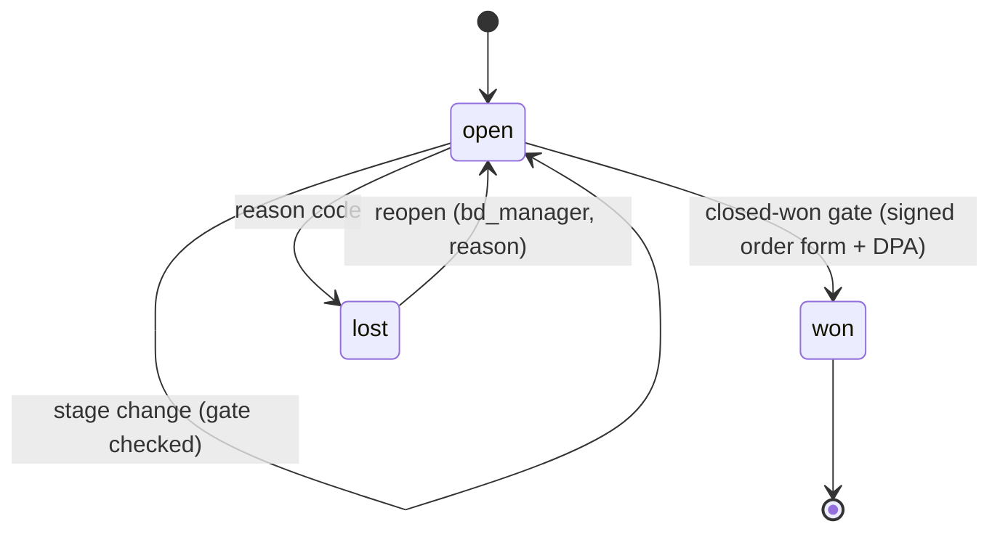
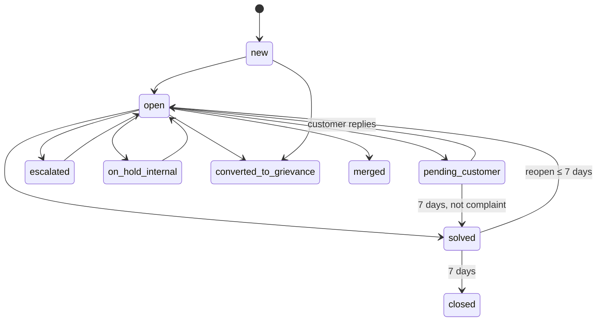

# Phase P16 — Equator Operations Platform: CRM, Support, Onboarding and Customer Success
> Paste after `01_MASTER_PROMPT.md`. Binding reference: **Appendix X** (v3.0). **Hard dependencies:** P00 (platform core, outbox, audit chain, Temporal, OpenFeature), P01 (identity, Keycloak, workforce SSO, consent ledger), **P15** (Configuration Studio, NN-33 tiers, rule packs, settings registry — Appendix V), **P05** (fee engine quotes, plans, subscriptions, invoices, dunning — read models only). **Soft dependencies (consumed if complete, otherwise the stated fallback ships in this phase):** P09 GRM ticket core (fallback: P16 builds the minimal GRM ticket core of P09 §5.1 needed for variant `EQ_SERVICE`, which P09 later adopts); P13 capture inbox `growth.leads` and CMS (fallback: EOP-native public contact form and help pages rendered from `ops.kb_*` with the same legal workflow); P07 `comms` (fallback: `EMAIL_PORT` business class only); P11 agent runtime (fallback: deterministic rule-based triage, no AI drafts); P18 HRMS staff directory (fallback: staff directory seeded from Keycloak workforce users and maintained in EOP until P18 publishes `equator.hr.employee.*`); P21 `WORKSPACE_PORT` (fallback: manual Teams links pasted by staff). Estimated effort: 8 sprints (2-week) for a squad of 9 (2 backend, 2 frontend, 1 integrations, 1 data/reporting, 1 QA, 1 designer, 0.5 legal reviewer, 0.5 DPO liaison).

---

## 1. Objective and business outcome

Give Equator's own teams one separate, group-ready operations platform — `apps/ops` behind the `eq-portal-ops` portal — so that every department works from its own workspace, every customer relationship is one record across sales, onboarding, success and support, and routine work runs on autopilot while legal, money, neutrality and people decisions stay with named humans (R-51–R-54; D3-02, D3-20–D3-24).

| Outcome | Exit-gate measure |
|---|---|
| A separate operations portal, distinct from the super-admin console | Ops staff sign in at `ops.equatorresolution.in` with phishing-resistant MFA; no ops role can reach `admin.…` or case content; Cerbos DENY tests green |
| One CRM, open and portable | Leads captured on the website appear in EOP in ≤ 60 s; a 10,000-row import completes mapping → dry-run → commit → reconciliation with exact counts; a round-trip migration rehearsal Equator → Brevo → Equator preserves every consent status exactly |
| Onboarding to go-live without spreadsheets | An enterprise lender project runs from closed-won to go-live sign-off with probes, migration reconciliation, Teams training and hypercare, all in EOP |
| Customer success by evidence | Daily explainable health scores for every B2B account; QBR pack generated from aggregates; renewal opportunities auto-created at T-120/T-60 |
| Support with clocks that hold | Tickets from web, email, portal, WhatsApp and phone in one queue with SLA timers; P1 first response ≤ 30 min in UAT drills; complaints convert to grievances whose statutory clocks cannot be paused |
| Autopilot with human checkpoints | 20 operations automations (OA-01–OA-20) live with preview, simulation, rate limits, exception paths, pause and rollback; publishing any automation that reaches the locked approval list without an approval step is refused |
| Neutrality and privacy intact | Zero case-content fields in `ops` (schema validator + nightly scan); respondents never enter Brevo or any marketing segment; case and neutral roles cannot read commercial data |

---

## 2. Scope (in / out)

**In scope**
- `apps/ops` (Next.js), Keycloak client `eq-portal-ops`, host `ops.equatorresolution.in`, the `ops` bounded context in `apps/api`, Temporal task queue `ops`, the business-database extension (schema `ops`; D3-20).
- Company dimension and workspace template packs (Equator first: `equator_default_v1`); departments (D3-06 default, configurable); workspaces, dashboards, saved views, universal task queues and cross-functional assignment; company switcher for multi-company staff (Appendix AD grants honoured, but onboarding of Finbyx/Udofin as companies is out of scope).
- CRM: accounts, contacts, leads, opportunities with configurable pipelines and stage gates, products from the revenue registry (Appendix AB), quotes from the fee engine, subscriptions read model, activities (calls, meetings, emails) with consent and access controls, consent and communication preferences, segments, custom fields, tags, saved views, duplicate detection and merge/un-merge, import tools, territory/ownership and routing, explainable lead scoring, partner and referral sources, attribution hooks for Appendix Y.
- Onboarding and implementation (self-service checklist and assisted projects), customer success (health, playbooks, success plans, QBRs, NPS/CSAT, renewals, expansion, churn risk), after-sales service catalogue.
- Support desk (all channels, categories, priority, SLA clocks, routing, escalations, macros, internal notes, customer updates, resolution codes, CSAT, customer status view `/app/help`).
- Equator's own grievance redressal on GRM variant `EQ_SERVICE` (EGP-2026.1; X-52) with rule packs and the Company Secretary appeal.
- Knowledge base (internal SOPs, playbooks, scripts, templates) and public help centre publishing through the CMS.
- Case-services delivery metadata, finance-operations views, training-operations and marketplace-operations queues (metadata and hand-offs only).
- Openness: systems of record (`cfg.system_of_record` rows), Brevo CRM connector, `CRM_PORT` v3 with HubSpot/Zoho moved from P13 and Salesforce as a flagged candidate, migration both ways, outbound webhooks, public `/v1/ops` API, `OPS_DEPARTMENT` exports.
- Microsoft 365 hooks for ops staff through `WORKSPACE_PORT` (Teams meetings, calendar availability, meeting follow-ups where licensed, SharePoint links).
- Automation engine with OA-01–OA-20 seeded; marketing automations of Appendix Y run on this engine in P17.
- Operations settings (Appendix X §X.13), RBAC (§X.14), events, error codes, KPIs, reports, audit and assurance collectors.

**Out of scope (do not build here)**
- The technical super-admin console (P00/P14), case-administration console (P02–P06), tenant consoles (P09, P10).
- Marketing campaigns, social calendar, PR, brand assets, partnership content and `MARKETING_PORT` (P17, Appendix Y).
- HRMS, payroll, attendance and appraisal (P18); EOP only consumes the staff directory projection and emits work-item events.
- Revenue stream registry administration (P19, Appendix AB) — EOP reads it.
- Workspace JML provisioning and the full `WORKSPACE_PORT` (P21, Appendix AC) — P16 uses only `createMeeting`, availability, transcripts and share links.
- Onboarding Finbyx or Udofin as companies (Appendix AD procedure, after GDSA).
- Native mobile apps for EOP (responsive web only).
- Any ledger, invoice, refund, payout or subscription mutation (P05).

---

## 3. Personas and permissions touched

Role codes are binding (conventions; Appendix S §1.3). Full matrix: Appendix X §X.14.

| Role code | What it does in P16 | Key restrictions |
|---|---|---|
| `ops_director` | Leadership cockpit; approves discounts up to 25 %, health-weight changes, automations touching money or other departments, migrations, group dashboard publication | Cannot approve own items; no case content |
| `ops_manager` | Configures workspaces, queues, templates, imports, automations for own departments | No settings of tier G without a checker |
| `department_head` | Runs a department workspace; approves department imports and exports (`OPS_DEPARTMENT` maker) | Department scope only |
| `case_services_lead` | Service-delivery metadata, service requests, procedural scripts | Metadata only (`svc_matter_status`); fixes happen in `/console` |
| `onboarding_specialist` | Implementation projects, checklists, migrations tracking, training sessions | Own projects; no CRM list exports |
| `customer_success_manager` | Health, playbooks, QBRs, renewals, expansion | Covered accounts; outreach drafts on sensitive triggers |
| `support_agent` | Works tickets; applies consent withdrawals on request; converts complaints | Case context only via `tkt_case_context` and a ≤ 24 h support grant; no factor bypass |
| `support_lead` | Queues, SLA policies, macros, merges, escalations, support KB approval | — |
| `grievance_officer` | Owns `EQ_SERVICE` grievances from acknowledgement to final reply | Not head of the department complained about (per grievance) |
| `sales_executive`, `bd_manager` | Leads, opportunities, quotes (bands 5 % / 15 %), routing and scoring (BD) | Never quote placement to advocates/CAs/CSs/CMAs (NN-34); no party sales |
| `partnerships_manager` | Partnership pipeline, MoUs, partner records | No rewards to professionals (X-54) |
| `finance_ops`, `accounts_maker`, `accounts_checker` | Receivables views, refund/collection hand-offs to P05, quote-term approval | No ledger edits in EOP (NN-36) |
| `legal_reviewer` | Stage-gate legal reviews, KB legal approval, grievance rule packs (Head of Legal) | Cannot approve own drafts |
| `compliance_officer` | Reads everything except sealed/case content; pauses automations | — |
| `dpo` | Connector activation approvals, DSRs on EOP data, consent-propagation alerts, export approvals > 100 persons | — |
| `internal_auditor` | Read-only sampling with watermark; attestations | Holds no other ops role |
| `it_admin` | Workspace hooks, M365 app config, global automation pause | No CRM data |
| `group_admin` | Group dashboards and grants (Appendix AD) | Aggregates only |
| `employee` | Raises internal IT/HR requests and complaints as a requester | — |
| `ops_guest` | Named implementation project only, ≤ 90 days | No lists, no exports |
| `case_manager`, `registrar`, neutrals (consumers) | See ticket status in `/console` for case-procedure tickets assigned to Case Services | **Denied** all commercial data (D3-24) |
| Customer users (any portal) | Raise and track tickets in `/app/help`; receive surveys | See own/organisation tickets only |

---

## 4. Functional requirements

### 4A. Platform foundation

**FR-P16-01 — Separate app and portal.** Scaffold `apps/ops` (Next.js App Router, RSC, `packages/ui`, design tokens, next-intl en/hi) served at `ops.equatorresolution.in` behind CloudFront + WAF. Keycloak client `eq-portal-ops`: workforce SSO only (Entra ID brokered; Google adapter flag OFF), `acr = eq:aal2-pr` mandatory (`PHISHING_RESISTANT_MFA_REQUIRED`), network and device policy of Appendix S §2.6 (managed device required for finance views, exports and service metadata), session idle 15 min / absolute 10 h, concurrent sessions 2. The super-admin console and the case console are separate clients; a token for `eq-portal-ops` is rejected by `/v1/cases/*`, `/v1/documents/*` and `admin` APIs (audience check).

**FR-P16-02 — `ops` bounded context and module boundaries.** Create NestJS context `ops` with sub-modules `ops-core`, `crm`, `onboarding`, `success`, `support`, `grievance-bridge`, `kb`, `automation`, `ops-finance-views`, `ops-service-views`, `ops-connectors`, `ops-reporting` (Appendix X §X.2.1). An ESLint boundary rule forbids imports from `cases`, `documents`, `posh`, `hr`, `pay`, `escrow`, `neutrals` internals; only generated read-model clients are allowed.

**FR-P16-03 — Business database and isolation (D3-20).** Extend the P13 isolated database with schema `ops`; DB role `eq_ops` with `USAGE` on `ops`, `SELECT` on `growth.suppression_hashes` and the `growth.leads` capture view; `eq_mkt` gets `SELECT` only on `ops.crm_marketing_view`. No grants on core, case, sealed, `hr` or `pay`. Per-company KMS data keys; S3 bucket `eq-{env}-ops`. Migration includes RLS policy `ops_company_isolation` on every table (`company_id = current_setting('app.company_id')::uuid`). Test `NN-38_ops_company_isolation`.

**FR-P16-04 — Core-plane read models with schema validation.** Implement the six read models of Appendix X §X.2.3 fed by allow-listed outbox events and read APIs. A JSON-Schema validator with an explicit allow-list rejects any other field at publish and at consume (`OPS_CASE_FIELD_FORBIDDEN`, 422) and raises a security ticket. Nightly job `OpsCaseContentScan` samples `ops` text columns for case-number + party-name co-occurrence, Aadhaar/PAN patterns and offer language and reports findings to the DPO desk.

**FR-P16-05 — Company dimension and template packs.** Replicate `grp.companies` into `ops.ws_companies`; seed `EQR`. Every row carries `company_id`. Template pack `equator_default_v1` seeds departments, workspaces, queues, pipelines, SLA policies, dashboards, KB spaces, automations OA-01–OA-20 (published as drafts except OA-01, OA-09, OA-16 which publish on approval during UAT). Company switcher for users with several memberships; every action records the acting company.

**FR-P16-06 — Departments and workspaces.** Implement `ops.ws_departments` with the D3-06 default list (rename, merge, split, add, cost centre, legal entity) and the two locked properties of Appendix X §X.3.1 (Internal Audit independence; Grievance Officer conflict). Each department maps to one or more workspaces with home dashboard, queues, records, playbooks, automations, reports and settings (§X.3.2).

**FR-P16-07 — Department dashboards.** Build the twelve dashboards of Appendix X §X.3.3 with mandatory widgets, configurable layouts (`ops.ws_dashboard_layouts`), KPI definitions in-app (`ops.rpt_kpi_definitions`), data-as-of timestamps, a data table beside every chart (WCAG 2.2 AA), and no widget that ranks neutrals or displays outcomes.

**FR-P16-08 — Universal tasks and cross-functional assignment.** `ops.ws_tasks` per §X.3.4: configurable types, checklists, dependencies, watchers, SLA, visibility; request work from another department's queue; routing by skills, language, load, round-robin and out-of-office skip; reassignment reasons; cross-company tasks blocked without an Appendix AD grant (`OPS_GRANT_REQUIRED`). Free-text validator warns on case-number + party-name patterns.

**FR-P16-09 — Staff directory projection.** `ops.ws_staff_directory` (person id, display name, work email, department, cost centre, company, skills, languages, working hours, out-of-office) from `equator.hr.employee.*` (P18) or the fallback; no salary, leave reason, appraisal or personal data. Leaver events remove assignment eligibility in ≤ 60 s and reassign open work to the queue.

**FR-P16-10 — Work-item events (NN-35).** Emit normalised work-item events for HRMS (`hr.work_items`, Appendix Z §Z.7.1): ticket handled, SLA met/missed, project milestone done, quality review — IDs and codes only. EOP shows each staff member their own work-item metrics; no keystroke, screen, webcam or idle tracking exists.

**FR-P16-11 — Ethical walls.** Users with any Finbyx/Udofin role are denied `svc_matter_status` rows for tenants that are clients of those companies and are not assignable to case-linked tickets involving them (`OPS_ETHICAL_WALL`, 403); checked at role grant (DB trigger on memberships) and at policy time; annual attestation form in EOP.

### 4B. CRM

**FR-P16-12 — Accounts and contacts.** Implement `crm_accounts` and `crm_contacts` (Appendix X §X.4.1, §X.15) with hierarchy, multi-account contacts with roles, GSTIN/CIN/LEI validation, masked PAN display, enrichment from licensed aggregators (public company data only), `is_advocate` flag with advocate rules, link to `core_tenant_ref`/`core_org_ref` when provisioned.

**FR-P16-13 — Lead capture inbox and promotion (X-51).** `LeadIngestWorkflow` consumes `equator.growth.lead.created.v1`, reads the capture view, runs suppression (respondent hash, DND), dedupe (D6), routing and scoring, and creates `crm_leads` within 60 s (p95). One-time migration of `growth.accounts`/`growth.opportunities` with `ops.crm_migration_map`; read-only views kept 2 releases; SCR-P13-18 redirects to EOP.

**FR-P16-14 — Pipelines, stages and gates.** Configurable pipelines and stages (tier T) seeded per §X.4.2; stage gates evaluated server-side (`OPS_STAGE_GATE_UNMET`, 422) including quote approved, legal review done, DPA/DSA draft attached, Appendix O §2.4.1 contract heads captured, NN-03/NN-16 disclosure acknowledged; `crm_stage_history` with time-in-stage; closed-lost reason mandatory.

**FR-P16-15 — Products from the revenue registry.** `crm_products` is a read model of `rev.streams` (Appendix AB) + `core.plans`; only `sellable` products (stream `live` in the quoting scope, kill switch not engaged — Appendix AB AB-R1; `REV_STREAM_NOT_LIVE` surfaces as `OPS_PRODUCT_NOT_SELLABLE`) can be quoted; kill switch effective in ≤ 5 min with open quotes flagged; N2-rated streams quotable only to non-advocate private-practice neutrals and chambers on the marketplace surface, RS-19 only while `marketplace.paid_placement` is ON; N3/N4 streams never quotable for administered work; placement, ratings, featured labels or referral rewards never quotable to advocates, CAs, CSs or CMAs (`OPS_PAID_PLACEMENT_FORBIDDEN`).

**FR-P16-16 — Quotes from the fee engine.** Quote lines priced only by `POST /v1/billing/quotes` (P05; Appendix B precedence) with GST by place of supply and validity; discount bands from `ctl.authority_rules` (5 / 15 / 25 %), above band or non-standard terms → `ctl.approval_requests` maker-checker (`OPS_DISCOUNT_APPROVAL_REQUIRED`); locked denials (outcome-contingent pricing, prohibited success fees, take-rate falling with neutral fees, paid procedural advantage); DOCX + PDF renditions with totals incl. GST; e-sign via `ESIGN_PORT`; acceptance + signed DPA start OA-05/OA-06.

**FR-P16-17 — Commercial approvals.** Implement the approval table of §X.4.5 on `ctl` (maker ≠ checker; reasons ≥ 30 characters; related-party contracts flagged to the Company Secretary with s.188/s.184 note and the CS-set threshold).

**FR-P16-18 — Activities with consent and access controls.** Calls (click-to-call through `TELEPHONY_PORT`, DND scrub, recording only after disclosure and consent; FIN-borrower contacts blocked), meetings (calendar-backed Teams via `WORKSPACE_PORT`), emails (BCC drop-box via SES inbound; EOP composer through `EMAIL_PORT` business class; Outlook add-in flag OFF), notes, WhatsApp (service only). Visibility `team/private/restricted`; sensitive-attribute and case-pattern scanner masks and warns; complaint-in-activity requires a ticket link (`OPS_COMPLAINT_NOT_TRACKED`).

**FR-P16-19 — Consent and preferences mirror.** `crm_comm_prefs` mirrors `core.consent_records` within 60 s; all writes go through the consent API; `marketing_eligible` computed in `ops.crm_marketing_view` per §X.4.7; 90-day no-re-ask; withdrawal propagation to every enabled connector ≤ 15 min, alert `OPS_CONSENT_PROPAGATION_LATE` at 15 min and DPO page at 30 min.

**FR-P16-20 — Segments, custom fields, tags, saved views.** Segment DSL compiled to parameterised SQL over the marketing-safe view, preview count + masked 20-row sample, forbidden sources rejected (`OPS_SEGMENT_SOURCE_FORBIDDEN`), purpose must match a consent purpose for marketing use; custom fields (≤ 100 per object, typed, required-at-stage, sensitivity; prohibited-attribute dictionary in en/hi rejects creation — `OPS_FIELD_PROHIBITED`); tags; saved views with field-level permission enforcement at render.

**FR-P16-21 — Duplicate detection and merge.** Rules D1–D6 (§X.4.9) at create, import and nightly; candidate queue; merge with survivorship, consent union (most restrictive wins), re-parenting, tombstone and un-merge within 30 days; `crm_merge_log`; cross-company merge impossible.

**FR-P16-22 — Import tools.** `CrmImportWorkflow` per §X.4.10: CSV/XLSX/JSON ≤ 200,000 rows; mapping with saved templates; 50-row preview; per-row validation; dedupe plan; consent plan (lawful source required for marketing eligibility); suppression; dry-run reconciliation; checker for > 1,000 rows or > 100 people; idempotent commit; post-commit reconciliation (`OPS_IMPORT_RECONCILIATION_MISMATCH`); rollback within 7 days; prohibited sources rejected (`OPS_IMPORT_SOURCE_PROHIBITED`).

**FR-P16-23 — Territory, ownership and routing.** Ordered routing rules with assignment methods, SLA policies and fallback owners (seed from P13 FR-P13-19 bands); individuals (parties) routed to the case-services help queue, never to sales; territory re-assignment preview and checker above 50 records.

**FR-P16-24 — Explainable lead scoring.** Versioned points model with per-lead explanation, forbidden inputs enforced by a feature allow-list, 90-day back-test before approval, maker (`bd_manager`) → checker (head of sales), one-click rollback with asynchronous re-score.

**FR-P16-25 — Partners, referrals and attribution hooks.** `crm_partners` with `reward_eligible` locked `false` for advocates, bar bodies and CA/CS/CMA or law firms (X-54); referrals linked to leads/opportunities; referral programme rules and rewards are Appendix Y's (MA-17); OA-20 hands approved rewards for eligible partners to P05; `first_touch`/`last_touch` and `mkt_touchpoint_ids` stored; `GET /v1/ops/crm/attribution/{opportunityId}`; `equator.ops.opportunity.closed.v1` for Appendix Y attribution.

### 4C. Onboarding and implementation

**FR-P16-26 — Self-service onboarding checklist.** For self-serve plans, a setup checklist in the tenant's **settings area only** (never inside case views or hearings) with steps, completion probes (e.g., first member invited, branding approved, fee schedule published) and help links; progress visible to the CSM pool as an aggregate.

**FR-P16-27 — Implementation projects.** `ob_projects`, `ob_milestones`, `ob_checklist_items` with verification probes bound to platform events, `ob_migration_tasks` (tracking only; counts and status, never case content), `ob_training_sessions`, `ob_signoffs`; seven template packs of §X.5.2; state machine §5.4; RAG and blocker escalation.

**FR-P16-28 — Training sessions.** Teams sessions via `WORKSPACE_PORT.createMeeting` (calendar-backed), invites to customer contacts, materials from KB, attendance (API where licensed, else manual), feedback, "Certificate of attendance — product training" (never a professional credential).

**FR-P16-29 — Go-live sign-off and hypercare.** Sign-off pack (DOCX + PDF) per §X.5.6; e-sign by customer sponsor and Equator CSM, plus security lead for API/BYOK tenants (`OPS_GOLIVE_SIGNOFF_INCOMPLETE`); hypercare timer (default 30 days), tickets tagged `hypercare` with P2 minimum; hand-over to CS on exit criteria.

### 4D. Customer success and after-sales

**FR-P16-30 — Health score.** `HealthScoreJob` (daily 03:00 IST) computes components and weights per §X.6.1 from `cs_usage_signals`, ticket stats, `fin_receivables_view`, engagement and NPS; stores components and model version; explanation panel; excluded inputs enforced by allow-list (test `D3-24_health_excludes_outcomes`); weight changes maker-checker.

**FR-P16-31 — Playbooks and success plans.** Configurable playbooks with triggers, steps and exit conditions; outreach drafted (not sent) on sensitive triggers; success plans with customer objectives and product-metric measures.

**FR-P16-32 — QBRs.** QBR pack (DOCX/PPTX + PDF) from aggregates only (§X.6.3) with an `analytics_narrator` draft and CSM approval; banned content lint (settlement/award rates as performance, neutral names, matter details, "win" language) blocks generation (`OPS_QBR_CONTENT_BLOCKED`, 422 — registered with the Appendix X §X.18 codes); Teams meeting; follow-up tasks.

**FR-P16-33 — NPS and CSAT (process-only).** Surveys per §X.6.4 with audience exclusions (never parties, respondents, neutrals or GRM complainants for relationship NPS; no CSAT for grievances); n ≥ 5 display rule; verbatim moderation; results never feed grading or allocation.

**FR-P16-34 — Renewals, expansion, churn risk and after-sales catalogue.** `RenewalWatchWorkflow` (T-120 enterprise / T-60 SaaS) creates renewal opportunities and tasks; retention offers within bands (`tenant.ops.cs.retention_offer_bands`), otherwise maker-checker; expansion signals at > 80 % allowance with CSM approval and no prompts in case views; rule-based churn risk with reasons; after-sales service catalogue items as `service_request` tickets with fulfilment queues; chargeable items create a draft order line for `finance_ops` (RS-27) — nothing billed from EOP.

### 4E. Support desk

**FR-P16-35 — Omnichannel intake.** Channels of §X.7.1: public form (captcha + email/mobile OTP for tracking), portal Help panel (case link only to the user's own case, `case_link_verified`), email via SES inbound with threading and auto-reply, WhatsApp via `MESSAGING_PORT` (service window; utility templates outside it), phone via `TELEPHONY_PORT` (disclosure before recording; FIN-borrower callbacks only 08:00–19:00, NN-12), partner portal, raise-on-behalf. Original received time preserved; spam quarantine reviewed daily.

**FR-P16-36 — Categories, priority and SLA clocks.** Locked top-level categories with configurable sub-categories (§X.7.2) and their routing destinations (Case Services, DPO desk, grievance conversion, Appendix N complaints, safeguarding, sealed-channel signpost with body purge for POSH indicators); priority matrix with deadline awareness from `tkt_case_context` (dates only); SLA policies per §X.7.3 on business calendars (state holidays) with 24×7 P1 for platform and live-hearing issues; enterprise contract overrides (stricter only).

**FR-P16-37 — Ticket lifecycle.** State machine of Appendix X §X.7.4 (implemented in §5.5 here) with auto-close after 7 days in `pending_customer` (2 reminders; never for complaint categories), reopen ≤ 7 days, merge, incident linking and broadcast.

**FR-P16-38 — Agent workspace.** Queue views, next-ticket, side panel with requester, account (masked), KB suggestions, macros (legal-approved versions for fees/refunds/complaints/procedure), internal notes with @mentions → tasks, public replies, customer updates, resolution codes, CSAT; collision detection (two agents on one ticket); keyboard shortcuts.

**FR-P16-39 — Case-linked tickets.** `case_linked` tickets classified `high`; excluded from AI training, segments, sales timelines and QBRs; case context via `tkt_case_context` and a ≤ 24 h read-only support grant (Appendix S); procedural decisions handed to the case manager in `/console` with a linked task; agents never relay messages between parties or comment on merits.

**FR-P16-40 — Customer status view.** `/app/help` in every portal and a signed tracking link for public requesters: ticket number, status (received, in progress, waiting for you, solved), expected next update, conversation, attachments, CSAT; for converted tickets, the grievance number and its timelines.

### 4F. Grievance redressal (Equator's own)

**FR-P16-41 — Conversion and `EQ_SERVICE` variant.** Conversion triggers of §X.8.2; grievance created on the GRM core as variant `EQ_SERVICE` with clock start = original received time; reversal only by the Grievance Officer with reasons to the complainant. Rule packs of §X.8.3 loaded in the P15 Configuration Studio (G-legal; floors L; `due_at = min(...)`), alerts T-7/T-3/T-1, breach = Critical incident to `ops_director` and the Company Secretary. Clocks cannot be paused or extended (`OPS_GRIEVANCE_CLOCK_LOCKED`).

**FR-P16-42 — Grievance desk, final reply and appeal.** Desk UI over GRM APIs for `grievance_officer`: acknowledgement template (auto within 48 h permitted), investigation tasks to departments, final-reply templates with reasons, remedies and appeal route; level-2 appeal to the Company Secretary within 30 days (`level2_review`); out-of-scope signposting (case decisions, neutral conduct to Appendix N §7.7, POSH to the employer's IC); quarterly Transparency Report counts (k ≥ 10).

### 4G. Knowledge base and help centre

**FR-P16-43 — Knowledge base.** Spaces `internal_sop`, `playbooks`, `scripts`, `templates`, `public_help` with versioning, owners, review-due dates (12 months; 6 for fee/legal), legal-review routing for scripts on case procedure, fees, refunds and complaints, feedback and deflection analytics; template files stored as DOCX/XLSX/PPTX that open in MS Office.

**FR-P16-44 — Public help centre.** `public_help` articles published through the P13 CMS legal workflow (reviewer ≠ author, linter, Claims Register, live fee blocks) to `/help` (server-rendered, en + hi); contact form with KB deflection; fallback rendering from `ops.kb_*` with the same workflow if P13 is not complete.

### 4H. Service, finance, training and marketplace operations views

**FR-P16-45 — Case-services metadata workspace.** Dashboards over `svc_account_service_stats` and `svc_matter_status` (restricted roles), service-request queue, service-credit proposals routed to `finance_ops`, deep links into `/console` for any fix; account-level aggregates to CSMs only.

**FR-P16-46 — Finance-operations views.** Receivables ageing, dunning states, mandate states and billing-query tickets from `fin_receivables_view`; collections tasks (OA-17); refund and write-off **hand-offs** created through P05 APIs where `accounts_maker`/`accounts_checker` act (NN-36); export of ageing (XLSX) with step-up; no write path to `billing`.

**FR-P16-47 — Training and marketplace operations queues.** Training calendar and attendance for client training; EQAP sitting logistics (dates, rooms, invigilators; no candidate scores); training-provider list with at least three providers (X-29); Private Practice Marketplace seller-onboarding and listing-moderation queue with correction requests and suspension (maker-checker), complaint flags, ranking-parameter publication status, sponsored-slot audit task (inactive while `marketplace.paid_placement` is OFF; NN-34; Appendix AA).

### 4I. Openness and integrations

**FR-P16-48 — Systems of record.** Register EOP rows in `cfg.system_of_record` per Appendix X §X.10.1 (consent may never have an external SoR — CHECK); connector activation requires SoR row, approved mapping set, passed rehearsal, residency record and DPO approval (`CFG_SOR_UNDECLARED`, `CFG_MAPPING_MISSING`, `OPS_CONNECTOR_REHEARSAL_MISSING`).

**FR-P16-49 — Brevo CRM connector.** `CRM_PORT.brevo`: contacts (marketing-eligible or existing-customer business purpose only) with `SEGMENT_CODES` attribute, companies, deals (pipeline/stage IDs in provider config), tasks one-way — send lists are pushed by Appendix Y from audience snapshots, not here; bulk import above 50 records; one shared Brevo account budget `tenant.mkt.brevo.max_requests_per_hour` (default 80; Appendix AC §AC.17; one token bucket with `MARKETING_PORT`); 5-minute incremental queue; 429 backoff with jitter; single inbound webhook for both ports with bearer token (≤ 90-day rotation), IP allow-list and API re-fetch before applying consent events (`OPS_WEBHOOK_UNVERIFIED`), forwarding engagement events to Appendix Y through the outbox; nightly two-way reconciliation of counts and opt-out sets (drift on opt-outs = P1 privacy ticket); transfer-register row `BREVO_EU`; connector flag `mkt.brevo.enabled` (G, Appendix AC §AC.17) and CRM sync switch `tenant.ops.connectors.brevo_crm_sync.enabled` OFF until DPA, DPDP s.16 check and DPO approval.

**FR-P16-50 — Migration both ways.** `CrmMigrationWorkflow` with the ten steps of §X.10.3 (inventory, mapping set, dry-run, dedupe, consent preservation, approval, cut-over, reconciliation with exact consent-set equality, rollback within 30 days, rehearsal), for Equator ↔ Brevo, HubSpot, Zoho, Salesforce (flag OFF) and CSV.

**FR-P16-51 — Generic CRM port v3 and adapters.** Extend `CRM_PORT` with `capabilities`, `upsertBatch`, `exportAll`, `applyOptOut`, `verifyWebhook` (§X.10.4); move HubSpot and Zoho adapters from P13 to EOP; `csv_file` adapter always available; failover `none`.

**FR-P16-52 — Outbound webhooks and public API.** `ops.*` metadata events via the P09 webhook service (HMAC-SHA256, retries, replay); public `/v1/ops` API with OAuth2 scopes `ops.crm.read|write`, `ops.tickets.read|write`, `ops.kb.read`, per-key rate limits, idempotency keys; OpenAPI published in the developer portal.

**FR-P16-53 — Exports.** `OPS_DEPARTMENT` scope (Appendix AC §AC.13.3) producing `05_Operations/` content (§X.10.5) in standard or archival layout; `xpt.export_runs`; aal2-pr; maker-checker above 100 persons (`OPS_EXPORT_APPROVAL_REQUIRED`); watermarking; CSV + JSON data copies.

### 4J. Microsoft 365 hooks

**FR-P16-54 — Meetings, availability, follow-ups and links.** Through `WORKSPACE_PORT` (Appendix AC; adapter `m365_graph`): calendar-backed Teams meetings for onboarding, training, QBRs and sales demos (never hearings or case sessions — locked, AC D3-40); host availability for booking pages (slots only); transcripts for follow-up drafts where licensed and enabled and every attendee was told (`OA-15`), stored ≤ 30 days unless attached; SharePoint share links with expiry and SHA-256 recorded (M365 never system of record). Capability matrix hides unsupported actions per SKU; works on Business Basic (SKU to be confirmed, D3-04).

### 4K. Automation engine

**FR-P16-55 — Engine and builder.** No-code builder (trigger → conditions → actions with branches, waits and approval steps → exception path) over the catalogue of §X.12.1; definitions versioned in `wf_automations`/`wf_automation_versions`; executed by `AutomationRunWorkflow` idempotent per `(version, trigger_event)`; `owning_appendix` X or Y.

**FR-P16-56 — Permissions, preview and simulation.** Author/publisher separation and elevated publishers per §X.12.2; preview (graph, fields changed, recipient classes, approval steps); 30-day read-only simulation report required before first publish.

**FR-P16-57 — Locked approval list.** Static analysis of the action graph against the list of §X.12.6; publish refused without an approval step (`OPS_AUTOMATION_APPROVAL_REQUIRED`); EOP-L06 neutral actions cannot be modelled at all.

**FR-P16-58 — Rate limits, loop guard, exceptions.** Per-automation and per-company limits, recipient frequency caps, connector budgets, loop guard (depth 3; `OPS_AUTOMATION_LOOP`), retries, fallback assignee, dead-letter, auto-pause after 20 failures/h, owner notification.

**FR-P16-59 — Audit, pause and rollback.** Audit chain on publish/pause/resume/rollback with diffs; `wf_runs` 13 months; pause within 60 s; rollback to the last approved version without a checker; compensation list executed only on confirmation; global pause for `ops_director`, DPO, `it_admin`.

**FR-P16-60 — Seed automations.** OA-01–OA-20 of §X.12.5 with tests; Y-owned automations are not seeded here (P17).

### 4L. Settings, reporting, audit

**FR-P16-61 — Operations settings.** Register every key of §X.13 in the P15 Configuration Studio with tier badge, who may change, approval need, bounds, preview and rollback; department-level overrides within company bounds.

**FR-P16-62 — Reports.** Standard reports of §X.19 (DOCX/XLSX/PDF), scheduled via OA-18 with approved distribution lists; staff-level reports show work items only and are visible to the staff member.

**FR-P16-63 — Audit and assurance.** Audit events for every mutation; `audit.access_log` for case-linked tickets, service metadata, finance views and exports; collectors `ops_consent_parity`, `ops_projection_schema_check`, `ops_automation_approval_lint`, `ops_export_register`, `ops_attestation_status`; control `PC-OPS-01` in `eng`.

**FR-P16-64 — Privacy.** EOP purposes added to EPN-2026.1 and to the staff notice (draft for legal review); DSR coverage (access, correction, erasure, portability) for EOP data; retention classes of §X.20 registered (G) with the open verification items.

---

## 5. Workflows and state machines

### 5.1 Lead

| State | Event | Guard | Next | Side effects |
|---|---|---|---|---|
| (capture) | `growth.lead.created` | — | `new` | suppression + dedupe (D6: attach to existing contact instead of creating) |
| `new` | routed | routing rule matched or fallback owner | `working` | owner set; speed-to-lead SLA timer; OA-03 acknowledgement only on an opt-in channel with a pre-approved template |
| `working` | no response after sequence | — | `nurturing` | hand to Appendix Y nurture only if `marketing_eligible` |
| `working` / `nurturing` | qualified | required qualification fields set | `qualified` | score explanation frozen |
| `qualified` | convert | account match resolved | `converted` | account, contact, opportunity created; `lead.converted` |
| any open | disqualify | reason code | `disqualified` | retention clock for inactive leads (24 months) |
| any open | person is an individual party | persona = party | `routed_case_services` | help-queue task; no commercial follow-up |
| `new` | SLA breached | — | (same) + `breached` | escalate to head of sales; weekly breach report |

### 5.2 Opportunity



Stage-change guard = `StageGateEvaluator.check(opportunity, targetStage)` returning unmet gates; UI lists them with links (quote approval, legal review, DPA draft, contract heads, disclosure acknowledgement). `won` emits `opportunity.won` → OA-06 project creation and OA-05 provisioning hand-off.

### 5.3 Quote approval

| State | Event | Guard | Next | Side effects |
|---|---|---|---|---|
| `draft` | price | fee-engine quote returned | `draft` | lines, GST, validity, schedule version stored |
| `draft` | submit | every line `sellable`; no locked denial | `approved` if within maker's band and standard terms; else `pending` | `ctl.approval_requests` row for checker(s) |
| `pending` | approve | checker ≠ maker; checker band covers discount; legal approved non-standard terms | `approved` | audit; maker notified |
| `pending` | reject | reason | `draft` | — |
| `approved` | send | renditions generated | `sent` | e-sign envelope; validity timer |
| `sent` | customer signs | signature verified | `accepted` | `quote.accepted`; order form; OA-05 waits for DPA |
| `sent` | validity lapses | — | `expired` | owner task |
| any non-final | product killed / price schedule superseded | — | `draft` + flag | owner must re-price |

### 5.4 Implementation project

As Appendix X §X.5.3 (`draft → in_progress ⇄ at_risk → ready_for_golive → live_hypercare → handed_over`; `cancelled` from any state). Probe evaluation runs on each relevant platform event and daily (OA-07); `ready_for_golive` requires all probes green, migration tasks reconciled and customer-accepted, UAT signed.

### 5.5 Ticket

As Appendix X §X.7.4. Additional implementation rules: (a) SLA clocks are computed by `TicketSlaWorkflow` per ticket with timers for first response, next response and resolution; `pending_customer` pauses SLA timers only; (b) any transition to `converted_to_grievance` is terminal for the ticket and starts `GrievanceClockWorkflow` from `received_at`; (c) `safety_urgent` bypasses all queues: the ticket is assigned to the on-call `safeguarding_lead` with a P1 page and no auto-reply other than the safety acknowledgement; (d) `posh_related` tickets are routed and their body purged within 5 minutes; the purge is logged (who, when, routed where) without content.



### 5.6 Grievance (`EQ_SERVICE`)

| State | Event | Guard | Next | Side effects |
|---|---|---|---|---|
| `received` | auto | converted ticket or direct complaint | `acknowledged` (≤ 48 h) | grievance number; acknowledgement with Grievance Officer details and timelines; clocks from rule packs |
| `acknowledged` | assign investigation | GO not conflicted | `in_progress` | tasks to departments |
| `in_progress` | request information | — | `awaiting_complainant` | clocks continue |
| `awaiting_complainant` | reply / 10 days | — | `in_progress` | reminder at day 7 |
| `in_progress` | propose outcome | outcome code set | `proposed` | AI draft optional (human review) |
| `proposed` | GO approves final reply | template complete (decision, reasons, actions, appeal route, external remedies) | `final_reply_sent` | survey (grievance feedback form) |
| `final_reply_sent` | appeal within 30 days | — | `level2_review` | Company Secretary task |
| `level2_review` | CS decision | CS ≠ GO | `final_reply_sent` (level 2) | reasons appended |
| `final_reply_sent` | 30 days without appeal | — | `closed` | retention class `grievance` |
| any open | resolve deadline passes | — | (same) + `breached` | Critical incident; escalation to `ops_director` and CS |

### 5.7 Automation version

`draft → in_review → published → paused → published | retired`; `published → (rollback) → published(prev version)`. Guards: `in_review → published` requires simulation report, checker ≠ author, approval-list lint pass and, where §X.12.2 requires, the elevated checker; `published → paused` by any pauser role or auto-pause; `paused → published` requires the publisher role (resume) and, if the pause was by DPO or compliance, their release.

### 5.8 Import and migration run

| State | Event | Guard | Next |
|---|---|---|---|
| `uploaded` | mapping saved | all required target fields mapped | `mapped` |
| `mapped` | preview + validate | — | `validated` (with row errors) |
| `validated` | dry-run | — | `dry_run_complete` (reconciliation report) |
| `dry_run_complete` | approve | checker where thresholds apply; DPO for migrations > 1,000 persons or new processor | `approved` |
| `approved` | commit / cut-over | freeze window for migrations | `committed` |
| `committed` | reconcile | counts equal (± concurrent changes listed); consent sets equal (exact, migrations) | `reconciled` or `reconciliation_failed` |
| `committed` / `reconciled` | rollback (≤ 7 days import; ≤ 30 days migration) | before-images present | `rolled_back` |

### 5.9 Temporal workflows (summary)

`LeadIngestWorkflow` · `LeadSlaWorkflow` · `CrmImportWorkflow` · `CrmMigrationWorkflow` · `BrevoSyncWorkflow` (5-minute incremental, budget-aware) · `ConnectorReconciliationJob` (nightly) · `DedupeScanJob` (nightly) · `ProjectProbeWorkflow` · `GoLiveSignoffWorkflow` · `HypercareWorkflow` · `HealthScoreJob` (daily 03:00 IST) · `PlaybookRunWorkflow` · `RenewalWatchWorkflow` · `SurveyWorkflow` · `TicketSlaWorkflow` · `InboundEmailProcessor` · `WhatsAppInboundProcessor` · `GrievanceClockWorkflow` · `AutomationRunWorkflow` · `AutomationSimulationWorkflow` · `ScheduledReportWorkflow` · `ReadModelRefreshJobs` (per §X.2.3 cadence) · `OpsCaseContentScan` (nightly) · `ConsentMirrorConsumer`.

---

## 6. Screens and UX (web)

Common rules: skeleton, empty, error (problem+json `detail`, retry) and success states; WCAG 2.2 AA (charts paired with tables; timers conveyed by text + colour; AI content labelled "Draft — human review required"); en/hi; command palette `Ctrl/Cmd+K`; keyboard shortcuts on list and ticket screens; fewer-clicks rules (Appendix S §5); responsive to 360 px for support and CS screens; tier badges on every setting (P15); company switcher in the header for multi-company staff.

| ID | Route (`ops.equatorresolution.in`) | Persona | Purpose and key components | Notable states |
|---|---|---|---|---|
| SCR-P16-01 | `/` | all ops | Home: my work (tasks, tickets, approvals), department switcher, notifications | first-login tour |
| SCR-P16-02 | `/leadership` | `ops_director`, heads | Leadership cockpit (§X.3.3) | data-as-of stale banner |
| SCR-P16-03 | `/approvals` | approvers | Unified approval inbox (quotes, imports, automations, exports, settings, retention offers) with diff and reason | SoD conflict disabled state |
| SCR-P16-04 | `/tasks` | all | Task queues, cross-department requests, load view (work items only) | blocked tasks |
| SCR-P16-05 | `/crm/leads` | sales | Lead list, SLA timers, bulk assign, score with "Why?" | breached chip |
| SCR-P16-06 | `/crm/leads/{id}` | sales | Lead detail, timeline, qualification, convert wizard | suppressed banner |
| SCR-P16-07 | `/crm/accounts` | sales, CS | Account list, saved views, filters | — |
| SCR-P16-08 | `/crm/accounts/{id}` | sales, CS, onboarding | 360° account: contacts, opportunities, subscriptions view, projects, health (CS roles only), tickets (counts), activities | restricted-activity lock |
| SCR-P16-09 | `/crm/contacts/{id}` | sales, CS, support | Contact detail, preferences (read; withdraw via consent API), activities | advocate rules banner |
| SCR-P16-10 | `/crm/pipeline` | sales | Kanban by pipeline with stage gates, forecast summary | gate-unmet modal |
| SCR-P16-11 | `/crm/opportunities/{id}` | sales | Deal detail, products, quotes, approvals, legal/security reviews, attribution | — |
| SCR-P16-12 | `/crm/quotes/{id}` | sales, approvers | Quote builder (fee-engine priced), discounts, terms, renditions, send | pending approval |
| SCR-P16-13 | `/crm/segments` | sales, marketing | Segment builder (DSL UI), preview count and masked sample | forbidden source error |
| SCR-P16-14 | `/crm/duplicates` | `crm.merge` | Candidate queue, side-by-side merge with survivorship, un-merge | window expired |
| SCR-P16-15 | `/crm/imports` · `/crm/imports/{id}` | ops_manager | Upload, mapping, preview, dedupe and consent plans, dry-run report, approval, commit, reconciliation, rollback | reconciliation mismatch |
| SCR-P16-16 | `/crm/settings` | bd_manager, ops_manager | Pipelines, stages, gates, custom fields, tags, routing rules, scoring models (back-test) | — |
| SCR-P16-17 | `/crm/partners` | partnerships | Partner records, eligibility (locked for professionals), referral attribution, partnership pipeline link; MoU detail opens the Appendix Y partnerships screen (SCR-P17-27) | — |
| SCR-P16-18 | `/onboarding` | onboarding | Projects board with RAG, sign-offs due, migration failures | — |
| SCR-P16-19 | `/onboarding/{id}` | onboarding, CSM, guest | Project: milestones, checklist with probes, migration tasks, training sessions, documents, sign-off | at-risk banner |
| SCR-P16-20 | `/onboarding/{id}/signoff` | CSM, security lead | Sign-off pack preview, e-sign status | incomplete |
| SCR-P16-21 | `/success` | CSM | Health distribution, movers, renewals, playbooks, QBRs due | — |
| SCR-P16-22 | `/success/accounts/{id}` | CSM | Health explanation, success plan, playbook runs, NPS/CSAT, renewal | — |
| SCR-P16-23 | `/success/qbrs/{id}` | CSM | QBR pack builder with narrator draft and banned-content lint | blocked content |
| SCR-P16-24 | `/support` | support | Queue views, next ticket, SLA breaching soon | — |
| SCR-P16-25 | `/support/tickets/{id}` | support | Ticket workspace: thread, side panel, macros, notes, KB suggestions, case context (grant), escalate, convert | AI draft unreviewed lock; case grant expired |
| SCR-P16-26 | `/support/settings` | support_lead | Categories, priority matrix, SLA policies, calendars, queues, macros, service catalogue | locked top level |
| SCR-P16-27 | `/grievances` | grievance_officer | Grievance desk by clock state, acknowledgements due, appeals | breached |
| SCR-P16-28 | `/grievances/{id}` | GO, CS | Grievance record, tasks, final-reply builder, appeal | — |
| SCR-P16-29 | `/kb` · `/kb/{article}` | all | Spaces, articles, versions, review due, legal review, publish to CMS | review overdue |
| SCR-P16-30 | `/service` | case_services_lead | Service-delivery metadata, service requests, deep links to `/console` | — |
| SCR-P16-31 | `/finance` | finance_ops | Receivables ageing, dunning states, hand-offs, billing queries | read-only badges |
| SCR-P16-32 | `/training` | training ops | Client training calendar, EQAP logistics, provider list | — |
| SCR-P16-33 | `/marketplace-ops` | marketplace ops | Seller onboarding, listing moderation, complaints, audit tasks | paid placement OFF banner |
| SCR-P16-34 | `/automations` | authors, publishers | Automation list with status, runs, failures, pause | auto-paused |
| SCR-P16-35 | `/automations/{id}` | authors, publishers | Builder canvas, preview, simulation report, version history, rollback | approval-list violation |
| SCR-P16-36 | `/connectors` | DPO, ops_manager | Connectors: SoR rows, mapping sets, rehearsal status, residency, budget, sync log, reconciliation | rehearsal stale |
| SCR-P16-37 | `/connectors/migrations/{id}` | ops_manager, DPO | Migration run wizard (ten steps), consent-set equality | consent drift |
| SCR-P16-38 | `/reports` | all (by role) | Standard reports, schedules, distribution lists | — |
| SCR-P16-39 | `/settings` | by tier | Operations settings (P15 shell) with tier badges | approval pending |
| SCR-P16-40 | `/exports` | department heads | `OPS_DEPARTMENT` export requests, approval, download | expired link |
| SCR-P16-41 | `/audit` | internal_auditor | Sampling, attestations, exceptions | watermark |
| SCR-P16-42 | `apps/web /app/help` | customers (all portals) | Raise ticket, my tickets, status, CSAT, grievance link | — |
| SCR-P16-43 | `apps/web /help` · `/help/contact` | public | Help centre (CMS), contact form with deflection, tracking by signed link | OTP required |

---

## 7. Backend design

### 7.1 Modules

`ops` (new; sub-modules per FR-P16-02) · consumes `identity`, `tenancy`, `consent`, `billing` (quotes, read models), `grm` (variant `EQ_SERVICE`), `comms` (email/WhatsApp/SMS service class), `integrations` (`CRM_PORT`, `WORKSPACE_PORT`, `TELEPHONY_PORT`, `MESSAGING_PORT`, `EMAIL_PORT`, `ESIGN_PORT`), `cms` (public help), `ai` (agents `support_triage`, `meeting_followup`, `analytics_narrator`), `audit`, `reporting`; read models from `cases`, `clocks`, `notices`, `hearings`, `enterprise` via allow-listed events; `cfg` (settings, rule packs, SoR, mappings, rehearsals), `ctl` (authority rules and approvals), `rev` (streams), `grp` (companies, grants), `xpt` (exports), `hr` (staff directory events in; work-item events out).

### 7.2 Tables (schema `ops`, business database; key columns; full DDL for core tables in Appendix X §X.15)

- `ws_companies` (id, code, legal_name, status) · `ws_departments` (company_id, code, name, parent_id, cost_centre, legal_entity_ref, head_person_id, locked_flags) · `ws_workspaces` (department_id, kind, template_code) · `ws_template_packs` (code, version, payload jsonb) · `ws_tasks` (§X.3.4 columns) · `ws_saved_views` (object, filters jsonb, columns, sharing) · `ws_dashboard_layouts` (user/department, widgets jsonb) · `ws_staff_directory` (person_id, company_id, department_id, skills text[], languages text[], working_hours jsonb, ooo_until) · `rpt_kpi_definitions` (code, definition_md, formula_ref, owner).
- `crm_accounts`, `crm_contacts`, `crm_account_contacts` (account_id, contact_id, role) · `crm_leads` (capture_ref, source, utm_first jsonb, utm_last jsonb, persona, product_interest, volume_band, city, language, score, score_explanation jsonb, status, owner_person_id, sla_due_at, breached) · `crm_pipelines` (code, name, object) · `crm_stages` (pipeline_id, code, sequence, probability, gates jsonb) · `crm_stage_history` · `crm_opportunities` · `crm_opportunity_lines` (opportunity_id, stream_code, plan_code, qty, list_ref) · `crm_products` (view) · `crm_quotes` · `crm_subscription_view` · `crm_activities` (kind, direction, subject, body, participants jsonb, occurred_at, duration_s, outcome_code, recording_ref, recording_consent, join_url, visibility, sensitivity, related jsonb) · `crm_comm_prefs` · `crm_marketing_view` (view) · `crm_segments` (kind, predicate jsonb, purpose, owner, refresh, last_built_at, member_count) · `crm_segment_members` · `crm_custom_fields` · `crm_tags` · `crm_duplicate_candidates` (object, a_id, b_id, rule, score, status) · `crm_merge_log` (survivor_id, merged_id, before_digest, after_digest, rule, by, at, undone_at) · `crm_import_jobs` (file_ref, sha256, mapping jsonb, status, counts jsonb, maker_id, checker_id) · `crm_import_rows` (job_id, row_no, action, target_id, errors text[], before_image jsonb) — partitioned by job · `crm_routing_rules` (object, priority, conditions jsonb, method, team_id, sla_policy_id, fallback_owner) · `crm_scoring_models` (version, factors jsonb, threshold, status, backtest jsonb, maker_id, checker_id) · `crm_partners` (kind, agreement_ref, reward_type, reward_eligible, status) · `crm_referrals` · `crm_sources` · `crm_migration_runs` (connector, direction, status, mapping_set_ref, counts jsonb, consent_set_hash_source, consent_set_hash_target, restore_point_ref) · `crm_migration_map` (source_system, source_id, target_id).
- `ob_projects`, `ob_milestones` (project_id, name, sequence, owner_side, planned/actual dates, exit_criteria, status) · `ob_checklist_items` (project_id, code, probe_event_type, probe_predicate jsonb, status, verified_at, evidence_ref) · `ob_migration_tasks` (project_id, dataset, mapping_template_ref, dry_run_ref, error_rate, source_count, imported_count, rejected_count, customer_accepted_at, rollback_ref) · `ob_training_sessions` (project_id, title, audience, language, mode, trainer_id, start/end, capacity, join_url, attendance jsonb) · `ob_signoffs` (project_id, pack_ref, sponsor_sign_ref, csm_sign_ref, security_sign_ref, completed_at).
- `cs_health_scores` · `cs_usage_signals` (view) · `cs_playbooks` (trigger jsonb, steps jsonb, exit jsonb) · `cs_playbook_runs` · `cs_success_plans` (account_id, objectives jsonb, measures jsonb, review_dates) · `cs_qbrs` (account_id, period, pack_ref, narrator_draft_ref, approved_by, held_at) · `cs_surveys` (kind, audience_rule, questions jsonb) · `cs_survey_responses` (survey_id, respondent_ref, score, comment_moderated, moderated_by).
- `tickets` · `tkt_messages` (ticket_id, direction, channel, author_ref, body, attachments, ai_draft, reviewed_by, sent_at) · `tkt_internal_notes` · `tkt_macros` (code, body, variables, legal_approved_version, editable_fields) · `tkt_sla_policies` (priority, first_response_mins, next_response_mins, resolution_mins, calendar_ref, escalation jsonb) · `tkt_queues` (code, skills, languages, cap_per_agent) · `tkt_service_catalogue` (item, queue_id, sla_policy_id, approval_needed, chargeable, stream_code) · `tkt_incident_links` · `tkt_case_context` (cache; TTL 24 h).
- `kb_spaces` · `kb_articles` (space_id, slug, owner_id, status, review_due_at, legal_required) · `kb_versions` (article_id, version, body, locale, legal_reviewer_id, approved_at, cms_ref) · `kb_feedback`.
- `wf_automations` · `wf_automation_versions` · `wf_runs` (automation_version_id, trigger_event_id, status, steps jsonb, started/ended) — partitioned monthly · `wf_exceptions` (run_id, step, error_code, fallback_task_id, resolved_at).
- `svc_account_service_stats` · `svc_matter_status` · `fin_receivables_view` · `con_providers` (connector, enabled, budget, residency_ref, rehearsal_ref, last_reconciled_at) · `con_sync_log` (connector, direction, object, batch_id, counts jsonb, errors jsonb).

### 7.3 APIs

All endpoints of Appendix X §X.16, plus:

| Endpoint | Purpose | Roles |
|---|---|---|
| `GET /v1/ops/me/work` | Home aggregation (tasks, tickets, approvals) | all ops |
| `GET /v1/ops/approvals` · `POST /v1/ops/approvals/{id}/{approve|reject}` | Unified approvals (backed by `ctl.approval_requests`) | approvers |
| `GET/POST /v1/ops/departments` · `/workspaces` · `/dashboards/{code}` | Workspace configuration and data | heads, ops_manager |
| `GET /v1/ops/staff` | Staff directory projection | all ops |
| `POST /v1/ops/crm/segments/{id}/export-list` | Materialise a static list for a HubSpot/Zoho/Salesforce CRM connector (Brevo send lists come from Appendix Y audience snapshots) | sales (consent purpose check) |
| `POST /v1/ops/projects/{id}/probes/evaluate` | Re-evaluate checklist probes | onboarding |
| `POST /v1/ops/training-sessions` | Create session + Teams meeting | onboarding, training |
| `POST /v1/ops/surveys/{id}/send` | Send survey to eligible audience | CS lead |
| `POST /v1/ops/tickets/{id}/case-grant` | Request a ≤ 24 h read-only support grant | support_agent |
| `POST /v1/ops/tickets/{id}/purge-body` | Purge after sealed routing (system) | machine |
| `POST /v1/ops/connectors/{provider}/enable` · `/disable` · `/reconcile` | Connector lifecycle | DPO, ops_director |
| `GET /v1/ops/reports/{code}` · `POST /v1/ops/reports/{code}/schedule` | Reports | by role |
| `POST /v1/ops/attestations` | Annual ethical-wall/AUP attestation | staff |

### 7.4 Events

Published: all `equator.ops.*.v1` events of Appendix X §X.17 (outbox; payloads IDs, codes, amounts in minor units for opportunities and quotes; never PII or case content). Consumed: as listed in §X.17. Event-schema registry entries added to `packages/domain/events` with a CI test that every `ops` event schema contains no field on the PII deny-list (`email`, `phone`, `name`, `address`, `pan`, `aadhaar`, free-text bodies).

### 7.5 Jobs and Temporal workflows

As §5.9. Task queue `ops` with worker concurrency limits per workflow type; Brevo sync and migration workflows share a connector token bucket in Redis keyed by `(company, connector)`; all workflows propagate `company_id` in headers and refuse to run without it.

---

## 8. Integrations (ports and adapters)

| Port | Adapter(s) | Use in P16 | Failure behaviour | Flag / approver |
|---|---|---|---|---|
| `CRM_PORT` (v3) | `brevo`, `hubspot`, `zoho`, `salesforce` (candidate), `csv_file` | Contact/company/deal sync; migration both ways | Native CRM continues; queue + retry; reconciliation nightly | `tenant.ops.connectors.*.enabled` OFF; DPO + `ops_director` |
| `WORKSPACE_PORT` | `m365_graph` (default), `google_workspace` (stub), `manual_it_desk` | Teams meetings, availability, transcripts, share links | Manual link entry; meeting created by staff in Outlook and pasted | `ops.workspace.google.enabled` OFF; SKU confirmation (D3-04) |
| `EMAIL_PORT` | SES (business class; inbound for `support@` and BCC drop-box) | Ticket intake/replies, activity logging | Queue; inbound stored in S3 and replayed | — |
| `MESSAGING_PORT` | Gupshup / MSG91 (WhatsApp, SMS service class) | WhatsApp support; SMS notifications | Email fallback | WhatsApp templates approved (BSP) |
| `TELEPHONY_PORT` | Exotel / Plivo | Support line, click-to-call, recording with disclosure | Callback task | DLT/A2P rules (NN-12) apply to outbound |
| `ESIGN_PORT` | Per P06 | Quotes/order forms, go-live sign-off | Retry; manual upload of signed PDF with hash | — |
| `LLM_PORT` via AI gateway | Bedrock India | `support_triage`, `meeting_followup`, `analytics_narrator` | Deterministic triage; no drafts (NN-02 pattern) | Kill switch per agent |
| `ANALYTICS_PORT` | PostHog (EOP usage only, staff analytics disabled for individuals) | Product analytics of EOP features (aggregate) | Drop events | Staff notice (NN-35) |
| Webhook service (P09) | HMAC-SHA256 | `ops.*` events to customer systems | Retry/replay | Tenant subscription |

---

## 9. Configuration surface

Every key of Appendix X §X.13 is registered in the P15 Configuration Studio. Phase-specific additions and the approval path:

| Setting | Default | Tier | Changed by | Approval / guard |
|---|---|---|---|---|
| `platform.ops.case_projection.allowed_fields` | Appendix X §X.2.3 | L | release + ADR | Head of Legal + DPO |
| `platform.ops.health.excluded_inputs` | outcomes, settlement/award rates, neutral data | L | — | — |
| `platform.ops.automation.approval_list` | §X.12.6 | L | — | — |
| `platform.ops.ticket.top_level_categories` | §X.7.2 | L | — | — |
| `platform.ops.posh_body_purge_minutes` | 5 | L | — | — |
| `tenant.ops.lead.ingest_target_seconds` | 60 | T (≤ 60) | `ops_manager` | — |
| `tenant.ops.lead.inactive_delete_months` | 24 | G | DPO | `legal_reviewer` |
| `tenant.ops.crm.recording.enabled` | ON with disclosure | G | DPO | `compliance_officer` |
| `tenant.ops.crm.bcc_dropbox.enabled` | ON | T | `it_admin` | — |
| `tenant.ops.support.channels` | web, portal, email, WhatsApp, phone | T | `support_lead` | WhatsApp requires approved templates |
| `tenant.ops.support.p1_24x7_scope` | platform, live hearing | T (widen only) | `support_lead` | — |
| `tenant.ops.support.spam_quarantine_review_hours` | 24 | T | `support_lead` | — |
| `tenant.ops.support.case_grant_hours` | 24 | T (≤ 24) | `support_lead` | — |
| `tenant.ops.grievance.awaiting_reply_days` | 10 | T | `grievance_officer` | Clocks continue regardless |
| `tenant.ops.qbr.banned_terms` | settlement rate, award rate, win, recovery rate as performance, neutral names | T (add only) | CS lead | — |
| `tenant.ops.survey.cooldown_days_after_p1` | 30 | T | CS lead | — |
| `tenant.ops.automation.simulation_days` | 30 | T (≥ 7) | `ops_manager` | — |
| `tenant.ops.automation.max_runs_per_hour` | 1,000 | T | `ops_manager` | — |
| `tenant.ops.connectors.reconcile_cron` | daily 01:30 IST | T | `ops_manager` | — |
| `tenant.ops.export.link_minutes` | 5 | T (≤ 5) | — | — |
| `tenant.ops.ethical_wall.attestation_month` | April | T | Company Secretary | — |
| `tenant.ops.workspace.meeting_transcripts.enabled` | OFF until SKU confirmed | G | `it_admin` | DPO; X-OI-01/02 closed |

The Salesforce adapter and the Outlook add-in use the Appendix X §X.13 keys `tenant.ops.connectors.salesforce.enabled` and `tenant.ops.crm.outlook_addin.enabled`; no `feature.*` key family is created (Appendix V X-44 naming).

Rules: routine (T) changes take effect immediately with audit and one-click rollback; G changes go through maker ≠ checker with preview, effective date, review date and fallback; L values are shown read-only with the reason.

---

## 10. Security, privacy and audit

- **Identity and session:** `eq-portal-ops` with phishing-resistant MFA, managed-device requirement for finance views, service metadata and exports; network policy; step-up aal2-pr ≤ 10 min for approvals, exports, connector enablement, merges above 50 records and settings of tier G.
- **Authorisation:** Cerbos policies `ops.*` per Appendix X §X.14 with hard DENY rules (case content, sealed, HR/payroll, commercial data for case/neutral roles, ethical walls, SoD); Postgres RLS by `company_id` as second line; UI hides what policy denies but never substitutes for it.
- **Data isolation:** business database; schema validator on projections; nightly content scan; no cross-DB joins; event payload PII deny-list test.
- **Neutrality (NN-03, NN-16, NN-28, NN-34):** no API path from `ops` to allocation, grading or directory ordering; health excludes outcomes; QBR lint; marketing sources forbidden list; respondent suppression on import, sync, segment build and send; advocates never offered placement or rewards.
- **Money (NN-36):** EOP has no write path to `billing`/`payments`; discounts, terms, refunds, write-offs and payouts go through `ctl` approvals and P05.
- **Consent and DPDP (NN-15, NN-30):** consent API as single writer; mirror within 60 s; propagation ≤ 15 min; DSR coverage; retention classes; children: lead forms keep the P13 18+ check; marketing eligibility requires confirmed age.
- **Transparency to staff (NN-35):** work-item metrics only; each employee sees their own; no covert monitoring; Outlook add-in and transcripts behind notice-dependent flags.
- **Group (NN-38):** company RLS; Appendix AD grants for cross-company work; ethical walls; attestation.
- **Openness (NN-40):** SoR rows, mapping sets, rehearsals, residency records, reconciliation; `csv_file` fallback always available; free export at exit.
- **Audit (NN-22):** hash-chained audit events for every mutation (outbox to the core chain); `audit.access_log` for reads of high-tier objects; automation runs retained 13 months; approval records immutable.
- **Security testing:** DAST on `ops.…` and `/v1/ops`, `/v1/help`, `/webhooks/brevo`; tests for IDOR across companies and accounts, CSV-injection in exports (formula prefix escaping), HTML injection in ticket bodies (sanitiser), SSRF in webhook URLs (allow-list), email spoofing on inbound support (SPF/DKIM/DMARC evaluation recorded on the message).

---

## 11. AI touchpoints and guardrails

| Touchpoint | Agent | Inputs | Output | Guardrails |
|---|---|---|---|---|
| Ticket triage | `support_triage` (FR-P11-V3-X01) | Requester's ticket text, channel, language | Category, priority suggestion, complaint/safety/POSH indicators, KB suggestions, draft reply from approved macros/KB | NN-01: drafts only, `requires_human_review = true`; human sends fees, refunds, complaints, procedure replies; safety and POSH indicators route with no AI reply; no case content beyond the requester's own text; en/hi parity eval; deterministic fallback (keyword rules) when the LLM is unavailable |
| Grievance draft | `grievance_responder` (P11, profile `EQ_SERVICE`) | Grievance record, policy snippets | Draft final reply with checklist (reasons, actions, appeal, remedies) | GO approves and sends; no admission language unless the GO enters it |
| Meeting follow-up | `meeting_followup` (FR-P11-V3-X02) | Transcript of an internal or B2B ops meeting | Draft minutes and actions | Refuses hearing/case transcripts; organiser approves; 30-day transcript retention |
| QBR and leadership narrative | `analytics_narrator` (FR-P11-V3-X03) | Aggregates only | Narrative draft | No outcomes, no neutral data, k-rules; CSM/director approves |
| KB authoring help | `drafting_assistant` (KB mode) | Author's notes, existing articles | Draft article | Legal review for legal/fee content; Claims Register for any number |
| Scoring weights | scoring-weight suggestion tool (FR-P11-V3-X04) | Historical lead conversions (features allow-listed) | Suggested weights | Human owner decides; no AI scoring of individual leads |
| Duplicate hints | none (deterministic) | — | — | Dedupe is rule-based; no AI identity resolution |

AI features have per-feature kill switches in the AI gateway; tokens and costs metered per company; prompts registered and versioned; evaluation sets contain synthetic tickets only (no production ticket text without consent).

---

## 12. Acceptance criteria (Gherkin)

```gherkin
Feature: P16 Equator Operations Platform

Scenario: Separate portal and audience
  Given a staff user signed in through eq-portal-ops with a passkey
  When the user calls GET /v1/cases/{id}
  Then the API returns 403 and the denial is in audit.access_log

Scenario: Phishing-resistant MFA required
  Given a workforce sign-in using SMS OTP only
  When the user opens ops.equatorresolution.in
  Then sign-in fails with PHISHING_RESISTANT_MFA_REQUIRED

Scenario: NN-16_projection_allow_list
  Given an outbox event to ops.svc_matter_status containing "respondent_name"
  When the consumer validates it
  Then it is rejected with OPS_CASE_FIELD_FORBIDDEN and a security ticket is opened

Scenario: NN-38_company_isolation
  Given a user with membership only in company EQR
  When they request an ops.crm_accounts row whose company_id is another company
  Then the API returns 404 and RLS returns no row

Scenario: Ethical wall
  Given a user who holds a Finbyx role and an Equator ops role
  When they open svc_matter_status for a tenant that is a Finbyx client
  Then the API returns 403 OPS_ETHICAL_WALL

Scenario: Lead promoted within 60 seconds
  Given a website enterprise demo form submitted with volume band ">2,000"
  When LeadIngestWorkflow runs
  Then a crm_leads row exists within 60 seconds
  And it is owned by the enterprise lead RM with a 1-business-hour SLA timer
  And its score explanation lists each factor and points

Scenario: Respondent suppressed at import
  Given a served respondent's email hash in growth.suppression_hashes
  When a CSV import containing that email is dry-run
  Then the row is planned as "suppressed" and can never become marketing_eligible

Scenario: Import reconciliation and rollback
  Given a 10,000-row import whose dry-run plans 9,800 creates and 200 rejections
  When the checker approves and the job commits
  Then the reconciliation shows 9,800 created and 200 rejected
  When the maker rolls back within 7 days
  Then the 9,800 created records not modified since are removed and the rollback is audited

Scenario: Prohibited import source
  Given an import whose declared source is "Bar Council roll"
  When it is uploaded
  Then the API returns 422 OPS_IMPORT_SOURCE_PROHIBITED

Scenario: Merge keeps the most restrictive consent
  Given contact A with marketing_email granted and duplicate contact B with marketing_email withdrawn
  When A and B are merged with A surviving
  Then the survivor's marketing_email status is withdrawn
  And un-merge is available for 30 days

Scenario: Quote priced by the fee engine only
  Given an opportunity with product GRM-FIN
  When the user creates a quote
  Then line prices come from POST /v1/billing/quotes with the fee-schedule version
  And the user cannot edit a unit price field

Scenario: NN-34_no_placement_for_advocates
  Given a contact flagged is_advocate
  When a sales user adds stream RS-19 to a quote for that contact's account
  Then the API returns 422 OPS_PAID_PLACEMENT_FORBIDDEN

Scenario: Stage gate blocks closed-won without DPA
  Given an enterprise_odr opportunity with a signed order form but no DPA
  When the owner moves it to Closed won
  Then the API returns 422 OPS_STAGE_GATE_UNMET listing "DPA executed"

Scenario: Go-live sign-off requires security lead for API tenants
  Given an api_whitelabel_v1 project with all probes green
  When the customer sponsor and CSM have signed but the security lead has not
  Then the project stays ready_for_golive and OPS_GOLIVE_SIGNOFF_INCOMPLETE is returned on activation

Scenario: D3-24_health_excludes_outcomes
  Given the health model configuration
  When an ops_director adds input "settlement_rate"
  Then the change is rejected because the input is on platform.ops.health.excluded_inputs

Scenario: Case manager cannot read commercial data
  Given a user with role case_manager
  When they call GET /v1/ops/crm/opportunities
  Then the API returns 403 OPS_COMMERCIAL_DATA_FORBIDDEN

Scenario: QBR banned content
  Given a QBR draft containing "settlement rate 82%"
  When the CSM generates the pack
  Then generation fails with OPS_QBR_CONTENT_BLOCKED

Scenario: Ticket SLA and escalation
  Given a P1 ticket received at 10:00 IST
  When no public reply is sent by 10:15
  Then the ticket escalates to support_lead
  And at 10:30 it is marked first-response breached and escalated to ops_manager

Scenario: Deadline awareness raises priority
  Given a ticket linked to the requester's own case whose response clock is due in 36 hours
  When the ticket is triaged as P3
  Then its priority is raised to P1

Scenario: AI draft cannot be sent unreviewed
  Given a support_triage draft reply on a billing refund ticket
  When the agent clicks send without editing or approving
  Then the API returns 409 OPS_AI_DRAFT_REQUIRES_REVIEW

Scenario: POSH indicator purges body
  Given a ticket whose text indicates a sexual-harassment complaint at the requester's workplace
  When triage classifies it posh_related
  Then the requester receives the sealed-channel signpost
  And the ticket body is purged within 5 minutes and replaced with "Routed to sealed channel"

Scenario: Complaint converts to grievance with original clock
  Given a ticket received on 1 Nov 2026 at 09:00 IST
  When the requester writes "I want to file a complaint" on 3 Nov
  Then an EQ_SERVICE grievance is created with received_at 1 Nov 2026 09:00 IST
  And its acknowledgement is due by 3 Nov 2026 09:00 IST
  And the grievance clock cannot be paused (OPS_GRIEVANCE_CLOCK_LOCKED)

Scenario: Level-2 appeal
  Given a final reply sent on a grievance
  When the complainant appeals within 30 days
  Then a level2_review task is created for the Company Secretary
  And the Grievance Officer cannot decide the appeal

Scenario: Automation approval list enforced
  Given an automation that sends a refund-confirmation message after a ticket is solved without an approval step
  When the publisher publishes it
  Then the API returns 422 OPS_AUTOMATION_APPROVAL_REQUIRED

Scenario: Automation simulation, pause and rollback
  Given automation OA-13 version 3 published after a 30-day simulation
  When it fails 20 times within one hour
  Then it auto-pauses within 60 seconds and the owner is notified
  When the publisher rolls back to version 2
  Then version 2 is published without a checker and the rollback is audited

Scenario: Automation loop guard
  Given automation A updates field X and automation B triggers on field X and updates field Y that triggers A
  When a record triggers A
  Then the chain stops at depth 3 with OPS_AUTOMATION_LOOP

Scenario: Brevo webhook without valid token
  Given a POST to /webhooks/brevo with a wrong bearer token
  When it is received
  Then it is rejected with 401 OPS_WEBHOOK_UNVERIFIED and no consent change occurs

Scenario: Brevo unsubscribe propagates after re-fetch
  Given a valid Brevo "unsubscribed" event from an allow-listed IP
  When the connector re-fetches the contact and confirms the status
  Then a consent withdrawal is recorded within 15 minutes
  And ops_consent_parity shows equal opt-out sets after the nightly reconciliation

Scenario: Round-trip migration preserves consent
  Given 5,000 contacts with mixed consent statuses
  When they are migrated Equator → Brevo and back in a rehearsal
  Then the consent-set hash on return equals the original
  And no contact without a consent artefact is marketing_eligible

Scenario: External system cannot become consent system of record
  Given a request to set the system of record for "consent" to "brevo"
  When it is submitted
  Then it is rejected with OPS_SOR_CHANGE_FORBIDDEN

Scenario: Teams never used for hearings
  Given a meeting request linked to a case session
  When the user chooses Teams
  Then the option is unavailable and the session stays on VIDEO_PORT

Scenario: Export approval above threshold
  Given a department head requests OPS_DEPARTMENT export covering 2,400 contacts
  When the request is submitted
  Then an ops_director approval is required before generation
  And the package contains 05_Operations/CRM_Contacts.xlsx, CSV and JSON copies, 00_README.pdf and 99_Manifest/

Scenario: No ledger edits from EOP
  Given a finance_ops user on an overdue invoice in /finance
  When they try to change the invoice amount
  Then no edit control exists and PATCH /v1/billing/invoices/{id} from an eq-portal-ops token returns 403
```

---

## 13. Deliverables and exit gate

- [ ] `apps/ops` deployed to dev/staging/uat with `eq-portal-ops`; audience separation tests green; WAF and device policy in place.
- [ ] Business-database `ops` schema migration with RLS on every table; projection validator and nightly content scan live; event PII deny-list test green.
- [ ] Departments, workspaces, twelve dashboards, task queues, staff directory projection, work-item events to HRMS, ethical walls with attestation.
- [ ] CRM complete (objects, pipelines/gates, products from `rev.streams`, quotes via fee engine with `ctl` approvals, activities, consent mirror, segments, custom fields, tags, saved views, dedupe/merge/un-merge, imports with reconciliation and rollback, routing, explainable scoring with back-test, partners with locked eligibility, attribution hooks); P13 mini-CRM migrated with exact reconciliation.
- [ ] Onboarding (self-service checklist; seven template packs; probes; migration tracking; Teams training; sign-off; hypercare); customer success (health with explanation, playbooks, success plans, QBR packs with lint, NPS/CSAT rules, renewals, expansion, churn risk, service catalogue).
- [ ] Support desk on all channels with SLA drills (P1 first response ≤ 30 min in three UAT drills), routing, macros, notes, customer status view, case-linked ticket controls, POSH purge test, safety routing drill.
- [ ] Grievance desk on `EQ_SERVICE` with rule packs approved in P15 by the Head of Legal; level-2 appeal; quarterly summary generator.
- [ ] Knowledge base and `/help` publishing through the CMS legal workflow.
- [ ] Service, finance, training and marketplace operations views with no write paths to `billing`.
- [ ] Connectors: `cfg.system_of_record` rows, mapping sets, Brevo connector in staging with rehearsal (round-trip consent equality), HubSpot/Zoho moved, `csv_file` fallback; Brevo production enablement blocked until the DPA record and DPO approval exist.
- [ ] M365 hooks on the confirmed SKU (or Business Basic by default) with capability matrix; transcripts flag OFF until X-OI-01/02 close.
- [ ] Automation engine with builder, preview, simulation, approval-list lint, rate limits, loop guard, exceptions, pause/rollback; OA-01–OA-20 tested.
- [ ] Settings registered in P15 with tiers; reports; exports (`OPS_DEPARTMENT`) validated by the AC package verifier.
- [ ] ≥ 34 Gherkin scenarios passing (§12 and Appendix X §X.21); NN-01/15/16/22/33/34/35/36/37/38/40 tests green for EOP; seed data (EQR company, 60 accounts incl. 3 lenders, 1 insurer, 2 employers, 1 university, 5 chambers; 400 contacts with mixed consent; 30 tickets across categories; 3 projects; 5 grievances).
- [ ] Docs: `docs/phases/P16-demo.md`; ADRs — business-database extension (D3-20), GRM variant reuse (D3-21), SoR declarations (D3-22), automation engine (D3-23), commercial-to-case firewall (D3-24), Brevo residency, schema hygiene (X-50).
- [ ] Phase addenda applied: FR-P09-V3-X01–X04, FR-P11-V3-X01–X04, FR-P13-V3-X01–X04, FR-P14-V3-X01–X04 (Appendix X §X.23).

**Exit gate:** all checkboxes; no open high/critical VAPT finding on EOP surfaces; DPO sign-off on the privacy notice additions and connector posture; Head of Legal sign-off on grievance rule packs, procedural scripts and macros for fees/refunds/complaints/procedure; Company Secretary confirmation of the M365 SKU or recorded acceptance of the Business Basic default.

---

## 14. Open items and legal verification flags

1. **Microsoft 365 SKU** — management said "Business Starter"; Microsoft has no plan by that name; RD finds Business Basic most likely. The CS confirms via admin centre or `GET /subscribedSkus` (D3-04). Design works on Basic. **[VERIFY — open: CS]**
2. **Basic SKU capabilities** — Teams recording/transcription licensing, attendance-report API, Graph chat permission and Exchange application-RBAC scoping for a shared support mailbox (RD Open point 2). **[VERIFY — open: vendor]**
3. **Brevo** — INR prices; whether CRM and campaign endpoints fall under the 100 requests/hour catch-all; webhook retry policy; DPA and sub-processor list; DLT support for India SMS/WhatsApp (RD Open point 5). Connector stays OFF in production until resolved. **[VERIFY — open: vendor; CS contract]**
4. **Consumer Protection (E-Commerce) (Amendment) Rules 2026** — commencement (reported 1 Jan 2027) and final text of r.4(5), r.4(7) (RE F3.1). **[VERIFY — open: Gazette CG-DL-E-10092026-276125]**
5. **IT Rules 2021 amendment (G.S.R. 120(E), 10 Feb 2026)** — 7-day grievance disposal and 3-hour takedown figures are from pack research, not the Gazette (RE F3.3). **[VERIFY — open: legal reviewer]**
6. **Applicability of the E-Commerce Rules** to Equator's own services and marketplace (counsel characterisation, Appendix O §6.1); rule-pack applicability flags default ON (stricter).
7. **Fiduciary/processor role matrix** for EOP data (tenant users raising tickets as processor data vs Equator's own B2B contacts as fiduciary data). **[VERIFY — open: counsel]**
8. **Related-party thresholds** for group contracts and shared services (Companies Act 2013 s.188; Companies (Meetings of Board and its Powers) Rules 2014 r.15(3)) — sets `tenant.ops.crm.contract_board_threshold_minor`. **[CS to confirm]**
9. **Retention periods** for commercial CRM records and attachments (books-of-account and GST record periods). **[VERIFY — open: CS / tax adviser]**
10. **WhatsApp support** — customer-service window and template categories with the BSP. **[VERIFY — open: vendor]**
11. **Department structure** — management to describe it; the D3-06 default ships as configuration (no blocker).
12. **Group cross-sell** (AU-26) — stays OFF pending the group consent design and GDSA (Appendix AD).
13. **Public help centre host** — `/help` on `apps/web` (default) vs a `help.` sub-domain; product decision, no legal impact.

## v3 Addendum (23 October 2026)

The requirements below come from the v3.0 appendices and are part of this phase's scope and exit gate.

### From Appendix AC — Workspace Suites, Open Integrations and Data Portability

**FR-P16-V3-AC01 — Brevo CRM adapter conformance.** The `CRM_PORT` adapter `brevo` built in P16 (Appendix X §X.10.2) meets the vendor contract of AC.11.2: compensating webhook controls (bearer token, IP allow-list, inbox dedupe, re-fetch before any consent-changing event), the shared account-level request budget (AC.5), the `BREVO_EU` transfer row and a `cfg.system_of_record` row for CRM data in `ops`. *Acceptance:* AC-T08, AC-T09.

### From Appendix AD — Group Companies and Cross-Functional Operations

**FR-P16-V3-AD01 — Grants in the Operations Platform.** `ops_company_isolation` (Appendix X) honours grant-computed acting companies for the modules a grant names; company switcher shows the grant banner; support-desk routing applies EW-01 (`OPS_ETHICAL_WALL`) to tickets linked to Equator cases. *Acceptance:* AD-T01, AD-T06.

