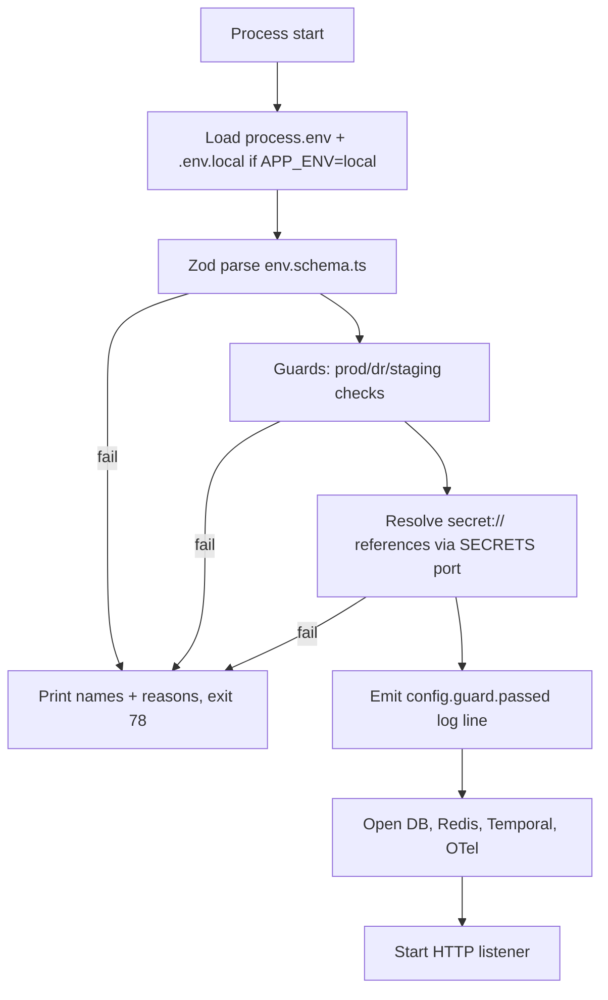

# IPB-11 — Environment and Seed Standard  (Infrabyx Platform Baseline Standard v1.0, 25 October 2026)

> **Status:** Binding for LD, LDC, EQ, FBX, UDF, OH unless a product records an `IPB-DEV` deviation.
> **Related:** IPB-01 (reference stack, `SECRETS` port, CI), IPB-02 (tenancy, identity, roles), IPB-03 (`AI_*` variables, model registry seed), IPB-04 (public website, Brand Studio host map), IPB-07 (settings tree — settings are not environment variables), IPB-08 (Trust Centre evidence), IPB-09 (engineering governance: CI, migrations, release), IPB-10 (API and event standard), IPB-12 (`fut.*` flags seeded OFF); Ecosystem Spec v1.2 §2 (identity), §5 (data classes).
> **Owner decisions applied:** IPB-D-01 (Node 24.22.1), IPB-D-02 (ports, PostgreSQL only, Supabase database-only in non-prod), IPB-D-04 (seed credentials, super admin, production refuses seeds, forced password change + MFA), IPB-D-05 (modular monolith), IPB-D-06 (multi-provider AI), IPB-D-07 (payments neutral).

## 11.1 Purpose and scope

This file fixes how every Infrabyx repository reads configuration from its environment, which variables exist, how they are named, which are secrets, how production refuses unsafe values, and how synthetic seed data and seed credentials are generated. It applies to `apps/api`, `apps/worker`, `apps/web`, `apps/public`, `apps/console`, product-specific apps, and the Expo mobile app where present.

Three rules frame everything else:

1. **Configuration is typed and validated at boot.** A process that cannot validate its environment exits with a non-zero code before it opens a port or a database connection.
2. **Secrets never live in environment variables in production** (brief §6). In production the process receives *references* and resolves them through the `SECRETS` port (AWS Secrets Manager reference adapter; Azure Key Vault, GCP Secret Manager, HashiCorp Vault, SOPS-file adapters). In local and CI, the same variables hold literal dev values.
3. **Seeds are for non-production only.** `SEED_PROFILE` present in production is a fatal boot error. Seed credentials are generated, never typed, and stored only in `SEED_CREDENTIALS.md` and the seed vault.

Environment variables configure the *process*. Business settings (anything a tenant or super admin changes at runtime) live in the settings registry (IPB-07 settings tree), never in `.env`.

## 11.2 Definitions

| Term | Meaning |
|---|---|
| **Environment** | One of `local`, `dev`, `test` (CI), `preview`, `staging`, `pre-prod`, `demo`, `prod`, `dr` — the IPB-09 §09.4.3 catalogue, which is binding. **Guard groups**: every rule in this file written for `prod`/`dr` also applies to `pre-prod` (production snapshot); every rule written for `staging` also applies to `pre-prod` and `demo`; `preview` follows `dev`. `APP_ENV` carries this; *(rev. 26 Oct 2026)* `NODE_ENV` stays `development`/`test`/`production` for framework behaviour. |
| **Overlay** | A set of variable values for one environment, supplied by the deployment system (Helm values, ECS task definition, Compose file) — never a committed `.env.<env>` file for staging or prod. |
| **Secret reference** | A string of the form `secret://<adapter>/<path>#<key>` resolved by the `SECRETS` port at boot. Example: `secret://aws-sm/infrabyx/fbx/prod/db#password`. |
| **Sensitivity** | `S` secret (resolved via reference in prod; redacted in logs), `C` config (non-secret but environment-specific), `P` public (safe to ship to a browser bundle, prefix `NEXT_PUBLIC_` / `EXPO_PUBLIC_`). |
| **Seed profile** | `dev`, `demo`, `test`, `load`. Each defines which tenants, personas and data volumes are created. |
| **Persona** | A named synthetic user with a role, used for development, demos and automated tests. |
| **Seed vault** | The `SECRETS` port path `secret://<adapter>/infrabyx/<product>/<env>/seed/*` where generated seed passwords are also stored so they can be rotated and audited. |
| **Tier (requirements)** | `M` mandatory; `S` should — omission needs an `IPB-DEV`; `O` optional. |

## 11.3 Requirements

### 11.3.A Philosophy and schema

| ID | Requirement | Tier | Test |
|---|---|---|---|
| IPB-11-01 | Each app declares its environment contract in `env.schema.ts` using Zod (`z.object` with per-variable `.describe()`), exported as a typed `env` object. No code reads `process.env` directly outside `env.schema.ts` and `packages/config`. | M | Lint rule `@infrabyx/no-process-env`; type check. |
| IPB-11-02 | Validation runs first in `main.ts` (before Nest bootstrap, before Next.js server start, before worker connects). On failure: print each failing variable name and reason (never the value), exit code 78 (`EX_CONFIG`). | M | Boot with missing `DB_URL` → exit 78, message names `DB_URL`. |
| IPB-11-03 | The schema records for each variable: description, example, `required` per environment, sensitivity (`S`/`C`/`P`), and owning port. A generator (`pnpm env:example`) regenerates `.env.example` from the schema so the two never drift. | M | CI fails if `.env.example` differs from generated output. |
| IPB-11-04 | Twelve-factor: one codebase, config in environment, no environment-specific code branches other than `APP_ENV` guards defined in `packages/config/guards.ts`. | M | Grep for `if (process.env.APP_ENV` outside guards → lint error. |
| IPB-11-05 | Variables are grouped by port prefix: `APP_`, `DB_`, `AUTH_`, `STORAGE_`, `SEARCH_`, `CACHE_`, `QUEUE_`, `WORKFLOW_`, `AI_`, `PAYMENTS_`, `MSG_` (email/SMS/WhatsApp/push), `OBS_`, `FLAGS_`, `SECRETS_`, `DOCGEN_`, `RULES_`, `SEED_`, `IPB_` (shared cross-product), product prefixes `LD_`, `LDC_`, `EQ_`, `FBX_`, `UDF_`, `OH_`. Browser-exposed variables additionally carry `NEXT_PUBLIC_` or `EXPO_PUBLIC_`. | M | Schema key regex test. |
| IPB-11-06 | Booleans are `true`/`false` only; durations carry units (`_MS`, `_S`, `_MIN`, `_DAYS`); sizes `_BYTES`/`_MB`; lists are comma-separated without spaces; URLs include scheme. | M | Zod refinements. |
| IPB-11-07 | Secrets (`S`) are redacted by the logger (`packages/config/redact.ts`) using the schema, not a hand-maintained list. | M | Log a config dump → all `S` values appear as `***`. |

### 11.3.B File set and repository rules

| ID | Requirement | Tier | Test |
|---|---|---|---|
| IPB-11-08 | Committed: `.env.example` (generated, every variable, no real values). Gitignored: `.env`, `.env.local`, `.env.*.local`, `SEED_CREDENTIALS.md`, `*.pem`, `*.p12`. The `.gitignore` entries are checked by a repo-policy test. | M | Repo policy test. |
| IPB-11-09 | Pre-commit (`lefthook`) blocks any file matching `.env*` except `.env.example`, and runs `gitleaks` on staged content. | M | Commit `.env.local` → rejected. |
| IPB-11-10 | GitHub repository ruleset: push protection for secrets enabled; a ruleset rule blocks paths `**/.env`, `**/.env.local`, `**/.env.*.local`, `**/SEED_CREDENTIALS.md` on all branches. | M | Attempt push with such a file → rejected server-side. |
| IPB-11-11 | Staging and production overlays are supplied by the deployment system: Helm `values-<env>.yaml` holds `C`/`P` values and `S` *references* only; the `SECRETS` adapter resolves references at boot. No `.env.staging` or `.env.prod` file exists anywhere. | M | Grep CI for `.env.prod`; Helm values contain no literal secrets (gitleaks). |
| IPB-11-12 | Local development uses Docker Compose (PostgreSQL 18, Redis, MinIO, Keycloak, Temporal, OpenSearch optional, MailHog) with `.env.local` created by `pnpm env:init`, which copies `.env.example` and fills local defaults. | M | `pnpm env:init && pnpm dev` boots. |
| IPB-11-13 | Expo app: `EXPO_PUBLIC_*` variables only; no secret ever enters the mobile bundle; build profiles in `eas.json` select API base URL per environment. | M | Bundle scan for non-public prefixes. |

### 11.3.C Production guard-rails

| ID | Requirement | Tier | Test |
|---|---|---|---|
| IPB-11-14 | When `APP_ENV` ∈ {`prod`, `dr`, `pre-prod`}: `NODE_ENV` must be `production`; `SEED_PROFILE` must be unset; `SEED_ENABLED` must be `false` or unset. `pre-prod` is included because it holds a production snapshot with REGULATED data (IPB-09 §09.4.3). Violation → exit 78. *(rev. 26 Oct 2026)* | M | @IPB-11-AT-01. |
| IPB-11-15 | In `prod`/`dr`/`staging`, every `S` variable must be a `secret://` reference; a literal value → exit 78 with "literal secret in <name>". | M | Boot with literal `DB_PASSWORD` in staging → exit 78. |
| IPB-11-16 | In `prod`/`dr`, no URL variable may point to `localhost`, `127.0.0.1`, `0.0.0.0`, `host.docker.internal`, `*.local`, `*.test`, or `http://` (except `OBS_OTLP_ENDPOINT` inside the cluster network when `OBS_OTLP_INSECURE=true` is explicitly set and documented). | M | Boot with `DB_URL=postgres://localhost` in prod → exit 78. |
| IPB-11-17 | Known development values are refused in `prod`/`dr`/`staging`: `AUTH_CLIENT_SECRET=dev-secret`, any JWT or encryption key shorter than 32 bytes, any key matching the committed `dev-keys.json` fingerprints, `postgres:postgres`, `minioadmin`, `changeme`, `password`, `admin123`, Razorpay/PayU/Cashfree test key prefixes (`rzp_test_`, etc.). | M | Table-driven test over refused values. |
| IPB-11-18 | `APP_BASE_URL`, `APP_PUBLIC_URL` and `AUTH_ISSUER_URL` must use `https://` and match the product's registered host map (brand pack) in prod. | M | Mismatch → exit 78. |
| IPB-11-19 | `DB_SSL_MODE` must be `verify-full` in prod/dr/staging; `DB_URL` must not contain a password (password arrives via `DB_PASSWORD` reference). | M | Boot test. |
| IPB-11-20 | `AI_*` adapter variables for India-resident adapters must specify region `ap-south-1`, `centralindia` or `asia-south1` respectively; any other region → exit 78 (defends IPB-03-23). | M | Boot test. |
| IPB-11-21 | Guard-rail results are written as a structured boot log line `config.guard.passed=true` with the list of checks, no values; this line is the evidence item for the Trust Centre. | S | Log assertion. |

### 11.3.D Seed framework

| ID | Requirement | Tier | Test |
|---|---|---|---|
| IPB-11-22 | `pnpm seed --profile <dev\|demo\|test\|load>` runs `packages/seed` with per-product seed modules. Refuses when `APP_ENV` ∈ {`prod`, `dr`, `pre-prod`} or when `SEED_ENABLED!=true`. *(rev. 26 Oct 2026)* | M | @IPB-11-AT-02. |
| IPB-11-23 | Seeds are deterministic: a fixed `SEED_RANDOM_SEED` drives `@faker-js/faker` (locale `en_IN`) so re-runs produce identical IDs and names; ULIDs for seeded rows are derived from a namespace hash, not the clock. | M | Two runs produce byte-identical dumps (excluding timestamps marked volatile). |
| IPB-11-24 | Seeds are idempotent: every row is upserted on a natural key; re-running changes nothing and reports `0 inserted / N unchanged`. | M | Second run diff is empty. |
| IPB-11-25 | Synthetic data only: names from faker, PAN/Aadhaar/account numbers from format-valid generators marked with the test prefixes documented in `packages/seed/README` (e.g. PAN `ZZZPZ9999Z`, Aadhaar beginning `9999`, IFSC `TEST0000001`, mobile `+91 99999 0xxxx`); no real person, company, GSTIN or CIN. | M | Seed data passes a "no real identifier" validator (checks Verhoeff on Aadhaar must *fail* for seeded values; PAN fourth letter `Z`). |
| IPB-11-26 | Seeded tenants in every product: **platform tenant** (`tnt_platform`, Infrabyx itself, holds super admin), **demo tenant** (`tnt_demo`, realistic volume for sales demos, brand pack "Demo Co"), **sandbox tenant** (`tnt_sandbox`, for API partners and automated tests; reset nightly in `demo`/`staging`). | M | Tenants exist after seed; sandbox reset job scheduled. |
| IPB-11-27 | Personas per product are defined in `packages/seed/personas/<product>.ts` and match `SEED_CREDENTIALS.md` exactly (same emails, roles, tenants). | M | Cross-check test between personas file and the credentials file structure. |
| IPB-11-28 | Profiles: `dev` (3 tenants, ~50 records per module, all personas); `demo` (3 tenants, ~2,000 records, narrative-consistent data for demos, dated relative to run day); `test` (minimal fixtures for CI, personas only, fast); `load` (sandbox tenant with ~1 M records for performance testing, requires `SEED_LOAD_CONFIRM=yes`). | M | Each profile runs within its time budget (`test` < 30 s, `dev` < 3 min). |
| IPB-11-29 | Seeds set the settings registry (IPB-07) to documented defaults and register all `fut.*` flags (IPB-12) as OFF; they never set production-only settings. | M | Settings snapshot test. |
| IPB-11-30 | Seeds write the IPB-03 model registry with `CANDIDATE` rows (never `APPROVED`) and the prompt registry with the shipped prompt versions. | M | Registry state test. |
| IPB-11-31 | Every seeded row carries `seed_profile` and `seed_run_id` columns (or a tag in metadata) so a `pnpm seed:purge --profile demo` can remove exactly what a profile created. Purge refuses in prod. | M | Purge leaves non-seed rows intact. |

### 11.3.E Seed credentials

| ID | Requirement | Tier | Test |
|---|---|---|---|
| IPB-11-32 | Super admin `rjnprajapati@gmail.com` exists in every product with role `PLT_SUPER_ADMIN` in the platform tenant (IPB-D-04). In `local`/`dev`/`test`/`demo`/`staging` its password is generated like any other seed credential. In production the account is created by the identity bootstrap (not the seed) with a one-time invitation link, forced password change and mandatory MFA enrolment on first login. | M | @IPB-11-AT-03. |
| IPB-11-33 | Test personas per product use the pattern `test.<persona>@<product>.test` where `<product>` ∈ {`lawdocs`, `ldc`, `equator`, `finbyx`, `udofin`, `ophub`}; `.test` is a reserved TLD (RFC 2606) so mail never leaves. | M | Email regex test. |
| IPB-11-34 | Passwords: ≥ 24 characters from a CSPRNG (`crypto.randomBytes` → base62 plus two symbols from a safe set), unique per app and per persona, never reused across products or environments, never derived from the email. | M | Entropy and uniqueness tests over generated file. |
| IPB-11-35 | `pnpm seed:credentials` generates `SEED_CREDENTIALS.md` from the template in 11.4.6, writes passwords into the seed vault via `SECRETS`, sets them on the identity provider (Keycloak admin API) for the seeded users, and prints only the file path and a count. It never prints a password to stdout, CI logs or telemetry. | M | CI log scan for any generated password → none. |
| IPB-11-36 | The generated file is gitignored, protected by the GitHub ruleset (IPB-11-10), and in shared environments (`demo`, `staging`) is stored only in the seed vault and the team password manager — not on wikis, chats or tickets. | M | Repo policy test; checklist sign-off. |
| IPB-11-37 | Every seeded human account has `must_change_password=true` and `mfa_required=true` on its first login in `staging`, `demo` and `prod`; in `local`/`dev`/`test` MFA is disabled for personas to keep automated tests simple, except `PLT_SUPER_ADMIN` which always requires TOTP (seeded secret stored in vault for test automation). | M | Login flow tests per environment. |
| IPB-11-38 | Credentials rotate: automatically on every `demo`/`staging` reseed; on demand with `pnpm seed:credentials --rotate`; the super admin production password rotates on first login by policy and thereafter per identity policy (IPB-02). | M | Rotation changes passwords and vault entries; old password fails. |
| IPB-11-39 | Agent identities (`AGT_*`) are seeded without passwords (service accounts with client credentials issued by Keycloak and stored in the vault), never in `SEED_CREDENTIALS.md` as human logins. | M | File contains no `AGT_` row with a password. |

## 11.4 Design

### 11.4.1 `env.schema.ts` pattern

```ts
import { z } from 'zod';
import { envVar, secretRef } from '@infrabyx/config';

export const envSchema = z.object({
  APP_ENV: envVar(z.enum(['local','dev','test','preview','staging','pre-prod','demo','prod','dr']), { desc: 'Deployment environment', example: 'local', required: 'all', sens: 'C', port: 'APP' }),
  NODE_ENV: envVar(z.enum(['development','test','production']), { desc: 'Node framework mode', example: 'development', required: 'all', sens: 'C', port: 'APP' }),
  DB_URL: envVar(z.string().url(), { desc: 'PostgreSQL URL without password', example: 'postgres://app@localhost:5432/ldc', required: 'all', sens: 'C', port: 'DB' }),
  DB_PASSWORD: secretRef({ desc: 'PostgreSQL password', example: 'secret://aws-sm/infrabyx/ldc/prod/db#password', required: 'all', port: 'DB' }),
  // ... one entry per variable in 11.4.3
});
export type Env = z.infer<typeof envSchema>;
export const env = loadAndValidate(envSchema);   // runs guards from packages/config/guards.ts; exits 78 on failure
```

`envVar` and `secretRef` attach metadata used by `pnpm env:example` (generator), the logger redaction map and the Trust Centre evidence export. `secretRef` accepts a literal in `local`/`dev`/`test` and requires `secret://` in `staging`/`demo`/`prod`/`dr`.

### 11.4.2 Boot sequence



### 11.4.3 Annotated `.env.example` template

The generator emits the file below. Columns in each comment: description · example · `req:` environments where required (`all`, `nonprod`, `prod`, `opt`) · `sens:` S/C/P. Values shown are local defaults or placeholders; secrets show `secret://` forms for prod and dev literals for local.

```dotenv
############################################################
# Infrabyx <PRODUCT> — environment template (generated by pnpm env:example; do not edit by hand)
# IPB-11 v1.0. Secrets (sens:S) MUST be secret:// references in staging/demo/prod/dr.
############################################################

# ---------- APP_ (process identity, URLs) ----------
APP_ENV=local                                  # Deployment environment: local|dev|test|preview|staging|pre-prod|demo|prod|dr · req:all · sens:C
NODE_ENV=development                           # Node mode; must be production when APP_ENV=prod|dr · req:all · sens:C
APP_PRODUCT=LDC                                # Product code LD|LDC|EQ|FBX|UDF|OH · req:all · sens:C
APP_NAME=lawdocscomply-api                     # Process name for logs/OTel service.name · req:all · sens:C
APP_VERSION=0.0.0-local                        # Set by CI from Changesets; shown in /health · req:all · sens:C
APP_GIT_SHA=local                              # Commit SHA from CI · req:all · sens:C
APP_PORT=4000                                  # HTTP listen port · req:all · sens:C
APP_HOST=0.0.0.0                               # Bind address · req:all · sens:C
APP_BASE_URL=http://localhost:4000             # API base URL; https and host-map match in prod · req:all · sens:C
APP_PUBLIC_URL=http://localhost:3000           # Public website URL (apps/public) · req:all · sens:C
APP_WEB_URL=http://localhost:3001              # Tenant app URL (apps/web) · req:all · sens:C
APP_CONSOLE_URL=http://localhost:3002          # Super-admin console URL · req:all · sens:C
APP_TRUST_PROXY=1                              # Number of trusted proxy hops · req:all · sens:C
APP_CORS_ORIGINS=http://localhost:3000,http://localhost:3001,http://localhost:3002  # Comma list · req:all · sens:C
APP_DEFAULT_TZ=Asia/Kolkata                    # Default time zone for schedules and display · req:all · sens:C
APP_DEFAULT_LOCALE=en-IN                       # Default locale · req:all · sens:C
APP_REGION=ap-south-1                          # Deployment region label (ap-south-1, ap-south-2) · req:all · sens:C
APP_SHUTDOWN_GRACE_MS=20000                    # Graceful shutdown window · req:opt · sens:C
APP_REQUEST_BODY_LIMIT_MB=25                   # Max JSON/multipart body · req:opt · sens:C
APP_MAINTENANCE_MODE=false                     # Serve 503 page except health · req:opt · sens:C

# ---------- DB_ (PostgreSQL only; IPB-D-02) ----------
DB_URL=postgres://app@localhost:5432/ldc       # Connection URL WITHOUT password · req:all · sens:C
DB_PASSWORD=app                                # Password · req:all · sens:S  (prod: secret://aws-sm/infrabyx/ldc/prod/db#password)
DB_SSL_MODE=disable                            # disable|require|verify-full; verify-full in staging/prod/dr · req:all · sens:C
DB_SSL_CA_REF=                                 # secret:// ref to CA bundle when verify-full · req:prod · sens:S
DB_POOL_MIN=2                                  # Pool minimum · req:opt · sens:C
DB_POOL_MAX=20                                 # Pool maximum per instance · req:opt · sens:C
DB_STATEMENT_TIMEOUT_MS=30000                  # Server-side statement timeout · req:opt · sens:C
DB_MIGRATIONS_ROLE=app_migrator                # Role used by migration job (expand→migrate→contract) · req:all · sens:C
DB_MIGRATIONS_PASSWORD=migrator                # Migration role password · req:all · sens:S
DB_RLS_BYPASS_ROLE=                            # Must be EMPTY in prod; break-glass only via SECRETS · req:opt · sens:S
DB_READ_REPLICA_URL=                           # Optional read replica URL · req:opt · sens:C
DB_PGVECTOR_DIMS=1024                          # Embedding dimension of the default index (IPB-03-04) · req:all · sens:C

# ---------- CACHE_ / QUEUE_ (Redis, BullMQ) ----------
CACHE_REDIS_URL=redis://localhost:6379/0       # Redis for cache and rate limits · req:all · sens:C
CACHE_REDIS_PASSWORD=                          # Redis AUTH · req:prod · sens:S
CACHE_REDIS_TLS=false                          # TLS to Redis; true in prod · req:all · sens:C
QUEUE_REDIS_URL=redis://localhost:6379/1       # BullMQ connection · req:all · sens:C
QUEUE_CONCURRENCY=8                            # Worker concurrency · req:opt · sens:C

# ---------- WORKFLOW_ (Temporal) ----------
WORKFLOW_TEMPORAL_ADDRESS=localhost:7233       # Temporal frontend · req:all · sens:C
WORKFLOW_TEMPORAL_NAMESPACE=ldc-local          # Namespace per product per env · req:all · sens:C
WORKFLOW_TEMPORAL_TLS_CERT_REF=                # secret:// client cert (Temporal Cloud/mTLS) · req:prod · sens:S
WORKFLOW_TEMPORAL_TLS_KEY_REF=                 # secret:// client key · req:prod · sens:S
WORKFLOW_TASK_QUEUE=ldc-main                   # Default task queue · req:all · sens:C

# ---------- AUTH_ (IDENTITY_PORT; Keycloak reference) ----------
AUTH_ADAPTER=keycloak                          # keycloak|entra|auth0|cognito · req:all · sens:C
AUTH_ISSUER_URL=http://localhost:8080/realms/infrabyx-ldc  # OIDC issuer; https in prod · req:all · sens:C
AUTH_CLIENT_ID=ldc-api                         # OIDC client id · req:all · sens:C
AUTH_CLIENT_SECRET=dev-secret                  # OIDC client secret; refused literal in prod · req:all · sens:S
AUTH_ADMIN_CLIENT_ID=ldc-admin                 # Keycloak admin API client (seeds, SCIM) · req:nonprod · sens:C
AUTH_ADMIN_CLIENT_SECRET=dev-admin-secret      # Admin client secret · req:nonprod · sens:S
AUTH_JWKS_CACHE_S=600                          # JWKS cache seconds · req:opt · sens:C
AUTH_SESSION_COOKIE_NAME=__Host-ldc_sess       # Session cookie name · req:all · sens:C
AUTH_SESSION_SECRET=change-me-32-bytes-minimum # Cookie signing key ≥32 bytes · req:all · sens:S
AUTH_SESSION_TTL_MIN=480                       # Idle session TTL · req:opt · sens:C
AUTH_MFA_REQUIRED_ROLES=PLT_SUPER_ADMIN,PLT_SECURITY_OFFICER,ORG_OWNER  # Roles forced to MFA · req:all · sens:C
AUTH_PASSKEYS_RP_ID=localhost                  # WebAuthn RP ID · req:all · sens:C
AUTH_PASSKEYS_ORIGINS=http://localhost:3001    # Allowed origins (related origins list, IPB-12 fut.passkeys-default) · req:all · sens:C
AUTH_SCIM_BEARER_REF=                          # secret:// SCIM inbound token · req:opt · sens:S
AUTH_SUPER_ADMIN_EMAIL=rjnprajapati@gmail.com  # Bootstrap super admin (IPB-D-04) · req:all · sens:C
AUTH_BREAK_GLASS_ENABLED=false                 # Emergency local login path; must be false in prod · req:opt · sens:C

# ---------- CERBOS / RULES_ ----------
AUTHZ_CERBOS_URL=http://localhost:3592         # Cerbos PDP · req:all · sens:C
RULES_ADAPTER=gorules                          # gorules|cel · req:all · sens:C
RULES_GORULES_URL=http://localhost:3593        # ZEN engine service · req:all · sens:C
RULES_GORULES_API_KEY=                         # API key if hosted · req:opt · sens:S

# ---------- STORAGE_ (STORAGE_PORT; S3 reference, MinIO local) ----------
STORAGE_ADAPTER=s3                             # s3|azure_blob|gcs|minio · req:all · sens:C
STORAGE_ENDPOINT=http://localhost:9000         # Endpoint (MinIO local; empty for AWS) · req:nonprod · sens:C
STORAGE_REGION=ap-south-1                      # Bucket region · req:all · sens:C
STORAGE_BUCKET_DOCS=ldc-docs-local             # Documents bucket (Object Lock in prod) · req:all · sens:C
STORAGE_BUCKET_PUBLIC=ldc-public-local         # Public assets (CMS media) · req:all · sens:C
STORAGE_BUCKET_EXPORTS=ldc-exports-local       # Tenant exports · req:all · sens:C
STORAGE_BUCKET_LOGS=ldc-logs-local             # 180-day CERT-In logs (WORM) · req:all · sens:C
STORAGE_ACCESS_KEY_ID=minioadmin               # Access key; prod uses IAM role, leave empty · req:nonprod · sens:S
STORAGE_SECRET_ACCESS_KEY=minioadmin           # Secret key · req:nonprod · sens:S
STORAGE_OBJECT_LOCK_MODE=GOVERNANCE            # GOVERNANCE|COMPLIANCE for docs bucket · req:prod · sens:C
STORAGE_PRESIGN_TTL_S=300                      # Presigned URL TTL · req:opt · sens:C
STORAGE_KMS_KEY_REF=                           # secret:// or ARN of KMS key · req:prod · sens:S
STORAGE_AV_SCAN_URL=http://localhost:3310      # ClamAV/ICAP scanner for uploads · req:all · sens:C

# ---------- SEARCH_ (SEARCH_PORT) ----------
SEARCH_ADAPTER=pg_fts                          # pg_fts|opensearch · req:all · sens:C
SEARCH_OPENSEARCH_URL=                         # OpenSearch endpoint · req:opt · sens:C
SEARCH_OPENSEARCH_USERNAME=                    # · req:opt · sens:C
SEARCH_OPENSEARCH_PASSWORD=                    # · req:opt · sens:S

# ---------- DOCGEN_ (DOCGEN_PORT) ----------
DOCGEN_GOTENBERG_URL=http://localhost:3000     # Gotenberg for PDF conversion · req:all · sens:C
DOCGEN_FONT_DIR=/usr/share/fonts/infrabyx      # Brand fonts path · req:opt · sens:C
DOCGEN_PDFA_ENABLED=true                       # Produce PDF/A for archival · req:opt · sens:C

# ---------- SECRETS_ (SECRETS port) ----------
SECRETS_ADAPTER=env                            # env (local only)|aws_sm|azure_kv|gcp_sm|vault|sops · req:all · sens:C
SECRETS_AWS_REGION=ap-south-1                  # · req:prod · sens:C
SECRETS_VAULT_ADDR=                            # Vault address · req:opt · sens:C
SECRETS_VAULT_ROLE=                            # Vault AppRole/K8s role · req:opt · sens:C
SECRETS_CACHE_TTL_S=300                        # Secret cache TTL · req:opt · sens:C

# ---------- AI_ (packages/ai; IPB-03) ----------
AI_ENABLED=true                                # Master switch for AI gateway · req:all · sens:C
AI_DEFAULT_BAND_OPEN_ADAPTER=anthropic_direct  # Default adapter for PUBLIC/INTERNAL band · req:all · sens:C
AI_DEFAULT_BAND_IN_ZERO_ADAPTER=bedrock_claude_in  # Default for CONFIDENTIAL/REGULATED band · req:all · sens:C
AI_DEFAULT_BAND_SELF_ADAPTER=self_hosted_vllm  # Default for SECRET band · req:all · sens:C
AI_ANTHROPIC_API_KEY=                          # anthropic_direct key · req:opt · sens:S
AI_BEDROCK_REGION=ap-south-1                   # Must be ap-south-1 (IPB-11-20) · req:all · sens:C
AI_BEDROCK_ROLE_ARN=                           # IAM role for Bedrock (prod uses task role) · req:opt · sens:C
AI_OPENAI_API_KEY=                             # openai adapter · req:opt · sens:S
AI_OPENAI_ORG_ID=                              # · req:opt · sens:C
AI_AZURE_OPENAI_ENDPOINT=                      # https://<resource>.openai.azure.com · req:opt · sens:C
AI_AZURE_OPENAI_REGION=centralindia            # Must be centralindia · req:opt · sens:C
AI_AZURE_OPENAI_API_KEY=                       # · req:opt · sens:S
AI_VERTEX_PROJECT_ID=                          # GCP project for Gemini/Imagen · req:opt · sens:C
AI_VERTEX_REGION=asia-south1                   # Must be asia-south1 · req:opt · sens:C
AI_VERTEX_SA_KEY_REF=                          # secret:// service-account JSON · req:opt · sens:S
AI_XAI_API_KEY=                                # xai_grok · req:opt · sens:S
AI_SARVAM_API_KEY=                             # sarvam · req:opt · sens:S
AI_BHASHINI_USER_ID=                           # Bhashini/ULCA user id · req:opt · sens:C
AI_BHASHINI_API_KEY=                           # · req:opt · sens:S
AI_VLLM_BASE_URL=http://localhost:8000/v1      # self_hosted_vllm OpenAI-compatible endpoint · req:opt · sens:C
AI_VLLM_API_KEY=                               # · req:opt · sens:S
AI_IMAGE_DEFAULT_ADAPTER=gemini_imagen         # IMAGE_GEN_PORT default · req:opt · sens:C
AI_STABILITY_API_KEY=                          # stability adapter · req:opt · sens:S
AI_REPLICATE_API_TOKEN=                        # flux_replicate adapter · req:opt · sens:S
AI_SPEECH_DEFAULT_STT=bhashini                 # SPEECH_PORT default STT · req:opt · sens:C
AI_SPEECH_DEFAULT_TTS=azure_speech_in          # SPEECH_PORT default TTS · req:opt · sens:C
AI_AZURE_SPEECH_KEY=                           # · req:opt · sens:S
AI_AZURE_SPEECH_REGION=centralindia            # · req:opt · sens:C
AI_RERANK_ADAPTER=                             # cohere|voyage|self_hosted_bge|empty · req:opt · sens:C
AI_RERANK_API_KEY=                             # · req:opt · sens:S
AI_C2PA_SIGNING_KEY_REF=                       # secret:// key for C2PA manifests · req:opt · sens:S
AI_EVAL_JUDGE_ADAPTER=bedrock_claude_in        # Judge model adapter for evals (never model-under-test) · req:nonprod · sens:C
AI_OBS_CAPTURE_CONTENT=false                   # Trace content capture; never true in prod · req:all · sens:C

# ---------- PAYMENTS_ (PAYMENTS_PORT; IPB-D-07) ----------
PAYMENTS_ADAPTER=razorpay                      # razorpay|payu|cashfree|stripe|phonepe · req:all · sens:C
PAYMENTS_RAZORPAY_KEY_ID=rzp_test_xxxxxxxx     # Test prefix refused in prod · req:opt · sens:C
PAYMENTS_RAZORPAY_KEY_SECRET=                  # · req:opt · sens:S
PAYMENTS_RAZORPAY_WEBHOOK_SECRET=              # · req:opt · sens:S
PAYMENTS_PAYU_MERCHANT_KEY=                    # · req:opt · sens:C
PAYMENTS_PAYU_SALT_REF=                        # secret:// · req:opt · sens:S
PAYMENTS_CASHFREE_APP_ID=                      # · req:opt · sens:C
PAYMENTS_CASHFREE_SECRET_REF=                  # secret:// · req:opt · sens:S
PAYMENTS_STRIPE_SECRET_KEY=                    # International only · req:opt · sens:S
PAYMENTS_STRIPE_WEBHOOK_SECRET=                # · req:opt · sens:S
PAYMENTS_PHONEPE_MERCHANT_ID=                  # · req:opt · sens:C
PAYMENTS_PHONEPE_SALT_REF=                     # secret:// · req:opt · sens:S
PAYMENTS_HOSTED_CHECKOUT_ONLY=true             # Must be true (PCI DSS SAQ A) · req:all · sens:C
PAYMENTS_BILLING_ENGINE_URL=http://localhost:4100  # Operations Hub OH8 endpoint · req:all · sens:C
PAYMENTS_BILLING_ENGINE_TOKEN_REF=             # secret:// service token to OH8 · req:all · sens:S

# ---------- MSG_ (NOTIFY port: email, SMS, WhatsApp, push) ----------
MSG_EMAIL_ADAPTER=smtp                         # smtp|ses|sendgrid|postmark · req:all · sens:C
MSG_SMTP_HOST=localhost                        # MailHog locally · req:nonprod · sens:C
MSG_SMTP_PORT=1025                             # · req:nonprod · sens:C
MSG_SMTP_USER=                                 # · req:opt · sens:C
MSG_SMTP_PASSWORD=                             # · req:opt · sens:S
MSG_EMAIL_FROM=no-reply@localhost              # From address (brand email domain in prod) · req:all · sens:C
MSG_EMAIL_DKIM_KEY_REF=                        # secret:// DKIM private key · req:prod · sens:S
MSG_SMS_ADAPTER=none                           # none|msg91|kaleyra|twilio · req:all · sens:C
MSG_SMS_API_KEY=                               # · req:opt · sens:S
MSG_SMS_DLT_ENTITY_ID=                         # TRAI DLT entity id · req:opt · sens:C
MSG_WHATSAPP_ADAPTER=none                      # none|meta_cloud|bsp · req:all · sens:C
MSG_WHATSAPP_PHONE_NUMBER_ID=                  # · req:opt · sens:C
MSG_WHATSAPP_ACCESS_TOKEN_REF=                 # secret:// · req:opt · sens:S
MSG_WHATSAPP_VERIFY_TOKEN=                     # Webhook verify token · req:opt · sens:S
MSG_PUSH_FCM_SA_KEY_REF=                       # secret:// FCM service account · req:opt · sens:S
MSG_PUSH_APNS_KEY_REF=                         # secret:// APNs key · req:opt · sens:S
MSG_WEBHOOK_SIGNING_SECRET_REF=                # secret:// Standard Webhooks signing key (outbound) · req:all · sens:S

# ---------- OBS_ (OpenTelemetry, errors, logs) ----------
OBS_OTLP_ENDPOINT=http://localhost:4318        # OTLP HTTP collector · req:all · sens:C
OBS_OTLP_INSECURE=true                         # Allow http:// to collector (in-cluster only) · req:opt · sens:C
OBS_OTLP_HEADERS_REF=                          # secret:// auth headers for hosted collector · req:opt · sens:S
OBS_SERVICE_NAMESPACE=infrabyx                 # OTel service.namespace · req:all · sens:C
OBS_TRACE_SAMPLE_RATIO=1.0                     # 1.0 local; 0.1 prod · req:all · sens:C
OBS_LOG_LEVEL=debug                            # trace|debug|info|warn|error; info in prod · req:all · sens:C
OBS_LOG_FORMAT=pretty                          # pretty|json; json in prod · req:all · sens:C
OBS_ERRORS_DSN=                                # Sentry-compatible DSN · req:opt · sens:S
OBS_METRICS_PORT=9464                          # Prometheus scrape port · req:opt · sens:C
OBS_LOG_RETENTION_DAYS=180                     # CERT-In 180-day minimum · req:all · sens:C
OBS_AUDIT_HASH_CHAIN_KEY_REF=                  # secret:// HMAC key for audit ledger chain (IPB-02) · req:all · sens:S

# ---------- FLAGS_ (FEATURE_FLAG_PORT; OpenFeature) ----------
FLAGS_ADAPTER=file                             # file|unleash|flagsmith · req:all · sens:C
FLAGS_FILE_PATH=./config/flags.local.json      # Local flag file · req:nonprod · sens:C
FLAGS_UNLEASH_URL=                             # · req:opt · sens:C
FLAGS_UNLEASH_API_TOKEN_REF=                   # secret:// · req:opt · sens:S
FLAGS_FLAGSMITH_ENV_KEY=                       # · req:opt · sens:C

# ---------- IPB_ (shared cross-product; Ecosystem Spec) ----------
IPB_ECOSYSTEM_BUS_URL=nats://localhost:4222    # Cross-product CloudEvents bus · req:all · sens:C
IPB_ECOSYSTEM_BUS_CREDS_REF=                   # secret:// NATS creds · req:prod · sens:S
IPB_OPS_HUB_URL=http://localhost:4100          # Operations Hub API (billing, vendor assurance, consent) · req:all · sens:C
IPB_OPS_HUB_TOKEN_REF=                         # secret:// service token · req:all · sens:S
IPB_BRAND_PACK_SOURCE=db                       # db|ops_hub — where brand_pack is read from · req:all · sens:C
IPB_TRUST_CENTRE_FEED_URL=                     # Vendor Assurance Room publish feed · req:opt · sens:C
IPB_DATA_RESIDENCY=IN                          # Declared residency of this deployment · req:all · sens:C
IPB_CERTIN_REPORT_EMAIL=                       # Incident reporting mailbox (runbook) · req:prod · sens:C

# ---------- SEED_ (non-production only; IPB-11.3.D) ----------
SEED_ENABLED=true                              # Must be false/unset in prod/dr/pre-prod · req:nonprod · sens:C
SEED_PROFILE=dev                               # dev|demo|test|load; MUST be unset in prod/dr/pre-prod · req:nonprod · sens:C
SEED_RANDOM_SEED=20261025                      # Deterministic faker seed · req:nonprod · sens:C
SEED_LOAD_CONFIRM=                             # Set to yes for the load profile · req:opt · sens:C
SEED_CREDENTIALS_PATH=./SEED_CREDENTIALS.md    # Output path (gitignored) · req:nonprod · sens:C
SEED_VAULT_PREFIX=secret://env/infrabyx/ldc/local/seed  # Seed vault path · req:nonprod · sens:C
SEED_SANDBOX_RESET_CRON=0 2 * * *              # Nightly sandbox reset (demo/staging) · req:opt · sens:C

# ---------- Browser-exposed (apps/web, apps/public, apps/console) ----------
NEXT_PUBLIC_APP_ENV=local                      # · req:all · sens:P
NEXT_PUBLIC_API_BASE_URL=http://localhost:4000 # · req:all · sens:P
NEXT_PUBLIC_AUTH_ISSUER_URL=http://localhost:8080/realms/infrabyx-ldc  # · req:all · sens:P
NEXT_PUBLIC_AUTH_CLIENT_ID=ldc-web             # Public client · req:all · sens:P
NEXT_PUBLIC_PRODUCT=LDC                        # · req:all · sens:P
NEXT_PUBLIC_CMP_ENABLED=true                   # Cookie consent manager · req:all · sens:P
NEXT_PUBLIC_ANALYTICS_ID=                      # Consent-gated analytics id; never on authenticated routes · req:opt · sens:P
NEXT_PUBLIC_OBS_BROWSER_DSN=                   # Browser error DSN · req:opt · sens:P
NEXT_PUBLIC_FLAGS_CLIENT_KEY=                  # Client-side flags key (read-only) · req:opt · sens:P

# ---------- Mobile (Expo; Udofin, Finbyx field app) ----------
EXPO_PUBLIC_APP_ENV=local                      # · req:all · sens:P
EXPO_PUBLIC_API_BASE_URL=http://10.0.2.2:4000  # Android emulator host · req:all · sens:P
EXPO_PUBLIC_AUTH_ISSUER_URL=                   # · req:all · sens:P
EXPO_PUBLIC_AUTH_CLIENT_ID=udofin-mobile       # · req:all · sens:P
EXPO_PUBLIC_PRODUCT=UDF                        # · req:all · sens:P
```

The template above lists 196 variables for a full-featured product (about 120 are common to every product; the remainder are port-specific optional keys); a product may omit a port's variables when it does not use the port (the schema marks them `req:opt`).

### 11.4.4 Per-product differences

| Product | Extra variables (prefix) | Notes |
|---|---|---|
| **LD** | `LD_ESIGN_ADAPTER` (`emudhra`\|`nsdl`\|`leegality`\|`self`), `LD_ESIGN_API_KEY_REF`, `LD_ESIGN_CALLBACK_URL`, `LD_STAMP_ADAPTER` (`shcil`\|`state_portal`\|`nesl`), `LD_STAMP_API_KEY_REF`, `LD_TEMPLATE_LIBRARY_BUCKET`, `LD_REDLINE_ENGINE_URL` | eSign provider names are placeholders until contracts exist **[VERIFY: provider API availability]**. |
| **LDC** | `LDC_REGULATOR_FEEDS` (comma list of feed URLs), `LDC_FEED_POLL_MIN`, `LDC_AI_REGISTER_PUBLIC` (bool), `LDC_EVIDENCE_BUCKET`, `LDC_BOARDPACK_BUCKET` | Regulator feeds are public URLs (sens:C). |
| **EQ** | `EQ_VIDEO_ADAPTER` (`jitsi`\|`daily`\|`zoom`), `EQ_VIDEO_API_KEY_REF`, `EQ_RECORDING_BUCKET` (Object Lock COMPLIANCE), `EQ_SCHEME_CONFIG_PATH` (scheme-as-data file set), `EQ_AWARD_SIGNING_KEY_REF`, `EQ_EU_PARTY_FLAG_DEFAULT` | Recordings are `REGULATED`; bucket must be `IPB_DATA_RESIDENCY=IN`. |
| **FBX** | `FBX_CIC_ADAPTER` (`cibil`\|`experian`\|`equifax`\|`crif`), `FBX_CIC_CREDS_REF`, `FBX_AA_FIU_ID`, `FBX_AA_CLIENT_CREDS_REF`, `FBX_AA_PRIVATE_KEY_REF`, `FBX_ULI_ENABLED` (false), `FBX_ULI_CLIENT_REF`, `FBX_DISBURSEMENT_RAIL_ADAPTER` (`bank_api`\|`razorpayx`\|`cashfree_payouts`), `FBX_DISBURSEMENT_CREDS_REF`, `FBX_ENACH_ADAPTER`, `FBX_ENACH_CREDS_REF`, `FBX_KYC_VCIP_ADAPTER`, `FBX_KYC_VCIP_CREDS_REF`, `FBX_CKYC_FI_CODE`, `FBX_CKYC_CREDS_REF`, `FBX_GL_EXPORT_FORMAT` | All credential refs `sens:S`; AA keys per ReBIT specs. |
| **UDF** | `UDF_LSP_ID`, `UDF_RE_PARTNER_IDS` (comma list), `UDF_KFS_SIGNING_KEY_REF`, `UDF_GRIEVANCE_OFFICER_CONTACT_SOURCE` (`brand_pack`), `UDF_COOLING_OFF_DEFAULT_DAYS` (3), `UDF_OFFER_MATCH_LOG_BUCKET`, `UDF_APP_STORE_ID`, `UDF_PLAY_STORE_ID`, `UDF_DEEPLINK_SCHEME` | RBI (Digital Lending) Directions 2025 artefacts (KFS, offer-match log) **[LAW]**. |
| **OH** | `OH_BILLING_ENGINE_MODE` (`primary`), `OH_GST_API_ADAPTER`, `OH_GST_CREDS_REF`, `OH_EINVOICE_IRP_CREDS_REF`, `OH_PAYROLL_PF_CREDS_REF`, `OH_PAYROLL_ESI_CREDS_REF`, `OH_CRM_IMPORT_BUCKET`, `OH_SUPPORT_INBOUND_EMAIL`, `OH_VENDOR_ASSURANCE_BUCKET`, `OH_PRODUCT_SCOPE_ENFORCEMENT` (true) | OH is the billing engine of record; other products point `PAYMENTS_BILLING_ENGINE_URL` at it. |

### 11.4.5 Seed personas

| Persona key | Role | Tenant | Purpose |
|---|---|---|---|
| `super_admin` | `PLT_SUPER_ADMIN` | platform | Owner account (IPB-D-04) |
| `plt_security` | `PLT_SECURITY_OFFICER` | platform | Registry promotions, kill switches |
| `plt_release` | `PLT_RELEASE_MANAGER` | platform | Releases, flags |
| `plt_content` | `PLT_CONTENT_EDITOR` | platform | CMS, platform notebooks |
| `plt_legal` | `PLT_LEGAL_REVIEWER` | platform | Claims Register, legal review |
| `plt_dpo` | `PLT_DPO` | platform | Privacy settings, consent |
| `plt_grievance` | `PLT_GRIEVANCE_OFFICER` | platform | Grievance queue |
| `plt_auditor` | `PLT_AUDITOR_RO` | platform | Read-only audit |
| `test.admin` | `ORG_OWNER` | demo | Tenant owner |
| `test.maker` | `ORG_MAKER` | demo | Maker in maker-checker |
| `test.checker` | `ORG_CHECKER` | demo | Checker |
| `test.member` | `ORG_MEMBER` | demo | Ordinary user |
| `test.auditor` | `ORG_AUDITOR_RO` | demo | Tenant read-only auditor |
| `test.sandbox` | `ORG_OWNER` | sandbox | API partner tests |
| Product personas | see table below | demo | Domain roles |

| Product | Additional personas |
|---|---|
| LD | `test.advocate` (ORG_MAKER, advocate profile), `test.client` (external party portal), `test.party` (counter-party for eSign) |
| LDC | `test.compliance_head` (ORG_OWNER), `test.control_owner` (ORG_MAKER), `test.internal_auditor` (ORG_AUDITOR_RO), `test.board_member` (read-only board pack) |
| EQ | `test.neutral` (mediator/arbitrator), `test.claimant` (`test.party`), `test.respondent` (`test.party2`), `test.case_manager` (ORG_MAKER), `test.institution_admin` (ORG_OWNER) |
| FBX | `test.credit_officer` (ORG_MAKER), `test.credit_approver` (ORG_CHECKER), `test.ops` (ORG_MEMBER), `test.collections` (ORG_MEMBER, collections scope), `test.borrower` (borrower portal), `test.co_lender` (partner read) |
| UDF | `test.borrower` (consumer), `test.borrower2`, `test.lsp_ops` (ORG_MEMBER), `test.grievance` (ORG_MAKER grievance scope), `test.re_partner` (lender read) |
| OH | `test.ops_admin` (OPS_ADMIN), `test.sales` (OPS_SALES, product_scope LDC), `test.support` (OPS_SUPPORT, product_scope LD), `test.finance` (OPS_FINANCE), `test.hr` (OPS_HR), `test.marketing` (OPS_MARKETING) |

### 11.4.6 `SEED_CREDENTIALS.md` template

The generator fills `<<GENERATED>>` with CSPRNG passwords and never commits the result.

```markdown
# SEED_CREDENTIALS — <PRODUCT> — generated <ISO timestamp> by pnpm seed:credentials (run id <seed_run_id>)

> Gitignored and blocked by repository ruleset. Do not paste into chats, tickets or wikis.
> Valid for environments: local, dev, test, demo, staging. Production never uses this file.
> All passwords: 24+ chars, CSPRNG, unique per app and persona. Also stored at <SEED_VAULT_PREFIX>.
> On first login in staging/demo/prod: password change + MFA enrolment are forced.

| Persona | Role | Email | Password | Tenant | Environments |
|---|---|---|---|---|---|
| Super admin | PLT_SUPER_ADMIN | rjnprajapati@gmail.com | <<GENERATED>> | platform | local, dev, test, demo, staging (prod: invitation link, not seeded) |
| Platform security officer | PLT_SECURITY_OFFICER | test.security@<product>.test | <<GENERATED>> | platform | local, dev, test, demo, staging |
| Platform release manager | PLT_RELEASE_MANAGER | test.release@<product>.test | <<GENERATED>> | platform | local, dev, test, demo, staging |
| Platform content editor | PLT_CONTENT_EDITOR | test.content@<product>.test | <<GENERATED>> | platform | local, dev, test, demo, staging |
| Platform legal reviewer | PLT_LEGAL_REVIEWER | test.legal@<product>.test | <<GENERATED>> | platform | local, dev, test, demo, staging |
| Platform DPO | PLT_DPO | test.dpo@<product>.test | <<GENERATED>> | platform | local, dev, test, demo, staging |
| Platform grievance officer | PLT_GRIEVANCE_OFFICER | test.grievance.plt@<product>.test | <<GENERATED>> | platform | local, dev, test, demo, staging |
| Platform auditor (RO) | PLT_AUDITOR_RO | test.auditor.plt@<product>.test | <<GENERATED>> | platform | local, dev, test, demo, staging |
| Tenant owner | ORG_OWNER | test.admin@<product>.test | <<GENERATED>> | demo | local, dev, test, demo, staging |
| Tenant maker | ORG_MAKER | test.maker@<product>.test | <<GENERATED>> | demo | local, dev, test, demo, staging |
| Tenant checker | ORG_CHECKER | test.checker@<product>.test | <<GENERATED>> | demo | local, dev, test, demo, staging |
| Tenant member | ORG_MEMBER | test.member@<product>.test | <<GENERATED>> | demo | local, dev, test, demo, staging |
| Tenant auditor (RO) | ORG_AUDITOR_RO | test.auditor@<product>.test | <<GENERATED>> | demo | local, dev, test, demo, staging |
| Sandbox owner | ORG_OWNER | test.sandbox@<product>.test | <<GENERATED>> | sandbox | local, dev, test, demo, staging |
| <product persona, e.g. Borrower> | <role> | test.borrower@<product>.test | <<GENERATED>> | demo | local, dev, test, demo, staging |
| <product persona, e.g. Party> | <role> | test.party@<product>.test | <<GENERATED>> | demo | local, dev, test, demo, staging |

## Service accounts (no passwords; client credentials in vault only)
| Identity | Role | Client ID | Vault path |
|---|---|---|---|
| Vidhi agent | AGT_VIDHI | <product>-agt-vidhi | <SEED_VAULT_PREFIX>/agt-vidhi |
| OH billing link | SVC_BILLING | <product>-svc-billing | <SEED_VAULT_PREFIX>/svc-billing |

## Rotation log
| Date | Run id | Rotated by | Reason |
|---|---|---|---|
| <ISO> | <seed_run_id> | pnpm seed:credentials | initial generation |
```

Where `<product>` is the email domain label (`lawdocs`, `ldc`, `equator`, `finbyx`, `udofin`, `ophub`). The actual passwords are produced later by the lead; this standard fixes only the shape and the rules.

### 11.4.7 Password generation rule and the `seed:credentials` script

Rule: length ≥ 24; alphabet = `[A-Za-z0-9]` plus exactly two characters from `-_.!@#` inserted at random positions; generated from `crypto.randomBytes(32)` with rejection sampling to avoid modulo bias; must contain at least one of each class (upper, lower, digit, symbol); no persona, product or year substrings; unique across the file and across products (checked against a salted hash list kept in the seed vault, never the plaintext of other products).

Script behaviour (`packages/seed/src/credentials.ts`, invoked by `pnpm seed:credentials [--rotate] [--product <code>] [--env <env>]`):

1. Refuse if `APP_ENV` ∈ {`prod`,`dr`} or `SEED_ENABLED!=true`.
2. Load personas for the product; generate a password per persona; compute Argon2id hash for Keycloak import where direct import is used, otherwise set via admin API with `temporary=true` in `staging`/`demo`.
3. Write each plaintext to the seed vault path `<SEED_VAULT_PREFIX>/<persona>`; write `SEED_CREDENTIALS.md` at `SEED_CREDENTIALS_PATH` with mode `0600`.
4. Register the file path in `.git/info/exclude` as a second guard (in addition to `.gitignore`).
5. Print to stdout: `Wrote 22 credentials to ./SEED_CREDENTIALS.md (run 01JB...)` and nothing else. Set `process.env.SEED_SILENT=true` so the logger drops any `debug` lines during the run. CI runs the script with `--no-file` in the `test` profile so no file is produced; passwords live only in the job's ephemeral vault (GitHub Actions secret store is not used for them).
6. Append a row to the rotation log inside the file and emit `in.<product>.seed.CredentialsGenerated.v1` (counts only, no values).

How Claude Code should run it: after `pnpm env:init`, `pnpm db:migrate`, `pnpm seed --profile dev`, run `pnpm seed:credentials`; open `SEED_CREDENTIALS.md` locally to read the generated values; never echo, `cat` into a transcript, or paste any value into a commit message, pull request, chat or log. When a test needs a credential, read it from the vault at runtime (`SECRETS` port) rather than copying it into test code.

### 11.4.8 Seed data narrative (demo profile)

The demo tenant tells one consistent story per product so sales demos and tutorials align: "Demo Co" is a fictitious NBFC-ML with a legal team, a compliance function and a dispute history. LD holds its contracts and notices; LDC holds its RBI Scale Based Regulation obligations and board packs; EQ holds three mediations against fictitious borrowers; FBX holds its loan book (personal loans, MSME term loans, one co-lending arrangement); UDF is its LSP app with three fictitious borrowers; OH holds Demo Co as a customer with invoices, tickets and a support history. All amounts, dates and names are synthetic and relative to the seed run date.

## 11.5 Settings keys

Environment variables are not settings. The only settings this file introduces are seed-related toggles exposed in the super-admin console for non-production environments.

| Key | Tier | Type | Default | Who may change | Maker-checker |
|---|---|---|---|---|---|
| `eng.seed.sandbox_reset_enabled` | PLATFORM | bool | true (demo/staging), false elsewhere | PLT_RELEASE_MANAGER | No |
| `eng.seed.sandbox_reset_cron` | PLATFORM | string | `0 2 * * *` | PLT_RELEASE_MANAGER | No |
| `eng.seed.demo_date_anchor` | PLATFORM | date | run date | PLT_CONTENT_EDITOR | No |
| `eng.env.show_banner` | PLATFORM | bool | true in non-prod | PLT_RELEASE_MANAGER | No |
| `eng.env.guard_report_public` | PLATFORM | bool | false | PLT_SECURITY_OFFICER | Yes |

`eng.env.show_banner` renders an environment ribbon ("DEMO — synthetic data") on every non-production UI so screenshots cannot be mistaken for production.

## 11.6 Events and error codes

| Event | When | Payload |
|---|---|---|
| `in.<p>.eng.ConfigValidated.v1` | Boot success | app_name, version, env, checks_passed[] |
| `in.<p>.eng.ConfigGuardFailed.v1` | Boot refused (emitted to local collector before exit when possible) | app_name, env, failing_names[] (never values) |
| `in.<p>.seed.SeedRunStarted.v1` / `SeedRunCompleted.v1` | Seed profile run | profile, run_id, counts per module |
| `in.<p>.seed.SeedRefused.v1` | Seed attempted in prod/dr | env, actor |
| `in.<p>.seed.CredentialsGenerated.v1` | Credentials written | run_id, count, rotated(bool) |
| `in.<p>.seed.SandboxReset.v1` | Nightly reset | tenant_id, run_id |

| Code | Meaning | Exit / HTTP |
|---|---|---|
| `IPB-ENV-001` | Schema validation failed | exit 78 |
| `IPB-ENV-002` | `SEED_PROFILE`/`SEED_ENABLED` present in prod/dr | exit 78 |
| `IPB-ENV-003` | Literal secret in staging/demo/prod/dr | exit 78 |
| `IPB-ENV-004` | Forbidden host (`localhost` etc.) in prod/dr URL | exit 78 |
| `IPB-ENV-005` | Known development value refused | exit 78 |
| `IPB-ENV-006` | `NODE_ENV` not `production` in prod/dr | exit 78 |
| `IPB-ENV-007` | TLS/SSL mode insufficient | exit 78 |
| `IPB-ENV-008` | AI adapter region not India for India-resident adapter | exit 78 |
| `IPB-ENV-009` | Secret reference could not be resolved | exit 78 |
| `IPB-ENV-010` | Host map mismatch for public URLs | exit 78 |
| `IPB-SEED-001` | Seed refused in production | CLI exit 1 |
| `IPB-SEED-002` | Load profile without `SEED_LOAD_CONFIRM=yes` | CLI exit 1 |
| `IPB-SEED-003` | Personas file and credentials template mismatch | CLI exit 1 |
| `IPB-SEED-004` | Real-identifier validator failed on seed data | CLI exit 1 |
| `IPB-SEED-005` | Credential uniqueness check failed | CLI exit 1 |
| `IPB-SEED-006` | Vault write failed; file not written | CLI exit 1 |

## 11.7 Product adoption notes

### LD — LawDocs
Add `LD_*` eSign and stamp variables; `LD_ESIGN_ADAPTER=self` in local (mock signer). Demo narrative: 40 contracts, 12 notices, 3 eSign envelopes with `test.party`. `test.advocate` has an advocate profile so reserved-advice behaviour (IPB-03) can be tested against a professional role.

### LDC — LawDocsComply
`LDC_REGULATOR_FEEDS` in local points to fixture files served by the dev container, not live regulator sites. Demo narrative: Scale Based Regulation obligations for an NBFC-ML, one board pack, two open findings. LDC hosts the AI system register; seed registers the product's own Vidhi skills as AI systems.

### EQ — Equator Resolution
Recording bucket uses COMPLIANCE lock even in staging to test the retention path; local uses MinIO with lock emulated. Demo narrative: three cases (one settled, one at hearing, one with an EU-resident party flagged). `EQ_SCHEME_CONFIG_PATH` seeds a scheme file set including a SEBI-style scheme marked DRAFT (IPB-12 `fut.sebi-odr-v2`).

### FBX — Finbyx
Largest seed: 500 loan accounts in `dev`, 20,000 in `demo`, 1 M in `load`. CIC, AA, disbursement and eNACH adapters default to `mock` in local/test with recorded fixtures; `FBX_AA_*` real credentials appear only in staging via references. Borrower identifiers follow the synthetic prefixes (IPB-11-25). `test.credit_officer` and `test.credit_approver` are distinct people so maker-checker tests are meaningful.

### UDF — Udofin
Borrower personas have Hindi display names and `plain_language` on. KFS signing key is a local self-signed key in non-prod. Expo app reads only `EXPO_PUBLIC_*`. Demo narrative follows RBI (Digital Lending) Directions 2025: offers from two REs, cooling-off period active on one loan, one grievance open.

### OH — Operations Hub
OH seeds the other five products as "customers" and Demo Co as a client; `OH_PRODUCT_SCOPE_ENFORCEMENT=true` even in local so IPB-D-12 segregation is always exercised. Billing engine mode `primary`; other products' local `.env.local` point `PAYMENTS_BILLING_ENGINE_URL` at the OH dev container. Payroll and statutory credential refs are empty in non-prod (mock adapters).

## 11.8 Acceptance tests

```gherkin
@IPB-11-AT-01
Feature: Production refuses seed profiles and unsafe values
  Scenario: SEED_PROFILE present in production
    Given APP_ENV=prod and NODE_ENV=production
    And SEED_PROFILE=dev is set
    When the API process starts
    Then it exits with code 78
    And the output names "SEED_PROFILE" and does not print any variable value

  Scenario: localhost database URL in production
    Given APP_ENV=prod and DB_URL=postgres://app@localhost:5432/ldc
    When the API process starts
    Then it exits with code 78 and names "DB_URL" with reason "forbidden host"

  Scenario: literal secret in staging
    Given APP_ENV=staging and DB_PASSWORD=app
    When the process starts
    Then it exits with code 78 and names "DB_PASSWORD" with reason "literal secret"

  Scenario: development key in production
    Given APP_ENV=prod and AUTH_CLIENT_SECRET=dev-secret
    When the process starts
    Then it exits with code 78 and names "AUTH_CLIENT_SECRET" with reason "known development value"

@IPB-11-AT-02
Feature: Seeds refuse production and are idempotent
  Scenario: seed in production
    Given APP_ENV=prod
    When "pnpm seed --profile demo" runs
    Then it exits with code 1 and error IPB-SEED-001
    And event in.ldc.seed.SeedRefused.v1 is emitted

  Scenario: idempotent re-run
    Given APP_ENV=dev and the dev profile has been seeded
    When "pnpm seed --profile dev" runs again
    Then the report shows 0 inserted and 0 updated
    And a database dump matches the previous dump excluding volatile timestamps

@IPB-11-AT-03
Feature: Super admin and seeded users
  Scenario: Super admin exists in every product
    Given the dev profile is seeded for each of LD, LDC, EQ, FBX, UDF, OH
    Then a user "rjnprajapati@gmail.com" with role PLT_SUPER_ADMIN exists in the platform tenant of each

  Scenario: First production login forces change and MFA
    Given APP_ENV=prod and the identity bootstrap has invited the super admin
    When the super admin logs in for the first time
    Then a password change is required
    And MFA enrolment is required before any other screen loads

@IPB-11-AT-04
Feature: Seed credentials never reach logs or git
  Scenario: Generation
    When "pnpm seed:credentials" runs in dev
    Then SEED_CREDENTIALS.md is written with mode 0600
    And every password has length >= 24 and is unique
    And stdout contains exactly one line and no password
    And the vault contains one entry per persona

  Scenario: Commit attempt
    When a developer stages SEED_CREDENTIALS.md
    Then the pre-commit hook rejects the commit
    When the file is force-pushed on a branch
    Then the GitHub ruleset rejects the push

@IPB-11-AT-05
Feature: Synthetic identifiers only
  Scenario: Seed data validation
    Given the demo profile is seeded for FBX
    Then every Aadhaar-like value begins with 9999 and fails the Verhoeff check
    And every PAN-like value has "Z" as its fourth character
    And no GSTIN or CIN matches a real registry format checksum

@IPB-11-AT-06
Feature: Schema and example stay in sync
  Scenario: Drift
    Given a developer adds AI_NEW_KEY to env.schema.ts without regenerating
    When CI runs "pnpm env:example --check"
    Then CI fails with a diff naming AI_NEW_KEY

@IPB-11-AT-07
Feature: India-resident AI adapter regions
  Scenario: Wrong Bedrock region
    Given AI_BEDROCK_REGION=us-east-1
    When the process starts in any environment
    Then it exits with code 78 and error IPB-ENV-008
```

## 11.9 Checklist (for the lead and for Claude Code at repo creation)

1. `env.schema.ts` present in every app; `pnpm env:example --check` green.
2. `.gitignore` covers `.env`, `.env.local`, `.env.*.local`, `SEED_CREDENTIALS.md`, key files.
3. `lefthook` pre-commit with `.env*` block and `gitleaks`; GitHub ruleset with path blocks and push protection.
4. Helm `values-staging.yaml` / `values-prod.yaml` contain only `C`/`P` values and `secret://` references.
5. Guards table (IPB-11-14 to 11-20) implemented in `packages/config/guards.ts` with table-driven tests.
6. `pnpm env:init`, `pnpm db:migrate`, `pnpm seed --profile dev`, `pnpm seed:credentials` run clean on a fresh clone.
7. Personas file matches the `SEED_CREDENTIALS.md` template rows.
8. Synthetic-identifier validator wired into the seed pipeline.
9. Sandbox nightly reset scheduled in demo/staging.
10. Production identity bootstrap invites `rjnprajapati@gmail.com` with forced change + MFA; no seed runs in prod.
11. Environment ribbon visible in all non-prod UIs.
12. `config.guard.passed` log line captured as Trust Centre evidence.

## 11.10 Open items

| ID | Open item | Owner | Flag (default OFF) |
|---|---|---|---|
| IPB-OI-11-01 | Choose the production `SECRETS` adapter per cloud (AWS Secrets Manager reference; Vault for multi-cloud) and document rotation SLAs. | PLT_SECURITY_OFFICER | n/a |
| IPB-OI-11-02 | Argon2id direct import vs Keycloak admin API for seeded users in staging — pick one for all products. | Platform architect | n/a |
| IPB-OI-11-03 | eSign/stamp provider variable set for LD depends on contracted vendors **[VERIFY]**. | LD lead | `ld.esign.provider_live` |
| IPB-OI-11-04 | Load profile data generator for 1 M loan accounts — performance budget and storage. | FBX lead | `eng.seed.load_profile` |
| IPB-OI-11-05 | Whether `demo` environment seeds should be re-anchored daily (dates relative to today) or frozen for tutorial screenshots. | PLT_CONTENT_EDITOR | `eng.seed.daily_reanchor` |
