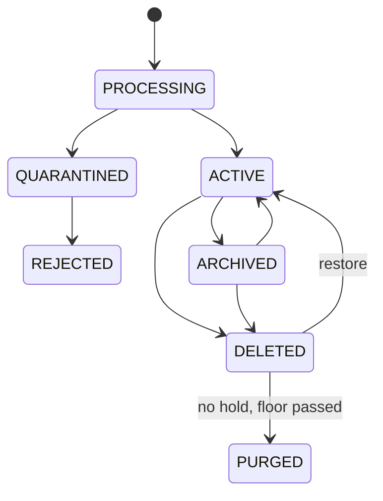

# Phase P04 — Legal Vault and Document Management System

> Paste after `01_MASTER_PROMPT.md` and `02_REQUIREMENTS_MAP_AND_DECISION_LOG.md`.
>
> **Dependencies:** P00 (repository, S3 SSE-KMS with versioning and Object Lock, audit ledger, outbox, OpenSearch, pgvector, Temporal, `packages/dix` skeleton), P01 (accounts, OTP/passkey sessions, step-up MFA, `CP_GUEST` magic-link identities, DigiLocker requester integration in `kyc`, consent artefacts `cns_`), P02 (tenants, legal entities, departments, user types, maker-checker, delivery grants), P03 (settings registry, rule engine `RULES_PORT`, metadata-schema and retention content packs). External: DigiLocker Requester API (NeGD), malware engines, Microsoft Graph and Google Drive APIs (optional), JioCX WhatsApp BSP (optional, flagged).
> **Sequencing:** Wave 1. Sprints 1–3 build the storage core (§4A–§4E, §4M, §4N) because P06, P07 and P08 write into it; sprints 4–6 build search, sharing, intake and reminders (§4F–§4K); sprints 7–9 build family vault, nominee access, Office co-editing, mobile offline and health checks (§4L, §4O–§4R). P04 ships the **`packages/dix` baseline** (malware scan, true-type sniffing, deterministic print OCR for search, Aadhaar detection and masking) so that NN-04 holds from the first upload; P05 (Wave 2) adds handwriting, type copies, translation and extraction on the same pipeline. P20 core (Wave 1) owns the import engine and `LD-EXPORT-1.0` packaging; P04 owns the vault-side mapping UX. **Freeze point:** the canonical document model (§4A) and the folder-view rule pack format freeze at end of sprint 3; later changes follow expand → migrate → contract (NN-12).
> **Binding appendices:** A (workflows and state machines), B (data model, events and error codes), D (personas and permission matrix), F (instrument eligibility — read by health checks), K (`LD-EXPORT-1.0` folder taxonomy — vault folder views mirror it), R (settings registry), W (open items), Y (Ecosystem Spec v1.2 change request — LD as producer of `documents` events).
> **Requirements covered:** R-011, R-021, R-022, R-023, R-024, R-043, R-053, R-055, R-061, R-067, R-068; contributes to R-005 (DigiLocker pull), R-017 (mobile), R-025 (accessibility), R-027, R-030, R-044 (inputs for type copy).
> **Decisions applied:** D-01, D-07, D-10, D-12 (DigiLocker via `kyc`) · **Challenges applied:** CH-02, CH-15, CH-16, CH-28, CH-29 · **Non-negotiables tested:** NN-01, NN-02, NN-04, NN-09, NN-11, NN-12, NN-13, NN-15, NN-17, NN-18, NN-24, NN-25, NN-26, NN-28, NN-29, NN-30, NN-32, NN-38, NN-40 (health-check input), NN-42, NN-44, NN-45, NN-46
> **Estimated effort:** 9 two-week sprints, squad of 8 (backend 3, web 2, mobile 1, search/data 1, QA/accessibility 1), plus a part-time content analyst for metadata schemas and retention packs.

---

## 1. Objective and business outcome

LawDocs must be the app a person or a company **keeps** — the place where every agreement, ID, policy, notice, order and receipt lives, can be found in seconds, is shared exactly as far as the owner chooses, and survives code releases, vendor changes and the owner's own exit. P04 builds the **Legal Vault** (individuals and families) and the **Document Management System** (companies) as one `dms` bounded context with two experiences.

The vault is not a "DigiLocker" under the IT (Preservation and Retention of Information by Intermediaries Providing Digital Locker Facilities) Rules 2016 — LawDocs is not a licensed Digital Locker Service Provider. Product copy says **"Legal Vault"**, never "DigiLocker"; DigiLocker is a source the vault pulls from with consent (R3 LG-036–038; CH-15) **[LAW]**.

| Outcome | Exit-gate measure |
|---|---|
| Keep everything, lose nothing | Every original is stored once with SHA-256 at ingest and S3 Object Lock; zero originals overwritten in the release test suite (NN-09) |
| Find anything fast | Permission-trimmed search ≤ 1.5 s p95 on 1 million documents per tenant, ≤ 800 ms p95 on 10,000 documents per individual, including OCR text and Indic queries |
| Share exactly what you mean | A share pack containing one version, pages 3–7, redacted, view-only, watermarked, expiring in 72 hours, created in ≤ 6 clicks; revocation effective ≤ 60 s; every open logged and visible to the owner |
| Structure survives change | Folder views are computed from canonical IDs and metadata; a release that renames, reorders or adds folder views changes zero stored objects (NN-12) |
| Bulk intake | A 5,000-file folder tree or ZIP maps, previews and commits in one job with duplicate detection and no overwrite; re-import of an `LD-EXPORT-1.0` package maps 100% from its manifest |
| Nothing expires unnoticed | Every document with an expiry or renewal date produces reminders at the configured offsets; dashboard of "expiring in 30/60/90 days" |
| Family and legacy | An individual can add family members, guardians for dependants and a nominee with time-locked legacy access; the nominee release flow completes with identity verification and a cancellable waiting period |
| Lawful by construction | No full Aadhaar number is ever written to storage or to derived text (NN-04); DigiLocker documents are stored as URI + verification result unless a permitted retained copy is recorded (NN-42) |
| Portable | Every record type in this phase is registered in `xpt.export_map` and exports in `LD-EXPORT-1.0` without staff help (NN-11) |

"Done" for an individual: from the home screen they photograph a rent agreement, it is auto-classified as "Rent agreement", the expiry date is extracted as a suggestion, they confirm it, a renewal reminder is set, and they share pages 1–4 with their landlord's advocate for 7 days, view-only — in under two minutes.

---

## 2. Scope (in / out)

**In scope**

- Canonical document model: documents, versions, derived-rendition links, document links to records, relationships, folders as views, smart folders and saved views.
- Personal Legal Vault (individual tenant type) and Company DMS (company tenant type) on one engine with different defaults.
- Metadata schemas per document type (content packs), tags, custom fields.
- Versions, check-in/check-out, compare, restore.
- Search (full text, metadata, semantic, Indic), filters, facets, saved views.
- Selective sharing: internal and external share packs (document, version, page range, redacted copy), expiry, watermark, download/print control, view-only, OTP, revocation, access log; shares to counterparties, advocates, family, nominee and ecosystem apps (through `int`).
- Ingestion channels: web upload, drag-and-drop, phone camera scanner, device scanner (TWAIN-free: via OS share sheet/PDF), email-in, WhatsApp forward (flagged), DigiLocker pull, connector pull (OneDrive/SharePoint/Google Drive), bulk folder/ZIP intake (with the P20 importer).
- `packages/dix` baseline: malware scan, content disarm for renditions, true-type sniffing, print OCR for search, Aadhaar detection and masking at ingest.
- Retention schedules, legal hold, recycle bin, disposal with approval and disposal certificate.
- Reminders on expiry/renewal facts (IDs, leases, insurance, warranties, licences, PUC, registrations).
- Family vault, dependants, guardians, nominee/legacy access.
- Document health checks (rule-driven).
- Office-openable files; optional co-editing in the customer's own Microsoft 365 or Google Workspace.
- Mobile vault including encrypted offline cache.
- Pricing hooks: storage quotas, overage meter, add-on entitlements.

**Out of scope (owner phase)**

| Item | Owner |
|---|---|
| Handwriting/screenshot type copies, translation, field extraction beyond expiry-date suggestions, PII redaction suggestions | P05 |
| Template assembly, AI drafting | P06 |
| Negotiation rounds, redlines, deal rooms for negotiation, obligations register | P07 |
| eSign, eStamp, execution formalities, evidence packs, BSA s.63 certificate service | P08 |
| Vidhi Q&A over documents ("ask your vault"), agents | P09 (P04 exposes permission-scoped retrieval) |
| Court bundles, annexure builder, court render profiles | P10 |
| Matter and case records | P11 |
| Export packaging, BYO storage sync, import engine | P20 (P04 registers record types and supplies mapping UX) |
| Mobile store release and device-trust plumbing | P22 (P04 specifies vault behaviour) |
| Credential vault (portal passwords) | `cvl` (P18) — never stored in the DMS |

---

## 3. Personas and permissions touched

Full matrix in Appendix D. Permissions are Cerbos policies over attributes `tenant_id`, `legal_entity_id`, `department_id`, `confidentiality_class`, `owner_prs_id`, `share_grant`, `delivery_grant`.

| Role code | What they can do in P04 |
|---|---|
| `IND_OWNER` | Full control of own vault: upload, organise, share, set reminders, add family members, guardians, delegates and nominees, export, delete (subject to legal hold and evidence floors) |
| `IND_FAMILY_MEMBER` | Own vault; read/write the family folders shared with them; cannot see the owner's private folders |
| `IND_GUARDIAN` | Manages a dependant's profile (minor or ward) inside the guardian's vault; no separate login for the dependant |
| `IND_NOMINEE` | No access until a legacy release completes; then read-only and export over the designated scope |
| `IND_DELEGATE` | Scoped helper (e.g., upload and file only; or view one folder) with expiry |
| `ORG_OWNER`, `ORG_ADMIN` | Configure folder views, metadata fields, retention classes, sharing defaults, connectors, email-in, WhatsApp channel (if enabled), quotas per department |
| `ORG_CLO` | Legal hold, legal-privilege class, disposal approval (checker), oversight of external shares |
| `ORG_LEGAL_MAKER` | Upload, classify, version, relate, share within policy, propose disposal |
| `ORG_CHECKER` | Approves bulk deletes, disposals, external shares of `CONFIDENTIAL_LEGAL` (maker ≠ checker, NN-18) |
| `ORG_APPROVER`, `ORG_DIRECTOR`, `ORG_KMP` | Read documents in scope; approve where a workflow names them |
| `ORG_DEPT_HEAD` | Manages department folder views and department sharing |
| `ORG_MEMBER` | Upload into intake folders; read shared documents; request documents from legal |
| `ORG_EXT_COUNSEL` | Guest: only documents shared with them; upload into a request slot |
| `ORG_AUDITOR_RO` | Read-only over the audit scope, watermarked, no download unless granted |
| `ORG_DELEGATED_MAKER` / `OPS_RM` / `OPS_PROFESSIONAL` | Only under a client-approved delivery grant (NN-17): deliver documents into client folders, read in grant scope; every access in the client's transparency log |
| `CP_GUEST` | Opens a share pack after OTP; downloads/prints only if allowed; uploads into a request slot |
| `PRO_*` | Practitioner workspace sees client documents only through engagement grants (P16) |
| `PLT_CONTENT_EDITOR` / `PLT_LEGAL_REVIEWER` | Author and review metadata schemas, retention packs and health-check rules (content, NN-30) |
| `PLT_SUPER_ADMIN`, `PLT_SRE` | No content access; operate quotas, engines and incidents; break-glass only under NN-17 |
| `AGT_*` | Maker only (NN-43): classify, propose metadata, propose folder, propose reminders; never share externally, delete or release nominee access |

---

## 4. Functional requirements

### 4A. Canonical document model and folder views

**FR-P04-01 — One document, stable identity.** Every stored item is a `doc_` with immutable identity (ULID) and an ordered list of versions `ver_`. Derived renditions (OCR text, type copies, translations, redacted copies, PDF/A conversions) are `drv_` rows linked to a source version; they never replace it (NN-09). A document can be linked to any number of records (`agr_`, `mat_`, `cas_`, `grv_`, `mtg_`, `eng_`, `tmk_`, `veh_`, `chl_`, `prs_`) through `dms.doc_links`; removing a link never deletes the document.

**FR-P04-02 — Folders are views over canonical IDs.** The physical object key is `t/<tenant_id>/d/<doc_id>/v/<ver_id>` and never encodes a folder, name, year or region (NN-12). What users see as folders are **views** computed by a versioned rule pack (`dms.folder_view_pack`) from metadata: tenant type, document type, category, legal entity, year (calendar year for individuals, Indian FY for companies — setting), department, counterparty, record links. Moving a document in the UI writes metadata (e.g., category), so its view path changes and its identity and storage key do not.

**FR-P04-03 — Default views mirror `LD-EXPORT-1.0`.** Personal Vault top-level views: `01 My Profile and IDs (masked)`, `02 Property`, `03 Family and Succession`, `04 Employment`, `05 Finance, Loans and Insurance`, `06 Vehicles`, `07 Disputes and Court Cases`, `08 Agreements`, `09 Tax`, `10 Receipts and Invoices`, plus `00 Inbox (unfiled)`. Company DMS top-level views: `01 Company Profile`, `02 Agreements and Contracts/<Year>/<Department>/<Counterparty> – <Agreement title> (LD-AGR-…)/{01 Drafts … 06 Correspondence}`, `03 Litigation and Disputes`, `04 Trademarks and IP`, `05 Board and Governance`, `06 Policies and Registers`, `07 People and HR`, `08 Notices and Correspondence`, `09 Services and Engagements`, `10 Billing and Invoices`, `11 AI Work Products (labelled)`, plus `00 Intake`. The Appendix K taxonomy is authoritative; the view pack implements it so that what users browse equals what they export.

**FR-P04-04 — Working folders.** Users may create manual folders (`fld_`) anywhere in their tree (e.g., "Flat purchase 2026"). A manual folder is a tag-like membership set: a document may appear in several manual folders and still has exactly one canonical view path. Exports include manual folders as an alternate index (`00 Index.xlsx`, sheet "My folders") without duplicating files.

**FR-P04-05 — Smart folders.** A smart folder is a saved query pinned in the tree (e.g., "Expiring in 90 days", "Unsigned agreements", "Documents shared externally this month", "Everything about Flat 302"). Seed smart folders per tenant type; users create their own from any search (§4F). Smart folders never hold documents; they evaluate at open time with the user's permissions.

**FR-P04-06 — View-pack changes are migrations of views, not data.** A new view-pack version (e.g., splitting "Finance, Loans and Insurance") is published as content (NN-30) with an old-path → new-path alias table; links and bookmarks to old paths redirect; exports list both paths for one release cycle. No object moves.

**FR-P04-07 — File names.** Display names default to a pattern per document type (`<YYYY-MM-DD> – <Document type> – <Counterparty or subject>`), editable; the original upload filename is preserved as metadata `original_filename`. Names are sanitised for export (no reserved characters, ≤ 120 characters) without changing the stored display name.

*Customisation hooks:* tenant view-pack overlays (rename a top-level view, add a department level, choose FY or calendar year), naming patterns per type, seeded smart folders on/off. *Help keys:* `hlp.dms.legal_vault`, `hlp.dms.folder_view`, `hlp.dms.smart_folder`, `hlp.dms.canonical_id`.

### 4B. Metadata schemas, document types and tags

**FR-P04-08 — Document-type catalogue.** Platform content (`PLT_CONTENT_EDITOR` authors, `PLT_LEGAL_REVIEWER` approves) maintains a catalogue of document types, each with: code, display names (10 launch UI languages, D-07), category, default view path, metadata schema (JSON Schema 2020-12), default retention class, reminder rules, health-check rules, eligibility family code (Appendix F) where the type is an executable instrument, and confidentiality default. Catalogue versions are effective-dated; tenants pin or follow latest.

**FR-P04-09 — Seed schemas (minimum).**

| Type family | Key fields (all optional unless marked *) |
|---|---|
| Identity documents (PAN, passport, driving licence, voter ID, Aadhaar — masked only) | document kind*, issuer, number (masked display; Aadhaar last 4 only), name as on document, date of birth (individuals' own only), issue date, expiry date, source (`USER_UPLOAD` / `DIGILOCKER_URI`), verification result |
| Lease / rent / leave and licence | lessor/licensor*, lessee/licensee*, property address, State*, start*, end*, rent, deposit, escalation, lock-in, notice period, stamp certificate UIN, registration number and office, eligibility family |
| Property title (sale deed, gift deed, partition, mutation, tax receipt) | property ID/address, State, district, sub-registrar office, registration number and date, parties, consideration, encumbrance notes |
| Insurance policy | insurer, policy number, product, insured, sum insured, premium, premium due date, expiry, nominee name |
| Warranty / invoice | product, seller, purchase date, invoice number, amount, warranty end, serial number |
| Vehicle (RC, insurance, PUC, permit) | registration number, owner name, chassis/engine (masked to last 5), insurance expiry, PUC expiry, fitness expiry, hypothecation |
| Employment | employer, designation, start/end, CTC, notice period, document kind (offer, appointment, relieving, payslip, Form 16) |
| Loan / credit | lender, loan account (masked), sanction amount, EMI, tenure, closure date, NOC received |
| Agreement (generic) | parties*, agreement type, effective date, term/end date, renewal type (auto/manual/none), notice-for-renewal days, value, governing law, jurisdiction, counterparty, department, LD-AGR reference |
| Court/dispute | forum, case number/CNR, parties, next date, stage (links to `lit` in P11) |
| Tax | assessee, tax year/AY, return type, acknowledgement number, filing date |
| Company records | entity, FY, body (Board, committee), meeting date, resolution number, register name |

**FR-P04-10 — Custom fields.** `ORG_ADMIN` (and `IND_OWNER` for personal types) add fields per type: text, number, money (INR NUMERIC), date, picklist, person, organisation, record link, boolean; validation; visibility by role. Custom fields appear in filters, exports (manifest columns) and the Configuration Studio; no Super Admin involvement (NN-29).

**FR-P04-11 — Tags.** Free tags (user) and governed tags (tenant list, colour, description). Tags are many-to-many and never drive the canonical path.

**FR-P04-12 — Auto-classification (baseline).** On ingest, rules (filename patterns, email-in address, source module, DigiLocker document type, OCR keyword sets per type) propose a type and category with a confidence score; the user confirms in one tap or changes it. Auto-apply above `dms.classify.auto_apply_threshold` (default 0.95, tenant-adjustable, never for Aadhaar-bearing or `CONFIDENTIAL_LEGAL` documents). P05 adds model-based classification and field extraction on the same contract.

**FR-P04-13 — Expiry and renewal facts.** Date fields marked `is_reminder_fact` in a schema (expiry, end date, premium due, renewal notice deadline) feed §4K. Where P05 is not yet live, users enter them; the baseline extracts dates only from DigiLocker metadata and native-text PDFs using deterministic patterns, always as a suggestion.

*Help keys:* `hlp.dms.document_type`, `hlp.dms.metadata`, `hlp.dms.custom_field`, `hlp.dms.tag`.

### 4C. Versions, check-in/check-out, compare

**FR-P04-14 — Versions.** Every new file for an existing document creates `ver_` with sequence (major.minor), author, comment, SHA-256, size, MIME (sniffed), source and created-at. Restoring an old version creates a new version that copies it; history is never rewritten (NN-02). Executed versions (signed in P08 or marked executed with evidence) are `is_executed = true` and sealed under compliance-mode Object Lock.

**FR-P04-15 — Check-out.** Optional exclusive lock with expiry (`dms.checkout.max_hours`, default 24); the lock holder edits in Word/Excel desktop or in a co-editing session (§4P) and checks in a new version; `ORG_ADMIN` can break a lock with a reason (audited); a check-in after lock expiry is accepted as a new version with a conflict banner if another version was created meanwhile (`LD-DMS-008`).

**FR-P04-16 — Compare.** Any two versions: text diff for DOCX/PDF text (word level, side by side and inline), page-image visual diff for scans, metadata diff. For negotiation rounds, P07's deterministic redline replaces this view.

**FR-P04-17 — Version visibility.** External share recipients see only the versions placed in a share pack (NN-37 parity); internal comments on a version are never shown in a share.

### 4D. Document relationships

**FR-P04-18 — Typed relationships.** `dms.relationships(from_doc, to_doc, type, effective_date, note)` with types: `AMENDS` / `AMENDED_BY`, `ADDENDUM_TO`, `RENEWS` / `RENEWED_BY`, `SUPERSEDES` / `SUPERSEDED_BY`, `TERMINATES` / `TERMINATED_BY`, `ANNEXURE_OF`, `COUNTERPART_OF`, `STAMP_CERTIFICATE_FOR`, `REGISTRATION_RECEIPT_FOR`, `NOTICE_UNDER`, `REPLY_TO`, `EVIDENCE_FOR`, `REFERENCES`. Inverses are maintained automatically; cycles of `SUPERSEDES` are rejected (`LD-DMS-026`).

**FR-P04-19 — Effective view.** For an agreement family the document page shows "Current effective position": the base agreement, applied amendments in date order, the latest renewal, and any termination — with a warning if a superseded version is opened ("This lease was renewed on 2026-04-01 — open current"). Search results de-rank superseded documents unless the filter asks for them.

**FR-P04-20 — Relationship suggestions.** On upload, a document whose title or text contains "amendment", "addendum", "renewal", "supplementary", "termination" and a counterparty name matching an existing agreement prompts "Link to …?". Suggestions only; the user confirms.

*Help keys:* `hlp.dms.amendment`, `hlp.dms.addendum`, `hlp.dms.supersedes`, `hlp.dms.counterpart`.

### 4E. Ingestion channels

**FR-P04-21 — Upload pipeline (baseline).** `RECEIVED → SCANNED (malware; two engines where licensed) → SNIFFED (magic bytes; extension mismatch rejected) → SANITISED (rendition copy without active content) → AADHAAR_CHECK → STORED (Object Lock, SHA-256) → TEXT_EXTRACTED (native text) → OCR_PRINT (deterministic engine for scans, for search only) → INDEXED → CLASSIFIED (suggestion)`. Each stage is an idempotent activity in `DocIngestWorkflow` (Temporal), retried with back-off; the document page shows a processing panel. The SHA-256 is computed over the exact bytes committed and recorded in the audit ledger in the same transaction as the `doc_`/`ver_` rows (NN-45).

**FR-P04-22 — Aadhaar at ingest (NN-04).** Before bytes are committed, the baseline detector scans native text and print-OCR text for 12-digit sequences passing the Verhoeff checksum (with spacing variants) and detects Aadhaar card layouts and legacy Aadhaar QR codes. On detection:

1. The user sees "This file contains an Aadhaar number. LawDocs stores only a masked copy (first 8 digits hidden)." with a preview.
2. The system produces the masked file (image regions burned in; PDF text removed from the content stream, not overlaid; legacy QR codes masked **[VERIFY: which UIDAI QR versions embed the full number]**) and commits **only the masked file** as version 1.
3. The ledger records `pre_mask_sha256` of the unmasked bytes, the masking method and the regions, so the user can later prove the masked copy came from a specific original they hold offline. The unmasked bytes are discarded from memory and temp storage (no S3 write; temp volumes encrypted and wiped).
4. Help text recommends keeping Aadhaar as a DigiLocker link (§4G) or the UIDAI masked e-Aadhaar.

There is no "store unmasked" option for any role or plan. Evidence originals that contain third-party Aadhaar numbers follow the same rule; the user keeps the unmasked original physically or on their own device **[COUNSEL: confirm that a masked electronic copy plus pre-mask hash and the user-held original is adequate for evidentiary use; OI-P04-01]**. Error/info code `LD-DMS-006`.

**FR-P04-23 — Phone camera scanner.** Mobile and mobile-web capture with edge detection, perspective correction, multi-page capture, auto-crop, black-and-white/colour modes, page reorder, and on-device compression to PDF; each page keeps its capture timestamp; GPS/EXIF is **not** written to the rendition and is retained in the original only when the user opts in (default off for vault, on for evidence capture in P15). Offline capture queues encrypted on device (NN-44) and uploads when online. Budget: **≤ 3 taps from home to captured and queued**.

**FR-P04-24 — Device scanners and share sheet.** Desktop: drag-and-drop files or folders; scanner output arrives as PDF/JPEG via the OS. Mobile: "Share to LawDocs" from any app (Files, Gmail, Outlook, Photos, WhatsApp's own share sheet) — this is the default WhatsApp path and needs no WhatsApp integration.

**FR-P04-25 — Email-in.** Per user and per company department addresses (`<token>@in.<mail-domain>` **[OWNER: domain]**), regenerable tokens, SPF/DKIM/DMARC evaluation, sender allowlist (company addresses default to "tenant users only"), size limits, body saved as `.eml` original plus a readable PDF rendition, attachments as child documents linked `ANNEXURE_OF`. Unknown senders → rejected with a bounce that discloses nothing (`LD-DMS-024`).

**FR-P04-26 — WhatsApp forward (flagged).** Inbound documents to a LawDocs WhatsApp Business number through the JioCX BSP adapter **[VERIFY: JioCX WhatsApp BSP status and media-retention terms — R4]**: the sender's number must match a verified account mobile; the first message returns a one-time link to confirm the account; files land in `00 Inbox (unfiled)`. Media in transit is processed by Meta's WhatsApp infrastructure outside LawDocs' control; the feature therefore stays OFF (`dms.channel.whatsapp_in.enabled = false`) until a transfer assessment is recorded (NN-25) and the user sees a disclosure before first use. The share-sheet route (FR-P04-24) is always available and keeps content on-device until upload.

**FR-P04-27 — Connector pull.** Pick files or folders from the user's connected OneDrive/SharePoint/Google Drive (OAuth via `int`, P19 connectors); files are copied in (hashed, versioned); the source path and file ID are kept as provenance; optional one-way watch on a folder creates new versions on change (company only, setting).

**FR-P04-28 — Bulk folder/ZIP intake (with P20).** Drag a folder tree or upload a ZIP (resumable chunked upload, `dms.intake.max_zip_gb` default 10) → P20 importer (`imp_` job) expands and fingerprints → P04 **mapping preview grid**: every file with proposed document type, category, entity, year, department, counterparty, record links, tags, from (a) folder-name pattern rules (tenant-editable, e.g., `FY {yyyy}-{yy}` → FY; `*/Leases/*` → type Lease), (b) `LD-EXPORT-1.0` path and manifest recognition (100% automatic on a LawDocs export), (c) classification suggestions; flags for duplicates (same SHA-256 in tenant → default "link existing"), conflicts (same view path, different bytes → "new version" or "skip"; never overwrite), Aadhaar detections (masked per FR-P04-22), encrypted/unsupported/oversized/infected files (quarantined list). Bulk edit (select rows → set field), save rules for next time, then commit as a resumable, idempotent job with an XLSX/CSV intake report. Budget: **≤ 4 clicks from folder drop to commit** for an export re-import.

**FR-P04-29 — Generated documents.** Documents produced by other modules (P06 drafts, P07 rounds, P08 signed files, P10 pleadings) are written through the same `DmsWriter` API with source `GENERATED` and their record links; modules never write object storage directly.

*Help keys:* `hlp.dms.aadhaar_masking`, `hlp.dms.email_in`, `hlp.dms.bulk_intake`, `hlp.dms.duplicate`, `hlp.dms.scanner`.

### 4F. Search, filters and saved views

**FR-P04-30 — Index.** OpenSearch per-tenant index alias (one index per large tenant; shared index with `tenant_id` routing and filtered aliases for small tenants), Indic analyzers (ICU tokenizer, normalisation for Devanagari, Bengali, Gurmukhi, Gujarati, Odia, Tamil, Telugu, Kannada, Malayalam, Perso-Arabic scripts; transliteration-aware fields for romanised Indic queries), English stemming; fields: title, display name, type, metadata, tags, native text, OCR text, and (from P05) type-copy and translation text. PostgreSQL FTS fallback if OpenSearch is unavailable (degraded banner).

**FR-P04-31 — Permission trimming.** Every query adds the caller's ABAC filter at the engine (tenant, entity, department, confidentiality class, share grants, delivery grants); snippets are produced only from documents the caller can open. `CONFIDENTIAL_LEGAL` (privileged) and `RESTRICTED_PERSONAL` (health, family disputes, minors) classes live in a separate scoped index searchable only by holders of that scope. IDOR tests per endpoint (NN-01).

**FR-P04-32 — Semantic search.** Chunk embeddings (pgvector, tenant-scoped tables, multilingual embedding model via `packages/ai` on Bedrock India for confidential classes, NN-15) support natural-language queries ("the lease for the Pune office that ends next year", "मेरी कार का बीमा"). Hybrid ranking (BM25 + vector, reciprocal-rank fusion) with the same permission filter. Cross-lingual retrieval quality is evaluated per launch language before enabling (`dms.search.semantic.enabled` per language; NN-38).

**FR-P04-33 — Filters and facets.** Type, category, year/FY, entity, department, counterparty, party, tag, status (draft, executed, expired, superseded, on hold), source (upload, DigiLocker, email-in, generated, intake), language, has-expiry, expiring-within, shared-externally, confidentiality, owner, created/modified date ranges, signed (yes/no), stamped (yes/no), health flags. Facet counts are permission-trimmed.

**FR-P04-34 — Saved views.** Any search + filters + columns + sort is saveable as a view (`svw_`), private or shared with a role/department; pin as smart folder; schedule a digest ("every Monday email me documents expiring in 60 days" via `ntf`). Budget: **≤ 2 clicks from home to a result** for a title search; **≤ 3** to save a view.

*Help keys:* `hlp.dms.search`, `hlp.dms.semantic_search`, `hlp.dms.saved_view`.

### 4G. DigiLocker pull (NN-42)

**FR-P04-35 — Pull with consent.** From "Add from DigiLocker", the user authenticates with DigiLocker (OAuth through the `kyc` requester integration), selects issued documents (PAN, DL, RC, marksheets, insurance and others the issuer provides), and gives purpose-specific consent recorded as a `cns_` artefact naming the purpose ("keep a verified reference in my Legal Vault").

**FR-P04-36 — Default storage = URI + verification.** The vault stores the DigiLocker URI, issuer, document type, issue date, metadata returned, the verification result, consent reference and fetch time — not the file (Requester ToU cl.4(d), 6(b), 18; R3 LG-038). Viewing or exporting re-fetches with a fresh session and consent; if consent or session has expired the user is asked again (`LD-DMS-016`). Documents fetched by URI show a "Verified with issuer (DigiLocker)" badge re-validated on display; user uploads never get this badge (Rule 9A, LG-037).

**FR-P04-37 — Retained copy (flag OFF).** "Keep a copy in my vault" is available only when `dms.digilocker.retain_copy.enabled = true`, which stays OFF until NeGD's written confirmation of the permitted purpose and duration is logged in `docs/compliance/verification-log.md` (NN-38) **[VERIFY: NeGD position on user-directed saving — R3 §17 item 6]**. When ON: the retained copy is stored with its own hash, linked to the URI, labelled "Copy saved on <date> — verify again for current status", and retained only for the recorded purpose and period.

**FR-P04-38 — Incident clock.** DigiLocker-related incidents trigger the 24-hour NeGD notification task in the incident runbook (Requester ToU cl.4(e), 13), in addition to CERT-In 6 hours (NN-27).

*Help keys:* `hlp.dms.digilocker_uri`, `hlp.dms.verified_with_issuer`.

### 4H. Selective sharing

**FR-P04-39 — Internal sharing.** Share a document, folder view, smart folder or saved view with a user, role, department, family member or delegate with level `VIEW`, `COMMENT`, `EDIT`, `MANAGE`; optional expiry; "Who has access" panel per document listing every path of access (ownership, folder rule, share, delivery grant, engagement grant).

**FR-P04-40 — External share packs (`shr_`).** The owner builds a share pack by ticking exactly what to include. Each item is one of:

| Item kind | Rule |
|---|---|
| Document (current version) | Recipient sees the version current at share time unless "always current" is ticked (company setting; off by default) |
| Specific version | Pinned `ver_` |
| Page range | Server renders a new PDF of the selected pages from the source version as a `drv_` (kind `PAGE_EXTRACT`) with a footer "Extract: pages 3–7 of 12 of <title>"; the recipient never receives the other pages |
| Redacted copy | A `drv_` (kind `REDACTED`) produced in the redaction tool (§4I); the original is untouched |
| DigiLocker reference | Shares the verification result and a re-fetchable view only if the Requester ToU permits onward display **[VERIFY]**; otherwise the item is blocked with an explanation |

Pack options: recipients (email/mobile; `CP_GUEST` identity created on first open), authentication (OTP to the address/number used — mandatory; optional passcode), access mode (`VIEW_ONLY` in the secure viewer / `DOWNLOAD` / `PRINT`, each a separate toggle), dynamic watermark (recipient name/email/mobile masked, timestamp, "Shared by <owner> via LawDocs", pack ID), expiry date-time (default `dms.share.default_expiry_days` = 7; max per plan), maximum opens, message, request-for-upload slot (recipient can return files into a chosen folder after malware scan), "notify me on first open". Preview "what the recipient will see" before sending. Budget: **≤ 6 clicks** for a single-document, page-range, view-only, expiring share.

**FR-P04-41 — Revocation and expiry.** The owner (or any `MANAGE` holder) revokes a pack or a single item; viewer sessions are invalidated ≤ 60 s (short-lived signed URLs ≤ 5 minutes plus server-side session check per page request). Expired packs show the recipient "This share has ended" with no metadata.

**FR-P04-42 — Access log visible to the owner.** Every open, page view (page number and dwell band), download, print request, failed OTP, upload into a slot and revocation is logged (`dms.share_access_log`) and shown to the owner in the pack and in "Sharing activity". Counterparties are told, on the OTP screen, that access is logged.

**FR-P04-43 — Guards.** External sharing of `CONFIDENTIAL_LEGAL` needs an `ORG_CHECKER` approval in company tenants (maker-checker, NN-18); `RESTRICTED_PERSONAL` items prompt a purpose confirmation; documents under legal hold may be shared (holds stop disposal, not access); documents with unresolved Aadhaar detections cannot exist (FR-P04-22). AI agents can prepare a share pack as a draft but only a human sends it (NN-13).

**FR-P04-44 — Share audiences.** Counterparties and their advocates (pack), engaged professionals (engagement grant via P16 instead of a pack, so access ends with the engagement), family members (internal share), nominees (designation, §4L — not a share), LawDocs delivery staff (delivery grant, NN-17), ecosystem apps (FR-P04-45).

**FR-P04-45 — Share to ecosystem apps.** A user may send a document to their own account in Equator, LawDocsComply, Finbyx or Udofin (e.g., an executed settlement to Equator) only through `int`: LawDocs publishes `in.infrabyx.documents.DocumentShared.v1` (Ecosystem Spec §6.13) with document reference, SHA-256 and detached JWS, a `consentref` from the user's consent artefact, and the consumer retrieves via `GET /v1/documents/{id}` on a signed India-hosted URL valid ≤ 15 minutes. LD as producer is registered in Appendix Y. Nothing is pushed by default; the sharing ledger lists every transfer (NN-24, CH-16).

*Help keys:* `hlp.dms.selective_share`, `hlp.dms.page_range`, `hlp.dms.watermark`, `hlp.dms.view_only`, `hlp.dms.revoke`, `hlp.dms.access_log`.

### 4I. Viewer, annotation and redaction

**FR-P04-46 — Secure viewer.** In-browser and in-app viewer for PDF, images, Office (server-rendered PDF renditions), email; page thumbnails, search within document, zoom to 400% without loss of function (NN-28), keyboard navigation, screen-reader text layer (native or OCR text), high-contrast mode; print/download buttons rendered only when permitted; dynamic watermark overlay rendered server-side into page images for `VIEW_ONLY` packs.

**FR-P04-47 — Annotations.** Private and shared annotations (highlight, note, pin) stored separately from the file; never exported to external recipients unless "Include my notes" is chosen.

**FR-P04-48 — Redaction tool.** Area and text-pattern redaction producing a new `drv_` (kind `REDACTED`): content removed from the PDF content stream and images re-rendered (not black boxes over live text); reason codes; redaction log; pattern library in the baseline: Aadhaar, VID, PAN, phone, email, bank account, card numbers (P05 adds model-based PII suggestions). A redacted copy is labelled in its footer "Redacted copy — original retained by owner".

### 4J. Retention, legal hold, recycle bin, disposal

**FR-P04-49 — Retention classes (content).** Rule-pack rows: class code, legal floor, trigger (upload, execution, end of agreement, closure of matter, end of FY, account closure), citation, confidence, reviewer of record (NN-30). Tenants can lengthen, never shorten below a floor. Seeds (each `[VERIFY]` before go-live unless marked):

| Class | Floor | Basis |
|---|---|---|
| `PERSONAL_USER_CONTENT` | Until the user deletes or closes the account (+ grace, §4J-53) | User instruction; DPDP Act 2023 s.8(7) for data LawDocs holds as fiduciary [INTERP] |
| `EXECUTED_INSTRUMENT_EVIDENCE` (eSign evidence, signed PDFs) | ≥ 7 years after the later of signing and account closure; longer if limitation requires | eSign API v3.3 log archival (R3 LG-008, V-WEB); Limitation Act 1963 (LG-092) |
| `COMPANY_BOOKS_AND_VOUCHERS` | 8 years from the end of the relevant FY | Companies Act 2013 s.128(5) |
| `MINUTES_AND_REGISTERS` | Permanent | Companies Act s.118 and s.88 with the Management and Administration Rules [VERIFY rule numbers] (shared with `gov`; LDC is SoR when present, NN-47) |
| `GST_RECORDS` | 72 months from the due date of the annual return | CGST Act s.36 |
| `INCOME_TAX_RECORDS` | Per Income-tax Act 2025 and Rules 2026 | [VERIFY new-Act provision] |
| `LITIGATION_FILE` | Closure of matter + limitation for appeal/execution + 3 years | Limitation Act 1963 [REC] |
| `EMPLOYEE_RECORDS` | Per Labour Codes and rules | [VERIFY] (P13) |
| `MARKETING_AND_TRANSIENT` | 2 years | [REC] |

**FR-P04-50 — Legal hold (`hld_`).** `ORG_CLO` (company) or `IND_OWNER` (own vault, e.g., "I am in a dispute") places a hold by matter, document, folder view or saved view, with reason and optional matter link (`mat_`); the hold sets the S3 legal-hold flag on all affected object versions and blocks disposal, purge and recycle-bin expiry; release needs a second approver in company tenants (NN-18). Holds are listed on each document and in a hold register.

**FR-P04-51 — Recycle bin.** Delete moves a document to the recycle bin (state `DELETED`, invisible in views and search); restore within `dms.recycle.retention_days` (default 30; plan range 30–90). Bulk deletes of > `dms.delete.bulk_threshold` (default 20) items in company tenants need checker approval (NN-18). Executed and evidence-class documents cannot be deleted before their floor; the user sees why (`LD-DMS-010`) and may instead archive (hide) them.

**FR-P04-52 — Storage modes enabling lawful deletion.** User uploads use S3 Object Lock **governance mode** with per-object data keys (envelope encryption); purge after the recycle period deletes object versions through a dedicated service role and destroys the data key (crypto-shredding), with a purge record (hash, size, who, when, basis) kept permanently. Executed instruments, evidence packs and documents in `EXECUTED_INSTRUMENT_EVIDENCE` use **compliance mode** with retain-until = floor date; no one can delete them early, which is disclosed in the eSign terms.

**FR-P04-53 — Disposal (companies) and account closure (individuals).** A monthly job lists company documents past retention; owner proposes, checker approves; the disposal certificate (what, basis, approvals, hashes) is retained permanently. On account closure an individual is offered a full export first (never paywalled, NN-11), then a grace period (`dms.closure.grace_days`, default 90) after which governance-mode content is purged; compliance-mode items remain until their floor and are then purged automatically. DPDP erasure requests run the same path with the legal-retention check and a reasoned response (NN-26).

*Help keys:* `hlp.dms.retention`, `hlp.dms.legal_hold`, `hlp.dms.recycle_bin`, `hlp.dms.why_cannot_delete`.

### 4K. Reminders

**FR-P04-54 — Reminder rules.** Each `is_reminder_fact` date gets reminders at offsets from the type's rule (e.g., passport: 9 months, 6 months, 1 month before expiry; lease: notice-for-renewal deadline −30/−7 days and end −60/−30/−7; insurance: −30/−7/−1; warranty: −30; PUC: −15/−3; driving licence: −6 months/−1 month; agreement auto-renewal: notice deadline −30/−7). Users and tenants edit offsets, channels (in-app, push, email, SMS/WhatsApp within NN-34 consent), assignees and quiet hours. Reminders are `ntf` jobs referencing `doc_`/`ver_`; deleting a document cancels its reminders.

**FR-P04-55 — Expiry dashboard.** "Expiring soon" widget on home (Personal and Company), by category and owner; one tap to "Renew" opens the matching P06 template or service (marketplace) where one exists, or creates a task.

**FR-P04-56 — Renewal chain.** When a renewal document is linked `RENEWS`, reminders on the old document close and the new document's facts schedule new reminders.

*Help keys:* `hlp.dms.reminder`, `hlp.dms.renewal`.

### 4L. Family vault, dependants, delegates and nominee/legacy access

**FR-P04-57 — Family space.** A Personal plan owner adds up to the plan's family members (R6: 5 on Personal, +5 per add-on). Each adult member has an own account and vault (`IND_FAMILY_MEMBER`); the family gets shared views ("Family — Property", "Family — Insurance") whose items each member can see; private vaults stay private. Leaving a family removes shared access but not the member's own documents.

**FR-P04-58 — Dependants.** Minors and wards are **profiles**, not accounts (accounts are 18+; R3 LG-066, LG-032): documents (birth certificate, school records, custody orders) sit in the guardian's vault tagged to the dependant `prs_`; a second guardian can be added. DPDP Act 2023 s.9 verifiable guardian consent is recorded for any processing of the child's data beyond storage at the guardian's instruction **[VERIFY: DPDP Rules 2025 r.10 mechanism, R3 LG-040]**. At 18 the dependant can claim the profile (verified identity), and the guardian chooses what transfers.

**FR-P04-59 — Delegates.** `IND_DELEGATE` (e.g., an adult child helping a parent) with scopes `UPLOAD_ONLY`, `VIEW_FOLDERS[…]`, `MANAGE_REMINDERS`, `SHARE_ON_BEHALF` (never `DELETE`, never nominee changes), expiry mandatory (max 12 months, renewable), activity visible to the owner.

**FR-P04-60 — Nominee designation (`nom_`).** The owner designates one or more nominees with: scope (whole vault, or chosen views), access level (`READ_AND_EXPORT`), trigger (`DEATH_CLAIM`, `INCAPACITY_CLAIM`, `INACTIVITY` after `dms.nominee.inactivity_days` default 365 with check-in prompts at −60/−30/−7 days), waiting period (`iam.nominee.release_waiting_days`, P01-owned, default 30, owner-adjustable 7–90), and a personal message. The nominee is notified of the designation and accepts by OTP (Appendix A §A.8 `DESIGNATED → ACCEPTED`; P01 FR-P01-49); only the personal message can be held back until release. DPDP Act 2023 s.14 gives a Data Principal the right to nominate a person to exercise their rights on death or incapacity **[LAW] [VERIFY: s.14 wording and Rules procedure]**; the vault nomination also records that designation.

**FR-P04-61 — Legacy release workflow.** Claim by nominee → identity verification of the nominee (Aadhaar App offline verification or DigiLocker, per P01; optional proof of presence via Aadhaar App face verification, R3 LG-033) → evidence upload (death certificate, or medical certificate of incapacity, or none for inactivity) → maker-checker evidence review for death/incapacity claims (`OPS_ONBOARDING` maker → `PLT_DPO` or `OPS_DELIVERY_LEAD` checker at AAL3, per Appendix A §A.8; staff see the claim evidence only, never vault content; the claimant may escalate to `PLT_GRIEVANCE_OFFICER`) → waiting period with notices to the owner on every channel and to other nominees → owner (or any co-nominee with "object" right) can cancel during the wait → release read-only access plus export of the scope for `iam.nominee.access_days` (P01-owned, default 180). Release never transfers ownership. The screen states: "Nominee access lets you see and download documents. It does not decide who inherits property — that is governed by law (for example, a will or the succession law that applies)." **[COUNSEL: wording; OI-P04-02]**. Budget: owner sets up a nominee in **≤ 5 taps**.

*Help keys:* `hlp.dms.family_vault`, `hlp.dms.dependant`, `hlp.dms.delegate`, `hlp.dms.nominee`, `hlp.dms.legacy_access`.

### 4M. Document health checks

**FR-P04-62 — Rule-driven checks.** Health rules are content (GoRules decision tables behind `RULES_PORT`, versioned, reviewer of record, NN-30), evaluated on ingest, on metadata change, nightly and before export. Seed rules:

| Code | Check | Source of truth |
|---|---|---|
| `HC-STAMP-MISSING` | Instrument type is chargeable (Appendix F `stamp` ≠ `NOT_CHARGEABLE`) and no `STAMP_CERTIFICATE_FOR` relationship or stamp metadata exists | Appendix F row for the eligibility family; P08 `stp_` |
| `HC-UNSIGNED-PAGE` | Executed-status PDF where expected signature fields or (tenant setting) initials on every page are absent, or a page has no signature appearance while others do | P08 field map; PDF signature dictionary scan |
| `HC-UNSIGNED-PARTY` | Fewer signatures than parties recorded | Metadata parties vs signature events |
| `HC-REGISTRATION-DUE` | Appendix F says registration is compulsory and no registration receipt is linked; days since execution approaching Registration Act s.23 four-month window | Appendix F; `REGISTRATION_RECEIPT_FOR` |
| `HC-WITNESS-MISSING` | Attestation required by law (e.g., will, gift of immovable property) and fewer witness signatures than required | Appendix F |
| `HC-NOTARY-MISSING` | Affidavit/notarial instrument stored without a sworn/notarised version | Appendix F; P08 formalities |
| `HC-ID-EXPIRED` / `HC-ID-EXPIRING` | Identity or licence past/near expiry | Metadata |
| `HC-SUPERSEDED-IN-USE` | Superseded version linked from an active record | Relationships |
| `HC-ESIGN-EXCLUDED` | Document of an excluded family (wills and other testamentary dispositions; trusts; POAs other than those empowering an RBI/NHB/SEBI/IRDAI/PFRDA-regulated entity; NIs other than cheques and DPNs/bills of exchange in favour of such entities) carries only an electronic signature | Appendix F, NN-07 |
| `HC-UNVERIFIED-COPY` | Type copy or translation attached to a record but not verified (from P05) | `drv_` status |
| `HC-DUPLICATE` | Same SHA-256 under two documents | Hash index |
| `HC-LEGIBILITY` | OCR confidence below threshold on a scan (re-scan suggested) | dix |

**FR-P04-63 — Presentation.** Health status per document (OK / attention / problem) with plain-language explanation, the rule's citation, and a "Fix" action (buy eStamp, book notary, start registration checklist, re-scan, link renewal). A vault-level "Health" page lists issues by severity. Health checks are advisory: they never block storage, and they inform but do not replace the NN-40 formalities gate in P08. Rules derived from `[VERIFY]` rows show as advisory only (NN-38).

*Help keys:* `hlp.dms.health_check`, `hlp.dms.stamp_missing`, `hlp.dms.registration_due`.

### 4N. Confidentiality classes and data classes

**FR-P04-64 — Classes.** `PUBLIC`, `INTERNAL`, `CONFIDENTIAL`, `CONFIDENTIAL_LEGAL` (privileged advice, litigation strategy), `RESTRICTED_PERSONAL` (health, matrimonial, child custody, domestic violence, criminal matters), `BOARD_CONFIDENTIAL` (company; `gov` integration). Defaults come from the document type; owners can raise, and lowering below the type default needs `ORG_CLO` (company). Classes drive search index scope, sharing guards, AI routing (confidential classes only to Bedrock India, NN-15) and watermark defaults.

### 4O. Office-openable files and co-editing

**FR-P04-65 — Office-native storage.** Drafts and generated documents are stored as DOCX/XLSX (and PDF/PDF-A for executed or archival versions); every document has "Open in Word/Excel" (download with check-out) and "Download PDF". No proprietary format is ever the only copy (R-053). Exports keep Office formats (NN-11).

**FR-P04-66 — Co-editing in the customer's suite (optional).** Where a company connects Microsoft 365 (SharePoint/OneDrive) or Google Workspace (Drive) through P19 connectors: "Co-edit in Microsoft 365/Google Docs" places a working copy in the customer's own library via Microsoft Graph / Google Drive API, under the customer's identities and retention; on "Check in to LawDocs" the file is pulled, converted back to DOCX if edited in Google Docs, hashed and versioned; the working copy is removed or kept per setting. Direct WOPI hosting of Office for the web is not assumed — it requires Microsoft's Cloud Storage Partner Program **[VERIFY eligibility at P00 ADR]**; an embedded ONLYOFFICE/Collabora editor stays behind a licence ADR (`dms.embedded_editor.enabled = false`). Individuals use desktop/mobile Office round-trip or the plain in-app editor for notes. The owner's own use of "Microsoft 365 Business Starter" is a naming error — that is a Google Workspace edition; the actual M365 plan must be confirmed before connector scopes are set (CH-29) **[OWNER]**.

**FR-P04-67 — Self-explanatory names.** Folder views and file names avoid internal codes; IDs appear only in metadata, manifest and the "Details" pane.

### 4P. Mobile vault and offline cache (NN-44)

**FR-P04-68 — Mobile vault.** Home → Vault, Scan, Search, Share, Expiring soon, Health; biometric unlock (device-local only); push for share opens, reminders and requests; protected screens (vault viewer, IDs, share packs) block screenshots and screen recording (Android `FLAG_SECURE`; iOS screen-capture detection with content blur) and hide content in the app switcher.

**FR-P04-69 — Offline.** Users mark documents or views "Available offline" within `dms.offline.max_items` / `dms.offline.max_mb` (plan and tenant limits); cached files are encrypted with a key held in the device secure enclave/keystore and bound to the session; cache expires after `dms.offline.max_age_days` (default 30) without a successful online check; remote wipe on logout, account lock, device de-registration or tenant policy change; tenants can disable offline for classes (default: `CONFIDENTIAL_LEGAL` and `BOARD_CONFIDENTIAL` offline OFF). Offline edits are limited to notes, tags and scans queued for upload; conflicts resolve as new versions.

### 4Q. Pricing hooks and entitlements

**FR-P04-70 — Meters and entitlements via `bil`.** Storage quota by plan (seed R6: Free 1 GB, Personal 10 GB, Pro 50 GB, Business 250 GB, Enterprise 1 TB+) **[OWNER TO SET]**; `STORAGE_OVERAGE` meter per 100 GB-month (Business/Enterprise only; individuals are blocked from new uploads with a clear upgrade/clean-up choice, never from viewing or exporting); entitlement checks for `LD-ADD-DMSX` (advanced intake and intelligence), `LD-ADD-DR` (data-room share packs, below), `LD-ADD-BYO` (P20). Reading, storing within quota, searching, sharing and exporting are never metered (R6 §R6.2.1). Quota warnings at 80/95/100%.

**FR-P04-71 — Data-room share packs.** With `LD-ADD-DR`, a share pack can be of kind `DATA_ROOM`: indexed folder of items, per-recipient permissions, Q&A threads (`msg`), watermarking by default, access analytics, 90-day term; closes into an archive with the full access log. Negotiation deal rooms are P07.

### 4R. Accessibility and language

**FR-P04-72 — Accessibility (NN-28).** All P04 screens meet WCAG 2.2 AA and IS 17802: keyboard-operable tree and grid (roving tabindex, `aria-tree`/`aria-grid` semantics), visible focus, drag-and-drop always paired with a button alternative ("Move to…", "Upload files", "Upload folder"), status messages announced via live regions (upload progress, intake results), share-pack preview readable by screen readers, viewer text layer exposed, captions on tutorial videos, 400% zoom reflow on mobile web, minimum 44×44 px touch targets, colour never the only signal for health status (icons + text). Voice input for search on mobile.

**FR-P04-73 — Language.** UI in the 10 launch languages (D-07); document-type names, folder views and health explanations are translatable content; Indic search per FR-P04-30.

---

## 5. Workflows and state machines

### 5.1 Document lifecycle (`dms.documents.state`)

| State | Entry | Allowed transitions | Actor | Guard | Side effects / events |
|---|---|---|---|---|---|
| `PROCESSING` | Upload received | → `ACTIVE`, → `QUARANTINED`, → `REJECTED` | System | Pipeline stages | `DocumentUploaded` |
| `QUARANTINED` | Malware or unsafe archive | → `REJECTED` (auto after 7 days), → `ACTIVE` (false positive, `PLT_SECURITY_OFFICER`) | System / security | Second-engine re-scan | Bytes kept in quarantine bucket, never served |
| `ACTIVE` | Pipeline completed | → `ACTIVE` (new version, metadata), → `ARCHIVED`, → `DELETED` | Owner, editors | Checkout lock; maker-checker for bulk | `DocumentVersionCreated`, `DocumentMetadataChanged` |
| `ARCHIVED` | User hides | → `ACTIVE`, → `DELETED` (if floor allows) | Owner | — | `DocumentArchived` |
| `DELETED` | Delete | → `ACTIVE` (restore), → `PURGED` (after recycle days) | Owner / system | No legal hold; floor passed | `DocumentDeleted`, `DocumentRestored` |
| `PURGED` | Recycle period ends or disposal approved | terminal | System | Hold check at purge time; compliance-mode objects only after retain-until | Crypto-shred; purge record; `DocumentPurged` |
| `REJECTED` | Unsupported/infected | terminal | System | — | Hash retained, bytes destroyed |

Orthogonal flags: `is_executed`, `on_legal_hold`, `health_status`, `superseded`.

### 5.2 Share pack (`dms.shares.state`)

| State | Entry | Transitions | Guard | Events |
|---|---|---|---|---|
| `DRAFT` | Owner or agent prepares | → `PENDING_APPROVAL`, → `ACTIVE` | Items exist; class guards | — |
| `PENDING_APPROVAL` | `CONFIDENTIAL_LEGAL` item (company) | → `ACTIVE`, → `REJECTED` | Checker ≠ maker | `ShareApprovalRequested` |
| `ACTIVE` | Sent by a human (NN-13) | → `REVOKED`, → `EXPIRED`, → `EXHAUSTED` (max opens) | — | `ShareCreated`, `ShareAccessed` |
| `REVOKED` / `EXPIRED` / `EXHAUSTED` | — | terminal (owner may clone) | — | `ShareRevoked`, `ShareExpired` |

### 5.3 Intake job (with P20 `imp_`)

State machine: Appendix A §A.21 governs (Resolution R-A-10). A folder/ZIP intake is an `xpt.import_jobs` row with `source_kind = DMS_FOLDER`; the P04 labels below are the user-facing names of canonical states: `UPLOADING` = CREATED, `EXPANDING` = SCANNING, `MAPPING_PREVIEW` = MAPPING/AWAITING_REVIEW, `COMMITTED_WITH_EXCEPTIONS` = COMMITTED with exception rows; checker approval (CHECKER_PENDING) and the undo window (UNDONE/FINALISED) follow A.21.

`UPLOADING → EXPANDING → MAPPING_PREVIEW → (user edits) → COMMITTING → COMMITTED | COMMITTED_WITH_EXCEPTIONS | CANCELLED`. Commit is idempotent on (`imp_id`, file SHA-256, target view path); re-running after a crash continues from the last committed file.

### 5.4 Nominee release (`dms.nominee_claims.state`)

State machine: Appendix A §A.8 governs (Resolution R-A-04): one claim machine and one `nom_` record (`kyc.nominations`, owned by P01); `dms.nominees` is the vault-scope projection keyed by the same `nom_`. `EVIDENCE_REVIEW` below is the review activity between IDENTITY_VERIFIED and EVIDENCE_VERIFIED.

`CLAIMED → IDENTITY_VERIFIED → EVIDENCE_REVIEW (death/incapacity only) → EVIDENCE_VERIFIED → WAITING (owner notified) → RELEASED | CANCELLED_BY_OWNER | OBJECTED | REJECTED`; `RELEASED → EXPIRED` after access days. Each transition writes the audit ledger and notifies the owner on every channel; `CANCELLED_BY_OWNER` also offers to review nominees and security settings.

### 5.5 Legal hold

`ACTIVE → RELEASE_REQUESTED → RELEASED` (second approver in company tenants). Placing a hold is immediate; S3 legal-hold flags are set by an idempotent job and reconciled nightly (NN-46).



---

## 6. Screens and UX

| ID | App | Purpose | Key components | Empty / error states | Mobile | Accessibility |
|---|---|---|---|---|---|---|
| SCR-P04-01 | web, mobile | Vault home | Category tiles (views), Expiring soon, Health summary, Recent, Inbox count, Scan/Upload FAB | "Your vault is empty — scan your first document" with 3 suggestions (ID, rent agreement, insurance) | Tiles 2-column; FAB bottom-right | Tiles are buttons with counts in accessible name |
| SCR-P04-02 | web | Company DMS home | View tree, department filter, intake queue, approvals pending, storage meter | No connector: "Connect Microsoft 365 or Google" card | — | Tree keyboard navigation |
| SCR-P04-03 | web, mobile | Folder view / list | Breadcrumb (view path), grid/list toggle, column chooser, bulk bar | Empty view explains what belongs here | List only | Grid semantics; sortable headers announced |
| SCR-P04-04 | web, mobile | Document page | Viewer, details pane (metadata form by schema), versions, relationships ("current effective position"), links to records, health, sharing, activity | Processing panel while ingesting | Tabs | Viewer text layer; landmarks |
| SCR-P04-05 | web, mobile | Upload and classify sheet | Drop zone + buttons, per-file type suggestion, Aadhaar-masking notice, duplicate notice | Rejected file reasons with "i" | Camera/scan entry | Live-region progress |
| SCR-P04-06 | mobile | Scanner | Edge detection, multi-page tray, reorder, filter | Camera permission denied → instructions | Native | Shutter button labelled; haptic feedback |
| SCR-P04-07 | web | Bulk intake mapping preview | Virtualised grid, rule panel, bulk edit, exceptions tab, commit | Large job: progress with ETA | Read-only status | Grid fully keyboard operable; row count announced |
| SCR-P04-08 | web, mobile | Search | Query box (voice on mobile), facets, results with permission-trimmed snippets, save view | No results: suggestions, spelling, other language | Facets in bottom sheet | Facet checkboxes grouped with legends |
| SCR-P04-09 | web, mobile | Share pack builder | Item picker (document, version, page range, redacted copy), recipients, access toggles, watermark preview, expiry, request slot, recipient preview | Blocked item explanation | Stepper | Each toggle has a text explanation |
| SCR-P04-10 | web, mobile | Recipient viewer (external) | OTP gate, logged-access notice, watermarked pages, download/print only if allowed, upload slot | Expired/revoked: neutral message | Responsive | Works without JavaScript-heavy widgets for assistive tech |
| SCR-P04-11 | web, mobile | Sharing activity | Packs, item-level access log, revoke | — | List | Table with captions |
| SCR-P04-12 | web | Redaction tool | Area/pattern tools, reason codes, preview, create redacted copy | — | — (view only) | Keyboard drawing alternative via text-pattern mode |
| SCR-P04-13 | web, mobile | Reminders and Expiring soon | Calendar/list, edit offsets/channels, renew action | — | List | Dates read in full |
| SCR-P04-14 | web, mobile | Family and nominees | Members, dependants, delegates (scopes/expiry), nominees (scope, trigger, waiting period), legacy-claim status | — | Native | Plain-language consequences before confirm |
| SCR-P04-15 | web, mobile | Nominee claim (claimant) | Identity verification, evidence upload, status timeline | Claim rejected with reason and appeal path | Native | Step headings |
| SCR-P04-16 | web | Retention, holds and disposal | Classes, holds register, disposal proposals, certificates | — | — | — |
| SCR-P04-17 | web, mobile | Vault health | Issues by severity, explanations with citations, fix actions | "All good" state | List | Severity as text + icon |
| SCR-P04-18 | web, mobile | Recycle bin | Items with days left, restore, purge now (owner) | — | List | — |
| SCR-P04-19 | web | DMS settings (tenant) | View-pack overlay, naming patterns, custom fields, sharing defaults, email-in, connectors, offline policy, quotas per department | — | — | Form labels and errors linked |
| SCR-P04-20 | web, mobile | Add from DigiLocker | Document picker, purpose consent, result list with badges | DigiLocker unavailable: retry later | Native redirect | Consent text readable at 400% |

**Click budgets (tested in P23 usability scripts):** scan and queue ≤ 3 taps from home; title search to result ≤ 2; share one document view-only with expiry ≤ 6 clicks; set a reminder from a document ≤ 3; add nominee ≤ 5 taps; restore from recycle bin ≤ 3.

---

## 7. Backend design

### 7.1 Modules

`dms` (owner), `dix` baseline (malware, sniffing, sanitising, print OCR, Aadhaar masking), `kyc` (DigiLocker), `ntf` (reminders, digests), `msg` (data-room Q&A), `int` (ecosystem `DocumentShared`, connectors), `xpt` (import engine, export map), `rul` (health checks, folder-view pack, retention rules), `bil` (quota, meters), `core` (audit ledger), `iam` (`CP_GUEST`, step-up), `mob` (offline cache keys, device trust).

### 7.2 Tables (schema `dms`; every row has `tenant_id`, `legal_entity_id` (nullable for individuals), standard audit columns; RLS deny-by-default, NN-01)

| Table | Key columns | Indexes | Retention class |
|---|---|---|---|
| `documents` | `doc_id`, `doc_type_code`, `category_code`, `display_name`, `state`, `confidentiality_class`, `owner_prs_id`, `current_ver_id`, `is_executed`, `on_legal_hold`, `health_status`, `retention_class`, `source`, `eligibility_family` | (tenant, state, category), (tenant, doc_type_code), GIN on `metadata` | Per class |
| `versions` | `ver_id`, `doc_id`, `seq_major`, `seq_minor`, `object_key`, `sha256`, `pre_mask_sha256`, `size_bytes`, `mime_sniffed`, `object_lock_mode`, `retain_until`, `created_by` | (doc_id, seq), unique (tenant, sha256, doc_id) | Per class |
| `renditions` (read model of `dix.renditions`) | `drv_id`, `source_ver_id`, `kind` (`PDF_A`, `OCR_TEXT`, `PAGE_EXTRACT`, `REDACTED`, `MASKED`, later `TYPE_COPY`, `TRANSLATION`), `status`, `label` | (source_ver_id, kind) | Follows source |
| `metadata_values` | `doc_id`, `schema_version`, `values jsonb`, `custom jsonb` | GIN | Follows doc |
| `doc_types` (content) | `code`, `version`, `schema jsonb`, `default_view`, `retention_class`, `reminder_rules`, `health_rules`, `eligibility_family`, `effective_from/to`, `reviewer_of_record` | (code, version) | Permanent |
| `folders` | `fld_id`, `name`, `parent_fld_id`, `kind` (`MANUAL`, `SMART`), `query jsonb` | (tenant, parent) | Follows tenant |
| `folder_members` | `fld_id`, `doc_id` | PK both | — |
| `view_packs` (content) | `pack_version`, `rules jsonb`, `aliases jsonb` | — | Permanent |
| `saved_views` | `svw_id`, `owner`, `query`, `columns`, `shared_with` | — | Tenant |
| `tags`, `doc_tags` | `tag_id`, `label`, `governed` | — | Tenant |
| `doc_links` | `doc_id`, `record_type`, `record_id` | (record_type, record_id) | Follows doc |
| `relationships` | `from_doc`, `to_doc`, `type`, `effective_date` | (from_doc), (to_doc) | Follows doc |
| `checkouts` | `doc_id`, `holder`, `expires_at`, `broken_by`, `reason` | unique active per doc | 1 year |
| `shares` | `shr_id`, `kind` (`PACK`, `DATA_ROOM`, `INTERNAL`), `state`, `access_mode`, `watermark`, `expires_at`, `max_opens`, `auth`, `approval_ref` | (tenant, state) | 7 years [REC] |
| `share_items` | `shr_id`, `doc_id`, `ver_id`, `drv_id`, `page_from`, `page_to` | — | With share |
| `share_recipients` | `shr_id`, `prs_id`/`usr_id`, `channel_masked` | — | With share |
| `share_access_log` | `shr_id`, `recipient`, `event`, `page`, `ip_prefix`, `ua_hash`, `at` | (shr_id, at) | 7 years; append-only |
| `retention_classes` (content) | `code`, `floor`, `trigger`, `citation`, `confidence` | — | Permanent |
| `legal_holds` | `hld_id`, `scope jsonb`, `reason`, `mat_id`, `state`, `released_by` | — | Permanent |
| `disposals` | `batch_id`, `doc_ids`, `basis`, `maker`, `checker`, `certificate_doc_id` | — | Permanent |
| `purge_records` | `doc_id`, `ver_id`, `sha256`, `basis`, `at` | — | Permanent |
| `reminder_facts` | `doc_id`, `fact_code`, `date`, `rule_version` | (tenant, date) | Follows doc |
| `nominees` (projection of `kyc.nominations`, same `nom_`; R-A-04) | `nom_id`, `owner_prs_id`, `nominee_prs_id`, `scope`, `trigger`, `waiting_days`, `access_days` | — | Until revoked + 7 years |
| `nominee_claims` | `claim_id`, `nom_id`, `state`, `evidence_doc_ids`, `reviewer` | — | Permanent |
| `delegates` | `usr_id`, `scopes`, `expires_at` | — | Expiry + 1 year |
| `digilocker_refs` | `doc_id`, `uri`, `issuer`, `doctype`, `verification jsonb`, `cns_id`, `fetched_at`, `retained_copy_ver_id` | (uri) | Per consent purpose |
| `intake_mappings` | `imp_id`, `file_sha256`, `proposed jsonb`, `final jsonb`, `result` | (imp_id) | 1 year |
| `email_in_addresses` | `address_token`, `target`, `allowlist` | unique token | Tenant |
| `health_findings` | `doc_id`, `rule_code`, `rule_version`, `severity`, `status` | (tenant, status) | Rolling |
| `offline_grants` | `device_id`, `doc_ids`, `key_ref`, `expires_at`, `wiped_at` | — | 1 year |

Search index documents carry `tenant_id`, `legal_entity_id`, `department_id`, `confidentiality_class`, `acl_principals[]` for engine-side filtering.

### 7.3 APIs (`/v1/dms/…`; OpenAPI 3.1 from Zod; mobile BFF `/m/v1/vault/…`)

| Method | Path | Scope | Idempotency |
|---|---|---|---|
| POST | `/uploads` (initiate multipart, returns presigned parts) | `dms.document:write` | `Idempotency-Key` required |
| POST | `/uploads/{id}/complete` | same | Key |
| GET | `/documents?view=&q=&filters=` | `dms.document:read` | — |
| GET/PATCH | `/documents/{doc_id}` (metadata) | read / write | `If-Match` ETag |
| POST | `/documents/{doc_id}/versions` | write | Key |
| POST | `/documents/{doc_id}/checkout`, `/checkin` | write | Key |
| GET | `/documents/{doc_id}/versions/{a}/compare/{b}` | read | — |
| POST/DELETE | `/documents/{doc_id}/relationships` | write | Key |
| POST | `/documents/{doc_id}/delete`, `/restore`, `/archive` | write (+approval for bulk) | Key |
| POST | `/shares` ; POST `/shares/{shr_id}/send` ; POST `/shares/{shr_id}/revoke` | `dms.share:write` | Key |
| GET | `/shares/{shr_id}/access-log` | `dms.share:read` | — |
| GET | `/s/{token}` (recipient, separate origin `share.<domain>`) | `CP_GUEST` after OTP | — |
| POST | `/redactions` | write | Key |
| POST | `/intake-jobs` ; GET/PATCH `/intake-jobs/{imp_id}/mappings` ; POST `/intake-jobs/{imp_id}/commit` | `dms.intake:write` | Key |
| POST | `/digilocker/pull` | `dms.document:write` + consent | Key |
| POST/GET | `/legal-holds` ; POST `/legal-holds/{hld_id}/release` | `dms.hold:manage` | Key |
| GET/POST | `/reminders` | `dms.document:write` | Key |
| POST/GET | `/nominees` ; POST `/nominee-claims` ; POST `/nominee-claims/{id}/cancel` | owner / claimant | Key |
| GET | `/health` (findings) | read | — |
| POST | `/documents/{doc_id}/coedit` (M365/Google working copy) ; POST `/coedit/{session}/checkin` | write | Key |

All mutating handlers write the audit ledger in the same transaction (NN-45). Problem details per RFC 9457 with `LD-DMS-*` codes.

### 7.4 Domain events (`in.lawdocs.dms.<EventName>.v1`; CloudEvents 1.0; outbox; payloads carry IDs, hashes and codes — never document content, NN-32)

`DocumentUploaded`, `DocumentVersionCreated`, `DocumentMetadataChanged`, `DocumentClassified`, `DocumentArchived`, `DocumentDeleted`, `DocumentRestored`, `DocumentPurged`, `DocumentCheckedOut`, `DocumentCheckedIn`, `RelationshipLinked`, `RelationshipUnlinked`, `AadhaarMaskedAtIngest`, `DigiLockerDocumentLinked`, `ShareCreated`, `ShareApprovalRequested`, `ShareAccessed`, `ShareRevoked`, `ShareExpired`, `RedactedCopyCreated`, `IntakeJobCommitted`, `LegalHoldPlaced`, `LegalHoldReleased`, `DisposalApproved`, `HealthFindingRaised`, `HealthFindingResolved`, `ReminderFactSet`, `NomineeDesignated`, `NomineeClaimRaised`, `NomineeAccessReleased`, `NomineeClaimCancelled`, `CoeditSessionCheckedIn`, `OfflineCacheWiped`, `DocumentDeposited` (a deposit from a connected app stored in the vault — P19 §5.7, Appendix A §A.58; `int` maps it to `documents.DocumentDeposited`). Cross-product: `in.infrabyx.documents.DocumentShared.v1` published only by `int` (FR-P04-45).

### 7.5 Jobs and workflows (Temporal unless noted)

| Workflow | Purpose |
|---|---|
| `DocIngestWorkflow` | Pipeline §4E with retries, per-stage idempotency, Aadhaar masking before commit |
| `IntakeCommitWorkflow` | Resumable commit of mapped files (with P20) |
| `ShareLifecycleWorkflow` | Expiry timers, max-open counters, revocation fan-out to viewer sessions |
| `RetentionSweepWorkflow` (monthly) | Disposal proposals; recycle-bin purge; compliance-mode expiry |
| `LegalHoldReconcileJob` (nightly, BullMQ) | S3 legal-hold flags vs DB |
| `ReminderScheduler` | Fact changes → `ntf` schedules |
| `NomineeInactivityWorkflow` | Check-in prompts, trigger, waiting period, release, expiry |
| `HealthEvaluationJob` (nightly + on change) | Runs rule pack; raises/resolves findings |
| `ViewPackMigrationWorkflow` | Publishes new view pack with aliases; no object moves |
| `DigiLockerRefetch` (on demand) | Fresh fetch with consent for view/export |
| `CoeditCheckinWorkflow` | Pull from Graph/Drive, convert, hash, version |
| `HashAuditJob` (weekly sample + full quarterly) | Re-hash stored objects vs ledger; mismatch → P1 incident |

---

## 8. Integrations

| Port / adapter | Use | Vendors / alternatives | Failure behaviour | Manual fallback |
|---|---|---|---|---|
| `STORAGE_PORT` (S3) | Originals, renditions, quarantine | AWS S3 ap-south-1 (+ replication to ap-south-2); MinIO for non-prod | Uploads queue; reads served from DR replica | — |
| `MALWARE_PORT` | Scan | ClamAV in-cluster + commercial engine where licensed | Fail-closed: files stay `PROCESSING` | Security officer review |
| `OCR_PORT` (baseline print) | Search text | Tesseract / PaddleOCR with Indic models (self-hosted) | Document stored and searchable by metadata only; re-run later | — |
| `DIGILOCKER_PORT` (in `kyc`) | Pull issued documents | NeGD Requester API direct (R6 D-18); aggregator fallback only after ToU review | "DigiLocker unavailable" with retry | User upload (no verified badge) |
| `M365_PORT`, `GDRIVE_PORT` (P19 connectors) | Pull, co-edit | Microsoft Graph, Google Drive API | Co-edit disabled; desktop round-trip | Download/upload |
| `WHATSAPP_PORT` via `packages/notify` | Inbound forward (flagged) | JioCX BSP [VERIFY], other DLT-registered BSPs | Feature off; share-sheet path | Share sheet |
| `EMAIL_IN_PORT` | Email-in | SES inbound (ap-south-1 availability [VERIFY]) or self-hosted MTA | Bounce with retry advice | Upload |
| `SEARCH_PORT` | Index | OpenSearch; PostgreSQL FTS fallback | Degraded search banner | — |
| `EMBED_PORT` via `packages/ai` | Semantic search | Bedrock India embedding model [VERIFY availability] | Keyword search only | — |
| `BILLING_PORT` (OH8 via `bil`) | Quotas, meters | OH8 | Last known entitlement cached 24 h; never blocks viewing/export | — |

---

## 9. Settings and configuration (registered in Appendix R before code reads them, NN-29)

| Key | Tier | Type | Default | Changed by | Maker-checker |
|---|---|---|---|---|---|
| `dms.views.pack_version` | PLATFORM | string | latest | `PLT_CONTENT_EDITOR` + `PLT_LEGAL_REVIEWER` | Y |
| `dms.views.year_basis` | TENANT | enum `CALENDAR`/`INDIAN_FY` | individuals CALENDAR; companies INDIAN_FY | `ORG_ADMIN` / `IND_OWNER` | N |
| `dms.views.tenant_overlay` | TENANT | json | none | `ORG_ADMIN` | Y (company) |
| `dms.naming.pattern.<doc_type>` | TENANT | string | type default | `ORG_ADMIN` / `IND_OWNER` | N |
| `dms.classify.auto_apply_threshold` | TENANT | decimal | 0.95 | `ORG_ADMIN` | N |
| `dms.upload.max_file_mb` | PLAN | int | 200 | `PLT_SUPER_ADMIN` | Y |
| `dms.upload.allowed_types` | PLATFORM | list | PDF, DOCX, XLSX, PPTX, ODT, TXT, EML, MSG, JPG, PNG, HEIC, TIFF, ZIP, MP3/M4A/OGG (voice notes), MP4 (≤ 2 GB) | `PLT_SECURITY_OFFICER` | Y |
| `dms.aadhaar.mask_at_ingest` | PLATFORM | bool (locked true) | true | none (locked, NN-04) | — |
| `dms.checkout.max_hours` | TENANT | int | 24 | `ORG_ADMIN` | N |
| `dms.share.default_expiry_days` | TENANT/USER | int | 7 | `ORG_ADMIN`, user within max | N |
| `dms.share.max_expiry_days` | PLAN | int | Free 7, Personal 30, Pro 90, Business 365 | `PLT_SUPER_ADMIN` | Y |
| `dms.share.require_otp` | PLATFORM | bool (locked true for external) | true | none | — |
| `dms.share.default_access_mode` | TENANT | enum | `VIEW_ONLY` | `ORG_ADMIN` | N |
| `dms.share.watermark_default` | TENANT | bool | true | `ORG_ADMIN` | N |
| `dms.share.confidential_legal_needs_checker` | TENANT | bool | true | `ORG_CLO` | Y |
| `dms.share.always_current_allowed` | TENANT | bool | false | `ORG_ADMIN` | N |
| `dms.channel.email_in.enabled` | TENANT | bool | true | `ORG_ADMIN` / `IND_OWNER` | N |
| `dms.channel.whatsapp_in.enabled` | PLATFORM→TENANT | bool | false (NN-38, NN-25) | `PLT_DPO` enables platform; then `ORG_ADMIN` | Y |
| `dms.digilocker.retain_copy.enabled` (vault pulls; KYC pulls use P01 `kyc.digilocker.retain_copy.enabled`; both default OFF, X-11) | PLATFORM | bool | false (NN-38, NN-42) | `PLT_DPO` after verification log | Y |
| `dms.intake.max_zip_gb` | PLAN | int | 10 | `PLT_SUPER_ADMIN` | Y |
| `dms.intake.duplicate_policy` | TENANT | enum `LINK_EXISTING`/`NEW_DOCUMENT` | `LINK_EXISTING` | `ORG_ADMIN` | N |
| `dms.search.semantic.enabled.<lang>` | PLATFORM | bool | en, hi true after eval; others false | `PLT_SUPER_ADMIN` on eval evidence | Y |
| `dms.recycle.retention_days` | TENANT | int (30–90 by plan) | 30 | `ORG_ADMIN` / `IND_OWNER` | N |
| `dms.delete.bulk_threshold` | TENANT | int | 20 | `ORG_ADMIN` | Y |
| `dms.retention.class_overrides` | TENANT | json (lengthen only) | none | `ORG_CLO` | Y |
| `dms.closure.grace_days` | PLATFORM | int | 90 | `PLT_DPO` | Y |
| `dms.reminder.offsets.<doc_type>` | TENANT/USER | list | type default | user / `ORG_ADMIN` | N |
| `dms.nominee.inactivity_days` | USER | int (180–1095) | 365 | `IND_OWNER` | N |
| `iam.nominee.release_waiting_days` (P01-owned; read here — no `dms` duplicate) | USER | int (7–90) | 30 | `IND_OWNER` | N |
| `iam.nominee.access_days` (P01-owned; read here — no `dms` duplicate) | PLATFORM | int | 180 | `PLT_DPO` | Y |
| `dms.health.initials_every_page` | TENANT | bool | false | `ORG_ADMIN` | N |
| `dms.health.rule_pack_version` | PLATFORM | string | latest | `PLT_CONTENT_EDITOR` + reviewer | Y |
| `dms.offline.enabled` | TENANT | bool | true (individuals), false (companies) | `ORG_ADMIN` | N |
| `dms.offline.max_age_days` | TENANT | int | 30 | `ORG_ADMIN` | N |
| `dms.offline.blocked_classes` | TENANT | list | `CONFIDENTIAL_LEGAL`, `BOARD_CONFIDENTIAL` | `ORG_ADMIN` | N |
| `dms.coedit.provider` | TENANT | enum `NONE`/`M365`/`GOOGLE` | `NONE` | `ORG_ADMIN` | N |
| `dms.coedit.keep_working_copy` | TENANT | bool | false | `ORG_ADMIN` | N |
| `dms.embedded_editor.enabled` | PLATFORM | bool | false (licence ADR) | `PLT_SUPER_ADMIN` | Y |
| `dms.quota.gb` | PLAN | int | per R6 seeds [OWNER TO SET] | `PLT_SUPER_ADMIN` | Y |
| `dms.dataroom.enabled` | PLAN | bool | entitlement `LD-ADD-DR` | `bil` | — |

---

## 10. Security, privacy and audit

| Threat | Control |
|---|---|
| Cross-tenant read (IDOR/BOLA) | RLS on every table; ABAC at API and search engine; object keys unguessable; presigned URLs ≤ 5 min single-object; per-endpoint IDOR tests (NN-01) |
| Share-link leakage | Separate share origin; OTP mandatory; token bound to recipient; watermark; max opens; revocation ≤ 60 s; no content in link previews (`noindex`, no Open Graph content) (NN-31) |
| Malicious files | Two-engine scan, true-type sniffing, content disarm for renditions, archive limits (entries, ratio, nesting, traversal), password-protected files rejected with guidance (`LD-DMS-004`) |
| Aadhaar exposure | Mask-before-commit, no unmasked storage path, pattern checks in logs/traces (NN-04, NN-32) |
| Insider access (staff) | No content access without delivery grant (NN-17); break-glass dual approval and client report ≤ 24 h; access-transparency log per tenant |
| Tampering | SHA-256 at ingest; hash-chained audit ledger (NN-02); weekly hash audit; compliance-mode Object Lock for executed/evidence |
| Prompt injection through documents | Extracted text passed to AI only as delimited data; agent tool calls from document context need human confirmation (NN-13) |
| Offline device loss | Encrypted cache, device-bound keys, expiry, remote wipe, jailbreak/root detection (NN-44) |

**Data classes:** document content (customer personal/confidential data, India only, NN-25), metadata, access logs (personal data of recipients — retained 7 years [REC] for evidentiary use; disclosed on OTP screen), DigiLocker artefacts (requester ToU), nominee claim evidence (sensitive; visible only to the claim reviewers under Appendix A §A.8 — `OPS_ONBOARDING` maker, `PLT_DPO`/`OPS_DELIVERY_LEAD` checker — and to `PLT_GRIEVANCE_OFFICER` only on escalation; FR-P04-61). **DPDP:** notice at first upload and at first share; consent artefacts for DigiLocker pulls and ecosystem shares; erasure and nomination rights wired to §4J and §4L; children via guardian (§4L). **Audit events:** every view of a `CONFIDENTIAL_LEGAL` document, every external share event, every hold, purge, nominee transition and break-glass are audit-ledger entries visible to the tenant.

---

## 11. AI touchpoints and guardrails

| Feature | Agent/feature | Autonomy ceiling | Human confirmation |
|---|---|---|---|
| Classification, deduplication, tagging and bulk-intake mapping | `AGT_DMS_LIBRARIAN` (Appendix H #20) / Vidhi | Default L1; tenant may raise to L3 for moves with undo (Appendix H); auto-apply of type only for deterministic rules above threshold | One-tap confirm; never auto for Aadhaar-bearing or `CONFIDENTIAL_LEGAL` |
| Relationship and renewal suggestions | Vidhi | L1 (suggest) | User links |
| Reminder-fact suggestions | Deterministic patterns (baseline); P05 extraction later | L1 | User confirms dates |
| Share pack preparation ("share my rent documents with the landlord") | Vidhi | L1 draft | Owner reviews and presses Send (NN-13) |
| Semantic search | Retrieval in `packages/ai` | Read-only, permission-scoped (NN-15) | — |

No AI output changes an original. All AI-proposed metadata is labelled "Suggested by Vidhi" until confirmed (NN-14). Evaluation: classification precision/recall per document type on a labelled set of ≥ 2,000 documents (English, Hindi, and 3 more launch languages) before auto-apply is offered; target precision ≥ 0.97 at the auto-apply threshold.

---

## 12. Acceptance criteria (Gherkin; `tests/acceptance/p04/*.feature`)

```gherkin
@P04-AT-01 @NN-09
Scenario: Original is immutable and hashed at ingest
  Given an individual uploads "rent.pdf"
  When the ingest workflow completes
  Then a version exists with the SHA-256 of the committed bytes recorded in the audit ledger in the same transaction
  And the object is stored with S3 Object Lock
  And any attempt to overwrite the object key is rejected

@P04-AT-02 @NN-04
Scenario: Aadhaar number masked before commit
  Given a scanned PAN-and-Aadhaar page containing a Verhoeff-valid 12-digit number
  When the user uploads it
  Then the user sees the masking notice with a preview
  And only the masked file is written to storage with "pre_mask_sha256" recorded
  And no derived text, search index entry, log line or trace contains the first 8 digits

@P04-AT-03 @NN-12
Scenario: Folder view change moves no data
  Given 10,000 documents in a tenant
  When view pack v2 splits "05 Finance, Loans and Insurance" into two views
  Then zero storage objects are copied, moved or rewritten
  And old view paths redirect to the new paths
  And the next export lists both old and new paths in the manifest

@P04-AT-04 @NN-01
Scenario: Search never leaks across tenants or permissions
  Given user A in tenant T1 and a document "Board strategy" classed BOARD_CONFIDENTIAL in tenant T1
  And user B in tenant T2
  When user B and an ORG_MEMBER of T1 search "strategy"
  Then neither sees the document, its title or any snippet
  And direct GET of its doc_id returns 404 for both

@P04-AT-05
Scenario: Page-range, view-only, expiring share
  Given an owner selects pages 3-7 of version 2 of a 12-page lease
  When they create a share pack with VIEW_ONLY, watermark on, expiry 72 hours and send it
  Then the recipient after OTP sees only 5 pages, each watermarked with their identity
  And no download or print control is rendered or accepted by the API
  And the owner's access log shows the open and each page viewed

@P04-AT-06
Scenario: Revocation within 60 seconds
  Given a recipient is viewing a shared document
  When the owner revokes the pack
  Then within 60 seconds the next page request fails with "This share has ended"

@P04-AT-07 @NN-18
Scenario: External share of privileged document needs a checker
  Given a company tenant with dms.share.confidential_legal_needs_checker = true
  When an ORG_LEGAL_MAKER sends a pack containing a CONFIDENTIAL_LEGAL document
  Then the pack enters PENDING_APPROVAL
  And the same user cannot approve it
  And an ORG_CHECKER approval activates it

@P04-AT-08 @NN-13 @NN-43
Scenario: Agent prepares but cannot send a share
  Given Vidhi drafts a share pack for "send my rent documents to my landlord"
  Then the pack is in DRAFT labelled "Prepared by Vidhi"
  And the share API rejects a send call made with the agent's credentials

@P04-AT-09 @NN-42
Scenario: DigiLocker pull stores URI and verification by default
  Given dms.digilocker.retain_copy.enabled = false
  When a user pulls a driving licence from DigiLocker with consent
  Then the vault stores the URI, issuer, verification result and consent reference
  And no file bytes of the licence are written to storage
  And viewing it triggers a fresh fetch

@P04-AT-10
Scenario: Bulk intake of an LD-EXPORT-1.0 package maps fully and never overwrites
  Given a tenant re-imports its own LawDocs export of 3,200 files
  When the mapping preview is generated
  Then 100% of rows are mapped from the manifest
  And 3,200 existing identical files are marked "link existing"
  And committing creates no duplicate documents and overwrites nothing

@P04-AT-11
Scenario: Conflict on intake becomes a new version
  Given a file whose view path matches an existing document with different bytes
  When the user chooses "new version" and commits
  Then a new version is created and the earlier version is unchanged

@P04-AT-12 @NN-18
Scenario: Bulk delete requires approval
  Given dms.delete.bulk_threshold = 20 in a company tenant
  When a maker deletes 25 documents
  Then the deletion waits for a checker who is not the maker

@P04-AT-13
Scenario: Legal hold blocks purge
  Given a document in the recycle bin under a legal hold
  When the recycle period ends
  Then the document is not purged
  And the purge job logs "held"

@P04-AT-14
Scenario: Executed instrument cannot be deleted before its floor
  Given a signed agreement in class EXECUTED_INSTRUMENT_EVIDENCE
  When the owner tries to delete it
  Then the API returns LD-DMS-010 with the floor date and the option to archive

@P04-AT-15 @NN-11
Scenario: Every P04 record type is in the export map
  When the export-map registry test runs
  Then documents, versions, renditions, relationships, folders, saved views, shares, share access logs, legal holds, disposal certificates, reminder facts, nominees and DigiLocker references are registered with LD-EXPORT-1.0 paths

@P04-AT-16
Scenario: Renewal reminder chain
  Given a lease with end date 2027-03-31 and offsets -60, -30, -7
  When a renewal deed is linked with RENEWS
  Then pending reminders for the old lease are cancelled
  And reminders are scheduled from the renewal's end date

@P04-AT-17
Scenario: Nominee release with cancellable waiting period
  Given an owner designated a nominee with waiting_days = 30 and trigger INACTIVITY
  When the inactivity trigger fires and the nominee verifies identity
  Then the owner is notified on every channel
  And if the owner cancels within 30 days the claim ends CANCELLED_BY_OWNER with no access granted

@P04-AT-18 @NN-17
Scenario: Delivery staff need a grant
  Given an OPS_RM without an active delivery grant for tenant T1
  When they request any T1 document
  Then access is denied and the attempt appears in T1's access-transparency log

@P04-AT-19
Scenario: Health check flags a missing stamp
  Given an executed lease whose Appendix F row says stamp duty is chargeable
  And no stamp certificate is linked
  Then the document shows HC-STAMP-MISSING with the citation and a "Buy eStamp" action
  And the finding is advisory and does not block viewing or sharing

@P04-AT-20 @NN-44
Scenario: Offline cache is encrypted and wiped
  Given a document marked available offline on a phone
  When the user logs out
  Then the cached file and its key are deleted from the device
  And protected screens cannot be captured by screenshot

@P04-AT-21 @NN-24
Scenario: Share to an ecosystem app only with consent through int
  Given a user chooses to send an executed settlement to their Equator account
  When they confirm the consent screen
  Then int publishes in.infrabyx.documents.DocumentShared.v1 with consentref, sha256 and JWS
  And no other module calls Equator directly

@P04-AT-22 @NN-28
Scenario: Folder tree and intake grid are keyboard and screen-reader operable
  When the axe scan and the manual NVDA script run on SCR-P04-03 and SCR-P04-07
  Then there are no WCAG 2.2 AA violations
  And every drag-and-drop action has a button alternative

@P04-AT-23 @NN-38
Scenario: WhatsApp inbound stays off until assessed
  Given no transfer assessment is recorded
  Then the setting dms.channel.whatsapp_in.enabled cannot be set to true

@P04-AT-24 @NN-45
Scenario: Mutation without audit fails
  Given the audit ledger write is forced to fail
  When a user changes document metadata
  Then the whole transaction rolls back and the metadata is unchanged
```

---

## 13. Exit gate, deliverables and open items

**Checklist**

- [ ] Storage core, pipeline (with Aadhaar mask-before-commit), versions, relationships, views and smart folders live; NN-04/09/12 tests green.
- [ ] Search (keyword + semantic for en/hi) meets latency targets on the 1M-document load fixture; permission-trimming tests green.
- [ ] Share packs, recipient viewer, access log, revocation ≤ 60 s; pen-test of share origin passed.
- [ ] Intake mapping preview with P20 importer; `LD-EXPORT-1.0` round-trip test (export → import) identical by hash.
- [ ] Retention classes, holds, recycle bin, purge with crypto-shredding, disposal certificates.
- [ ] Reminders, Expiring soon, renewal chains.
- [ ] Family, dependants, delegates, nominees and legacy release.
- [ ] Health checks with Appendix F integration (advisory).
- [ ] Office round-trip; M365/Google co-edit behind connector; mobile vault with offline cache.
- [ ] Settings registered (Appendix R); help keys registered in `hlp` (all `hlp.dms.*` above); errors `LD-DMS-001…040` registered with user messages.
- [ ] Accessibility gate (axe + manual) passed on SCR-P04-01…20.

**Demo script (12 minutes).** (1) Scan a rent agreement on a phone; masking notice on an Aadhaar page; auto-classification; set end date; reminders appear. (2) Search "किराया" and find the English lease. (3) Share pages 1–4 view-only for 72 hours; open as recipient; revoke. (4) Upload a 2,000-file folder; mapping preview; commit; intake report. (5) Place a legal hold; show purge blocked. (6) Designate a nominee; simulate inactivity claim; owner cancels. (7) Health page shows "stamp missing" on an unstamped lease with "Buy eStamp" (P08 link). (8) Export the vault and show folders matching the vault views.

**Export-map entries (`xpt.export_map`)**

| Record type | `LD-EXPORT-1.0` location |
|---|---|
| `dms.document` + `dms.version` (originals) | View path (individual `01…10`; company `01…11`), file named per §4A-07; all versions under `_versions/` sub-folder of the document's folder |
| `dms.rendition` | Beside the original, suffixed ` (OCR text).txt`, ` (Redacted).pdf`, ` (Extract p3-7).pdf` |
| `dms.relationship`, `dms.doc_link`, `dms.metadata_values`, `dms.tags` | `99 System Data (CSV and JSON)/documents.csv`, `relationships.csv`; manifest columns |
| `dms.folder` (manual), `dms.saved_view` | `00 Index.xlsx` sheet "My folders" and `99 System Data/folders.json` |
| `dms.share`, `dms.share_access_log` | `99 System Data/sharing/shares.csv`, `share_access_log.csv` |
| `dms.legal_hold`, `dms.disposal`, `dms.purge_record` | `99 System Data/retention/` (CSV) + disposal certificates as PDF under `06 Policies and Registers/Retention/` (company) |
| `dms.reminder_fact` | `99 System Data/reminders.csv` |
| `dms.nominee`, `dms.delegate` | `99 System Data/family_and_nominees.csv` (individual) |
| `dms.digilocker_ref` | `01 My Profile and IDs (masked)/DigiLocker references.csv` (URI and verification only) |
| `dms.health_finding` | `99 System Data/health_findings.csv` |

**Errors (`LD-DMS-001…040`; 033–040 reserved).** Each has a user message and help key `hlp.dms.err_<nnn>`.

| Code | Meaning → user message (short) |
|---|---|
| 001 | File type not allowed → "This file type can't be stored. Save it as PDF or an image." |
| 002 | Malware detected → "This file looks unsafe and was not stored." |
| 003 | Storage quota reached → "Your vault is full. Free up space or upgrade; viewing and export still work." |
| 004 | Encrypted/password-protected file → "Remove the password and upload again." |
| 005 | Unsafe archive (ratio, nesting, traversal) → "This ZIP can't be opened safely." |
| 006 | Aadhaar number detected (info) → "We stored a masked copy; the first 8 digits are hidden." |
| 007 | Document checked out → "<Name> is editing until <time>." |
| 008 | Version conflict → "A newer version exists; your file was saved as a new version." |
| 009 | Legal hold → "This document is on legal hold and can't be deleted." |
| 010 | Retention floor → "Signed documents and evidence are kept until <date>. You can archive it." |
| 011 / 012 | Share expired / revoked → "This share has ended." |
| 013 | OTP failed → "The code didn't match. Try again or request a new code." |
| 014 | Class guard on external share → "This document can't be shared outside your organisation without approval." |
| 015 | Nominee waiting period → "Access opens on <date> unless the owner cancels." |
| 016 | DigiLocker consent/session expired → "Reconnect DigiLocker to view this document." |
| 017 | Retained DigiLocker copy not permitted → "We keep a verified link instead of a copy." |
| 018 | Duplicate → "This file is already in your vault — linked instead." |
| 019 | Intake mapping conflict → "Choose 'new version' or 'skip'." |
| 020 | Metadata validation → field-level messages from the schema |
| 021 | Recycle-bin item already purged → "This item was permanently deleted on <date>." |
| 022 | Maker-checker required → "Sent for approval to a checker." |
| 023 | Offline not allowed for this class → "Your organisation doesn't allow this document offline." |
| 024 | Email-in sender not allowed → generic bounce, no detail |
| 025 | WhatsApp channel disabled → "Use 'Share to LawDocs' from WhatsApp instead." |
| 026 | Relationship cycle → "This would make a document supersede itself." |
| 027 | Check-out expired → "Your edit lock expired; check in as a new version." |
| 028 | Co-edit connector not connected → "Connect Microsoft 365 or Google Drive in Settings." |
| 029 | Download/print disabled by sharer → "The sender allowed viewing only." |
| 030 | Item kind not shareable (DigiLocker onward display unverified) → explanation with alternative |
| 031 | Delegate scope exceeded → "Your helper access doesn't include this." |
| 032 | Checksum mismatch at ingest (P00 pipeline) → "The file changed during upload. Please upload it again." |

**Open items**

| ID | Item | Owner |
|---|---|---|
| OI-P04-01 | Counsel confirmation that mask-before-commit (with pre-mask hash and user-held original) is adequate for evidence containing Aadhaar numbers | [COUNSEL] / `PLT_LEGAL_REVIEWER` |
| OI-P04-02 | Nominee access wording vis-à-vis succession law; DPDP s.14 nomination procedure under the Rules | [COUNSEL] / `PLT_DPO` |
| OI-P04-03 | NeGD written position on retained DigiLocker copies and onward display in share packs (NN-42) | `PLT_DPO` |
| OI-P04-04 | JioCX WhatsApp BSP availability, media retention and transfer assessment | Owner / `PLT_DPO` |
| OI-P04-05 | Actual Microsoft 365 plan used by the group (CH-29) and connector scopes | [OWNER] |
| OI-P04-06 | Microsoft Cloud Storage Partner Program eligibility (WOPI) vs Graph co-edit only | P00 ADR |
| OI-P04-07 | Storage quotas and overage price | [OWNER TO SET] |
| OI-P04-08 | Retention floors marked [VERIFY] (income-tax under the 2025 Act; labour records; registers) | `PLT_LEGAL_REVIEWER` |
| OI-P04-09 | Bedrock India multilingual embedding model availability and cross-lingual quality per launch language | P09 / P00 |
| OI-P04-10 | Confirm `AGT_DMS_LIBRARIAN` L3 "moves with undo" means metadata/view moves only (never delete, share or purge) in Appendix H | Pack lead |
