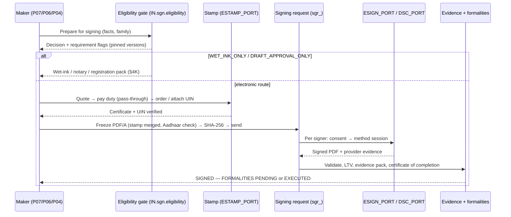

# Phase P08 — eSign, eStamp, Execution and Evidence

> Paste after `01_MASTER_PROMPT.md` and `02_REQUIREMENTS_MAP_AND_DECISION_LOG.md`.
>
> **Dependencies:** P01 (identities, OTP/passkey sessions and step-up, `CP_GUEST`, KYC artefacts for signer identity binding), P02 (delegation of authority, authorised signatories, maker-checker), P03 (rule engine for the eligibility gate, duty rules and formalities; settings registry), P04 (frozen PDFs, executed versions under compliance-mode Object Lock, relationships, health checks), P06 (template answers → duty inputs, execution blocks), P07 (final agreed version, negotiation threads), P17 (credits, meters, duty pass-through presentation through OH8). External: eSign aggregator(s) and ESPs, eStamp vendor(s), DSC local signing agent, RFC 3161 timestamp authority, Razorpay via OH8.
> **Sequencing:** Wave 1. Sprint 1: provider registry, ports, licence monitor, eligibility gate (Appendix F runtime); sprints 2–3: signing ceremonies, Aadhaar eSign through the primary aggregator, consent, evidence capture; sprint 4: DSC agent, electronic acceptance, assisted and mobile signing, messaging; sprint 5: eStamp (attach existing e-stamp with UIN verification, then purchase), duty calculator (advisory), stamp-before-sign lock; sprint 6: formalities gate, wet-ink/notary/registration packs; sprint 7: evidence pack, certificate of completion, s.63 certificate service, validation, LTV, public verification; sprint 8: bulk signing, second ESP route, amendments/void flows, hardening and ASP audit readiness. **Freeze points:** port contracts (`ESIGN_PORT`, `ESTAMP_PORT`, `DSC_PORT`) end of sprint 1; Appendix F row schema end of sprint 1 (content can change any time after, NN-30).
> **Binding appendices:** F (instrument eligibility matrix and eStamp State coverage registry — runtime data; §9 supersedes the R5 eSign flags, X-02), A (state machines A.31–A.34), B (data model, events, errors), D (personas), U (accessibility), K (`LD-EXPORT-1.0`), R (settings), W (open items), Y (Ecosystem Spec change request — LD as producer).
> **Requirements covered:** R-006, R-009 (signing part; Aadhaar is never login), R-011 (enter, eSign, amend, preserve), R-039 (SLAs eSigned), R-077, R-078, R-067; contributes to R-017, R-025, R-035, R-054.
> **Decisions applied:** D-12, D-10, D-17 · **Challenges applied:** CH-01, CH-12, CH-13, CH-16, CH-28 · **Non-negotiables tested:** NN-03, NN-04, NN-06, NN-07, NN-08, NN-09, NN-10, NN-13, NN-18, NN-22, NN-24, NN-28, NN-34, NN-37, NN-38, NN-39, NN-40, NN-43, NN-45, NN-46, NN-50
> **Estimated effort:** 8 two-week sprints, squad of 8 (backend 3, web 1, mobile 1, PKI/security engineer 1, integrations 1, QA/accessibility 1), plus a part-time legal analyst for Appendix F rows and State registry verification.

---

## 1. Objective and business outcome

The brief's core promise is "two parties … enter into personal, business or property contracts by making Aadhaar-based eSign", with eStamp "buy … online or attach stamp papers, then eSign" (R-006, R-078). P08 delivers execution that a court will respect: the right instrument goes to the right method, stamp duty is paid **before** signing, formalities are tracked to completion, and every execution leaves an evidence pack with a BSA 2023 s.63 certificate draft (NN-10).

Two corrections to the brief are built in. (1) **Not every instrument can be eSigned**: the IT Act 2000 First Schedule (as amended by S.O. 4720(E) [VERIFY: Gazette text; S.O. dated 26 Sep 2022, published 4 Oct 2022 — Appendix W §W.9 LA-01]) excludes negotiable instruments other than cheques (with a regulated-entity carve-out), powers of attorney (with a regulated-entity carve-out), trusts, and wills/testamentary dispositions; registrable property instruments still need the sub-registrar (R3 LG-003, LG-104) **[LAW]** — CH-12, NN-07. (2) **LawDocs does not sell stamp paper**: certificates are issued only through the CRA (SHCIL) and authorised collection centres or State routes; LawDocs procures as the user's agent through a contracted vendor, passes duty through at actuals and discloses its own fee (R3 LG-098–100) — CH-13, NN-08.

| Outcome | Exit-gate measure |
|---|---|
| Lawful routing | 100% of signing requests pass the eligibility gate; 0 excluded instruments reach an ESP in the test corpus (all 35 R5 "not valid" templates plus wills/POAs/trusts/NIs uploaded as free documents) |
| Stamp before sign | 0 signing requests started for a chargeable instrument without a verified stamp record or a cited exemption |
| Fast signing | Median time from "Send" to all-signed ≤ 24 h for two-party Aadhaar eSign; signer completes in ≤ 4 taps + OTP on mobile |
| Resilient | ESP failover within one attempt; ≥ 99% successful completion for started Aadhaar eSign sessions excluding signer abandonment; routing never sent to an ESP whose licence date has passed without renewal evidence |
| Provable | Every completed execution has an evidence pack (hashes, consent versions, signer events, provider evidence, validation report, certificate of completion) and a s.63 Part A draft available in one click |
| Formalities complete | No document reaches `EXECUTED` while a required formality is open, unless waived by an authorised user with reason (NN-40) |
| Transparent money | Every checkout shows stamp duty (at actuals), LawDocs facilitation fee, ESP/eSign credits and GST separately, with the total before payment (NN-22, NN-50) |

---

## 2. Scope (in / out)

**In scope:** provider-neutral ports and adapters (`ESIGN_PORT`, `ESTAMP_PORT`, `DSC_PORT`, `TSA_PORT`); provider registry, health and licence monitoring; the instrument eligibility gate (Appendix F runtime); signing requests and ceremonies; Aadhaar eSign (OTP; biometric at assisted counters; face only if verified), account-based eSign (API 3.x), DSC signing for company signatories, electronic acceptance where lawful; in-person/assisted and mobile signing; messaging with counterparties during signing; bulk signing; stamp-before-sign with eStamp purchase via authorised channels, attachment of existing e-stamp certificates with UIN verification, physical stamp paper/franking/e-SBTR for the wet-ink route; stamp duty calculator per State × instrument (advisory until verified); formalities gate (witness, notary, registration, board approval, counterparties) with appointment tracking; wet-ink/notary/registration packs; evidence packs, certificate of completion, `Bsa63CertificateService`; signature validation, LTV, timestamping, public hash verification; amendments, re-execution, cancellation, void, decline and expiry; pricing hooks; ecosystem boundary rules.

**Out of scope (owner):** drafting and negotiation (P06, P07); storage, sharing and health-check UI (P04); type copies and translations (P05); marketplace notary/registration-assistance professionals (P16, consumed here as services); billing engine and GST invoices (OH8 via P17); mobile store release (P22); court e-filing signatures for pleadings (P10 uses this phase's DSC/eSign services under forum rules).

---

## 3. Personas and permissions touched

| Role code | What they can do in P08 |
|---|---|
| `IND_OWNER` | Create signing requests for own documents, buy/attach stamps, sign, track formalities, waive optional formalities with reason, download evidence |
| `ORG_LEGAL_MAKER` | Prepare signing requests, stamp orders and packs; cannot be the approver of the same request where maker-checker applies |
| `ORG_CHECKER` | Approves sending of requests above tenant thresholds and stamp purchases above a duty threshold (NN-18) |
| `ORG_APPROVER` (authorised signatory under DoA) | Signs for the company within DoA limits (amount, instrument families); DSC or Aadhaar eSign "for and on behalf of" |
| `ORG_CLO` | Configures methods, thresholds, waiver rights; waives optional formalities; views all executions |
| `ORG_DIRECTOR`, `ORG_KMP` | Sign where the instrument or a board resolution requires them |
| `ORG_MEMBER` | Raises a request to legal; signs HR documents addressed to them |
| `CP_GUEST` | Counterparty signer, witness, approver, viewer or CC: opens via magic link + OTP, reads, messages, signs, declines with reason, downloads executed copy |
| `ORG_EXT_COUNSEL`, `PRO_ADVOCATE` | Review and (if a party designates) approve before signing; witness where permitted |
| `OPS_RM` / `ORG_DELEGATED_MAKER` | Prepare requests and stamp orders under a delivery grant (NN-17); never sign for the client; never enter a signer's OTP |
| `OPS_ONBOARDING`, `OPS_SUPPORT_AGENT` | Assisted-signing operator mode (kiosk), view request status (no document content unless granted) |
| `PRO_OTHER` (notary-facilitator, registration assistant) | Receives appointment tasks and uploads proof under engagement scope |
| `PLT_LEGAL_REVIEWER`, `PLT_CONTENT_EDITOR` | Maintain Appendix F rows, duty rules, State registry, consent texts (content, NN-30) |
| `PLT_SECURITY_OFFICER`, `PLT_SRE` | Provider registry, kill switches, ASP keys, incident handling |
| `AGT_*` | Maker only: reads request status and submits *proposals* (draft request, stamp quote, reminder plan) through the `agt` proposal inbox that a human converts; agent tokens get `403 LD-AGT-007` on every `sgn.*` write endpoint (P09); never send, sign, pay, waive or void (NN-13, NN-43) |

---

## 4. Functional requirements

### 4A. Provider-neutral ports, adapters and the provider registry

**FR-P08-01 — Ports.** `ESIGN_PORT` (`createSession`, `getStatus`, `fetchSignedDocument`, `fetchAuditEvidence`, `cancel`, `listEsps`, `health`), `DSC_PORT` (`prepareHash`, `embedSignature`, `validateCertificate`, `agentHandshake`), `ESTAMP_PORT` (`coverage`, `quote`, `order`, `getCertificate`, `verifyUin`, `cancel`, `health`), `TSA_PORT` (`timestamp`). Every call carries an idempotency key and is reconciled by a status poll and webhook (NN-46).

**FR-P08-02 — Aggregator first (D-12).** v1 integrates one eSign/eStamp aggregator as primary (candidates: Leegality, Digio, Melento (formerly SignDesk), Surepass-type; R1 §6, R6 D-24/D-25) and one secondary route. P00/P08 records, per vendor, the **`asp_mode`** required by NN-06 as amended (X-15): `VENDOR` — a contracted aggregator acts as ASP; `LAWDOCS` — LawDocs' own ASP arrangement with an ESP; the capability is never sublet in either mode. The registry also records which ESPs the vendor routes to, where consent and logs are held, data residency, log-export rights, SLAs, exit and data-return terms **[VERIFY per vendor contract]**. Rules:

| Mode | Rule |
|---|---|
| `asp_mode = VENDOR` (aggregator is ASP) | The signer completes eSign in the vendor's hosted ceremony (redirect or embedded page under the vendor's application); the vendor's consent and logs are primary; LawDocs stores the consent version shown, the vendor audit trail and response codes as received; the vendor contract must allow this use for LawDocs' own application only |
| `asp_mode = LAWDOCS` (own ASP arrangement) | LawDocs shows the consent screen, signs requests with its own Class 3 organisation certificate, stores request/response XML and response codes in its audit log (eSign API v2.1; R3 LG-006, LG-009); the vendor acts as technology provider |

The data model and evidence pack are identical in both modes so LawDocs can later become its own ASP with a direct ESP without code change (D-12).

**FR-P08-03 — Second ESP.** Where `asp_mode = LAWDOCS`, integrate a second ESP within one month of going live with the first (eSign API v3.3; R3 LG-008, V-WEB) **[LAW]**. Where `asp_mode = VENDOR`, the contract requires at least two ESPs with automatic failover; LawDocs additionally keeps a second vendor route for availability.

**FR-P08-04 — Provider registry (data).** `sgn.providers`: provider, kind (`ESIGN_AGGREGATOR`, `ESP`, `ESTAMP_VENDOR`, `DSC_AGENT`, `TSA`), ASP mode, ESPs reachable, methods supported (OTP, fingerprint, iris, face [VERIFY], account-based 3.x, DSC, e-acceptance), States covered (eStamp), contract start/end, LawDocs' ASP certificate expiry, CCA licence validity of each ESP, last renewal evidence, status, kill switch (NN-39). Seed from the CCA list (R3 LG-005, V-WEB, 25 Oct 2026): eMudhra (licence to 6 Nov 2028), C-DAC (28 Jun 2030), Capricorn Identity Services (shown to **15 May 2026**), Protean eGov Technologies (shown to **26 Oct 2026**), Verasys (22 Jul 2028), CSC e-Governance Services (15 May 2029), CDSL Ventures (6 Jan 2030).

**FR-P08-05 — Licence and contract monitor.** Nightly job: alerts at T-60/T-30/T-7 days before any ESP licence, vendor contract, LawDocs ASP certificate or TSA certificate expiry to `PLT_SECURITY_OFFICER` and the integrations owner; on the day after a recorded expiry without renewal evidence, routing to that ESP is **blocked** (`ProviderRoutingBlocked`; `LD-SGN-009`; NN-06 as amended, X-16) until renewal evidence (CCA list snapshot or ESP letter) is attached by a checker. At build time Capricorn and Protean start as `RENEWAL_UNCONFIRMED`: Capricorn is blocked until evidence is recorded; Protean blocks from 27 Oct 2026 unless evidence is recorded.

**FR-P08-06 — Health and routing.** Per provider and method: synthetic probes every 5 minutes (sandbox), rolling 15-minute success rate, p95 latency, error-class counts (provider down, ESP down, UIDAI-side failure, signer OTP failure), and vendor status feeds. Routing policy: preferred provider by tenant setting → healthy ESP → on degraded Aadhaar OTP success (< `sgn.provider.degraded_threshold`, default 90%) offer the signer the next permitted method (account-based eSign or DSC) where the Appendix F row and the sender allow it. A signer's in-flight session is never silently moved; retries create a new provider session with the same signing-request idempotency key.

**FR-P08-07 — Kill switches.** Per provider, per method, per State (eStamp) — operable by `PLT_SRE`/`PLT_SECURITY_OFFICER` with audit; engaging a switch pauses new sessions and shows signers "This signing method is temporarily unavailable" with alternatives.

### 4B. Instrument eligibility gate (NN-07; Appendix F)

**FR-P08-08 — Evaluation points.** Appendix F governs every outcome; its §9 supersedes the eSign column of `R5_Document_Page_Inventory.csv` (X-02): agreements for sale of immovable property are `ESIGN_OK` or `ESIGN_OK_REGISTRATION_ROUTE` (the First Schedule entry for contracts for sale or conveyance was omitted by S.O. 4720(E) [VERIFY/COUNSEL: Gazette text and date — LA-01]), while conveyances and sale deeds stay `WET_INK_ONLY` for execution and registration; affidavits are `DRAFT_APPROVAL_ONLY`; vakalatnamas, petitions and other pleadings are `FORUM_RULES`; adoption deeds are `WET_INK_ONLY`. No screen, template page or Vidhi answer reads the R5 flag. The gate (rule set `IN.sgn.eligibility` run by P03 `RULES_PORT` over Appendix F rows; formalities from `IN.sgn.formalities`) runs (1) at template selection (P06), (2) when a document is uploaded for signature (P04 type + P05 classification), (3) at signing-request creation, and (4) at send — and is enforced by a database CHECK that rejects a `sgn.signing_requests` row with `method_family = ELECTRONIC` for an instrument whose current evaluation is `WET_INK_ONLY`, `DRAFT_APPROVAL_ONLY` or `NEEDS_CLASSIFICATION`. The request pins the eligibility and formalities rule-set versions at creation (P03 FR-P03-59).

**FR-P08-09 — Inputs and outputs.** Inputs: eligibility family (from template or document type), instrument facts (immovable-property interest, term in months, consideration, State of execution and of property, parties' types including regulated-entity status for the First Schedule carve-outs, negotiable-instrument flag), P05 `eligibility_suspect` tag. Output (`sgn.eligibility_evaluations`): decision code from Appendix F §3.2 — `ESIGN_OK`, `ESIGN_OK_REGISTRATION_ROUTE`, `DSC_OK`, `E_ACCEPTANCE_OK`, `WET_INK_ONLY`, `DRAFT_APPROVAL_ONLY`, `FORUM_RULES`, `NEEDS_CLASSIFICATION` (the P03/P06 codes plus the Appendix F extensions); permitted methods; requirement flags (`STAMP_REQUIRED`, `REGISTRATION_REQUIRED`, `NOTARY_REQUIRED`, `WITNESS_REQUIRED(n)`, `BOARD_APPROVAL_REQUIRED`, `SPECIAL_LAW_STEP`); citations; row ID and version; confidence.

**FR-P08-10 — No override of exclusions.** `WET_INK_ONLY` outcomes from First Schedule rows cannot be overridden by any role or setting (`sgn.eligibility.block_excluded_instruments` is locked true). The sender sees a plain explanation — e.g., "This power of attorney can't be signed electronically under Indian law (IT Act 2000, First Schedule, entry 2 — only a power of attorney empowering an RBI/NHB/SEBI/IRDAI/PFRDA-regulated entity is carved out, FR-P08-11). We've prepared a print-and-sign pack with notarisation and registration steps." — and the wet-ink pack (§4K). Error `LD-SGN-014 Instrument not eligible for electronic signature`.

**FR-P08-11 — Carve-outs.** First Schedule carve-outs (a demand promissory note or bill of exchange issued in favour of, or endorsed by, an entity regulated by RBI, NHB, SEBI, IRDAI or PFRDA; a power of attorney empowering such an entity to act for the executant) apply only when the counterparty organisation is verified as such an entity (P01 KYB with regulator registration number) and the template variant is the carve-out variant (R3 LG-003) **[LAW]**.

**FR-P08-12 — Unknown or suspect.** `NEEDS_CLASSIFICATION` (free upload with no type) asks the sender to choose a type with a short decision helper ("Does this document give someone power to act for you?" → POA path). A P05 `eligibility_suspect` tag makes the gate return `WET_INK_ONLY` until a human reclassifies with a reason; the reclassification is logged and visible in the evidence pack.

### 4C. Signing requests and ceremonies

**FR-P08-13 — Signing request (`sgr_`).** Fields: document version (must be the frozen PDF/A rendition, §4C-15), title, LD-AGR reference, eligibility evaluation, stamp instruments, participants, order, fields, message, expiry (`sgn.request.default_expiry_days` 7, max 30), reminders (days 2 and 5 by default, inside contact windows, NN-34), language of signer pages, completion actions (file to vault views, update record status, notify, start post-signing formalities), visibility of the message thread.

**FR-P08-14 — Participants and roles.**

| Role | Acts | Notes |
|---|---|---|
| `SIGNER` | Signs with a permitted method | Capacity: self / for organisation (with authority reference) / guardian (where law permits) |
| `APPROVER` | Approves before signers receive it (or before a specific signer) | E.g., `ORG_CHECKER`, counterparty's counsel; approval is e-acceptance, not a signature |
| `WITNESS` | Signs as witness after the signer(s) they witness | Only where the Appendix F row permits electronic witnessing; otherwise the instrument goes wet-ink |
| `VIEWER` | Reads and comments in the thread | No action |
| `CC` | Receives the executed copy and evidence summary | No access before completion unless also `VIEWER` |

Order: sequential, parallel, or mixed groups (e.g., group 1 parallel parties → group 2 witnesses → group 3 company DSC). A participant may be reassigned by the sender (with reason) or delegated by the participant only if the sender allowed delegation (company authorised-signatory changes).

**FR-P08-15 — Freeze and pre-sign checks.** On "Prepare for signing": render the final DOCX to PDF/A-2b (P04 generation), merge the stamp certificate pages (§4H), print the stamp certificate number and the LD-AGR reference in the header/footer of every page (`sgn.stamp.number_on_every_page`), place signature fields (drag-and-drop or anchor text from the template), run checks — Aadhaar numbers in the body (blocked; the parties' Aadhaar numbers must not be written into instruments, masked to last 4 if a reference is needed — `LD-SGN-027`, NN-04), unresolved negotiation comments (P07), missing party details, eligibility, stamp — then compute SHA-256 of the frozen PDF and lock it. Any change voids the request (`LD-SGN-002`); one ceremony per document (eSign API: one hash per request, no combining documents — R3 LG-006).

**FR-P08-16 — Identity binding.** Each signer is invited by email/mobile; opening requires OTP to that channel (NN-03: authentication ≠ identity ≠ signing). After an Aadhaar eSign, the name in the signer certificate is compared with the party name in the document (normalised fuzzy match; `sgn.identity.name_match_threshold` default 0.85); a mismatch puts the request in `HELD_FOR_REVIEW` for the sender ("Signed as 'R. Kumar', party named 'Ramesh Kumar Sharma' — accept or ask to re-sign"), never auto-rejects. Company signers must hold the authority recorded in the DoA (P02) for the instrument family and amount; otherwise `LD-SGN-013`.

**FR-P08-17 — Optional signer controls.** Tenant-configurable, OFF by default, consented and disclosed on the consent page: selfie capture, coarse geolocation, ID-document check, OTP to the registered mobile (R1 IMP-044). Selfies and location are personal data retained with the evidence pack only; never used for any other purpose (DPDP purpose limitation). No face matching against Aadhaar inside LawDocs (R3 LG-034).

**FR-P08-18 — Signer experience.** Signer page: document viewer (accessible text layer, 400% zoom), summary card (parties, key terms the sender chose to highlight, stamp details), "i" explanations (`hlp.sgn.*`), message thread, actions: Sign, Decline (reason mandatory), Request changes (§4F), Download draft. Signer-facing pages available in the 10 launch UI languages; the document itself stays in its language of record. Budget: **≤ 4 taps + OTP** from link to signed on mobile.

### 4D. Signature methods

**FR-P08-19 — Method matrix.**

| Method | Legal basis | Who | How |
|---|---|---|---|
| **Aadhaar eSign — OTP** (`AADHAAR_OTP`) | IT Act 2000 s.3A and Second Schedule (eSign using Aadhaar e-KYC, G.S.R. 61(E), 27 Jan 2015); eSign API v2.1 `authMode` 1 (R3 LG-001, LG-004, LG-006) **[LAW]** | Individuals with an Aadhaar-linked mobile | Through the ESP; LawDocs never sees or stores the Aadhaar number, OTP, e-KYC data or authentication payload (NN-04); a one-time certificate is issued per signature and the key deleted by the ESP |
| **Aadhaar eSign — biometric** (`AADHAAR_BIO`) | eSign API v2.1 `authMode` 2/3 (fingerprint/iris) | Assisted counters only (RM office, partner centre) | UIDAI-registered device via the ESP [VERIFY RD device requirements, LG-013]; `sgn.esign.biometric_enabled` OFF until a device and ESP route are certified |
| **Aadhaar eSign — face** (`AADHAAR_FACE`) | [VERIFY: whether any ESP offers face-authentication eSign and under which instrument] | — | OFF (`sgn.esign.face_enabled = false`, NN-38) |
| **Account-based eSign (API 3.x)** (`ACCOUNT_ESIGN`) | eSign API v3.3 — Aadhaar offline XML, bank, organisational, PAN or foreign-national e-KYC; PIN + OTP/TOTP/FIDO2 (R3 LG-008) | NRIs, foreign nationals, users without Aadhaar-linked mobile | Through ESPs that support it [VERIFY per ESP]; signer ID and credentials held by the ESP |
| **DSC Class 3** (`DSC`) | IT Act s.3 (digital signature with a CA-issued certificate); Class 2 discontinued [VERIFY date, LG-011] | Company signatories, directors, professionals | Local signing agent (§4D-20); key never leaves the token |
| **Electronic acceptance** (`E_ACCEPTANCE`) | IT Act s.10A (contracts formed electronically) and the Indian Contract Act 1872; **not** a s.3A electronic signature (R3 LG-001) | Low-risk instruments where the Appendix F row permits | OTP-verified click/typed acceptance with authenticated session, timestamp and document hash; always labelled "Accepted electronically (OTP)" — never "eSign" |
| **Wet ink** (`WET_INK`) | — | Any; mandatory for excluded instruments | Print pack (§4K); scan uploaded and linked as the executed counterpart |

The row in Appendix F lists the permitted methods per instrument family; tenant settings may remove methods, never add ones the row does not permit.

**FR-P08-20 — DSC signing agent.** A signed desktop agent (Windows/macOS; Linux optional) exposes a localhost WebSocket with origin pinning; flow: server computes the PDF byte-range hash → agent asks the user to select certificate and enter the token PIN (PIN handled only by the token middleware, never by LawDocs) → agent returns the CMS signature → server embeds it (PAdES) and validates. Checks: certificate class 3, not expired, not revoked (OCSP/CRL), chains to the CCA root (Root Certifying Authority of India), key usage includes non-repudiation/digital signature, subject name matches the signer (and organisation for organisation certificates). A batch mode signs up to `sgn.dsc.batch_max` (default 50) separately hashed documents in one agent session where the token middleware permits **[VERIFY token driver behaviour]**. No "DocSigner"-branded component is named in user copy until chosen (R3 LG-012).

**FR-P08-21 — Organisation seal (optional).** For bulk company letters, an organisation document-signing certificate held in a customer-controlled HSM or the customer's own signing service; LawDocs never holds a customer's private key in v1 (`sgn.org_seal.enabled = false`) **[VERIFY CA product terms; OI-P08-06]**.

**FR-P08-22 — In-person and assisted signing.** Kiosk mode on a LawDocs or RM device: the operator opens the request in assisted mode; each signer completes OTP on **their own** phone (OTP to their Aadhaar-linked mobile) or biometric on a certified device; the operator cannot type a signer's OTP or press "Sign" for them (UI and API guard, `LD-SGN-039`); the evidence pack records "assisted by <operator>" and the location; optional Aadhaar App offline face verification as proof of presence (R3 LG-033). Witnesses present in person sign in the same session.

**FR-P08-23 — Mobile signing.** Deep link opens the app (or mobile web); ESP pages open in the system browser component (SFSafariViewController / Chrome Custom Tabs), not an embedded WebView [REC]; SMS OTP autofill uses platform APIs without the app reading or storing the OTP (NN-04); push notifications for "Your turn to sign", reminders and completion.

### 4E. Consent

**FR-P08-24 — Versioned consent screens.** Consent texts are content (NN-30) per method and language, approved by `PLT_LEGAL_REVIEWER`; for Aadhaar eSign the text covers the purpose, the e-KYC retrieval by the ESP, certificate issuance, one-time key use and deletion, and that LawDocs does not receive Aadhaar data (eSign API v2.1 consent requirements; R3 LG-006) **[VERIFY final text against the ESP's mandated wording]**. The signer must tick and confirm; the consent version ID, language, timestamp, IP and user agent are stored per signer per document. Where the vendor is ASP, the vendor's consent page is the legal consent and LawDocs records which version was shown (vendor-supplied).

**FR-P08-25 — Pre-sign disclosure.** Before signing, every signer sees: the document title and hash prefix, the stamp certificate number, State and amount (if any), the method and what it means legally ("An Aadhaar eSign is a legally recognised electronic signature under Indian law"), and for e-acceptance: "This records your acceptance electronically; it is not an Aadhaar eSign."

### 4F. Messaging during signing (R-077)

**FR-P08-26 — Signing thread.** Each request has a `msg` thread (`cnv_`) for participants: text, attachments (scanned as P04 uploads), mentions, read receipts; internal-only notes for the sender's organisation are a separate channel never visible to counterparties (NN-37). Messages are part of the evidence pack only if the sender chooses "Include correspondence".

**FR-P08-27 — Request changes.** A signer (or approver) can "Request changes" with a comment; the request moves to `CHANGES_REQUESTED`, outstanding signers are told it is paused, and the sender opens P07 to create a new round; on re-send a new frozen version and a new request are created and the old one is `VOIDED` with reason (`LD-SGN-036`). Signatures already applied to the voided version are listed in its evidence record as "applied to a version that was not executed".

**FR-P08-28 — Notifications.** Invitation (one LawDocs-originated invitation plus reminders the counterparty has not opted out of; no automated calls to counterparties without opt-in — NN-34), turn notifications, decline/changes alerts to the sender, completion to all.

### 4G. Bulk signing (HR and onboarding)

**FR-P08-29 — Batch (`sgb_`).** Upload CSV/XLSX (or pick an HR list from the `hr` kernel) mapped to a P06 template's variables; preview rows; validate (eligibility per row, missing fields, duplicate recipients); generate one document and one signing request per row (one hash per request); company side signs first by DSC batch or authorised signatory eSign per document, then recipients sign by e-acceptance or Aadhaar eSign as the row permits; dashboard with per-row status, reminders, re-send, export of status report. Limits `sgn.bulk.max_rows` (default 5,000) and throttling per provider rate limits. Budget: **≤ 6 clicks** from CSV upload to batch sent.

### 4H. Stamp before sign (NN-08)

**FR-P08-30 — Lock.** For any instrument whose Appendix F row is `stamp ∈ {CHARGEABLE, STATE_VARIES, CHECK}`, a signing request cannot be sent until a stamp record (`stp_`) is attached, verified and merged, or a cited exemption is declared (FR-P08-35). Indian Stamp Act 1899 s.17 requires instruments executed in India to be stamped before or at the time of execution; s.35 makes an insufficiently stamped instrument inadmissible unless duty and penalty are paid (R3 LG-096) **[LAW] [VERIFY s.2(14) electronic-record amendment text]**. Locked despite partial verification because the conservative choice is the safe one (R3 §17). `sgn.stamp.required_before_sign` is locked true.

**FR-P08-31 — Route A: buy an e-stamp through LawDocs (agent procurement).** Steps: (1) State of stamping determined (execution State; property State for immovable-property instruments; inter-State rules flagged [VERIFY]) and checked against the State coverage registry (Appendix F §5; only States with `enabled = true` after verification are offered); (2) duty computed by the calculator (§4I) and shown with citation; (3) "who pays" taken from the template clause (P06 variable `stamp_duty_payer`) and editable — first party, second party or split; second-party payment by link (R1 IMP-047); (4) first-party name (the purchaser shown on the certificate), second party, article, description, consideration — all real values from the agreement; (5) checkout shows duty at actuals, facilitation fee and GST separately (NN-22); (6) duty settlement: collected through OH8 and paid to the vendor via Razorpay Route split settlement or paid directly on the vendor's payment page — LawDocs never pools duty (NN-22; R3 LG-100) **[TAX MEMO: pure-agent treatment of duty for GST — CGST Rules 2017 r.33 [VERIFY]]**; (7) vendor procures the certificate from SHCIL/ACC/State route; (8) certificate PDF, UIN, issue date-time, State, article, amount, purchaser, second party and vendor reference are stored (`stp_`, P04 document of type `ESTAMP_CERTIFICATE`, `STAMP_CERTIFICATE_FOR` relationship); (9) UIN verified (§4H-33); (10) certificate merged as the first page(s) of the frozen PDF (or as the vendor/State practice requires — "merge at start/end" per R1 Setu note) **[VERIFY per State]**.

**FR-P08-32 — Route B: attach an existing e-stamp certificate.** Upload the certificate PDF/image; P05/P04 OCR extracts UIN, State, date, amount, article, purchaser and second party; the user confirms; the system checks: purchaser = a party; amount ≥ calculator duty (else "Duty may be insufficient" with the difference); article plausible for the instrument; certificate not already linked to another document in the tenant (hash and UIN uniqueness); certificate date not after the planned execution; then UIN verification.

**FR-P08-33 — UIN verification.** Through the vendor's authorised verification API or an SHCIL/State arrangement held by the vendor **[VERIFY per vendor]**; where no API exists, a guided **manual verification task**: deep-link to the official public verification page, the user (or an `OPS_PROFESSIONAL` under grant) checks and records the result with a screenshot uploaded as evidence and an attestation — never automated scraping or CAPTCHA solving of government portals (NN-05). Verification result, method, time and verifier are stored and shown on the signing page. "Locked by sub-registrar" status is recorded when known (R3 LG-098).

**FR-P08-34 — Route C: physical stamp paper, franking, e-SBTR (wet-ink route).** For wet-ink execution: the pack prints the instrument for engrossing on non-judicial stamp paper or for franking; the user uploads the scan of the stamped executed document; OCR captures serial number, vendor, denomination, date and purchaser; hygiene checks from market practice (first party's name on the paper, one paper per document, authorised vendors only, deface after use — R1 §6.2) are shown as a checklist. Maharashtra e-SBTR and GRAS challan proofs and Kerala treasury e-stamps are recorded as State-specific proof types (Appendix F §5) **[VERIFY per State]**. Attaching a **physical** stamp paper to an **electronically signed** document is not offered (`sgn.stamp.physical_with_esign.enabled = false`) until counsel confirms validity **[COUNSEL; OI-P08-03]** (`LD-SGN-038`).

**FR-P08-35 — Exemptions and nil duty.** If the State registry lists an exemption or nil duty for the article (content with citation), an `ORG_CLO`/`IND_OWNER` may declare it by **choosing the cited exemption** (free-text reasons are not accepted, `LD-SGN-037`); the declaration is recorded in the evidence pack and the health check stays advisory.

**FR-P08-36 — Cancellation and refund of unused stamps.** If execution is abandoned after a certificate is issued, the system creates a "Cancel or claim refund of unused stamp" task with the State's procedure and time limits from the registry (Indian Stamp Act ss.49–50 on spoiled stamps and State e-stamp cancellation rules) **[VERIFY per State]**; LawDocs' facilitation fee refund terms are shown before purchase (NN-50).

### 4I. Stamp duty calculator

**FR-P08-37 — Rules as data.** Jurisdiction rule sets `IN-<ST>.stamp.duty_table` (P03 FR-P03-54; schema in Appendix F §6) — rows per State/UT × article: formula type (`FIXED`, `PERCENT_OF_CONSIDERATION`, `PERCENT_OF_MARKET_VALUE`, `RENT_FORMULA` (average annual rent × term bands + deposit/premium components), `SLAB`, `MAX_OF`, `MIN_MAX_CAP`), parameters, surcharges/cess/metro levies where applicable, concessions (with eligibility questions), rounding rule, minimum duty, citation (State Act + article + notification), effective dates, verification status (`VERIFIED` / `SECONDARY_ONLY` / `NOT_CONFIRMED`, P03 FR-P03-57), reviewer of record (NN-30); duty rows are `computational` and permissive State activations need `VERIFIED` (P03 FR-P03-56). No rate is seeded without a cited source; seeds are entered by `PLT_LEGAL_REVIEWER` from State schedules **[VERIFY rates — every row]**.

**FR-P08-38 — Inputs and output.** Inputs flow from P06 answers or the stamp form: State(s), article mapping (from the eligibility family), consideration, market value (user-entered; ready-reckoner/guidance value lookup is user-performed on State portals, NN-05), rent, deposit, term, premium, party types (concession eligibility). Output: duty amount, breakdown, citation, confidence badge; `ESTIMATE — not verified` banner when the row is `[VERIFY]`; in that case the duty is advisory and the user may proceed only by buying through the vendor (whose quote is shown alongside) or attaching a certificate (NN-38). Calculator also published as a free public tool (IMP-095; P21) with the same rows.

### 4J. Formalities gate (NN-40)

**FR-P08-39 — Formalities plan.** On request creation the `IN.sgn.formalities` output becomes one `wf` item per formality (P03 FR-P03-79), mirrored in `sgn.formalities` for the evidence pack: `STAMP`, `SIGNATURES` (each party), `WITNESSES` (count, electronic or wet-ink), `NOTARISATION`, `REGISTRATION` (office, deadline), `BOARD_APPROVAL` (resolution reference via `gov`), `COUNTERPARTY_SIGNATURE`, `SPECIAL_LAW` (e.g., RERA agreement-for-sale registration, trade mark assignment recordal), `INTERNAL_APPROVAL` (DoA). Each item: status `REQUIRED → IN_PROGRESS → RESOLVED (with evidence) | WAIVED | NOT_APPLICABLE`, evidence links, owner, due date; items with `visibility = shared_with_parties` show counterparties only their external label ("Awaiting your signature").

**FR-P08-40 — Executed status.** A document becomes `EXECUTED` (P04 `is_executed`, compliance-mode lock) only when every `REQUIRED` item is `RESOLVED` or `WAIVED`. Waiver: roles per `sgn.formalities.waiver_roles` (default `ORG_CLO`, `IND_OWNER`), reason code from the locked waiver-reason list plus free-text note, shown on the certificate of completion and in health checks; `STAMP` on the electronic route and eligibility can never be waived (§4B, §4H). Until then the status is `SIGNED — FORMALITIES PENDING`.

**FR-P08-41 — Registration tracking.** For instruments requiring registration (Registration Act 1908 s.17; LG-104): checklist (original, identity proofs, two witnesses, photographs, stamp proof, PAN/Form 60 where required [VERIFY], property documents), the four-month presentation window from execution (s.23) with reminders, office selection, and appointment booking **performed by the user** on the State e-registration portal through a guided deep link — LawDocs never automates government portals or uses the user's credentials (NN-05); an optional marketplace registration-assistance service (P16) helps in person. The user records token/appointment details or uploads the confirmation; after registration they upload the registered document and receipt (registration number, book, volume, pages, date) and the formality is resolved.

**FR-P08-42 — Notary and oath.** Affidavits and notarial instruments: the drafted affidavit gets an e-acceptance "Approved for swearing" by the deponent (not a jurat; NN-07 row `DRAFT_APPROVAL_ONLY`), then a notary/oath-commissioner appointment task (marketplace notary-facilitator or self-arranged), then upload of the sworn copy → `NOTARISATION = RESOLVED`. LawDocs never presents an eSigned affidavit as sworn (Notaries Act 1952; Oaths Act 1969; R3 LG-106) **[VERIFY e-notarisation status]**.

### 4K. Wet-ink, notary and registration packs

**FR-P08-43 — Pack contents.** P06 FR-P06-43 generates the pack for template-based documents; P08 generates the same pack for uploaded documents and at signing time. For `WET_INK_ONLY` instruments and any user choosing wet ink: print-ready PDF (with stamp-paper engrossing guidance or franking space), execution page with signature/witness blocks per the row (e.g., will: testator + two attesting witnesses — Indian Succession Act 1925 s.63; gift of immovable property: two attesting witnesses — Transfer of Property Act 1882 s.123), a plain-language checklist (stamp, sign each page if the template requires, witnesses, notary, registration and deadline), optional safe-custody note for wills (deposit with the Registrar under Registration Act ss.42–46 [VERIFY]), and an upload slot for the executed scan. The scan becomes the executed counterpart (`COUNTERPART_OF`) and the formalities checklist continues.

### 4L. Evidence pack, certificate of completion and s.63 certificate (NN-10)

**FR-P08-44 — Evidence pack (`evp_`).** Sealed on completion (and updated by appending sealed addenda as formalities are recorded): frozen pre-sign PDF and SHA-256; final signed PDF with embedded signatures; stamp certificate(s) and verification records; eligibility evaluation (row ID, version, decision); consent versions shown and accepted per signer; provider evidence (ESP request/response XML or vendor audit trail; response codes; ESP transaction IDs; certificate serials and chains); signer events (invited, opened, OTP requested/verified — never the OTP — consented, signed, declined) with IST and UTC timestamps from NTP-synced clocks (NN-27), IP address and user agent; identity-binding results; optional signer-control artefacts; validation report (§4M); formalities records; correspondence (optional); manifest with SHA-256 per file and a pack hash entered in the audit ledger. Stored under compliance-mode Object Lock with `EXECUTED_INSTRUMENT_EVIDENCE` retention (≥ 7 years after the later of signing and account closure; R3 LG-008, LG-092).

**FR-P08-45 — Certificate of completion.** A LawDocs-issued PDF listing document title, LD-AGR reference, hashes, stamp details, each participant (masked identifiers), role, method, certificate serial, time and IP, formalities status and waivers. It is a separate PDF in the pack; optionally also added to a "Signed + certificate" copy as an incremental update after the last signature, sealed with LawDocs' organisation certificate so existing signatures remain valid (`sgn.evidence.append_certificate_incremental`) **[VERIFY validation behaviour in common PDF readers]**.

**FR-P08-46 — `Bsa63CertificateService` (shared).** Generates the BSA 2023 s.63(4) certificate in the Schedule form: **Part A** pre-filled — for the party relying on their copy (the party as deponent) or, for platform-generated records, LawDocs' designated custodian officer as the person in charge of the platform **[COUNSEL: confirm who signs Part A for platform records; OI-P08-04]**; record description, device/system description (LawDocs platform version, storage, hashing method), hash table (file, SHA-256, size, computed at); **Part B** routed to an expert (marketplace; s.79A examiner preferred). Field labels follow the Schedule **[VERIFY against the Gazette text; flag `sgn.bsa63.enabled` OFF until verified, NN-38]**. P05 reuses the service for uploaded electronic records. One click from the executed document: "Prepare s.63 certificate".

### 4M. Signature validation, LTV, timestamping and public verification

**FR-P08-47 — Validation.** On completion and on demand: for each signature verify byte-range integrity, certificate chain to the CCA root, revocation status at signing time (embedded OCSP/CRL), signing time vs certificate validity, timestamp token if present; record a validation report (PDF + JSON). A failure raises `SignatureValidationFailed`, blocks `EXECUTED`, and alerts the sender.

**FR-P08-48 — Long-term validation.** Prefer ESP output that embeds the chain, CRL/OCSP and timestamp (`PKCS7pdf`; R3 LG-006); add a document timestamp (PAdES-B-LTA) from an RFC 3161 TSA (`TSA_PORT`; CA-operated TSA under CCA [VERIFY provider]); `LtvRefreshWorkflow` re-timestamps executed documents before TSA certificate expiry or algorithm deprecation (`sgn.ltv.retimestamp_before_days` 365).

**FR-P08-49 — Public verification.** A public page lets anyone check a file: the browser computes SHA-256 locally and sends only the hash; the response is "match / no match" with execution date, number of signatures and validation status — no names, unless the requester is a logged-in participant. Rate-limited; QR on the certificate of completion links to it (R1 IMP-052).

### 4N. Amendments, re-execution, cancellation and void

**FR-P08-50 — Before completion.** Sender cancels (all participants notified; signatures applied so far listed as "applied to a version that was not executed"); signer declines (reason mandatory; sender may reassign or cancel); request expires (sender may extend once by up to the max expiry if no signature has been applied, otherwise re-send); changes requested (§4F). Credits for eSigns already performed are consumed; unused stamp handling per FR-P08-36.

**FR-P08-51 — After completion.** An executed document is never edited or "unsigned". Changes go through a new instrument — amendment agreement, addendum, renewal, termination or cancellation deed — drafted in P06/P07, run through the gate, stamped as its own instrument, signed, and linked (`AMENDS`, `ADDENDUM_TO`, `RENEWS`, `TERMINATES`) so P04's "current effective position" updates. Re-execution of a corrected instrument creates a new document; the earlier executed one is marked `SUPERSEDED` (not deleted). Registered instruments are cancelled only by a registered cancellation deed where law requires (Appendix F row) — the system says so.

### 4O. Pricing hooks

**FR-P08-52 — Meters and credits via `bil`.** Meters: `sgn.esign_aadhaar`, `sgn.esign_account`, `sgn.e_acceptance`, `sgn.dsc` (₹0), `sgn.estamp_facilitation`, `sgn.estamp_bulk_order`, `sgn.physical_stamp_courier`; seed prices R6 §R6.2.4 (Aadhaar eSign single ₹29, packs down to ₹16; e-acceptance 100 for ₹499 beyond fair use; eStamp facilitation ₹49 + duty at actuals; bulk order fee ₹299; physical paper ₹199 + duty + courier) and plan allowances R6 §R6.2.2 (Personal 2/month, Pro 10, Business 50 Aadhaar eSigns; Pro 2 and Business 10 eStamps/month, duty extra) **[OWNER TO SET]**. Charge eSign credits **only on successful signature** (`sgn.credits.charge_on_success_only`); failed provider sessions release reservations. Who pays for eSign credits: sender by default; counterparty-pays option shows the price to the counterparty before they start (NN-50). Duty is a separate pass-through line, never discounted or bundled.

### 4P. Ecosystem boundary (NN-06, NN-24)

**FR-P08-53 — No sub-letting; hosted hand-off only (NN-06 as amended; X-05, X-15).** LawDocs' eSign capability (in either `asp_mode`) serves only LawDocs' own application and its own customer relationships. The integration gateway exposes **no** "sign this document for app X" API to Finbyx, Udofin, Equator, LDC, tenants' systems or third parties (`LD-SGN-034`; at the gateway `LD-INT-060`). Where an ecosystem product wants a document signed through LawDocs, it uses the **hosted hand-off** (P19 §5.9; Appendix A §A.31): the user (or the product, with the user's consent) deposits the document into the user's LawDocs vault; the signing ceremony always runs on a LawDocs-hosted page within a LawDocs customer relationship — the signer authenticates to LawDocs, sees LawDocs' consent page and the eligibility gate runs (`LD-INT-061` when not eligible); framing the page in another product is refused (`LD-INT-062`); the originating product receives **status and evidence only** (`in.infrabyx.documents.DocumentShared.v1` and the proposed execution-status events via `int`, with consent). Sister apps that need their own signing do it under their own ASP arrangements (R3 LG-007). [COUNSEL] confirms the hand-off model (master §19).

**FR-P08-54 — Company tenants sending to their customers.** A Business/Enterprise tenant (e.g., a proptech or employer) sending documents to its customers or employees uses LawDocs' hosted ceremony, branded "<Tenant> via LawDocs", with LawDocs (or its vendor) disclosed as the application on the consent page. A full white-label where the tenant appears as the application owner (R6 RS-LD-17) is OFF until the ESP/vendor contract and counsel confirm it is not sub-letting **[COUNSEL; VERIFY ESP terms; OI-P08-05]**.

**FR-P08-55 — Cross-product events.** (Hand-off status and evidence, FR-P08-53, are the only cross-product output of a ceremony.) LawDocs publishes `DocumentShared` only for user-consented transfers. Publishing `ESignCompleted`/`EStampCompleted` (existing Ecosystem Spec event names, currently produced by Udofin) with LD as producer is proposed in Appendix Y for the case where an ecosystem consumer has the user's consent to receive execution evidence for a LawDocs-executed document; until approved, nothing is published (NN-24).

### 4Q. Accessible and assisted signing for signers with disabilities (NN-28; R-025)

**FR-P08-56 — Accessible signer journey.** Every signer page (invitation, OTP, document viewer, summary card, consent, method hand-off, completion) meets WCAG 2.2 AA and IS 17802 (Parts 1–2) and is tested with NVDA, JAWS, VoiceOver and TalkBack, keyboard-only and 400% zoom (NN-28; Appendix U). Provisions: the frozen PDF/A carries a tagged text layer and an accessible HTML reading view generated from the same version (hash shown so the signer knows it is the same document); a plain-language summary card the signer can have read aloud by the device's own screen reader or the built-in read-aloud in the signer's language; large-print and high-contrast modes; adjustable time limits — session and OTP-entry timeouts extend on request where the ESP permits (WCAG 2.2.1) **[VERIFY per ESP]**; consent text is reachable and read in full by screen readers before the checkbox (SCR-P08-05). Where an ESP page is not accessible, the routing policy prefers an ESP/method that is (provider registry attribute `a11y_conformance`), and the gap is logged as an accessibility issue for vendor management. The Rights of Persons with Disabilities Act 2016 (ss.40–42 on accessibility of ICT) applies **[LAW] [VERIFY section numbers and the current accessibility rules/standards notified under s.40]**.

**FR-P08-57 — Assisted signing with a helper and witness, consent recorded.** A signer may choose "I need help to sign" (`sgn.accessibility.assisted_signing.enabled`, default ON). Modes: `SELF_WITH_ASSISTIVE_TECH` (no helper; mode recorded only if the signer chooses), `READ_ALOUD_BY_HELPER` (a helper of the signer's choice, or a LawDocs operator in kiosk mode, reads and explains the document), `SIGN_LANGUAGE_INTERPRETER` (interpreter on a video call booked through the request) and `LARGE_PRINT_OR_BRAILLE_COPY` (copy produced before the ceremony). Rules: (1) the signer personally performs the authentication and the "Sign" action — Aadhaar OTP on their own phone, biometric on a certified device, account-based eSign or their own DSC; the helper, interpreter or operator can never enter an OTP, PIN or press Sign (`LD-SGN-039`); (2) before the ceremony the signer gives a recorded **assistance consent** (who helps, in what mode and language) by OTP-confirmed action, and the helper (identified by OTP to their own mobile, `CP_GUEST`) signs a **helper declaration** ("I read/interpreted the document to the signer in <language>; the signer confirmed understanding; I did not operate the signing step") by e-acceptance (`LD-SGN-041` until both exist); (3) where the Appendix F row or the sender requires a witness — and always where `READ_ALOUD_BY_HELPER` or `SIGN_LANGUAGE_INTERPRETER` is used for an instrument valued above `sgn.accessibility.witness_required_above_inr` — an independent witness (not the helper, not a party) attends and records presence; (4) if the signer cannot personally perform any permitted electronic signing action, LawDocs does not let anyone sign for them electronically: the request switches to the wet-ink route with a signature by mark or a signature by a person at the signer's direction in the signer's presence, attested by witnesses and, where the instrument requires, notarised or presented before the registering officer **[LAW: General Clauses Act 1897 s.3(56) "sign" includes affixing a mark by a person unable to write; Registration Act 1908 Part VI attendance rules] [VERIFY; COUNSEL for the attestation wording]** (`LD-SGN-042`). The evidence pack records the assistance mode, helper and witness identities (masked), declarations, interpreter session reference and timestamps; it records **no diagnosis or disability detail** — only that assistance was used (data minimisation, DPDP Act 2023 s.6). Assistance preferences are saved for reuse only if the signer opts in. Budget: choosing assistance adds ≤ 2 taps.

*Help keys:* `hlp.sgn.assisted_signing`, `hlp.sgn.helper_declaration`, `hlp.sgn.signature_by_mark`.

*Help keys (all of §4):* `hlp.sgn.esign`, `hlp.sgn.aadhaar_esign`, `hlp.sgn.account_esign`, `hlp.sgn.dsc`, `hlp.sgn.e_acceptance`, `hlp.sgn.first_schedule`, `hlp.sgn.eligibility`, `hlp.sgn.stamp_duty`, `hlp.sgn.estamp_uin`, `hlp.sgn.franking`, `hlp.sgn.esbtr`, `hlp.sgn.who_pays_duty`, `hlp.sgn.registration`, `hlp.sgn.notarisation`, `hlp.sgn.attestation`, `hlp.sgn.formalities`, `hlp.sgn.evidence_pack`, `hlp.sgn.certificate_of_completion`, `hlp.sgn.bsa63`, `hlp.sgn.ltv`, `hlp.sgn.esp`, `hlp.sgn.asp`, `hlp.sgn.amendment`, `hlp.sgn.void`.

*Customisation hooks (all of §4):* tenant permitted methods (subset of row), default order and expiry, reminder cadence, approval thresholds (value, instrument family), name-match threshold and mismatch action, optional signer controls, initials-on-every-page, branding of invitations, preferred provider, who-pays defaults, waiver roles, include-correspondence default.

---

## 5. Workflows and state machines

### 5.1 End-to-end execution sequence



### 5.2 Signing request (`sgn.signing_requests.state`)

State machines §5.2–§5.6: Appendix A §A.31–§A.34 govern (hosted hand-off entry per A.31; X-05).

| State | Entry | Allowed transitions | Actor | Guard | Side effects / events |
|---|---|---|---|---|---|
| `DRAFT` | Created by a human maker (an agent's draft arrives as an `agt` proposal that a human converts; agents get `403 LD-AGT-007` on `sgn.*` writes, §3) | → `PENDING_APPROVAL`, → `READY`, → `CANCELLED` | Maker | Eligibility `ESIGN_OK*`/`DSC_OK`/`E_ACCEPTANCE_OK` | `SigningRequestCreated` |
| `PENDING_APPROVAL` | Above tenant threshold | → `READY`, → `DRAFT` (rejected) | `ORG_CHECKER` ≠ maker | NN-18 | — |
| `READY` | Frozen, stamped, checks passed | → `SENT`, → `CANCELLED` | Human sender (NN-13) | Stamp lock; hash frozen; Aadhaar check | — |
| `SENT` / `IN_PROGRESS` | First invitation | → `IN_PROGRESS`, → `HELD_FOR_REVIEW`, → `CHANGES_REQUESTED`, → `DECLINED`, → `EXPIRED`, → `CANCELLED`, → `COMPLETED` | System / participants | Turn order | `SigningRequestSent`, `SignerViewed`, `SignerConsented`, `SignatureApplied` |
| `HELD_FOR_REVIEW` | Name mismatch, validation warning | → `IN_PROGRESS` (accepted), → `VOIDED` | Sender | Reason recorded | `SigningHeld` |
| `CHANGES_REQUESTED` | Participant asks for changes | → `VOIDED` (new round) | System | — | `ChangesRequested` |
| `DECLINED` | Signer declines | → `IN_PROGRESS` (reassigned), → `CANCELLED` | Sender | Reason mandatory | `SignerDeclined` |
| `EXPIRED` | Timer | → `IN_PROGRESS` (one extension if no signature yet), → `CANCELLED` | Sender | — | `SigningRequestExpired` |
| `COMPLETED` | All signatures applied and validated | → (formalities) | System | Validation passed | `SigningCompleted`, `EvidencePackSealed` |
| `VOIDED` / `CANCELLED` | — | terminal | — | — | `SigningRequestVoided` |

### 5.3 Participant (`sgn.participants.state`)

`PENDING → INVITED → OPENED → CONSENTED → SIGNED | DECLINED | REASSIGNED | SKIPPED (CC/VIEWER)`; `FAILED_ATTEMPT` (provider/OTP failure, retry allowed up to `sgn.esign.max_attempts`, default 3, then method switch offered).

### 5.4 Stamp instrument (`sgn.stamp_instruments.state`)

`QUOTED → PAYMENT_PENDING → ORDERED → ISSUED → VERIFIED → MERGED → LOCKED_TO_DOCUMENT`; attach route: `UPLOADED → EXTRACTED → CONFIRMED → VERIFIED → MERGED`; side states `VERIFICATION_FAILED`, `MISMATCH` (party/amount), `CANCELLATION_REQUESTED → CANCELLED | REFUNDED` (State procedure). One certificate links to one document only (DB unique on UIN within platform).

### 5.5 Execution status (document, mirrored to P04/P07)

`DRAFT → LOCKED_FOR_SIGNATURE (P07) → SIGNING → SIGNED_FORMALITIES_PENDING → EXECUTED`; `EXECUTED → SUPERSEDED` (re-execution) or `TERMINATED` (termination instrument linked); `SIGNING → NOT_EXECUTED` (voided/cancelled). Wet-ink route: `PACK_ISSUED → SCAN_UPLOADED → SIGNED_FORMALITIES_PENDING → EXECUTED`.

### 5.6 Provider status

`ACTIVE → DEGRADED → ACTIVE`; `ACTIVE/DEGRADED → BLOCKED` (licence/contract expiry without evidence, kill switch) → `ACTIVE` (checker records evidence); `RENEWAL_UNCONFIRMED` is a flag shown with alerts until evidence is recorded.

---

## 6. Screens and UX

| ID | App | Purpose | Key components | Empty / error states | Mobile | Accessibility |
|---|---|---|---|---|---|---|
| SCR-P08-01 | web, mobile | Prepare for signing | Eligibility result card (decision, plain explanation, citation, "i"), formalities plan, stamp panel, participants, order builder, fields placement, checks list | `WET_INK_ONLY`: pack card replaces send | Stepper | Decision announced; field placement has keyboard mode (anchor text / page+position inputs) |
| SCR-P08-02 | web, mobile | Stamp panel | State, article, duty estimate with badge, who pays, buy / attach / exemption, vendor quote, checkout breakdown | State not covered: attach or wet-ink route | Bottom sheet | Amounts read with currency |
| SCR-P08-03 | web, mobile | Attach existing e-stamp | Upload, extracted fields to confirm, verification status, mismatch warnings | Verification failed: manual task | Camera capture | — |
| SCR-P08-04 | web, mobile | Signer page | Viewer, summary card, thread, Sign / Decline / Request changes, method chooser | Not your turn; expired; voided | Primary design target | Text layer, 400% reflow, labels in launch languages |
| SCR-P08-05 | web, mobile | Consent and method | Versioned consent text, method explanation, continue to ESP | Provider degraded → alternatives | System browser hand-off | Consent readable by screen reader before checkbox |
| SCR-P08-06 | desktop web | DSC signing | Agent detection, certificate picker (from agent), status | Agent not running → install/start guide | — | Keyboard operable |
| SCR-P08-07 | web, mobile | Request tracker | Participants timeline, reminders, reassign, cancel, extend, thread | — | List | Timeline as ordered list |
| SCR-P08-08 | web | Bulk batch | Upload, mapping, preview rows, validation, send, per-row status | Row errors downloadable | — | Grid semantics |
| SCR-P08-09 | web, mobile | Formalities | Items with status, evidence upload, deadlines (registration window), waiver with reason code | All resolved → "Executed" banner | List | Status text + icon |
| SCR-P08-10 | web, mobile | Wet-ink / notary / registration pack | Download, checklist, booking deep links, upload executed scan | — | Native share/print | Checklist as list with checkboxes |
| SCR-P08-11 | web, mobile | Evidence pack | Files list with hashes, certificate of completion, validation report, "Prepare s.63 certificate", download ZIP | — | List | — |
| SCR-P08-12 | public web | Verify a document | Drag file (local hash), result | No match | Responsive | Works with keyboard file picker |
| SCR-P08-13 | web (assisted) | Kiosk mode | Operator banner, per-signer handover screens, presence check | Operator attempt to sign blocked | Tablet | Large controls |
| SCR-P08-14 | console | Providers | Registry, licence dates, health graphs, routing policy, kill switches, renewal evidence | — | — | — |
| SCR-P08-15 | console | Eligibility, duty and State registry content | Rows (Appendix F), golden cases, verification status, reviewer of record | — | — | — |
| SCR-P08-16 | web | Signing settings (tenant) | Methods, thresholds, reminders, name-match, signer controls, branding, waiver roles | — | — | — |
| SCR-P08-17 | web, mobile, kiosk | Signing assistance | "I need help to sign" entry, mode picker (assistive tech, read aloud by helper, sign-language interpreter, large print/Braille), helper OTP and declaration, witness presence, accessible reading view with hash | Helper declaration missing → `LD-SGN-041`; signer cannot act → wet-ink pack (`LD-SGN-042`) | Full support; large targets | Built and tested first with screen readers; no time limits without extension; focus never moves without user action |

**Click budgets:** from an agreed version to "Sent" with Aadhaar eSign and an attached e-stamp ≤ 6 clicks; with eStamp purchase ≤ 8 (excluding payment page); signer from link to signed ≤ 4 taps + OTP; record a registration receipt ≤ 3.

---

## 7. Backend design

### 7.1 Modules

`sgn` (owner), `rul` (`IN.sgn.eligibility`, `IN.sgn.formalities`, `IN-<ST>.stamp.duty_table`, State registry), `dms` (frozen and executed versions, relationships, compliance lock), `msg` (signing threads), `wf` (formality items, approvals), `iam` (`CP_GUEST`, step-up), `bil` (credits, meters, duty line items via OH8), `int` (cross-product events), `mob` (deep links, push), `ntf` (invitations, reminders within NN-34).

### 7.2 Tables (schema `sgn`; `tenant_id`, `legal_entity_id`, RLS; append-only where noted)

| Table | Key columns | Notes / retention |
|---|---|---|
| `providers` (platform) | `provider_id`, `kind`, `asp_mode` (`VENDOR`/`LAWDOCS`; NN-06), `esps[]`, `methods[]`, `states[]`, `a11y_conformance` (FR-P08-56), `contract_to`, `asp_cert_to`, `status`, `kill_switch` | Permanent; changes maker-checker |
| `esp_licences` (platform) | `esp`, `licence_to`, `source_snapshot_ref`, `renewal_evidence_ref`, `status` | Permanent |
| `provider_health` | `provider_id`, `method`, `window_start`, `success_rate`, `p95_ms`, `error_classes` | 400 days |
| `eligibility_evaluations` | `eval_id`, `doc_id`, `ver_id`, `family`, `facts jsonb`, `decision`, `flags[]`, `methods[]`, `rule_set_versions`, `row_ids[]` | Evidence class |
| `signing_requests` | `sgr_id`, `ver_id`, `frozen_sha256`, `state`, `order_mode`, `expires_at`, `eval_id`, `ld_agr_ref`, `approval_ref`, `idempotency_key` | Evidence class; CHECK on method family vs decision |
| `participants` | `sgr_id`, `seq_group`, `role` (adds `HELPER`, `INTERPRETER` as non-signing roles), `prs_id`, `capacity`, `authority_ref`, `methods_allowed[]`, `state`, `name_match_score` | Evidence class |
| `signing_assistance` | `sgr_id`, `participant_id`, `mode`, `helper_participant_id`, `witness_participant_id`, `language`, `assistance_consent_ref`, `helper_declaration_ref`, `interpreter_session_ref`, `at` | Evidence class; append-only; no disability or health data |
| `fields` | `sgr_id`, `participant_id`, `page`, `rect`, `kind` | With request |
| `consent_versions` (content) | `consent_id`, `method`, `lang`, `text_ref`, `approved_by`, `effective_from` | Permanent |
| `consent_records` | `participant_id`, `consent_id`, `at`, `ip`, `ua_hash` | Evidence class; append-only |
| `signature_events` | `sig_id`, `participant_id`, `event`, `provider_txn_id`, `esp`, `cert_serial`, `at_utc`, `at_ist`, `ip`, `ua_hash`, `response_code` | Evidence class; append-only; never OTP or Aadhaar data |
| `provider_evidence` | `sig_id`, `kind` (`REQUEST_XML`, `RESPONSE_XML`, `VENDOR_AUDIT`), `object_ref`, `sha256` | Evidence class |
| `stamp_instruments` | `stp_id`, `route`, `state_code`, `article_code`, `uin`, `amount`, `purchaser`, `second_party`, `issued_at`, `vendor_ref`, `verification jsonb`, `doc_id`, `state` | Unique (`uin`); evidence class |
| `duty_quotes` | `stp_id`, `rule_set_version`, `inputs jsonb`, `computed`, `vendor_quote`, `status_badge` | Evidence class |
| `exemption_declarations` | `stp_id`, `exemption_code`, `citation`, `declared_by` | Evidence class |
| `formalities` | `doc_id`, `kind`, `status`, `wf_item_id`, `evidence_doc_ids[]`, `waiver_reason_code`, `waived_by` | Evidence class |
| `appointments` | `formality_id`, `office`, `slot`, `token_ref`, `source` (`USER_ENTERED`, `UPLOAD`) | 7 years |
| `evidence_packs` | `evp_id`, `doc_id`, `manifest jsonb`, `pack_sha256`, `addenda[]`, `sealed_at` | Compliance-mode lock |
| `bsa63_certificates` | `cert_doc_id`, `subject_doc_ids[]`, `part_a jsonb`, `part_b_status`, `signed_ver_id` | Evidence class |
| `validation_reports` | `doc_id`, `ver_id`, `results jsonb`, `ltv_status`, `next_retimestamp_at` | Evidence class |
| `bulk_batches` | `sgb_id`, `template_ver`, `rows`, `state`, `report_doc_id` | 7 years |
| `public_verifications` | `sha256_prefix`, `result`, `at` (no requester identity unless logged in) | 180 days |

### 7.3 APIs (`/v1/sgn/…`)

| Method | Path | Scope | Idempotency |
|---|---|---|---|
| POST | `/eligibility/evaluate` | `sgn.request:write` | — (pure) |
| POST | `/stamps/quote` ; POST `/stamps/orders` ; POST `/stamps/attach` ; POST `/stamps/{stp_id}/verify` ; POST `/stamps/{stp_id}/exemption` | `sgn.stamp:write` (+ payment) | Key |
| POST | `/requests` ; POST `/requests/{sgr_id}/freeze` ; POST `/requests/{sgr_id}/send` | `sgn.request:write`; send requires human principal | Key |
| POST | `/requests/{sgr_id}/cancel` / `/extend` / `/reassign` / `/void` | `sgn.request:manage` | Key |
| GET | `/requests/{sgr_id}` ; GET `/requests/{sgr_id}/timeline` | read | — |
| GET | `/sign/{token}` (signer session, `CP_GUEST` after OTP) | signer | — |
| POST | `/sign/{token}/consent` ; POST `/sign/{token}/start` (returns provider session/redirect) ; POST `/sign/{token}/decline` ; POST `/sign/{token}/request-changes` ; POST `/sign/{token}/accept` (e-acceptance) | signer | Key |
| POST | `/dsc/hash` ; POST `/dsc/embed` | signer + agent handshake | Key |
| POST | `/webhooks/{provider}` | provider (signed, mTLS/HMAC) | Provider event ID |
| POST | `/formalities/{id}/resolve` ; POST `/formalities/{id}/waive` | owner / waiver roles | Key |
| GET | `/evidence/{doc_id}` ; POST `/evidence/{doc_id}/bsa63` | read / write | Key |
| POST | `/bulk` ; POST `/bulk/{sgb_id}/send` | `sgn.bulk:write` | Key |
| POST | `/verify` (public; hash only) | public, rate-limited | — |

Agent principals receive `403 LD-AGT-007` on every `sgn.*` write endpoint (P09 rule); read endpoints for status are allowed within the agent's scope, and agent drafts arrive as `agt` proposals.

### 7.4 Domain events (`in.lawdocs.sgn.<EventName>.v1`)

`EligibilityEvaluated`, `SigningRequestCreated`, `SigningRequestSent`, `SignerViewed`, `SignerConsented`, `SigningAssistanceRecorded`, `SignatureApplied`, `SignerDeclined`, `ChangesRequested`, `SigningHeld`, `SigningCompleted` (consumed by P07), `SigningRequestExpired`, `SigningRequestVoided`, `StampQuoted`, `StampOrdered`, `StampIssued`, `StampVerified`, `StampVerificationFailed`, `StampMerged`, `StampCancellationRequested`, `FormalityResolved`, `FormalityWaived`, `DocumentExecuted`, `DocumentSuperseded`, `EvidencePackSealed`, `Bsa63CertificateDrafted`, `SignatureValidationFailed`, `LtvRefreshed`, `ProviderHealthChanged`, `ProviderLicenceExpiring`, `ProviderRoutingBlocked`, `BulkBatchCompleted`. Payloads: IDs, hashes, codes, masked identifiers only (NN-32). Cross-product: none published by `sgn`; `int` publishes `DocumentShared` on user consent (FR-P08-55).

### 7.5 Jobs and workflows (Temporal)

| Workflow | Purpose |
|---|---|
| `SigningCeremonyWorkflow` (per `sgr_`) | Turn order, invitations, reminders within contact windows, timers, provider sessions with idempotency keys, status polling + webhooks reconciliation, completion, validation, evidence sealing |
| `StampOrderWorkflow` | Quote, payment signal from OH8, vendor order, polling, certificate fetch, verification (API or manual task), merge |
| `FormalitiesWorkflow` | Items, deadlines (Registration Act s.23 window), reminders, executed transition |
| `EvidencePackWorkflow` | Assemble, hash, seal; addenda on later formalities |
| `LtvRefreshWorkflow` | Re-timestamp schedule |
| `ProviderHealthProbe` (BullMQ, 5 min) | Synthetic probes, rolling metrics, degraded/blocked transitions |
| `LicenceMonitorJob` (nightly) | ESP licences, vendor contracts, ASP certificate, TSA expiry alerts and blocks |
| `BulkSigningWorkflow` | Row generation, batch DSC signing session, per-row ceremonies with throttling |
| `ReconciliationJob` (hourly) | Provider transactions vs `signature_events`; credits charged vs successful signatures; duty collected vs certificates issued (NN-46) |

---

## 8. Integrations

| Port | Primary (v1) | Secondary / alternatives | Failure behaviour | Manual fallback |
|---|---|---|---|---|
| `ESIGN_PORT` | One aggregator (Leegality / Digio / Melento / Surepass-type; selection by P00 ADR on ASP mode, ESP count, residency, log export, price — R6 B-16–B-26) | Second aggregator or direct ASP–ESP (Protean/eMudhra route, R6 D-24) | Failover per §4A; never move an in-flight session silently | DSC or wet ink |
| `DSC_PORT` | LawDocs signing agent (built or licensed component, signed installer) | Vendor desktop signer via aggregator | Agent missing → guide; no server-side key | Wet ink |
| `ESTAMP_PORT` | Aggregator's eStamp (e.g., Leegality BharatStamp claims 25–31 States/UTs; Melento 25+; Surepass 16 via SHCIL — vendor claims, R1/R6) | Second vendor per State | State paused; offer attach route or wet ink | Attach existing certificate; physical paper (wet ink) |
| `TSA_PORT` | CA-operated RFC 3161 TSA [VERIFY] | Second TSA | Queue timestamps; ESP-embedded timestamps remain | — |
| `BILLING_PORT` (OH8) | Credits, meters, duty pass-through lines, Razorpay Route split to vendor where used | — | Cannot start paid steps; signing of already-paid steps continues | — |
| `msg`, `ntf` | Threads, invitations (email/SMS/WhatsApp via DLT-registered CPaaS, NN-34) | — | Email fallback | Sender shares link manually |

Contract requirements for every vendor: India residency for documents and logs, log export on demand and at exit, consent/log retention aligned with eSign API (≥ 7 years after account deactivation for FIDO/public-key logs; R3 LG-008), ASP audit cooperation (CERT-In-empanelled auditor) [VERIFY frequency in ESP contract, LG-009], breach notice ≤ 6 hours, no use of LawDocs data for other purposes, kill-switch-friendly webhooks.

---

## 9. Settings and configuration

| Key | Tier | Type | Default | Changed by | Maker-checker |
|---|---|---|---|---|---|
| `sgn.eligibility.block_excluded_instruments` | PLATFORM | bool (locked) | true | none | — |
| `sgn.eligibility.rule_set_version` | PLATFORM | string | latest active | `PLT_LEGAL_REVIEWER` publish via P03 | Y |
| `sgn.methods.allowed` | TENANT | list (subset of row) | all row-permitted except biometric/face | `ORG_CLO` / `IND_OWNER` | Y (company) |
| `sgn.esign.biometric_enabled` | PLATFORM | bool | false | `PLT_SECURITY_OFFICER` after device certification | Y |
| `sgn.esign.face_enabled` | PLATFORM | bool | false (NN-38) | `PLT_LEGAL_REVIEWER` + `PLT_SECURITY_OFFICER` | Y |
| `sgn.esign.account_based_enabled` | PLATFORM | bool | true where provider supports | `PLT_SUPER_ADMIN` | Y |
| `sgn.esign.max_attempts` | PLATFORM | int | 3 | `PLT_SUPER_ADMIN` | N |
| `sgn.e_acceptance.enabled` | TENANT | bool | true | `ORG_CLO` | N |
| `sgn.e_acceptance.max_value_inr` | TENANT | money | 0 (off for valued commercial agreements until set) | `ORG_CLO` | Y |
| `sgn.request.default_expiry_days` / `max_expiry_days` | TENANT / PLATFORM | int | 7 / 30 | `ORG_ADMIN` / `PLT_SUPER_ADMIN` | N / Y |
| `sgn.request.reminder_days` | TENANT | list | [2, 5] | `ORG_ADMIN` | N |
| `sgn.request.approval_threshold_inr` | TENANT | money | none | `ORG_CLO` | Y |
| `sgn.identity.name_match_threshold` | TENANT | decimal | 0.85 | `ORG_CLO` | Y |
| `sgn.identity.on_mismatch` | TENANT | enum `HOLD`/`ALLOW_WITH_FLAG` | `HOLD` | `ORG_CLO` | Y |
| `sgn.signer_controls.selfie` / `geo` / `id_check` | TENANT | bool | false | `ORG_CLO` (with DPDP notice) | Y |
| `sgn.provider.preferred` | TENANT | enum | platform default | `ORG_ADMIN` | N |
| `sgn.provider.degraded_threshold` | PLATFORM | decimal | 0.90 | `PLT_SRE` | N |
| `sgn.provider.licence_alert_days` | PLATFORM | list | [60, 30, 7] | `PLT_SECURITY_OFFICER` | N |
| `sgn.stamp.required_before_sign` | PLATFORM | bool (locked) | true | none (NN-08) | — |
| `sgn.stamp.number_on_every_page` | TENANT | bool | true | `ORG_ADMIN` | N |
| `sgn.stamp.physical_with_esign.enabled` | PLATFORM | bool | false ([COUNSEL]) | `PLT_LEGAL_REVIEWER` | Y |
| `sgn.stamp.duty_payment_route` | PLATFORM | enum `ROUTE_SPLIT`/`VENDOR_DIRECT` | per vendor ADR | `PLT_SUPER_ADMIN` + finance ([TAX MEMO]) | Y |
| `sgn.stamp.purchase_checker_threshold_inr` | TENANT | money | 10,000 | `ORG_CLO` | Y |
| `sgn.estamp.state.<code>.enabled` | PLATFORM | bool | false until Appendix F §5 row `VERIFIED` | `PLT_LEGAL_REVIEWER` + `PLT_SUPER_ADMIN` (permissive) | Y |
| `sgn.duty.calculator.mode` | PLATFORM | enum `ADVISORY`/`BINDING_WHEN_VERIFIED` | `BINDING_WHEN_VERIFIED` | `PLT_LEGAL_REVIEWER` | Y |
| `sgn.formalities.waiver_roles` | TENANT | list | `ORG_CLO`, `IND_OWNER` | `ORG_OWNER` | Y |
| `sgn.witness.electronic_allowed` | TENANT | bool (cannot exceed row) | true where row permits | `ORG_CLO` | N |
| `sgn.evidence.retention_years_min` | PLATFORM | int | 7 | `PLT_DPO` | Y |
| `sgn.evidence.append_certificate_incremental` | TENANT | bool | true | `ORG_ADMIN` | N |
| `sgn.bsa63.enabled` | PLATFORM | bool | false (NN-38) | `PLT_LEGAL_REVIEWER` | Y |
| `sgn.ltv.retimestamp_before_days` | PLATFORM | int | 365 | `PLT_SECURITY_OFFICER` | N |
| `sgn.dsc.batch_max` | PLATFORM | int | 50 | `PLT_SECURITY_OFFICER` | N |
| `sgn.org_seal.enabled` | PLATFORM | bool | false | `PLT_SECURITY_OFFICER` | Y |
| `sgn.bulk.max_rows` | PLAN | int | 5,000 (Business), 500 (Pro) | `PLT_SUPER_ADMIN` | Y |
| `sgn.chat.enabled` | TENANT | bool | true | `ORG_ADMIN` | N |
| `sgn.public_verify.enabled` | PLATFORM | bool | true | `PLT_SUPER_ADMIN` | N |
| `sgn.credits.charge_on_success_only` | PLATFORM | bool | true | `PLT_SUPER_ADMIN` + finance | Y |
| `sgn.credits.counterparty_pays_allowed` | TENANT | bool | false | `ORG_ADMIN` | N |
| `sgn.whitelabel.full.enabled` | PLATFORM | bool | false ([COUNSEL]) | `PLT_LEGAL_REVIEWER` | Y |
| `sgn.accessibility.assisted_signing.enabled` | TENANT | bool | true (tenants may not switch it off for individuals) | `ORG_ADMIN` | N |
| `sgn.accessibility.helper_declaration_required` | PLATFORM | bool (locked) | true | none | — |
| `sgn.accessibility.witness_required_above_inr` | TENANT | money | 0 (always, when a helper reads or interprets) | `ORG_CLO` | Y |
| `sgn.accessibility.extended_session_minutes` | PLATFORM | int (15–60) | 30 | `PLT_SUPER_ADMIN` | N |

---

## 10. Security, privacy and audit

| Threat | Control |
|---|---|
| Signing an altered document | Hash frozen at `READY`; providers sign the frozen hash; any change voids; validation of byte ranges; weekly hash audit |
| Signer impersonation | OTP to invited channel before viewing; ESP authentication for signing; name-match hold; optional signer controls; assisted-mode guards so operators cannot sign or enter OTPs |
| Aadhaar data exposure | LawDocs never receives Aadhaar number, OTP, biometrics or e-KYC payload; pre-sign check blocks Aadhaar numbers in instruments (NN-04); logs scrubbed (NN-32) |
| Excluded instrument signed electronically | Gate at four points + DB CHECK + P05 suspect tightening; no override (NN-07) |
| Unstamped execution | Locked stamp-before-sign; one certificate per document; UIN uniqueness (NN-08) |
| Provider compromise or lapse | Licence monitor and blocks, health routing, kill switches, signed webhooks with replay protection, mTLS where supported |
| Key misuse | DSC keys stay on tokens; LawDocs ASP signing key in HSM (AWS CloudHSM/KMS asymmetric) with dual control for rotation; no customer private keys held (v1) |
| Money handling | Duty passes through split settlement or vendor-direct; no pooling (NN-22); reconciliation hourly |
| Repudiation | Evidence pack sealed with compliance-mode Object Lock, hash-chained audit ledger (NN-02), NTP time (NN-27) |
| ASP sub-letting | No external sign API; consent page names the application; full white-label OFF (NN-06) |

**Data classes:** signer identity attributes (personal), signature events and IP/device data (personal; evidence purpose), consent records, provider evidence (may include certificate subject names), selfies/location (only if enabled; evidence purpose only), stamp certificates (party names, amounts). **DPDP:** signers who are not LawDocs customers (`CP_GUEST`) get a short privacy notice on the OTP screen naming LawDocs, the purpose (execution and evidence), retention (≥ 7 years) and rights; erasure requests for evidence-class data are answered with the legal-retention reason (NN-26). **Audit:** every gate evaluation, send, signature event, waiver, void, stamp purchase and verification, provider block/unblock and kill-switch use is a ledger entry visible to the tenant (provider events at platform level).

---

## 11. AI touchpoints and guardrails

| Feature | Agent | Autonomy ceiling | Human confirmation |
|---|---|---|---|
| Sequence eStamp → eSign, prepare reminder plan, explain failures | `AGT_SIGNING_COORDINATOR` (Appendix H #21) | L1 default / L3 for executing a confirmed reminder plan only | Sender confirms the plan; agent never sends invitations, signs, pays, waives or voids (NN-13, NN-43) |
| Duty and eligibility lookups during drafting | `AGT_CONTRACT_DRAFTER` (#2) | L1 | Results come from the engines, not the model; shown with citations (NN-14) |
| Explain "why can't I eSign this?" | Vidhi | L1 | Answer quotes the Appendix F row and citation; no free-form legal conclusion |
| Formalities chasers | `AGT_SIGNING_COORDINATOR` | L1 draft | Human sends external chasers (P03 FR-P03-80) |

No model decides eligibility, duty or formalities: these are deterministic rule outputs; the model only explains them. Evaluation: explanation answers checked against row citations on a 200-question set; any mismatch fails the release.

---

## 12. Acceptance criteria (Gherkin; `tests/acceptance/p08/*.feature`)

```gherkin
@P08-AT-01 @NN-07
Scenario: Will cannot be routed to eSign
  Given a document of family "Will" evaluated by IN.sgn.eligibility
  When the maker tries to create an electronic signing request
  Then the API returns LD-SGN-014 "Instrument not eligible for electronic signature"
  And the database CHECK rejects a direct insert
  And the wet-ink pack with two attesting witnesses is offered

@P08-AT-02 @NN-07
Scenario: Power of attorney in favour of a verified regulated entity uses the carve-out
  Given a POA template variant empowering a counterparty verified as an RBI-regulated NBFC
  When eligibility is evaluated
  Then the decision is ESIGN_OK citing the First Schedule entry 2 carve-out
  And the same template with an unverified counterparty is WET_INK_ONLY

@P08-AT-03 @NN-07
Scenario: Suspect classification tightens the gate
  Given an uploaded file typed "Agreement" but tagged eligibility_suspect by P05 as a power of attorney
  Then the decision is WET_INK_ONLY until a human reclassifies it with a reason

@P08-AT-04 @NN-08
Scenario: Stamp before sign is locked
  Given a residential rent agreement whose Appendix F row has STAMP_REQUIRED
  And no stamp instrument is linked
  When the sender presses Send
  Then the request cannot leave DRAFT and the API returns LD-SGN-003
  And no setting or role can bypass it

@P08-AT-05 @NN-08
Scenario: Attached e-stamp is verified and bound to one document
  Given a user attaches an e-stamp certificate with UIN "IN-DL…"
  When verification succeeds and the certificate is merged
  Then the certificate number appears on every page of the frozen PDF
  And attaching the same UIN to another document fails with LD-SGN-005

@P08-AT-06 @NN-05
Scenario: No scraping when no verification API exists
  Given the vendor has no verification API for the State
  When verification is needed
  Then a manual verification task with a deep link is created
  And no automated request is sent to the government verification portal

@P08-AT-07 @NN-22 @NN-50
Scenario: Checkout shows duty, fee and GST separately
  When a user buys an e-stamp through LawDocs
  Then the checkout lists stamp duty at actuals, the facilitation fee, GST on the fee and the total before payment
  And the duty amount is settled to the vendor without being pooled by LawDocs

@P08-AT-08 @NN-38
Scenario: Unverified duty row is advisory
  Given the duty table row for the State and article is NOT_CONFIRMED
  Then the calculator shows "ESTIMATE — not verified"
  And the vendor quote is shown alongside
  And the State is not offered for purchase while sgn.estamp.state.<code>.enabled is false

@P08-AT-09 @NN-04
Scenario: Aadhaar number in an instrument blocks freezing
  Given an agreement body containing a full Aadhaar number of a party
  When the maker prepares it for signing
  Then freezing fails with LD-SGN-027 and offers to replace it with the last 4 digits

@P08-AT-10 @NN-03 @NN-04
Scenario: Aadhaar eSign without Aadhaar data at LawDocs
  When a signer completes Aadhaar OTP eSign through the provider
  Then signature_events contain the provider transaction ID, ESP, certificate serial and timestamps
  And no Aadhaar number, OTP or e-KYC payload exists in any LawDocs table, log or trace

@P08-AT-11
Scenario: Consent version recorded per signer per document
  When two signers sign the same document in Hindi and English
  Then each consent_record stores its consent_id, language, time and IP

@P08-AT-12
Scenario: Name mismatch holds for review
  Given the certificate name "R Kumar" and party name "Ramesh Kumar Sharma" with match score 0.62
  Then the request enters HELD_FOR_REVIEW and the sender may accept or ask to re-sign

@P08-AT-13 @NN-06
Scenario: ESP with lapsed licence is blocked
  Given ESP "Protean" with licence_to 2026-10-26 and no renewal evidence
  When the licence monitor runs on 2026-10-27
  Then routing to that ESP is blocked and ProviderRoutingBlocked is emitted
  And new sessions route to another healthy ESP

@P08-AT-14
Scenario: Failover to an alternative method on degraded OTP eSign
  Given Aadhaar OTP success rate is 70% over 15 minutes on all ESPs
  When a signer starts signing an instrument whose row permits ACCOUNT_ESIGN and DSC
  Then the signer is offered the alternative methods with an explanation

@P08-AT-15 @NN-13 @NN-43
Scenario: Agent cannot send or sign
  Given AGT_SIGNING_COORDINATOR prepared a request and reminder plan
  When the agent calls send or sign
  Then both return 403 LD-AGT-007
  And after the sender confirms the plan the agent may execute only the confirmed reminders

@P08-AT-16
Scenario: Assisted operator cannot sign for a signer
  Given kiosk mode operated by an OPS_ONBOARDING user
  When the operator attempts to submit a signer's OTP or press Sign
  Then the action is rejected with LD-SGN-039 and logged

@P08-AT-17 @NN-37
Scenario: Internal notes never reach counterparties
  Given the sender's team posts an internal note on the signing thread
  Then the counterparty's thread view and evidence export do not contain it

@P08-AT-18
Scenario: Request changes voids the request
  Given one of two signers has signed
  When the second requests changes
  Then the request becomes VOIDED after the new round is created
  And the first signature is recorded as applied to a version that was not executed

@P08-AT-19 @NN-40
Scenario: Registration pending prevents Executed
  Given a lease for 3 years signed electronically with REGISTRATION_REQUIRED
  Then the document status is SIGNED — FORMALITIES PENDING with the s.23 deadline
  And it becomes EXECUTED only after the registration receipt is uploaded or the item is waived with a reason code

@P08-AT-20 @NN-40
Scenario: Stamp cannot be waived on the electronic route
  When an ORG_CLO tries to waive the STAMP formality of a chargeable instrument before signing
  Then the waiver is refused with LD-SGN-020

@P08-AT-21 @NN-10
Scenario: Evidence pack and s.63 draft on completion
  When all signatures are applied and validated
  Then an evidence pack with the frozen and signed PDFs, stamp records, consent records, provider evidence, validation report and certificate of completion is sealed under compliance-mode Object Lock
  And "Prepare s.63 certificate" produces a Part A draft with the hash table

@P08-AT-22
Scenario: Signature validation failure blocks Executed
  Given a signed PDF whose certificate chain does not reach the CCA root
  Then SignatureValidationFailed is emitted and the document is not marked EXECUTED

@P08-AT-23 @NN-46
Scenario: eSign credits charged once and only on success
  Given a provider timeout followed by a successful retry with the same idempotency key
  Then one signature event exists and one credit is charged
  And a failed session releases its credit reservation

@P08-AT-24 @NN-06
Scenario: No sign-on-behalf API for ecosystem apps
  When an ecosystem client calls the gateway to create a signing session for its own document
  Then the gateway returns LD-SGN-034

@P08-AT-25
Scenario: Affidavit approved for swearing is not presented as sworn
  Given an affidavit with decision DRAFT_APPROVAL_ONLY
  When the deponent completes e-acceptance "Approved for swearing"
  Then the document is labelled "Not sworn" until the notarised scan is uploaded

@P08-AT-26 @NN-28 @NN-03
Scenario: Visually impaired signer signs with a helper and witness; consent recorded
  Given signer "Meera" uses a screen reader and chooses "I need help to sign" with mode READ_ALOUD_BY_HELPER
  And her helper "Arjun" is invited and verifies his own mobile by OTP
  When Meera gives the assistance consent by OTP-confirmed action
  And Arjun accepts the helper declaration in Hindi
  And an independent witness records presence
  Then Meera can complete Aadhaar OTP eSign on her own phone using only the screen reader and keyboard
  And any attempt by Arjun to enter the OTP or press Sign is rejected with LD-SGN-039
  And the evidence pack lists the assistance mode, the masked helper and witness identities and both declarations
  And the evidence pack contains no disability or health detail

@P08-AT-27 @NN-07
Scenario: Signer who cannot perform the signing step is routed to wet ink, not signed for
  Given a signer who cannot personally operate any permitted electronic method
  When the sender tries to let the helper complete the eSign
  Then the request returns LD-SGN-042
  And a wet-ink pack with signature by mark, two witness blocks and attestation wording is generated

@P08-AT-28 @NN-07
Scenario: Agreement for sale follows Appendix F, not the R5 flag
  Given an agreement for sale of a flat in Maharashtra flagged "Not valid" in the R5 inventory
  When the eligibility gate evaluates it
  Then the decision is ESIGN_OK_REGISTRATION_ROUTE citing Appendix F §9
  And a sale deed for the same flat evaluates to WET_INK_ONLY

@P08-AT-29 @NN-06
Scenario: Ecosystem product hands off to a LawDocs-hosted signing page
  Given Udofin deposits a loan-related consent letter into the user's LawDocs vault with consent
  When the user opens the hand-off link
  Then the ceremony runs on a LawDocs-hosted page after LawDocs authentication and the eligibility gate
  And an attempt to frame the page inside Udofin is refused with LD-INT-062
  And Udofin receives only status and evidence through int
```

---

## 13. Exit gate, deliverables and open items

**Checklist**

- [ ] Ports and primary aggregator live; ASP mode recorded per vendor; second ESP/route live (≤ 30 days after first where LawDocs is ASP).
- [ ] Provider registry seeded from the CCA list; licence monitor active; Capricorn/Protean renewal evidence recorded or blocks in force.
- [ ] Eligibility gate at four points + DB CHECK; Appendix F rows for all launch templates published with reviewer of record; golden cases pass (P03).
- [ ] Aadhaar OTP eSign, account-based eSign (where supported), DSC agent, e-acceptance; assisted and mobile signing; messaging; bulk.
- [ ] eStamp attach route in all launch States; purchase route in States whose registry rows are `VERIFIED`; duty calculator rows for launch States × launch articles.
- [ ] Formalities gate with registration/notary tracking; wet-ink packs.
- [ ] Evidence pack, certificate of completion, validation, LTV, public verification; `Bsa63CertificateService` available to P05 (flag OFF until verified).
- [ ] Reconciliation jobs green for 14 days in staging; ASP audit readiness checklist complete [VERIFY audit frequency].
- [ ] Settings, help keys (`hlp.sgn.*`), errors and events registered; accessibility gate on SCR-P08-01…17 (assisted-signing journey tested with screen-reader users before GA).

**Demo script (12 minutes).** (1) Rent agreement agreed in P07 → gate `ESIGN_OK` with `STAMP_REQUIRED` → attach existing e-stamp, verify, merge → send. (2) Counterparty signs on a phone with Aadhaar OTP; name-match passes. (3) Company signs with DSC. (4) Evidence pack and certificate of completion; public verification by dragging the file. (5) Will template → `WET_INK_ONLY` → pack with two witnesses → upload scan → `EXECUTED`. (6) 3-year lease → `ESIGN_OK_REGISTRATION_ROUTE` → "Signed — formalities pending" with the four-month clock. (7) Console: Protean blocked on 27 Oct 2026 without renewal evidence; routing shifts. (8) Bulk send 200 offer letters.

**Export-map entries (`xpt.export_map`)**

| Record type | `LD-EXPORT-1.0` location |
|---|---|
| Executed instrument (`dms` version with `is_executed`) | Company: `02 Agreements and Contracts/<Year>/<Department>/<Counterparty> – <Title> (LD-AGR-…)/03 Signed and Stamped/`; Individual: `08 Agreements/<Year>/<Title> (LD-AGR-…)/Signed and Stamped/` (property instruments under `02 Property/`) |
| `sgn.stamp_instruments` + certificate | Same folder, `03 Signed and Stamped/Stamp certificate – <State> – <UIN>.pdf` + `stamp.csv` |
| `sgn.evidence_packs`, certificate of completion, validation reports, `sgn.bsa63_certificates` | `04 Evidence and Certificates/` (manifest, hashes, PDFs, provider evidence) |
| `sgn.signing_requests`, `participants`, `signature_events`, `consent_records` | `04 Evidence and Certificates/Signing record.xlsx` + `99 System Data (CSV and JSON)/signing/` |
| `sgn.formalities`, `appointments`, registration receipts | `03 Signed and Stamped/Registration and formalities/` + `formalities.csv` |
| Amendments / renewals / terminations | `05 Amendments and Renewals/` |
| Signing threads (if included) | `06 Correspondence/Signing messages.pdf` |
| `sgn.bulk_batches` | `07 People and HR/<Year>/Bulk letters – <batch>/` (company) + status report XLSX |

**Errors (`LD-SGN-001…050`)**

| Code | Meaning |
|---|---|
| 001 | Document not frozen/final — prepare for signing first |
| 002 | Document changed after freezing — request voided |
| 003 | Stamp required before signing |
| 004 | Stamp UIN verification failed |
| 005 | Stamp certificate mismatch (party, amount, or already used) |
| 006 | eStamp not available for this State — attach a certificate or use the wet-ink route |
| 007 | Duty estimate not verified (info) |
| 008 | Signing provider unavailable — try another method or later |
| 009 | Provider blocked (licence/contract lapse) |
| 010 | Consent not given |
| 011 | Signing attempt failed at the provider (generic; no Aadhaar detail) |
| 012 | Name mismatch — held for sender review |
| 013 | Signer lacks authority under delegation of authority |
| 014 | **Instrument not eligible for electronic signature** |
| 015 | Classification needed or suspect — reclassify with a reason |
| 016 | Electronic witnessing not permitted for this instrument |
| 017 | Notarisation required — use the print pack |
| 018 | Registration required — document cannot be marked executed yet |
| 019 | Formalities incomplete |
| 020 | This formality cannot be waived |
| 021 | Signing request expired |
| 022 | Declined by signer |
| 023 | Signing request cancelled |
| 024 | Bulk row invalid |
| 025 | Insufficient eSign credits |
| 026 | Stamp duty payment pending |
| 027 | Aadhaar number present in the document — mask before signing |
| 028 | Signature validation failed |
| 029 | Long-term validation refresh failed |
| 030 | DSC agent not detected |
| 031 | DSC certificate expired or revoked |
| 032 | DSC class not accepted |
| 033 | Electronic acceptance not permitted for this instrument |
| 034 | Signing on behalf of another application is not permitted |
| 035 | Signer must be an adult (or guardian where the row allows) |
| 036 | Changes requested — request voided; new round required |
| 037 | Exemption must be chosen from the cited list |
| 038 | Physical stamp paper cannot be combined with electronic signature |
| 039 | Assisted operator cannot act for a signer |
| 040 | Sandbox provider credentials in production blocked |
| 041 | Assistance consent and helper declaration required before assisted signing |
| 042 | Signer cannot perform the signing step personally — use the wet-ink route with signature by mark and witnesses |

**Open items**

| ID | Item | Owner |
|---|---|---|
| OI-P08-01 | Vendor selection ADR: ASP of record, ESP count, residency, log export, price; aggregator vs direct ASP timeline | P00 / Owner |
| OI-P08-02 | Capricorn and Protean CCA licence renewal evidence (R3 §17 item 11) | `PLT_SECURITY_OFFICER` |
| OI-P08-03 | Validity of combining a physical stamp paper with an electronically signed instrument; e-SBTR/GRAS proofs for electronic instruments | [COUNSEL] |
| OI-P08-04 | Who signs Part A of the s.63 certificate for platform-generated records; Part B expert criteria | [COUNSEL] |
| OI-P08-05 | Full white-label eSign for B2B tenants (RS-LD-17) vs ASP no-sub-letting (NN-06) | [COUNSEL] / ESP contract |
| OI-P08-06 | Organisation document-signer certificates and customer-held HSM option | `PLT_SECURITY_OFFICER` |
| OI-P08-07 | Face-authentication eSign availability and legal basis | `PLT_LEGAL_REVIEWER` |
| OI-P08-08 | GST pure-agent treatment of stamp duty and Route split design | [TAX MEMO] |
| OI-P08-09 | Electronic witnessing adequacy where attestation is legally required (TPA s.3 "attested") | [COUNSEL] |
| OI-P08-10 | State e-registration acceptance of eSigned instruments (launch States) | `PLT_LEGAL_REVIEWER` |
| OI-P08-11 | Stamp duty tables and e-stamp channels for launch States (Appendix F §5–§6) | `PLT_LEGAL_REVIEWER` |
| OI-P08-12 | eSign/eStamp credit prices and plan allowances | [OWNER TO SET] |
