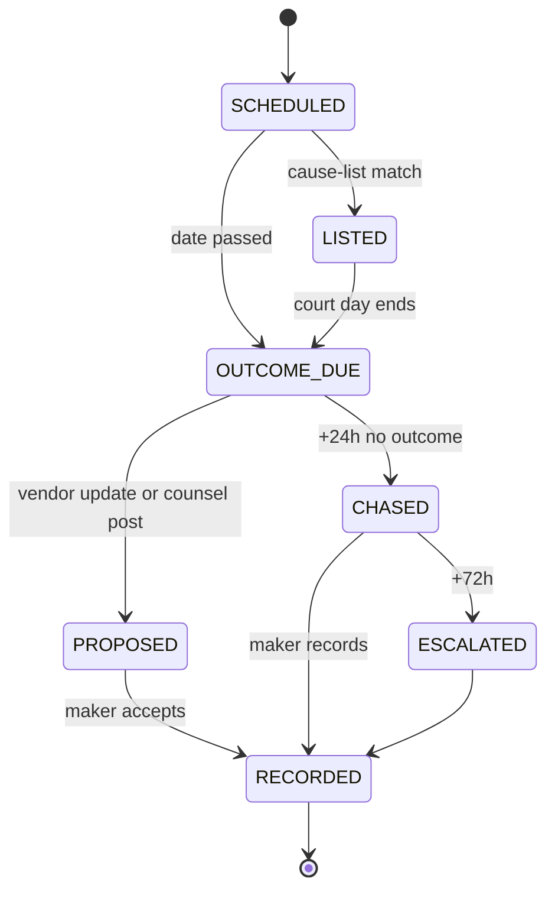

# Phase P11 — Litigation and Matter Management

> Paste after `01_MASTER_PROMPT.md` and `02_REQUIREMENTS_MAP_AND_DECISION_LOG.md`.
>
> **Dependencies:** P02 (organisations, departments, maker-checker, delegations), P03 (settings registry, `RULES_PORT`, limitation and forum rule packs), P04 (Legal Vault: folders, versions, legal hold, bulk folder intake), P05 (OCR, type copies and translation of orders and notices), P09 runtime (Vidhi agents `AGT_LITIGATION_CLERK`, `AGT_ORDER_DIGEST`, `AGT_HEARING_PREP`, `AGT_EVIDENCE_CLERK`, `AGT_NOTICE_RESPONDER`), P10 (notice register `ntc_`, pleadings `pld_`, annexure and bundle builder), P16 (marketplace engagements of advocates), P17 (plan limits, meters, add-on `LD-ADD-LIT`), P19 core (`int` gateway, connector framework, ecosystem inbox/outbox), P20 core (export map), P22 (push). External: two licensed court-data aggregators (contracts pending), Equator Resolution (ADR referral contract — Appendix Y), Finbyx/Udofin Recovery Suite (litigation events, Ecosystem Spec §6.10), LawDocsComply (when the tenant uses it).
> **Sequencing:** Wave 2. Sprint 1–2: matter/case model, forum registry, manual CNR, vault folders; freeze the `lit` read API (`GET /v1/lit/matters`, `/v1/lit/cases`, `/v1/lit/clocks`) at the end of sprint 2 for P12 (oppositions as matters) and P13 (CLO dashboard, board MIS). Sprint 3–5: court-data adapters, hearings, cause lists, orders, deadline engine. Sprint 6–7: counsel, spend, exposure, bundles, bulk import, individual view. Sprint 8–9: Equator referral, ecosystem projections, reports, mobile, hardening. The second court-data vendor can follow in Wave 2's last sprint (R6 §R6.6.6 v1.1).
> **Binding appendices:** A (workflows and state machines), B (data model, events and error codes), D (roles and access matrix), H (agent roster), K (`LD-EXPORT-1.0` folder taxonomy), M (marketplace professional rules), R (settings registry), T (legal-department operating model and intake SLAs), W (verification log and open items), Y (Ecosystem Spec v1.2 change request).
> **Requirements covered:** R-002, R-012, R-017, R-019, R-021, R-023, R-026, R-027, R-030, R-047, R-060, R-061, R-062 (alerts), R-067, R-068, R-076, R-083 (status tracking for consumer cases that reach a forum), R-086.
> **Decisions applied:** D-02, D-05, D-07, D-10, D-14, D-15, D-17 · **Challenges applied:** CH-08, CH-14, CH-16, CH-27, CH-28, CH-31 · **Non-negotiables tested:** NN-01, NN-02, NN-05, NN-09, NN-10, NN-11, NN-13, NN-14, NN-17, NN-19, NN-20, NN-21, NN-24, NN-28, NN-29, NN-30, NN-34, NN-38, NN-39, NN-43, NN-45, NN-46
> **Estimated effort:** 9 two-week sprints, squad of 8 (backend 3, frontend 2, mobile 1, QA 1, integration 1) plus a part-time legal domain analyst (advocate with corporate and recovery litigation experience) and a chartered accountant for the exposure schedule.

---

## 1. Objective and business outcome

Indian companies run litigation from spreadsheets, counsel e-mails and the eCourts app one case at a time. Individuals do not understand what "Stage: Appearance — next date 14.01.2027" means or what they must do next. This phase builds a Provakil-class matter and case management system (R1 §5; IMP-060 to IMP-069) for both audiences:

- **Companies:** one register of every dispute and pre-dispute (notices, suits, writs, arbitrations, consumer complaints, tribunal and regulatory proceedings), with hearings, cause lists, orders turned into tasks, limitation and order-compliance clocks, counsel and spend control, exposure estimates for the financial statements, document bundles and board/audit-committee MIS.
- **Individuals ("My cases"):** add a case by CNR or case number, see the status in plain language in their language, get reminders, keep every paper in the Legal Vault, and hire a professional when they need one.

LawDocs is a technology and legal-operations platform. It does not appear in court, give legal advice or file anything on anyone's behalf (NN-41, CH-14). Court data comes only from licensed sources or the user (NN-05, CH-27).

| Outcome | KPI and exit-gate measure |
|---|---|
| No missed date | 100% of active cases have an owner and a next date or an explicit "date awaited" status; missed-hearing-outcome rate < 2% after 48 hours in pilot; 0 missed limitation clocks in UAT |
| Data is honest | Every court-sourced field shows source, fetched-at time and a staleness label; 0 screens use "real-time", "live", "official" or "certified" for vendor data (NN-20) |
| Orders become actions | An uploaded order produces a confirmed digest and tasks in ≤ 3 clicks; 95% of directions have an owner within 1 business day |
| Company control | Board MIS and quarterly exposure schedule produced in ≤ 10 minutes for a 300-matter tenant; counsel invoice validated against budget before approval |
| Onboarding speed | 500-row Excel import with CNR de-duplication, preview and undo in < 5 minutes |
| Individual clarity | "What this status means / what happens next" shown for 100% of seeded status codes in the 10 launch languages (D-07) |
| Boundaries kept | Recovery cases from the Recovery Suite appear only as read-only projections; 0 LawDocs writes to recovery records (Ecosystem Spec §6.10) |

**Done for users.** A CLO opens Litigation Home, sees today's cause-list matches, overdue outcomes and clocks under 30 days, and clears them from one screen. An individual opens the app, taps "My cases", and reads "Your case is listed on 14 January 2027 before Court No. 4. The court will hear arguments on your application. Bring: copy of the agreement, payment receipts."

## 2. Scope (in / out)

**In scope** (detailed in §4A–§4R)
- Matters: litigation, pre-litigation (notices, demands, opinions), arbitration and mediation, regulatory and quasi-judicial proceedings, criminal complaints where the tenant or individual is a party.
- Court cases across the Supreme Court, High Courts, district, commercial and family courts, NCLT/NCLAT, DRT/DRAT, consumer commissions, RERA authorities and appellate tribunals, other tribunals, Lok Adalats and arbitral tribunals; CNR and case-number capture; `COURT_DATA_PORT` with two licensed aggregators, manual refresh and staleness labels.
- Hearings calendar, cause-list matching, next-date tracking; orders and judgments with Vidhi digests and directions as tasks; limitation, appeal, pleading and order-compliance clocks.
- Counsel panel, external-counsel portal, fees, legal spend; exposure and contingent-liability schedule; bundles, folders and evidence; team tasks and waiting items.
- Individual "My cases" with plain-language explainer, legal-aid signposting and professional hand-off; alerts; bulk import; reports and board/audit-committee MIS.
- ADR referral through the P19 route panel (Equator as one provider) and read-only Recovery Suite projections (Ecosystem Spec §6.10, entity #24).

**Out of scope (owner phase)**
- Drafting pleadings, notices, replies, vakalatnamas and annexure indices — P10 (`pld`). P11 links to them and opens the drafting studio in context.
- Dispatch and proof of service of notices — P10 (with `ntf`).
- Hiring, paying and reviewing marketplace professionals — P16. P11 consumes engagements.
- Recovery litigation (SARFAESI, DRT original applications as lender, s.138 as lender, IBC as financial creditor, recovery-linked arbitration) — Finbyx/Udofin Recovery Suite (system of record). LawDocs shows projections only.
- ADR adjudication, neutral appointment and awards — Equator Resolution.
- Regulator inspections, RFIs, observations and MAP items — LawDocsComply (compliance system of record, D-10). LawDocs records regulatory **proceedings** (show-cause, adjudication, appeal) as matters.
- E-filing, court-fee payment, appearance — done by the advocate or party-in-person outside LawDocs (NN-05, NN-13, NN-41).
- Consumer-help grievance desks (pre-forum complaints to banks, insurers, ombudsmen) — P15; a grievance that becomes a consumer-commission case creates a P11 case.
- Board-pack assembly and listed-company disclosure workflow — P13 (P11 supplies MIS and flags).

## 3. Personas and permissions touched

Full matrix in Appendix D. Access is matter-scoped by ABAC attributes (`matter_id`, `team`, `privilege`, `confidentiality_class`, `owner_system`).

| Role code | What they can do in P11 |
|---|---|
| `ORG_CLO` | Owns the litigation register; sees all matters of the entity; approves counsel engagement, budgets, settlement proposals within delegation; sets exposure class (as assessor); approves privilege downgrade; configures tenant settings under `lit.*` |
| `ORG_LEGAL_MAKER` | Creates matters and cases, records hearings and outcomes, confirms order digests, creates tasks, prepares bundles, imports registers; cannot approve own budget or invoice (NN-18) |
| `ORG_CHECKER` | Checks imports, exposure schedules, invoice approvals and settlement proposals made by a maker |
| `ORG_APPROVER` | Approves settlement, waiver and spend above the CLO's delegation (DoA from P13) |
| `ORG_DEPT_HEAD` | Sees matters tagged to the department; answers tasks; nominates business owner |
| `ORG_MEMBER` | Raises a legal request (P13 intake) that may become a matter; sees only matters where named |
| `ORG_KMP` (CFO) | Reviews and approves the exposure schedule; sees spend; (CS) sees listed-company materiality flags |
| `ORG_DIRECTOR`, `ORG_BOARD_OBSERVER` | Read the board MIS pack published to them; no matter-level access unless granted |
| `ORG_EXT_COUNSEL` | Guest in assigned matters only: posts hearing updates, uploads pleadings and orders (privileged by default), answers tasks, submits invoices; updates enter a review queue |
| `ORG_AUDITOR_RO` | Reads the frozen exposure schedule and matter list within a time-boxed scope grant; privileged documents excluded |
| `ORG_DELEGATED_MAKER` / `OPS_RM` / `OPS_PROFESSIONAL` | Under a client-approved delivery grant (NN-17): maker for hearing updates, order digests, bundles and imports; never checker or approver |
| `IND_OWNER` | Adds and tracks own cases; uploads papers; sets reminders; shares a case with family or delegate; hires a professional |
| `IND_FAMILY_MEMBER`, `IND_DELEGATE`, `IND_GUARDIAN` | Scoped view or edit of shared cases as granted by `IND_OWNER` |
| `PRO_ADVOCATE`, `PRO_FIRM_ADMIN`, `PRO_FIRM_MEMBER` | Through a marketplace engagement (P16): same powers as `ORG_EXT_COUNSEL` in the engaged matter; in the practitioner workspace (apps/delivery) see a cross-client diary of their engaged matters only |
| `AGT_LITIGATION_CLERK`, `AGT_ORDER_DIGEST`, `AGT_HEARING_PREP`, `AGT_EVIDENCE_CLERK`, `AGT_NOTICE_RESPONDER` | Makers only (NN-43): propose syncs, timelines, digests, hearing briefs, type copies, task lists and reply outlines; never confirm, file, send or approve |
| `PLT_LEGAL_REVIEWER`, `PLT_CONTENT_EDITOR` | Maintain the forum registry, status explainer glossary and limitation rule pack (NN-30) with maker-checker |

## 4. Functional requirements

### 4A. Matter model

**FR-P11-01 — Matter and case.** A **matter** (`mat_`, business ID `LD-MAT-YYYY-NNNNNN`) is the business dispute or legal issue. A **case** (`cas_`, `LD-CAS-YYYY-NNNNNN`) is one proceeding before one forum. A matter holds zero or more cases (e.g., one dispute → s.9 A&C petition in the commercial court, arbitration, s.34 challenge, appeal) linked as a **proceeding tree** (parent case, relation: APPEAL_OF, REVISION_OF, TRANSFERRED_FROM, EXECUTION_OF, CONNECTED_WITH, REMANDED_FROM, SLP_AGAINST). A pre-litigation matter has no case until filing; conversion keeps the matter ID.

**FR-P11-02 — Matter types (seeded, tenant-extendable).**

| Group | Types |
|---|---|
| Pre-litigation | NOTICE_RECEIVED, NOTICE_SENT (both link P10 `ntc_` records), DEMAND, LEGAL_OPINION, CEASE_AND_DESIST, PRE_INSTITUTION_MEDIATION (Commercial Courts Act 2015 s.12A) |
| Civil and commercial | CIVIL_SUIT, COMMERCIAL_SUIT, SUMMARY_SUIT (CPC Order XXXVII), EXECUTION, CIVIL_APPEAL, REVISION, CONTEMPT |
| Constitutional | WRIT (Art. 226/227), SLP (Art. 136), PIL, TRANSFER_PETITION |
| Criminal | COMPLAINT_S138_NI (non-recovery capacity, e.g., vendor cheque), FIR_COMPLAINT, BAIL, CRIMINAL_REVISION, QUASHING (BNSS s.528) [VERIFY section], CRIMINAL_APPEAL |
| Company and insolvency | NCLT_COMPANY_PETITION, OPPRESSION_MISMANAGEMENT (Companies Act ss.241–242), IBC_OPERATIONAL_CREDITOR (s.9), IBC_CLAIM, IBC_CORPORATE_DEBTOR_DEFENCE, NCLAT_APPEAL |
| Consumer | CONSUMER_COMPLAINT, CONSUMER_APPEAL, CONSUMER_REVISION, EXECUTION_CONSUMER |
| Real estate | RERA_COMPLAINT, RERA_APPEAL |
| Tax and fiscal | TAX_APPEAL_FAA, TAX_APPEAL_TRIBUNAL (ITAT/CESTAT/GSTAT), TAX_WRIT |
| Employment | LABOUR_DISPUTE, INDUSTRIAL_REFERENCE, EMPLOYEE_SUIT, POSH_APPEAL (record only; POSH inquiry stays sealed in P13) |
| Regulatory | REGULATORY_SCN, ADJUDICATION, COMPOUNDING, REGULATORY_APPEAL (e.g., SAT, appellate authorities) |
| ADR | ARBITRATION, ARB_S9_INTERIM, ARB_S11_APPOINTMENT, ARB_S34_CHALLENGE, ARB_S37_APPEAL, ARB_S36_ENFORCEMENT, MEDIATION, CONCILIATION, LOK_ADALAT, PERMANENT_LOK_ADALAT |
| IP | TM_OPPOSITION, TM_RECTIFICATION, INFRINGEMENT_SUIT, PASSING_OFF, IP_APPEAL (created from P12) |
| Family and personal (individuals) | MATRIMONIAL, MAINTENANCE, CUSTODY, SUCCESSION_PROBATE, PROPERTY_PARTITION, TENANCY, MOTOR_ACCIDENT_CLAIM, CHALLAN_VIRTUAL_COURT (from P15) |

Each type carries a stage set, default folders, default clocks, default alerts and an "i" key (`hlp.lit.type.<code>`). Tenants add types and rename stages (TENANT tier) but cannot remove statutory clocks attached to a platform type (NN-29, NN-30).

**FR-P11-03 — Matter record fields.** Matter ID and business ID; title (auto: "<Our party> v. <Opposite party>" or the notice subject; editable); type; our role (PETITIONER, RESPONDENT, PLAINTIFF, DEFENDANT, APPELLANT, COMPLAINANT, ACCUSED, CLAIMANT, OPPOSITE_PARTY, INTERVENOR, CREDITOR, CORPORATE_DEBTOR, OTHER); legal entity and department; business owner; matter team; opposite parties (party model FR-P11-04); subject matter tags; claim value and currency (NUMERIC + decimal.js), counter-claim; relief sought; linked records (agreements `agr_`, notices `ntc_`, pleadings `pld_`, trademarks `tmk_`, employees via HR kernel reference, grievances `grv_`); privilege default; confidentiality class (STANDARD, CONFIDENTIAL, BOARD_CONFIDENTIAL, LEGAL_PRIVILEGED); status (ACTIVE, STAYED, DORMANT, DISPOSED, SETTLED, WITHDRAWN, CLOSED); stage; next date (derived from cases); exposure class (FR-P11-43); risk score (advisory, FR-P11-47); listed-entity materiality flag (FR-P11-48); `owner_system` (LD, RS, LDC); source reference.

**FR-P11-04 — Party model.** Parties are `prs_` (persons) or `org_` (organisations) shared with the vault and CLM. A matter party has role, advocate on record (name and enrolment number as text — not a marketplace profile), address for service, and a **masking flag** for third-party personal data in reports (default ON outside the matter team). Party-name variants (transliterations, abbreviations such as "Pvt Ltd" / "Private Limited", former names) feed the party watch (FR-P11-12).

**FR-P11-05 — Internal conflict check.** On matter creation, LawDocs checks the tenant's own records (counterparties in CLM, other matters' opposite parties, group entities from P02) and shows "We have an agreement with this party (LD-AGR-…)" or "This party is on the other side in LD-MAT-…". The check is informational; the CLO decides. For marketplace engagements the professional's own conflict declaration is collected in P16.

**FR-P11-06 — System of record when the tenant also uses LawDocsComply.** Per D-10, LawDocs is system of record for litigation and matters. LawDocsComply v1.2 P26 (its D-41) also specifies a legal-matters register. To avoid double entry:

| `lit.sor.mode` (ENTITY tier) | Behaviour |
|---|---|
| `LAWDOCS` (default) | LawDocs owns matters, cases, hearings, orders, clocks and exposure. With `int.eco.ldc.projections.enabled` (P19), it publishes the proposed `legal` domain projections — `legal.LegalMatterOpened/Updated/Closed.v1`, `legal.CourtCaseRegistered.v1`, `legal.CourtCaseUpdated.v1`, `legal.CourtHearingScheduled.v1`, `legal.CourtOrderRecorded.v1` — to the same organisation's LDC tenant (P19 FR-P19-32; Appendix I §I.5; Appendix Y §Y.14). LDC shows them read-only and uses the exposure aggregates for contingent-liability, Reg 30 and penalty views. |
| `LDC` | For a tenant already live on LDC P26 before LawDocs. LawDocs shows LDC matters read-only (projection), still lets the user add documents to the LawDocs vault and use bundles, and offers a guided **SoR migration** (expand → migrate → contract, NN-12) to `LAWDOCS` with dual-run reconciliation. |

Changing the mode is maker-checker (`ORG_CLO` + `ORG_CHECKER`), effective-dated, and blocked while an import or migration job is running. [OWNER] confirm that LDC v1.3 will adopt this split (OI-P11-01). Regulator inspections remain LDC-only in both modes.

### 4B. Forums and court cases

**FR-P11-07 — Forum registry (content, NN-30).** Platform-maintained, versioned list of forums with: code, name, forum class (SUPREME_COURT, HIGH_COURT, HC_BENCH, DISTRICT_COURT, COMMERCIAL_COURT, FAMILY_COURT, TRIBUNAL, CONSUMER_COMMISSION, RERA_AUTHORITY, RERA_APPELLATE, ARBITRAL_TRIBUNAL, LOK_ADALAT, PERMANENT_LOK_ADALAT, REGULATOR_ADJUDICATION, OTHER), State and district, establishment code where the eCourts system uses one [VERIFY per forum], parent forum, court language (Constitution Art. 348(1) for SC/HCs; CPC s.137 for subordinate courts — R3 LG-093), holiday calendar reference, vacation periods, identifier scheme(s) accepted, licensed-source coverage per vendor, filing-size limits [VERIFY per forum], and help text. Seed: SC, all HCs and benches, district courts by State, NCLT benches and NCLAT, DRTs and DRATs, consumer commissions (DCDRC by district, SCDRC by State, NCDRC), RERA authorities and appellate tribunals by State, ITAT, CESTAT, GSTAT benches [VERIFY operational benches], NGT, SAT, TDSAT, APTEL, CAT, labour courts and industrial tribunals by State (seed partially; tenant can add), Lok Adalats (National Lok Adalat dates as events). Tenants add local forums (TENANT tier) without affecting the platform list.

**FR-P11-08 — Case identifiers.** A case holds one or more identifiers, each typed and validated:

| Identifier | Applies to | Validation |
|---|---|---|
| CNR (Case Number Record) | Courts on the eCourts CIS platform (district courts; HCs on CIS) | Exactly 16 alphanumeric characters, entered without hyphens or spaces (eCourts Services app help, checked 25 Oct 2026); strip separators, uppercase; candidate pattern `^[A-Z]{4}[0-9]{12}$` (establishment prefix, establishment number, serial, year — e.g., `DLST010012342025`) [VERIFY composition before the pattern becomes blocking — OI-P11-09; until then length + charset only]; uniqueness per tenant |
| Case type + number + year | All courts and tribunals | Case type from the forum's type list (e.g., "CS(COMM)", "W.P.(C)", "O.A.", "CC") [VERIFY per forum]; number numeric; year 4 digits |
| Filing number / e-filing number | Courts and tribunals with e-filing | Free text with forum-specific mask |
| Diary number | Supreme Court; NCLT/NCLAT; DRT | Number + year |
| Consumer case number | e-Jagriti (NCDRC, SCDRC, DCDRC; replaced e-Daakhil/CONFONET from 1 Jan 2025 — R6 D-07 [VERIFY; P10 OI-P10-07 tracks the same point]) | Free text with mask |
| Arbitration reference | Arbitral institution or ad hoc | Free text |
| Equator docket reference | Equator ADR cases | From the ADR projection |
| FIR number | Criminal | Police station + number + year |

Ambiguous or invalid identifiers raise `LD-LIT-001` with a forum-specific example; the user may save the case as **manual** with the identifier marked "unvalidated".

**FR-P11-09 — Add a case (≤ 3 taps from home on mobile; ≤ 4 clicks on web).** Four paths in SCR-P11-03:

1. **By CNR** — paste or scan (camera OCR of the CNR printed on the case paper or the QR code on eCourts documents where present [VERIFY QR content]) → licensed adapter lookup (if covered and plan allows) → preview with source and fetched-at time → confirm.
2. **By case number** — forum → case type → number → year → lookup or manual.
3. **By party or advocate name** — only through a licensed adapter that offers party search; results show minimal fields; the user picks and confirms (party searches are logged and rate-limited because they process third-party personal data; NN-26).
4. **Manual** — forum, identifiers, parties, next date; the user uploads the last order and Vidhi proposes the fields (FR-P11-26).

Duplicate detection on CNR and on (forum, type, number, year) returns `LD-LIT-002` with a link to the existing case. Plan limits (`lit.matters.max`, PLN tier; seeds Free 1, Personal 5, Pro 50, Business 300 band, Enterprise by band — R6 §R6.2.2, [OWNER TO SET]) return `LD-LIT-003` with upgrade and archive options (no dark patterns: the user may archive a disposed case to free a slot; NN-50).

**FR-P11-10 — Case record fields.** Case ID and business ID; matter link; forum and bench/court number; judge or coram (as published; text); identifiers; case type; filing date; registration date; stage (normalised code + raw text as published); status (PENDING, LISTED, RESERVED, DISPOSED, TRANSFERRED, DORMANT, SINE_DIE, STAYED_BY_SUPERIOR_COURT); next date and purpose; last date and business done; petitioner/respondent advocates (text); acts and sections (normalised to the rules register where resolvable, else "as published"); interim orders in force (stay, injunction, status quo) with dates; disposal date and nature; `data_provenance` per field (FR-P11-15).

**FR-P11-11 — Proceeding tree and transfers.** When a case is transferred, re-numbered, tagged with another case or appealed, the user (or an adapter event) links the new case; history is preserved; reminders move to the live case. Superior-court stays show as a banner on the lower-court case.

**FR-P11-12 — Party watch ("new case filed against us").** For companies on Business and Enterprise plans, the CLO registers watch terms (entity names, variants, CIN-linked former names, brands) and forum scope. A licensed adapter that offers party-name search or new-filing alerts runs the watch on the vendor's schedule; hits land in a **review queue** (never auto-create a case), with fields: forum, identifier, parties as published, filing date, match reason, confidence. The reviewer accepts (creates a case under a new or existing matter), dismisses (false positive, reason logged) or snoozes. Flag `lit.party_watch.enabled` OFF until a vendor contract covering this use is signed and the DPDP processing purpose is recorded (NN-38; OI-P11-03). Error `LD-LIT-024` if enabled without a capable adapter.

### 4C. Court data adapters (`COURT_DATA_PORT`)

**FR-P11-13 — Port and adapters.** `COURT_DATA_PORT` (in `packages/connectors`, consumed only through `int`; base interface `CourtDataPort` in Appendix I §I.3 — `addWatch`, `refresh`, `coverage` — extended here and to be added to Appendix I) exposes: `lookupByCnr`, `lookupByNumber`, `searchParty` (optional capability), `getCaseSnapshot`, `getOrders`, `batchCauseList` (CNR list → listings for a date), `subscribeWatch` (optional), `health`. Adapters:

| Adapter | Status at launch | Notes (R6 D-01 to D-09) |
|---|---|---|
| `LicensedAggregatorA` (primary; vendor kill switch e.g. `ecourtsindia-court`) | ON after contract | Vendor shortlisted from eCourtsIndia API, Surepass eCourts API, Claw, Legitquest-type providers (R6 D-08) [VERIFY each]. Contract must include lawful-collection warranty, indemnity, India data residency, DPDP processor clauses, permitted storage and display to LawDocs users, no-resale terms compatible with LawDocs' use, SLA, deletion on termination |
| `LicensedAggregatorB` (fallback; e.g. `surepass-court`) | ON when contracted | Different upstream collection where possible; used on A's failure, coverage gap or disagreement checks |
| `ManualCNR` | Always ON | The user or counsel enters status, next date and orders; LawDocs reminds and asks for an update after each date |
| `eCourtsOfficialApi` (kill switch `ecourts-official`) | OFF (v2) | eCourts Open APIs are restricted to institutional litigants and government departments with e-Committee/High Court approval (R6 D-01). Only where the **client** is an approved institutional litigant and supplies its own credentials through the credential vault (NN-16); LawDocs never applies in its own name unless eligibility is confirmed [VERIFY] (OI-P11-02) |

There is **no** scraper, CAPTCHA solver, headless-browser automation or credential-driven login to any court, tribunal or government portal, for any adapter or agent (NN-05). A CI rule rejects dependencies and code paths that automate those domains (test `NN-05_no_court_portal_automation`).

**FR-P11-14 — Coverage map.** Each adapter declares coverage by forum code and capability (status, orders, cause list, party search, watch). The Add Case wizard shows "Automatic updates available from <Vendor>" or "Not covered — you will update this case yourself; we will remind you after every date". Coverage is refreshed from vendor metadata monthly and is shown on SCR-P11-20.

**FR-P11-15 — Provenance and staleness labels.** Every court-derived field stores `source` (VENDOR_A, VENDOR_B, USER, COUNSEL, ORDER_EXTRACT, ECOSYSTEM_RS), `fetched_at` or `entered_at`, `source_ref` (vendor request ID) and `as_published_text`. The UI shows a freshness chip per case:

| Label | Rule (defaults; TENANT tier can tighten) | Display |
|---|---|---|
| UPDATED_TODAY | Last successful refresh or human update ≤ 24 h | "Updated today 07:12 from <Vendor>" |
| RECENT | ≤ `lit.court_data.recent_hours` (72 h) | "Updated 2 days ago" |
| STALE | Older than `lit.court_data.recent_hours`, or a listed date passed without a refresh or outcome within `lit.court_data.staleness_label_hours` (24) | Amber chip "May be out of date — refresh or add the outcome" |
| UNKNOWN | No source yet | Grey chip "No update yet" |
| CONFLICT | Vendors disagree, or vendor disagrees with counsel | Red chip "Sources disagree — check" with side-by-side view |

Copy never says "real-time", "live", "official" or "certified" for vendor data; it says "from <Vendor>, a licensed data provider; check the court record before relying on it" (NN-20; guard `LD-LIT-025` blocks such strings in templates).

**FR-P11-16 — Precedence.** Counsel and user entries prevail over vendor data for the same field and date (Ecosystem Spec §10.2 adapter catalogue, legal-tech row: "counsel updates prevail"); a later vendor value that differs raises CONFLICT rather than overwriting. An uploaded order prevails over both for the facts it records.

**FR-P11-17 — Refresh policy and metering.** Scheduled diff: active cases with a date in the next `lit.court_data.lookahead_days` (7) refresh daily at `lit.court_data.sync_time` (05:30 IST); other active cases weekly; dormant monthly; disposed never (unless reopened). User-initiated refresh is allowed once per case per `lit.court_data.manual_cooldown_minutes` (30). Refreshes beyond the plan allowance consume the `COURT_DATA_REFRESH` meter (R6 §R6.2.6; pass-through with disclosed margin) — the user sees the credit cost before confirming; `LD-LIT-005` when credits are exhausted, with manual update offered.

**FR-P11-18 — Vendor health and failover.** `CourtDataHealthJob` probes each adapter (latency, error rate, coverage drift). After `lit.court_data.failover_error_rate` (20% over 15 minutes) the router uses Vendor B for covered forums and marks affected cases with "Updates delayed". Each adapter has a kill switch (NN-39) operable by `PLT_SRE` and `PLT_SUPER_ADMIN` with audit. When both fail, LawDocs switches the tenant to manual mode for affected cases and notifies owners once per day (no alert storms).

**FR-P11-19 — Field mapping and status normalisation.** Vendor stages and statuses map to LawDocs codes through a versioned mapping table per vendor and forum class (content, NN-30). Unmapped values show the raw text and open a mapping task for `PLT_CONTENT_EDITOR`. The **plain-language explainer** (FR-P11-56) keys off the normalised code.

### 4D. Hearings, cause lists and next dates

**FR-P11-20 — Hearing record (`hrg_`).** Case, date, session (morning/afternoon where known), court/bench, item number, purpose (as listed), mode (physical, VC, hybrid), appearing counsel, our attendees, outcome (HEARD, ADJOURNED, PART_HEARD, RESERVED, DISPOSED, NOT_REACHED, PASSED_OVER, LISTED_NOT_TAKEN_UP, TRANSFERRED, OTHER), business done (text), adjournment reason and who sought it, costs imposed, next date and purpose, order uploaded (link), recorded by, recorded at, source.

**FR-P11-21 — Hearings calendar.** Day, week, month and agenda views across all permitted matters; filters by forum, counsel, department, owner, entity; colour by matter priority; conflicts (same counsel in two forums at the same session) flagged. Calendar sync to the user's Microsoft 365 or Google calendar through `WORKSPACE_PORT` (P19) as busy blocks with a deep link; event bodies carry no party names unless `lit.calendar.include_titles` = ON (DEPARTMENT tier; default OFF for privacy).

**FR-P11-22 — Cause-list matching.** Each evening at `lit.cause_list.match_time` (19:30 IST) and early morning (06:00 IST) for next-day lists, LawDocs sends the tenant's CNR list for covered forums to the adapter's batch cause-list endpoint and records matches (date, court, item number, list type: daily/supplementary/advance). Uncovered forums: the user or counsel may upload a cause-list PDF; `dix` extracts entries and fuzzy-matches by case number and party names; matches are proposals until confirmed. Matched listings update the hearing and trigger alerts (FR-P11-59). "Not listed although next date is tomorrow" raises a warning to the owner.

**FR-P11-23 — Missing-outcome chaser.** After a listed date, the owner and assigned counsel get an outcome request at `lit.hearing.outcome_due_hours` (24) after the court day ends; reminders at 48 h; escalation to the CLO at 72 h; the case turns STALE. Counsel can reply to the e-mail or WhatsApp utility template with a one-tap link to a 4-field outcome form (outcome, next date, purpose, order uploaded yes/no) — no login wall beyond magic-link + OTP for `ORG_EXT_COUNSEL` (≤ 2 taps after opening).

**FR-P11-24 — Next-date integrity.** A case cannot remain ACTIVE without a next date or an explicit "date awaited / sine die / reserved for judgment" status. A daily job lists violations on Litigation Home.

### 4E. Orders, judgments and action items

**FR-P11-25 — Order record (`odr_`).** Case, date, type (DAILY_ORDER, INTERIM_ORDER, FINAL_ORDER, JUDGMENT, DECREE, AWARD, SETTLEMENT_RECORD, LOK_ADALAT_AWARD), source (UPLOAD, VENDOR, COUNSEL, ECOSYSTEM), original file (immutable, SHA-256 at ingest, Object Lock; NN-09), language, certified-copy status (NOT_APPLIED, APPLIED on date, RECEIVED on date — the dates feed the limitation exclusion under Limitation Act s.12(2) [VERIFY]), digest (derived rendition), directions, appealability.

**FR-P11-26 — Vidhi order digest (`AGT_ORDER_DIGEST`).** On upload or vendor fetch, the agent proposes: outcome (allowed, dismissed, partly allowed, disposed with directions, adjourned, reserved, notice issued, interim relief granted/refused), a 5-line plain summary, holdings (for judgments), amounts (costs, deposit, compensation), **directions** (who must do what by when), next date and purpose, whether an appeal or review lies and the proposed clock code. Each proposal cites page and paragraph of the order (NN-14). Regional-language and handwritten orders first pass through P05 (type copy + translation labelled "machine translation — verify"; NN-48). The digest is a `drv_` rendition labelled "AI summary — check against the order".

**FR-P11-27 — Confirm and convert (≤ 3 clicks).** In SCR-P11-08 the maker reviews the digest side by side with the order, edits, and clicks **Confirm**. Confirmed directions become tasks (`tsk_`) with owner, due date (from the deadline engine), evidence requirement and link to the order; appeal and compliance clocks are created; the hearing record updates. Nothing is created before confirmation (NN-13 analogue for internal effects; NN-43).

**FR-P11-28 — Orders library and search.** Per case and across the tenant: full-text search (OpenSearch, tenant-filtered, Indic analysers), filters by forum, judge (as published), outcome, date, act/section; "Similar orders in our matters" for internal precedent. Public judgments may be linked to an open-access source URL; LawDocs does not republish third-party law-report content.

### 4F. Deadline engine: limitation, appeals, pleadings and order compliance

**FR-P11-29 — Clock model (`lit.clocks`).** Clock code, subject (matter, case, order, direction, notice), start event and date (the **earliest receipt** by the party or its agent — never the date the user logged it), period and unit, day type (calendar/working), exclusions (certified-copy time, court closure), hard cap (e.g., s.34 outer limit), condonable extension (e.g., "+45 days on sufficient cause"), computed last date, internal target date (`lit.clocks.internal_buffer_days`, default 7 or 25% of the period, whichever is smaller), owner, reminder ladder, rule version, verification status (VERIFIED/UNVERIFIED), state (OPEN, MET, MISSED, CONDONATION_SOUGHT, WAIVED_NO_ACTION, SUPERSEDED).

**FR-P11-30 — Rule pack (`rul` content, NN-30).** Clock rules are content, versioned and effective-dated, each with instrument, provision, period, start event, exclusions and a reviewer of record. Seed rows (all **[VERIFY]** against India Code before activation; until verified the clock shows an "Advisory — confirm with counsel" badge and cannot drive a hard block — NN-38, OI-P11-04):

| Code | Clock | Period (seed) | Source to verify |
|---|---|---|---|
| LIM-CONTRACT-SUIT | Suit for breach of contract | 3 years from breach | Limitation Act 1963, Schedule, Art. 55 |
| LIM-RESIDUAL-SUIT | Suit with no specific article | 3 years | Art. 113 |
| LIM-RESIDUAL-APPLN | Application with no specific article | 3 years | Art. 137 |
| LIM-EXECUTION | Execution of decree | 12 years | Art. 136 |
| APP-HC-FROM-DECREE | Appeal to High Court from decree/order | 90 days | Art. 116(a) |
| APP-OTHER-COURT | Appeal to any other court | 30 days | Art. 116(b) |
| APP-INTRA-COURT | Intra-court appeal in the High Court | 30 days | Art. 117 |
| APP-COMMERCIAL | Appeal from commercial court/division | 60 days | Commercial Courts Act 2015 s.13(1A) |
| SLP-SC | Special leave petition | 90 days from judgment (60 days from refusal of certificate) | Supreme Court Rules 2013, Order XXI (civil) / Order XXII (criminal) [VERIFY rule numbers — Order XXII governs criminal SLPs only]; Limitation Act Art. 133 |
| WS-CIVIL | Written statement | 30 days from service, extendable to 90 | CPC Order VIII r.1 |
| WS-COMMERCIAL | Written statement, commercial suit | 120 days outer limit | CPC Order VIII r.1 proviso as amended by Commercial Courts Act 2015 |
| ARB-S34 | Challenge to arbitral award | 3 months from receipt + 30 days on sufficient cause, not thereafter | Arbitration and Conciliation Act 1996 s.34(3) |
| ARB-S29A | Making of award | 12 months from completion of pleadings, extendable 6 months by consent | A&C Act s.29A(1), (3) |
| NCLAT-CA | Appeal to NCLAT (Companies Act) | 45 days + up to 45 days | Companies Act 2013 s.421(3) |
| NCLAT-IBC | Appeal to NCLAT (IBC) | 30 days + up to 15 days | IBC 2016 s.61(2) |
| SC-FROM-NCLAT-CA | Appeal to SC from NCLAT (Companies Act) | 60 days + up to 60 days | Companies Act 2013 s.423 |
| SC-FROM-NCLAT-IBC | Appeal to SC from NCLAT (IBC) | 45 days + up to 15 days | IBC 2016 s.62 |
| IBC-S8-REPLY | Reply to operational creditor's demand notice | 10 days from receipt | IBC 2016 s.8(2) |
| DRT-S17 | Application against SARFAESI measures (borrower side) | 45 days | SARFAESI Act 2002 s.17(1) |
| DRAT-SARFAESI | Appeal to DRAT | 30 days | SARFAESI Act s.18(1) |
| DRAT-RDB | Appeal to DRAT from DRT order | 45 days | RDB Act 1993 s.20(3) |
| CONS-COMPLAINT | Consumer complaint | 2 years from cause of action | Consumer Protection Act 2019 s.69(1) |
| CONS-APP-STATE | Appeal to State Commission | 45 days | CPA 2019 s.41 |
| CONS-APP-NATIONAL | Appeal to National Commission | 30 days | CPA 2019 s.51(1) |
| CONS-APP-SC | Appeal to Supreme Court | 30 days | CPA 2019 s.67 |
| RERA-APPEAL | Appeal to RERA Appellate Tribunal | 60 days | RERA 2016 s.44(2) |
| NI-138-NOTICE | Demand notice after dishonour | 30 days from information of dishonour | NI Act 1881 s.138 proviso (b) |
| NI-138-COMPLAINT | Complaint | 1 month from cause of action (after the 15-day payment window) | NI Act s.142(1)(b) |
| GST-FAA | Appeal to first appellate authority | 3 months + 1 month on sufficient cause | CGST Act 2017 s.107(1), (4) |
| GSTAT | Appeal to GST Appellate Tribunal | 3 months | CGST Act s.112(1) [VERIFY as amended and tribunal start date] |
| ITAT | Appeal to ITAT | per Income-tax Act 2025 [VERIFY new section; 1961 Act s.253(3) was 2 months] | Income-tax Act 2025 |
| ORDER-COMPLIANCE | Compliance with a direction | As stated in the order, from order date or receipt as the order says | The order |
| WRIT-LACHES | Writ petition | No statutory period; advisory reminder only | — (advisory) |

Rules applied by the engine: Limitation Act s.4 (court closed on the last day → next opening day), s.12 (exclusion of the day of judgment and certified-copy time where applicable), s.5 (condonation — modelled as `CONDONATION_SOUGHT`, never as pause) [VERIFY each]. Clocks **never pause** while the team waits for documents.

**FR-P11-31 — Computation.** Deterministic function in `packages/rules` (no AI): `due = addPeriod(start, period, unit, dayType, forumCalendar) + exclusions`, then holiday roll-forward per the rule; outer caps enforced; result carries rule ID and version. Recomputation on any input change creates a new clock version; the history is kept (NN-02).

**FR-P11-32 — Reminder ladder.** Defaults `lit.clocks.reminder_offsets_days` = [30, 15, 7, 3, 1, 0]; escalation to the CLO at T-3 and on breach; a breach creates a P13 legal-calendar exception and appears on the CLO dashboard. For individuals the ladder is [15, 7, 3, 1] with plain-language copy ("You may have 30 days from 10 December 2026 to appeal. Speak to an advocate this week.").

**FR-P11-33 — Closing a clock.** MET (evidence: filing receipt or document), WAIVED_NO_ACTION (decision "no appeal" with reason by `ORG_CLO`), CONDONATION_SOUGHT (link to the application), SUPERSEDED (rule or order changed). A matter cannot be closed while a clock is OPEN (`LD-LIT-009`) or a direction is open (`LD-LIT-010`).

### 4G. Counsel panel and assignment

**FR-P11-34 — Counsel panel (tenant data).** The company's own panel of advocates and firms (`lit.counsel_panel`): name, firm, enrolment number and State Bar Council (as provided by the counsel), practice areas, forums, cities, languages, contact, rate card (per appearance, per hearing day, per stage, per hour, fixed fee, retainer), GST status (registered/unregistered; reverse-charge flag for legal services to business entities under Notification 13/2017-CT(R) Sl. 2 — R6), PAN (masked + token), engagement terms on file, NDA, data-processing clause status, empanelment dates and review date. Panel entries are **private to the tenant** and are not marketplace profiles; LawDocs does not rank or recommend panel counsel to other tenants.

**FR-P11-35 — Assignment.** Per case: lead counsel, briefing counsel, local counsel, senior counsel (per hearing), in-house owner. Assigning external counsel issues an `ORG_EXT_COUNSEL` invitation scoped to the matter (magic link + OTP; MFA required after first login — NN-03) and records a vakalatnama/memo-of-appearance status (DRAFTED via P10, SIGNED, FILED with date). Reassignment revokes access at once and keeps their past contributions attributed.

**FR-P11-36 — Marketplace engagement link.** If the user hires an advocate through the marketplace (P16), the engagement (`eng_`) attaches to the matter with scope, fee and SLA. The advocate works in the practitioner workspace (apps/delivery) with the same matter-scoped powers as panel counsel. LawDocs takes no commission, referral or success fee from advocates (NN-21, CH-08); the buyer-side platform fee is P16's concern.

**FR-P11-37 — Fee arrangements.** Allowed bases: per appearance, per stage, hourly, fixed, retainer, capped. **Contingency or success fees for advocates are blocked** (BCI Rules, Part VI Ch II, Rule 20 — R3 LG-112; CH-31); the field set offers no percentage-of-recovery option for counsel of type ADVOCATE (`LD-LIT-011`). Success fees in the separate Consumer Help entity follow P15 and are not available here.

**FR-P11-38 — Counsel portal and review queue.** Counsel see: matter overview shared with them, docket, hearings, tasks assigned to them, documents shared (privileged by default), message thread. They can post hearing outcomes, upload pleadings, orders and opinions, answer tasks and submit invoices. Every counsel post lands in the matter's **review queue**; the legal maker accepts (becomes part of the record) or returns with a comment. Counsel never see other matters, the panel, spend analytics or exposure (`LD-LIT-012`, test `NN-01_counsel_matter_scope`). **Internal scorecards** (timeliness of updates, budget adherence, outcomes recorded) are private tenant management data, never shown outside the tenant, never published, and never feed marketplace ordering [INTERP][COUNSEL confirm under BCI Rule 36 — OI-P11-08].

### 4H. Legal spend

**FR-P11-39 — Budgets.** Per matter and per case, by stage or by financial year: professional fees, court fees and stamp, out-of-pocket, senior counsel, experts, ADR fees; phased by quarter. Alerts at `lit.spend.alert_pct` [80, 100] of budget; overruns need approval per the delegation-of-authority matrix (P13 DoA).

**FR-P11-40 — Invoices (`lit.spend_invoices`).** Intake from the counsel portal, e-mail-in (`int` mailbox per entity) or upload; `dix` extracts invoice number, date, GSTIN, amounts, period and line items. Validation: rate card, budget, duplicate (same counsel, number and amount), hearing cross-check (billed appearances vs recorded hearings), GST treatment (reverse charge where applicable — shown as "RCM: you pay GST" note), TDS field (section under the Income-tax Act 2025 for professional fees [VERIFY section — OI-P11-06]). Result: PASS, WARN (with reasons) or FAIL. Approval is maker-checker (maker ≠ approver; NN-18) within DoA (`LD-LIT-013` when the amount exceeds budget without an approved overrun).

**FR-P11-41 — Accruals and hand-off.** Monthly accrual of work done but not billed (counsel estimate or rule: hearings recorded × rate); approved invoices are exported to the tenant's accounts payable (CSV/XLSX, or an ERP connector through P19 `ACCOUNTING_PORT`). **LawDocs never pays counsel** outside marketplace engagements; for marketplace engagements payment runs on OH8/Razorpay Route under P16 (NN-22).

**FR-P11-42 — Spend analytics.** Spend by matter, counsel, forum, type, department and FY; budget vs actual; cost per disposed case; ageing of unpaid approved invoices. Visible to `ORG_CLO`, `ORG_KMP` (CFO) and roles granted `lit.spend:read`.

### 4I. Exposure and contingent liabilities

**FR-P11-43 — Assessment.** Per matter, per quarter (frequency `lit.exposure.frequency`) and on material events (adverse order, settlement offer): likelihood class **PROBABLE / POSSIBLE / REMOTE** with rationale; best estimate of outflow, range (low–high), expected timing, expected reimbursement (insurance, indemnity); amounts claimed against us vs our claims (contingent assets disclosed only where the standard allows); assessor (`ORG_CLO` or counsel) and reviewer (`ORG_KMP` CFO). Classes follow the definitions and recognition/disclosure tests in **Ind AS 37 Provisions, Contingent Liabilities and Contingent Assets** (Companies (Indian Accounting Standards) Rules 2015) — recognition para 14, contingent liability definition para 10, disclosure para 86, prejudicial-information exemption para 92 — or **AS 29** (Companies (Accounting Standards) Rules 2021) for non-Ind AS companies [VERIFY paragraph numbers; TAX MEMO not needed; accounting review by the tenant's auditor]. Percentage bands are guidance only and never set the class.

**FR-P11-44 — Human decisions only.** Vidhi may draft the rationale from pleadings and orders, labelled as a draft; the class, amounts and timing are entered by a human (`LD-LIT-014` on any attempt to save an AI-only value; NN-14, NN-43).

**FR-P11-45 — Quarterly schedule.** `ExposureScheduleWorkflow` opens assessment tasks at quarter-end − `lit.exposure.open_days_before_qe` (10), collects assessments, and produces the schedule: provisions (opening, additions, utilisation, reversals, unwinding of discount, closing) and contingent liabilities (nature, estimate, uncertainty, possibility of reimbursement), by entity and segment. The CFO approves (checker ≠ maker); the schedule freezes with a snapshot hash (`LD-LIT-015` for edits after freeze; changes create a variance record). Exports: XLSX schedule and a draft note text for the financial statements (Schedule III to the Companies Act 2013 — contingent-liabilities note in the applicable Division; NBFCs follow Division III [VERIFY]). When the tenant links LDC, the frozen schedule's aggregates travel with the `legal` domain projections (P19 FR-P19-32, contingent-liability disclosures); other accounting systems receive the XLSX or an `ACCOUNTING_PORT` export.

**FR-P11-46 — Recovery cases.** Projections from the Recovery Suite show the lender's own provisioning context only as published by Finbyx; LawDocs does not compute exposure for them.

**FR-P11-47 — Risk score (advisory).** 1–5 score from weighted drivers (claim value vs entity materiality, likelihood class, regulator involvement, reputational tag, precedent impact, forum history in the tenant's own data); weights at `lit.risk.weights` (TENANT tier, sum = 1, maker-checker); model version stored. The score never sets the exposure class or materiality.

**FR-P11-48 — Listed-entity flag.** For listed tenants, a matter whose exposure or nature may be material under the entity's disclosure policy (SEBI LODR Reg 30 and Schedule III Part A — litigation/dispute items as restructured by the 2023 amendment [VERIFY para and item number]; Part B is not the litigation list) shows a "Consider disclosure" flag to the CS (`ORG_KMP`) and opens a disclosure case in P13 (when LDC is SoR, in LDC). The determination is human.

### 4J. Document bundles and matter folders

**FR-P11-49 — Standard matter folders (views over canonical IDs, NN-12).** Each case: `01 Pleadings`, `02 Orders and Judgments`, `03 Hearings and Cause Lists`, `04 Notices and Replies`, `05 Evidence` (originals, type copies, translations, s.63(4) certificates), `06 Counsel and Costs`, `07 Settlement and ADR`, `08 Internal Notes (Privileged)`, `09 Bundles`. Folder names are renameable (TENANT tier); the mapping is by ID so renaming never breaks exports or links.

**FR-P11-50 — Bundles.** The bundle builder (P10 engine) assembles a paper book, compilation, convenience compilation, hearing brief pack or settlement pack from selected documents: index, pagination, bookmarks, typed copies and translations placed after originals, s.63(4) certificate drafts for electronic records (NN-10; BSA 2023 s.63(4) and Schedule — R3 LG-091), PDF/A output and forum-specific size checks (`LD-LIT-026` when a known limit is exceeded [VERIFY limits per forum]). Bundles are versioned; a filed bundle is locked with hash.

**FR-P11-51 — Legal hold.** Opening a matter offers to place a legal hold on linked agreements, correspondence folders and vault documents (P04); holds suspend retention-based deletion and DPDP erasure for those records (NN-26), with the reason shown to the data principal on an erasure request.

**FR-P11-52 — Privilege.** Documents default to the class's privilege; `08 Internal Notes (Privileged)` and counsel opinions are LEGAL_PRIVILEGED: excluded from auditor/regulator grants, from AI retrieval for users outside the matter team, from ecosystem events and from Operations Hub data (NN-19). Downgrade needs `ORG_CLO` approval and is a ledger event (`LD-LIT-021` when sharing is attempted through a grant that does not allow it).

### 4K. Team tasks and collaboration

**FR-P11-53 — Tasks.** Matter tasks use the `wf` engine: owner, due date, linked clock or direction, evidence requirement, checklist, dependency, SLA. Task templates per matter type (e.g., "Arbitration commenced": appoint arbitrator, s.21 notice, statement of claim timeline). Open, interim and waiting-for-others items (`itm_`) show who the matter is waiting on (court, counsel, opposite party, internal department) with ageing; categories are tenant-configurable (R-047).

**FR-P11-54 — Matter chat.** Threads per matter (`msg`): internal channel and a separate counsel channel; @mentions; decisions can be pinned and converted into tasks; internal comments are never visible to counsel unless posted in the counsel channel.

### 4L. Individual litigant view ("My cases")

**FR-P11-55 — My cases (Personal workspace and mobile).** List of the user's cases with next date, freshness chip and one plain line ("Next: arguments on your application, 14 Jan 2027"). Add a case (FR-P11-09) in ≤ 3 taps from home. Each case page shows: what the status means, what happens next, what to bring, documents in the vault for this case, reminders, and two buttons: **Ask Vidhi** (general information, labelled; NN-14) and **Get help from an advocate** (P16 service SKUs — consult, draft reply, appearance).

**FR-P11-56 — Status explainer (content, NN-30).** For every normalised stage/status and matter type, a reviewed glossary entry (`trm_`, `hlp.lit.status.<code>`) in the 10 launch languages: meaning, typical next step, what the party should do, common mistakes; reviewer of record; effective date. The explainer never predicts outcomes or timelines beyond published averages (NJDG aggregates may be cited for context — R6 D-02).

**FR-P11-57 — Legal-aid signposting.** A "Free legal aid" card explains that eligible persons can seek free legal services from the District/State Legal Services Authority under the Legal Services Authorities Act 1987 s.12 [VERIFY eligibility categories and income limits by State] with the official contact route and helpline [VERIFY]; LawDocs does not assess eligibility.

**FR-P11-58 — Sharing and delegation.** `IND_OWNER` shares a case with `IND_FAMILY_MEMBER` or `IND_DELEGATE` (view or edit), or with a professional engaged on the marketplace; `IND_GUARDIAN` manages a minor's or ward's case. Shares are time-boxed and revocable; every view is logged and visible to the owner.

### 4M. Alerts and digests

**FR-P11-59 — Alert catalogue.** Events: case listed (cause-list match), next date changed, hearing tomorrow, outcome missing, order uploaded/fetched, direction due, clock T-n, clock breached, stale case, vendor conflict, counsel post awaiting review, invoice awaiting approval, budget threshold, party-watch hit, ADR status change, recovery projection change. Channels: in-app, push (P22), e-mail, SMS, WhatsApp. Defaults per role; users tune per matter and per channel (USER tier) within tenant floors (e.g., clock breach alerts cannot be switched off by the owner).

**FR-P11-60 — Channel rules.** SMS uses DLT-registered headers and templates; WhatsApp uses approved **utility** templates only after recorded opt-in, never for legal notices, debt-recovery or opposite-party contact (R6 D-31; NN-34); quiet hours `ntf.quiet_hours` respected except for same-day hearing alerts the user enabled; counterparties never receive LawDocs alerts from P11. Missing consent → `LD-LIT-020`.

**FR-P11-61 — Digests.** Daily digest at `lit.cause_list.alert_time` (07:00 local): today's listings with item numbers, outcomes awaited, clocks ≤ 7 days, directions due; hearing reminders follow `lit.hearing.reminder_offsets_days`; weekly CLO digest (Monday 08:00): new matters, disposals, adverse orders, exposure changes, spend vs budget. Digest content in alerts is minimal (case short title + date); details open in-app after authentication.

### 4N. Bulk import

**FR-P11-62 — Excel template `LD-TPL-LIT-v1.0`.** Mapped to the registered import layout `ld_court_watch_import_v1` (Appendix I) so API and file imports share one validator. Downloadable workbook with sheets Matters, Cases, Hearings, Counsel, Budgets, Instructions; data validation lists (forum codes, types, roles); one row per case with a matter key for grouping. Upload → column mapping (saved per tenant) → validation (CNR format, forum code, dates, duplicates within file and against existing cases) → preview with errors per row (`LD-LIT-018`) → commit by a maker → checker approval for > `lit.import.checker_threshold_rows` (100) rows → background lookups for covered CNRs (metered, with cost preview) → undo within `lit.import.undo_hours` (24) (`LD-LIT-019` after expiry). Idempotent on re-upload (same file hash and mapping).

**FR-P11-63 — Folder intake.** A ZIP or connected-drive folder (P04 bulk intake) organised `<Case>/<Orders|Pleadings|…>/files` is matched to imported cases by CNR or case number in folder names; `AGT_LITIGATION_CLERK` proposes matter–document mapping and docket back-fill (dates and order types from file content); the maker confirms in batches.

### 4O. Reports and MIS

**FR-P11-64 — Report catalogue (`rpt`).** LIT-01 Active matters by forum, stage and entity; LIT-02 Hearings next 30 days; LIT-03 Adverse orders and appeals pending; LIT-04 Clocks and directions due; LIT-05 Exposure and contingent liabilities (frozen schedule); LIT-06 Legal spend vs budget; LIT-07 Ageing (by filing year); LIT-08 Disposals and outcomes; LIT-09 Matters involving directors/KMP; LIT-10 Counsel performance (internal); LIT-11 Recovery projections summary (Finbyx tenants). Each report: filters, saved views, export XLSX/PDF/CSV, scheduled e-mail to permitted roles.

**FR-P11-65 — Board and audit-committee pack section.** One click produces a "Litigation and Disputes" section for P13 board packs: summary counts, top exposures (as frozen), new material matters, adverse orders, matters involving directors, and changes since the last meeting, with "as of" date and data-source note. The section is frozen with the pack; matter-level detail appears only where the CLO includes it (BOARD_CONFIDENTIAL).

**FR-P11-66 — Individual reports.** "My case summary" PDF per case (for sharing with a new advocate): parties, identifiers, history of dates, orders list, documents index.

### 4P. Settlement and ADR referral (Equator as one provider)

**FR-P11-67 — Resolve outside court (route panel).** From a matter (pre-litigation or pending), **Explore settlement or ADR** opens the provider-neutral route panel owned by P19 (FR-P19-45, FR-P19-46): negotiation, pre-institution mediation under the Commercial Courts Act 2015 s.12A for commercial suits not seeking urgent interim relief, conciliation, arbitration only with a valid basis (A&C Act s.7), Lok Adalat or court. Equator Resolution is **one** option behind `ODR_PORT`, never the default, shown with the disclosure "Equator Resolution is an Infrabyx group company" next to other configured providers; LawDocs earns nothing linked to any outcome. P11 adds matter-specific deterministic pre-checks: arbitration basis on file (clause or written post-dispute consent); stamp status of the instrument containing the clause (unstamped instruments are inadmissible until duly stamped but not void — *In re Interplay between Arbitration Agreements under the A&C Act 1996 and the Indian Stamp Act 1899*, SC 7-judge bench, 13 Dec 2023 [VERIFY citation]); non-arbitrable subject flags from the P19 panel; pending consumer complaint flag. Failed checks → `LD-LIT-016` with the missing item.

**FR-P11-68 — Referral pack and contract.** The maker selects documents from the matter folders; `int` assembles the referral pack (manifest, SHA-256, detached JWS; documents by reference) per FR-P19-47; `ORG_CLO` approves (company) or the individual confirms with step-up; privileged material is excluded unless explicitly selected with a warning. The referral is created through `ODR_PORT` once Appendix Y §Y.7.4 is approved and `int.eco.v12_contracts.enabled` is ON; until then the P19 interim manual channel applies (FR-P19-27): the user downloads the signed pack and uploads it to the provider, and the sharing ledger records `channel = MANUAL_INTERIM` (`LD-LIT-017`). No data moves without the user's action and a consent artefact (NN-24).

**FR-P11-69 — ADR projection into the matter.** LawDocs consumes `ADRCaseStatusChanged`, `ADRHearingScheduled`, `ADRNeutralAppointed` (name only) and `ADROutcomeRecorded` for cases where the LawDocs user is a party (FR-P19-48). The matter shows an ADR case with the provider's docket reference, status, session dates (joined through the provider's own launch link) and outcome summary (read-only); the award or settlement is fetched by reference into `07 Settlement and ADR` as an immutable original. Advisory clocks start from the party's recorded receipt: correction under A&C Act s.33 (30 days) and challenge under s.34(3) (3 months + 30 days; FR-P11-30 ARB-S34), labelled "advisory — confirm with your advocate". LawDocs never receives hearing content, recordings, selection logs or other parties' documents (FR-P19-49).

### 4Q. Recovery Suite litigation projections

**FR-P11-70 — Scope.** For an RE tenant that runs Finbyx or Udofin with the Recovery Suite and also uses LawDocs as its legal-department OS, recovery litigation stays in the Recovery Suite (system of record for `litigation_case`, Ecosystem Spec §5.2 entity #24). LawDocs consumes `in.infrabyx.litigation.LitigationCaseOpened.v1`, `…LitigationCaseUpdated.v1`, `…HearingScheduled.v1`, `…OrderRecorded.v1` and `…LitigationCaseClosed.v1` (§6.10) when the `ORG_CLO` enables `int.eco.finbyx.litigation_projection.enabled` (P19 FR-P19-37) and Appendix Y §Y.7.5 adds LawDocs as a consumer (scope `litigation.case:read.legal`).

**FR-P11-71 — Projection rules.** Projection cases carry `owner_system = RS`, a lock icon and the label "Recovery proceedings (Finbyx) — source: Finbyx Recovery Suite, as of <time>". Stored fields: role, mechanism, forum, case number/CNR, claim (as published), stage, next date, counsel, stay, outcome, linked RS reference. Borrower personal data is pseudonymised (RS reference + masked name) unless the RE grants `litigation.case:read` with a recorded legal basis [INTERP]. LawDocs may add internal notes and vault links only; any edit returns `LD-LIT-007`. Projections appear in calendars, LIT-11 and board MIS as a separate "Recovery litigation (from Recovery Suite)" block — never mixed into LawDocs exposure totals.

**FR-P11-72 — Inbox discipline.** Consumption uses the idempotent inbox (`(source, id)` dedupe; ordered by `seq` per subject; gaps parked 15 minutes then replayed; `ReconciliationBreakRaised` handling per Ecosystem Spec §3.5). A daily reconciliation compares counts with RS snapshots (`GET /v1/litigation/cases/{id}` where provided).

### 4R. Customisation and click budgets

**FR-P11-73 — Tenant customisation (no Super Admin needed; NN-29).** Matter types, stage labels, folder names, task templates, intake-to-matter mapping, alert defaults, digest times, reminder ladders (tighten only for statutory clocks), budget categories, risk weights, report views, staleness thresholds (tighten only), calendar privacy, counsel-portal permissions, required fields per matter type.

**FR-P11-74 — Click budgets.**

| Journey | Budget |
|---|---|
| Add a case by CNR (mobile) | ≤ 3 taps from home |
| Record a hearing outcome (counsel via link) | ≤ 2 taps after opening the link; 4 fields |
| Confirm an order digest and create tasks | ≤ 3 clicks from the alert |
| See today's listings across all courts | 1 click from Litigation Home |
| Approve a validated counsel invoice | ≤ 2 clicks from the approval inbox |
| Produce the board litigation section | ≤ 2 clicks from P13 pack builder |
| Import 500 cases | 5 steps, < 5 minutes excluding vendor lookups |

## 5. Workflows and state machines

### 5.1 Matter (`lit.matter`)

| State | Entry | Allowed transitions | Actor | Guard | Side effects / events |
|---|---|---|---|---|---|
| DRAFT | Created from intake (P13), notice (P10), import or manual | → ACTIVE, → DISCARDED | `ORG_LEGAL_MAKER` | Required fields per type | — |
| ACTIVE | Confirmed | → STAYED, DORMANT, SETTLED, DISPOSED, WITHDRAWN | Maker; adapter for DISPOSED proposal | Owner set | `in.lawdocs.lit.MatterOpened.v1`; legal-hold offer |
| STAYED | Superior-court stay recorded | → ACTIVE | Maker | Stay order linked | Lower-court clocks marked SUPERSEDED or kept per order |
| DORMANT | Sine die / no date for `lit.matter.dormant_days` (180) | → ACTIVE | Maker / job | — | Monthly refresh only |
| SETTLED | Settlement recorded | → CLOSED | Maker + approver per DoA | Settlement deed executed (P08 formalities gate, NN-40); compliance schedule tasks created | `MatterSettled` |
| DISPOSED | Final order confirmed | → ACTIVE (appeal/remand/review), → CLOSED | Maker | Order confirmed | Appeal clock created |
| WITHDRAWN | Withdrawal order | → CLOSED | Maker | Order linked | — |
| CLOSED | Closure | → ACTIVE only via docket entry "Reopened" with reason | `ORG_CLO` | No OPEN clock (`LD-LIT-009`), no open direction (`LD-LIT-010`), final exposure assessment, lessons note if `lit.matter.lessons_required` | `MatterClosed`; retention clock starts |

### 5.2 Case status (normalised overlay)

PENDING → LISTED (cause-list match for a date) → [HEARD | ADJOURNED | PART_HEARD | NOT_REACHED] → PENDING (next date) … → RESERVED → DISPOSED; side states TRANSFERRED (new case linked), SINE_DIE, STAYED_BY_SUPERIOR_COURT. Status changes from vendors are proposals when they conflict with a human entry (FR-P11-16).

### 5.3 Hearing outcome capture



### 5.4 Court-data sync (`CourtDataSyncWorkflow`, Temporal)

1. Select due cases by refresh class. 2. Route by coverage and adapter health (A → B → manual). 3. Call with idempotency key `(case_id, adapter, date)` (NN-46). 4. Diff snapshot vs current; write field-level provenance. 5. Conflicts → CONFLICT chip + task. 6. New orders → `OrderFetched` → digest proposal. 7. Meter usage → `bil` (`COURT_DATA_REFRESH`). 8. Emit `CaseDataRefreshed` or `CaseDataStale`. Retries: exponential, max 3 per run; vendor 429 respected.

### 5.5 Clock (`lit.clock`)

OPEN → (T-n reminders) → MET (evidence) | MISSED (date passed without evidence → `ClockBreached`, CLO alert, exception in P13) | CONDONATION_SOUGHT (application linked; stays visible) | WAIVED_NO_ACTION (`ORG_CLO`, reason) | SUPERSEDED (rule/order change; new clock version). UNVERIFIED rules: same states, but MISSED shows "advisory" and does not block closure — closure requires the CLO to acknowledge.

### 5.6 Import job (`imp_`)

State machine: Appendix A §A.21 governs (Resolution R-A-10). A litigation register import is an `xpt.import_jobs` row with `source_kind = LIT_REGISTER` (one `imp_` ID space owned by P20 `xpt`); P11 supplies the mapping, row validation and enrichment.

`CREATED → SCANNING → MAPPING → AWAITING_REVIEW` (row errors listed, `LD-LIT-018`) `→ COMMITTING` (maker), or `→ CHECKER_PENDING → COMMITTING` when rows exceed `lit.import.checker_threshold_rows` (100) or a tenant rule (checker ≠ maker, before anything is written) `→ COMMITTED` (undo window open) `→ ENRICHING` (optional metered vendor lookups with cost preview) `→ COMMITTED → FINALISED` when the window closes; `COMMITTED → UNDONE` within `lit.import.undo_hours` (24; else `LD-LIT-019`); `CANCELLED` before COMMITTING; `FAILED` resumes from the last committed file. Undo removes created records via Correction Entries and restores prior values; it never deletes ledger history (NN-02). Events `xpt.ImportCommitted` / `xpt.ImportUndone` plus module notifications `lit.ImportCommitted` / `lit.ImportUndone`.

### 5.7 ADR referral (`lit.adr_referral`)

State machine: Appendix A §A.43 governs (Resolution R-A-15: one machine owned by P11; P19 supplies the `ODR_PORT` transport only).

DRAFT → PRECHECK_FAILED (`LD-LIT-016`) | READY → APPROVED (`ORG_CLO`, or the individual with step-up) → CONSENT_PENDING (counterparty consent captured by the provider) → SUBMITTED (`ODR_PORT`) or MANUAL_INTERIM (signed pack handed over) → [projection states from `ADRCaseStatusChanged`] → OUTCOME_RECORDED → CLOSED. WITHDRAWN before SUBMITTED by the user with confirmation (NN-13); after SUBMITTED only through the provider (Equator or another configured provider). MANUAL_INTERIM applies while the ODR contract is not live (`LD-LIT-017`).

### 5.8 Counsel invoice

RECEIVED → EXTRACTED → VALIDATED (PASS/WARN/FAIL) → PENDING_APPROVAL → APPROVED (checker ≠ maker; DoA) | REJECTED (reason to counsel) → EXPORTED_TO_AP → PAID_CONFIRMED (from AP file or manual).

## 6. Screens and UX

Menu root in the Company workspace: **Litigation** (icon: scale); Personal workspace: **My cases**. All jargon has "i" keys under `hlp.lit.*` (e.g., `hlp.lit.cnr`, `hlp.lit.cause_list`, `hlp.lit.vakalatnama`, `hlp.lit.limitation`, `hlp.lit.contingent_liability`, `hlp.lit.sine_die`, `hlp.lit.certified_copy`, `hlp.lit.stale_data`, `hlp.lit.party_watch`, `hlp.lit.pre_institution_mediation`).

| ID | App | Purpose and key components | Empty / error state | Mobile and accessibility |
|---|---|---|---|---|
| SCR-P11-01 Litigation Home | web, mobile | Tiles: today's listings, outcomes awaited, clocks ≤ 30 days, directions due, stale cases, conflicts, invoices to approve, exposure change; each opens a filtered list with bulk actions | "No matters yet — import your register or add a case by CNR" | Tile list; tiles are headings + lists, counts announced |
| SCR-P11-02 Matters Register | web | Grid: matter, type, forum, stage, next date, freshness chip, exposure class, owner, entity; saved views; bulk assign/tag/export | Filter returns none → "Clear filters" | Card list on mobile; keyboard grid; chip text never colour-only |
| SCR-P11-03 Add Case wizard | web, mobile | CNR field and camera scan; forum/type/number/year; licensed party search; manual; preview with source | Not covered → manual explanation; duplicate → link | ≤ 3 taps; labelled fields with examples; error summary at top |
| SCR-P11-04 Matter Workspace | web | Tabs: Overview, Cases (proceeding tree), Docket, Hearings, Orders, Deadlines, Tasks & Waiting, Documents, Counsel & Spend, Exposure, ADR, Chat, Related | Privileged tab hidden for non-team users | Section menu on mobile; ARIA tab pattern |
| SCR-P11-05 Docket & Timeline | web, mobile | Append-only entries, filters, correction entries linked to originals | — | Ordered-list semantics |
| SCR-P11-06 Hearings Calendar | web, mobile | Day/week/month/agenda; counsel clash flags; outcome drawer | "Next 30 days are clear" | Agenda view is the default and accessible view |
| SCR-P11-07 Cause List Today | web, mobile | Matched listings with court and item; "not listed" warnings; cause-list PDF upload | No matches → coverage explanation | Day cache encrypted offline (NN-44); large-text table |
| SCR-P11-08 Order Review | web | Split view: original (+ type copy/translation) and digest with page anchors; directions grid → tasks | AI unavailable → manual form | Read-only summary on phones; anchors are links |
| SCR-P11-09 Deadlines | web, mobile | Last date, internal target, rule citation, VERIFIED/ADVISORY badge, owner, state | — | Countdown announced as text |
| SCR-P11-10 Counsel Panel | web | Entries, rate cards, documents, assignments, private scorecards | — | Read-only on mobile |
| SCR-P11-11 Counsel Portal | web (guest); apps/delivery for marketplace professionals | Assigned matters, outcome form, uploads, tasks, invoices, messages | Access revoked → plain message | Responsive; magic-link page without CAPTCHA |
| SCR-P11-12 Legal Spend | web | Validation results, approval inbox, accruals, AP export | — | Approve on mobile with step-up |
| SCR-P11-13 Exposure | web | Quarter view, assessment forms, movement table, freeze, exports | Not frozen → banner | Tables with captions |
| SCR-P11-14 Bundle Builder | web | Drag-order, index, pagination preview, size check, PDF/A | Size exceeded → `LD-LIT-026` | Tablet only; keyboard re-ordering |
| SCR-P11-15 My Cases | web, mobile (Personal) | Cards with next date, plain line, freshness chip | "Add your first case — have your CNR or case number ready" | Primary mobile surface; 10 languages |
| SCR-P11-16 Case Explainer | web, mobile | Meaning, next step, what to bring, legal-aid card, Ask Vidhi, Get an advocate | Unmapped status → raw text + "We are adding an explanation" | Read-aloud option; readability check at publish |
| SCR-P11-17 Bulk Import | web | Mapping, per-row validation, preview, cost preview, commit, undo | Errors downloadable as XLSX | Error table navigable |
| SCR-P11-18 Reports & Board Section | web | Report catalogue; board section generator | — | Tagged PDF where Gotenberg allows [VERIFY] |
| SCR-P11-19 ADR Referral | web, mobile | ADR route panel (P19) and referral: matter pre-checks, provider options with disclosure, pack approval, submit or interim pack | Check failed → what is missing | Full flow on mobile |
| SCR-P11-20 Data Sources | web (admin) | Coverage map, adapter health, last sync, credits used, kill-switch state (read-only for tenants) | Vendor down → banner | — |
| SCR-P11-21 Alert Preferences | web, mobile | Channels, quiet hours, WhatsApp opt-in, digest time | Missing consent → opt-in prompt | Native settings screen |
| SCR-P11-22 Party Watch Review | web | New-filing hits with match reason; accept/dismiss/snooze | Feature OFF → explanation | — |

Global UX rules: freshness chip on every case surface; "Data from <Vendor>, a licensed provider — check the court record before relying on it" footer on vendor-sourced pages; registers paginate with counts (no infinite scroll); undo toast for bulk changes (24 h for imports).

## 7. Backend design

### 7.1 Modules

`lit` (owner; schema `lit`); uses `dms` (folders, holds, versions), `dix` (OCR, extraction, translation), `pld` (notices, pleadings, bundles), `wf` (tasks, approvals, SLAs, `itm_`), `ntf` (alerts, digests), `msg` (matter chat), `rul` (clock rules, forum registry, status mappings), `ai`/`agt` (Vidhi agents), `mkp` (engagements), `bil` (plan limits, meters), `int` (court-data adapters, ecosystem inbox/outbox, mailbox), `rpt` (reports), `xpt` (export map), `mob` (BFF). No parallel workflow, notification, document or export code (OP-1).

### 7.2 Tables (schema `lit`; every row has `tenant_id`, `legal_entity_id`, enforced RLS deny-by-default (NN-01), `created_at`, `updated_at`, `version`, ledger pointer)

| Table | Key columns | Indexes | Retention class |
|---|---|---|---|
| `matters` | id `mat_`, ref `LD-MAT-…`, type, title, our_role, department_id, owner_id, team jsonb, claim numeric, currency, status, stage, confidentiality, privilege_default, exposure_class, risk_score, materiality_flag, owner_system, source_ref, sor_mode | (tenant, status, next_date), (tenant, type), GIN(title tsvector) | LIT_RECORD (closure + 12 years default [REC]; Ecosystem Spec §13.3: recovery and litigation records until proceedings close plus the 12-year execution period) |
| `cases` | id `cas_`, ref `LD-CAS-…`, matter_id, forum_code, bench, case_type, filing_date, stage_code, stage_raw, status, next_date, next_purpose, disposal jsonb, parent_case_id, relation, owner_system | unique (tenant, cnr) partial; unique (tenant, forum, type, number, year) | LIT_RECORD |
| `case_identifiers` | case_id, scheme, value_normalised, value_raw, validated | (scheme, value_normalised) | LIT_RECORD |
| `case_field_provenance` | case_id, field, value, source, source_ref, fetched_at, superseded_by | (case_id, field, fetched_at desc) | 3 years after closure |
| `forums` (content) | code, class, name, state, district, parent, language, calendar_id, id_schemes jsonb, coverage jsonb, limits jsonb, version | (class, state) | Permanent (content) |
| `matter_parties` | matter_id, party_ref (`prs_`/`org_`), role, advocate_text, variants jsonb, mask_in_reports | (tenant, party_ref) | LIT_RECORD |
| `docket_entries` (append-only) | matter_id, case_id, seq, at, entry_type, title, document_version_id, actor_id, corrects_entry_id | (matter_id, seq) unique | LIT_RECORD |
| `hearings` | id `hrg_`, case_id, date, session, court_no, item_no, purpose, mode, outcome, business_done, next_date, recorded_by, source, state | (tenant, date), (case_id, date) | LIT_RECORD |
| `cause_list_matches` | case_id, date, list_type, court_no, item_no, source, confirmed | (tenant, date) | 2 years |
| `orders` / `order_directions` | order: id `odr_`, case_id, date, type, source, document_version_id, digest_drv_id, certified_copy jsonb, appealable, confirmed_by; direction: text, owner_id, due_on, task_id, clock_id, status | (case_id, date) | Orders permanent [REC]; directions LIT_RECORD |
| `clocks` | id `clk_` (new prefix), subject_type, subject_id, rule_code, rule_version, start_at, due_on, internal_target_on, outer_cap_on, owner_id, state, verified | (tenant, due_on, state) | LIT_RECORD |
| `counsel_panel` / `counsel_people` | id `cnl_` (new prefix), firm, enrolment_text, bar_council, areas, forums, rate_card jsonb, gst jsonb, pan_token, status, review_on | (tenant, status) | Panel exit + 8 years |
| `assignments` | case_id, counsel_id or eng_id, role, from, to, vakalatnama_status | (case_id) | LIT_RECORD |
| `budgets` | matter_id, case_id, category, period, amount | (matter_id) | 8 FY (Companies Act s.128(5) books context [REC]) |
| `spend_invoices` | id `lsi_` (new prefix), counsel_id, matter_id, number, date, amounts jsonb, gst_treatment, tds_section, validation jsonb, state, approver_id, ap_export_ref | unique (tenant, counsel_id, number) | 8 FY |
| `accruals` | matter_id, period, amount, basis | (tenant, period) | 8 FY |
| `exposure_assessments` | id `exa_` (new prefix), matter_id, quarter, class, best_estimate, range jsonb, timing, reimbursement, rationale, assessor_id, reviewer_id | (tenant, quarter) | 8 FY |
| `exposure_schedules` | entity, quarter, rows jsonb, snapshot_hash, frozen_at, approved_by | unique (tenant, entity, quarter) | 8 FY |
| `bundles` / `bundle_items` | id, case_id, kind, version, document_ids, page_map jsonb, pdf_version_id, locked_hash | (case_id) | LIT_RECORD |
| `party_watches` / `party_watch_hits` | terms jsonb, forums, adapter; hit: payload jsonb (minimal), decision, reason | (tenant, decision) | Hits 1 year; dismissed hits 90 days |
| `adr_referrals` | matter_id, process, provider, prechecks jsonb, pack_manifest_hash, consentref, channel, state, provider_docket_ref, outcome_summary jsonb | (matter_id) | LIT_RECORD |
| `projections_rs` | rs_case_ref, fields jsonb, seq, last_event_at | unique (tenant, rs_case_ref) | Mirror of RS retention notice |
| `alert_subscriptions` | user_id, matter_id, event, channel, consent_id | (user_id) | Account lifetime |
| `sync_runs` | adapter, started_at, counts jsonb, errors jsonb | (adapter, started_at) | 180 days (NN-27 logs in India) |

### 7.3 APIs (REST under `/v1/lit/` per FR-P19-03 and Appendix I §I.5; scopes `lit.<resource>:<action>`; OpenAPI 3.1 from Zod; tenant and entity scope from token; `Idempotency-Key` required on every POST/PUT/PATCH)

| Method | Path | Scope | Notes |
|---|---|---|---|
| GET/POST | `/matters` | `lit.matter:read` / `lit.matter:write` | Filters, cursor pagination |
| GET/PATCH | `/matters/{id}` | read / write | PATCH blocked for `owner_system ≠ LD` (`LD-LIT-007`, `LD-LIT-022`) |
| POST | `/matters/{id}:close` | `lit.matter:close` | Guards §5.1 |
| POST | `/cases` | `lit.case:write` | Body: identifiers; `lookup=true` triggers adapter (metered) |
| POST | `/cases/{id}:refresh` | `lit.case:refresh` | Cooldown; credit preview via `GET /cases/{id}/refresh-quote` |
| GET | `/cases/{id}/provenance` | read | Field-level sources |
| POST | `/cases/{id}/hearings` · PATCH `/hearings/{id}` | `lit.hearing:write` | Counsel posts go to review queue |
| GET | `/causelist?date=` | read | Matches for date |
| POST | `/cases/{id}/orders` | `lit.order:write` | Multipart upload; starts digest |
| POST | `/orders/{id}:confirm` | `lit.order:confirm` | Creates tasks and clocks atomically with audit (NN-45) |
| GET | `/clocks?due_before=&state=` | read | — |
| POST | `/clocks/{id}:close` | `lit.clock:close` | MET/WAIVED/CONDONATION |
| GET/POST | `/counsel` · POST `/cases/{id}/assignments` | `lit.counsel:*` | Assignment issues guest invite |
| POST | `/spend/invoices` · POST `/spend/invoices/{id}:approve` | `lit.spend:*` | Maker ≠ approver |
| POST | `/exposure/assessments` · POST `/exposure/schedules/{q}:freeze` | `lit.exposure:*` | CFO checker |
| POST | `/bundles` · POST `/bundles/{id}:lock` | `lit.bundle:write` | — |
| POST | `/imports` · POST `/imports/{id}:commit` · POST `/imports/{id}:undo` | `lit.import:*` | Undo window |
| POST | `/adr/referrals` · POST `/adr/referrals/{id}:submit` | `lit.adr:write` | `ODR_PORT` call when Appendix Y §Y.7.4 is live |
| GET/POST | `/party-watches` · POST `/party-watch-hits/{id}:decide` | `lit.watch:*` | Flagged |
| GET | `/reports/{code}` | `rpt.report:read` | Async export for large sets |
| GET | `/m/v1/my-cases` | mobile BFF | Personal workspace, minimal payload |

### 7.4 Domain events (internal; CloudEvents 1.0; transactional outbox)

`in.lawdocs.lit.MatterOpened.v1`, `MatterUpdated.v1`, `MatterSettled.v1` (§5.1), `MatterClosed.v1`, `CaseRegistered.v1`, `CaseStatusChanged.v1`, `CaseDataRefreshed.v1`, `CaseDataStale.v1`, `CaseDataConflictDetected.v1`, `HearingScheduled.v1`, `CauseListMatched.v1`, `HearingOutcomeRecorded.v1`, `HearingOutcomeMissing.v1`, `OrderUploaded.v1`, `OrderFetched.v1` (new order received from a court-data adapter, §5.4; proposal only until confirmed), `OrderConfirmed.v1`, `DirectionTaskCreated.v1`, `ClockCreated.v1`, `ClockDueSoon.v1`, `ClockBreached.v1`, `ClockClosed.v1`, `CounselAssigned.v1`, `CounselUpdateSubmitted.v1`, `SpendInvoiceApproved.v1`, `BudgetThresholdCrossed.v1`, `ExposureAssessed.v1`, `ExposureScheduleFrozen.v1`, `BundleLocked.v1`, `ImportCommitted.v1`, `ImportUndone.v1`, `PartyWatchHitReceived.v1`, `AdrReferralSubmitted.v1`, `CourtDataAdapterDegraded.v1`. Tenant webhooks may subscribe to a documented subset (no privileged payloads).

**Cross-product (via `int` only; NN-24; mapping in Appendix I §I.5):** consumed — `litigation.LitigationCaseOpened/Updated/Closed.v1`, `litigation.HearingScheduled.v1`, `litigation.OrderRecorded.v1` from the Recovery Suite (Spec §6.10; v1.2, LawDocs as consumer — Appendix Y §Y.7.5) and `adr.ADRCaseStatusChanged.v1`, `ADRHearingScheduled.v1`, `ADRNeutralAppointed.v1`, `ADROutcomeRecorded.v1` (Spec §6.9; party view); produced (v1.2, LawDocs-owned cases only, to the same organisation's LDC tenant) — `lit.MatterOpened/MatterUpdated/MatterClosed` → `legal.LegalMatterOpened/Updated/Closed.v1` and `lit.CaseRegistered/CaseStatusChanged/HearingScheduled/OrderUploaded` → `legal.CourtCaseRegistered.v1`, `CourtCaseUpdated.v1`, `CourtHearingScheduled.v1`, `CourtOrderRecorded.v1` (class `LEGAL`, `legalbasis = LEGAL_CLAIM`); ADR referrals through `ODR_PORT` (Appendix Y §Y.7.4). Nothing reaches the Operations Hub except usage aggregates (active-case counts, `COURT_DATA_REFRESH` units) and marketplace `MatterAllocated` counts (FR-P19-39) (Ecosystem Spec §4.6; NN-19).

### 7.5 Jobs and workflows (Temporal unless noted)

`CourtDataSyncWorkflow` (daily/weekly/monthly classes), `CauseListMatchJob` (19:30 and 06:00 IST), `CourtDataHealthJob` (every 5 minutes, BullMQ), `HearingOutcomeChaser` (per hearing timer), `ClockWatcher` (hourly recompute on calendar/rule changes), `OrderDigestWorkflow` (P05 → agent → review), `ExposureScheduleWorkflow` (quarterly), `SpendInvoiceWorkflow`, `ImportWorkflow` (with undo timer), `FolderIntakeWorkflow`, `PartyWatchPoller` (flagged), `RecoveryProjectionConsumer` (idempotent inbox), `AdrReferralWorkflow`, `DigestJob` (daily/weekly), `NextDateIntegrityJob` (daily), `RsReconciliationJob` (daily).

## 8. Integrations

| Port / adapter | Use | Vendor alternatives | Failure behaviour | Manual fallback |
|---|---|---|---|---|
| `COURT_DATA_PORT` → `LicensedAggregatorA/B` | Status, orders, cause lists, party search (optional) | eCourtsIndia API, Surepass eCourts API, Claw, Legitquest-type (R6 D-08) [VERIFY coverage, terms, residency] | Failover A → B; then manual mode with daily notice | `ManualCNR`; cause-list PDF upload |
| `COURT_DATA_PORT` → `eCourtsOfficialApi` | Client-credentialed eCourts Open API | NIC eCourts (restricted) | OFF until eligibility verified | — |
| `WORKSPACE_PORT` | Calendar sync, Teams/Meet links for internal hearing prep, mailbox for invoices | Microsoft Graph (least-privilege scopes), Google Workspace (R6 D-28/29) | Queue and retry; banner | ICS download |
| `NOTIFY` (`packages/notify`) | Alerts and digests | SES/Brevo; JioCX and other DLT CPaaS; WhatsApp Cloud API; Expo push | Channel fallback order per user | In-app only |
| `ECOSYSTEM` (`int`) | RS litigation events; ADR via `ODR_PORT` (Equator one provider); LDC `legal` projections | Ecosystem Spec §6.9, §6.10, §6.13 | Inbox parking and replay; reconciliation breaks | P19 interim manual channel (signed pack) |
| `ACCOUNTING_PORT` | AP export of approved invoices; exposure schedule | CSV/XLSX; ERP connectors (P19) | Retry; file download | Manual download |
| `TRANSLATE_PORT` / `dix` | Order type copies and translations | Bhashini [VERIFY], Google, Azure | Labelled "translation unavailable" | Certified translation service via P16 (NN-48) |
| `BILLING_PORT` (OH8) | Meter `COURT_DATA_REFRESH`, plan limits, add-on `LD-ADD-LIT` | — | Usage buffered and reconciled | — |

Vendor onboarding checklist (P19 connector certification): licence and lawful-collection warranty; DPDP processor terms; residency (India); security questionnaire; SLA; incident notice ≤ 6 hours (to meet CERT-In reporting, NN-27); termination data deletion; no resale conflict; pricing per refresh; coverage list. No adapter goes live without certification (Ecosystem Spec §14.3 certification suite).

## 9. Settings and configuration (register in Appendix R before use; NN-29)

Keys marked **(R)** are already in Appendix R §R.9; the others are new for registration by this phase. Tier abbreviations follow Appendix R §R.1.

| Key | Tier | Type | Default | Changed by | Maker-checker |
|---|---|---|---|---|---|
| `lit.matters.max` (R) | PLN | int | 1 / 5 / 50 / 300 / band (R6 [OWNER TO SET]) | `PLT_SUPER_ADMIN` | Y |
| `lit.court_data.adapters` (R) | PLT | list | two licensed aggregators | `PLT_SECURITY_OFFICER` | Y |
| `lit.court_data.realtime_claim` (R) | PLT | bool, LOCKED | false (NN-20) | — | — |
| `lit.court_data.portal_scraping` (R) | PLT | bool, LOCKED | false (NN-05) | — | — |
| `lit.court_data.staleness_label_hours` (R) | PLT→TEN ↓ | int 1–72 | 24 (a listed date passed without outcome or refresh → STALE) | `ORG_ADMIN` | N |
| `lit.court_data.recent_hours` | TEN ↓ | int 24–168 | 72 (older updates → STALE) | `ORG_CLO` | N |
| `lit.court_data.manual_refresh_per_day` (R) | PLN | int | 1 / 5 / 20 / 100 / band; beyond → `COURT_DATA_REFRESH` meter | `PLT_SUPER_ADMIN` | N |
| `lit.court_data.manual_cooldown_minutes` | PLT | int | 30 | `PLT_SRE` | Y |
| `lit.court_data.sync_time` | PLT | time | 05:30 IST | `PLT_SRE` | Y |
| `lit.court_data.lookahead_days` | TEN | int 1–30 | 7 | `ORG_CLO` | N |
| `lit.court_data.failover_error_rate` | PLT | pct | 20 | `PLT_SRE` | Y |
| Adapter kill switches `ecourtsindia-court`, `surepass-court`, `ecourts-official` (registered in P19 `int.connectors.kill_switch_key`; FR-P19-81) | PLT | bool | OFF until certified | `PLT_SUPER_ADMIN` (re-enable needs `PLT_SECURITY_OFFICER`) | Y (NN-39) |
| `lit.court_data.official_api_client_credentials` | ENT | bool | OFF | `ORG_ADMIN` + `PLT_SECURITY_OFFICER` | Y |
| `lit.party_watch.enabled` | TEN | bool | OFF (flag, NN-38) | `ORG_CLO` | Y |
| `lit.cause_list.match_time` | PLT | time | 19:30 IST | `PLT_SRE` | Y |
| `lit.cause_list.alert_time` (R) | USR | time | 07:00 (daily digest) | user | N |
| `lit.hearing.reminder_offsets_days` (R) | TEN→USR ↑ | list | [7, 2, 1] | `ORG_ADMIN`, user | N |
| `lit.hearing.outcome_due_hours` | TEN | int 4–72 | 24 | `ORG_CLO` | N |
| `lit.hearing.escalate_after_hours` | TEN | int | 72 | `ORG_CLO` | N |
| `lit.calendar.include_titles` | DEP | bool | OFF | `ORG_DEPT_HEAD` | N |
| `lit.limitation.advisory_label` (R) | PLT | text, LOCKED | "Advisory — confirm with counsel" | — | — |
| `lit.clocks.reminder_offsets_days` | TEN ↑ | list (add only for statutory clocks) | [30, 15, 7, 3, 1, 0] | `ORG_CLO` | N |
| `lit.clocks.internal_buffer_days` | TEN | int | 7 | `ORG_CLO` | N |
| `lit.clocks.rule_set` | PLT | ref | `rulepack.IN.lit.limitation` latest VERIFIED | `PLT_LEGAL_REVIEWER` | Y (NN-30) |
| `lit.sor.mode` | ENT | enum LAWDOCS/LDC | LAWDOCS | `ORG_CLO` | Y |
| `lit.matter.default_team_roles` (R) | TEN→DEP | menum | lead, associate, client contact | `ORG_ADMIN` | N |
| `lit.matter.dormant_days` | TEN | int | 180 | `ORG_CLO` | N |
| `lit.matter.lessons_required` | TEN | bool | OFF | `ORG_CLO` | N |
| `lit.matter.required_fields.<type>` | TEN | list | platform set | `ORG_CLO` | N |
| `lit.order.auto_ocr` (R) | TEN | bool | true | `ORG_ADMIN` | N |
| `lit.counsel_panel.enabled` (R) | TEN | bool | false | `ORG_ADMIN` | N |
| `lit.counsel_panel.portal_invoices` | TEN | bool | true | `ORG_CLO` | N |
| `lit.spend.alert_pct` | TEN | list | [80, 100] | `ORG_CLO` | N |
| `lit.spend.invoice_validation_strict` | TEN | bool | true | `ORG_CLO` | Y |
| `lit.exposure.frequency` | ENT | enum QUARTERLY/HALF_YEARLY | QUARTERLY | `ORG_KMP` (CFO) | Y |
| `lit.exposure.open_days_before_qe` | ENT | int | 10 | `ORG_KMP` (CFO) | N |
| `lit.exposure.pct_guidance_bands` | ENT | bool | false | `ORG_KMP` (CFO) | Y |
| `lit.risk.weights` | TEN | json (sum 1) | platform default | `ORG_CLO` | Y |
| `lit.import.checker_threshold_rows` | TEN | int | 100 | `ORG_ADMIN` | Y |
| `lit.import.undo_hours` | TEN | int 1–72 | 24 | `ORG_ADMIN` | N |
| `lit.alerts.whatsapp.enabled` | TEN | bool | false | `ORG_ADMIN` | N |
| `agt.autonomy.agent.AGT_LITIGATION_CLERK` (R family) | TEN | enum L0–L3 | L1 (L3 only for sync and alerts) | `ORG_CLO` within ceiling | Y |
| `agt.autonomy.agent.AGT_ORDER_DIGEST` (R family) | TEN | enum L0–L2 | L1 | `ORG_CLO` within ceiling | Y |
| `int.eco.finbyx.litigation_projection.enabled` (P19; reference) | TEN | bool | false | `ORG_CLO` | Y |
| `int.eco.ldc.projections.enabled` (P19; reference) | TEN | bool | false | `ORG_CLO` | Y |

## 10. Security, privacy and audit

- **Data classes:** matters and cases CONFIDENTIAL by default; counsel opinions and internal notes LEGAL_PRIVILEGED (separate KMS key context; excluded from search for non-team users, from AI retrieval outside the matter team, from auditor grants and from all cross-product events); board sections BOARD_CONFIDENTIAL; third-party personal data (opposite parties, witnesses) minimised and masked in reports.
- **Threats and controls:** IDOR/BOLA on matter and case IDs (per-endpoint tests, NN-01); counsel guest over-reach (matter-scoped ABAC, step-up MFA, sessions per P01 FR-P01-13 — 15-minute idle, 8-hour absolute); vendor data poisoning (provenance, conflict detection, no overwrite of human entries); scraping by our own agents (tool allowlists exclude browsing of court domains, NN-05); notification leakage (minimal content in SMS/WhatsApp/push; protected screens blocked from screenshots on mobile, NN-44); bulk export of a tenant's matters (maker-checker, NN-18).
- **DPDP:** purpose — managing the user's own disputes; party-search and party-watch processing recorded as a separate purpose with notice in the tenant's privacy notice (tenant is fiduciary for its matter data; LawDocs processor) [INTERP]; individuals are fiduciaries' data principals for their own cases; legal hold overrides erasure with explanation; vendors bound as processors with India residency (NN-25).
- **Retention:** LIT_RECORD default closure + 12 years [REC: covers the execution period under Limitation Act Art. 136 and appeal windows]; orders and judgments retained permanently unless the tenant shortens; tenant-configurable within floors.
- **Audit (NN-02, NN-45):** every create/update, adapter refresh, provenance write, digest confirmation, clock close, privilege change, invoice approval, schedule freeze, import/undo, referral, share and export writes the ledger in the same transaction; docket is append-only with Correction Entries.
- **Access transparency:** delivery-grant access by `OPS_RM`/`OPS_PROFESSIONAL` appears in the client's access log (NN-17).

## 11. AI touchpoints and guardrails

| Agent (Appendix H; R4 roster) | What it does | Autonomy ceiling | Human confirmation | Evaluation |
|---|---|---|---|---|
| `AGT_LITIGATION_CLERK` (R4 LV-04) | Runs scheduled syncs through `COURT_DATA_PORT`, proposes timeline entries, sets internal reminders, chases outcomes, proposes import mappings | Default L1; ceiling L3 for sync and alerts only (Appendix H #5); record changes stay proposals | Maker confirms proposed record changes; external messages only to the tenant's own users and counsel via approved templates | Sync accuracy vs counsel entries; false-chase rate |
| `AGT_ORDER_DIGEST` (R4 LV-05) | Digest, directions, appeal proposal | Default L1; ceiling L2 (Appendix H #6) | Maker confirms digest; advocate reviews hearing brief; individuals get a general summary labelled "not legal advice" | Gold set of 300 orders across forums and languages: direction recall ≥ 95%, date accuracy ≥ 98%, zero fabricated citations |
| `AGT_HEARING_PREP` (Appendix H #7) | Hearing brief before each date: last order, pending compliance, documents to carry, chronology, questions for counsel | L1 | Advocate reviews; individuals get a general summary only | Advocate usefulness ≥ 4/5; citation validity 100% |
| `AGT_NOTICE_RESPONDER` (R4 LV-09) | Classifies notices received, proposes matter conversion and reply outline (drafting in P10) | L1 | Advocate or CLO signs any reply (P10) | Classification F1 ≥ 0.9 on seeded set |
| Vidhi chat in My cases | Explains status, procedure and documents in plain language with citations to the explainer or the law | L0 (answers only) | Escalation to "Get an advocate" for strategy, liberty, minors, urgent relief | Refusal tests for outcome predictions and advice |

Guardrails: no agent calls a court portal or files anything (NN-05, NN-13); limitation dates come from the rules engine, never the model (R4 §8 point 2); every legal statement cites a source or shows "unverified" (NN-14); privileged context is excluded unless the CLO enables per matter; customer data never trains models (NN-15); kill switch per agent (NN-39).

## 12. Acceptance criteria (Gherkin; `tests/acceptance/p11/*.feature`)

```gherkin
Feature: Adding and tracking cases

  @P11-AT-01
  Scenario: Add a district-court case by CNR with a licensed source
    Given tenant "Alpha Pvt Ltd" has Vendor A certified and covering forum "DL-SAKET-DC"
    And the user has 3 refresh credits
    When the legal maker enters a valid CNR and confirms the preview
    Then a case is created under a new matter with next date and stage from Vendor A
    And every court-derived field shows source "Vendor A" and a fetched-at time
    And the freshness chip reads "Updated today"

  @P11-AT-02
  Scenario: Duplicate CNR is refused
    Given case LD-CAS-2026-000041 has CNR "DLST010012342025"
    When a user adds the same CNR
    Then the action is refused with LD-LIT-002 and a link to LD-CAS-2026-000041

  @P11-AT-03 @NN-05
  Scenario: No court portal automation exists
    Given the dependency and egress allowlists for apps/api and agents
    Then no package automates browsing, CAPTCHA solving or login on eCourts, High Court, NCLT, DRT, e-Jagriti or IP India domains
    And egress from agents to those domains is denied

  @P11-AT-04 @NN-20
  Scenario: Vendor data is never labelled official or real-time
    When any notification or screen template under lit.* is rendered
    Then it contains none of "real-time", "live status", "official", "certified" for vendor-sourced values
    And vendor pages show "from <Vendor>, a licensed data provider"

  @P11-AT-05
  Scenario: Counsel entry prevails over vendor data
    Given counsel recorded next date 14 Jan 2027 for case C-9
    When Vendor A later returns next date 21 Jan 2027
    Then the next date remains 14 Jan 2027
    And the case shows a CONFLICT chip with both values and a review task

  @P11-AT-06
  Scenario: Failover to Vendor B and then to manual mode
    Given Vendor A error rate exceeds 20% for 15 minutes
    Then covered cases refresh through Vendor B
    When Vendor B is also unavailable
    Then affected cases switch to manual mode and owners get one daily notice

Feature: Hearings and orders

  @P11-AT-07
  Scenario: Cause-list match triggers next-day alert
    Given case C-9 is listed in tomorrow's daily list as item 23 in Court 4
    When CauseListMatchJob runs at 19:30 IST
    Then the hearing is LISTED with item 23 and the owner receives an in-app and push alert

  @P11-AT-08
  Scenario: Missing outcome is chased and escalated
    Given hearing H-3 was on 10 Dec 2026 and no outcome is recorded
    Then counsel and owner are chased 24 hours after the court day
    And the CLO is alerted at 72 hours and the case turns STALE

  @P11-AT-09 @NN-14 @NN-43
  Scenario: Order digest creates tasks only after human confirmation
    Given an order dated 10 Dec 2026 directs deposit of Rs 5,00,000 within 4 weeks
    When AGT_ORDER_DIGEST proposes the digest with page anchors
    Then no task or clock exists before confirmation
    When the legal maker confirms
    Then a task "Deposit Rs 5,00,000" is due on 7 Jan 2027 and an appeal clock is created from the rule pack

Feature: Deadlines

  @P11-AT-10 @NN-38
  Scenario: Unverified limitation rule is advisory
    Given rule ARB-S34 is UNVERIFIED in the active rule pack
    When an award received on 2 Nov 2026 is recorded
    Then the clock shows an "Advisory — confirm with counsel" badge
    And the clock does not block matter closure but requires CLO acknowledgement

  @P11-AT-11
  Scenario: Clock never pauses while waiting for documents
    Given clock K-7 is OPEN and the matter waits on the finance department
    Then K-7's due date is unchanged and reminders continue

  @P11-AT-12
  Scenario: Matter cannot close with an open clock
    Given matter M-4 has an OPEN appeal clock
    When the CLO closes M-4
    Then the action is refused with LD-LIT-009

Feature: Counsel and spend

  @P11-AT-13 @NN-01
  Scenario: External counsel sees only assigned matters
    Given firm "Rao & Co" is assigned to M-4 only
    When a Rao & Co user requests GET /v1/lit/matters/M-5
    Then the response is 404 and the attempt is audited

  @P11-AT-14 @NN-21
  Scenario: Contingency fee for an advocate is blocked
    When the CLO sets fee basis "percentage of recovery" for counsel type ADVOCATE
    Then the action is refused with LD-LIT-011

  @P11-AT-15 @NN-18
  Scenario: Invoice approver must differ from maker
    Given invoice I-12 validated PASS was entered by user U1
    When U1 tries to approve I-12
    Then approval is refused and routed to a checker within the DoA

Feature: Exposure

  @P11-AT-16
  Scenario: Exposure class is human-set and schedule freezes
    Given AGT_ORDER_DIGEST drafted a rationale for M-4
    When the CFO approves the Q3 FY2026-27 schedule with M-4 as POSSIBLE
    Then M-4 appears under contingent liabilities, not provisions
    And the schedule is frozen with a snapshot hash and later edits return LD-LIT-015

Feature: Individuals

  @P11-AT-17 @NN-28
  Scenario: Plain-language status in Hindi with screen reader
    Given an individual has a case with stage "Framing of issues"
    When the user opens the case in Hindi with TalkBack on
    Then the explainer text, next step and "what to bring" are announced in order
    And the "Get an advocate" button is reachable within 3 swipes

  @P11-AT-18
  Scenario: Add a case in three taps on mobile
    Given the user is on the home screen
    When the user taps "My cases", "Add case" and scans the CNR on a case paper
    Then the preview is shown for confirmation

Feature: Ecosystem

  @P11-AT-19 @NN-24
  Scenario: Recovery Suite case is read-only
    Given int.eco.finbyx.litigation_projection.enabled is ON for an RE tenant
    When in.infrabyx.litigation.LitigationCaseOpened.v1 arrives for RS case R-991
    Then a projection case with owner_system RS appears with a lock icon
    And PATCH /v1/lit/matters/{id} returns LD-LIT-007

  @P11-AT-20 @NN-19
  Scenario: No matter content reaches the Operations Hub
    When the outbox publishes usage for tenant "Alpha Pvt Ltd"
    Then the Operations Hub receives only counts and meter units
    And no matter, case, party or document identifier is present

  @P11-AT-21
  Scenario: ADR referral uses the interim manual channel until v1.2 contracts are enabled
    Given int.eco.v12_contracts.enabled is OFF
    When the CLO approves a referral pack for matter M-8 to a mediation provider
    Then the user can download a signed pack (manifest, hashes, JWS) and the sharing ledger records channel MANUAL_INTERIM
    And no API call to the provider is made, and the route panel listed Equator alongside other providers with the group-company disclosure

Feature: Import

  @P11-AT-22 @NN-02
  Scenario: Import undo uses correction entries
    Given 500 cases were imported at 10:00
    When the maker undoes the import at 15:00 the same day
    Then the cases are removed from views and correction entries reference each original
    And the audit ledger retains the import and the undo

  @P11-AT-23 @NN-11
  Scenario: Litigation export folder structure
    When the tenant exports everything
    Then "03 Litigation and Disputes/2026/Delhi High Court/Alpha v Beta (LD-CAS-2026-000041)/02 Orders and Judgments/" contains the orders as PDF
    And "00 Index.xlsx" lists every case with identifiers and next date
```

NN test files: `NN-01_lit_matter_scope.spec.ts`, `NN-02_lit_docket_append_only.spec.ts`, `NN-05_no_court_portal_automation.spec.ts`, `NN-09_order_original_immutable.spec.ts`, `NN-13_no_agent_filing.spec.ts`, `NN-14_digest_citations.spec.ts`, `NN-18_invoice_maker_checker.spec.ts`, `NN-19_no_matter_data_to_oh.spec.ts`, `NN-20_no_realtime_claims.spec.ts`, `NN-21_no_advocate_contingency.spec.ts`, `NN-24_rs_projection_readonly.spec.ts`, `NN-38_unverified_clock_advisory.spec.ts`, `NN-45_order_confirm_atomic_audit.spec.ts`, `NN-46_refresh_idempotency.spec.ts`.

## 13. Exit gate, deliverables and open items

**Deliverables:** `lit` module with migrations (expand/contract, NN-12); forum registry seed (SC, all HCs and benches, district courts by State, NCLT/NCLAT, DRT/DRAT, consumer commissions, RERA, major tribunals); status mapping tables for both vendors; clock rule pack seed with verification log entries; status explainer glossary (10 languages) with reviewer of record; Excel template `LD-TPL-LIT-v1.0`; task templates per matter type; report definitions LIT-01–LIT-11; counsel portal; certified court-data adapters (A at minimum); RS projection consumer behind flag; Equator deep-link fallback; user guides (CLO, legal maker, counsel portal, individual "My cases"); tutorial scripts for "Add a case by CNR" and "Turn an order into tasks" (P21 video plan).

**Exit checklist:**
1. All `@P11-AT-*` scenarios and listed NN tests green in CI.
2. Pilot company: 300 matters imported with CNR de-duplication; 30 days of cause-list matching on covered forums; one order converted to tasks per pilot user; one quarterly exposure schedule frozen and exported.
3. Pilot individuals: 50 users add cases on mobile; explainer coverage 100% for statuses seen.
4. Vendor A certified (contract terms in §8 checklist), Vendor B contract in progress or certified; kill switches tested.
5. Every clock rule used in pilot VERIFIED or advisory-badged, logged in `docs/compliance/verification-log.md` (NN-38).
6. WCAG 2.2 AA and IS 17802 audit (axe + NVDA/TalkBack manual) of SCR-P11-03, -04, -06, -08, -15, -16 (NN-28).
7. Settings in §9 registered in Appendix R; help keys `hlp.lit.*` registered in `hlp`.
8. **Export-map entries registered (NN-11):** record types `lit.matter`, `lit.case`, `lit.docket_entry`, `lit.hearing`, `lit.order`, `lit.order_direction`, `lit.clock`, `lit.counsel_assignment`, `lit.spend_invoice`, `lit.budget`, `lit.exposure_schedule`, `lit.bundle`, `lit.adr_referral`, `lit.rs_projection` (as read-only mirror, labelled). Company path: `03 Litigation and Disputes/<Year of filing or opening>/<Forum>/<Case title> (LD-CAS-…)/{01 Pleadings, 02 Orders and Judgments, 03 Hearings and Cause Lists, 04 Notices and Replies, 05 Evidence, 06 Counsel and Costs, 07 Settlement and ADR, 08 Internal Notes (Privileged), 09 Bundles}` plus `03 Litigation and Disputes/Matter Register.xlsx`, `Hearings.xlsx`, `Deadlines.xlsx`, `Exposure Schedule <FY> <Qn>.xlsx`; pre-litigation matters under `03 Litigation and Disputes/<Year>/Pre-litigation/<Matter title> (LD-MAT-…)/`. Individual path: `07 Disputes and Court Cases/<Year>/<Case title> (LD-CAS-…)/…` with the same sub-folders minus 06 and 08 unless used. Privileged folders are included in the tenant's own export and flagged in the README. [Proposed sub-folder names for Appendix K owner.]
9. Demo script: CLO morning routine (Litigation Home → today's list → record outcome from counsel link → confirm order digest → approve invoice → open board section), individual journey (add by CNR → explainer in Marathi → hire advocate), RS projection display, ADR referral through the interim signed pack.

**Error codes introduced (`LD-LIT-001`–`LD-LIT-026`):** 001 Identifier format invalid · 002 Duplicate case · 003 Plan case limit reached · 004 Court-data source unavailable — manual mode · 005 Refresh credits exhausted · 006 Forum not covered by a licensed source · 007 Case managed in Recovery Suite (read-only) · 008 Clock rule unverified — advisory · 009 Open clock blocks closure · 010 Open direction blocks closure · 011 Contingency/success fee not permitted for advocates · 012 Counsel not assigned to this matter · 013 Invoice exceeds budget — approval required · 014 Exposure values must be entered by a person · 015 Exposure schedule frozen · 016 ADR pre-check failed · 017 ADR contract not live — use the interim signed pack · 018 Import row errors · 019 Undo window expired · 020 Channel consent missing · 021 Privileged document not shareable under this grant · 022 Matter system of record is LawDocsComply · 023 Agents cannot perform external actions · 024 Party watch needs a licensed adapter · 025 Prohibited claim wording in template · 026 Bundle exceeds forum size limit. Each has user text and `hlp.lit.err.<nnn>`.

**Open items (Appendix W):**

| OI | Item | Owner | Fallback |
|---|---|---|---|
| OI-P11-01 | LDC v1.3 to align with D-10: LawDocs SoR for matters; LDC consumes projections (conflict with LDC D-41/P26) | [OWNER] + LDC pack lead | `lit.sor.mode` per entity |
| OI-P11-02 | Platform vs client eligibility for eCourts Open APIs | Integration lead + [COUNSEL] | Adapter OFF |
| OI-P11-03 | Vendor party-search/new-filing alerts: contract terms, DPDP purpose | CLO advisor + DPO | Party watch OFF |
| OI-P11-04 | Verify every clock rule seed in §4F (Limitation Act articles, special statutes, Income-tax Act 2025 appeal section, GSTAT start) | Legal domain analyst | Advisory badge |
| OI-P11-05 | Ind AS 37 / AS 29 paragraph references and Schedule III Division mapping | CA reviewer | Text without paragraph numbers |
| OI-P11-06 | TDS section for professional fees under the Income-tax Act 2025 | [TAX MEMO] | Field captured, validation advisory |
| OI-P11-07 | Appendix Y items this phase depends on (tracked by P19): §Y.7.4 ADR referral fields, §Y.7.5 LawDocs as consumer of Spec §6.10, §Y.14 `legal` domain projections to LDC with LDC P26 consuming them | Integration lead | Flags OFF; P19 interim manual channel |
| OI-P11-08 | Internal counsel scorecards vs BCI Rule 36 | [COUNSEL] | Scorecards hidden by default |
| OI-P11-09 | CNR structure and QR content for scan-to-add | Product analyst | Manual entry |
| OI-P11-10 | Forum filing-size limits for bundle checks | Legal domain analyst | Warning only |
| OI-P11-11 | New ID prefixes `clk_`, `cnl_`, `lsi_`, `exa_` to be added to conventions §5 / master | Pack lead | Use as proposed |
