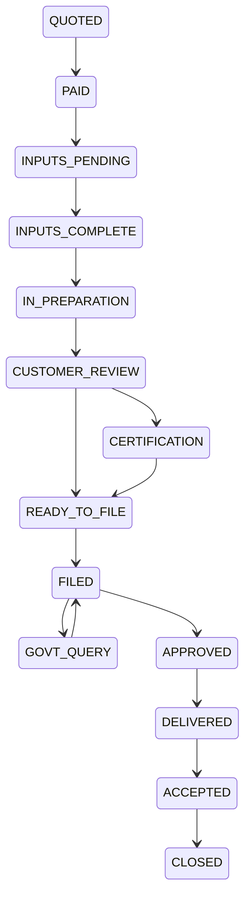

# Phase P14 — Business Services: Start a Business, Compliance Services and Tax

> Paste after `01_MASTER_PROMPT.md` and `02_REQUIREMENTS_MAP_AND_DECISION_LOG.md`.
>
> **Dependencies:** P16 (marketplace catalogue, offering object, engagement lifecycle, professional registry, Rule 36 directory, buyer platform fee), P17 (`BILLING_PORT`, OH8 SKUs and streams, entitlements, GST invoice mirror, refunds), P04 (vault folders, document checklists, retention, legal hold), P06 (templates and questionnaires: founders' agreement, SHA, SSA, term sheet, ESOP plan, partnership deed, trust deed, MoA/AoA), P07 (deal rooms, obligations `obl_`), P08 (eSign, DSC, eStamp, instrument eligibility gate), P10 (notice replies), P11 (tax litigation matters), P13 (governance kernel mount, compliance calendar for LawDocs-only tenants, HRMS/payroll kernel), P18 (Delivery Console, delivery grants, RM-as-maker), P19 (`int`: LDC contracts, GSP/ERI/KYB adapters), P03 (settings, rule engine, effective-dated tax-year rule packs). External: Operations Hub OH8 (catalogue, prices, invoices, Razorpay) and OH9 (professional directory); MCA V3, IP India, FoSCoS, DGFT, Udyam, State portals (user- or practitioner-operated only); a licensed GSP; LawDocs' own ERI registration (Type 2) [VERIFY]; KYB vendor (R6 D-15).
> **Sequencing:** Wave 3. Sprint 1 freezes the service-definition schema (§4A) and fee-line model (§4F) so that P21 content can bind service pages to `svc_` codes. Catalogue seeding (§4B–§4C) and Startup Desk (§4J) run in parallel with the tax workspace (§4K–§4N). ERI and GSP adapters ship behind flags (NN-38) until registrations and contracts are verified. Attest services (statutory, tax and secretarial audit) ship in BYO-professional mode only (§4G).
> **Binding appendices:** A (workflows and state machines — governs where a §5 pointer says so), D (roles and access matrix), F (instrument eligibility gate), H (agent roster), K (`LD-EXPORT-1.0`), M (marketplace and professional rules), R (settings registry), W (verification log and open items), X (Operations Hub additions), Y (Ecosystem Spec v1.2 change request).
> **Requirements covered:** R-014, R-036, R-037, R-038, R-039, R-040, R-047, R-063, R-064, R-069, R-075, R-080, R-082, R-086, R-087, R-090.
> **Decisions applied:** D-02, D-05, D-10, D-11, D-12, D-17 · **Challenges applied:** CH-06, CH-07, CH-08, CH-09, CH-10, CH-12, CH-13, CH-16, CH-19, CH-25 · **Non-negotiables tested:** NN-01, NN-05, NN-07, NN-08, NN-11, NN-13, NN-14, NN-16, NN-17, NN-18, NN-20, NN-21, NN-22, NN-29, NN-30, NN-38, NN-40, NN-41, NN-45, NN-46, NN-47, NN-50
> **Estimated effort:** 8 two-week sprints, squad of 8 (backend 3, frontend 2, tax/rules analyst 1, QA 1, CS/CA content reviewer 1).

---

## 1. Objective and business outcome

LawDocs sells the owner's **Start a Business** catalogue (26 services) and **Compliance** catalogue (22 services) as **productised services**. A founder, SME or individual can see what a service needs, what it costs line by line, who may lawfully perform it, how long LawDocs takes and how long the government takes, and can then buy it with or without a subscription (R-040, D-11). Every document collected and every certificate received lands in the Legal Vault and drives renewal reminders, so the customer has a reason to keep LawDocs (R-011). The **Startup Desk** packages incorporation, founder documents, funding readiness and a "virtual legal officer" retainer (R-082). The **Tax workspace** gives individuals, companies and LLPs one place for returns, TDS, GST, professional tax, advance-tax calendars and tax notices (R-069), without anyone sharing a portal password (CH-10).

**Why it matters.** Commodity filings have settled at ₹1,499–₹2,999 + GST + government fees (R6 B-06–B-15). LawDocs wins on (i) a free guided start and free AI-drafted first documents, (ii) the vault and renewal engine, (iii) honest fee breakdowns (IMP-075) and (iv) live order tracking (IMP-080).

| Outcome | Exit-gate measure |
|---|---|
| Productised catalogue | 48 services seeded as `svc_` definitions, each with questionnaire, document checklist, fee lines, lawful-performer rule, SLA, deliverables and renewal rule; every definition has a reviewer of record (NN-30) |
| Buy without subscription | A non-subscriber orders a fixed-price service in ≤ 7 taps from the service page (buyer account, eligibility answers, fee review, checkout) |
| Fee honesty | 100% of orders show government fee, stamp duty, third-party costs, professional fee, LawDocs fee and GST per supplier as separate lines before payment; zero drip-pricing defects in the NN-50 test suite |
| Lawful delivery | 0 orders assigned to a performer who lacks the credential the service's rule requires (CI test `NN-41_performer_credential_gate`) |
| Tracking | Every order shows the current milestone, "Waiting on" owner and next date; customer status updates by in-app, email and opted-in WhatsApp within 15 minutes of a milestone change |
| Renewals | Every certificate with an expiry or periodic duty creates an obligation with T-60/T-30/T-7 reminders |
| Tax without passwords | ITR filing via the ERI route reaches "Awaiting taxpayer e-verification" without LawDocs ever receiving an OTP, DSC PIN or e-filing password |
| KPIs (post-launch) | Order-to-inputs-complete median ≤ 3 days; LawDocs SLA attainment ≥ 95%; rework rate ≤ 3%; refund-dispute rate ≤ 1%; renewal capture ≥ 40% |

## 2. Scope (in / out)

**In scope**
- `bsv` module: service definitions (catalogue data), service orders, intake, eligibility questionnaires, document checklists, fee lines, practitioner assignment, milestone tracker, deliverables, renewals and the Startup Desk.
- `tax` module: tax profiles (individual, HUF [VERIFY scope], company, LLP, firm), tax-year rule packs, ITR via ERI, GST returns via GSP and GST practitioners, TDS returns, professional tax, advance-tax calendar, tax-notice intake and response, tax computation drafts, tax document checklists.
- Binding of the 48 service pages (`/start-a-business/*`, `/compliance/*`; R5 §8.3–§8.4) to `svc_` codes for the order widget, the "Draft with AI free" block and the "Hire a professional" block (R-087). Page copy is P21.
- Correction of outdated law in service definitions (R5 §5): Udyam not Udyog Aadhaar; GSTR-1/1A/3B/2B and IMS, not GSTR-2/3; GST audit re-scoped to GSTR-9/9C; Income-tax Act 2025 and "tax year"; Labour Codes for PF/ESI/payroll; hallmarking dates; Nidhi 2022 amendment; OPC 2021 liberalisation.

**Out of scope (owner phase)**
- Marketplace mechanics, professional onboarding, Rule 36 directory, buyer platform fee and Route payouts — P16. P14 consumes them.
- Plans, GST invoices, credit notes and revenue-stream switches — P17 and OH8.
- Compliance calendars, obligation registers and regulatory returns for regulated entities — **LawDocsComply is system of record** when the tenant uses LDC (D-10, NN-47); otherwise the P13 governance kernel mount. P14 only sells and fulfils services against those obligations.
- Client payroll engine — P13 HRMS kernel via `infrabyx-labour-rulepack`. P14 sells the "payroll maintenance" service that runs on it.
- LawDocs' own staff payroll, CRM and billing engine — Operations Hub (D-02).
- Trademark portfolio tracking after filing — P12 (P14 hands the application number to `ipm`).
- Tax litigation after an appeal is filed — P11. Notice drafting studio — P10.
- Consumer grievances — P15.

## 3. Personas and permissions touched

| Role | In P14 | Guard |
|---|---|---|
| Anonymous visitor | Browse the catalogue, run the entity chooser and eligibility questionnaire, see the fee breakdown, start a free AI draft (template automation) | No personal data stored until the visitor creates an account; answers held in browser session only |
| `IND_OWNER` | Order services, upload documents, approve deliverables, use the Personal Tax workspace, add LawDocs as ERI on the e-filing portal, e-verify their own return | Only the taxpayer verifies (§4K) |
| `IND_DELEGATE`, `IND_FAMILY_MEMBER` | Prepare a family member's tax file and upload documents where the owner granted scope | Cannot e-verify or approve fees |
| `ORG_OWNER`, `ORG_ADMIN` | Order services for the entity, set who may buy (`bsv.order.who_can_buy`), grant delivery access, enable the credential vault | Purchase approval per tenant DoA |
| `ORG_LEGAL_MAKER`, `ORG_KMP` (CS/CFO) | Raise orders, answer questionnaires, upload documents, review drafts | Cannot accept their own order's deliverable where maker-checker is ON |
| `ORG_CHECKER`, `ORG_APPROVER` | Approve fee quotes above threshold, accept deliverables, approve filings before submission | Maker ≠ checker (NN-18) |
| `ORG_DELEGATED_MAKER` (RM or engaged professional) | Prepares forms and filings inside the tenant under a delivery grant | Grant scope, time-box, access log (NN-17) |
| `OPS_RM` | Owns the client relationship; acts as maker on retainer orders | No checker rights in the client tenant |
| `OPS_PROFESSIONAL` (LawDocs-employed CS/CA/advocate/tax staff) | Prepares non-reserved deliverables at LawDocs prices | Never signs as practising professional for LawDocs' account (NN-41) |
| `OPS_DELIVERY_LEAD` | Assigns orders, overrides SLA with reason, approves rework, publishes service definitions (maker) | Publication needs `PLT_LEGAL_REVIEWER` as checker |
| `OPS_QA_REVIEWER` | Samples deliverables before release | — |
| `PRO_CA`, `PRO_CS`, `PRO_ADVOCATE`, `PRO_TAX_PRACTITIONER`, `PRO_OTHER` | Perform services that need their credential, under a direct engagement (P16) or as the client's own professional (BYO) | Credential and certificate-of-practice validity checked at assignment and at each certification step |
| `PLT_CONTENT_EDITOR` | Maintains service definitions, checklists, fee schedules and tax-year rule packs (maker) | — |
| `PLT_LEGAL_REVIEWER` | Reviewer of record and checker for definitions and rule packs | Publication without a reviewer is blocked |
| Agents (`AGT_SERVICE_INTAKE`, `AGT_DOC_CHECKER`, `AGT_TAX_PREPARER`, `AGT_NOTICE_TRIAGE`) | Makers only (NN-43) | §11 |

## 4. Functional requirements

### 4A. Service definition model

- **FR-P14-01 — Service definition object.** P16 owns the `svc_` service record (`mkp.services`: scope, exclusions, deliverables, price model, SLA template, seller of record). P14 adds a `bsv.service_profile` per `svc_` version (catalogue data, versioned, effective-dated, jurisdiction-scoped, reviewer of record; NN-30) with these business-service fields:

| Field | Content |
|---|---|
| `code`, `title`, `group` | e.g., `SAB-INC-PVT`, "Private Limited Company Registration", group "Incorporate your Business" |
| `page_slug` | R5 §8 URL; P21 binds the page |
| `entity_types_allowed` | individual, proprietor, firm, LLP, Pvt Ltd, OPC, public company, Section 8, trust, society, HUF |
| `questionnaire_ref` | `tpl_` questionnaire (P06) for eligibility and intake (§4D) |
| `checklist_ref` | versioned document checklist (§4E) |
| `authority` | Registrar or portal (MCA V3, IP India, FoSCoS, DGFT, Udyam, State PCB, BIS, EPFO, ESIC, State labour department, GSTN, e-filing portal, TRACES) |
| `forms` | statutory forms list with version and source citation |
| `fee_schedule_ref` | fee lines and government-fee table (§4F) |
| `performer_rule_ref` | lawful-performer row (§4G) |
| `milestones` | ordered milestone template with owner (`LAWDOCS`, `CUSTOMER`, `GOVERNMENT`, `PROFESSIONAL`, `COUNTERPARTY`) and SLA days |
| `sla` | LawDocs working days from inputs-complete, excluding government time; government time shown as indicative only |
| `deliverables` | e.g., certificate of incorporation, PAN/TAN, MoA/AoA, filed-form acknowledgements, registration certificate |
| `formalities` | stamp, notarisation, registration, board resolution, DSC — feeds the NN-40 gate |
| `renewal_rule` | creates `obl_` obligations (§4I) |
| `cross_sell` | linked services (e.g., Pvt Ltd → GST registration, TM, founders' agreement, annual compliance) shown after delivery, never pre-ticked (NN-50) |
| `law_refs` | citations with [LAW]/[INTERP] tags and [VERIFY] markers; unverified rows force `advisory_only = true` (NN-38) |
| `status` | `DRAFT → IN_REVIEW → LIVE → PAUSED → RETIRED` |

- **FR-P14-02 — Groups and navigation.** Seed the owner's groups with corrected headings (R5 §3.2): Incorporate your Business · Protect your Intellectual Property · Get a Licence · Registrations for Business · Quality Certification · NGO and Society Registration · ROC Compliances · Closure of Business · GST · Taxation · Accounting · Labour Law Compliances · Audit. Also expose the life-stage view Start / Run / Protect / Resolve / Exit (IMP-078) as an alternative filter over the same `svc_` codes.
- **FR-P14-03 — Market corrections.** Rename "Private Limited Company (PLC)" to "Private Limited Company (Pvt Ltd)", "Copy Right" to "Copyright", "MSME Registration" to "MSME (Udyam) Registration", "GST Audit" to "GST Annual Return and Reconciliation (GSTR-9/9C)". Keep old slugs as 301 redirects (P21).
- **FR-P14-04 — No copied text.** A service definition's customer-facing text fields fail lint if they contain any string from the R5 §4 copied-content list or a competitor brand (Vakilsearch, Corpbiz, Provenience, LegalWiz, Registrationwala, LegalRaasta, ebizfiling, enterslice, toppr, StartupSeven). The last one appears at Compliance manual line 1060 and is missing from R5 §4; add it to the list.

### 4B. Start a Business catalogue (26 services; seed)

Columns: code · authority and main forms · eligibility questions (keys) · lawful performer (§4G class) · LawDocs SLA (working days from inputs-complete) · renewal or periodic duty. Government fees load from `bsv.fee_schedule` rows. Every fee row is `[VERIFY]` until checked against the authority's current schedule and logged (NN-38). Treat all forms and thresholds below as `[VERIFY: current form/version on the authority portal]` unless marked [LAW].

| # | Service (code) | Authority, forms | Eligibility keys | Performer class | SLA | Renewal / periodic |
|---|---|---|---|---|---|---|
| 1 | Private Limited Company (`SAB-INC-PVT`) | MCA V3: SPICe+ Part A/B with AGILE-PRO-S, e-MoA, e-AoA; DSC for subscribers and directors; DIN allotment | ≥ 2 directors (one resident in India), ≥ 2 subscribers, name options, registered office, capital, objects; foreign or NRI subscriber (triggers FEMA flag) | `CERT_PRO_FORMATION`: declaration by an advocate, CA, CMA or CS in practice engaged in formation (Companies Act 2013 s.7(1)(b)) [LAW] | 5 | First board meeting ≤ 30 days (s.173(1)); auditor appointment ≤ 30 days (s.139(6)); commencement declaration INC-20A ≤ 180 days (s.10A) [VERIFY]; annual filings (C1.2) |
| 2 | One Person Company (`SAB-INC-OPC`) | SPICe+ with nominee consent (INC-3) | Single natural-person member, Indian citizen; resident (≥ 120 days) or NRI after the 2021 liberalisation (R5 §5); nominee details | `CERT_PRO_FORMATION` | 5 | As #1; OPC filing dates differ (C1.2) |
| 3 | Sole Proprietorship (`SAB-INC-PROP`) | No single registration; establish identity through GST, Udyam, Shops and Establishments, current account | Turnover band, State, employees, nature of business | `NON_RESERVED` | 3 | Depends on the registrations chosen |
| 4 | Partnership Firm (`SAB-INC-FIRM`) | Partnership deed (P06 template); stamp per State; registration with the State Registrar of Firms (Indian Partnership Act 1932 ss.58–59) [LAW]; PAN | ≥ 2 partners, capital, profit ratio, State | `NON_RESERVED` (deed drafting from template); advocate for bespoke advice | 5 + Registrar time | Changes intimated to the Registrar (s.63) [VERIFY State form]; unregistered-firm disability explained (s.69) |
| 5 | Limited Liability Partnership (`SAB-INC-LLP`) | MCA FiLLiP; LLP agreement filed in Form 3 within 30 days of incorporation [VERIFY] | ≥ 2 designated partners, one resident in India; contribution; name | `CERT_PRO_FORMATION` (LLP Act 2008 s.11(1)(c) statement by an advocate, CA, CMA or CS engaged in formation, and a subscriber — G LG-316, W.9 LA-20) [VERIFY wording] | 7 | Form 11 and Form 8 (C1.3) |
| 6 | Nidhi Company (`SAB-INC-NIDHI`) | SPICe+ as a public company; NDH-4 declaration and Central Government approval before accepting deposits (Nidhi (Amendment) Rules 2022) | ≥ 7 members at incorporation; ≥ 200 members and minimum net owned funds within the prescribed time [VERIFY] | `CERT_PRO_FORMATION` | 7 + approval | NDH-1/NDH-3 returns [VERIFY]; Nidhi Rules 2014 compliance |
| 7 | Patent (`SAB-IP-PATENT`) | IP India: Form 1, Form 2 (provisional or complete), Form 3, Form 5, Form 18 (request for examination) | Inventor and applicant details, novelty disclosure, prior public disclosure, startup or MSME status (fee class) | `IP_PATENT_AGENT` (registered patent agent; Patents Act 1970 ss.125–132) [VERIFY whether an advocate may file without agent registration] | 15 for provisional; quote-only for complete | Complete specification within 12 months of provisional (s.9(1)) [LAW]; examination request within the Rule 24B period as amended 2024 [VERIFY]; annual renewal fees from year 3 [VERIFY] |
| 8 | Copyright (`SAB-IP-COPYRIGHT`) | Copyright Office: Form XIV with statement of particulars; waiting period for objections [VERIFY rule] | Work type, authorship, first publication, employer-employee ownership (s.17), assignment deed | `IP_ADVOCATE_OR_AGENT` | 5 | None (term by statute); assignment and licence registers |
| 9 | Trademark (`SAB-IP-TM`) | IP India: TM-A; TM-48 authorisation of agent [VERIFY current form]; search report | Mark, class(es), user date (proposed or since), applicant type (individual, MSME, DPIIT startup → lower fee; R6 B-13) | `IP_TM_AGENT` (Trade Marks Act 1999 s.145: legal practitioner or registered TM agent) [LAW] | 2 | Hand-off to P12; opposition window 4 months from advertisement (s.21); renewal every 10 years (s.25) [LAW] |
| 10 | Geographical Indication (`SAB-IP-GI`) | GI Registry: GI-1 (producer association) and authorised user application [VERIFY form] | Applicant must represent producers; product, area, proof of origin | `IP_ADVOCATE_OR_AGENT` | Quote-only | Renewal every 10 years (GI Act 1999 s.18) [VERIFY] |
| 11 | Logo Design and Branding (`SAB-IP-LOGO`) | No authority; commercial design service | Brand brief, colours, usage | `NON_RESERVED` (design vendor via P16, non-regulated) | 7 | Copyright assignment deed from designer to customer (P06) is a mandatory deliverable; TM filing cross-sell |
| 12 | FSSAI Registration or Licence (`SAB-LIC-FSSAI`) | FoSCoS: basic registration, State licence or Central licence by turnover, capacity and activity (FSS (Licensing and Registration) Regulations 2011) | Turnover, activity (manufacture, trade, catering, e-commerce), premises, States | `AUTHORISED_AGENT` | 3 | Validity 1–5 years chosen at application; annual return for licensees [VERIFY form and due date] |
| 13 | Import Export Code (`SAB-LIC-IEC`) | DGFT: online IEC application with PAN, bank and address proof | Entity PAN, bank account, address | `AUTHORISED_AGENT` | 2 | Annual IEC profile update (April–June) or IEC deactivation [VERIFY DGFT notification] |
| 14 | MSME (Udyam) Registration (`SAB-REG-UDYAM`) | udyamregistration.gov.in; Aadhaar of proprietor, partner or authorised signatory; PAN and GSTIN linkage | Investment and turnover (revised limits from 1 Apr 2025: micro ≤ ₹2.5 cr / ₹10 cr; small ≤ ₹25 cr / ₹100 cr; medium ≤ ₹125 cr / ₹500 cr; R5 §5) [VERIFY] | `SELF_SERVE_FIRST` | 1 | Annual update of ITR/GST-linked data on the portal [VERIFY] |
| 15 | Industrial Design (`SAB-REG-DESIGN`) | Design Office (IP India): Form 1 with representations; Locarno class | Novelty, no prior publication, applicant type | `IP_ADVOCATE_OR_AGENT` [VERIFY who may act under the Designs Act 2000] | 7 | 10 years + 5-year extension (Designs Act 2000 s.11) [LAW] |
| 16 | APEDA Registration (`SAB-REG-APEDA`) | APEDA RCMC (through the DGFT common platform [VERIFY]) | IEC, scheduled products exported | `AUTHORISED_AGENT` | 3 | RCMC validity and renewal [VERIFY] |
| 17 | Pollution Consent (`SAB-REG-PCB`) | State Pollution Control Board: Consent to Establish and Consent to Operate (Water Act 1974 s.25; Air Act 1981 s.21) [LAW]; category Red/Orange/Green/White [VERIFY State list] | Industry category, State, capital investment, effluent and emissions | `AUTHORISED_AGENT`; environmental consultant for technical reports | Quote-only | Consent validity per State and category; annual environmental statement where required [VERIFY] |
| 18 | Spices Board Registration (`SAB-REG-SPICES`) | Certificate of Registration as Exporter of Spices (CRES) under the Spices Board Act 1986 [VERIFY] | IEC, spice list, business type | `AUTHORISED_AGENT` | 3 | CRES validity [VERIFY] |
| 19 | Barcode (GS1) Registration (`SAB-REG-BARCODE`) | GS1 India membership (a subscription with GS1 India, not a statutory registration) | Number of products (GTIN band), turnover | `AUTHORISED_AGENT` | 2 | Annual GS1 subscription |
| 20 | Agmark Certification (`SAB-QC-AGMARK`) | Directorate of Marketing and Inspection under the Agricultural Produce (Grading and Marking) Act 1937 [VERIFY current rules] | Commodity, laboratory access, premises | `AUTHORISED_AGENT` | Quote-only | Certificate of Authorisation renewal [VERIFY] |
| 21 | Hallmark Registration (`SAB-QC-HALLMARK`) | BIS registration for jewellers under the BIS Act 2016 and the Hallmarking Order; mandatory from 16 Jun 2021 in notified districts; HUID-only from 1 Apr 2023 (R5 §5) | Jeweller, district, turnover | `AUTHORISED_AGENT` | 3 | Registration validity [VERIFY] |
| 22 | ISI Certification (`SAB-QC-ISI`) | BIS product certification (Scheme-I of the BIS Conformity Assessment Regulations 2018 [VERIFY]); Quality Control Orders make it mandatory for listed products | Product, Indian Standard, factory, in-house testing | `AUTHORISED_AGENT`; testing by a BIS-recognised laboratory | Quote-only | Licence renewal and surveillance [VERIFY] |
| 23 | ISO Certification (`SAB-QC-ISO`) | Accredited certification body (not LawDocs) | Standard (9001, 14001, 27001, 45001), sites, headcount | `READINESS_ONLY`: LawDocs delivers readiness; certification only by an accredited body chosen by the customer; LawDocs takes no referral commission (independence) | Quote-only | Surveillance audits yearly, recertification every 3 years |
| 24 | Section 8 Company (`SAB-NGO-SEC8`) | SPICe+ with Section 8 licence (Companies Act 2013 s.8) [VERIFY licence form within SPICe+] | Charitable objects, no dividend, ≥ 2 directors | `CERT_PRO_FORMATION` | 10 | Tax registration and approval of the charity under the Income-tax Act 2025 (successor of ss.12A/80G) [VERIFY section and form]; annual ROC filings |
| 25 | Trust Registration (`SAB-NGO-TRUST`) | Trust deed (P06), stamp per State, registration with the Sub-Registrar where required (Indian Trusts Act 1882 s.5 for private trusts of immovable property; State public-trust Acts) [VERIFY State] | Settlor, trustees, objects, corpus, immovable property | `NON_RESERVED` (deed from template) with advocate review recommended | 7 + Sub-Registrar | Tax registration under the 2025 Act [VERIFY]; annual accounts |
| 26 | Society Registration (`SAB-NGO-SOCIETY`) | Registrar of Societies under the Societies Registration Act 1860 or the State Act; memorandum and rules | ≥ 7 members (1860 Act s.1) [VERIFY State variant], objects, office | `NON_RESERVED` | 7 + Registrar | Annual list of governing body [VERIFY State]; tax registration [VERIFY] |

**Eligibility-gate rule (`rul`).** The trust deed (#25) and any power of attorney collected for any service run through the instrument eligibility gate (Appendix F). Trusts are excluded from electronic signature by the IT Act 2000 First Schedule, so the order produces a print–sign–stamp–register pack (NN-07, CH-12). Partnership deeds, LLP agreements, MoA/AoA and founders' agreements are eSign-eligible [INTERP], subject to State stamp duty (NN-08).

### 4C. Compliance catalogue (22 services; seed)

| # | Service (code) | Authority, forms | Eligibility keys | Performer class | SLA | Periodic duty |
|---|---|---|---|---|---|---|
| 1 | Event-based corporate compliances (`CMP-ROC-EVENT`) | MCA V3: e.g., DIR-12 (director change), MGT-14 (resolutions, 30 days; s.117), PAS-3 (allotment), SH-7 (capital), INC-22 (registered office), ADT-1 (auditor, 15 days of AGM) | Event type, event date, board or member approval | `CERT_PRO_EFORM` where the form needs certification by a practising professional; otherwise `NON_RESERVED` | 3 | Per event; clock starts on the event date (P13 resolutions feed it) |
| 2 | Company and OPC annual filings (`CMP-ROC-ANNUAL`) | AOC-4 (within 30 days of AGM; s.137), MGT-7/MGT-7A (within 60 days of AGM; s.92(4)), DIR-3 KYC [VERIFY current periodicity], ADT-1; AGM within 6 months of FY end (s.96) [LAW] | Company class (small, OPC, listed, Section 8), AGM date, audited accounts | `CERT_PRO_EFORM` (MGT-8 certification by a PCS for prescribed classes [VERIFY threshold]) | 5 | Annual; obligations created from the governance calendar (P13) or LDC (§4O) |
| 3 | LLP annual filing (`CMP-LLP-ANNUAL`) | Form 11 (by 30 May) and Form 8 (by 30 Oct) (R5 C1.3) | Turnover, contribution (audit if turnover > ₹40 lakh or contribution > ₹25 lakh) | `NON_RESERVED`; CA/CS certification where turnover or contribution exceeds the prescribed limits [VERIFY] | 5 | Annual |
| 4 | Closing a company (`CMP-CLOSE-CO`) | STK-2 under s.248(2), processed by C-PACE [VERIFY]; alternative: voluntary liquidation under IBC 2016 s.59 for solvent companies | No business for 2 years or not commenced within 1 year; no liabilities; consent of 75% of shareholders by value; all overdue returns filed | `CERT_PRO_EFORM`; IBC route needs an insolvency professional (quote-only) | 10 + Registrar | Post-strike-off: vault retention of records for the statutory period |
| 5 | Closing an LLP (`CMP-CLOSE-LLP`) | Form 24 (LLP Rules r.37) [VERIFY]; all overdue Form 8/11 filed | Ceased business, no liabilities, partners' consent | `NON_RESERVED` with CA statement of accounts | 10 + Registrar | — |
| 6 | Closing an OPC (`CMP-CLOSE-OPC`) | STK-2 (as #4) | As #4 | `CERT_PRO_EFORM` | 10 + Registrar | — |
| 7 | GST registration (`CMP-GST-REG`) | GST REG-01 with Aadhaar authentication, biometric and document verification where triggered [VERIFY current rule 8/9] | Turnover vs threshold, inter-State supply, e-commerce, State, place of business | `GST_PRACTITIONER_OR_SELF` | 3 + department | Returns (#8); amendments; cancellation |
| 8 | GST return filing (`CMP-GST-RET`) | GSTR-1/1A, GSTR-3B, Invoice Management System, GSTR-2B reconciliation, CMP-08 and GSTR-4 for composition [VERIFY current set]; GST rate rationalisation effective 22 Sep 2025 (R5 §5) | Scheme (regular, composition, QRMP), invoice volume | `GST_PRACTITIONER_OR_SELF` (§4L) | Monthly by T-3 of due date | Monthly or quarterly; annual GSTR-9 |
| 9 | Income-tax return (`CMP-TAX-ITR`) | e-filing portal via ERI (§4K) | Taxpayer type, income heads, audit applicability, regime | `ERI_PREPARER`; verification only by the taxpayer | 3 after documents | Annual; advance tax (§4L) |
| 10 | TDS return (`CMP-TAX-TDS`) | Quarterly TDS/TCS statements prepared with the Return Preparation Utility and validated with the File Validation Utility; TRACES for certificates (R3 LG-129) [VERIFY form numbers under the Income-tax Rules 2026] | TAN, deductee volume, sections | `ERI_PREPARER`; deductor uploads or verifies | 5 per quarter | Quarterly |
| 11 | Professional tax (`CMP-TAX-PT`) | State PT Acts; enrolment (employer) and registration; cap ₹2,500 per person per year (Constitution Art. 276(2)) [LAW] | State, employees, salary slabs | `AUTHORISED_AGENT` | 3 | Monthly, quarterly or annual by State |
| 12 | Accounting and bookkeeping (`CMP-ACC-BOOKS`) | Books under Companies Act 2013 s.128; accounting software with an audit-trail feature (Companies (Accounts) Rules 2014 r.3(1) proviso) [VERIFY] | Transaction volume, software, GST | `NON_RESERVED`; independence block where the same firm is statutory auditor (s.144) [LAW] | Monthly close by day 10 | Monthly |
| 13 | Payroll maintenance (`CMP-ACC-PAYROLL`) | Runs on the P13 HRMS kernel and `infrabyx-labour-rulepack` (Code on Wages 2019 s.17 wage timelines; R3 LG-163) | Headcount, States, wage structure | `NON_RESERVED` | Monthly by wage-period cut-off | Monthly; where LDC is SoR, LDC runs payroll and P14 only records the service order (D-10) |
| 14 | PF registration (`CMP-LAB-PF`) | EPFO establishment registration (Code on Social Security 2020; EPF schemes continue; R5 §5) | Headcount ≥ 20 or voluntary (R3 LG-165) | `AUTHORISED_AGENT` | 3 | Monthly ECR filing (P13 payroll) |
| 15 | ESI registration (`CMP-LAB-ESI`) | ESIC employer registration (Code on Social Security 2020) | Headcount ≥ 10, notified area; employees within the wage ceiling (₹21,000 per month; ₹25,000 for persons with disability [VERIFY current ESIC notification]) | `AUTHORISED_AGENT` | 3 | Monthly contributions; half-yearly returns [VERIFY] |
| 16 | Shops and Establishments (`CMP-LAB-SE`) | State Shops and Establishments Act registration or intimation | State, municipal area, headcount | `AUTHORISED_AGENT` | 3 + department | Renewal by State; register maintenance |
| 17 | ESOP (`CMP-LAB-ESOP`) | Companies Act 2013 s.62(1)(b); Companies (Share Capital and Debentures) Rules 2014 r.12; special resolution; MGT-14 [LAW]; listed companies: SEBI (SBEB and Sweat Equity) Regulations 2021 [VERIFY] | Company class, DPIIT startup status (promoter grants [VERIFY]), pool size, vesting | `NON_RESERVED` for plan drafting from template; advocate for bespoke advice; valuation by a registered valuer | 10 | ESOP register, annual disclosure in the board's report |
| 18 | Secretarial audit (`CMP-AUD-SEC`) | Companies Act 2013 s.204; MR-3; SEBI LODR Reg 24A as amended Dec 2024 (R5 C7.1) [VERIFY] | Listed, or public company above the prescribed thresholds [VERIFY r.9] | `ATTEST_PCS` (company secretary in practice only) | Quote-only | Annual |
| 19 | Tax audit (`CMP-AUD-TAX`) | Income-tax Act 2025 successor of 1961 s.44AB; thresholds ₹1 crore, or ₹10 crore where cash ≤ 5%; professionals ₹50 lakh (R5 C7.2) [VERIFY section] | Turnover, cash share, presumptive scheme | `ATTEST_CA` (chartered accountant in practice only) | Quote-only | Annual |
| 20 | GST annual return and reconciliation (`CMP-AUD-GST9`) | GSTR-9 and self-certified GSTR-9C (s.35(5) omitted w.e.f. 1 Aug 2021; R5 §5); support during departmental audit (CGST s.65) | Aggregate turnover above the GSTR-9/9C thresholds [VERIFY current notification] | `GST_PRACTITIONER_OR_SELF`; reconciliation prepared by CA or practitioner | 10 | Annual |
| 21 | Statutory company audit (`CMP-AUD-STAT`) | Companies Act 2013 ss.139–143; ADT-1 | Every company | `ATTEST_CA`; s.141 eligibility and s.144 prohibited services enforced | Quote-only | Annual |
| 22 | Internal audit (`CMP-AUD-INT`) | Companies Act 2013 s.138 and Companies (Accounts) Rules 2014 r.13 thresholds [VERIFY]; internal auditor may be a CA, a CMA or another professional decided by the Board | Company class and thresholds | `NON_RESERVED` (co-sourced internal audit), with independence check against the statutory auditor | Quote-only | Annual or quarterly per plan |

### 4D. Entity chooser and eligibility questionnaire

- **FR-P14-05 — Entity chooser.** A 6-question wizard ("How many founders? Will you raise equity? Do you need limited liability? Expected turnover? Foreign founder or investor? Charitable purpose?") recommends Pvt Ltd, OPC, LLP, partnership, proprietorship, Section 8, trust or society. It shows a comparison table (liability, compliance load, annual cost band, fundraising fit, tax treatment marked "[VERIFY rules for the tax year]") and never ranks by LawDocs' price. Output is labelled "Information, not legal advice" with a one-tap paid consult with an advocate or CS (NN-41). Click budget: result in ≤ 8 taps from the Start a Business landing.
- **FR-P14-06 — Questionnaire runtime.** Each service's `tpl_` questionnaire (P06 engine) supports branching, validation (PAN/GSTIN/CIN format checks only; lookups through licensed KYB adapters, never scraping — NN-05, CH-06), "I don't know" answers that route to a scoping call, and pre-fill from the tenant's organisation profile (P02) and prior orders. Answers are versioned with the order.
- **FR-P14-07 — Eligibility outcomes.** The rule engine (`rul`, GoRules decision table per service) returns one of `ELIGIBLE`, `ELIGIBLE_WITH_CONDITIONS` (lists conditions, e.g., "Nidhi: you need 200 members within the prescribed period before accepting deposits"), `NOT_ELIGIBLE` (with reason and alternative service) or `NEEDS_PROFESSIONAL` (complex facts: foreign investment, regulated activity such as NBFC, insurance or payments; routes to quote-only). Regulated activities are flagged and redirected: "An NBFC needs RBI registration; this is not a company-incorporation service" (link to the LDC regulatory-licensing offering where enabled).
- **FR-P14-08 — Fee class from answers.** Answers set the government-fee class (e.g., TM-A ₹4,500 for individuals, sole proprietors, MSMEs and DPIIT startups vs ₹9,000 for others — R6 B-13 [VERIFY]; patent fee class for startups and MSMEs [VERIFY]). Proof of the fee class (Udyam certificate, DPIIT certificate) is added to the checklist automatically.
- Help keys: `hlp.bsv.entity_chooser`, `hlp.bsv.din`, `hlp.bsv.dsc`, `hlp.bsv.spice_plus`, `hlp.bsv.fee_class`, `hlp.bsv.registered_office`.

### 4E. Document checklist and vault collection

- **FR-P14-09 — Checklist object.** Each `svc_` has a versioned checklist: item code, label, who provides it (each director, partner, applicant, entity), accepted formats, self-attestation or notarisation or apostille rule (e.g., foreign national or NRI documents notarised or apostilled — Start manual L520, L1063 [VERIFY current MCA rule]), validity window (e.g., utility bill ≤ 2 months old [VERIFY]), mandatory or conditional (condition expressed against questionnaire answers), DigiLocker-pullable flag, and a sample image.
- **FR-P14-10 — Collection into the vault.** Uploads and DigiLocker pulls go into the customer's vault (P04), not into a staff mailbox. Folder (Appendix K §K.3.1–§K.3.2 governs): company `09 Services and Engagements/Business Services/<FY>/<Service> (LD-ENG-…)/`; individual `08 Agreements/` (or the life-area folder) or `09 Tax/Tax Year <YYYY-YY>/` by service type. A document reused across orders (PAN, address proof) is linked, not copied (NN-12). DigiLocker-pulled items follow requester terms: URI and verification result stored; copy retained only for the recorded purpose [VERIFY with NeGD] (NN-42).
- **FR-P14-11 — Aadhaar handling.** Aadhaar copies required by an authority are stored masked (first 8 digits) in every derived rendition; the unmasked original is kept only where the authority requires a full copy and the customer confirms, with an Object Lock retention tied to the order (NN-04) [VERIFY each authority's requirement; prefer masked or offline-verified copies].
- **FR-P14-12 — Automated checks.** `AGT_DOC_CHECKER` (maker, L1) checks legibility, name match across documents, expiry, page completeness and mismatch between questionnaire and document (e.g., address on bill ≠ declared registered office). It raises `itm_` waiting items for the customer, never rejects silently, and a human (`OPS_PROFESSIONAL` or performer) clears each flag.
- **FR-P14-13 — Inputs-complete event.** When all mandatory items are accepted, the order moves to `INPUTS_COMPLETE` and the LawDocs SLA clock starts. The customer sees "LawDocs clock: day 2 of 5" and "Government clock: indicative".
- **FR-P14-14 — DSC.** Where a DSC is needed, the order offers (a) "I have a valid Class 3 DSC" (token stays with the customer; LawDocs never stores the PIN — NN-16) or (b) procurement through a licensed CA vendor at a third-party cost line. Signing of MCA forms with the customer's DSC happens on the customer's device or in a scheduled screen-share session; never by staff holding the token without a written, revocable authority logged in the order [COUNSEL].

### 4F. Fee breakdown (NN-22)

- **FR-P14-15 — Fee lines.** Every quote and checkout shows these lines, each with supplier, GST treatment and basis:

| Line | Supplier | GST | Collection |
|---|---|---|---|
| Government fee / filing fee | Authority | Not a taxable supply by LawDocs | `CLIENT_PAYS_DIRECT` by default (§FR-P14-16) |
| Stamp duty | State | Not taxable | Via eStamp route at actuals (NN-08; P08) |
| Third-party costs (DSC, notary, courier, GS1 subscription, laboratory testing) | Named vendor | Vendor's GST | Pass-through at actuals or the vendor bills directly |
| Professional fee | LawDocs (non-reserved), or the named professional (reserved) | LawDocs 18% forward; advocate to a business entity (registered or not) under RCM, Notification 13/2017-CT(R) Sl. 2; exempt where the recipient is not a business entity or is a business entity below the registration threshold, Notification 12/2017-CT(R) [VERIFY entry] (LG-340, LG-341; R6 T-01/T-02) [TAX MEMO]; CA/CS 18% by the professional | LawDocs via OH8; professional via Route split (P16) |
| LawDocs platform or facilitation fee | LawDocs | 18% | OH8 |
| GST | Per supplier | — | Shown per line |
| **Total payable now** and **payable later to authorities** | — | — | Shown before payment (NN-50) |

- **FR-P14-16 — Government-fee mode.** Setting `bsv.fees.govt_fee_mode`: `CLIENT_PAYS_DIRECT` (default: the customer pays the portal challan or payment link generated for their own application; LawDocs records the receipt) · `PURE_AGENT_REIMBURSE` (LawDocs pays in the customer's name and invoices at actuals afterwards as a pure-agent line under CGST Rules r.33; OFF until a tax memo and a counsel note on the RBI Payment Aggregator Directions 2025 are attached; R6 T-08) · never `ADVANCE_COLLECT_POOLED`, which is not offered (LawDocs never pools third-party money — NN-22, CH-25).
- **FR-P14-17 — Estimates vs actuals.** Government fees that depend on capital, State or class show a range with the formula ("MCA fee depends on authorised capital and State stamp duty on MoA/AoA"). Final actuals replace estimates on the invoice with the receipt attached. If actuals exceed the estimate by more than `bsv.fees.variance_alert_pct` (default 10%), the customer must re-approve before filing.
- **FR-P14-18 — Refunds and cancellation.** Published cancellation scale per milestone (e.g., before inputs-complete 100% of professional fee refundable; after filing 0%; government fees refundable only if the authority refunds). Rework is free where LawDocs erred (IMP-083, `bsv.rework.free_if_lawdocs_error`, default ON). Refunds and credit notes run through P17/OH8 with maker-checker (NN-18).
- **FR-P14-19 — Plan allowances.** Pro and Business plans may include allowances (e.g., "1 trademark filing per year", "annual ROC filing for 1 company") configured in P17. An allowance covers only the professional and LawDocs fee lines; government fees always remain separate.

### 4G. Practitioner assignment and lawful-performer rules (NN-41, NN-21)

- **FR-P14-20 — Performer classes.** Each `svc_` names one class. The assignment engine refuses any performer without the credential.

| Class | Who may perform | Who may only prepare | Credential checked | Commercial model |
|---|---|---|---|---|
| `NON_RESERVED` | `OPS_PROFESSIONAL`, LawDocs staff, non-regulated vendors | — | None beyond competence tag | LawDocs is supplier (M1) |
| `AUTHORISED_AGENT` | LawDocs staff as the applicant's authorised agent on the portal, under a written authority | — | Authority letter signed by applicant | M1 |
| `SELF_SERVE_FIRST` | The applicant (government service is free, e.g., Udyam) | LawDocs guides; optional paid assistance clearly labelled "the government registration is free" | — | Guided flow free; assistance fee optional |
| `CERT_PRO_FORMATION` / `CERT_PRO_EFORM` | Preparation by LawDocs staff; certification and declaration only by an advocate, CA, CMA or CS **in practice** | `OPS_PROFESSIONAL` | Enrolment or membership number; certificate of practice valid on the certification date | Certifying professional engaged directly by the customer (P16 M2 Route-collected or M3 direct — X-21) or the customer's own professional (BYO) |
| `IP_TM_AGENT`, `IP_PATENT_AGENT`, `IP_ADVOCATE_OR_AGENT` | Registered TM agent or advocate (TM Act s.145); registered patent agent (Patents Act s.126 [VERIFY]) | LawDocs staff prepare search reports and drafts | Agent registration number, enrolment | Direct engagement with the agent or advocate (P16 M2 Route-collected or M3 off-platform — X-21); buyer platform fee only (D-05) |
| `GST_PRACTITIONER_OR_SELF` | The taxpayer, or a GST practitioner enrolled under CGST s.48 and r.83 and authorised by the taxpayer in Form PCT-05 (R3 LG-127) | LawDocs staff prepare data | GST practitioner enrolment number | M1 for preparation; practitioner submits under their own login |
| `ERI_PREPARER` | LawDocs as registered ERI prepares and uploads; **only the taxpayer verifies** (R3 LG-124/125) | — | ERI registration [VERIFY] | M1 |
| `ATTEST_CA`, `ATTEST_PCS` | Practising CA or CS (firm) appointed by the company; LawDocs never performs attest functions (NN-41) | LawDocs staff prepare schedules and working papers only where independence rules allow | Membership number, COP, peer review where required [VERIFY], s.141/s.144 independence | `BYO_PROFESSIONAL` default; `AFFILIATED_FIRM_DIRECT` OFF until counsel opinion (OI-P14-03) |
| `READINESS_ONLY` | LawDocs delivers readiness; certification by an accredited body | — | Body's accreditation (NABCB/IAF) [VERIFY] | No referral commission |

- **FR-P14-21 — ICAI and ICSI limits.** Practising-CA and practising-CS listing stays OFF (ICAI ESB announcement 23 Oct 2019; R3 LG-115, LG-117; D-05). Therefore attest and certification steps use **BYO professional**: the customer invites its own CA, CS or advocate into the order as `PRO_*` guest through a scoped, time-bound delivery grant (NN-17). LawDocs charges the customer only its own preparation fee. No fee share, referral reward or listing fee flows to or from the professional (NN-21, CH-09).
- **FR-P14-22 — Assignment engine.** Inputs: performer class, language, State, workload, SLA, conflict and independence checks (statutory auditor cannot do bookkeeping or internal audit for the same company — s.144 [LAW]; readiness consultant cannot certify), and customer preference. Ordering among eligible performers is neutral (round-robin within capacity), never paid (NN-21). Every assignment and override is logged with reason (NN-45).
- **FR-P14-23 — Credential re-check.** The certification step re-checks the credential on the day of certification; an expired COP blocks the step (`LD-BSV-007`).
- **FR-P14-24 — Authority letters.** Where LawDocs staff act as the applicant's agent on a portal, the order generates a scoped authority letter (P06 template): service, portal, period, revocable in-app. It runs through the eligibility gate; a letter that is in substance a power of attorney is routed to wet-ink or notarisation (NN-07).

### 4H. Order lifecycle, SLA and status tracker

- **FR-P14-25 — Order object.** `bsv_order` wraps a P16 engagement (`eng_`, business reference `LD-ENG-…`) with: `svc_` code and version, questionnaire answers, checklist state, fee lines, performer(s), milestones, SLA clocks, government application numbers (SRN, TM application number, ARN, FoSCoS reference), deliverables, renewal obligations.
- **FR-P14-26 — Milestones.** Template milestones per service (e.g., Pvt Ltd: Name approved → DSC ready → SPICe+ drafted → Customer reviewed → Certified by professional → Filed (SRN) → Registrar query (optional loop) → Incorporated (CIN) → PAN/TAN received → Post-incorporation kit delivered). Each milestone has owner, SLA days and evidence (acknowledgement PDF, SRN).
- **FR-P14-27 — Waiting items.** Anything blocking progress becomes an `itm_` item with a "Waiting on" chip (`Customer`, `Registrar`, `Professional`, `Counterparty`, `LawDocs`) and a due date (R-047). The SLA clock pauses while waiting on the customer or government and resumes on clearance; pauses are visible with reason.
- **FR-P14-28 — Government status.** LawDocs does not scrape portals (NN-05). Status updates come from (a) the practitioner entering the status with an uploaded acknowledgement or email, (b) parsing the authority's emails forwarded by the customer or delivered to an order-specific inbound address the customer adds as a contact where the portal allows [VERIFY each portal], or (c) a licensed data source (e.g., KYB vendor confirms CIN). Staleness is shown ("Status as on 24 Oct, 18:05").
- **FR-P14-29 — Notifications.** Milestone changes notify in-app, email and opted-in WhatsApp (IMP-100) through `ntf` with DLT-registered templates (NN-34). Daily digest option.
- **FR-P14-30 — Customer approvals.** Before any filing, the customer (or `ORG_CHECKER`) approves the final form preview. Filing is an irreversible external action: no agent or automation submits (NN-13).
- **FR-P14-31 — Registrar queries.** A query (e.g., MCA resubmission) creates a sub-task with the statutory or portal deadline, a draft reply by the performer, customer approval and resubmission. Repeated rejection beyond `bsv.order.max_resubmissions` (default 2) escalates to `OPS_DELIVERY_LEAD`.
- **FR-P14-32 — Click budgets.** Order status ≤ 2 taps from home; upload a missing document ≤ 3 taps from the notification; approve a filing preview ≤ 3 taps.

### 4I. Deliverables, formalities and renewals

- **FR-P14-33 — Deliverables.** Delivered into the vault as immutable originals (NN-09) with metadata (authority, number, issue date, validity). Examples: certificate of incorporation with CIN, PAN, TAN, MoA/AoA, LLP agreement, registration certificates, TM application receipt, FSSAI licence, IEC, Udyam certificate, filed-form acknowledgements. Each deliverable needs customer acceptance or auto-accepts after `bsv.deliverable.auto_accept_days` (default 7) with notice.
- **FR-P14-34 — Formalities gate.** Deliverables that are instruments (partnership deed, trust deed, LLP agreement, founders' agreement) cannot be marked "Executed" until stamp, signatures, notarisation and registration are recorded or waived with reason (NN-40).
- **FR-P14-35 — Post-delivery kits.** Incorporation orders deliver a post-incorporation checklist: first board meeting minutes (P13 template), auditor appointment, share certificates, statutory registers (governance kernel), INC-20A [VERIFY], bank account resolution, GST and Udyam cross-sells (opt-in, never pre-ticked).
- **FR-P14-36 — Renewals and periodic duties.** The `renewal_rule` creates P07 obligations (`obl_`) with due date, rule citation, reminders T-60/T-30/T-7/T-1 and a one-tap "Renew with LawDocs" order. Examples: FSSAI expiry, IEC annual update, TM 10-year renewal (P12), design extension, PCB consent validity, BIS licence, GS1 subscription, ISO surveillance, S&E renewal, Nidhi returns, DIR-3 KYC, AOC-4/MGT-7, Form 8/11, PT returns. Where LDC is SoR, obligations are read from LDC through `int` and not duplicated (§4O).
- **FR-P14-37 — Savings evidence.** A renewal completed before its due date feeds the P17 savings ledger as "penalty exposure avoided" only with the obligation, due date and completion evidence (NN-36).

### 4J. Startup Desk (R-082)

- **FR-P14-38 — Founder onboarding.** A Startup workspace template: founders, idea stage, sector, funding plans, IP assets, team. It sets up the Company workspace with a "Startup" profile and a 90-day launch plan (incorporation → bank → GST/Udyam → TM → founders' agreement → ESOP pool → website policies → first contracts).
- **FR-P14-39 — Startup kit bundles** (IMP-084; R6 "Startup kit"). Bundles are priced as the sum of components with a disclosed bundle discount: Incorporation + founders' agreement + TM (1 class) + website policies (privacy, terms, refund) + NDA and consultant agreement pack. Each component remains a separate order line with its own fee breakdown (NN-22). No auto-renewing subscription hidden in a bundle (NN-50; R6 LD-X03).
- **FR-P14-40 — Founder documents** (P06 templates, versioned): founders' agreement (roles, vesting with cliff, IP assignment, non-compete limits [VERIFY enforceability under Contract Act s.27], deadlock), term sheet (non-binding except confidentiality and exclusivity), SHA and SSA (pre-emption, ROFR, tag/drag, information rights, reserved matters, anti-dilution), convertible note or CCPS instrument summaries [VERIFY FEMA and Companies Act constraints], ESOP plan and grant letters (§4C #17), advisor agreement. Assembly from a vetted template is template automation; any AI-customised clause carries the NN-14 label until a professional reviews it.
- **FR-P14-41 — DPIIT Startup India recognition** [VERIFY current eligibility notification, including the age limit, turnover cap and innovation criteria, and the application route on the Startup India portal]. Flow: eligibility questions → document checklist (incorporation certificate, brief on innovation, website or pitch, director details) → the founder applies on the official portal (LawDocs prepares the write-up; the founder submits) → certificate stored in the vault. Linked benefits are shown as "may be available, subject to separate eligibility": lower IP fees (R6 B-13), self-certification under labour and environment laws [VERIFY], tax holiday under the Income-tax Act 2025 successor of 1961 s.80-IAC [VERIFY section and inter-ministerial board certification]. No benefit is claimed as certain (NN-20).
- **FR-P14-42 — Funding-readiness data room.** A P07 deal room (RS-LD-14) seeded with a due-diligence index: corporate (CoI, MoA/AoA, registers, minutes, filings), cap table export from the governance kernel's register of members, IP (applications, assignments), contracts, employment and ESOP, tax and GST, litigation (P11), policies. Readiness score = % of index items present and current, with gaps listed. Investors join as `CP_GUEST` with view-only, watermarked, per-folder access; downloads OFF by default; every view logged. Foreign investment triggers a FEMA checklist (pricing guidelines, reporting through the AD bank within the prescribed time [VERIFY form and timeline]) marked for a professional.
- **FR-P14-43 — Virtual legal officer retainer.** The "Startup Legal Officer" retainer (R6.2.7; RS-LD-20) is **advocate-led** for legal advice and opinions, supplied by an advocate or advocates' firm in its own name under a direct engagement (NN-41; R6 P-05); CS-led for ROC work; LawDocs supplies software, RM coordination and non-reserved drafting. The retainer SLA is eSigned in the tool (P08). Invoice split: advocate fee (RCM for companies; R6 T-01) + LawDocs SaaS/coordination fee (18%). Hour bank tracked; utilisation shown monthly; scope exclusions mandatory. Marketing copy never says "LawDocs is your lawyer" (D-17, CH-14).
- **FR-P14-44 — Startup dashboard.** One screen: launch-plan progress, open orders, upcoming obligations, data-room readiness, TM status (from P12), retainer hours left. ≤ 1 tap from the workspace home.

### 4K. Tax workspace — individuals (R-069)

- **FR-P14-45 — Tax profile.** Per taxpayer: PAN (masked display; never used to call a PAN database directly — NN-05, CH-04), residential status per year, regime choice per year, employers, bank accounts (masked), income heads, prior-year carry-forwards, family members linked as separate taxpayers (`IND_FAMILY_MEMBER` with consent).
- **FR-P14-46 — Tax-year rule packs.** Every computation, due date, form and threshold comes from an effective-dated `rul` pack keyed by `tax_year` and `governing_act` (`ITA1961` for years up to FY 2025-26; `ITA2025` from tax year 2026-27; R3 LG-123). Each pack is marked `[VERIFY rules each year]` until `PLT_LEGAL_REVIEWER` (a CA reviewer of record) verifies it; an unverified pack produces drafts labelled "Draft computation — rules not yet verified for this year" and blocks the "Ready to upload" step (NN-38).
- **FR-P14-47 — ERI route (CH-10).** LawDocs registers as an e-Return Intermediary of the type that lets its own software prepare and upload returns via API [VERIFY scheme text and type; R3 LG-124]. Flow: taxpayer adds LawDocs as ERI or authorises it through the e-filing portal's OTP-based client-addition step on the taxpayer's own device → LawDocs fetches pre-filled data where the ERI API permits with consent [VERIFY] → computation draft → taxpayer review and approval → LawDocs uploads → **the taxpayer e-verifies** with Aadhaar OTP, bank or demat EVC, DSC or ITR-V on the portal. LawDocs never receives, relays or stores the OTP, EVC, DSC PIN or password (NN-16; R3 LG-125). Until ERI registration is complete the flag `tax.eri.enabled` stays OFF and the workspace runs in **prepare-and-guide mode** (the taxpayer uploads the JSON on the portal).
- **FR-P14-48 — Document checklist** by income head: Form 16 / salary certificate, AIS and TIS (downloaded by the taxpayer or fetched under consent [VERIFY]), bank interest certificates, capital-gains statements, rent receipts and landlord PAN where required, home-loan interest certificate, investment proofs for the old regime, foreign assets details, previous-year return and intimation. Each item lands in `09 Tax/<year>/`.
- **FR-P14-49 — Computation draft.** `AGT_TAX_PREPARER` (maker, L1) builds a draft: income by head, deductions allowed in the chosen regime, regime comparison, tax, rebate, surcharge, cess, TDS/TCS credit from AIS, advance tax, self-assessment tax, interest estimates. Every number shows its source document and rule row. The draft is labelled "AI-assisted draft — review by the taxpayer or a professional required" (NN-14). A CA review (`PRO_CA` or `OPS_PROFESSIONAL` tax staff) is optional for salaried returns and default for business, capital-gains and foreign-asset returns (`tax.review.required_for`).
- **FR-P14-50 — Mismatch handling.** Differences between AIS/TIS and the taxpayer's records become `itm_` items with suggested action (accept, provide feedback on AIS through the portal, or explain in the return). LawDocs never files AIS feedback for the taxpayer without approval (NN-13).
- **FR-P14-51 — Post-filing.** Track e-verification (taxpayer confirms with the acknowledgement), processing intimation, refund status (entered or uploaded by the taxpayer, or fetched via ERI where permitted), and defective-return or mismatch notices (→ §4M).

### 4L. Tax workspace — companies, LLPs and firms

- **FR-P14-52 — Entity tax calendar.** Generated from the tax profile and rule packs: advance-tax instalments (15 Jun 15%, 15 Sep 45%, 15 Dec 75%, 15 Mar 100% under 1961 s.211; ITA2025 equivalent [VERIFY section]; presumptive-scheme single instalment [VERIFY]), TDS deposit dates and quarterly statements, TCS, GST returns, PT by State, tax-audit report and return due dates, transfer-pricing report where applicable [VERIFY]. Where the tenant uses LDC, the calendar is read from LDC and shown here (§4O).
- **FR-P14-53 — Advance-tax estimator.** Quarterly estimate from books (P14 bookkeeping data, uploaded trial balance or manual entry) with interest exposure for shortfall (1961 ss.234B/234C; ITA2025 equivalents [VERIFY]). Payment is made by the taxpayer on the official payment channel through a deep link; LawDocs records the challan identification number from the uploaded receipt and never collects tax (NN-22).
- **FR-P14-54 — Company and LLP returns.** Prepared by the ERI or the entity's CA; companies verify with the authorised signatory's DSC as the rules require [VERIFY]; tax-audit cases link the BYO CA's tax-audit report (§4G). LawDocs staff never use the entity's DSC (NN-16).
- **FR-P14-55 — TDS returns.** LawDocs imports deduction data (payroll from P13 or LDC, vendor payments from bookkeeping), validates PAN format and section mapping (2025-Act sections per R6 T-06/T-07 [VERIFY]), prepares statements with the official utilities, and hands the validated file to the deductor to upload, or uploads as ERI where the scheme permits [VERIFY]. Form 16/16A are downloaded by the deductor from TRACES and stored; LawDocs does not hold the TRACES password unless the client enables the credential vault (NN-16, off by default).
- **FR-P14-56 — GST returns via GSP and practitioner.** Two routes behind `tax.gst.route`: (a) `GSP_API`: the taxpayer enables API access on the GST portal and consents by OTP; LawDocs' licensed GSP partner fetches GSTR-2B and IMS data and posts GSTR-1 data; the taxpayer files GSTR-3B with EVC/DSC; (b) `PRACTITIONER`: an enrolled GST practitioner authorised in PCT-05 prepares and submits under their own login, with the taxpayer's confirmation as the rules require (R3 LG-127) [VERIFY]. Reconciliation: purchase register vs GSTR-2B and IMS actions (accept, reject, pending), with the customer approving IMS actions (NN-13).
- **FR-P14-57 — Professional tax.** State rule table (`rul`): applicability, slabs, employer enrolment and registration, payment and return frequency, cap ₹2,500 (Art. 276(2)). Payroll deductions come from P13; the employer pays on the State portal by deep link.
- **FR-P14-58 — Retention.** Tax documents are retained at least 8 years (CGST s.36: 72 months from the annual-return due date — R3 LG-128 [VERIFY]; income-tax assessment and reassessment windows under the 2025 Act [VERIFY]) via P04 retention class `TAX_8Y`, extendable by legal hold.

### 4M. Tax notices (link P10/P11)

- **FR-P14-59 — Notice intake.** The taxpayer uploads a notice (PDF, screenshot, email) or forwards it. P05 extracts authority, section, DIN (document identification number on the notice [VERIFY]), dates, demand, response deadline. `AGT_NOTICE_TRIAGE` classifies (intimation of adjustment, defective return, scrutiny, reassessment, penalty, GST show-cause or demand, TDS default) using the rule pack's notice taxonomy for the governing Act and creates a `ntc_` record (direction `INBOUND`) with a deadline and "Waiting on: You" chip.
- **FR-P14-60 — Response.** Simple responses (accept adjustment, rectification request) are drafted from templates in P10; contested replies, appeals and representation go to a CA or advocate engaged directly (BYO or P16), because representation before tax authorities is limited to authorised representatives as defined by the Act [VERIFY ITA2025 successor of 1961 s.288] and LawDocs staff are not authorised representatives of clients (NN-41). The taxpayer submits the response through the e-proceedings facility on their own login unless the representative submits under theirs.
- **FR-P14-61 — Escalation to litigation.** An appeal or writ opens a P11 matter (`mat_`) with the notice, reply and order linked; the matter appears under `03 Litigation and Disputes/` (company) or `07 Disputes and Court Cases/` (individual) with a link file from `12 Tax/…/Notices, Assessments and Appeals/` (company) or `09 Tax/` (individual) — a view, not a copy (NN-12; Appendix K).
- **FR-P14-62 — Missed-deadline guard.** T-7, T-3 and T-1 reminders to the taxpayer and the engaged professional; on T-1 the case is flagged on the Delivery Console.

### 4N. Income-tax Act 2025 transition

- **FR-P14-63 — Dual-Act model.** Every tax object carries `governing_act`. Returns and proceedings for FY 2025-26 and earlier run under the 1961 Act; tax year 2026-27 onwards under the 2025 Act (R3 LG-123; R5 §5).
- **FR-P14-64 — Section-mapping table.** `tax_section_map` (content data, reviewer of record) maps 1961 sections to 2025-Act sections for the concepts the product uses (return filing, verification, advance tax, interest, TDS sections, tax audit, charity registration and approval, startup deduction, authorised representative, notices). Seed rows from R6 T-06/T-07 (TDS s.393 tables) are marked "verified (secondary)"; every other mapping is `[VERIFY section mapping against the official text of the Income-tax Act 2025 and Income-tax Rules 2026]` and shows both citations ("s.44AB (1961); 2025-Act equivalent pending verification") until verified.
- **FR-P14-65 — Terminology.** UI uses "tax year" for 2025-Act years and "assessment year/previous year" for 1961-Act years, with an "i" key `hlp.tax.tax_year`. Folder labels follow the same rule (§13 export map).
- **FR-P14-66 — Content correction.** Service definitions C4.1, C4.2, C7.2, S6.1–S6.3 replace 1961-only citations (R5 §8.3–§8.4).

### 4O. LawDocsComply and governance boundaries (D-10, NN-47)

- **FR-P14-67 — SoR rule.** If the tenant has an active LDC subscription, compliance obligations, regulatory returns calendars, governance records and client payroll live in LDC. P14 reads obligations through `int` contracts, creates service orders against them and writes back only order status and filed-acknowledgement references by contract (NN-24). If the tenant is LawDocs-only, the P13 governance kernel mount holds them.
- **FR-P14-68 — No double entry.** A director change ordered in P14 updates the director register once (in LDC or the local kernel), never both.
- **FR-P14-69 — Regulated-entity services** (NBFC returns, RBI/SEBI/IFSCA compliance) are not in this catalogue; they are LDC marketplace offerings shown in the same storefront (D-11).

## 5. Workflows and state machines

State machine: Appendix A §A.49 governs §5.1–§5.3 (Resolution R-A-18: a service order is an engagement keyed `eng_` with business reference `LD-ENG-…`, created through `mkp`; A.49 is the `bsv` profile of the engagement machine A.51; `LD-ORD-…` is reserved for OH8 order mirrors and legacy orders).

**5.1 Service order (`bsv_order.state`)**

| State | Entry | Allowed transitions | Actor | Guard | Side-effects / events |
|---|---|---|---|---|---|
| `QUOTED` | Questionnaire complete; fee lines computed | `PAID`, `EXPIRED`, `CANCELLED` | Customer | Eligibility ≠ `NOT_ELIGIBLE`; fees shown in full | `bsv.ServiceQuoted` |
| `PAID` | OH8 payment confirmed (P17) | `INPUTS_PENDING` | System | Idempotent payment reference (NN-46) | `bsv.ServiceOrderPlaced`; checklist opened |
| `INPUTS_PENDING` | — | `INPUTS_COMPLETE`, `ON_HOLD`, `CANCELLED` | Customer, performer | — | Waiting items; reminders T+2, T+5 |
| `INPUTS_COMPLETE` | All mandatory items accepted | `IN_PREPARATION` | System | — | SLA clock starts; `bsv.InputsCompleted` |
| `IN_PREPARATION` | Performer assigned | `CUSTOMER_REVIEW` | Performer | Credential gate (§4G) | `bsv.PerformerAssigned` |
| `CUSTOMER_REVIEW` | Preview shared | `CERTIFICATION`, `IN_PREPARATION` (changes) | Customer / `ORG_CHECKER` | Maker ≠ checker | — |
| `CERTIFICATION` | Only for `CERT_PRO_*` / `ATTEST_*` | `READY_TO_FILE` | Certifying professional | COP valid today | `bsv.ProfessionalCertified` |
| `READY_TO_FILE` | — | `FILED` | Customer / performer | Per-action human confirmation (NN-13); DSC on customer device | — |
| `FILED` | Acknowledgement (SRN/ARN) captured | `GOVT_QUERY`, `APPROVED`, `REJECTED` | Performer | Acknowledgement uploaded | `bsv.ApplicationFiled` |
| `GOVT_QUERY` | Authority query | `FILED` (resubmitted), `REJECTED` | Performer + customer | Query deadline tracked | `bsv.GovernmentQueryRaised` |
| `APPROVED` | Certificate or registration issued | `DELIVERED` | Performer | Certificate uploaded and hashed | — |
| `DELIVERED` | Deliverables in vault | `ACCEPTED`, `REWORK` | Customer | Formalities gate for instruments (NN-40) | `bsv.DeliverablesDelivered`; renewal obligations created |
| `ACCEPTED` | Customer accepts or auto-accept | `CLOSED` | Customer / system | — | `bsv.ServiceOrderClosed`; CSAT request |
| `REJECTED` | Authority rejects | `IN_PREPARATION` (fresh attempt), `CLOSED` | Delivery lead | Refund scale applied | Credit note via P17 |
| `ON_HOLD`, `CANCELLED`, `EXPIRED` | — | per refund scale | Customer / delivery lead | Maker-checker on refunds (NN-18) | `bsv.ServiceOrderCancelled` |

**5.2 Return filing (`tax_filing.state`)**: `DATA_COLLECTION → DRAFT_COMPUTED → TAXPAYER_REVIEW → PROFESSIONAL_REVIEW (optional) → APPROVED → UPLOADED (ERI) or HANDED_TO_TAXPAYER (guide mode) → AWAITING_EVERIFICATION → VERIFIED → PROCESSED (intimation) → CLOSED | NOTICE_RAISED (→ §4M)`. Guard on `APPROVED`: rule pack verified; on `UPLOADED`: taxpayer approval ≤ 72 h old and unchanged data hash.

**5.3 Renewal obligation**: `SCHEDULED → REMINDED → ORDERED (links a new bsv_order) | SELF_HANDLED (evidence uploaded) → DONE | MISSED (exposure recorded, never shown as savings)`.



## 6. Screens and UX

| ID | App | Purpose | Key components | Empty / error | Mobile and accessibility |
|---|---|---|---|---|---|
| SCR-P14-01 | public | Service page order widget | Eligibility mini-quiz, fee breakdown card, SLA strip ("LawDocs 5 days + government time"), "Draft with AI free", "Hire a professional" | Unverified fee row shows "Estimate — confirm at checkout" | Fee card readable by screen reader as a table; no colour-only cues |
| SCR-P14-02 | public/web | Entity chooser | 6 questions, comparison table, "talk to a professional" | — | One question per screen on mobile |
| SCR-P14-03 | web | Checkout and fee review | Lines per §4F, supplier names, GST per line, cancellation scale, unticked add-ons | Variance re-approval banner | Total announced on change (ARIA live) |
| SCR-P14-04 | web | Order tracker | Milestone timeline, "Waiting on" chip, clocks, application numbers, messages | Paused clock with reason | Push notification deep-links here |
| SCR-P14-05 | web | Document checklist | Items with status, sample images, DigiLocker pull, camera capture | Rejected item with reason and retake | Camera capture with edge detection; large touch targets |
| SCR-P14-06 | web | Filing preview and approval | Rendered form, diff since last view, approve/return | — | Two-step confirmation (NN-13) |
| SCR-P14-07 | web | Startup Desk dashboard | Launch plan, orders, obligations, data-room readiness, retainer hours | First-run guided tour | — |
| SCR-P14-08 | web | Data room readiness | Index tree, gap list, investor access panel | — | Watermark preview |
| SCR-P14-09 | web | Personal tax home | Year switcher (TY/AY), checklist, draft computation, regime comparison, status | "Rules not yet verified for this year" banner | Numbers have text equivalents |
| SCR-P14-10 | web | ERI consent guide | Step-by-step for adding LawDocs on the portal; "we never ask for your OTP" | ERI disabled → guide mode | — |
| SCR-P14-11 | web | Entity tax calendar | Advance tax, TDS, GST, PT due items; estimator | — | Calendar export (ICS) |
| SCR-P14-12 | web | GST workspace | Route selector, 2B/IMS reconciliation, approval queue | GSP outage banner with manual upload | Keyboard grid navigation |
| SCR-P14-13 | web | Tax notice desk | Notice list with deadlines, extraction review, reply draft, professional engagement | Low OCR confidence → manual fields | — |
| SCR-P14-14 | delivery | Practitioner work queue | Orders by SLA risk, credential badge, certification tasks | Credential expired block | — |
| SCR-P14-15 | console | Service definition studio | Definition editor, checklist builder, fee schedule, performer class, law refs, reviewer of record, publish (maker-checker) | Lint failures (copied text, missing exclusions) | — |
| SCR-P14-16 | console | Tax rule-pack studio | Tax-year packs, section map, verification status | Unverified rows highlighted | — |

## 7. Backend design

### 7.1 Modules
`bsv` (catalogue binding, orders, checklists, fee lines, assignment, milestones, renewals, Startup Desk); `tax` (profiles, rule-pack binding, filings, GST/TDS/PT, notices, section map). Both call `mkp` (engagements), `bil` (`BILLING_PORT`), `dms`, `dix`, `tpl`, `wf`, `ntf`, `rul`, `clm` (obligations), `sgn`, `gov`/`hr` (kernel mounts) and `int` (LDC, GSP, ERI, KYB).

### 7.2 Tables (all with `tenant_id`, `legal_entity_id`, RLS deny-by-default; NN-01)

| Table | Key columns | Indexes | Retention |
|---|---|---|---|
| `bsv.service_profile` | `svc_id` + version (FK to P16 `mkp.services`, which owns the `svc_` record), group, entity_types_allowed, questionnaire_ref, checklist_ref, authority, forms, performer_class, milestones, renewal_rule, law_refs, advisory_only | (svc_id, version) unique | Permanent (content) |
| `bsv.fee_schedule` | `svc_id`, version, line_type, formula, amount_min/max, authority, source_url, verified_at | (svc_id, version) | Permanent |
| `bsv.order` | `eng_id`, `svc_id`+version, state, answers_jsonb, sla_started_at, sla_paused_ms, application_refs | (tenant_id, state), (svc_id) | 10 years after close [VERIFY] |
| `bsv.order_fee_line` | order, line_type, supplier, amount, gst_treatment, estimate/actual, receipt_doc_id | order | With order |
| `bsv.checklist_item` | order, item_code, provider_party, status, doc_id, reviewer, reason | order | With order |
| `bsv.milestone` | order, code, owner, due_at, done_at, evidence_doc_id | order, due_at | With order |
| `bsv.assignment` | order, performer_id, class, credential_snapshot, checked_at, reason | performer | With order |
| `tax.profile` | taxpayer `prs_`/`ent_` id, pan_hash, pan_masked, type, regime_by_year | pan_hash | Life of account |
| `tax.filing` | `tfl_id`, tax_year, governing_act, form, state, data_hash, ack_no, everified_at | (taxpayer, tax_year) | `TAX_8Y` |
| `tax.computation` | `tfl_id`, version, lines_jsonb, rule_pack_version, label | tfl_id | `TAX_8Y` |
| `tax.section_map` | concept, act_1961_ref, act_2025_ref, status, source, reviewer | concept | Permanent |
| `tax.calendar_item` | entity, duty, period, due_at, status, source (`LOCAL`/`LDC`) | (entity, due_at) | `TAX_8Y` |

Notices reuse `pld`/`lit` `ntc_` records with `domain = TAX`.

### 7.3 APIs (OpenAPI 3.1; scopes; idempotency on all POSTs)

| Method, path | Scope | Notes |
|---|---|---|
| `GET /v1/bsv/services?group=&entity_type=` | public | Catalogue; cached |
| `POST /v1/bsv/services/{code}/eligibility` | public (session) | Returns outcome + fee estimate; no persistence without account |
| `POST /v1/bsv/orders` | `bsv.order.create` | Idempotency-Key; creates `eng_` via `mkp` |
| `POST /v1/bsv/orders/{id}/checklist/{item}/documents` | `bsv.order.write` | Links `doc_` |
| `POST /v1/bsv/orders/{id}/approve-filing` | `bsv.order.approve` | Maker ≠ checker; step-up auth |
| `POST /v1/bsv/orders/{id}/milestones/{code}/complete` | `bsv.delivery.write` | Evidence required |
| `POST /v1/tax/filings` / `POST /v1/tax/filings/{id}/compute` | `tax.write` | Compute is async job |
| `POST /v1/tax/filings/{id}/upload` | `tax.file` | ERI flag ON; taxpayer approval hash check |
| `POST /v1/tax/notices` | `tax.write` | Triggers P05 extraction |
| Mobile BFF `/m/v1/orders`, `/m/v1/tax/home` | — | Aggregated views |

### 7.4 Domain events (internal; `in.lawdocs.<module>.<Event>.v1`)
`bsv.ServiceQuoted`, `bsv.ServiceOrderPlaced`, `bsv.InputsCompleted`, `bsv.PerformerAssigned`, `bsv.ProfessionalCertified`, `bsv.ApplicationFiled`, `bsv.GovernmentQueryRaised`, `bsv.DeliverablesDelivered`, `bsv.ServiceOrderClosed`, `bsv.ServiceOrderCancelled`, `bsv.RenewalDue`, `bsv.ServiceDefinitionPublished`; `tax.ComputationDrafted`, `tax.ReturnUploaded`, `tax.ReturnEVerified`, `tax.NoticeReceived`, `tax.DeadlineApproaching`, `tax.RulePackVerified`. Cross-product: order status exchange with LDC through `int` only, using `in.infrabyx.ops.ServiceOrderStatusChanged.v1` (proposed, Appendix Y §Y.7.9; the earlier `compliance.` domain is superseded) — LDC → LawDocs for LDC-fulfilled lines bought on the group storefront, LawDocs → LDC (from `bsv.*` status events) for LawDocs-fulfilled lines bought in LDC; inert until Appendix Y is merged (manual interim channel meanwhile). OH8 receives commercial records only (NN-19).

### 7.5 Jobs and workflows
Temporal: `ServiceOrderWorkflow` (milestones, SLA timers with pause/resume, reminders), `RenewalScheduler` (daily), `TaxComputeJob`, `EriUploadWorkflow` (upload, poll acknowledgement, reconcile; idempotent — NN-46), `GstReconcileJob`, `NoticeDeadlineWatcher`. BullMQ: document checks, notifications.

## 8. Integrations

| Port / adapter | Vendor options | Failure behaviour | Manual fallback |
|---|---|---|---|
| `KYB_PORT` (CIN, LLPIN, GSTIN, name availability hints) | Licensed MCA-data vendors (Probe42, Signzy, Surepass, Perfios-Karza; R6 D-15/D-16) | Show "lookup unavailable"; never scrape | Customer uploads certificate |
| `ERI_PORT` | LawDocs' own ERI registration [VERIFY] | Queue upload; taxpayer notified | Guide mode: taxpayer uploads JSON |
| `GSP_PORT` | Licensed GSP partner [VERIFY contract] | Banner; switch to practitioner route | Offline utility upload by taxpayer/practitioner |
| `ESIGN_PORT`, `ESTAMP_PORT` | P08 aggregators | P08 rules | Wet-ink pack |
| `DIGILOCKER_PORT` | P01 | Upload instead | — |
| `BILLING_PORT` | OH8/Razorpay | Order stays `QUOTED` | Payment link |
| LDC obligations contract | `int` | Read-only cached view with staleness label | Manual obligation entry (LawDocs-only tenants) |

No adapter calls MCA, IP India, FoSCoS, DGFT, e-filing, TRACES or GST portals by browser automation or with customer credentials (NN-05). Portal credentials, if the customer chooses to share them, live only in `cvl`, OFF by default, delegation-first (NN-16, CH-07).

## 9. Settings and configuration

| Key | Tier | Type | Default | Changed by | M-C |
|---|---|---|---|---|---|
| `bsv.catalogue.enabled_groups` | BRAND | list | all 13 | `PLT_SUPER_ADMIN` | Y |
| `bsv.order.who_can_buy` | TENANT | enum | `ADMINS_AND_MAKERS` | `ORG_ADMIN` | N |
| `bsv.order.approval_threshold_inr` | TENANT | money | 25,000 | `ORG_ADMIN` | Y |
| `bsv.order.max_resubmissions` | PLATFORM | int | 2 | `OPS_DELIVERY_LEAD` | N |
| `bsv.fees.govt_fee_mode` | PLATFORM | enum | `CLIENT_PAYS_DIRECT` | `PLT_SUPER_ADMIN` (+ tax memo ref) | Y |
| `bsv.fees.variance_alert_pct` | PLATFORM | pct | 10 | `PLT_SUPER_ADMIN` | Y |
| `bsv.rework.free_if_lawdocs_error` | PLATFORM | bool | ON | `PLT_SUPER_ADMIN` | Y |
| `bsv.deliverable.auto_accept_days` | TENANT | int | 7 | `ORG_ADMIN` | N |
| `bsv.attest.sourcing_mode` | PLATFORM | enum | `BYO_PROFESSIONAL` | `PLT_SUPER_ADMIN` (+ counsel ref) | Y |
| `bsv.assignment.ordering` | PLATFORM | enum | `NEUTRAL_ROUND_ROBIN` (locked) | — | Y |
| `bsv.renewal.reminder_days` | TENANT | list | 60,30,7,1 | `ORG_ADMIN` / `IND_OWNER` | N |
| `bsv.startup.bundle_discount_pct` | PLATFORM | pct | 10 [OWNER] | `PLT_SUPER_ADMIN` | Y |
| `bsv.dataroom.download_default` | TENANT | bool | OFF | `ORG_ADMIN` | N |
| `tax.eri.enabled` | PLATFORM | bool | OFF until ERI verified | `PLT_SUPER_ADMIN` | Y |
| `tax.gst.route` | TENANT | enum | `PRACTITIONER` | `ORG_ADMIN` | N |
| `tax.review.required_for` | PLATFORM | list | business, capital_gains, foreign_assets | `PLT_LEGAL_REVIEWER` | Y |
| `tax.rulepack.block_unverified` | PLATFORM | bool | ON (locked) | — | Y |
| `tax.year.label_mode` | USER | enum | `AUTO_BY_ACT` | user | N |
| `tax.notice.reminder_days` | TENANT | list | 7,3,1 | `ORG_ADMIN` | N |

All keys registered in Appendix R before use (NN-29).

## 10. Security, privacy and audit

- **Data classes:** identity documents (masked Aadhaar; PAN masked in UI and logs — NN-32), financial and tax data (confidential), DSC tokens never held. Field-level encryption for PAN, bank account and tax computations.
- **Threats and controls:** staff exfiltration of customer KYC (delivery grants, watermarking, download alerts); impersonation of government sites (official-link registry; never ask for OTPs; copy "LawDocs will never ask for your OTP or portal password"); fee manipulation (fee schedule changes are maker-checker and versioned; quote locks the version); fake government-approval claims (NN-20 lint blocks "government-approved", "official partner").
- **DPDP:** purpose-specific consent for each order and for ERI/GSP data fetch; withdrawal stops further fetches; retention by class with legal hold; DigiLocker requester terms (NN-42).
- **Audit:** every questionnaire answer change, fee change, assignment, credential check, approval, filing, upload and deliverable acceptance writes the ledger in the same transaction (NN-45); customers see an order activity log.

## 11. AI touchpoints and guardrails

| Agent | Task | Autonomy ceiling | Human confirmation |
|---|---|---|---|
| `AGT_SERVICE_INTAKE` | Explains the service, pre-fills questionnaires from profile and documents, suggests entity type | L2 (suggests; cannot submit) | Customer confirms answers |
| `AGT_DOC_CHECKER` | Checks documents, raises waiting items | L1 | Human clears each flag |
| `AGT_TAX_PREPARER` | Builds computation drafts with sources | L1 | Taxpayer approval; professional review where required |
| `AGT_NOTICE_TRIAGE` | Classifies notices, drafts simple replies | L1 | Taxpayer or professional approves and submits |

Guardrails: makers only (NN-43); no filing, payment, AIS feedback or IMS action without per-action human confirmation (NN-13); every legal or tax citation resolved against the rule pack or shown as "unverified" (NN-14); labelled AI drafts; no customer data used for training (NN-15). Evaluation set: 200 synthetic questionnaires and 100 synthetic returns per tax year with expected outcomes; release gate ≥ 98% rule-match on eligibility and 100% on "never fabricate a section".

## 12. Acceptance criteria (Gherkin; `tests/acceptance/p14/*.feature`)

```gherkin
@P14-AT-01
Scenario: Non-subscriber buys Pvt Ltd incorporation with a full fee breakdown
  Given an anonymous visitor on the Private Limited Company page
  When they answer the eligibility questions and create an account
  Then checkout shows government fee, stamp duty, DSC cost, professional fee, LawDocs fee and GST per supplier as separate lines
  And the total payable now and the amount payable later to authorities are shown before payment
  And the order is placed in no more than 7 taps from the service page

@P14-AT-02 @NN-41
Scenario: Certification blocked for a non-practising performer
  Given a SPICe+ order in CERTIFICATION
  When an OPS_PROFESSIONAL without a valid certificate of practice tries to certify
  Then the action fails with LD-BSV-007 and the attempt is written to the audit ledger

@P14-AT-03 @NN-21
Scenario: Practising CA cannot be listed or paid a referral
  Given bsv.attest.sourcing_mode is BYO_PROFESSIONAL
  When a tax-audit order is created
  Then the customer is asked to invite its own CA
  And no listing, ranking, referral fee or fee share record is created for the CA

@P14-AT-04 @NN-22
Scenario: Government fee is not collected in advance into a LawDocs account
  Given bsv.fees.govt_fee_mode is CLIENT_PAYS_DIRECT
  When the MCA challan is generated
  Then the customer is shown the official payment link and LawDocs records only the receipt

@P14-AT-05 @NN-50
Scenario: Startup bundle has no pre-ticked or hidden recurring item
  When a founder opens the Startup kit checkout
  Then every add-on is unticked and no auto-renewing subscription is included without explicit opt-in

@P14-AT-06 @NN-07
Scenario: Trust deed routed to wet-ink pack
  Given a Trust Registration order
  When the trust deed is finalised
  Then eSign is unavailable and a print-sign-stamp-register pack is generated

@P14-AT-07 @NN-40
Scenario: Partnership deed cannot be marked executed without stamp
  Given a partnership deed signed by all partners
  And no stamp instrument is recorded
  Then the deliverable cannot move to Executed

@P14-AT-08 @NN-16 @CH-10
Scenario: ITR flow never requests an OTP or password
  Given tax.eri.enabled is ON
  When a salaried taxpayer completes the ITR flow
  Then no screen, API or message asks for an OTP, EVC, DSC PIN or portal password
  And the filing ends in AWAITING_EVERIFICATION by the taxpayer

@P14-AT-09 @NN-38
Scenario: Unverified tax-year rule pack blocks upload
  Given the rule pack for tax year 2026-27 is unverified
  When a draft is computed
  Then it is labelled "Draft computation — rules not yet verified for this year"
  And the Upload action is disabled

@P14-AT-10 @NN-13
Scenario: Agent cannot file
  Given AGT_TAX_PREPARER has produced a draft
  When the agent calls the upload endpoint
  Then the call is rejected and a human confirmation task is created

@P14-AT-11 @NN-05
Scenario: No portal scraping for status
  Given an order in FILED
  Then no adapter performs automated login or page retrieval on MCA, IP India or the e-filing portal
  And status changes only with an uploaded acknowledgement, a forwarded authority email or a licensed data source

@P14-AT-12 @NN-47
Scenario: LDC is system of record for obligations
  Given a tenant with an active LawDocsComply subscription
  When an AOC-4 order is closed
  Then the AOC-4 obligation is updated in LDC through the int contract and no local duplicate obligation exists

@P14-AT-13 @NN-18
Scenario: Fee schedule change needs a checker
  When a PLT_CONTENT_EDITOR edits the TM-A government fee row
  Then the change stays pending until a PLT_LEGAL_REVIEWER approves it and quotes already issued keep their locked version

@P14-AT-14 @NN-20
Scenario: Claims lint
  When a service definition contains "government-approved" or "guaranteed registration"
  Then publication fails lint with LD-BSV-012

@P14-AT-15
Scenario: SLA clock pauses while waiting on the customer
  Given an order in INPUTS_COMPLETE with SLA 5 days
  When the performer raises a waiting item for the customer
  Then the LawDocs clock pauses and the tracker shows "Waiting on: You"

@P14-AT-16
Scenario: Renewal obligation from FSSAI licence
  When an FSSAI licence with a 1-year validity is delivered
  Then an obligation is created with reminders at T-60, T-30, T-7 and T-1

@P14-AT-17 @NN-11
Scenario: Export includes orders and tax files
  When the tenant runs a full export
  Then each order appears under 09 Services and Engagements with inputs, deliverables and fee lines
  And each tax filing appears under the tax folder labelled by tax year or assessment year

@P14-AT-18 @NN-17
Scenario: BYO professional access is scoped and time-bound
  When the customer invites its CA to a tax-audit order
  Then the CA sees only that order's folder until the grant expires and every access appears in the transparency log

@P14-AT-19 @NN-01
Scenario: Cross-tenant order access is denied
  Given user A in tenant T1
  When A requests an order of tenant T2 by ID
  Then the API returns 404 and the attempt is logged

@P14-AT-20
Scenario: Udyam guided flow states that registration is free
  When a user opens MSME (Udyam) Registration
  Then the page states the government registration is free and offers the guided self-serve route before any paid assistance
```

Errors introduced: `LD-BSV-001` service not available for entity type · `-002` eligibility not met · `-003` checklist incomplete · `-004` fee version expired, re-quote · `-005` variance above threshold, re-approval needed · `-006` performer class mismatch · `-007` credential or certificate of practice invalid · `-008` independence conflict · `-009` filing approval missing or stale · `-010` government-fee mode not permitted · `-011` formalities incomplete · `-012` claims or copied-text lint failure; `LD-TAX-001` rule pack unverified · `-002` ERI disabled · `-003` taxpayer approval stale · `-004` OTP or credential input blocked · `-005` GSP consent missing · `-006` notice deadline passed. Each has a user message and a `hlp.` key.

## 13. Exit gate, deliverables and open items

- [ ] 48 service definitions LIVE with reviewer of record, fee schedules verified or flagged advisory-only, copied-text lint clean.
- [ ] Performer-class gate, independence checks and BYO professional flow pass CI (`NN-41_performer_credential_gate`, `NN-21_no_professional_commission`).
- [ ] Fee-line model renders on web and mobile; NN-22 and NN-50 suites green.
- [ ] Startup Desk: entity chooser, kit, founder templates, DPIIT guide (advisory-only until verified), data room, retainer SLA eSign.
- [ ] Tax workspace in guide mode; ERI and GSP flows behind flags with verification-log entries; rule packs for FY 2025-26 (1961 Act) and tax year 2026-27 (2025 Act) with section map.
- [ ] Settings in Appendix R; help keys registered: `hlp.bsv.*` (entity_chooser, din, dsc, spice_plus, fee_class, registered_office, government_fee, pure_agent, sla_clock, waiting_on, certification, udyam_free, renewal), `hlp.tax.*` (tax_year, eri, everify, ais, regime, advance_tax, gsp, pct05, ims, gstr2b, professional_tax, notice_din).
- [ ] **Export map** (`xpt.export_map`): `bsv_order`, `bsv_order_fee_line`, `bsv_checklist_item`, `bsv_milestone` → company `09 Services and Engagements/Business Services/<FY>/<Service> (LD-ENG-…)/` (applications, government acknowledgements, certificates; Appendix K §K.3.1 governs — X-07); individual `08 Agreements/` (or life-area folder) or `09 Tax/`; `tax_filing`, `tax_computation`, tax notices → company `12 Tax/{<Entity>/}<FY>/{Income Tax, GST/<GSTIN last 4 - State>, TDS and TCS, Professional Tax/<State>, Notices, Assessments and Appeals}/` (X-12) and individual `09 Tax/Tax Year <YYYY-YY>/` (pre-2026-27 years `Tax Year <YYYY-YY> (AY <YYYY-YY>)`); `tax.calendar_item`, `obl_` renewals → `99 System Data (CSV and JSON)/`.
- [ ] Demo script: visitor → entity chooser → Pvt Ltd order → checklist → certification by BYO CS → filing approval → CIN delivered → renewal obligations; salaried ITR in guide mode; GST practitioner route; tax notice to P11 matter.

| OI | Item | Owner |
|---|---|---|
| OI-P14-01 | Verify every government fee row and form version (48 services) and log in `docs/compliance/verification-log.md` | `PLT_LEGAL_REVIEWER` |
| OI-P14-02 | ERI registration type, eligibility, security audit and API scope; re-notification under the 2025 Act | Owner + CA [VERIFY] |
| OI-P14-03 | Counsel opinion: may an affiliated CA/CS/advocate firm deliver attest or certification services to LawDocs customers by direct engagement without breaching ICAI/ICSI/BCI rules? | [COUNSEL] |
| OI-P14-04 | Tax memo: pure-agent treatment of government fees and PA Directions position for `PURE_AGENT_REIMBURSE` | [TAX MEMO] |
| OI-P14-05 | GSP partner selection and contract; taxpayer API-consent flow | Owner |
| OI-P14-06 | Income-tax Act 2025 section map (return, verification, advance tax, tax audit, charity registration, startup deduction, authorised representative) | CA reviewer [VERIFY] |
| OI-P14-07 | DPIIT recognition criteria and benefits currently in force | [VERIFY] |
| OI-P14-08 | DIR-3 KYC periodicity; INC-20A; C-PACE; LLP Form 24 rule | CS reviewer [VERIFY] |
| OI-P14-09 | DSC handling authority letter wording | [COUNSEL] |
| OI-P14-10 | Ecosystem Spec v1.2: LDC service-order status contract (Appendix Y) | Pack lead |
| OI-P14-11 | Tax-year folder label: resolved by X-12 / Appendix K (`Tax Year <YYYY-YY>` with legacy AY alias; company `12 Tax/`); statutory term confirmation tracked as OI-K-06 [TAX MEMO] | Pack lead |
