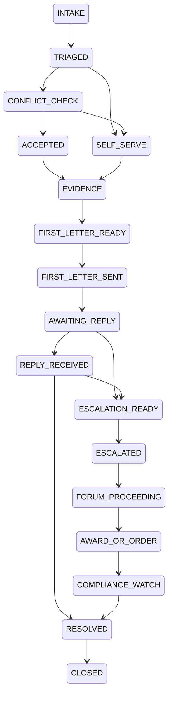

# Phase P15 — Consumer Help: Loan/Insurance Grievances, Challans and Vehicles

> Paste after `01_MASTER_PROMPT.md` and `02_REQUIREMENTS_MAP_AND_DECISION_LOG.md`.
>
> **Dependencies:** P04 (vault, evidence folders, Object Lock, legal hold), P05 (OCR, screenshot and handwriting type copies, translation, call-recording transcripts), P10 (letters, complaints and notices drafting studio), P16 (Rule 36 advocate directory, fixed-fee engagements, buyer platform fee, Route payouts), P06 (vehicle sale agreement, delivery note, authority letters), P07 (deal rooms, messaging), P08 (eSign, eStamp, eligibility gate, evidence pack, BSA s.63 certificate), P17 (separate selling entity, Razorpay merchant, stream switches RS-LD-39/40), P18 (Delivery Console in the Consumer Help entity scope), P19 (`int`; conflict-check client), P01 (DigiLocker pulls of RC/DL [VERIFY issuer availability]), P03 (rule engine, effective-dated rule data). External: Operations Hub conflict service (extension of OH1.6; Appendix X), OH8 (Consumer Help selling entity), official portals by deep link only (cms.rbi.org.in, sachet.rbi.org.in, Bima Bharosa, cioins.co.in, e-Jagriti, NCH 1915, echallan.parivahan.gov.in, vcourts.gov.in, vahan.parivahan.gov.in, State traffic Lok Adalat pages).
> **Sequencing:** Wave 3. Sprint 1 builds the brand/entity profile, ethical wall and conflict check; nothing else ships until the wall tests pass. Vertical A (loans) and the challan/vehicle verticals run in parallel from sprint 2; Vertical B (insurance) from sprint 4. Success-fee code ships dark (RS-LD-40 OFF). Rules data (Appendix S) is loaded and verified per row before the related screen leaves advisory mode (NN-38).
> **Binding appendices:** A (workflows and state machines — governs where a §5 pointer says so), S (Consumer Help Rules and Playbooks), D (roles), F (instrument eligibility gate), K (`LD-EXPORT-1.0`), M (marketplace professional rules), R (settings), W (verification log), X (Operations Hub additions), Y (Ecosystem Spec v1.2 change request).
> **Requirements covered:** R-002, R-011, R-044, R-047, R-061, R-063, R-083, R-084, R-085, R-086, R-087, R-088.
> **Decisions applied:** D-05, D-06, D-11, D-12, D-13 · **Challenges applied:** CH-05, CH-08, CH-12, CH-13, CH-16, CH-20, CH-22, CH-23, CH-25, CH-28, CH-30, CH-31 · **Non-negotiables tested:** NN-01, NN-04, NN-05, NN-07, NN-08, NN-09, NN-10, NN-13, NN-14, NN-16, NN-17, NN-19, NN-20, NN-21, NN-22, NN-23, NN-24, NN-26, NN-34, NN-35, NN-38, NN-39, NN-40, NN-45, NN-46, NN-49, NN-50
> **Estimated effort:** 9 two-week sprints, squad of 8 (backend 3, frontend 2, rules/legal-ops analyst 1, QA 1, security engineer 0.5, content 0.5).

---

## 1. Objective and business outcome

Indian consumers who face recovery-agent harassment, unfair loan charges, a wrong credit report, a rejected insurance claim, a traffic challan or a used-vehicle sale usually do not know which forum to approach, by when, or with what evidence. Competitors either "take everything over" for a success fee (FREED, Insurance Samadhan) or collect fines through their own accounts (Park+) (R2 §1(a), §2(a), §3(a)). `[Consumer Help Brand]` is the **documented, user-controlled** alternative: it tells the user the right forum and deadline, captures evidence that will stand up, drafts the letters, tracks every clock, and adds a human case manager or an advocate only where the forum allows it (R2 §0).

The brand runs on the LawDocs platform but under its **own brand and legal-entity profile** with an ethical wall from the group's lender-facing products (D-06, NN-23). Finbyx, Udofin and LawDocsComply serve lenders. Consumer Help sometimes acts against lenders. The two must never share data, staff or incentives.

| Outcome | Exit-gate measure |
|---|---|
| Separate brand and entity | Brand, domain, legal entity, GSTIN, Razorpay merchant, privacy notice, grievance officer and staff group configured independently; wall tests (§12) pass |
| Right forum, right time | Triage returns a forum, eligibility result and computed deadline for 100% of seeded scenarios in Appendix S, each tied to a verified rule row or shown as advisory |
| Evidence that survives | Every evidence item hashed at capture, time-stamped, with a typed copy for screenshots and a BSA 2023 s.63 certificate draft on export (NN-10) |
| User control | User signs and files wherever the forum expects the complainant; every authority letter is scoped, time-bound and revocable in-app |
| No money handling | LawDocs never receives fines, dues, settlement amounts or vehicle prices (NN-22, NN-23); CI test proves no payment intent can name a government or lender beneficiary |
| No outcome promises | Banned-phrase lint blocks "waiver", "guaranteed", "stop EMIs", "100% success" across site, app, templates and AI output (NN-20) |
| KPIs (post-launch) | First draft letter ≤ 24 h from intake; 0 missed statutory windows on managed cases; median days per stage by forum published internally; refund-dispute rate ≤ 1%; NPS by vertical |

## 2. Scope (in / out)

**In scope**
- `chp` module: brand and entity profile, ethical wall, conflict checks, issue-first intake, case workspace (`grv_`, `LD-GRV-…`), evidence locker, escalation ladders, deadline engine, authority letters and consents, case-manager workflow, advocate path, fee models, outcome reporting.
- Verticals: **A** loans and lending (recovery harassment, unfair charges, KFS/APR issues, digital-loan-app complaints, settlement and closure, NOC and document release); **A2** credit-report disputes (CIC); **B** insurance (claim rejection, delay, short settlement, mis-selling); **C** traffic challans (lookup by deep link, pay on official portal, Lok Adalat, Virtual Court, advocate to contest, reminders); **D** vehicles (pre-sale checks, sale agreement and delivery note, RC transfer checklist, hypothecation removal, foreclosure letters, deal room, eSign, vehicle documents in vault).
- Consumer commission complaints through e-Jagriti and the National Consumer Helpline as escalation steps for A and B.

**Out of scope (owner phase)**
- Drafting engine, templates and court formats — P10/P06 (P15 supplies the templates' data and triggers).
- Advocate directory and engagement mechanics — P16.
- Litigation after a court case is filed — P11 (P15 opens the matter and hands over).
- Debt-settlement programmes, savings corpus, "loan waiver" products, lender lead generation, insurance selling or comparison — **excluded by design** (R2 §1(d), §2(e) B1; RBI cautions of 11 Dec 2023 and 4 May 2026).
- Bulk or fleet challan APIs — excluded until a lawful source is verified (R2 §3(b)); fleet subscription is OI-P15-04.
- Escrow of vehicle sale price — excluded unless a licensed bank or escrow partner is engaged (R2 §4(e) D3; OI-P15-05).

## 3. Personas and permissions touched

| Role | In P15 | Guard |
|---|---|---|
| Anonymous visitor | Issue-first tiles, free triage, forum and deadline explainer, free template preview | No case data stored before account creation |
| `IND_OWNER` (consumer) | Open cases, capture evidence, approve and send letters, sign authority letters, file on official portals, pay fines on official portals, hire an advocate, sell or buy a vehicle | Only the user can approve any outbound letter or settlement (NN-13) |
| `IND_DELEGATE`, `IND_GUARDIAN` | Help a family member with a case within granted scope | Cannot sign the user's authority letter |
| `CP_GUEST` | Vehicle buyer or seller in a deal room; signs the sale agreement and delivery note | Sees only shared versions (NN-37) |
| `OPS_CONSUMER_CASE_MANAGER` | Non-advocate case manager in the Consumer Help entity: triage review, evidence organisation, drafting, deadline tracking, correspondence under a written authority, filing before RBI Ombudsman as authorised representative where the user opts for it | Consumer Help entity scope only; no grants in any lender, LDC, Finbyx, Udofin or Equator tenant; scripts limited to procedural help; no legal opinions (R2 risk A7) |
| `OPS_DELIVERY_LEAD` (Consumer Help scope) | Assigns cases, approves fee waivers and refunds (maker), reviews conflict hits | Maker-checker with a second lead (NN-18) |
| `OPS_QA_REVIEWER` (Consumer Help scope) | Samples letters before dispatch for banned phrases and accuracy | — |
| `PRO_ADVOCATE` | Fixed-fee advice, consumer-commission complaints, court challan contests, Insurance Ombudsman adjudication stage where permitted | **Blocked** as representative on RBI Ombudsman cases (RB-IOS 2026 Cl. 10(1)(b); R2 §0.1); never shares a success fee (BCI Rules Part VI Ch II r.20) |
| `PLT_GRIEVANCE_OFFICER` (Consumer Help entity) | Complaints about the Consumer Help service itself | E-Commerce Rules 2020 r.4 clocks (R3 LG-141) |
| `PLT_SUPER_ADMIN`, `PLT_SECURITY_OFFICER` | Brand and entity configuration, wall policies, kill switches | Wall-policy changes need two approvers and a counsel reference |
| Agents (`AGT_CONSUMER_HELP_ASSISTANT`, `AGT_EVIDENCE_CLERK`, `AGT_TRANSLATOR`; Appendix H) | Makers only | §11 |

**Who may represent where** (enforced by `chp.representation_matrix`, from R2 §5.3; detail in Appendix S §S.2):

| Forum | Self | Non-advocate case manager | Advocate |
|---|---|---|---|
| Lender / RE grievance officer, insurer GRO | Yes | Yes, with written authority | Yes |
| RBI Ombudsman (RB-IOS 2026) | Yes | Yes, written authorisation (Cl. 3(1)(c)) | **No**, unless the advocate is the aggrieved person (Cl. 10(1)(b)) |
| Insurance Ombudsman | Yes (or legal heir, nominee, assignee; R.14(1)) | No [VERIFY CIO practice] | Adjudication stage (R.17) per Karnataka HC, 1 Jul 2026; elsewhere [VERIFY] |
| Consumer Commission | Yes | Only an agent under the 2014 agent regulations on the party's own authenticated authorisation [VERIFY form] | Yes |
| Virtual Court / magistrate (challan) | Yes | No | Yes, vakalatnama |
| Traffic Lok Adalat | Yes | [VERIFY] | Yes |

## 4. Functional requirements

### 4A. Brand, entity profile and ethical wall (D-06, NN-23)

- **FR-P15-01 — Brand profile.** `[Consumer Help Brand]` is a brand record (`cfg` BRAND tier): name, domain, logo, design tokens, email and SMS sender IDs (DLT-registered for that entity — NN-34), WhatsApp number, help-centre space, legal pages (privacy notice, terms, fee sheet, refund scale, grievance officer), app flavour (P22). The public site lives in `apps/public` as a separate brand host; the logged-in experience reuses `apps/web` and `apps/mobile` with the brand theme.
- **FR-P15-02 — Legal-entity profile.** The Consumer Help operating entity (`[Consumer Help Entity]`, placeholder) has its own CIN, GSTIN, registered office, bank account, Razorpay merchant ID (OH8 selling entity), DPO, Grievance Officer and Nodal Officer, configured in Super Admin → Legal entities. All Consumer Help invoices issue from this entity (P17).
- **FR-P15-03 — Data isolation.** All `chp` tables live in schema `chp`. In production the schema runs on a **dedicated database instance** with its own KMS key ring (`chp.isolation.dedicated_cluster`, default ON [OWNER: cost]). Platform services (dms, dix, drf, sgn, ai) are called as stateless services with per-entity keys. Case rows carry `tenant_id` = the consumer's Personal tenant and `legal_entity_id` = the Consumer Help entity; RLS requires both and a staff session in the Consumer Help entity scope.
- **FR-P15-04 — People wall.** Staff in realm `ld-staff` group `chp` hold only Consumer Help roles. Cerbos policy denies any grant that combines a Consumer Help role with `OPS_RM`, `OPS_PROFESSIONAL`, `OPS_CSM` or `OPS_DELIVERY_LEAD` in a non-Consumer-Help scope, or with any role in LDC, Finbyx, Udofin or Equator (pattern of OH Part 4.4). Panel advocates who act for a group lender client in the last `chp.wall.advocate_cooling_months` (default 24) are excluded from Consumer Help engagements against that lender, using their own declarations [REC]. Quarterly access recertification.
- **FR-P15-05 — Data wall.** No `chp` event, table or document is published through `int` to any group product. OH receives only Consumer Help's own commercial records (orders, invoices, payment status) and aggregate counts (NN-19). A deny rule in `int` rejects any outbound contract carrying a `chp` source. Vidhi retrieval for Consumer Help runs in a separate index namespace; lender-tenant content is never retrievable from a Consumer Help session, and vice versa (NN-15).
- **FR-P15-06 — Commercial wall.** No lender or insurer referral fee, lead sale, sponsorship, advertising or data monetisation (R2 §5.6.5; R6 C-6, LD-X02). Advertising is OFF on all Consumer Help pages, including content pages (NN-35 applied strictly) [REC].
- **FR-P15-07 — Wall breach log.** Every denied cross-wall attempt (query, grant, retrieval, event) is logged and reviewed monthly by the Consumer Help entity's compliance owner; metadata of breaches may be recorded in LawDocsComply's breach register only as counts (R2 §5.6.6).
- **FR-P15-08 — Account portability between brands.** One identity in realm `ld` can use LawDocs and Consumer Help. A Consumer Help case can attach documents from the user's LawDocs vault only through an explicit "Attach from my vault" action that records consent; LawDocs never shows Consumer Help cases to anyone but the user (and their delegates).

### 4B. Issue-first intake and triage (IMP-014)

- **FR-P15-09 — Issue tiles.** Home shows tiles: "Recovery agents harassing me", "Unfair charges or interest on my loan", "Loan app misusing my contacts", "Loan closed but no NOC or documents", "Wrong entry in my credit report", "Insurance claim rejected or delayed", "Insurance mis-sold to me", "Traffic challan", "Selling or buying a vehicle", "Something else". Each tile opens a 3–7 question triage (one question per screen on mobile). Click budget: triage result ≤ 6 taps from home.
- **FR-P15-10 — Triage engine.** GoRules decision tables (Appendix S per vertical) return: forum ladder, current step, eligibility (`ELIGIBLE`, `NOT_YET` with the date when it becomes eligible, `OUT_OF_SCOPE` with an alternative route, `UNKNOWN_FILE_ANYWAY` where the official system validates — R2 §1(c) rule 2), computed deadlines, required evidence, and the safety track (threats, violence, morphing or extortion → police and cyber-crime track immediately and in parallel; National Cyber Crime Reporting Portal / 1930 [VERIFY]).
- **FR-P15-11 — Lender legitimacy check.** "Is my lender legit?" looks up the RBI-published NBFC and digital-lending-app information the user can see on RBI's site, by deep link or by a stored public dataset refreshed by `PLT_CONTENT_EDITOR` with source and date [VERIFY licence for reuse]. It shows "Inclusion in RBI's list is not an RBI endorsement" (DL Directions 2025 para 17; R2 §1(b)C). Unregistered lender → illegal-app track (Sachet, cyber cell, police), no RB-IOS route.
- **FR-P15-12 — Scope check for RB-IOS 2026.** Applies Cl. 1(3) coverage (e.g., NBFCs that take deposits, or have a customer interface and assets ≥ ₹100 crore; CICs; non-bank PPI issuers) and Cl. 10 maintainability (prior complaint to the RE, 30-day wait, 90-day window, not pending elsewhere, excluded matters such as CICRA s.18) (R2 §1(b)). Uncertainty is recorded on the case.
- **FR-P15-13 — Conflict check before acceptance** (§4I). Triage and DIY drafts are available to everyone; case-manager services start only after the conflict check.
- **FR-P15-14 — Case creation.** A case (`grv_`, `LD-GRV-YYYY-NNNNNN`) records vertical, opposite party (normalised legal name, RBI registration or IRDAI registration number, CIN where available), product (loan account or policy number, masked), amounts in dispute, forum ladder snapshot, deadlines, conflict-check result, consent artefacts and fee plan.

### 4C. Case workspace and evidence locker

- **FR-P15-15 — Workspace layout.** One screen: status chip and "Waiting on: Lender / Insurer / Ombudsman / You / Case manager / Court" (R-047), escalation ribbon (ladder with current step highlighted), deadlines with countdown, evidence, letters, messages with the case manager, timeline, fees. Vault view (Appendix K governs — X-07): in the user's Personal workspace `07 Disputes and Court Cases/Complaints and Grievances/<Year>/<YYYY-MM-DD> - <Institution> - <Topic> (LD-GRV-…)/` with a link file from `05 Finance, Loans and Insurance/Complaints and Grievances/`; challans and vehicles under `06 Vehicles/`; the Consumer Help export uses profile `ld_consumer_help_v1` (§13; Appendix K §K.3.4).
- **FR-P15-16 — Evidence capture.** Sources: camera, file upload, share-sheet from WhatsApp and other apps, call-recording import (user's own recordings), email forwarding to a case-specific inbound address, voice note. At capture: SHA-256 hash, server timestamp (NTP-synced; NN-27), capture channel, device class, and the user's description. Originals are immutable (NN-09).
- **FR-P15-17 — Type copies and translation.** Screenshots, handwritten letters and call recordings produce labelled derived renditions (`drv_`): typed copy, transcript, English translation, each with confidence and page/region anchors, editable by the user, versioned (P05; NN-48; CH-28). Aadhaar numbers in any rendition are masked (NN-04).
- **FR-P15-18 — Harassment log.** A structured log per incident: date and time, caller number, agent name and agency, channel (call, visit, message, social media, contact to relatives), content category (threat, abuse, false statement about the debt, public shaming, calls outside permitted hours), linked evidence. The rule engine flags breaches against the conduct rows effective on the incident date (calling hours 08:00–19:00 under the existing RBI guidance [VERIFY 2022 circular] and the RBC amendment directions effective 1 Jan 2027; microfinance 09:00–18:00 [VERIFY]; agent ID, authorisation and IIBF certificate; one-day prior agency disclosure) (R2 §1(b)B).
- **FR-P15-19 — Third-party data.** Agent names, numbers and voices are third-party personal data: processed only for the claim, access restricted to the case team, retention capped by `chp.retention.third_party_months` (default: case closure + 36 months, subject to legal hold) (R2 §5.5).
- **FR-P15-20 — Evidence export.** "Export evidence bundle" produces an indexed PDF (A-2b) with exhibits, typed copies, hash list and a BSA 2023 s.63 certificate draft (Part A for the user, Part B for the expert where needed; NN-10) [VERIFY current Schedule format].

### 4D. Vertical A — loans and lending

- **FR-P15-21 — Sub-issues and playbooks** (Appendix S §S.3): recovery-agent harassment; unfair charges, penal charges or interest; KFS/APR mismatch (charges not disclosed in the Key Fact Statement); digital lending app breaches (contacts or media access, disbursal to a third-party account, LSP fees charged to the borrower — DL Directions 2025 paras 8, 9, 12); foreclosure statement refused; document release and charge removal after closure (30 days, ₹5,000 per day for delay attributable to the NBFC — NBFC RBC Directions 2025 paras 35–41 [VERIFY]); settlement request support (no promise; settled status reported to CICs — RBI compromise-settlement framework 8 Jun 2023 [VERIFY]).
- **FR-P15-22 — Ladder.** RE grievance officer or nodal officer (30 days) → Internal Ombudsman (auto-escalation by the RE; the user does not file) → RBI Ombudsman via CMS (within 90 days of the later of reply-period expiry or the RE's last communication; Cl. 10(1)(g)) → award acceptance (30 days; Cl. 15(4)) → appeal to the Appellate Authority (30 days, extendable 30; Cl. 17(3)) → consumer commission, civil court or DRT by referral. Police and cyber track in parallel for criminal conduct (R2 §1(b)A).
- **FR-P15-23 — Clocks.** The deadline engine computes the 30-day wait from the RE's acknowledgement (or dispatch proof if no acknowledgement), the RBIO window "later of" rule, the award-acceptance and appeal windows, and alerts at T-15, T-7, T-1 (R2 risk A5). Transition rule: complaints received by the RBI before 1 Jul 2026 stay under RB-IOS 2021.
- **FR-P15-24 — Relief computation.** For RBIO packs, relief is shown in separate heads: disputed amount (no cap), consequential loss (up to ₹30 lakh), loss of time, expenses, harassment or mental anguish (up to ₹3 lakh) (Cl. 8(3)). The user enters amounts with evidence; the tool never inflates claims.
- **FR-P15-25 — Self-file first.** The RBIO pack is pre-structured to the CMS fields; the user files on cms.rbi.org.in (Hindi or English) or by email or post (any language) and uploads the acknowledgement. The case manager may file as an authorised **non-advocate** representative only with the written authorisation (T-A4) signed by the user.
- **FR-P15-26 — Settlement guard.** Any settlement proposal letter (T-A6) carries mandatory disclosures (no right to settlement, credit-report impact, lender's discretion). The case manager may correspond but cannot bind the user; acceptance requires the user's in-app confirmation (R2 §5.4). Settlement money goes from the user directly to the lender; LawDocs never holds it (R2 risk A3).

### 4E. Vertical A2 — credit-report disputes (CH-05)

- **FR-P15-27 — No bureau pull.** LawDocs never pulls a credit report (CICRA; NN-05, CH-05). The user downloads their own report from the CIC and uploads it; P05 extracts accounts, enquiries and status.
- **FR-P15-28 — Dispute flow.** The user marks wrong entries; the tool drafts the CIC dispute (T-A5) and a parallel letter to the credit institution; the clock follows RBI/2023-24/72 (CI correction within 21 days, CIC resolution within 30 days total; ₹100 per calendar day compensation after 30 days, credited automatically) (R2 §1(b)E). The compensation tracker shows days elapsed and expected compensation, labelled "as per RBI framework; actual credit by the CIC/CI".
- **FR-P15-29 — Escalation.** Unresolved or rejected → RBI Ombudsman (CICs are covered REs), except CICRA s.18 matters (Cl. 10(2)).

### 4F. Vertical B — insurance

- **FR-P15-30 — Policy reader.** `AGT_CONSUMER_HELP_ASSISTANT` (policy-reading skill) extracts sum insured, exclusions, waiting periods, sub-limits, co-payment and claim conditions from the uploaded policy wording and schedule into a labelled summary with page anchors; the user and case manager confirm. Health data is the highest internal sensitivity tier with field-level encryption and specific consent (R2 risk B5; NN-26).
- **FR-P15-31 — Turnaround checks.** The rule engine compares the claim timeline with PPHI Master Circular TATs (5 Sep 2024): life death claims, health cashless final authorisation within 3 hours, general insurance surveyor timelines and the 7-day settlement after survey report; delay interest at bank rate + 2% (R2 §2(b)) [VERIFY current circular]. Breaches are listed with citations for the GRO letter (T-B1) and interest computation (T-B2).
- **FR-P15-32 — Ladder.** Insurer GRO (resolve within 14 days) → Bima Bharosa / IRDAI → Insurance Ombudsman (only after a written representation to the insurer that was rejected, not answered within one month, or answered unsatisfactorily; file within 1 year of the insurer's reply or, where there is no reply, within 1 year of the end of that one-month period; award cap ₹50 lakh including expenses; R.14(3), R.17(3)) → consumer commission (e-Jagriti) → civil court. NCH 1915 in parallel for pre-litigation. Claims above ₹50 lakh skip the Ombudsman and route to the consumer commission tier fixed by the premium paid, not the claim value (FR-P15-35; R2 risk B3).
- **FR-P15-33 — Filing.** The user signs and files the Ombudsman complaint (R.14(1) does not list agents). The case manager prepares the user for mediation and the hearing, including a video-hearing request (R.15(5)). An advocate may be engaged at the adjudication stage where permitted (Karnataka HC, *Office of Insurance Ombudsman v. M V Narasimha Prasad*, WA 1534/2026, 1 Jul 2026, persuasive outside Karnataka) [VERIFY].
- **FR-P15-34 — No insurance selling.** Consumer Help never sells, compares or recommends policies and never receives insurer commissions (R2 risk B1; Insurance Act intermediary rules [VERIFY]).

### 4G. Consumer commission and National Consumer Helpline

- **FR-P15-35 — Pecuniary routing.** Jurisdiction is fixed by the value of goods or services paid as consideration (CPA 2019 ss.34(1), 47(1), 58(1)), not the compensation claimed. District ≤ ₹50 lakh; State > ₹50 lakh to ₹2 crore; National > ₹2 crore (Consumer Protection (Jurisdiction of the District Commission, the State Commission and the National Commission) Rules 2021) (R2 §2(b); R5 §5). Limitation 2 years from the cause of action (CPA 2019 s.69) [VERIFY condonation guidance].
- **FR-P15-36 — e-Jagriti pack.** T-A9 / T-B7 draft complaint, index, affidavit placeholder (affidavit needs oath — not eSign; eligibility gate NN-07), fee note (fees paid by the user on the official portal), and filing guide. Filing by the user or by a panel advocate (fixed fee). A non-advocate agent appears only under the 2014 agent regulations on the party's own authorisation, never on an advocate's authority letter (*Anuj Kumar Chauhan*, Delhi HC, Dec 2024; R2 §0.3).
- **FR-P15-37 — NCH.** Guide to lodge with the National Consumer Helpline (1915, WhatsApp, app, UMANG) for convergence companies; the user enters the docket number and LawDocs tracks it.

### 4H. Letters, complaints and authority letters (P10)

- **FR-P15-38 — Template set.** Appendix S §S.7 lists templates T-A1…T-A9, T-B1…T-B7, T-C1…T-C5, T-D1…T-D7 (from R2). Each is a P10/P06 template with versioned legal citations, reviewer of record (NN-30) and banned-phrase lint. Assembly from the user's answers is template automation; any free-text AI paragraph is labelled until a professional reviews it (NN-14, CH-30).
- **FR-P15-39 — Sending.** Letters are sent by the user (email from their own account, speed post, or the lender's or insurer's online grievance form) or by the case manager from the Consumer Help entity's mailbox under authority. Every send requires the user's per-letter approval (NN-13). Proof of dispatch (email headers, postal receipt, portal acknowledgement) is captured and hashed.
- **FR-P15-40 — Authority letters.** T-A4 (RBIO non-advocate representative), lender-correspondence authority (non-POA, cannot bind), consumer-commission agent authorisation [VERIFY form], RTO authority (T-D7). Each names the representative, forum, subject, opposite party and period; is revocable in-app; and runs through the eligibility gate. An instrument that is in substance a power of attorney is routed to wet-ink and stamp (IT Act First Schedule; NN-07) [COUNSEL on whether CMS accepts eSigned authorisations — R2 §5.4].
- **FR-P15-41 — Consents.** Itemised DPDP consents per purpose: case handling, sending to the opposite party, sharing with a panel advocate, sharing with the case manager, analytics (off by default), each separately withdrawable (R2 §5.5; NN-26). Withdrawal stops processing for that purpose and is recorded.

### 4I. Conflict checks against group clients

- **FR-P15-42 — Check.** Before a case manager, panel advocate or paid service is attached, `chp` computes `HMAC-SHA256(k_epoch, normalised identifier)` for each opposite-party identifier (legal name, RBI or IRDAI registration number, CIN) and calls the Operations Hub conflict service through `int` (OH1.6 `POST /v1/conflicts/check` extended for LawDocs as machine client with hashed identifiers — Appendix X §X.10; contract change via Appendix Y). The request carries no consumer data and no case ID. The answer is only `conflict: true/false`, `category` (`LENDER_CLIENT` or `CONSUMER_HELP_ADVERSE`, per Appendix X §X.10) and `as_of`. Every call is logged in `chp.conflict_check_log`.
- **FR-P15-43 — Outcome policy** (`chp.conflict.on_hit_policy`): `SELF_SERVE_ONLY` (default: triage, templates and tracker stay available; no case manager, no paid representation by the entity; the user is told in generic terms that "we cannot act for you against this company; you can still use the self-help tools or engage an independent advocate") · `DECLINE` · `ACCEPT_WITH_INFORMED_CONSENT` (OFF; [COUNSEL]). Panel advocates run their own conflict check on receipt.
- **FR-P15-44 — Re-check.** Conflict status is re-checked when a new opposite party is added and at each paid escalation step; a later hit applies the policy prospectively and notifies the user.

### 4J. Fees, no outcome promises (CH-31, NN-22, NN-50)

- **FR-P15-45 — Fee models** (switches in P17; streams RS-LD-39/40):

| Model | Default | Rule |
|---|---|---|
| Free self-help: triage, explainer, basic templates, tracker | ON | — |
| Premium pack per case (e.g., RBIO pack, harassment pack, Ombudsman pack, consumer-complaint pack) | ON after legal memo (RS-LD-39) | Flat fee shown before purchase |
| Case-management plan (flat per case or monthly) | OFF until memo | Flat; not marketed as legal representation |
| Success fee (non-advocate entity only) | **OFF** (RS-LD-40) | Only if switched on with counsel opinion and checker approval: cap `chp.fee.success_cap_pct` (default 10%) and `chp.fee.success_cap_inr` (default ₹1,50,000) [OWNER]; disclosed in a plain-language fee sheet before acceptance; no fee on statutory penal interest, per-day compliance penalties, CIC ₹100/day compensation, automatic refunds or amounts the user recovers without the case manager's work [COUNSEL]; cooling-off cancellation; time-based withdrawal fee, not a percentage |
| Panel advocate fee | ON (P16) | Fixed fee agreed between user and advocate, separate invoice, buyer platform fee separate; never a share of any award or success fee (BCI r.20; R2 §5.1) |
| Lead fees from lenders or insurers; settlement-savings fee | **Prohibited** | Deny-list (R6 C-6; R2 §1(d)) |

- **FR-P15-46 — No outcome promises.** Banned phrases (configurable list, seeded from R2 risk A2 and C3): "loan waiver", "debt waiver certificate", "stop paying EMIs", "guaranteed settlement", "guaranteed claim", "100% success", "challan cancelled", "Lok Adalat discount guaranteed", "RBI-approved", "government-approved". Lint runs on CMS pages, templates, notifications and AI output; failures block publication or sending (NN-20).
- **FR-P15-47 — Refund scale.** Published per product and stage; pro-rata refunds; automatic credit note through OH8 (R2 risk A9).

### 4K. Traffic challans (R-084, CH-22)

- **FR-P15-48 — Vehicle and licence records.** A `veh_` record (registration number, make, model, fuel, owner as per RC, hypothecation, insurance and PUC validity) is created from an uploaded RC or a DigiLocker pull where the issuer is available [VERIFY]. DL details likewise. Expiry reminders for insurance, PUC, fitness and permits (IMP-059).
- **FR-P15-49 — Lookup (user-initiated only).** "Check challans" opens the official e-challan portal (or the State portal) in the system browser with the vehicle number copied to the clipboard. The user completes any OTP or CAPTCHA on the official site. LawDocs does not embed, automate, scrape or call any third-party challan API (R2 §0.7; NN-05). The user brings results back by (a) uploading the challan PDF or screenshot, (b) sharing the challan SMS text through the share sheet or copy-paste (no READ_SMS permission on Android), or (c) entering the challan number manually. P05 parses challan number, date, offence section, amount, status and court.
- **FR-P15-50 — Classification.** `AGT_CONSUMER_HELP_ASSISTANT` (challan-classification skill) maps the offence section against the MV Act s.200 compoundable list and the State's compounding notification and multiplier (s.210A) to classify: `COMPOUNDABLE_ONLINE`, `VIRTUAL_COURT`, `PHYSICAL_COURT`, `LOK_ADALAT_ELIGIBLE`, `NON_COMPOUNDABLE` (e.g., s.185) (R2 §3(b)). State timelines for transfer to Virtual Court and physical court are data rows marked [VERIFY by State].
- **FR-P15-51 — Pay on the official portal.** "Pay now" opens the official payment page (e-challan or vcourts.gov.in). LawDocs never collects, holds or remits the fine and never adds a convenience fee to it (NN-23; R2 §0.8). After payment the user uploads the receipt; status becomes `PAID_ON_OFFICIAL`. A record-update check reminder fires after 10–15 working days.
- **FR-P15-52 — Lok Adalat.** A State Lok Adalat calendar (ops-editable, with source link and date) shows the next sittings and eligibility (compoundable items only; State caps such as Delhi's limits per appointment) (R2 §3(b)). The user books the slot on the official site by OTP; LawDocs reminds. Copy: "Lok Adalat may settle at a reduced amount at the court's discretion; no guarantee" (R2 risk C3).
- **FR-P15-53 — Contest.** For Virtual Court contest: guide to "Request to contest" on vcourts.gov.in. For physical court or non-compoundable offences: "Hire an advocate" opens the P16 Rule 36 directory filtered by court location and language in neutral order; fixed-fee engagement; vakalatnama and memo of appearance (T-C3); hearing dates tracked in P11 as a light matter. The fine, if imposed, is still paid by the user on the official channel.
- **FR-P15-54 — Wrong-owner challans.** If a challan post-dates a recorded vehicle sale, the tool links the time-stamped delivery note (FR-P15-61) and drafts the grievance to the e-challan portal (T-C1) and representation to traffic police (T-C2) (R2 risk C5).
- **FR-P15-55 — Reminders.** Unpaid challan reminders at `chp.challan.reminder_days` (default 7, 30, 55 days from issue) with State-specific escalation dates where verified.

### 4L. Vehicles (R-085, CH-23)

- **FR-P15-56 — Pre-sale checklist.** Pending challans (user lookup, §4K), blacklist status [VERIFY official source], hypothecation entry on the RC, insurance and PUC validity, road-tax clearance, original documents present. Each item: status, evidence, who checked, date.
- **FR-P15-57 — Sale agreement and delivery note.** P06 templates T-D1 (vehicle sale agreement: consideration, payment mode party-to-party, challan-responsibility cut-off date and time, hypothecation warranty, indemnity, no-accident declaration, RC-transfer co-operation covenant with the 14/45-day timeline) and T-D2 (delivery note time-stamped to the hour with odometer, keys and document handover, optional geo-tagged photos). T-D3 receipt.
- **FR-P15-58 — Deal room and eSign.** A P07 deal room for buyer and seller (`CP_GUEST` for the counterparty) with messaging and redlines; execution by Aadhaar eSign through P08. A sale agreement of a movable vehicle is not an excluded instrument under the IT Act First Schedule [INTERP]; stamp duty per State from the rule table with "duty basis" shown on the document (R2 risk D1; NN-08) [VERIFY each State]. An agent authority for RTO work that is a POA goes to wet-ink (NN-07).
- **FR-P15-59 — RC transfer checklist on Vahan.** Forms 29 (notice of transfer) and 30 (application for transfer) pre-filled from the agreement for printing or reference; Form 28 (NOC) for another State or RTO; Form 35 if hypothecated. Deadlines (MV Act s.50(1)): the seller reports the transfer within 14 days (same State) or 45 days (other State); the buyer reports within 30 days; legal-heir and auction-buyer variants follow s.50(2) and CMVR r.56 [VERIFY]; the buyer applies to the insurer to transfer the certificate of insurance within 14 days of transfer (MV Act s.157(2) — text checked on a secondary source 25 Oct 2026 [VERIFY against India Code, including any Chapter XI change by the MV (Amendment) Act 2019]; R2 §4(b)). The parties apply on vahan.parivahan.gov.in (OTP to the owner's mobile) and upload the application number. Some States require physical submission (State data row).
- **FR-P15-60 — Hypothecation removal and foreclosure.** Templates T-D5 (foreclosure statement request; NOC and Form 35 demand). Watch: release of documents and charge removal within 30 days of full repayment, ₹5,000 per day for delay attributable to an NBFC (NBFC RBC Directions 2025 paras 35–41 [VERIFY that it covers vehicle hypothecation and Form 35]); prepayment charges per KFS, none on floating-rate non-business loans to individuals sanctioned on or after 1 Jan 2026 [VERIFY]. If the financier is a group client, the conflict policy applies (§4I; R2 risk D4).
- **FR-P15-61 — Post-sale protection.** 14/45-day alerts to both parties; if the buyer does not transfer, T-D6 protective intimation to the RTO and police [VERIFY State practice]; the delivery note time-stamp is offered in any later challan dispute (R2 risk D2).
- **FR-P15-62 — Vehicle documents in the vault.** `06 Vehicles/<Registration number>/{RC, Insurance, PUC, Loan and NOC, Sale and Transfer, Challans}` with expiry reminders. Vehicle sale kit is also offered in the core LawDocs brand (`chp.vertical.vehicle.brand_surface = BOTH`); the challan and grievance features stay in the Consumer Help brand.

### 4M. Status tracking, deadline engine and official-link registry

- **FR-P15-63 — Deadline engine.** Computes "later-of" windows, calendar vs working days, holidays per forum, and reply-period expiry from acknowledgement or dispatch evidence; every computed date shows its rule row, inputs and "computed on" date. Recomputes when inputs change; history kept.
- **FR-P15-64 — Status sources.** The user or case manager enters forum status with evidence (acknowledgement, email, portal screenshot). No portal polling or scraping (NN-05). Staleness label on every status.
- **FR-P15-65 — Official-link registry.** Each official URL (Appendix S §S.10) has owner, last-checked date and a weekly link-health monitor; the app opens only registry links; users are warned about impostor sites (IRDAI warnings on fake Bima Bharosa sites; R2 risk B6). Copy on every screen that touches a portal: "We will never ask for your OTP or portal password."
- **FR-P15-66 — Notifications.** In-app, email, SMS and WhatsApp (opt-in) under the Consumer Help entity's DLT registrations; no automated voice calls (NN-34).

### 4N. Reporting and savings

- **FR-P15-67 — Internal MIS.** Cases by vertical, forum and stage; median days per stage; outcomes by forum (resolved at RE, IO, RBIO award, settled, rejected, withdrawn); amounts recovered and compensation obtained (evidence-backed); missed deadlines (target 0); conflict hits (counts only).
- **FR-P15-68 — No public success rates.** Outcome statistics are never published as marketing claims (NN-20) unless the owner approves a methodology note and the claims gate passes.
- **FR-P15-69 — User savings view.** Money recovered, compensation credited, challan amounts paid vs original, with evidence class (MEASURED only when a receipt or credit proof exists; NN-36).
- **FR-P15-70 — Vehicle-loan journeys (added at traceability review; owner brief "explore vehicle loans", Appendix Z TM-380, TC-083).** The Vehicles tile offers "My vehicle loan", which reuses existing objects rather than adding a vertical: (a) loan papers (sanction letter, KFS, loan agreement, repayment schedule, insurance policy) are filed against the `veh_` record and appear in the vault view `06 Vehicles` (P04 FR-P04-03); (b) closure follows FR-P15-60 (foreclosure statement request, NOC + Form 35, 30-day document-release watch and delay-compensation template — R2 §vehicles [VERIFY that the release rule expressly covers vehicle hypothecation for the lender's RE category]); (c) repossession, seizure or recovery-agent conduct complaints route to the vertical A recovery-harassment playbook (FR-P15-21, Appendix S §S.3) and the self-file-first ladder (FR-P15-22, FR-P15-25); playbook text on repossession notice and conduct stays advisory until verified against the lender's current RBI directions (NN-38); (d) a vehicle sale agreement for a hypothecated vehicle cannot be marked "Executed/Complete" until the NOC/Form 35 step is recorded or waived with reason (NN-40). LawDocs and the Consumer Help entity never source, compare or refer vehicle loans, share leads with lenders or act as a DSA/LSP (NN-23; P19 FR-P19-84). Help key `hlp.chp.vehicle_loan` (registered in P21 `hlp`).

## 5. Workflows and state machines

State machine: Appendix A §A.50 governs (Resolution R-A-19) for the grievance case, challan and vehicle sale below. P18 §5.5 is a **queue view** over this case for `OPS_CONSUMER_CASE_MANAGER` (New = `INTAKE`/`TRIAGED`; Assigned = `ACCEPTED`; Waiting on … = an open WAITING item on the case), not a second machine; assignment, reassignment and decline are transitions of this machine.

**5.1 Grievance case (`chp.case.state`; generic spine, with vertical stage sets from Appendix S)**

| State | Entry | Allowed transitions | Actor | Guard | Side-effects / events |
|---|---|---|---|---|---|
| `INTAKE` | Tile chosen | `TRIAGED`, `ABANDONED` | User | — | `chp.CaseOpened` (no PII in payload) |
| `TRIAGED` | Triage result stored | `CONFLICT_CHECK`, `SELF_SERVE` | System | Rule rows effective on today's date | Deadlines computed |
| `CONFLICT_CHECK` | User requests a paid or managed service | `ACCEPTED`, `SELF_SERVE`, `DECLINED` | System | Conflict service answer | `chp.ConflictChecked` |
| `SELF_SERVE` | DIY route | `EVIDENCE`, `CONFLICT_CHECK` | User | — | — |
| `ACCEPTED` | Fee plan agreed, consents captured, case manager assigned | `EVIDENCE` | Delivery lead | No conflict or policy permits; fee sheet acknowledged | `chp.CaseAssigned` (case manager), `chp.CaseAccepted`; OH8 order (billing fields only under `CONTRACT_PERFORMANCE_CUSTOMER`; X-13) |
| `EVIDENCE` | — | `FIRST_LETTER_READY` | User, case manager | Minimum evidence set per Appendix S | Waiting items |
| `FIRST_LETTER_READY` | Draft approved | `FIRST_LETTER_SENT` | User | Per-letter approval (NN-13); lint pass | — |
| `FIRST_LETTER_SENT` | Dispatch proof captured | `AWAITING_REPLY` | User / case manager | Proof hashed | Wait clock starts (e.g., 30 days RE, 14 days insurer) |
| `AWAITING_REPLY` | — | `REPLY_RECEIVED`, `ESCALATION_READY` (clock expired) | System / user | — | Reminders |
| `REPLY_RECEIVED` | Reply uploaded | `RESOLVED`, `ESCALATION_READY` | User | — | Window clocks recomputed |
| `ESCALATION_READY` | Next forum eligible | `ESCALATED` | User (self-file) or case manager (where allowed) | Representation matrix; authority letter valid | — |
| `ESCALATED` | Filing acknowledgement captured | `FORUM_PROCEEDING`, `ESCALATION_READY` (next rung) | User / case manager | — | `chp.CaseEscalated` (forum code only) |
| `FORUM_PROCEEDING` | Hearing, mediation or response | `AWARD_OR_ORDER`, `RESOLVED`, `WITHDRAWN` | User / advocate | — | Hearing reminders |
| `AWARD_OR_ORDER` | Award or order uploaded | `ACCEPTANCE_WINDOW`, `APPEAL_WINDOW`, `COMPLIANCE_WATCH` | User | Window computed | — |
| `COMPLIANCE_WATCH` | Award accepted | `RESOLVED`, `ESCALATION_READY` (non-compliance) | System | — | Penalty-per-day tracker where the rule provides |
| `REFERRED_TO_COURT` | Consumer commission, civil court or DRT via advocate | `CLOSED` | Advocate | Fixed-fee engagement | P11 matter opened |
| `RESOLVED` / `WITHDRAWN` / `DECLINED` / `ABANDONED` | — | `CLOSED` | User / lead | Refund scale; success-fee computation only if RS-LD-40 ON | `chp.CaseClosed` |

Parallel tracks on any case: `SAFETY_TRACK` (police and cyber complaint), `HARASSMENT_LOG`, `CREDIT_REPORT_DISPUTE`, `SETTLEMENT_CORRESPONDENCE` (R2 §1(c)).

**5.2 Challan (`chp.challan.state`)**: `DISCOVERED → CLASSIFIED → DECIDED {PAY | LOK_ADALAT | CONTEST} → (PAID_ON_OFFICIAL | LOK_ADALAT_BOOKED → LOK_ADALAT_DISPOSED | CONTEST_ADVOCATE_ENGAGED → HEARING → DISPOSED) → RECORD_UPDATE_CHECK → CLOSED`; side state `DISPUTED_WRONG_OWNER`. Guard on `PAID_ON_OFFICIAL`: receipt uploaded.

**5.3 Vehicle sale (`chp.vehicle_sale.state`)**: `PRE_SALE_CHECKS → TERMS_AGREED → AGREEMENT_DRAFTED → STAMPED (where duty applies) → SIGNED → PAYMENT_CONFIRMED (both parties confirm; no escrow) → DELIVERED (delivery note) → FORMS_PREPARED → VAHAN_APPLIED → RC_TRANSFERRED → INSURANCE_TRANSFERRED → CLOSED`; branch `HYPOTHECATED → FORECLOSURE_REQUESTED → LOAN_CLOSED → NOC_AND_FORM35_RECEIVED → HYPOTHECATION_REMOVED` (30-day release watch). Formalities gate before `SIGNED → executed` (NN-40).



## 6. Screens and UX

| ID | App | Purpose | Key components | Empty / error | Mobile and accessibility |
|---|---|---|---|---|---|
| SCR-P15-01 | public (brand host) | Consumer Help home | Issue tiles, "how it works", fee sheet link, "we never collect fines or dues", grievance officer | — | Tiles as large buttons with text labels; plain-language level target ≤ Class 8 reading [REC] |
| SCR-P15-02 | web/mobile | Triage | One question per screen, "I don't know" option, safety prompt | Out-of-scope result with alternative route | Voice input; Hindi and other D-07 languages |
| SCR-P15-03 | web/mobile | Triage result | Forum ladder, eligibility, deadlines, evidence list, DIY vs managed options with prices | Advisory banner where rule rows unverified (NN-38) | Deadlines also as text, not only countdown graphics |
| SCR-P15-04 | web/mobile | Case workspace | Status chip, "Waiting on", ribbon, deadlines, evidence, letters, messages, fees | — | Push deep links; offline cached read (NN-44) |
| SCR-P15-05 | mobile | Evidence capture | Camera, share-sheet intake, voice note, recording import, description, hash confirmation | Upload failure retry queue | Protected-screen flag (no screenshots of others' evidence) |
| SCR-P15-06 | web/mobile | Harassment log | Incident form, rule-breach flags, timeline | — | Quick-add widget ≤ 2 taps |
| SCR-P15-07 | web | Letter studio (P10 embed) | Template, fields, citations, lint results, approve and send | Lint failure explained | Read-aloud preview |
| SCR-P15-08 | web | Authority and consent centre | Active authorities, scope, expiry, revoke; consents per purpose | — | — |
| SCR-P15-09 | web | Credit-report dispute | Upload report, mark entries, dispute drafts, 30-day and ₹100/day tracker | — | — |
| SCR-P15-10 | web | Insurance claim desk | Policy summary, TAT breaches, ladder, Ombudsman pack | Policy unreadable → manual fields | — |
| SCR-P15-11 | mobile/web | My vehicles | Vehicle cards, document expiries, challans, sale kit | — | — |
| SCR-P15-12 | mobile/web | Challan desk | "Check on official portal", import result, classification, pay/Lok Adalat/contest buttons, receipts | No challans imported yet | Clipboard copy announced |
| SCR-P15-13 | web | Vehicle sale room | Pre-sale checklist, agreement, deal room, eSign, delivery note, Vahan checklist, deadlines | — | — |
| SCR-P15-14 | delivery (Consumer Help scope) | Case-manager queue | Cases by deadline risk, conflict status, waiting items, letters awaiting approval | — | — |
| SCR-P15-15 | console | Rules and calendars | Appendix S rule rows, State Lok Adalat calendar, official-link registry, banned phrases | Unverified rows flagged | — |
| SCR-P15-16 | console | Wall and conflict monitor | Breach log, conflict-check counts, recertification status | — | — |

## 7. Backend design

### 7.1 Modules
`chp` (cases, verticals, evidence index, harassment log, deadlines, authorities, conflict client, fee plans, challans, vehicle sales, rules binding). Uses `dms`, `dix`, `pld` (letters), `tpl`, `clm` (deal rooms), `sgn`, `mkp` (advocates), `bil`, `wf`, `ntf`, `rul`, `ai`, `int` (conflict service only).

### 7.2 Tables (schema `chp`; RLS on `tenant_id` + `legal_entity_id` + staff entity scope; NN-01)

| Table | Key columns | Indexes | Retention |
|---|---|---|---|
| `chp.case` | `grv_id`, ref `LD-GRV-…`, vertical, issue, opposite_party_norm, opp_identifiers_hmac, state, forum_step, amounts, fee_plan_id, conflict_result | (tenant_id, state), (legal_entity_id, vertical) | Closure + 8 years [VERIFY limitation-based period] |
| `chp.case_deadline` | case, rule_row_id, rule_version, inputs_jsonb, due_at, computed_at | (due_at) | With case |
| `chp.evidence_item` | case, doc_id, sha256, captured_at, channel, description, drv_ids | case | With case; third-party data cap |
| `chp.harassment_incident` | case, occurred_at, channel, caller_hash, agency, category, breach_flags | case, occurred_at | Third-party cap |
| `chp.authority` | case, representative_id, forum, scope, valid_to, revoked_at, doc_id | case | With case |
| `chp.consent_link` | case, `cns_id`, purpose, status | case | Consent-artefact rule |
| `chp.conflict_check_log` | request_id, identifiers_hmac, epoch, result, category, as_of | request_id | 3 years [REC] |
| `chp.fee_plan` | case, model, amounts, caps, disclosure_doc_id, accepted_at | case | 8 years (tax) |
| `chp.challan` | `chl_id`, `veh_id`, challan_no, offence_section, amount, state_code, court, class, state, receipt_doc_id | (veh_id), (challan_no) | 8 years |
| `chp.vehicle` | `veh_id`, reg_no, rc_doc_id, hypothecation, insurance_to, puc_to | (tenant_id, reg_no) | Life of account |
| `chp.vehicle_sale` | sale, veh_id, agr_id, seller, buyer, delivered_at, vahan_app_no, deadlines | veh_id | 8 years |
| `chp.wall_breach_log` | actor, attempted_resource, rule, at | at | 5 years [REC] |

### 7.3 APIs (Consumer Help brand host; scopes; idempotency on POST)

| Method, path | Scope | Notes |
|---|---|---|
| `POST /v1/chp/triage` | public (session) | No persistence without account |
| `POST /v1/chp/cases` | `chp.case.create` | Idempotency-Key |
| `POST /v1/chp/cases/{id}/evidence` | `chp.case.write` | Multipart; hash returned |
| `POST /v1/chp/cases/{id}/letters/{lid}/approve` | `chp.case.approve` | User only; step-up |
| `POST /v1/chp/cases/{id}/conflict-check` | `chp.case.manage` | Calls `int` conflict client |
| `POST /v1/chp/cases/{id}/authorities` / `DELETE …/{aid}` | `chp.case.approve` | Revocation immediate |
| `POST /v1/chp/challans/import` | `chp.vehicle.write` | PDF, image or text |
| `POST /v1/chp/vehicle-sales` | `chp.vehicle.write` | Creates deal room via `clm` |
| `GET /v1/chp/official-links` | public | Registry |
| `/m/v1/chp/*` | — | Mobile BFF |

No endpoint accepts a payment instruction whose beneficiary is a lender, insurer, court or government treasury (`LD-CHP-010`).

### 7.4 Domain events (internal only; never published by `int`)
`chp.CaseOpened`, `chp.CaseTriaged`, `chp.ConflictChecked`, `chp.CaseAssigned` (case manager assigned or reassigned; consumed by the P18 queue), `chp.CaseAccepted`, `chp.LetterApproved`, `chp.LetterDispatched`, `chp.DeadlineApproaching`, `chp.CaseEscalated`, `chp.AwardRecorded`, `chp.CaseClosed`, `chp.AuthorityRevoked`, `chp.ChallanImported`, `chp.ChallanPaidOnOfficial`, `chp.VehicleSaleSigned`, `chp.RcTransferDue`, `chp.WallBreachBlocked`. Payloads carry IDs and codes, never names, amounts or evidence. Commercial records to OH8 travel through `bil` (`BILLING_PORT`) under the Consumer Help selling entity.

### 7.5 Jobs and workflows
Temporal: `GrievanceCaseWorkflow` (state machine, wait clocks, escalation readiness), `DeadlineRecomputeJob` (on rule-row publication), `ChallanReminderJob`, `VehicleTransferWatch` (14/45 days), `HypothecationReleaseWatch` (30 days), `OfficialLinkHealthJob` (weekly), `AccessRecertificationJob` (quarterly), `ThirdPartyDataPurgeJob`.

## 8. Integrations

| Port / service | Use | Failure behaviour | Fallback |
|---|---|---|---|
| OH conflict service via `int` (OH1.6 extension; Appendix X §X.10) | Group-client conflict flag | Fail closed: managed services unavailable, self-serve continues | Manual check by the Consumer Help compliance owner with logged reason |
| `DIGILOCKER_PORT` | RC/DL pull [VERIFY issuer] | Upload instead | — |
| `ESIGN_PORT`, `ESTAMP_PORT` (P08) | Authority letters, vehicle agreements | P08 rules | Wet-ink pack |
| P16 engagements | Advocates | Directory OFF → show "find your own advocate" guidance | — |
| `BILLING_PORT` (Consumer Help merchant) | Fees | Case stays `CONFLICT_CHECK`/`ACCEPTED` pending | Payment link |
| `ntf` (JioCX or other DLT CPaaS) | SMS/WhatsApp | Email fallback | In-app |
| Official portals | Deep links only | Link-health alert | Registry shows alternate official URL |

No vendor challan, vehicle-data or credit-bureau API is integrated (R2 §3(b); CH-05). Any future vendor needs a legal sign-off on the data source and a verification-log entry before its flag turns on (NN-38).

## 9. Settings and configuration

| Key | Tier | Type | Default | Changed by | M-C |
|---|---|---|---|---|---|
| `chp.brand.enabled` | PLATFORM | bool | OFF until entity configured | `PLT_SUPER_ADMIN` | Y |
| `chp.isolation.dedicated_cluster` | PLATFORM | bool | ON | `PLT_SECURITY_OFFICER` | Y |
| `chp.vertical.<loan|credit|insurance|challan|vehicle>.enabled` | BRAND | bool | loan, credit, challan, vehicle ON; insurance ON from sprint 4 | `PLT_SUPER_ADMIN` | Y (kill switch NN-39) |
| `chp.conflict.on_hit_policy` | BRAND | enum | `SELF_SERVE_ONLY` | `PLT_SUPER_ADMIN` + counsel ref | Y |
| `chp.conflict.fail_mode` | PLATFORM | enum | `FAIL_CLOSED` (locked) | — | Y |
| `chp.wall.advocate_cooling_months` | BRAND | int | 24 | `PLT_SUPER_ADMIN` | Y |
| `chp.representation_matrix` | PLATFORM (content) | table | Appendix S §S.2 | `PLT_LEGAL_REVIEWER` | Y |
| `chp.fee.flat_packs.enabled` | BRAND | bool | OFF until legal memo | `PLT_SUPER_ADMIN` | Y |
| `chp.fee.success.enabled` | BRAND | bool | OFF (locked until counsel opinion) | `PLT_SUPER_ADMIN` | Y |
| `chp.fee.success_cap_pct` | BRAND | pct | 10 | `PLT_SUPER_ADMIN` | Y |
| `chp.fee.success_cap_inr` | BRAND | money | 1,50,000 | `PLT_SUPER_ADMIN` | Y |
| `chp.copy.banned_phrases` | BRAND | list | seed (§4J) | `PLT_LEGAL_REVIEWER` | Y |
| `chp.deadline.alert_days` | USER | list | 15,7,1 | user | N |
| `chp.challan.reminder_days` | USER | list | 7,30,55 | user | N |
| `chp.retention.third_party_months` | BRAND | int | 36 after closure | `PLT_DPO` | Y |
| `chp.vertical.vehicle.brand_surface` | PLATFORM | enum | `BOTH` | `PLT_SUPER_ADMIN` | Y |
| `chp.lokadalat.calendar` | BRAND (content) | table | per State | `PLT_CONTENT_EDITOR` | Y |
| `chp.ads.enabled` | BRAND | bool | OFF (locked) | — | Y |
| `chp.conflict.key_rotation_days` | PLATFORM | int | 90 | `PLT_SECURITY_OFFICER` | Y |
| `chp.deadline.transit_days` | BRAND | int | 3 | `PLT_LEGAL_REVIEWER` | Y |
| `chp.case.abandon_days` | BRAND | int | 90 | `OPS_DELIVERY_LEAD` | N |
| `chp.withdrawal.cooling_hours` | BRAND | int | 24 | `PLT_LEGAL_REVIEWER` | Y |

## 10. Security, privacy and audit

- **Threats:** a group lender learning that a borrower complained (wall; no events out; hashed conflict queries without consumer data); staff with dual roles (Cerbos SoD); impostor portals and phishing (link registry; no OTP requests); evidence tampering (hash at capture, Object Lock); coercion by recovery agents to make the user withdraw (withdrawal needs an in-app confirmation with a cooling period of 24 hours and a safety prompt [REC]); data of third parties (minimisation, retention cap).
- **Data classes:** health (insurance) and financial (loans) at the highest internal tier; field-level encryption; download watermarking; protected screens on mobile (NN-44).
- **DPDP:** itemised consents (FR-P15-41); legal-claims exemption (DPDP s.17(1)(a)) not relied on for analytics or marketing [VERIFY scope]; breach workflow per entity; grievance officer of the Consumer Help entity.
- **Audit:** every triage result (with rule versions), conflict check, consent, authority, letter approval, dispatch, escalation, fee acceptance and closure writes the ledger in the same transaction (NN-45). Users see the full case activity log.

## 11. AI touchpoints and guardrails

| Agent (Appendix H) | Skills in P15 | Ceiling | Human point |
|---|---|---|---|
| `AGT_CONSUMER_HELP_ASSISTANT` | Plain-language triage from the user's description; forum signposting from Appendix S rows; checklist; letter drafts with cited rule rows; policy reading; challan classification; deadline-watch proposals and status-update proposals | L1 (Appendix H row 19) | User confirms triage answers and approves every letter; case manager or QA reviews before any complaint is filed or the company approached |
| `AGT_EVIDENCE_CLERK` | Typed copies, transcripts, annexure index, BSA s.63 Part A draft | L1 | User corrects and certifies each typed copy (NN-10) |
| `AGT_TRANSLATOR` | Labelled machine translation of evidence and replies | L1 | Labelled; reviewed before operative use (NN-48) |

All three run inside the Consumer Help entity scope with a separate retrieval namespace (FR-P15-05). Appendix H evaluation sets `EV-CHP-<vertical>` apply: forum-routing accuracy ≥ 0.95 and outcome-promise rate = 0.

Guardrails: no agent sends, files, pays, settles, accepts an award or withdraws (NN-13, NN-43); banned-phrase lint on output; citations only from Appendix S rule rows or retrieved official sources, else "unverified" (NN-14); never predicts outcomes or probability of success; never advises on whether to stop paying EMIs; escalates legal-opinion questions to a panel advocate (NN-41). Evaluation: 300 synthetic cases across verticals with expected forum, eligibility and deadlines; gate 100% on representation-matrix compliance and banned phrases, ≥ 98% on deadline computation.

## 12. Acceptance criteria (Gherkin; `tests/acceptance/p15/*.feature`)

```gherkin
@P15-AT-01 @NN-23
Scenario: Consumer Help data never reaches a lender tenant
  Given a Finbyx-connected lender tenant and a Consumer Help case against that lender
  When any int outbound contract is generated
  Then no message carries a chp source, case ID, borrower identity or evidence
  And an attempt to publish one is blocked and written to chp.wall_breach_log

@P15-AT-02 @NN-23
Scenario: Conflict hit limits the case to self-serve
  Given the conflict service returns conflict true for the opposite party
  When the user requests a case manager
  Then the case stays SELF_SERVE, templates remain available
  And the user sees the generic conflict message without the group client being named

@P15-AT-03 @NN-23
Scenario: Conflict service unavailable fails closed
  Given the conflict service times out
  Then managed services are unavailable and self-serve continues

@P15-AT-04 @NN-23
Scenario: Advocate cannot be the representative before the RBI Ombudsman
  Given an RB-IOS case in ESCALATION_READY
  When a PRO_ADVOCATE is added as authorised representative
  Then the action fails with LD-CHP-004 citing RB-IOS 2026 Cl. 10(1)(b)

@P15-AT-05
Scenario: RBIO window uses the later-of rule
  Given an RE complaint acknowledged on 1 Aug 2026 and a final reply on 10 Sep 2026
  When the deadline engine runs
  Then the RBIO filing deadline is 90 days after the later of 31 Aug 2026 and 10 Sep 2026
  And the computation shows the rule row and inputs

@P15-AT-06 @NN-22 @NN-23
Scenario: LawDocs never collects a challan fine
  Given a compoundable challan
  When the user taps Pay now
  Then the official payment page opens and no LawDocs payment intent is created for the fine
  And any API call naming a government beneficiary fails with LD-CHP-010

@P15-AT-07 @NN-05
Scenario: Challan lookup is user-initiated on the official portal
  When the user taps Check challans
  Then the system browser opens the official e-challan portal
  And no server-side request to any challan portal or vendor API is made

@P15-AT-08 @NN-20
Scenario: Banned phrase blocks a letter
  When a draft contains "loan waiver"
  Then sending is blocked with LD-CHP-007 and the phrase is highlighted

@P15-AT-09 @NN-13
Scenario: Agent cannot send a letter
  Given AGT_CONSUMER_HELP_ASSISTANT has prepared a GRO complaint
  Then it remains in FIRST_LETTER_READY until the user approves it

@P15-AT-10 @NN-10 @NN-09
Scenario: Evidence bundle with hashes and s.63 certificate
  Given 12 evidence items including WhatsApp screenshots
  When the user exports the evidence bundle
  Then the PDF lists each item's SHA-256 and capture time, includes labelled typed copies
  And a BSA 2023 s.63 certificate draft is attached

@P15-AT-11 @NN-04
Scenario: Aadhaar masked in typed copies
  Given an uploaded KYC letter showing a full Aadhaar number
  Then every derived rendition shows only the last 4 digits

@P15-AT-12 @CH-31
Scenario: Success fee cannot be switched on without counsel and checker
  When a PLT_SUPER_ADMIN turns chp.fee.success.enabled ON without a counsel opinion reference
  Then the change is rejected
  And with a reference it stays pending until a second approver approves

@P15-AT-13 @NN-21
Scenario: No advocate shares in a success fee
  Given a case with success fee ON and a panel advocate engaged
  Then the advocate's invoice is a separate fixed-fee invoice and no allocation of the success fee to the advocate exists

@P15-AT-14
Scenario: Claim above the ombudsman cap routes by consideration paid, not claim value
  Given a rejected health claim of ₹72 lakh on a policy with a premium paid of ₹48,000
  Then the ladder skips the Insurance Ombudsman (claim above ₹50 lakh) and shows the District Commission via e-Jagriti, because pecuniary jurisdiction follows the consideration paid

@P15-AT-15
Scenario: Credit report compensation tracker
  Given a CIC dispute filed on 1 Oct 2026 and unresolved on 5 Nov 2026
  Then the tracker shows 5 days beyond 30 and expected compensation of ₹500 labelled as per the RBI framework

@P15-AT-16 @NN-07
Scenario: RTO power of attorney goes to wet-ink
  When the user generates an authority for an agent that grants power to act generally at the RTO
  Then the eligibility gate classifies it as a power of attorney and eSign is unavailable

@P15-AT-17 @NN-40
Scenario: Vehicle sale agreement not executed without stamp where duty applies
  Given State X requires stamp duty on the vehicle sale agreement
  When both parties eSign without a stamp instrument
  Then the agreement cannot be marked Executed

@P15-AT-18
Scenario: RC transfer deadline alerts
  Given a delivery note time-stamped 3 Nov 2026 10:00 for a same-State sale
  Then both parties receive alerts before the 14-day transfer deadline

@P15-AT-19 @NN-17
Scenario: Case manager sees only cases in the Consumer Help scope
  Given an OPS_CONSUMER_CASE_MANAGER
  When they request any LawDocs company tenant, LDC, Finbyx or Udofin resource
  Then access is denied by policy and logged

@P15-AT-20 @NN-34
Scenario: No automated calls
  Then no voice-call campaign or automated call can be scheduled from the Consumer Help entity

@P15-AT-21 @NN-26
Scenario: Consent withdrawal stops advocate sharing
  When the user withdraws consent for sharing with the panel advocate
  Then the advocate's access to the case folder ends immediately and the event is logged

@P15-AT-22 @NN-50
Scenario: Fee sheet before acceptance
  Then the user sees all fees, caps, refund scale and cancellation terms before accepting a paid plan, with no pre-ticked add-ons

@P15-AT-23 @NN-40
Scenario: Vehicle-loan papers and hypothecated sale (FR-P15-70)
  Given a user opens Vehicles > "My vehicle loan" for vehicle "veh_01" with an active hypothecation
  When the user uploads the sanction letter, KFS, loan agreement and repayment schedule
  Then the files are filed against "veh_01" and appear in the vault view "06 Vehicles"
  When the user starts a vehicle sale agreement for "veh_01"
  Then the sale cannot be marked "Executed/Complete" until the NOC and Form 35 step is recorded or waived by an authorised user with a reason

@P15-AT-24 @NN-23 @NN-19
Scenario: No loan sourcing, comparison or referral from the vehicle-loan journey (FR-P15-70)
  Given the "My vehicle loan" screen is open
  Then no lender offer, loan comparison, "apply for a loan" or lender referral element is rendered
  And no event, API call or lead record about the user is sent to any lender, DSA or Operations Hub CRM pipeline
  When a recovery agent's conduct is reported for "veh_01"
  Then the case opens on the vertical A recovery-harassment playbook with the self-file-first ladder
  And repossession-notice text is labelled advisory while its rule row is unverified (NN-38)
```

Errors introduced: `LD-CHP-001` vertical disabled · `-002` out of forum scope · `-003` not yet eligible (date shown) · `-004` representative not permitted for this forum · `-005` authority letter missing or expired · `-006` conflict policy blocks managed service · `-007` banned phrase · `-008` evidence hash mismatch · `-009` rule row unverified (advisory only) · `-010` payment to third-party beneficiary not permitted · `-011` consent missing for purpose · `-012` wall policy denied. Each with a user message and `hlp.chp.*` key.

## 13. Exit gate, deliverables and open items

- [ ] Consumer Help brand and legal entity configured; dedicated database and keys; wall tests P15-AT-01/02/03/19 green; all scenarios `@P15-AT-01…24` green; recertification job scheduled.
- [ ] Appendix S rule rows loaded; every row verified or flagged advisory; representation matrix enforced.
- [ ] Verticals A, A2, C, D live; B live from sprint 4; kill switch per vertical tested (NN-39).
- [ ] Templates T-A1…T-D7 published with reviewer of record; banned-phrase lint on all channels.
- [ ] OH conflict-service extension accepted (Appendix X) and the Ecosystem Spec change request filed (Appendix Y).
- [ ] Settings in Appendix R; help keys: `hlp.chp.ombudsman`, `hlp.chp.internal_ombudsman`, `hlp.chp.rb_ios`, `hlp.chp.award`, `hlp.chp.authorised_representative`, `hlp.chp.kfs`, `hlp.chp.apr`, `hlp.chp.recovery_agent_rules`, `hlp.chp.cic_dispute`, `hlp.chp.bima_bharosa`, `hlp.chp.insurance_ombudsman`, `hlp.chp.e_jagriti`, `hlp.chp.nch`, `hlp.chp.compounding`, `hlp.chp.virtual_court`, `hlp.chp.lok_adalat`, `hlp.chp.form_29_30`, `hlp.chp.form_35`, `hlp.chp.hypothecation`, `hlp.chp.delivery_note`, `hlp.chp.conflict_check`, `hlp.chp.vehicle_loan` (FR-P15-70; registered in P21's help-key list).
- [ ] **Export map** (`xpt.export_map`): `chp_case`, `chp_evidence_item`, `chp_harassment_incident`, `chp_authority`, `chp_fee_plan` → profile `ld_consumer_help_v1` (Appendix K §K.3.4, which governs — X-07): `02 Loan and Lending Complaints/`, `03 Insurance Complaints/`, `04 Credit Report Disputes/` `<Year>/<YYYY-MM-DD> - LD-GRV-… - <Institution> - <Product>/{01 Complaint to the Institution … 05 Outcome and Compliance}`; `chp_challan` → `05 Challans/<Year>/…`; `chp_vehicle`, `chp_vehicle_sale` and vehicle-loan papers (FR-P15-70) → `06 Vehicles/<Vehicle label>/…`; fees → `07 Fees and Receipts/<Year>/`; case metadata CSV/JSON → `99 System Data (CSV and JSON)/`. Natural-person names never appear in paths (`ids_only` LOCKED). Export runs from the user's own workspace without staff help (NN-11); conflict-check logs are entity records, not user data.
- [ ] Demo: harassment case from tile to RE letter to RBIO pack self-filed; conflict hit → self-serve; health-claim rejection to Ombudsman pack; challan import → pay on official portal → receipt; vehicle sale with eSign, delivery note and Vahan checklist.

| OI | Item | Owner |
|---|---|---|
| OI-P15-01 | Incorporate and name the Consumer Help entity; board COI policy; annual independent wall review | [OWNER] |
| OI-P15-02 | Counsel opinion on success fee (champerty, unfair contract terms, CCPA) and on flat-fee case management (Advocates Act s.33 / *A.K. Balaji* boundary) | [COUNSEL] |
| OI-P15-03 | Does CMS accept an eSigned authorisation for a non-advocate representative? Consumer-commission agent authorisation form under the 2014 regulations | [VERIFY] |
| OI-P15-04 | Fleet challan subscription: entity placement and lawful data source | [OWNER] [VERIFY] |
| OI-P15-05 | Escrow partner for vehicle sales, or party-to-party only | [OWNER] |
| OI-P15-06 | RBC amendment paragraph numbers (banks Fourth, NBFC Third Amendment, 6 Aug 2026) and the earlier calling-hours guidance applicable before 1 Jan 2027 | [VERIFY] |
| OI-P15-07 | State data: Virtual Court and physical-court transfer timelines, Lok Adalat rules, stamp duty on vehicle sale agreements, RTO physical-submission States | [VERIFY] per State |
| OI-P15-08 | Brand name: R2 could not find "ChallanWallah", but R1 records challanwala.com as a live competitor; confirm the comparator set | [OWNER] |
| OI-P15-09 | OH1.6 extension: chp machine client, HMAC epoch-key management, response schema | Pack lead / OH |
| OI-P15-10 | Licence to reuse RBI-published NBFC/DLA lists in the legitimacy check | [VERIFY] |
